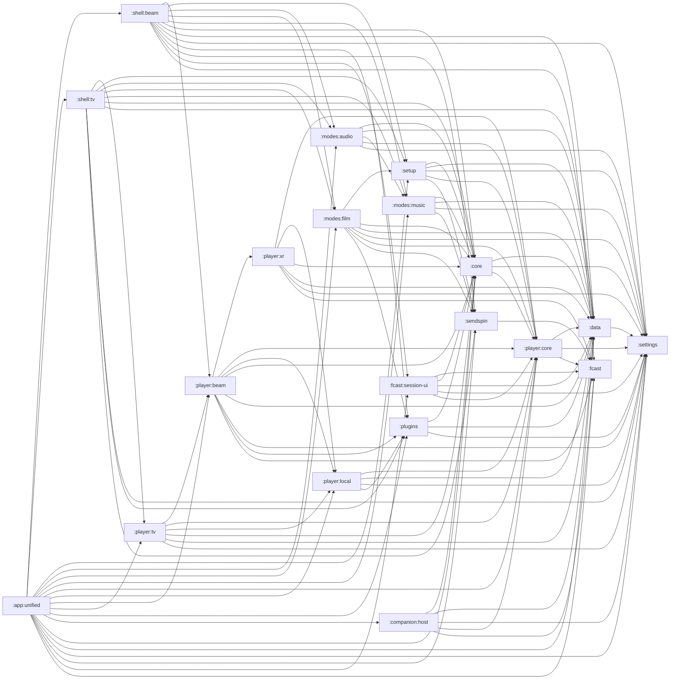
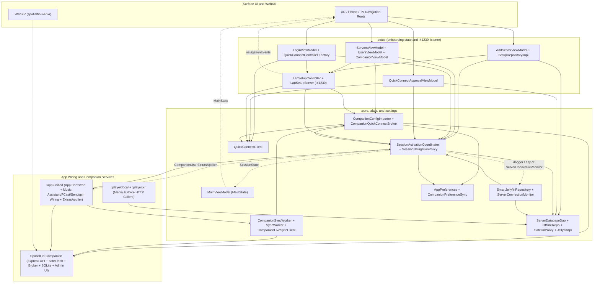
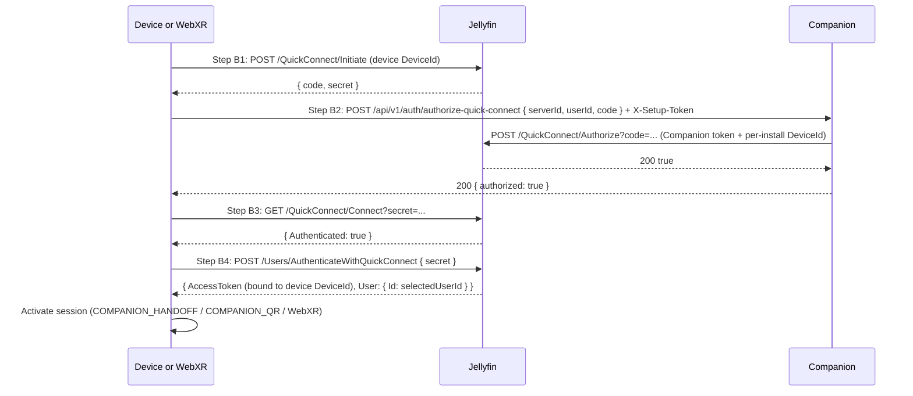
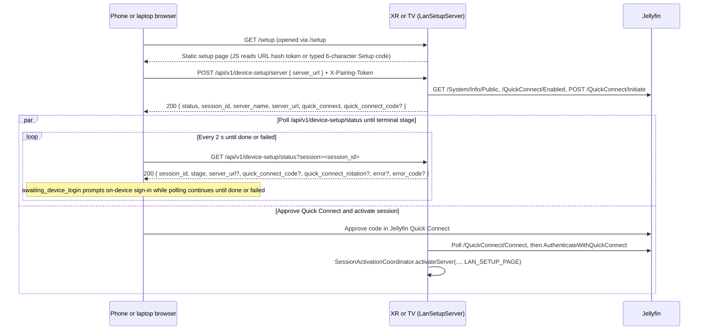

# Unified Cross-Surface Onboarding, Native Quick Connect, and LAN Device Setup

*   **Author:** Ignacio Martinez <ignacio@martinez.fyi>
*   **Status:** Approved
*   **Date:** 2026-11-14
*   **Baseline Commits:** `SpatialFin` `fea0a5d0`, `SpatialFin-Companion` `04f0782`

--------------------------------------------------------------------------------

## Table of Contents

*   [Overview](#overview)
*   [The Problem](#the-problem)
*   [Goals](#goals)
*   [Non-Goals](#non-goals)
*   [Resolved Design Decisions](#resolved-design-decisions)
*   [Critical User Journeys (CUJs)](#critical-user-journeys-cujs)
*   [Technical Plan (Architecture)](#technical-plan-architecture)
*   [Alternatives Considered](#alternatives-considered)
*   [Risks and Mitigations](#risks-and-mitigations)
*   [Non-Functional Requirements](#non-functional-requirements)
*   [Appendix: Detailed Implementation Plan](#appendix-detailed-implementation-plan)
*   [Verification Plan](#verification-plan)
*   [Future Improvements](#future-improvements)
*   [Additional Resources](#additional-resources)

## Overview

SpatialFin runs from one Android build across Android XR headsets (XR), Android phones and tablets (Phone), and Android TV (TV), alongside an optional Docker service (`SpatialFin-Companion`) and an in-repo WebXR client (`SpatialFin/spatialfin-webxr`). Today, each surface uses a separate first-run flow, and TV cannot connect to a Jellyfin server without Companion.

This design unifies the first screen across XR, Phone, and TV around source selection: "Connect to Jellyfin server", "Set up from another device", and "Continue without a server" (local files and Server Message Block / Network File System (SMB/NFS) shares). Every surface shares local area network (LAN) User Datagram Protocol (UDP) discovery and explicit Quick Connect state handling (`Idle`, `Checking`, `Active` with `rotatedNotice`, `Authenticated`, `Expired`, `DisabledOnServer`, and `Failed`), bringing both to TV for the first time.

Signed-in Phone and XR installs can approve another device's 6-digit Quick Connect code from Settings, Companion brokers per-device Quick Connect approvals during device pairing, and every surface switches sessions without restarting the app process.

The changes span 20 Android modules (`:core`, `:data`, `:settings`, `:setup`, `:modes:film`, `:modes:music`, `:modes:audio`, `:player:core`, `:player:local`, `:player:beam`, `:player:tv`, `:player:xr`, `:fcast`, `:fcast:session-ui`, `:sendspin`, `:plugins`, `:companion:host`, `:shell:beam`, `:shell:tv`, `:app:unified`), in-repo WebXR client `SpatialFin/spatialfin-webxr`, `SpatialFin-Companion` (Node/Express server, SQLite storage, React admin UI, Vite bundle, Dockerfile, and tests), Gradle configuration, and documentation. Work ships in two stages: a security-hardening release (Stage 1) followed by the unified onboarding redesign (Stage 2).

### Terminology

*   **Beam:** Internal codebase package/component name for the Android phone and tablet form factor (`:shell:beam`, `:player:beam`). User-facing strings do not expose "Beam" (Stage 2 Entry 38 removes the remaining legacy string at `BeamLocalMediaScreen.kt:128`).
*   **Companion (`SpatialFin-Companion` vs `:companion:host` / `:companion:wear`):** Unless qualified as `:companion:host` or `:companion:wear` (the Android Wear OS watch bridge modules, alongside shared watch-bridge classes such as `CompanionPairingOffers`), "Companion" refers to the optional self-hosted `SpatialFin-Companion` Docker/Node service.
*   **`setup_token` (`X-Setup-Token`):** Long-lived 128-bit shared secret formatted as `sf-setup-<32-hex>` (validator accepts `>= 32` lowercase hex characters). Persisted in `SpatialFin-Companion`'s SQLite database (`data/companion.sqlite`) and sent on authenticated Companion API calls and `GET /api/admin/qr` payloads. Auto-rotation, import validation, and snapshot-restore preservation rules are defined in [Stage 1: Security Release](#stage-1-security-release).
*   **`pairing_token`, `manual_code`, and `X-Pairing-Token`:** Per-session pairing credentials generated by `PairingSecrets` (`:setup`):
    *   `pairing_token` is an ephemeral 128-bit hex secret generated by a cryptographically secure pseudorandom number generator (CSPRNG), delivered optically via QR (`/setup#t=<pairing_token>` or the receiver pairing QR JSON payload `CompanionTvPairingPayload`) and omitted from network advertisements per [Threat Model](#threat-model).
    *   `manual_code` is a fallback 6-character **Crockford Base32** code (e.g., `K7P-9M2`, labeled "Setup code" on `/setup` server-entry screens and "Companion pairing code" on Companion receiver screens). Normalization strips spaces and hyphens, uppercases, maps `O` → `0` and `I`/`L` → `1`, rejects `U` and any character outside `[0-9A-HJKMNP-TV-Z]`, and requires exact length `6`.
    *   `X-Pairing-Token` is the HTTP request header carrying either credential to `LanSetupServer`. `LanSetupServer` consumes active `PairingSecrets` once setup reaches a terminal outcome (`done` or `fallback_to_login`, entering a `60 s` drain window where exact-match handoff retries replay the cached `200`) or a paired watch rejects the offer (failing immediately with `409 pairing_cancelled` and no drain replay).
*   **Protocol version labels (`v1` vs `v2`):**
    *   **Receiver pairing QR (`version: 1`):** JSON payload `CompanionTvPairingPayload` scanned by Companion (`{ version: 1, receiver_url, pairing_token, device_name, expires_at_epoch_ms }`).
    *   **Pairing `v1` route (`protocol_v: 1`):** Legacy/Stage 1 inline-envelope Companion push to `POST /api/v1/tv-pairing/config` (`CompanionTvPairingEnvelope`).
    *   **Pairing `v2` route (`protocol_v: 2`, capability `companion_handoff_v2`):** Stage 2 tokenless Companion handoff to `POST /api/v1/device-setup/companion-handoff` (`CompanionHandoffRequest`), which triggers an authenticated `GET /api/v1/config` pull and Quick Connect brokering.
*   **`srv-*`, `S_canon`, and `shellIds`:**
    *   `srv-*`: Synthetic local/Companion server IDs (`srv-<id>`, e.g., `Servers.jsx`'s `'srv-' + Date.now().toString(36)`) created when a server is saved offline before its canonical Jellyfin `SystemInfo.Id` UUID is probed.
    *   `S_canon`: An existing saved canonical server row whose `id` is already the Jellyfin `SystemInfo.Id` UUID, into which a matching `srv-*` row merges during canonicalization.
    *   `shellIds`: The set of legacy `srv-*` Room `Server.id` values being migrated into a canonical `SystemInfo.Id` row during `@Transaction migrateLegacyServer`.
*   **`Entry N`:** Shorthand reference to numbered implementation section `#### N.` inside [Appendix: Detailed Implementation Plan](#appendix-detailed-implementation-plan).
*   **External protocols and optional subsystems:**
    *   **App Lock:** SpatialFin's local PIN/biometric lock screen (`AppLockManager` / `AppLockScreen` in `:settings`) protecting app access on-device; enrollment keys remain local-only, while policy thresholds (`appLockWipeOnFail`, `appLockMaxAttempts`) optionally sync from Companion only when App Lock is locally enabled.
    *   **FCast (`:fcast`):** Open media-casting protocol allowing SpatialFin devices and WebXR browsers to receive or cast playback sessions.
    *   **Music Assistant (`:modes:music`):** Self-hosted multi-room music server optionally paired per Jellyfin user and bridged into SpatialFin via WebSocket Remote Procedure Call (RPC) (`ServiceClient`) and Sendspin audio streaming. Code identifiers and compact table labels abbreviate Music Assistant as `MA`.
    *   **Sendspin (`:sendspin`):** Audio streaming and synchronized playback receiver protocol used with Music Assistant.
    *   **Seerr:** Jellyseerr / Overseerr media-request server optionally configured through Companion preferences (`pref_seerr_*`).
    *   **SearXNG:** Self-hosted metasearch engine optionally queried by `:player:xr` voice search (`WebSearchClient`) or Companion `GET /api/v1/search`.
*   **Quick Connect:** Jellyfin's 6-digit numeric approval flow (`/QuickConnect/Enabled`, `/QuickConnect/Initiate`, `/QuickConnect/Connect`, `/QuickConnect/Authorize`, `/Users/AuthenticateWithQuickConnect`).
*   **Quick Connect broker:** Companion's authenticated `POST /api/v1/auth/authorize-quick-connect` server endpoint, which approves a client's 6-digit Quick Connect code against Jellyfin using Companion's stored verified user token without transmitting that token or a password to the client.
*   **`CompanionQuickConnectBroker`:** The `:core` Android client class (mirrored in `spatialfin-webxr`) that executes broker Steps `B1`–`B4` so each device mints its own `(DeviceId, UserId)` Jellyfin token.
*   **`LanSetupServer`:** Shared HTTP and Network Service Discovery (NSD) setup listener (`:setup`) introduced in Stage 1 for hardened TV Companion pairing (`/api/v1/tv-pairing/info`, `/api/v1/tv-pairing/config`) and expanded in Stage 2 for XR and TV setup screens to accept Companion handoffs and browser submissions sent via `/setup` to `/api/v1/device-setup/*`.

## The Problem

**Setup differs by surface, blocking or delaying first playback.**

*   **XR** runs a six-step wizard before the user can enter a server address: Jellyfin, Music Assistant, Companion QR, spoken languages, App Lock, and on-device AI (`SpatialFin/setup/src/main/java/dev/jdtech/jellyfin/presentation/setup/welcome/WelcomeScreen.kt`). New users have not yet configured a server or library when those prompts appear, and `WelcomeRoute` instantiates `GeminiNanoService` and probes AICore availability immediately on open.
*   **Phone** puts Companion import above "Connect to Jellyfin server" even though Companion is an optional external service (`BeamWelcomeScreen` in `SpatialFin/shell/beam/src/main/java/dev/spatialfin/beam/BeamNavigationRoot.kt` and server setup in `SpatialFin/shell/beam/src/main/java/dev/spatialfin/beam/BeamSetupScreens.kt`).
*   **TV** has no first-run server discovery, address entry, or Quick Connect; its only setup path is Companion pairing (`SpatialFin/shell/tv/src/main/java/dev/spatialfin/tv/TvCompanionScreen.kt`), blocking both Companion-free server login and standalone SMB/NFS shares.
*   **Phone and TV** terminate the app process after Companion pairing, masking runtime session-switch bugs.

**Quick Connect is incomplete.** XR and Phone can request a code, but `LoginViewModel` catches and discards exceptions and clears the active code (aborting polling instead of backing off on transient failures), never rotates expired codes, and hides the Quick Connect button without explanation when Quick Connect is disabled on the server (`SpatialFin/setup/src/main/java/dev/jdtech/jellyfin/setup/presentation/login/LoginViewModel.kt`). Neither SpatialFin nor Companion can approve another device's code.

**Devices share one Jellyfin token, and credentials leak.**

*   Companion signs every user in under one fixed device ID (`spatialfin-companion`) and copies that token onto every paired device, overwriting local tokens every `12 h` via `CompanionSyncWorker` (`SpatialFin/core/src/main/java/dev/jdtech/jellyfin/work/CompanionSyncWorker.kt`). Multiple Companion instances overwrite each other's tokens on the same server, re-verifying a user breaks every paired device, and remote-control targeting collides across devices.
*   Companion's `GET /api/auth/credentials`, `GET /api/preferences`, `GET /api/fcast/receivers`, and WebSocket endpoints expose secrets, LAN topology, and live state without authentication (`SpatialFin-Companion/index.js`, sibling repository baseline `04f0782`).
*   The TV pairing server advertises its 6-character pairing code in NSD TXT records and `/api/v1/tv-pairing/info` and accepts that code as proof of authorization, letting any LAN peer reconfigure a waiting TV.
*   Companion requires plaintext user passwords to add Jellyfin accounts and persists them in SQLite (`data/companion.sqlite`).

## Goals

Stage 1 delivers G8 along with local-token preservation and `user.password` removal for G6; Stage 2 completes all remaining goals.

*   **G1 — Same single-prompt first screen on XR, Phone, and TV:** Reduce pre-server onboarding prompts on XR from 6 to 1 and present the same source-selection prompt in identical order across all three surfaces: "Connect to Jellyfin server", "Set up from another device", and "Continue without a server". Move Music Assistant, spoken languages, App Lock, and on-device AI out of onboarding into Settings with automatic defaults.
*   **G2 — Keyboard-free LAN TV setup via Quick Connect:** Let a TV user select a discovered Jellyfin server and approve the 6-digit code (e.g., `123 456`) from any signed-in Jellyfin app or SpatialFin on Phone or XR, opening Home without typing on the TV.
*   **G3 — Browser-assisted URL entry on XR and TV:** Avoid mid-air or D-pad URL typing on a LAN without client isolation. Both TV and XR "Enter on another device" screens display the short URL `http://<lan-ip>:<port>/setup`, the `/setup#t=<pairing_token>` QR, and "Setup code" (e.g., `K7P-9M2`).
*   **G4 — Explicit Quick Connect states on every surface:** Surface `Checking`, `DisabledOnServer` (with explicit notice), `Active` (`123 456`, with `rotatedNotice` across up to 3 total attempts: initial plus 2 auto-rotations), `Authenticated`, `Expired` after the final attempt, and `Failed` with a typed failure code.
*   **G5 — No app restarts during onboarding:** Switch sessions atomically on direct login, Quick Connect, Companion pairing, `/setup` handoff, or "Continue without a server", opening Home or standalone media without restarting the app process.
*   **G6 — Per-device Jellyfin tokens and revocation isolation:** Each SpatialFin device and `spatialfin-webxr` browser session mints and retains a dedicated `(DeviceId, UserId)` Jellyfin token that can be revoked independently on Jellyfin without disrupting Companion or other household devices. Background sync preserves valid local tokens, and Stage 2 clients sending `qc_broker_v1` receive no Jellyfin user tokens or passwords on `GET /api/v1/config` (shared household `setup_token` scope and transitional legacy exposure are bounded in [Threat Model](#threat-model)).
*   **G7 — Standalone SMB/NFS setup on every surface:** Provide SMB/NFS share discovery and credential setup on TV alongside XR and Phone.
*   **G8 — Credential and pairing hardening (Stage 1):** Require `X-Setup-Token` or an authenticated admin session on protected Companion data routes, enforce admin session or direct-loopback admission (with first-time admin password bootstrap) on `/api/admin/*`, and remove pairing codes and offline brute-force hashes from network advertisements.
*   **G9 — Passwordless Quick Connect user linking and brokered device pairing in Companion:** Let admins link or re-link Jellyfin users via Quick Connect without passwords, and broker Quick Connect approval automatically for the selected `(server, user)` during device setup.
*   **G10 — Actionable failure diagnostics without parallel storage:** Map setup failures to typed codes, display localized recovery guidance plus the wire code on screen across XR, Phone, and TV (even before Companion is linked), and log secret-redacted events via `Timber`.
*   **G11 — Non-disruptive upgrade path:** Keep upgraded installs with a configured server, network share, or prior local-file onboarding in Home or standalone mode without returning to setup.

## Non-Goals

*   **Wear OS setup (`:companion:wear` and sibling `spatialfin-wear`):** Credentials continue arriving over the Wear Data Layer; watch pairing confirmation stays active on non-TV hosts (Phone and XR) and disabled on Android TV, where Play Services Wearable is absent. Sibling client `spatialfin-wear` is outside this release scope.
*   **FCast inbound player (`XrFCastInboundPlayerActivity` and `FCastInboundPlayerActivity`):** Remains a cast receiver with no account setup (while Stage 1 and Stage 2 harden its Media3 factory, `thumbnailUrl` validation, `:xrplayer` session/fallback gating, and origin-pinned optional Jellyfin font/subtitle lookups).
*   **Phone as a local-network setup sender:** Phones approve Quick Connect codes; they do not discover or push configs to XR or TV over LAN.
*   **Jellyfin server changes:** Requires no server plugin or server-side Quick Connect changes.
*   **Per-user device IDs on SpatialFin clients:** Clients retain one `DeviceId` per install because Jellyfin `10.11.0+` (`SessionManager.GetAuthorizationToken`) already scopes tokens by `(DeviceId, UserId)`.
*   **Minimum Jellyfin version bump:** Minimum Jellyfin server version remains `10.11.0` (enforced by Jellyfin SDK `1.8.12`); legacy playback and intro-skip paths are untouched.
*   **Playback, player UI, library layouts, and plugin-repository QR UI:** Player controls, codecs/renderers, library layouts, and plugin-repository QR UI (`:plugins`'s `UniversalQrScanner.kt`) remain unchanged; player and media modules are modified only for Server-Side Request Forgery (SSRF) HTTP client wiring, plugin scope migration, `:xrplayer` Binder/Data Encryption Key (DEK)/preference-bridge isolation, offline gates, and session/App Lock teardown.
*   **Companion log-batching or SQLite retention redesign:** Companion's `/api/v1/device-logs` batching and SQLite retention schema remain unchanged.
*   **SMB/NFS credentials through `/setup`:** Browser `/setup` runs over HTTP on the LAN and accepts server URLs only.
*   **Client-isolated Wi-Fi networks (hotel/dorm Wi-Fi):** On-device URL entry and Quick Connect remain the fallback when `/setup` cannot reach the device.

## Resolved Design Decisions

*   Companion creates one per-install device ID (`spatialfin-companion-<instanceId>`, where `<instanceId>` is an immutable 16-character lowercase hex 64-bit CSPRNG value persisted in SQLite `app_state`) and canonicalizes server IDs to `SystemInfo.Id` (relying on Jellyfin `10.11.0+` `(DeviceId, UserId)` token scoping noted in [Non-Goals](#non-goals)).
*   Local `/setup` sessions combine a single-use 128-bit QR `pairing_token` (`/setup#t=<pairing_token>`) with a fallback typed 6-character Crockford Base32 `manual_code` (rate limiting and bounded rotation live in Steps `P5`–`P6` of [Canonical 7-Step Request Pipeline (`P1`–`P7`)](#canonical-7-step-request-pipeline-p1p7)).
*   Companion pairs only the admin-selected `(server, user)` during device handoff (or share-only setup when configured without a server); additional household profiles sign in later via the user switcher or Quick Connect rather than tokenless stub rows.
*   XR Home (`HomeScreen.kt`) and `LocalMediaScreen.kt` retain their language "Finish setup" card (`finishSetupLanguagesDismissed`, backed by `AppPreferences.getSmartSpokenLanguageCodes(context)` read-time locale fallback while `smartSpokenLanguages` remains `null` until the user saves a selection). `LocalMediaScreen.kt` removes the obsolete AI card (`needsAiSetup`) and both `finishSetupServerDismissed` and `finishSetupAiDismissed` preferences, while keeping the `!hasServers` "Connect to Jellyfin server" `FinishSetupItem` card non-dismissible (`onDismiss = null`).

## Critical User Journeys (CUJs)

### CUJ 1: New TV user, Jellyfin on the same network

*   **Given:** A fresh TV install on the same network as a Jellyfin server with Quick Connect enabled; the user is signed in to Jellyfin on Phone.
*   **When:** The user selects "Connect to Jellyfin server", picks the discovered server, and approves the TV's 6-digit code in the official Jellyfin app or SpatialFin on Phone.
*   **Then:** The TV mints its own token and opens Home without restarting, rotating expired codes automatically up to 3 total attempts (initial plus 2 rotations).

### CUJ 2: New XR user, remote HTTPS server

*   **Given:** A fresh XR install and a remote server (`https://media.example.com/jellyfin`) unreachable via local network discovery, with a laptop on the same LAN.
*   **When:** The user picks "Connect to Jellyfin server", then "Enter on another device" on the add-server screen. The headset displays `http://<lan-ip>:<port>/setup`, a scannable pairing QR code, and "Setup code" `K7P-9M2`; the user removes the headset (App Lock is disabled on first-run installs) and submits the URL from the laptop browser within `90 s` of headset removal.
*   **Then:** The headset keeps the local setup page reachable across standby, verifies the server, and opens sign-in with Quick Connect (plus password fallback). If client isolation blocks the local setup page, the user enters the URL on-device using `http://`, `https://`, and `:8096` shortcut chips.

### CUJ 3: Household TV paired through Companion

*   **Given:** Companion runs in Docker and holds verified sessions for three family users on one server.
*   **When:** In Companion's "Set up a device" modal, the admin selects the waiting TV (discovered via local network discovery or fallback subnet scan, or scanned via the TV's pairing QR code), enters the 6-character "Companion pairing code" if pairing manually, picks one server and user, and confirms.
*   **Then:** The TV receives preferences, shares, server info, and synchronous brokered Quick Connect approval, minting its own TV token and opening Home without restarting. Subsequent background syncs update preferences and shares while preserving valid local tokens and indexed share videos.

### CUJ 4: Shares only, no Jellyfin

*   **Given:** A fresh TV install with a local SMB share and no Jellyfin server.
*   **When:** The user selects "Continue without a server", discovers the share on the TV share-setup screen, and enters share credentials with the remote (or activates "Skip setup").
*   **Then:** The share (or focusable standalone empty state) appears on Home while initial network-attached storage (NAS) scanning continues in the background, Settings and source setup stay reachable, and relaunch stays in standalone mode.

### CUJ 5: Adding a family member to Companion without a password

*   **Given:** Companion has a Jellyfin server configured, and an admin does not know a family member's password.
*   **When:** The admin clicks "Link user via Quick Connect" in Companion's Servers screen and the family member approves the 6-digit code.
*   **Then:** Companion stores a verified token under its per-install device ID, marks the user as verified, and persists no password.

### CUJ 6: Upgrading an existing install

*   **Given:** An XR, Phone, or TV install upgraded from an earlier release (server-authenticated, server needing re-authentication, network shares only, or prior local-file onboarding completion).
*   **When:** The app updates and launches.
*   **Then:** The device opens directly into Home, the re-authentication screen (with a non-destructive offline media browse action for downloaded and local media), or standalone media without flashing the first-run source picker or losing saved servers, watch progress, or downloads.

### CUJ 7: Phone first-run setup (no Companion)

*   **Given:** A fresh Phone install on home Wi-Fi with a reachable Jellyfin server.
*   **When:** The user picks "Connect to Jellyfin server" (listed above "Set up from another device" and "Continue without a server"), taps a discovered server, and signs in.
*   **Then:** The session activates in-process and opens Home directly without restarting the app process.

### CUJ 8: Approving Quick Connect from a signed-in Phone or XR headset

*   **Given:** SpatialFin on Phone or XR is signed in to Jellyfin, and a TV or second headset displays a 6-digit Quick Connect code.
*   **When:** The user opens Settings → "Device setup" → "Approve a device (Quick Connect)", enters the 6-digit code, and taps "Approve".
*   **Then:** SpatialFin confirms approval in-place once Jellyfin responds while active playback continues uninterrupted or Settings remains open without navigating away, and the waiting device signs in.

## Technical Plan (Architecture)

Stage 1 hardens Companion, `spatialfin-webxr`, shared Companion import, and local pairing protocols while leaving Android's surface-specific first-run flows unchanged; Stage 2 replaces those flows with unified cross-surface onboarding.

*   **Normative language:** All architectural requirements in [Technical Plan (Architecture)](#technical-plan-architecture) and [Non-Functional Requirements](#non-functional-requirements) are mandatory; bold **MUST** and **MUST NOT** highlight high-risk security, locking, wire-format, and rollout boundaries. [Appendix: Detailed Implementation Plan](#appendix-detailed-implementation-plan) provides per-file implementation instructions referencing those specifications; rationale parentheticals and examples are informative.
*   **Baseline line locators:** Source line-number citations throughout this document are pre-Stage-1 baseline symbol locators anchored to `SpatialFin` commit `fea0a5d0` and `SpatialFin-Companion` commit `04f0782`.
*   **Numbered sequence prefixes:** To avoid cross-section ambiguity, the three multi-step sequences use distinct prefixes throughout this document:
    *   **`P1`–`P7`:** `LanSetupServer` local pairing HTTP request pipeline.
    *   **`A1`–`A4` (`A1a`–`A1f`):** `SessionActivationCoordinator` Room and session activation pipeline.
    *   **`B1`–`B4`:** `CompanionQuickConnectBroker` token-minting pipeline (`B1` `QuickConnect/Initiate`, `B2` `POST /api/v1/auth/authorize-quick-connect`, `B3` `QuickConnect/Connect` polling, `B4` `AuthenticateWithQuickConnect`).

### Threat Model

#### Shared LAN Attackers and Pairing Brute-Force Boundary

On-LAN attackers can inspect plaintext HTTP (`GET /setup`, `GET /api/v1/tv-pairing/info`), browse `_spatialfin-tv._tcp.`, probe UDP `7359`, and send requests to Companion or `:41230`:

*   NSD TXT records and `/api/v1/tv-pairing/info` **MUST** omit `manual_code`, `pairing_token`, and any code-derived hashes (`salt`/`code_tag`). Omitting those secrets and verifiers forces any on-LAN attacker to guess online against the full `2^30` space, eliminating offline attacks.
*   NSD TXT, `/api/v1/tv-pairing/info`, and `GET /setup` responses **MUST** omit QR `pairing_token` secrets (the `#t=<pairing_token>` fragment is never transmitted in `GET /setup` requests). Receivers deliver `pairing_token` optically via the receiver pairing QR or `/setup#t=<pairing_token>` before `POST` submission in `X-Pairing-Token`.
*   `LanSetupServer` serializes pairing verification, per-IP exponential backoff, typed-code pacing, and bounded `manual_code` rotation under one shared short-held `ReentrantLock` per Steps `P4`–`P6` of [Canonical 7-Step Request Pipeline (`P1`–`P7`)](#canonical-7-step-request-pipeline-p1p7).
*   `/setup` **MUST NOT** accept Jellyfin or SMB/NFS passwords, **MUST** render all server-supplied strings (`server_name`, `server_url`, error messages) via `textContent` (never `innerHTML`), and **MUST** emit the Content Security Policy (CSP), `X-Frame-Options`, `Referrer-Policy`, and `Cache-Control` headers defined in [Local Setup Server HTTP Routes](#local-setup-server-http-routes). Transmitting `setup_token` over plain LAN HTTP on `:41230` matches the accepted LAN trust boundary of Jellyfin HTTP and SMB/NFS browsing (optional Authenticated Encryption with Associated Data (AEAD) wrapping is evaluated in [Alternative Q](#alternative-q-encrypt-companion-handoff-payloads-with-aead)).
*   App Lock enrollment (`appLockMode` / `pref_app_lock_mode`, `appLockEnabled` / `pref_app_lock_enabled`, `appLockPinHash` / `pref_app_lock_pin_hash`, `appLockPinSalt` / `pref_app_lock_pin_salt`, `appLockPinKdfParams` / `pref_app_lock_pin_kdf_params`) and offline download encryption (`contentEncryptionEnabled` / `pref_content_encryption_enabled`) remain local-enrollment-only in `CompanionPreferenceSync`. Companion syncs `pref_app_lock_wipe_on_fail` (`appLockWipeOnFail`) and `pref_app_lock_max_attempts` (`appLockMaxAttempts`) only when local `getValue(appLockMode) != "off" || getValue(appLockEnabled)`.
*   **App Lock interactive system-modal grace boundary:** Opaque Android system credential (`ConfirmDeviceCredentialActivity`) and runtime-permission Activities stop SpatialFin's foreground Activity while the user interacts with them, and Android `RunningAppProcessInfo.importance` cannot reliably distinguish those modals from pressing Home (especially with an active `mediaPlayback` foreground service). SpatialFin therefore grants a bounded `20 s` interactive-only grace window during in-app credential or permission modals — locking immediately on `!PowerManager.isInteractive`, `ACTION_SCREEN_OFF`, timeout expiry, or modal completion with `startedActivities.isEmpty()`.
*   **Household `setup_token` scope and transitional `/api/v1/config` token exposure:**
    *   While Companion supports pre-Stage-2 clients omitting `X-SpatialFin-Capabilities: qc_broker_v1`, any `setup_token` holder can omit that header to retrieve Companion's raw Jellyfin `access_token` values from `GET /api/v1/config`. Retiring the legacy branch under the 60-day sunset gate ([Rollout and Rollback](#rollout-and-rollback)) closes raw Companion-token extraction and enforces per-device revocation isolation.
    *   Because `setup_token` remains a shared household bearer credential and `POST /api/v1/auth/authorize-quick-connect` is guarded only by `requireSetupTokenOnly` (with `openCors` for WebXR), any `setup_token` holder retains household-wide Jellyfin token-minting authority across verified household users via the Quick Connect broker until per-device scoped tokens ship under [Future Improvements](#future-improvements).
*   Pre-upgrade backup `data/companion.sqlite.pre-stage1.bak` retains pre-Stage-1 plaintext passwords at `0o600` inside `0o700` `data/` until operator deletion or 14-day auto-pruning (see [Rollout and Rollback](#rollout-and-rollback)).

#### Canonical Outbound SSRF Guard (`SafeUrlPolicy` in `:data` and IP-Pinned `safeFetch` in Companion)

*   **Normalization, legacy IPv4, and transition-prefix rejection:** Both `SafeUrlPolicy.kt` (`validateInitialUrl`) and `safe-fetch.js` strip `[` and `]` around IPv6 literals, unwrap `::ffff:0:0/96` and RFC 6052 `64:ff9b::/96` to IPv4, and reject non-canonical/legacy IPv4 host syntax (any host whose final non-empty label is all-numeric, `0x`/`0X` hex, or octal-prefixed, or where all dot-separated labels parse as decimal/octal/hex integers such as `127.1`, `0177.0.0.1`, `2130706433`, or `0xa9fea9fe`).
    *   Both also reject deprecated/tunnel prefixes (`::/96` excluding `::`/`::1`, `::ffff:0:0:0/96`, `64:ff9b:1::/48`, `2002::/16`, `2001::/32`, and raw-byte Intra-Site Automatic Tunnel Addressing Protocol (ISATAP) where `bytes[8] in {0x00, 0x02} && bytes[9] == 0x00 && bytes[10] == 0x5e && bytes[11] == 0xfe`).
*   **Companion `safe-fetch.js` socket, self-SSRF, and stream isolation:**
    *   `safe-fetch.js` wraps `node:http` and `node:https` in a Fetch-compatible interface using `agent: false` unconditionally and `Accept-Encoding: identity`.
    *   Requests call `http.request`/`https.request` with `hostname: stripBrackets(parsed.hostname)`, `servername: net.isIP(host) ? undefined : host`, and `lookup: createPinnedLookup(...)`, keeping literal IPv6 targets working alongside TLS Server Name Indication (SNI) and certificate checks.
    *   `safe-fetch.js` materializes `String`, `Buffer`, and `Uint8Array` request bodies to a `Buffer` with an explicit `Content-Length` header (never `Transfer-Encoding: chunked`, avoiding `:41230` `411 content_length_required` errors) and enforces streaming caps (`<= 10 MiB` artwork, `<= 1 MiB` JSON), calling `req.destroy()` and `res.destroy()` on breach or `AbortSignal`.
    *   `safe-fetch.js` **MUST** unconditionally block any `(ip, port)` where `port === PORT` and `ip` is in `127.0.0.0/8`, `::1`, or any local IP from raw `os.networkInterfaces()`, regardless of `allowLoopback` or `COMPANION_ALLOW_LOOPBACK_UPSTREAMS=1`.
    *   `safe-fetch.js` pre-validates literal IPs, unconditionally rejects syntactic loopback hostnames (`localhost`, `*.localhost`, `ip6-localhost`, `ip6-loopback`, lowercased with trailing dots stripped) unless explicitly allowlisted for `(host, port)`, and re-evaluates `legacy_loopback_upstreams_allowlist` `(hostname, port)` on every initial URL and every `3xx` `Location` hop, unconditionally blocking redirects from any non-loopback origin to a loopback target.
    *   **One-time Stage 1 loopback seeding (`stage1_loopback_seed_done`):** Synchronous `createStorage()` gates seeding only on an immutable `app_state` marker (`stage1_loopback_seed_done = "1"`), written unconditionally on both fresh database initialization and Stage 1 upgrade (`isUpgradedDb = existedBeforeOpen || migratedFromLegacyConfig`, returned from `migrateLegacyState()` at `storage.js:690–714` so direct upgrades from legacy root `config.json` at `storage.js:19` are treated as upgraded installs):
        *   When `!stage1_loopback_seed_done && isUpgradedDb`, it seeds syntactic loopback entries (`127.0.0.0/8`, `::1`, `localhost`, `*.localhost`) from pre-Stage-1 `servers[].addresses` and `pref_seerr_url` across global, device, and user preference maps (normalizing hostnames to lowercase without trailing `.` and resolving default ports `80`/`443`).
        *   It stores remaining unresolved pre-Stage-1 `(hostname, port)` candidates in `stage1_pending_loopback_dns_candidates` (a monotonically shrinking queue never re-seeded once `stage1_loopback_seed_done = "1"`) and sets `stage1_loopback_seed_done = "1"`.
    *   **`createCompanionApp` lifecycle:** Synchronous, side-effect-free `createCompanionApp({ storage, ... })` returns `{ app, server, init, start, close }`:
        *   `async init()` runs a bounded `2 s` async DNS pass only against `stage1_pending_loopback_dns_candidates`, followed by bounded-parallel (`Promise.allSettled`, `<= 3 s` cumulative cap) Stage 2 `srv-*` canonicalization. It appends loopback-resolving entries to `legacy_loopback_upstreams_allowlist`, drops resolved candidates, retries only timed-out entries on subsequent startups, and deletes the queue once drained while keeping `stage1_loopback_seed_done = "1"` permanently.
        *   `async start()` sets `vacuumInFlight = true` (populating the in-memory `Map<sha256(token), expiresAt>` admin-session snapshot) and acquires the initial `withConfigLock` guard **before** calling `server.listen(...)` (only inside `if (require.main === module)` or explicit test calls), so `/healthz` and cache-backed routes respond in milliseconds — within both legacy `5 s` and Stage 1 `30 s` Docker `HEALTHCHECK` start-periods — with zero unguarded SQLite write window.
        *   Immediately after `server.listen(...)`, `start()` passes the already-normalized `appConfig` JSON from `createStorage()` into `storage-vacuum-worker.js` (preventing any `setup_token` split-brain on blank legacy rows) to run `stage1_pre_backup_done` `VACUUM INTO data/companion.sqlite.pre-stage1.bak` → live `companion.sqlite` scrub → `stage1_live_vacuum_done` `VACUUM` + `PRAGMA wal_checkpoint(TRUNCATE)` **first**, then releases `withConfigLock` / clears `vacuumInFlight`, awaits `init()`, starts realtime sockets and analytics sync, and completes `scrubHistoricalBackups()` → initial `backupDatabase()` before scheduling the `24 h` `setInterval`.
*   **Artwork proxy Cross-Site Scripting (XSS) and traversal boundary:** `GET /api/admin/analytics/artwork/:serverId/:itemId` validates `itemId` against `/^[0-9a-fA-F-]{1,64}$/` (blocking `..` traversal). It strips `;...` Multipurpose Internet Mail Extensions (MIME) parameters before allowlisting raster types (`image/jpeg`, `image/png`, `image/webp`, `image/gif`, `image/avif`), re-emits the normalized `Content-Type` (`502` otherwise), and sends `Content-Security-Policy: default-src 'none'; sandbox` plus `X-Content-Type-Options: nosniff`.
*   **Universally prohibited IPs:** Both reject loopback (`127.0.0.0/8`, `::1`), unspecified (`0.0.0.0/8`, `::/128`), link-local and cloud Instance Metadata Service (IMDS) (`169.254.0.0/16`, `fe80::/10`, `fd00:ec2::254/128`, `100.100.100.200/32`), deprecated site-local (`fec0::/10`), multicast (`224.0.0.0/4`, `ff00::/8`), Class E reserved (`240.0.0.0/4`), and broadcast (`255.255.255.255`).
*   **DNS filtering:** Both reject literal `fe80::/10` URLs. `GuardedDns`, `safeFetch`, and `createPinnedLookup` resolve all records (`dns.lookup(hostname, { all: true })` in Node) and apply three strict steps in order:
    1.  Strip `fe80::/10` from multi-record answers (failing closed if empty).
    2.  Fail closed immediately if **any** remaining record is universally prohibited (loopback, IMDS, unspecified, deprecated site-local, multicast, Class E, or broadcast — except explicitly allowlisted loopback targets).
    3.  On `.local` / multicast DNS (mDNS) lookups under `PRIVATE_LAN_ONLY` or `http:` `LAN_ONLY`, filter remaining records to RFC 1918, Carrier-Grade Network Address Translation (CGNAT, `100.64.0.0/10`), and Unique Local Address (ULA, `fc00::/7`), failing closed if empty. On all other lookups, fail closed if any remaining record violates the active policy before returning the full array or first record per `options?.all` in Node.
*   **SMB/NFS host pinning (`safe-fetch.js` and Companion share probes):**
    *   Resolve `validateLanHost(host)` once at entry (stripping `[...]` around IPv6 literals before `dns.lookup`, catching octal/shorthand IPv4, and rejecting `%` zone IDs, leading `-`, `/`, `\`, `;`, control characters `[\r\n\0]`, whitespace, and prohibited/public IPs). Pass `{ address, family }` directly into all SMB/NFS helpers, immediately aborting without backend fallback on `ssrf_blocked`.
    *   **SMB (`smbclient`):** Pass `-I <pinnedAddress>` alongside Universal Naming Convention (UNC) target `//${uncServer}/${shareName}` (or `//${uncServer}` for share listing).
        *   Resolve `uncServer` as the validated DNS hostname when supplied, `pinnedAddress` for IPv4 literals, or Windows' IPv6-literal UNC encoding `<ipv6-colons-as-dashes>.ipv6-literal.net` for literal ULA IPv6 hosts (e.g., `fd00::1` → `fd00--1.ipv6-literal.net`; administrators using strict Windows Service Principal Name (SPN)-validated SMB servers over IPv6 configure a `.local` or LAN DNS hostname).
        *   Pass any non-empty `probePath` (`share.path`) via separate argv flag `-D <probePath>` (`--directory`) with fixed constant `-c ls` (preventing `; !cmd` shell escapes). Reject leading `-` and ``[;"'!`$|\r\n\0]`` on `probePath`, and reject leading `-` and ``[/\\;"'!`$|\r\n\0]`` on `shareName` and `domain`.
        *   When both `username` and `password` are empty, pass `-N` (`--no-pass`); otherwise create an atomic (`{ mode: 0o600, flag: "wx" }`) temporary `--authentication-file` inside `0o700` `data/` (rejecting `[\r\n\0]` in credentials) and unlink it unconditionally in `finally`.
    *   **SMB fallback (`smb-probe.js`):** Skip the IPv4-only `smb-probe.js` fallback whenever `family === 6` (returning an explicit error if `smbclient` is missing with `ENOENT`). For IPv4, `smb-probe.js` verifies `net.isIP(pinnedAddress) === 4` and receives `{ host: pinnedAddress, ... }` over `stdin` (never via `env`, preventing `/proc/<pid>/environ` credential leaks).
    *   NFS passes `<pinnedAddress>` into `checkTcpPort`, `queryNfsExportsViaRpc` (capping `nfs-rpc.js` TCP accumulation at `<= 1 MiB` and validating portmapper `mountdPort in 1..65535`), and `showmount -e <pinnedAddress>`.
    *   **Android SMB/NFS host pinning and path safety (`SafeUrlPolicy.resolveLanHost`):** `CompanionConfigImporter` (skipping/rejecting non-LAN shares on import), `NetworkMediaRepositoryImpl.addShare`, `SmbFileClient`, and `NfsFileClient` enforce `PRIVATE_LAN_ONLY` via `SafeUrlPolicy.resolveLanHost(host)` — rejecting syntactic loopback, prohibited/public IPs, and DNS-rebound non-LAN IPs.
        *   `SmbFileClient` pins the resolved LAN IP literal in its SMB URL (`toSmbUrlHost()`) before `SmbFile` connect (preventing NT LAN Manager v2 (NTLMv2) hash exfiltration to public hosts), and `NfsFileClient` passes the validated `InetAddress` directly into `AndroidNfsClient.connect(address)`.
        *   `AndroidNfsClient.lookupChunks()` (`:499–505`) and `NetworkStreamProxy.handleClient()` reject any path containing `.` or `..` segments.
*   **Android `OkHttpClient` enforcement (`SafeUrlPolicy.kt`):**
    *   **Derived-client isolation (`newBuilderWithSsrfGuard` and `withSsrfGuard`):** Because OkHttp 5.5.1's `OkHttpClient.Builder.proxySelector` and `eventListenerFactory` are `internal var` while `OkHttpClient.proxySelector` and `eventListenerFactory` are public getters, `SafeUrlPolicy.kt` exposes two builders:

        ```kotlin
        fun OkHttpClient.newBuilderWithSsrfGuard(
            policy: UrlTargetPolicy,
            allowLoopbackForTests: Boolean = false,
            loopbackAllowlistProvider: (() -> Set<Pair<String, Int>>)? = null,
            allowCrossOriginRedirects: Boolean = (policy == UrlTargetPolicy.PUBLIC_OR_LAN),
            maxRedirects: Int = 5,
        ): OkHttpClient.Builder

        fun OkHttpClient.Builder.withSsrfGuard(
            policy: UrlTargetPolicy,
            allowLoopbackForTests: Boolean = false,
            loopbackAllowlistProvider: (() -> Set<Pair<String, Int>>)? = null,
            allowCrossOriginRedirects: Boolean = (policy == UrlTargetPolicy.PUBLIC_OR_LAN),
            maxRedirects: Int = 5,
            baseProxySelector: ProxySelector? = ProxySelector.getDefault(),
            baseEventListenerFactory: EventListener.Factory = EventListener.Factory { EventListener.NONE },
        ): OkHttpClient.Builder
        ```

        *   `newBuilderWithSsrfGuard` reads `this.proxySelector` and `this.eventListenerFactory` publicly, unwraps any prior `SafeUrlPolicy`-owned `GuardedProxySelector` / `EventListener.Factory` wrappers, strips existing `SafeRedirectInterceptor` / `GuardedNetworkInterceptor` entries, and delegates to `this.newBuilder().withSsrfGuard(...)` so derived clients never stack conflicting policies (`GuardedProxySelector` treats a `null` `baseProxySelector` as direct-only `Proxy.NO_PROXY`).
        *   `withSsrfGuard` sets `followRedirects(false)`, `followSslRedirects(false)`, and `.fastFallback(false)` unconditionally across all policies (forcing OkHttp 5.5.1's synchronous `SequentialExchangeFinder` on the interceptor thread). Setting `maxRedirects = 0` returns raw `3xx` responses without following redirects (enforcing `followRedirects = false` on `SetupRepositoryImpl.probeServer`, `AuthenticateWithQuickConnect`, and `CompanionQuickConnectBroker`).
    *   **Proxy and `ThreadLocal<ProxyContext>` coordination:** `PRIVATE_LAN_ONLY`, `LAN_ONLY`, and `PUBLIC_INTERNET_ONLY` explicitly set `.proxy(Proxy.NO_PROXY)` and enforce direct-route checks (preventing untrusted QuickJS plugins from pivoting onto LAN/loopback/IMDS via system HTTP proxies). `PUBLIC_OR_LAN` explicitly sets `.proxy(null)` and wraps `baseProxySelector` in `GuardedProxySelector` to coordinate system `Proxy.Type.HTTP` endpoints (`127.0.0.1:<port>`, `proxy.corp.local:3128`):
        *   `SafeRedirectInterceptor` initializes and clears `ThreadLocal<ProxyContext>` in `try / finally`, storing `call = chain.call()`, resetting `ProxyContext` before each hop inside the `<= 5`-hop redirect loop, and recording `isWebSocket = request.header("Upgrade").equals("websocket", ignoreCase = true)`.
        *   `GuardedProxySelector.select(uri)` checks `loopbackAllowlistProvider` first: if `(uri.host?.removeSurrounding("[", "]"), effectivePort(uri))` matches a literal loopback entry in `loopbackAllowlistProvider()`, it returns `listOf(Proxy.NO_PROXY)` directly without setting `ProxyContext.httpProxyOnly = true` (preventing system Wi-Fi HTTP proxies from breaking local playback/relay or receiving 128-bit loopback auth tokens).
        *   Otherwise, `GuardedProxySelector.select(uri)` throws `SafeUrlBlockedException` on any `Proxy.Type.SOCKS` or prohibited-IP `Proxy.Type.HTTP` proxy (never returning an empty list, which would silently fall back to `Proxy.NO_PROXY`), and strips `Proxy.NO_PROXY` while setting `ProxyContext.httpProxyOnly = true` whenever any valid `Proxy.Type.HTTP` proxy is present.
        *   For already-resolved/literal-IP HTTP proxies, `GuardedProxySelector` validates the IP against non-loopback prohibited ranges (rejecting all transition/tunnel prefixes and universally prohibited ranges defined above), permits an already-resolved loopback `InetSocketAddress` **only** when `isa.hostString` (lowercased, brackets and trailing dots stripped) is literally `"127.0.0.1"`, `"::1"`, or `"localhost"` (otherwise throwing `SafeUrlBlockedException`), and records valid `(ip, port)` endpoints directly into `ProxyContext`. For unresolved HTTP proxies, it records `(proxyHost, proxyPort)` on `ProxyContext` for `GuardedDns.lookup(hostname)`.
        *   In `GuardedDns.lookup(hostname)`, whenever `ProxyContext.httpProxyOnly == true` and `hostname` matches a recorded unresolved HTTP proxy host for the current hop, `GuardedDns` permits loopback (`127.0.0.1`, `::1`) **only** when the configured proxy host is literally `127.0.0.1`, `::1`, or `localhost` (blocking LAN DNS spoofing toward local services). For all other proxy hostnames, it permits only non-prohibited IPs (rejecting transition/tunnel prefixes and universally prohibited ranges) and appends each resolved `(ip, proxyPort)` pair to `ProxyContext`.
        *   `withSsrfGuard(...)` installs a delegating `EventListener.Factory` (wrapping `baseEventListenerFactory`) that verifies `ctx?.call === call` before mutating `ProxyContext.activeRouteIsHttpProxy` (setting `proxy.type() == Proxy.Type.HTTP` in `connectStart` and clearing in `connectEnd`/`connectFailed`/`callEnd`/`callFailed`) so closing a prior response body never corrupts another active call on the same thread.
        *   `GuardedSocketFactory` checks the proxy allowlist when `activeRouteIsHttpProxy == true`, or — because OkHttp 5.5.1 `RealWebSocket.connect()` replaces `EventListener` with `EventListener.NONE` — when `ProxyContext.isWebSocket && ProxyContext.httpProxyOnly`. `GuardedNetworkInterceptor` skips socket-IP checks when `route.proxy.type() == Proxy.Type.HTTP` (under a user-configured system HTTP proxy, non-literal target DNS resolution happens at the proxy and relies on proxy egress filtering, while syntactic loopback and literal prohibited IPs stay blocked at `validateInitialUrl`).
    *   **Single-client `LAN_ONLY` scheme dispatch:** `CompanionLiveSyncClient` selects a concrete policy at `connect()` time (`ws://` → `PRIVATE_LAN_ONLY`, `wss://` → `PUBLIC_OR_LAN`). For HTTP `LAN_ONLY`, `SafeRedirectInterceptor` binds the hop policy (`if (req.isHttps) PUBLIC_OR_LAN else PRIVATE_LAN_ONLY`) in a `ThreadLocal` around `chain.proceed(req)` (cleared in `finally`), read synchronously by `GuardedDns` and `GuardedSocketFactory`, while `GuardedNetworkInterceptor` re-verifies `request.isHttps` against `connection.socket().inetAddress`.
    *   **4-layer `loopbackAllowlistProvider` enforcement (isolating `:sendspin`):**
        1.  `validateInitialUrl` unconditionally rejects syntactic loopback hostnames (`localhost`, `*.localhost`, `ip6-localhost`, `ip6-loopback`, lowercased with trailing dots stripped) — preventing localhost SSRF through system HTTP proxies under `PUBLIC_OR_LAN` — and permits literal loopback `(ip, effectivePort)` **only** when present in `loopbackAllowlistProvider()`.
        2.  `GuardedDns` permits loopback `ip` only if `loopbackAllowlistProvider().any { it.first == ip }`, and both `GuardedDns` and `GuardedSocketFactory` include `(policy, allowLoopbackForTests, allowlistIdentity)` in `equals`/`hashCode` to isolate shared `ConnectionPool` routes.
        3.  `GuardedSocketFactory` overrides all 5 `SocketFactory.createSocket` overloads: the two `String`-host overloads resolve through `GuardedDns` before connecting via `GuardedSocket`, and `GuardedSocket.connect(SocketAddress)` / `connect(SocketAddress, Int)` throw `SafeUrlBlockedException` for any non-`InetSocketAddress` or unresolved `InetSocketAddress` (`endpoint.isUnresolved || endpoint.address == null`) and validate `(address, port)` before calling `super.connect(...)`.
        4.  `GuardedNetworkInterceptor` re-checks `(socket.inetAddress, socket.port)` on every HTTP request, covering pooled connection reuse. Because OkHttp's `RealCall` skips `networkInterceptors` when `forWebSocket == true`, WebSocket SSRF invariants rely on Layers 1–3 (`validateInitialUrl`, `GuardedDns`, and `GuardedSocketFactory`).
    *   Because `:sendspin` has no `:data` dependency, `:app:unified`'s `SendspinReceiverWiring` passes a client-derivation factory lambda `(loopbackAllowlistProvider: () -> Set<Pair<String, Int>>) -> OkHttpClient` (calling `baseHttpClient.newBuilderWithSsrfGuard(...)`) into `SendspinReceiverService`. That shares `@Singleton OkHttpClient`'s `Dispatcher`/`ConnectionPool`, scopes `(127.0.0.1, activeLoopbackRelayPort)` only to `SendSpinClient`, and keeps `MusicAssistantGroupClient` and `MaWebRtcConnection` on unallowlisted `PUBLIC_OR_LAN` `outboundHttp`.
    *   `JellyfinApi` wraps `OkHttpFactory` in an `ApiClientFactory`/`SocketConnectionFactory` adapter forcing `httpClientOptions.copy(followRedirects = false)` on every SDK client so OkHttp's internal redirect follower never bypasses `SafeRedirectInterceptor`.
        *   Because `org.jellyfin.sdk:1.8.12` binds one fixed `apiClientFactory` per `Jellyfin` instance, `JellyfinApi` maintains a second lazy `noRedirectJellyfin` backed by `okHttpClient.newBuilderWithSsrfGuard(PUBLIC_OR_LAN, allowLoopbackForTests = allowLoopbackForTests, maxRedirects = 0).build()` (sharing `okHttpClient`'s connection pool and dispatcher).
        *   Calls to `createApi(..., followRedirects = false)` (`SetupRepositoryImpl.probeServer`, `CompanionConfigImporter`'s `server.addresses` probe, and `AuthenticateWithQuickConnect`) route through `noRedirectJellyfin.createApi(...)`.
*   **Manual redirect rules (`<= maxRedirects` hops, default `5`):** Both `SafeUrlPolicy.kt` (`SafeRedirectInterceptor(policy, maxRedirects = 5)`) and `safe-fetch.js` return the raw `3xx` response immediately when `maxRedirects == 0`, close intermediate `3xx` responses when following hops, and bypass manual `3xx` following on `Upgrade: websocket`.
    *   **Per-hop URL validation:** On **every** redirect `Location` target, both run `validateInitialUrl(nextUrl, hopPolicy, ...)` (rejecting non-`http`/`https` schemes, `userinfo`, `https://` → `http://` downgrades, syntactic loopback hostnames, and literal prohibited/IMDS IPs) and unconditionally block redirects from any non-loopback origin to a loopback target.
    *   **Origin boundary:** A hop to `next` is permitted only when `isSameOrigin(current, next) || allowCrossOriginRedirects`. Because `PRIVATE_LAN_ONLY` and `LAN_ONLY` default `allowCrossOriginRedirects = false`, all Companion callers allow only same-origin `3xx` path rewrites up to `5` hops and never follow `http:` → `https:` redirects that could widen `PRIVATE_LAN_ONLY` to `PUBLIC_OR_LAN` under rebinding DNS.
    *   **Method and body rewriting:**
        *   On `303`, rewrite *any* non-`GET`/`HEAD` method (`POST`, `PUT`, `PATCH`, `DELETE`) to `GET` (RFC 9110 §15.4.4); on `301`/`302`, rewrite `POST` → `GET`. On any method rewrite, drop the request body plus `Content-Length`, `Content-Type`, `Content-Encoding`, and `Transfer-Encoding`.
        *   Define `isSameHostDefaultPortHttpsUpgrade(current, next) = !current.isHttps && next.isHttps && current.host.equals(next.host, ignoreCase = true) && current.port == 80 && next.port == 443`.
        *   Reject `isOneShot()` bodies only when the redirected request retains a body; under `PUBLIC_OR_LAN`, reject cross-origin redirects on `301`/`302`/`307`/`308` whenever the redirected request retains a non-null body unless `isSameHostDefaultPortHttpsUpgrade(current, next)` holds.
    *   **Sensitive header stripping:** Strip `Authorization`, `X-Emby-Authorization`, `X-Emby-Token`, `X-MediaBrowser-Token`, `X-Setup-Token`, `X-Pairing-Token`, `X-Api-Key`, `Proxy-Authorization`, and `Cookie` on any origin change except `isSameHostDefaultPortHttpsUpgrade(current, next)` under `PUBLIC_OR_LAN`.
*   In Companion, `connectJellyfinRealtimeSocket` pre-validates the initial URL and any literal IP against `PUBLIC_OR_LAN` (including self-SSRF `(ip, port === PORT)` and `legacy_loopback_upstreams_allowlist`) **before** opening `WebSocket` (because Node `net.connect` skips `lookup` on IP literals), omitting `?api_key=` from the URL and keying reuse on `(displayUrl, sha256(token))`:

    ```js
    new WebSocket(url, {
      lookup: createPinnedLookup({ policy: "PUBLIC_OR_LAN", port: effectivePort, hostname: parsed.hostname, allowLoopback }),
      headers: buildJellyfinAuthHeaders(userConfig.access_token),
      followRedirects: false,
    })
    ```

| Policy | Allowed Schemes and Targets | Redirects and Pinning | Callers |
| :--- | :--- | :--- | :--- |
| `RECEIVER_LAN_HTTP_ONLY` *(Companion)* | `http:` only to literal RFC 1918 IPv4 or ULA `fc00::/7` (no DNS, no loopback override) | `maxRedirects = 0` (`redirect: "error"`) | Companion `/api/admin/tv-pairing/*` (`discover`, `resolve`), `POST /api/admin/device-setup/handoff` *(receiver target)* |
| `PRIVATE_LAN_ONLY` *(Android & Companion)* | `http:` or `https:` to RFC 1918, CGNAT (`100.64.0.0/10`), or ULA (`fc00::/7`), excluding IMDS | `<= 5` same-origin hops (`allowCrossOriginRedirects = false`); Android: `Proxy.NO_PROXY`, `fastFallback(false)`; Companion: IP-pinned `safeFetch` / `validateLanHost` | Android LAN-pushed `companion_url` (`LanSetupServer`, `CompanionConfigImporter`, `CompanionQuickConnectBroker`), `ws://` `CompanionLiveSyncClient`, Android SMB/NFS (`CompanionConfigImporter`, `NetworkMediaRepositoryImpl`, `SmbFileClient`, `NfsFileClient`); Companion `handoff` (`companionUrl`) and SMB/NFS `validateLanHost` |
| `LAN_ONLY` *(Android)* | `http:` requires RFC 1918, CGNAT, or ULA; `https:` permits any non-prohibited IP | `Proxy.NO_PROXY`, `fastFallback(false)`, `<= 5` same-origin hops via `ThreadLocal` hop policy | On-device `CompanionEndpoint` (`CompanionViewModel` validates via `CompanionEndpoint` and delegates HTTP to `CompanionConfigImporter`), saved-sync `CompanionConfigImporter`, `CompanionQuickConnectBroker`, `FCastReceiverWiring`, `CompanionLogUploader`, `:player:xr` `WebSearchClient` (`/api/v1/search`) |
| `PUBLIC_INTERNET_ONLY` *(Android)* | `http:` or `https:` to public internet IPs only (rejecting RFC 1918, CGNAT, ULA, and all universally prohibited IPs; no loopback override) | `Proxy.NO_PROXY`, `fastFallback(false)`, `<= 5` manual hops (`allowCrossOriginRedirects = true`) | `:plugins` QuickJS runtime `RealHttpBridge` (preventing untrusted JS plugins from probing LAN routers, NAS, Jellyfin, Companion `:1982`, or `:41230`) |
| `PUBLIC_OR_LAN` *(Android & Companion)* | `http:` or `https:` to any non-prohibited IP (Companion loopback allowlists noted below; never Companion's own local IPs on `PORT`) | `<= 5` manual hops (`allowCrossOriginRedirects = true`); Android: `fastFallback(false)`, throws on `Proxy.Type.SOCKS`; Companion: IP-pinned `safeFetch` / `createPinnedLookup` | Android core/app/player clients and Companion upstream callers (enumerated below) |

*   **Per-caller redirect and loopback overrides:**
    *   `maxRedirects = 0` applies to `CompanionQuickConnectBroker` (`PRIVATE_LAN_ONLY` / `LAN_ONLY`), `JellyfinApi.createApi(..., followRedirects = false)` (`SetupRepositoryImpl.probeServer`, `CompanionConfigImporter`'s `server.addresses` probe, `AuthenticateWithQuickConnect`), `ServerConnectionMonitor.probeServer`, and Companion `web-search.js`.
    *   `PluginRepository` sets `allowCrossOriginRedirects = false` when `requireHttps = true`; `:modes:film` `MusicAssistantRepository`, `:fcast:session-ui` `CastSessionManager.fetchTextSample()`, and `:player:local` `SubtitleCacheManager` set `allowCrossOriginRedirects = false` on their `PUBLIC_OR_LAN` derived clients so `Authorization: Bearer` and `X-Emby-Token` headers never follow cross-origin redirects.
    *   Under `PUBLIC_OR_LAN`, Companion allows loopback targets only for `COMPANION_SEARXNG_URL`, `COMPANION_ALLOW_LOOPBACK_UPSTREAMS=1`, or frozen `legacy_loopback_upstreams_allowlist` (never Companion's own local IPs on `PORT`).
*   **`PUBLIC_OR_LAN` caller inventory:**
    *   **Android core/app/modes:** `ApiModule`, Coil 3 `UnifiedApplication.newImageLoader`, `MusicAssistantModule.provideServiceClient()`, `:modes:film` `MusicAssistantRepository`, `:modes:audio` `Media3JellyfinAudioOutputEngine`, `:fcast:session-ui` `CastSessionManager.fetchTextSample()`, `JellyfinApi`, `SeerrApi`, `TmdbApi`, `OmdbApi`, `PluginRepository`, `ResumableDownloadWorker`, `ImagesDownloaderWorker`, `WearStatePublisher`, `ServerConnectionMonitor`, `SendspinReceiverWiring`, and `wss://` `CompanionLiveSyncClient`.
    *   **Android players:** `PluginHttpDataSourceFactory` (`OkHttpDataSource.Factory` backed by `@Singleton OkHttpClient`), `ExternalStreamMediaPreparer` (strict `http`/`https` only without `DefaultDataSource.Factory`), `XrFCastInboundPlayerActivity`, `FCastInboundPlayerActivity`, `PlaybackPreloadCoordinator`, `MultitaskPlayerActivity`, `PlaylistManager.probeSubtitleSize`, `SubtitleCacheManager`, `AniSkipApi`, `:player:xr` `PlayerFrameCapture.captureExact()` (active Jellyfin origin allowlist via `SafeUrlPolicy.validateInitialUrl(..., PUBLIC_OR_LAN)`, falling back to `selectTrickplayFrame(...)` for non-Jellyfin streams), and `:player:xr` `voiceHttpClient` (`GeminiCloudService`, `WebSearchClient`, `WikipediaSummaryClient`).
    *   **Companion:** Jellyfin, Seerr, Quick Connect, broker, artwork proxy, realtime WebSocket, and `web-search.js`.
*   **Media3 playback, FCast inbound isolation, and loopback relay/proxy hardening:**
    *   `PluginHttpDataSourceFactory` replaces Media3's raw `DefaultHttpDataSource.Factory` with `OkHttpDataSource.Factory` backed by `@Singleton OkHttpClient` (`PUBLIC_OR_LAN`).
    *   **Untrusted and non-proxy callers (`allowNetworkProxyLoopback = false`):**
        *   Applies to `ExternalStreamMediaPreparer` (LAN FCast), `XrFCastInboundPlayerActivity` (replacing `DefaultMediaSourceFactory(this)` with `PluginHttpDataSourceFactory.create(allowNetworkProxyLoopback = false)`), `PlayerViewModel` Universal plugins and placeholder `ExoPlayer`, `PlaybackPreloadCoordinator`, `:modes:audio` `Media3JellyfinAudioOutputEngine`, and unchanged `player/core/src/main/java/dev/jdtech/jellyfin/player/core/preload/StreamCacheModule.kt:34` (already inherits default `allowNetworkProxyLoopback = false`).
        *   These callers **MUST** block all loopback, IMDS, and cross-origin header leaks and **MUST NOT** wrap arbitrary untrusted URLs in `DefaultDataSource.Factory` (rejecting `file://`, `content://`, `asset://`, and `rawresource://`).
        *   Enforce HTTP-only isolation inside `SideloadedSubtitleMediaSourceFactory` across `XrPlayerActivity`, `BeamPlayerActivity`, `TvPlayerActivity`, and `MultitaskPlayerActivity`: whenever `mediaItem.localConfiguration?.uri?.scheme` is `http` or `https`, compute per-`MediaItem` `isAuthorizedNetworkProxyLoopback = (uri.scheme.equals("http", ignoreCase = true) && uri.host == "127.0.0.1" && ("127.0.0.1" to uri.port) in NetworkStreamProxy.activeLoopbackTargets())`.
        *   Route those HTTP/HTTPS items to internal HTTP-only `DefaultMediaSourceFactory` instances (forwarding `setDrmSessionManagerProvider` and `setLoadErrorHandlingPolicy`, preserving `parseSubtitlesDuringExtraction` and optional `ZlibSubtitleExtractorsFactory()`) so libass ASS/SSA stays intact while `initializePlayer`, `initializeUriPlayer`, `playExternalStream`, `skipToNextItem`, and `ensureNextEpisodeQueued` cannot pivot HLS/DASH manifests to `file://` or `content://`.
        *   Add `context: Context` to `EncryptedLocalDataSourceFactory` (`DispatchingDataSource.open()`, updating all 4 player activities). For `scheme == null || scheme.equals("file", ignoreCase = true)`, canonicalize via `File(rawPath).canonicalFile` first and reject paths under `dataDir`, `filesDir`, `cacheDir`, `externalFilesDir`, or `externalCacheDir` unless `canonicalFile.parentFile == cacheDir.canonicalFile && Regex("^transcode_offline_\\d+\\.mp4$").matches(canonicalFile.name)`.
        *   Query `database.getDownloadTaskByFinalPath` once in `DispatchingDataSource.open()` by canonical path (with raw path fallback), passing the resolved `(DownloadTaskDto, canonicalFile)` directly into `EncryptedLocalDataSource` (removing its duplicate raw-path Room lookup at `EncryptedLocalDataSource.kt:52–56`), wrap `source.open(dataSpec)` in `try / catch` calling `runCatching { source.close() }; active = null` before rethrowing, and idempotently zero `dek.fill(0)` + close `raf` in `EncryptedLocalDataSource.close()`.
    *   **FCast inbound metadata & thumbnail isolation (`ExternalStreamMediaPreparer`, `FCastInboundPlayerActivity`, `XrFCastInboundPlayerActivity`):**
        *   Validate `request.thumbnailUrl` via `SafeUrlPolicy.validateInitialUrl(..., PUBLIC_OR_LAN)` (`http`/`https` only) before setting `MediaMetadata.setArtworkUri` (`ExternalStreamMediaPreparer.kt:65–67`) or `thumbnailUrlState` (`FCastInboundPlayerActivity.kt:796`).
        *   Gate `preloadLibassFontsAsync` and `sideloadJellyfinSubtitlesAsync` in both inbound activities on an active authenticated Jellyfin session (`jellyfinApi.userId != null && !jellyfinApi.api.accessToken.isNullOrBlank()` in Stage 1; `ActiveSessionObserver.activeSessionState.value.isAuthenticated` in Stage 2).
        *   Also require `url` to match the active Jellyfin server's normalized `(scheme, host, port, basePath)` prefix (with Step `A1d` path-segment boundaries) so unauthenticated LAN FCast URLs cannot trigger authenticated `JellyfinRepository` calls or leak subtitle metadata over TCP.
    *   **Universal plugin stream & QuickJS runtime sandboxing (`PlayerViewModel`, `PlaylistManager`, `:plugins`):**
        *   Route `initializePlayerForUniversal` (removing the unguarded `else { player.setMediaItems(...) }` fallback), `skipToNextItem()`'s Universal branch, **and** `skipToPreviousItem()`'s Universal branch through one shared `buildUniversalMediaSource(...)` helper (`exoPlayer.setMediaSource(...)`, failing closed if `player !is ExoPlayer`) validating every stream URL via `SafeUrlPolicy.validateInitialUrl(..., PUBLIC_OR_LAN)` and `PluginHttpDataSourceFactory.create(allowNetworkProxyLoopback = false)`.
        *   For `data:application/dash+xml;base64,...` DASH manifests, parse decoded XML in memory via `DashManifestParser` (never writing `cacheDir/universal_manifest.mpd` or wrapping `DefaultDataSource.Factory`) and pass the parsed manifest directly to `DashMediaSource.Factory(PluginHttpDataSourceFactory.create(allowNetworkProxyLoopback = false)).createMediaSource(manifest)`, eliminating `<BaseURL>file://...` / `content://...` Local File Inclusion (LFI).
        *   In `:plugins` (`PluginModule`, `PluginBridges`, `RealHttpBridge`, `PluginClient`, `PluginEngine`, `RealDOMParserBridge`, `PluginRepository`, `PluginContentRepository`):
            *   Derive `RealHttpBridge`'s client via `newBuilderWithSsrfGuard(PUBLIC_INTERNET_ONLY)` (`Proxy.NO_PROXY`), cap response reads at `4 MiB`, disable `usePlatformAuth` / `CookieManager.getInstance()` cookie injection, redact `Authorization`/`X-Api-Key`/`Cookie` in `redactedForLog()`, and replace raw `android.util.Log.e` calls in `RealHttpBridge` and `PluginContentRepository` with query-stripped `Timber.d`.
            *   Declare default no-op `forScope(userScope, pluginId)`, `clearAllCookies()`, and `clearUserCookies(userScope)` on `HttpBridge` (avoiding split-singleton Hilt bindings), plumb `(repository.currentScope(), pluginId)` from `PluginClient` → `PluginEngine.createRuntime(userScope, pluginId)`, back `RealHttpBridge` with `ConcurrentHashMap<Pair<String, String>, InMemoryCookieJar>` (clearing each jar's cookie list in place before removing map entries), key `PluginContentRepository.homeCache` by `(userScope, pluginId, rowId)`, and clear both on `logout()`, user switch, and `LOCKED`.
            *   Scope `RealDOMParserBridge` handles per `PluginRuntime` (cleared in `PluginRuntime.close()`), and gate `PluginRepository.pluginsDir()` `mkdirs()` / `migrateLegacyLayoutIfNeeded()` on `isMainProcess`.
    *   **Main player delegates, `NetworkStreamProxy`, and `SendspinLoopbackRelay`:**
        *   `BeamPlayerActivity`, `TvPlayerActivity`, `XrPlayerActivity`, and `MultitaskPlayerActivity` wrap their local `EncryptedLocalDataSourceFactory` inside `SideloadedSubtitleMediaSourceFactory`, allowing loopback only for active `NetworkStreamProxy.activeLoopbackTargets()` HTTP/HTTPS streams (which `GuardedProxySelector` routes direct via `Proxy.NO_PROXY`).
        *   `NetworkStreamProxy` enforces `socket.soTimeout = 5_000`, `Semaphore(8)` concurrency, and a byte-capped (`<= 8 KiB`, `<= 32` headers) header reader **before** verifying a per-process 128-bit CSPRNG `token` query parameter in constant time (`HTTP/1.1 403 Forbidden` on mismatch, while `LOCKED`, or while `setPaused(true)` during non-finishing `XrPlayerActivity.onStop()`).
        *   `NetworkStreamProxy` also tracks open client `Socket`s in a `CopyOnWriteArraySet<Socket>` (closing active sockets on `setPaused(true)`, `stop()`, and `LOCKED`, and re-checking `!paused && !isLocked()` inside its streaming read/write loop), rejects `.`/`..` path segments, and validates `0 <= rangeStart <= rangeEnd < fileSize` (`HTTP/1.1 416 Range Not Satisfiable`).
        *   `SendspinLoopbackRelay` (`:sendspin`) generates a per-instance 128-bit CSPRNG hex `token` (`ws://127.0.0.1:$port/?token=$token`), validates `token` in constant time and enforces single-connection exclusivity during the WebSocket handshake (rejecting HTTP `4xx` **before** `101` upgrade via `InvalidDataException(CloseFrame.POLICY_VALIDATION)`), drops frames from non-active sockets, and synchronizes active-connection state across lifecycle and delivery callbacks.

#### Malicious Browser Tab and Cellular CGNAT Isolation (`:41230`)

*   `LanSetupServer` accepts sockets only when `unwrapIpv4InIpv6(socket.localAddress)` belongs to shared `:core` `PhysicalLanAddressResolver.resolvePhysicalLanAddresses(connectivityManager, includeVpn = false)`:
    *   That resolver enumerates active physical `TRANSPORT_WIFI`/`TRANSPORT_ETHERNET` network interface controller (NIC) IPs (`NET_CAPABILITY_NOT_VPN` and `!hasTransport(TRANSPORT_CELLULAR)`) and filters to **RFC 1918 IPv4 (`10.0.0.0/8`, `172.16.0.0/12`, `192.168.0.0/16`) and ULA IPv6 (`fc00::/7`)**.
    *   It rejects Global Unicast IPv6 (`2000::/3`), link-local (`fe80::/10`, `169.254.0.0/16`), loopback, and CGNAT (`100.64.0.0/10` when `includeVpn == false`), failing closed to `emptySet()` (except when tests inject `addressSupplier`) so cellular CGNAT, Customer-Side Translator (CLAT), and public IPv6 interfaces never reach `:41230`.
*   Because `:fcast` has no `:core` or `:data` dependency, `:app:unified` `FCastReceiverWiring` registers `FCastCompanionRegistrar` (`register(port: Int, displayName: String): RegistrationResult`, where `enum class RegistrationResult { OK, TRANSIENT_FAILURE, AUTH_REJECTED }`) with `FCastReceiverService`:
    *   It calls `PhysicalLanAddressResolver.resolvePhysicalLanAddresses(connectivityManager, includeVpn = true)` — which sorts the combined address set as RFC 1918 IPv4 → CGNAT `100.64.0.0/10` → ULA `fc00::/7` — and posts `{ ip, port, name: displayName }` via `newBuilderWithSsrfGuard(LAN_ONLY)` + `X-Setup-Token`.
    *   On HTTP `401`/`403`, `FCastReceiverWiring` latches rejected credentials locally and returns `AUTH_REJECTED` without network I/O until `onCompanionConfigChanged()` resets the latch.
*   `LanSetupServer` strips any IPv6 `%<iface>` scope suffix when formatting advertised `localUrls` (sorted RFC 1918 IPv4 first, then ULA `fc00::/7`), validates numeric `Host` headers against `unwrapIpv4InIpv6(socket.localAddress)` by raw address bytes plus integer `port == boundPort` (Step `P2`), requires `Content-Type: application/json` and valid `X-Pairing-Token` on `POST` requests, and emits no `Access-Control-*` headers. Outbound Jellyfin connections continue supporting `TRANSPORT_VPN` (`PUBLIC_OR_LAN`).

#### Canonical Companion Auth, WebSocket, and Cross-Origin Resource Sharing (CORS) Boundary (`SpatialFin-Companion`)

*   **Shared request helpers:**
    *   `hasConfiguredAdminPassword()` checks whether `COMPANION_ADMIN_PASSWORD` or `storage.getAdminPasswordHash()` is set (the environment variable takes precedence).
    *   `getEffectiveRequestOrigin(req)`, `getEffectiveClientIp(req)`, `buildCompanionBaseUrl(req)`, and `extractHostFromAuthority`/`resolveDiscoverySeedAddress` extract the **rightmost** non-empty comma-separated value (normalizing array headers safely) for `X-Forwarded-For`, `X-Forwarded-Proto`, and `X-Forwarded-Host` only when `COMPANION_TRUST_PROXY === "1"` across HTTP middleware and raw Node `'upgrade'` handlers. `getEffectiveRequestOrigin(req)` strictly validates scheme (`http` or `https`) and host authority, returning `null` on malformed values so callers fail closed (`403 csrf_rejected`).
    *   Shared `rateLimitValidate` (disabling `xForwardedForHeader` validation when `COMPANION_TRUST_PROXY !== "1"`) and `keyGenerator: (req) => ipKeyGenerator(getEffectiveClientIp(req), 64)` (imported via `const { rateLimit, ipKeyGenerator } = require('express-rate-limit')`) apply to **every** `rateLimit(...)` instance (`failedTokenLimiter`, `loginLimiter`, `searchLimiter`, `bootstrapLimiter`, `wsTicketLimiter`, `deviceLogsLimiter`, `analyticsSessionsLimiter`, and Stage 2 `requireSetupTokenOnly` IP limiters) — natively enforcing `/32`-IPv4 / `/64`-IPv6 bucketing without triggering `express-rate-limit` v8.3.1's `ERR_ERL_KEY_GEN_IPV6` validator.
*   **Unified loopback and DNS-rebinding gate (`checkDirectLoopbackRequest(req)`):** Defines one shared `hasForwardingHeaders(req)` helper checking `X-Forwarded-*`, `Forwarded`, and `Via`. Evaluates `!COMPANION_TRUST_PROXY`, `!hasForwardingHeaders(req)`, and socket IP in `{127.0.0.1, ::1, ::ffff:127.0.0.1}` **first** (`{ ok: false, reason: "admin_password_required" }`), then validates `req.headers.host` only against `localhost`, `127.0.0.1`, or `[::1]` with optional `:port` (`{ ok: false, reason: "host_rejected" }`). Every unconfigured loopback admission path (`requireSessionOrLoopback`, `/bootstrap-password`, `/login`, `/auth-check`, `requireSetupTokenOrAdmin`, and `adminSyncWss`) **MUST** call `checkDirectLoopbackRequest(req)`.
*   **Protected data, ticket, and Quick Connect broker routes (`requireSetupTokenOrAdmin` vs `requireSetupTokenOnly`):**
    *   **`requireSetupTokenOrAdmin`:** Guards `GET /api/preferences`, `GET /api/v1/config`, `POST /api/v1/device-logs`, `GET /api/v1/search`, `POST /api/v1/analytics/sessions`, `GET /api/fcast/receivers`, `POST /api/fcast/register`, and `POST /api/fcast/ws-ticket`.
        *   Applies constant-time SHA-256 `X-Setup-Token` verification behind `failedTokenLimiter` (`20/min` per `/32`-IPv4 / `/64`-IPv6 bucket via `ipKeyGenerator(..., 64)`, `skipSuccessfulRequests: true`, `requestWasSuccessful: (_req, res) => res.statusCode !== 401`, `validate: rateLimitValidate`).
    *   **`requireSetupTokenOnly` *(Stage 2)*:** Guards `POST /api/v1/auth/authorize-quick-connect` exclusively with **no** cookie-session or direct-loopback fallback.
        *   Chains a `10/min` pre-auth failed-token IP limiter (`skipSuccessfulRequests: true`, `requestWasSuccessful: (_req, res) => res.statusCode !== 401`), constant-time `X-Setup-Token` verification, a `20/min` post-auth per-IP limiter, and — only after resolving an existing `(server.id, user.id)` — a `<= 60/min` per-`(server.id, user.id)` ceiling.
    *   Whenever `req.headers['x-setup-token'] !== undefined` on `requireSetupTokenOrAdmin` (or on any missing/blank/mismatched header on `requireSetupTokenOnly`), authentication fails immediately with `401 { error, error_code: "invalid_credentials" }` without falling back to cookie or loopback admission.
    *   Stage 1 retires deprecated `GET /api/auth/credentials` (`410 Gone`). `GET /api/v1/config` upserts `devices` metadata when `X-Companion-Device` is present and omits `networkShares[].password` and `users[].musicAssistant.password` on `webxr_client_v1`.
    *   **`Cache-Control: no-store` routes:** Attach `res.setHeader('Cache-Control', 'no-store')` via middleware across **all** `/api/admin/*` routes (removing the explicit `private, max-age=3600` override at `index.js:2561` on `/api/admin/analytics/artwork/:serverId/:itemId` so it inherits `no-store`), plus client/ticket routes `POST /api/fcast/ws-ticket`, `GET /api/v1/config`, `GET /api/preferences`, and Stage 2 `POST /api/v1/auth/authorize-quick-connect`.
    *   **Telemetry & log ingestion bounds:** `POST /api/v1/device-logs` (`30/min` per IP bucket via its own `new BoundedMemoryStore(4096)`) and `POST /api/v1/analytics/sessions` (`60/min` per IP bucket via its own `new BoundedMemoryStore(4096)`) enforce per-IP rate limits. `POST /api/v1/device-logs` validates `payload.deviceId` (`1..128` chars, `400 invalid_request` otherwise) and broadcasts only sanitized, bounded summaries (`{ type: "new_logs", deviceId, accepted, totalEntries, logs: sanitizedEntries.slice(-50) }`) over `adminSyncWss`.
    *   `POST /api/fcast/register` calls `pruneExpiredFCastReceivers()` before enforcing a cap of `<= 64` registered receivers (`429 pairing_rate_limited` on cap; RFC 1918/CGNAT/ULA IP, port `1..65535`). Unauthenticated mDNS `_fcast._tcp.` discoveries (`fcastBrowser`, `index.js:2939–2967`) live in a separate bounded map and enforce the same `net.isIP`-backed RFC 1918/CGNAT/ULA IP check, integer `1..65535` port check, and `sanitizeText(name, 100)` validation (dropping invalid announcements instead of falling back to `addresses[0]`).
    *   `POST /api/fcast/ws-ticket` enforces `wsTicketLimiter` (`20/min` per `ipKeyGenerator(getEffectiveClientIp(req), 64)` bucket with its own `new BoundedMemoryStore(4096)` and `validate: rateLimitValidate`) and prunes expired `30 s` tickets before enforcing `<= 32` active tickets (`429 pairing_rate_limited` on cap). `POST /api/admin/discover-network-shares` and `POST /api/admin/tv-pairing/discover` stamp their `10 s` cooldowns synchronously on entry **before** the first `await` (`429 pairing_rate_limited`) so concurrent requests cannot spawn overlapping sweeps.
    *   When `req.headers['x-setup-token'] === undefined`, cookie-session (`hasConfiguredAdminPassword()`) or passwordless-loopback (`!hasConfiguredAdminPassword() && checkDirectLoopbackRequest(req).ok`) fallback applies **only** when `Origin` is absent or matches `isSameOriginHttpRequest(req)` and `Sec-Fetch-Site` (when present) is `"same-origin"` or `"none"` (`403 host_rejected` on loopback DNS rebinding). Cross-origin callers **MUST** present valid `X-Setup-Token`.
*   **Admin routes, Cross-Site Request Forgery (CSRF) guard, and headless LAN bootstrap (`requireSessionOrLoopback`):**
    *   Remove global `app.use(cors({ credentials: true }))` — Companion **MUST NOT** emit credentialed CORS headers on `/api/admin/*`, and any `/api/admin/*` request carrying a non-same-origin `Origin` or `Sec-Fetch-Site: cross-site` fails with `403 csrf_rejected`.
    *   Before `adminAuth` exemptions on **all** state-changing `/api/admin/*` routes (methods other than `GET`, `HEAD`, and `OPTIONS`, including `/login`, `/logout`, `/bootstrap-password`), HTTP CSRF middleware enforces three checks:
        *   Require `X-Companion-Admin: 1` (else `403 csrf_rejected`).
        *   Validate `Origin` whenever present against `getEffectiveRequestOrigin(req)` (allowing non-browser callers without `Origin` when `X-Companion-Admin: 1` is present; returning `403 csrf_rejected` on mismatch, where `Login.jsx` displays a `COMPANION_TRUST_PROXY=1` hint).
        *   Require `Content-Type` media type `application/json` (case-insensitive after stripping `;...` parameters, i.e. `String(req.headers['content-type'] || '').split(';')[0].trim().toLowerCase() === 'application/json'`) whenever framing headers indicate a body (`Number(req.headers['content-length'] || 0) > 0 || (req.method !== 'DELETE' && req.headers['transfer-encoding'] !== undefined) || (req.method === 'DELETE' && req.headers['content-type'] !== undefined)`, else `415 unsupported_media_type`).
    *   Inside `requireSessionOrLoopback` (all `/api/admin/*` except `/login`, `/logout`, `/auth-check`, `/bootstrap-password`): configured mode returns `401 { error, error_code: "invalid_credentials" }` on invalid/missing `session`; unconfigured mode calls `checkDirectLoopbackRequest(req)` (`403 admin_password_required` or `403 host_rejected`).
    *   Expose side-effect-free, unauthenticated, non-CORS probes `GET /healthz` (`200 { ok: true }`) and `GET /api/meta` (`200 { version, capabilities: { web_search } }`, read-only with zero credentials, SQLite writes, or PIN generation), and update `SpatialFin-Companion/Dockerfile:26–27` `HEALTHCHECK` (`--start-period=30s`, probing `http://localhost:1982/healthz`) so Docker health probes never mint `bootstrapPin`s or restart during one-time Stage 1 upgrade snapshots.
    *   **Shared IP bucketing (`normalizeClientIpBucket(ip)` + `ipKeyGenerator(..., 64)`):** Normalize every effective client IP to `/32` for IPv4 (unwrapping IPv4-mapped `::ffff:a.b.c.d`) and `/64` prefix for IPv6 — via `ipKeyGenerator(getEffectiveClientIp(req), 64)` on every `express-rate-limit` middleware and `normalizeClientIpBucket(ip)` across `bootstrapPinFailedIps`, `bootstrapPinCooldownByIp`, and WebSocket upgrade rejection throttling — so dual-stack LAN IPv6 Stateless Address Autoconfiguration (SLAAC)/ULA interface-ID rotation cannot bypass cooldowns or exhaust memory maps.
    *   While unconfigured, Companion holds an in-memory `15 min` 12-character CSPRNG Crockford Base32 `bootstrapPin` (never logging `setup_token`), a per-bucket failure map `bootstrapPinFailuresByIp`, a `bootstrapPinFailedIps: Set<String>`, and a bounded `4,096`-entry pinned-cooldown bucket map `bootstrapPinCooldownByIp` (evicting expired entries first, pinning active cooldown entries until expiry, and failing closed with `429` if all `4,096` slots hold active cooldowns):
        *   After 5 failed `bootstrapPin` submissions from a single bucket, record a `5 min` cooldown (`now + 5 * 60_000`) for that bucket without wiping the global `activeBootstrapPin` (preventing a single rogue LAN peer from locking out the admin).
        *   After 25 cumulative failed submissions across buckets against the active PIN, wipe `activeBootstrapPin = null; bootstrapPinExpiresAt = 0`, log a `stdout` warning pointing the admin to `COMPANION_ADMIN_PASSWORD` or direct loopback, record a `5 min` cooldown for every bucket in `bootstrapPinFailedIps`, and clear `bootstrapPinFailedIps` and `bootstrapPinFailuresByIp`.
        *   Unconfigured `GET /api/admin/auth-check` lazily regenerates a missing or expired PIN (`activeBootstrapPin == null || now >= bootstrapPinExpiresAt`) to `stdout` at most once per `60 s` globally **only** when all three conditions hold:
            1. `!checkDirectLoopbackRequest(req).ok`.
            2. The client bucket is not in cooldown.
            3. The request carries `X-Companion-Admin: 1` (sent by `Login.jsx` / `api.authCheck`, which automatically excludes legacy pre-Stage-1 Docker `HEALTHCHECK` probes against `/api/admin/auth-check` without locking out `COMPANION_TRUST_PROXY=1` operators accessing `http://localhost:1982` over direct loopback or an SSH tunnel).
        *   Compute `canBootstrapWithPin = (activeBootstrapPin != null && now < bootstrapPinExpiresAt && now >= ipCooldownUntil)`.
    *   `POST /api/admin/bootstrap-password` runs `checkDirectLoopbackRequest(req)` first (`403 host_rejected` on loopback DNS rebinding), then immediately returns `409 admin_password_already_configured` whenever `hasConfiguredAdminPassword()` is true (preventing loopback bypass when `COMPANION_ADMIN_PASSWORD` is set). Verified direct loopback remains exempt from PIN/cooldown gates; non-loopback requests short-circuit with `401 invalid_credentials` whenever `now < ipCooldownUntil || activeBootstrapPin == null || now >= bootstrapPinExpiresAt` (wiping `activeBootstrapPin = null; bootstrapPinExpiresAt = 0` on expiry without extending any cooldown).
    *   **Bootstrap pre-gate, `BoundedMemoryStore(4096)`, and commit ordering:**
        *   Run the `checkDirectLoopbackRequest`, `409`, and `ipCooldownUntil` / `activeBootstrapPin` checks in a preceding pre-gate **before** invoking `bootstrapLimiter` so `409`/`401` short-circuits are never masked by `429`.
        *   Instantiate a **separate** `new BoundedMemoryStore(4096)` for **every** `rateLimit(...)` middleware (`loginLimiter`, `searchLimiter`, `bootstrapLimiter`, `failedTokenLimiter`, `wsTicketLimiter`, `deviceLogsLimiter`, `analyticsSessionsLimiter`, and Stage 2 `requireSetupTokenOnly` IP limiters). Limiters **MUST NOT** share a single `Store` instance (sharing triggers `express-rate-limit` v8.3.1 `ERR_ERL_STORE_REUSE` and overwrites `windowMs`).
        *   Each `BoundedMemoryStore` sets `this.localKeys = true` (preventing `ERR_ERL_DOUBLE_COUNT` when chaining two IP-keyed limiters on Stage 2 `requireSetupTokenOnly`), implements `init(options)` (capturing `options.windowMs` and `options.limit`), `increment(key)`, `decrement(key)`, `resetKey(key)`, and `shutdown()`, and evicts expired entries first, then lowest-hit non-blocked entries — pinning actively blocked keys (`totalHits >= limit`) until `resetTime` and failing closed (`totalHits = limit + 1`) if all `4,096` slots are actively blocked.
        *   On eligible requests, apply `bootstrapLimiter` (`10/15 min` per `ipKeyGenerator(getEffectiveClientIp(req), 64)` bucket, `skip: (req) => checkDirectLoopbackRequest(req).ok`, `validate: rateLimitValidate`), validate `bootstrapPin` in constant time and `newPassword` (`8..1024` UTF-8 bytes), and hash via async `crypto.scrypt`.
        *   Commit atomically via `storage.setAdminPasswordHashIfUnset` (`409` if `changes === 0`), wipe the active PIN, `bootstrapPinFailedIps`, and `bootstrapPinFailuresByIp`, and issue `buildSessionCookie(token, ttl)` (`HttpOnly; Path=/; SameSite=Strict`, using `ADMIN_SESSION_TTL_MS` or optional `remember` time-to-live (TTL)).
    *   `POST /api/admin/login` (`loginLimiter` backed by `new BoundedMemoryStore(4096)`, keyed by `ipKeyGenerator(getEffectiveClientIp(req), 64)`, `skipSuccessfulRequests: true`, `validate: rateLimitValidate`) rejects passwords exceeding `1,024` UTF-8 bytes (`400 invalid_request`), compares `COMPANION_ADMIN_PASSWORD` via `timingSafeEqual(sha256(provided), sha256(expected))` or verifies `storage.getAdminPasswordHash()` via async `crypto.scrypt` + `crypto.timingSafeEqual` (pruning expired `admin_sessions`), or delegates to `checkDirectLoopbackRequest(req)` when unconfigured.

    | `GET /api/admin/auth-check` State | Status and Payload |
    | :--- | :--- |
    | Admin password configured | `200 { authenticated, authRequired: true, wsAllowed: authenticated }` |
    | Unconfigured + `checkDirectLoopbackRequest(req).ok` | `200 { authenticated: true, authRequired: false, wsAllowed: true }` |
    | Unconfigured + loopback DNS rebinding (`host_rejected`) | `403 { error, error_code: "host_rejected" }` |
    | Unconfigured + non-loopback LAN/proxy | `200 { authenticated: false, authRequired: false, adminPasswordRequired: true, canBootstrapWithPin, bootstrapPinExpiresAt, wsAllowed: false }` |

*   **WebSocket pool isolation (`fcastWss` vs `adminSyncWss`):**
    *   **Upgrade error handling and throttling:**
        *   Wrap `{ noServer: true }` `server.on('upgrade', ...)` in `try / catch` (writing `HTTP/1.1 400 Bad Request` and calling `socket.destroy()` on malformed requests) and wrap `decodeURIComponent(val)` inside `parseCookies(req)` in `try / catch` so malformed percent-encoded cookies never throw an uncaught `URIError`.
        *   Resolve `getEffectiveClientIp(req)` and `getEffectiveRequestOrigin(req)`, reject unknown paths with `HTTP/1.1 404 Not Found` + `socket.destroy()`, and throttle `401`/`403` rejections at `20/min` per `normalizeClientIpBucket(ip)` bucket (capped at `<= 1,024` entries with expired-first LRU eviction).
    1.  `fcastWss` (`/api/fcast/receive`, `maxPayload: 1024 * 1024`): requires a single-use `30 s`-TTL 128-bit `?ticket=<ticket>` from `POST /api/fcast/ws-ticket` (`<= 32` active; `HTTP/1.1 401` pre-handshake) and enforces `<= 8` total / `<= 2` per `normalizeClientIpBucket(getEffectiveClientIp(req))` bucket.
        *   Each connection enforces `isPrivateOrLanIp(socket.remoteAddress)` on `bridgeServer` TCP peers (destroying non-LAN sockets immediately) and enables TCP keepalive plus a `60 s` idle timeout (`socket.setKeepAlive(true, 15_000); socket.setTimeout(60_000, () => socket.destroy())`).
        *   Allocate `let messageBuffer = Buffer.alloc(0)` inside `net.createServer` (reset on `close`/`error`), validate `length === 0 || length > 1024 * 1024` as soon as `messageBuffer.length >= 4`, destroy `tcpSocket` if `ws.bufferedAmount > 4 * 1024 * 1024`, and guard `ws.send(payload)` on `ws.readyState === WebSocket.OPEN` and `ws.on('message')` writes on `tcpSocket && !tcpSocket.destroyed && tcpSocket.writable && Buffer.isBuffer(data)`.
        *   Each connection checks a `closed` flag inside `bridgeServer.listen`, creates a dedicated `const bonjourInstance = new Bonjour()` (leaving module-level `bonjour` solely for `fcastBrowser`, guarding publish errors and calling `bonjourInstance.destroy()` on close), and receives no admin/config/log/analytics broadcasts.
    2.  `adminSyncWss` (`/` from Android `CompanionLiveSyncClient` and `/ws` from the web UI; `maxPayload: 4096`, `<= 64` total, `<= 8` per `normalizeClientIpBucket(getEffectiveClientIp(req))` bucket) closes immediately on unexpected client frames. Whenever `req.headers['x-setup-token'] !== undefined`, it fails closed with `401` on invalid or blank tokens without falling back to cookie or loopback admission. Otherwise it rejects pre-handshake with `401`/`403` unless one of three conditions holds:
        *   Valid constant-time `X-Setup-Token` header.
        *   `hasConfiguredAdminPassword()` with a valid `session` cookie and `isSameOriginWsUpgrade(req)` (which rejects absent or mismatched `Origin` headers so non-browser local clients cannot bypass Origin validation on WebSocket upgrades).
        *   `!hasConfiguredAdminPassword()` with `checkDirectLoopbackRequest(req).ok` and `isSameOriginWsUpgrade(req)`.
    3.  Each `adminSyncWss` socket is tagged `{ authType: "setup_token" | "session" | "loopback_unconfigured", sessionToken? }`. Every broadcast validates `session` sockets via read-only `storage.isAdminSessionValid(token)` (zero `touchSession` SQLite writes; closing invalid/expired or slow sockets with `ws.bufferedAmount > 1 * 1024 * 1024` via `closeWithTerminateFailsafe(ws, 4401, 1_000)` / `4008`). `config_changed` broadcasts to **all** authorized sockets, whereas `new_logs` (bounded to sanitized `logs.slice(-50)`), `analytics_sessions_ingested`, and `analytics_sync_completed` deliver only to validated `session` and `loopback_unconfigured` sockets.
    4.  `ws.js` defaults `wsAllowed = false` (removing eager `startWebSocket()` from `main.jsx`), connects to `/ws` (`vite.config.js` rewrites dev `Origin`) once `setWebSocketAuthAllowed(Boolean(authCheck?.wsAllowed))` enables it, disables via `setWebSocketAuthAllowed(false)` in `App.jsx` `signOut()`, and re-queries `auth-check` on close (`1006`/`4401`) before `5 s` reconnects.
*   **CORS, body size caps, error handler, and Private Network Access (PNA) (`TOKEN_CORS_PATHS`):**
    *   Mount `openCors` solely on normalized `TOKEN_CORS_PATHS = ["/api/fcast/receivers", "/api/fcast/ws-ticket", "/api/preferences", "/api/v1/config"]` *(Stage 2 appends `"/api/v1/auth/authorize-quick-connect"`)* **before** JSON body parsers and rate limiters, wrapping `res.writeHead` directly to finalize status-gated headers on flush; remove global `cors({ credentials: true })` and route-level `cors()` calls from `/api/fcast/receivers` and `/api/preferences`.
    *   Global `bodyParser.json({ limit: "64kb" })` (`64 KiB`) bypasses only on `(req.method, normalizedPath)` (collapsing/stripping trailing slashes) for `POST /api/v1/device-logs`, `POST /api/admin/config`, `POST /api/admin/config/import`, and regex `req.method === "PUT" && /^\/api\/admin\/device-preferences\/[^/]+$/.test(normalizedPath)` (leaving `DELETE` on the `64 KiB` parser), attaching route-scoped `express.json({ limit: "5mb" })` (`5 MiB`) only **after** auth middleware.
    *   Update the global Express error handler to honor `err.status || err.statusCode`, mapping `entity.too.large` → `413 { error, error_code: "payload_too_large" }` and `entity.parse.failed` → `400 { error, error_code: "invalid_request" }` (never masking them as `500`).
    *   On `OPTIONS` preflights, requests carrying `req.headers['x-setup-token'] !== undefined`, and `{400, 401, 403, 413, 429}` errors, `openCors` emits `Access-Control-Allow-Origin: *`, `Access-Control-Allow-Methods: GET, POST, OPTIONS` (no `Access-Control-Allow-Credentials`), `Access-Control-Allow-Private-Network: true`, and `Vary` (`Origin, Access-Control-Request-Private-Network` on `OPTIONS`; `Origin, X-Setup-Token` on `GET`/`POST`). It omits CORS headers on non-token `2xx` cookie/loopback responses.
    *   **Preflight short-circuit:** On `req.method === "OPTIONS"`, `openCors` sets the preflight headers (`Access-Control-Allow-Origin`, `Access-Control-Allow-Methods`, `Access-Control-Allow-Headers`, `Access-Control-Allow-Private-Network`, `Vary`) and immediately terminates with `res.status(204).end()` without calling `next()`, so browser CORS/PNA preflights never hit `failedTokenLimiter` or auth middleware.
    *   `openCors` allowlists headers `Content-Type`, `X-Setup-Token`, `X-SpatialFin-Capabilities`, `X-Companion-Device`, `X-Companion-Device-Name`, and `X-Companion-App-Version`.
*   **Credential and WebSocket revocation:**
    *   All `4401` revocations call one shared helper `closeWithTerminateFailsafe(ws, 4401, 1_000)` (`ws.close(4401)` followed by `ws.terminate()` after `1 s` so unresponsive peers cannot pin socket slots).
    *   `POST /api/admin/rotate-token` and token-changing imports (`prevSetupToken !== appConfig.setup_token`; `POST /api/admin/config/snapshots/restore` unconditionally preserves `existing.setup_token`) clear `fcastWss` tickets, close `fcastWss` resources (`bridgeServer`, `tcpSocket`, `mdnsService`, `bonjourInstance`), revoke `fcastWss` and `authType === "setup_token"` `adminSyncWss` sockets, and broadcast `config_changed`.
    *   `POST /api/admin/logout` revokes matching `sessionToken` sockets; `POST /api/admin/bootstrap-password` revokes `loopback_unconfigured` sockets.

### Cross-Stage Wire Contracts and Local Pairing Pipeline

Core Stage 1 and Stage 2 Companion admin mutation, discovery, and setup-handoff routes, `:41230` receiver routes, and `LanSetupServer` request-pipeline invariants live in this canonical cross-stage section.

#### Companion Admin Wire Contracts

| Endpoint | Request / Query | `200` Response | Route-Specific Non-`2xx` `{ error, error_code }` |
| :--- | :--- | :--- | :--- |
| `GET /api/admin/auth-check` *(Stage 1)* | none | Auth/bootstrap state object per the `auth-check` table in [Canonical Companion Auth, WebSocket, and Cross-Origin Resource Sharing (CORS) Boundary (`SpatialFin-Companion`)](#canonical-companion-auth-websocket-and-cross-origin-resource-sharing-cors-boundary-spatialfin-companion) | `403 host_rejected` (unconfigured loopback DNS rebinding) |
| `POST /api/admin/login` *(Stage 1)* | `{ password, remember? }` (`<= 1,024` bytes) | `{ authenticated: true, expiresInMs? }` + `Set-Cookie` (`expiresInMs` and `Set-Cookie` omitted on unconfigured direct-loopback admission) | `400 invalid_request`, `401 invalid_credentials`, `403 admin_password_required` / `host_rejected`, `429 pairing_rate_limited` |
| `POST /api/admin/logout` *(Stage 1)* | `{}` | `{ ok: true }` + logout `Set-Cookie` (deletes `session` token and revokes matching `sessionToken` `adminSyncWss` sockets with `4401`) | none |
| `POST /api/admin/bootstrap-password` *(Stage 1)* | `{ newPassword, bootstrapPin?, remember? }` (`8..1024` bytes) | `{ authenticated: true, expiresInMs }` + `Set-Cookie` (`ADMIN_SESSION_TTL_MS` or `remember` TTL) | `400 invalid_request`, `401 invalid_credentials` (wrong/expired/wiped PIN), `403 host_rejected`, `409 admin_password_already_configured`, `429 pairing_rate_limited` |
| `GET /api/admin/config` *(Stage 1)* | none | `{ ...redactConfigForExport(appConfig), configVersion, setupTokenWeak }` + `ETag` | none |
| `GET /api/admin/qr` *(Stage 1)* | none (ignores legacy `?host=`) | `{ qr, payload, setup_token }` | `400 invalid_request` (malformed `Host` / `X-Forwarded-Host`) |
| `POST /api/admin/config` *(Stage 1)* | Section-scoped config patch + `If-Match` / `configVersion` (+ optional `confirmDropUnmatchedSecrets: true`; read-only metadata stripped; `400 invalid_request` if `If-Match` and `req.body.configVersion` both supplied and disagree) | `{ status: "ok", config, configVersion, droppedSecrets? }` + `ETag` (redacted `config`) | `400 invalid_request` / `ssrf_blocked` / `share_password_required` / `redacted_secret_mismatch` (`unmatchedSecrets`), `409 conflict`, `428 precondition_required` |
| `POST /api/admin/config/import` *(Stage 1 and 2)* | Exported config payload (+ optional `devicePreferences`) + `If-Match` / `configVersion` (+ optional `confirmDropUnmatchedSecrets: true`) | `{ status: "ok", config, configVersion, droppedSecrets? }` + `ETag` (redacted `config`; Stage 2 canonicalizes imported `srv-*` rows via `legacy_ids` / off-lock probe and `saveConfigAndMigrateServerIds`) | `400 invalid_request` (including explicit non-conforming `setup_token`) / `ssrf_blocked` / `share_password_required` / `redacted_secret_mismatch` (`unmatchedSecrets`), `409 conflict`, `428 precondition_required` |
| `POST /api/admin/config/snapshots/restore` *(Stage 1 and 2)* | `{ id }` (accepts `id` or `snapshotId`) + `If-Match` / `configVersion` | `{ status: "ok", config, configVersion }` + `ETag` (intentionally replacing legacy `{ success: true, config }`; redacted `config`; preserves `existing.setup_token`; honors `legacy_loopback_upstreams_allowlist`; Stage 2 pre-probes `srv-*` off-lock) | `400 invalid_request` / `ssrf_blocked`, `404 snapshot_not_found`, `409 conflict`, `428 precondition_required` |
| `PUT /api/admin/device-preferences/:deviceId` *(Stage 1)* | Preference map (`configVersion` and `confirmDropUnmatchedSecrets` read as control keys, then stripped before merge; invalid `deviceId` rejected) + `If-Match` / `configVersion` | `{ status: "ok", deviceId, overrides, configVersion, droppedSecrets? }` + `ETag` (redacted `overrides`) | `400 invalid_request` / `ssrf_blocked` (`pref_seerr_url`) / `redacted_secret_mismatch` (`unmatchedSecrets`), `409 conflict`, `428 precondition_required` |
| `DELETE /api/admin/device-preferences/:deviceId` *(Stage 1)* | Optional `{ configVersion }` + `If-Match` / `configVersion` (checked before no-op return) | `{ status: "ok", deviceId, cleared, configVersion }` + `ETag` | `400 invalid_request`, `409 conflict`, `428 precondition_required` |
| `POST /api/admin/rotate-token` *(Stage 1)* | `{}` (`If-Match` not required) | `{ setup_token, configVersion }` + `ETag` (revokes `fcastWss` and `setup_token` `adminSyncWss` sockets with `4401`) | none |
| `POST /api/admin/verify-user` *(Stage 1 and 2)* | `{ serverId, serverUrl?, username, password, confirmDropUnmatchedSecrets? (Stage 2) }` (+ required `If-Match` or `configVersion` whenever Stage 2 `confirmDropUnmatchedSecrets === true`; `400 invalid_request` if both supplied and disagree) | `{ success: true, serverId, user, config, configVersion, droppedSecrets? (Stage 2) }` + `ETag`, or `{ success: false, error, error_code: "invalid_credentials" \| "server_http_error" }` (`config` omitted when `success: false`) | `400 invalid_request` / `ssrf_blocked` / `redacted_secret_mismatch` (`unmatchedSecrets`, `configVersion`, Stage 2), `404 server_not_found`, `409 conflict`, `428 precondition_required` (Stage 2 `confirmDropUnmatchedSecrets === true` without `If-Match`/`configVersion`), `502 server_unreachable`, `504 server_timeout` |
| `POST /api/admin/unlink-user` *(Stage 1)* | `{ serverId, userId?, username? }` + `If-Match` / `configVersion` | `{ status: "ok", config, configVersion }` + `ETag` (clears `access_token` and `needs_relink`; optional `/Sessions/Logout`) | `400 invalid_request`, `404 server_not_found` / `user_not_found`, `409 conflict`, `428 precondition_required` |
| `GET /api/admin/diagnostics` *(Stage 1)* | none | `{ configPulls: { total, qcBroker, legacy, last60DaysLegacy, lastLegacyPullAt }, legacySunsetReady }` | none |
| `GET /api/admin/tv-pairing/subnet-hint` *(Stage 1)* | none | `{ primary, prefix, port, subnets, defaultCompanionUrl, isLikelyDockerBridge }` | none |
| `POST /api/admin/tv-pairing/discover` *(Stage 1)* | `{}` (no `manualCode`) | `{ candidates: [{ ip, port, receiver_url, device_name, device_class, protocol_v, capabilities, expires_at_epoch_ms }], scannedCount, source: "mdns" \| "subnet_scan" \| "none" }` | `429 pairing_rate_limited` (`10 s` cooldown stamped before first `await`), `503 local_network_unavailable` |
| `POST /api/admin/tv-pairing/resolve` *(Stage 1)* | `{ host, port }` or `{ receiverUrl }` | `{ candidate: { ip, port, receiver_url, device_name, device_class, protocol_v, capabilities, expires_at_epoch_ms } }` | `400 invalid_request` / `ssrf_blocked`, `403 host_rejected`, `409 pairing_code_expired`, `502 server_unreachable` / `server_http_error`, `503 server_busy`, `504 pairing_timeout` |
| `POST /api/admin/device-setup/handoff` *(Stage 1 and 2)* | `{ host?, port?, qrPayload?: string \| object, manualCode?, serverId?, userId?, shareOnly?, companionUrl? }` | `{ mode: "v2" \| "v1", status: "done" \| "fallback_to_login" \| "awaiting_user_selection", deviceName?, server_url?, prefilled_username?, error?, error_code? }` | Grouped error mapping in Admin route notes below (`400`, `401`, `403`, `404`, `409`, `422`, `429`, `500`, `502`, `503`, `504`) |
| `POST /api/admin/quick-connect/initiate` *(Stage 2)* | `{ serverId?, serverUrl?, serverName? }` | `{ pendingId, code, expiresAt }` (128-bit CSPRNG hex `pendingId`; `expiresAt` in Unix epoch milliseconds) | `400 invalid_request` / `ssrf_blocked`, `404 server_not_found`, `409 qc_disabled` / `conflict`, `429 pairing_rate_limited` (`32`-entry active cap), `503 qc_broker_unreachable` |
| `POST /api/admin/quick-connect/poll` *(Stage 2)* | `{ pendingId, confirmDropUnmatchedSecrets?: boolean }` | `{ status: "pending" \| "authenticated" \| "expired" \| "failed", serverId?, userId?, username?, config?, configVersion?, droppedSecrets?, error?, error_code? }` + `ETag` on commit | `400 invalid_request` / `redacted_secret_mismatch` (`unmatchedSecrets`), `404 session_not_found` / `server_not_found`, `409 conflict` |
| `POST /api/admin/quick-connect/cancel` *(Stage 2)* | `{ pendingId }` | `{ cancelled: true }` (wipes any matching pending/awaitingConfirmation in-memory entry and its `access_token`; idempotent on unknown or already-expired `pendingId`) | `400 invalid_request` |

*   **Additional Stage 1 hardened admin routes (same `requireSessionOrLoopback` + CSRF contract; preserving existing React UI `success` / `status` response envelopes):**

    | Endpoint *(Stage 1)* | Request / Query | `200` Response | Route-Specific Non-`2xx` `{ error, error_code }` |
    | :--- | :--- | :--- | :--- |
    | `GET /api/admin/config/export` | none (`?includeSecrets=1` removed) | Redacted export JSON (`instance_id` stripped) | none |
    | `POST /api/admin/test-jellyfin` | `{ url }` | `{ success: true, id, serverName, version }` (`id = result.data?.Id \|\| null`) or `{ success: false, error }` | `400 invalid_request` / `ssrf_blocked` |
    | `POST /api/admin/test-network-share` | `{ id?, protocol, host, shareName, path, port?, username?, domain?, password? }` (`"***REDACTED***"` only triggers stored lookup) | `{ success: true, protocol, targetPath, ... }` or `{ success: false, error }` | `400 invalid_request` / `ssrf_blocked` / `redacted_secret_mismatch` (`unmatchedSecrets`) |
    | `POST /api/admin/discover-smb-server-shares` | `{ host, port?, username?, domain?, password? }` (`"***REDACTED***"` only triggers stored lookup) | `{ success: true, host, shares }` or `{ success: false, error }` | `400 invalid_request` / `ssrf_blocked` / `redacted_secret_mismatch` (`unmatchedSecrets`) |
    | `POST /api/admin/discover-nfs-exports` | `{ host, port? }` | `{ success: true, host, exports, warning? }` or `{ success: false, error }` | `400 invalid_request` / `ssrf_blocked` |
    | `POST /api/admin/test-seerr` | `{ url?, seerrUrl?, apiKey? }` (`"***REDACTED***"` only triggers stored lookup) | `{ success: true, data }` or `{ success: false, error }` | `400 invalid_request` / `ssrf_blocked` / `redacted_secret_mismatch` (`unmatchedSecrets`) |
    | `POST /api/admin/discover-network-shares` | `{}` | `{ success: true, results, warnings, scannedSubnets }` or `{ success: false, error }` | `429 pairing_rate_limited` (`10 s` cooldown stamped before first `await`), `503 local_network_unavailable` |
    | `GET /api/admin/analytics/artwork/:serverId/:itemId` | `itemId` matching `/^[0-9a-fA-F-]{1,64}$/` | Allowlisted raster image (`<= 10 MiB`, normalized `Content-Type`, sandbox CSP, `nosniff`) | `400 invalid_request` / `ssrf_blocked`, `404 server_not_found`, `502 server_http_error` |
    | `POST /api/admin/device-logs/prune` | `{ olderThanDays }` | `{ status: "ok", ...result }` | `400 invalid_request` |
    | `POST /api/admin/analytics/prune` | `{ olderThanDays }` | `{ status: "ok", ...result }` | `400 invalid_request` |

*   **Admin route notes:**
    *   **Inherited middleware and storage errors:** Every `/api/admin/*` route emits `Cache-Control: no-store` via middleware and inherits `401 invalid_credentials` / `403 admin_password_required` / `403 host_rejected` from `requireSessionOrLoopback` (except `/login`, `/logout`, `/auth-check`, `/bootstrap-password`), `403 csrf_rejected` and `415 unsupported_media_type` on state-changing routes, `400 invalid_request` / `413 payload_too_large` from JSON parsing, and `500 storage_error` on SQLite-writing routes. `TvPairingModal.jsx` distinguishes receiver `401 pairing_token_invalid` from admin-session `401 invalid_credentials` only by `error_code` so wrong pairing codes never log out the admin UI.
    *   **Stage 1 probe and discovery error boundary:** `test-jellyfin`, `test-network-share`, `discover-smb-server-shares`, `discover-nfs-exports`, `test-seerr`, and `discover-network-shares` return non-`2xx` only for pre-flight validation, SSRF, redacted-secret, cooldown, or missing-LAN rejections (`400`, `429`, `503`). All upstream or runtime probe failures (unreachable host, timeout, non-`2xx` upstream status, SMB/NFS auth denial, or empty exports) return `200 { success: false, error }` to preserve existing React caller handling.
    *   **`POST /api/admin/verify-user`:** `serverUrl` **MUST** already belong to `server.addresses` (`400 invalid_request` otherwise; or, when omitted, Companion probes `server.addresses` in order). `user` omits `access_token`, emits `has_verified_token: true`, and clears `needs_relink`; canonical servers reject missing/mismatched `authResult.ServerId` (`409 conflict`). Stage 2 enforces [Server-Address Token Binding](#secret-target-binding-predicates) only when canonicalizing a `srv-*` row into an existing canonical server `S_canon` (`confirmDropUnmatchedSecrets?: boolean`, returning canonical `serverId`, redacted `config`, and optional `droppedSecrets?`).
    *   **`GET /api/admin/diagnostics` and `GET /api/admin/tv-pairing/subnet-hint`:** `getConfigPullStats()` computes `telemetryAgeDays` internally from `stage1_telemetry_started_at` (omitting `telemetryAgeDays` from wire JSON) to derive `legacySunsetReady`. `isLikelyDockerBridge` is `true` when `primary` is in `172.16.0.0/12` and either `/.dockerenv` exists or the interface name matches `^(docker|br-)`.
    *   **`POST /api/admin/device-setup/handoff`:** `shareOnly === true` with `serverId`/`userId`, or `userId` without `serverId`, fails `400 invalid_request`. When all three are omitted on a Stage 2 `v2` receiver, Companion sends `share_only: appConfig.servers.length === 0`. Responses include admin camelCase `deviceName` (preserving existing `TvPairingModal.jsx` camelCase expectations) alongside forwarded receiver snake_case fields. Non-`2xx` mappings:
        *   **Validation and auth (`400`–`404`):** `400 invalid_request` / `ssrf_blocked` / `pairing_code_format`; `401 pairing_token_invalid`; `403 host_rejected`; `404 server_not_found` / `user_not_found`.
        *   **State and throttling (`409`–`429`):** `409 pairing_code_expired` / `pairing_session_active` / `pairing_cancelled` / `no_verified_user`; `422 import_failed` *(Stage 1)* / `422 <wireCode>` *(Stage 2)*; `429 pairing_rate_limited`.
        *   **Upstream and storage (`500`–`504`):** `500 storage_error`; `502 server_unreachable` / `server_http_error`; `503 server_busy` / `local_network_unavailable`; `504 pairing_timeout`.
    *   **`POST /api/admin/quick-connect/initiate`, `/poll`, and `/cancel`:**
        *   On saved canonical servers (`!server.id.startsWith("srv-")`), `/initiate` pins `normalizeUuid(probedSystemInfoId) === normalizeUuid(server.id)` on both explicit `{ serverId, serverUrl }` and **every** `150 ms`-staggered `Promise.any` address branch (`3 s` per address) when `serverUrl` is omitted, rejecting mismatched branches so the valid fallback address wins.
        *   `/poll` and `/cancel` manage `awaitingConfirmation` secret-drop confirmation per [Quick Connect User Linking and `srv-*` Canonicalization in Companion](#quick-connect-user-linking-and-srv--canonicalization-in-companion).

#### Companion Client and Auth Wire Contracts

| Endpoint | Auth | Request / Query | `200` Response | Route-Specific Non-`2xx` `{ error, error_code }` |
| :--- | :--- | :--- | :--- | :--- |
| `GET /healthz` *(Stage 1)* | none | none | `{ ok: true }` | none |
| `GET /api/meta` *(Stage 1)* | none | none | `{ version, capabilities: { web_search } }` | none |
| `GET /api/auth/credentials` *(Stage 1, retired)* | none | none | none (retired) | `410 Gone` |
| `GET /api/v1/config` *(Stage 1 and 2)* | `requireSetupTokenOrAdmin` | Headers: `X-SpatialFin-Capabilities?`, `X-Companion-Device?`, `X-Companion-Device-Name?`, `X-Companion-App-Version?` | Operational Companion config JSON (`Cache-Control: no-store`; capability-filtered per route notes below) | none |
| `GET /api/preferences` *(Stage 1)* | `requireSetupTokenOrAdmin` | Optional `X-Companion-Device` | `{ seerr_enabled, seerr_url, seerr_api_key }` (merges `devicePreferences[deviceId]` over `globalPreferences` with cross-layer Seerr isolation per Predicate 3 of [Secret Target-Binding Predicates](#secret-target-binding-predicates); `Cache-Control: no-store`) | none |
| `POST /api/v1/device-logs` *(Stage 1)* | `requireSetupTokenOrAdmin` | Log batch JSON (`<= 5 MiB` post-auth parser) | `{ status: "ok", deviceId, accepted, totalEntries }` | none |
| `GET /api/v1/search` *(Stage 1)* | `requireSetupTokenOrAdmin` | `?q=<query>` (`searchLimiter`) | SearXNG JSON results (`allowLoopback: true`, `redirect: "error"`) | `400 invalid_request` / `ssrf_blocked`, `429 pairing_rate_limited`, `502 server_unreachable`, `503` (search disabled), `504` (SearXNG timeout; preserves existing error envelopes) |
| `POST /api/v1/analytics/sessions` *(Stage 1 and 2)* | `requireSetupTokenOrAdmin` | Playback session telemetry JSON (`<= 64 KiB`; Stage 2 canonicalizes incoming `server_id` against `appConfig.servers` `id` / `legacy_ids`) | `{ status: "ok", accepted, totalSessions }` | none |
| `GET /api/fcast/receivers` *(Stage 1)* | `requireSetupTokenOrAdmin` | none | Bare JSON array `[{ ip, port, name, lastSeen }, ...]` (merged from registered and isolated mDNS maps) | none |
| `POST /api/fcast/register` *(Stage 1)* | `requireSetupTokenOrAdmin` | `{ ip, port, name }` (RFC 1918/CGNAT/ULA IP, port `1..65535`) | `{ status: "ok" }` | `400 invalid_request`, `429 pairing_rate_limited` (`<= 64` registered receivers) |
| `POST /api/fcast/ws-ticket` *(Stage 1)* | `requireSetupTokenOrAdmin` | `{}` | `{ ticket, expiresInMs: 30_000 }` (`Cache-Control: no-store`; 128-bit single-use hex) | `429 pairing_rate_limited` (`20/min` per IP or `<= 32` active tickets) |
| `POST /api/v1/auth/authorize-quick-connect` *(Stage 2)* | `requireSetupTokenOnly` | `{ serverId, userId, code }` (`code`: 6 ASCII digits) | `{ authorized: true }` (`Cache-Control: no-store`) | `400 invalid_request`, `404 server_not_found` / `user_not_found`, `409 no_verified_user` / `qc_disabled` / `qc_authorize_false`, `429 pairing_rate_limited` (per [Threat Model](#threat-model)), `503 qc_broker_unreachable` |

*   **Client/auth route notes:**
    *   **Operational `/api/v1/config` filtering:** `GET /api/v1/config` returns operational config (never `redactConfigForExport`), so paired Android clients receive NAS passwords, Music Assistant tokens, and Seerr / The Movie Database (TMDB) / Open Movie Database (OMDb) / Gemini keys.
        *   It **MUST** strip `user.password`, **MUST** omit `users[].access_token` when `qc_broker_v1` is present, and **MUST** omit `networkShares[].password` plus `users[].musicAssistant.password` when `webxr_client_v1` is present.
        *   When `X-Companion-Device` is present, it enforces read-time Predicate 3 Seerr isolation ([Secret Target-Binding Predicates](#secret-target-binding-predicates)); when `qc_broker_v1` is absent and `server.legacy_ids` is non-empty, it projects `servers[].id = server.legacy_ids[0]` ([Masked Admin Config, Analytics URL Redaction, and `has_verified_token` Preparation](#masked-admin-config-analytics-url-redaction-and-has_verified_token-preparation)).
    *   **`openCors` (`TOKEN_CORS_PATHS`) and inherited middleware errors:** `openCors` mounts only on the 5 `TOKEN_CORS_PATHS` routes (`/api/v1/config`, `/api/preferences`, `/api/fcast/receivers`, `/api/fcast/ws-ticket`, and Stage 2 `/api/v1/auth/authorize-quick-connect`). All `requireSetupTokenOrAdmin` routes inherit `401 invalid_credentials` (`failedTokenLimiter` `429`) and `403 admin_password_required` / `host_rejected` on cookie/loopback fallback; `POST /api/v1/auth/authorize-quick-connect` inherits `requireSetupTokenOnly` ([Threat Model](#threat-model)); all `POST` routes inherit `400 invalid_request` / `413 payload_too_large` from JSON parsing.

#### Local Setup Server HTTP Routes

| Route and Stage | Auth | Request / Query | `200` Response | Route-Specific Non-`2xx` `{ error, error_code }` |
| :--- | :--- | :--- | :--- | :--- |
| `GET /api/v1/tv-pairing/info` *(Stage 1 and 2)* | none | none | `{ version: 1, port, device_name, device_class, expires_at_epoch_ms, protocol_v, capabilities }` (`Cache-Control: no-store`; secrets omitted per [Threat Model](#threat-model)) | `409 pairing_code_expired` (Step `P3`, evaluating Step `P4`'s `isActiveSecretsExpired`; maps `secretsConsumedByRejection` to `pairing_code_expired`) |
| `POST /api/v1/tv-pairing/config` *(Stage 1 and 2)* | `X-Pairing-Token` + JSON | Legacy `v1` `CompanionTvPairingEnvelope` (`companion_url` under `PRIVATE_LAN_ONLY`, `server_id?`, `user_id?`) | Stage 1: `{ ok: true, status: "done", device_name }`; Stage 2: `{ ok: true, status: "done" \| "fallback_to_login" \| "awaiting_user_selection", device_name?, server_url?, prefilled_username?, error?, error_code? }` | `400 ssrf_blocked`, `422 import_failed` *(Stage 1)* / `422 <wireCode>` *(Stage 2)*, `500 storage_error`, `504 pairing_timeout` |
| `GET /setup` *(Stage 2)* | none | none (`GET /favicon.ico` returns `204`) | Bundled HTML/JS/CSS (`<= 24 KiB`, `textContent`-only rendering; strict CSP, `X-Frame-Options: DENY`, `Referrer-Policy: no-referrer`, `Cache-Control: no-store`) | none |
| `POST /api/v1/device-setup/server` *(Stage 2)* | `X-Pairing-Token` + JSON | `{ server_url }` (stateless probe; zero Room writes; supersedes unactivated sessions) | `{ status: "waiting_quick_connect" \| "quick_connect_disabled" \| "awaiting_device_login", session_id, server_name, server_url, quick_connect, quick_connect_code? }` (`quick_connect_code` is 6 unspaced ASCII digits on the wire, formatted visually as `123 456` by `/setup` and Android UI) | `400 ssrf_blocked`, `422 <wireCode>`, `504 pairing_timeout` |
| `POST /api/v1/device-setup/companion-handoff` *(Stage 2)* | `X-Pairing-Token` + JSON | `{ companion_url, setup_token, server_id?, user_id?, share_only? }` (`PRIVATE_LAN_ONLY`; rejects `share_only == true && (server_id != null || user_id != null)` or `user_id != null && server_id == null`) | `{ ok: true, status: "done" \| "fallback_to_login" \| "awaiting_user_selection", device_name?, server_url?, prefilled_username?, error?, error_code? }` | `400 invalid_request` / `ssrf_blocked`, `422 <wireCode>`, `500 storage_error`, `504 pairing_timeout` |
| `GET /api/v1/device-setup/status?session=<session_id>` *(Stage 2)* | 32-character hex `session_id` + `Sec-Fetch-Site != "cross-site"` | Query: `session=<session_id>` (32-character lowercase hex) | `{ session_id, stage, server_url?, quick_connect_code?, quick_connect_rotation?, error?, error_code? }` (`Cache-Control: no-store`; `quick_connect_code` is 6 unspaced ASCII digits) | `400 invalid_request`, `403 csrf_rejected`, `404 session_not_found`, `429 pairing_rate_limited` (`30/min` `404`-miss limiter) |
| `POST /api/v1/device-setup/cancel` *(Stage 2)* | `X-Pairing-Token` + JSON | `{ session_id }` or `{ force: true }` | `{ cancelled: true }` | `400 invalid_request` (`force != true && session_id.isNullOrBlank()`), `404 session_not_found` (non-blank unmatched `session_id`), `409 pairing_code_expired` (done/draining) / `pairing_session_active` (active exclusive op except `force: true` fencing `activeCheckToken`) / `pairing_cancelled` |

*   **Local setup route notes:**
    *   **Inherited pipeline errors:** All `:41230` routes inherit framing, NIC, and auth errors from [Canonical 7-Step Request Pipeline (`P1`–`P7`)](#canonical-7-step-request-pipeline-p1p7) (`400 invalid_request` / `pairing_code_format`, `401 pairing_token_invalid`, `403 host_rejected`, `404 route_not_found`, `405 method_not_allowed`, `408 request_timeout`, `409 pairing_code_expired` / `pairing_session_active` / `pairing_cancelled`, `411 content_length_required`, `413 payload_too_large`, `415 unsupported_media_type`, `429 pairing_rate_limited`, `503 server_busy`). Every non-`2xx` response emits `{ error: String, error_code: String }`.
    *   **`/info` capability advertisement and drain entry:** `/info` emits `protocol_v: 1, capabilities: []` in Stage 1 vs `protocol_v: 2, capabilities: ["companion_handoff_v2", "setup_page_v1"]` in Stage 2 (returning `409 pairing_code_expired` per Step `P3`). On Stage 2 `v1` `/config` and `v2` `/companion-handoff`, `done` and `fallback_to_login` enter the `60 s` `completedDrainState`.
    *   **`/setup` headers and buffer budget:** `/setup` fits within the configured `64 KiB` TCP send buffer (`SO_SNDBUF`, `socket.sendBufferSize = 65_536`). Each `GET /setup` generates a fresh 128-bit CSPRNG base64 `<csp_nonce>`, injects it into the bundled `<script nonce="...">` and `<style nonce="...">` tags, and emits `Content-Security-Policy: default-src 'none'; script-src 'nonce-<csp_nonce>'; style-src 'nonce-<csp_nonce>'; connect-src 'self'; img-src 'none'; object-src 'none'; base-uri 'none'; form-action 'none'; frame-ancestors 'none'`.
    *   **`/status` history and rate limiting:** `404` misses are rate-limited to `30/min` per `/32`-IPv4 / `/64`-IPv6 peer in a bounded `256`-entry map (valid `200` polls are not counted). `quick_connect_rotation` is `0`-based (`0` = initial code, `1..2` = auto-rotations), and the status history map is capped at `<= 32` entries with first-in, first-out (FIFO) eviction and `<= 5 min` TTL while open.
    *   **`POST /api/v1/device-setup/server` probe errors, Quick Connect fallback, and `SetupStage`:**
        *   All `session_id` values are 32-character CSPRNG lowercase hex.
        *   **`probeServer` error mapping:** `URL_SSRF_BLOCKED` → `400 ssrf_blocked`, `URL_TIMEOUT` / `TimeoutCancellationException` → `504 pairing_timeout`, and all other probe failures (`URL_DNS_UNRESOLVED`, `URL_CLEARTEXT_BLOCKED`, `URL_TLS_UNTRUSTED`, `URL_REVERSE_PROXY_HTML_RESPONSE`, `SERVER_HTTP_ERROR`) → `422 <wireCode>`.
        *   After `probeServer` succeeds: if `QuickConnectClient.checkEnabled` or `initiate` hits `TimeoutCancellationException` or `elapsedRealtime() >= deadlineElapsedMs`, return `504 pairing_timeout`.
        *   If `checkEnabled` returns `false` or `initiate` throws `OnboardingFailureException(OnboardingFailureCode.QC_DISABLED_ON_SERVER)` (translated from Jellyfin HTTP `401` per Entry 16), seed `LanSetupUiState.quickConnectState = QuickConnectState.DisabledOnServer` and return `200 { status: "quick_connect_disabled", quick_connect: false, ... }`.
        *   If either call throws any other non-deadline `OnboardingFailureException` or `IOException`, seed `LanSetupUiState.quickConnectState = QuickConnectState.Failed(e.toOnboardingFailureCode())`, keep `activeSetupSession` alive in `SetupStage.AWAITING_DEVICE_LOGIN` (so `NavigateToLogin` validates and "Retry Quick Connect" stays active), and return `200 { status: "awaiting_device_login", quick_connect: false, ... }`.
        *   Both `quick_connect_disabled` and `awaiting_device_login` map to `SetupStage.AWAITING_DEVICE_LOGIN` on `/status`. `@Serializable enum class SetupStage` in `LanSetupWireModels.kt` annotates all 5 reachable states with lowercase `@SerialName` (`"waiting_quick_connect"`, `"awaiting_device_login"`, `"activating"`, `"done"`, `"failed"`), with `LanSetupUiState.stage: SetupStage? = null` when idle (`SetupStatusResponse.stage` is non-null because `/status` returns `404 session_not_found` when no session is active).

#### Handoff Timeout Budget

All synchronous Companion handoffs and `/setup` server probes follow this single canonical timeout table, keyed by **receiver route version** (`v1` `/api/v1/tv-pairing/config` vs `v2` `/api/v1/device-setup/*` — regardless of whether Companion is Stage 1 or Stage 2):

| Hop / Phase | Route Scope | Budget | Guard / Failure Rule |
| :--- | :--- | :--- | :--- |
| Browser UI (`api.deviceSetupHandoff`) | `v1` & `v2` | `32 s` (`AbortSignal.timeout(32_000)`) | Outlasts Companion's `24 s` server timeout |
| Companion handoff (`POST /api/admin/device-setup/handoff`) | `v1` & `v2` | `24 s` shared `AbortSignal` (`4 s` sub-timeout on pre-handoff `/info` via `AbortSignal.any`) | `>= 3 s` headroom above `X-Handoff-Timeout-Ms`; never holds `withConfigLock` |
| Forwarded header (`X-Handoff-Timeout-Ms`) | `v1` / `v2` | Fail fast `504 pairing_timeout` if `remaining < 4 s`; else `min(14 s, remaining - 3 s)` (`v1`) or `min(16 s, remaining - 3 s)` (`v2`) | Receiver parses positive integer ms in Step `P2` (fallback `14 s` `v1` / `16 s` `v2`, clamp `<= 16 s`) and sets `handoffDeadline = acceptElapsedMs + effectiveHandoffTimeoutMs` |
| Receiver in-flight lease (`LanSetupServer`) | `v1` & `v2` | `handoffDeadline + 2 s` (`<= 18 s`) | Socket awaits `Deferred`; `504 pairing_timeout` on expiry without cancelling commit |
| Config fetch (`GET /api/v1/config`) | `v1` / `v2` | `v1`: inline envelope (no fetch); `v2` LAN push: `2 s`; on-device QR/sync: `10 s` | `PRIVATE_LAN_ONLY` on LAN push; `LAN_ONLY` on QR/sync |
| Address probe (`server.addresses`) | `v1` / `v2` | `v1`: `150 ms` stagger, `3 s` cap; `v2`: `150 ms` stagger, `2 s` connect, `2.5 s` socket/request, `3 s` cap | `followRedirects = false` |
| Local token probe (`GET /Users/Me`, `v1` / legacy `access_token` fallback) | `v1` & `v2` | Clamped to `handoffDeadline - 500 ms` | Prevents orphaned writes past receiver deadline |
| `CompanionQuickConnectBroker` Steps `B1`–`B3` (`:core`) | `v2` | `budget = min(maxBrokerBudgetMs, remaining - 3 s)` (`8 s` synchronous LAN handoff, `25 s` on-device QR and interactive `completeUserSelection`); `0 ms` initial poll, then `1 s` | Abort `URL_TIMEOUT` (`504`) if `budget < 1 s`; clamps `B1`–`B3` via `withTimeout(remainingBudgetMs)` and per-call timeouts |
| `CompanionQuickConnectBroker` Step `B4` (`AuthenticateWithQuickConnect`) | `v2` | Reserved `3 s` tail: require `>= 2.5 s` remaining; `requestTimeout = max(1 s, remaining - 500 ms)` | `maxRedirects = 0`; abort `URL_TIMEOUT` (`504`) if `< 2.5 s`; require non-null `authResult.user?.id` matching `selectedUserId` (`AUTH_INVALID_CREDENTIALS`) and non-blank `authResult.serverId` matching `normalizeJellyfinId(probedSystemInfo.id)` (`SERVER_IDENTITY_MISMATCH`) |
| WebXR Quick Connect broker (`spatialfin-webxr/src/auth.ts`) | WebXR | Flat `25 s` broker budget; `0 ms` initial poll, then `1 s` | Runs via `fetchWithTimeout` against `POST /api/v1/auth/authorize-quick-connect` |
| Companion broker (`authorize-quick-connect`) & admin `/initiate` | Companion | `150 ms` staggered `Promise.any`, `3 s` per address | Runs against `server.addresses`; never awaits `withConfigLock` on HTTP response path |
| Room commit (`SessionActivationCoordinator` Steps `A1`–`A4`) | `v1` / `v2` | `v1`: sync inside handoff; `v2`: re-check `>= 500 ms` inside `Mutex` before `NonCancellable` Steps `A1`–`A4` | `v2` returns `ActivationResult.Failed(URL_TIMEOUT)` (`504`) if `< 500 ms`; post-commit effects run on `postCommitScope` |
| Browser `/setup` (`POST /api/v1/device-setup/server`) | `v2` | Cumulative `acceptElapsedMs + 12 s` | `probeServer` clamped to `min(8 s, max(1 s, remaining - 2.5 s))`; `checkEnabled` and `initiate` clamped to `deadlineElapsedMs - now`; `504` on expiry |

#### Canonical 7-Step Request Pipeline (`P1`–`P7`)

`LanSetupServer` enforces the same 7-step pipeline (`P1`–`P7`) in Stage 1 and Stage 2 (Stage 1 enables only `/api/v1/tv-pairing/info` and `/api/v1/tv-pairing/config`). In Stage 2, `LanSetupController` passes **one shared short-held `ReentrantLock` (no blocking I/O or suspension while held)** into `LanSetupServer` for Steps `P4`–`P6` and controller transitions; `LanSetupServer` **MUST NOT** hold this lock while reading/writing sockets or invoking `LanSetupServerCallbacks`. Define one canonical busy-lock predicate evaluated under this lock:

*   **`hasActiveExclusiveOperation()`:** `activeCheckToken != null || activeActivationToken != null || activeHandoffJob != null || activeManualLoginJob != null || pendingHandoffSelection != null || activeSetupSession?.stage == SetupStage.ACTIVATING`.

1.  **Step `P1` — Accept and NIC gate:**
    *   Record monotonic `acceptElapsedMs` on `Socket.accept()` and set `socket.sendBufferSize = 65_536` before writing any response buffer.
    *   Enforce `Semaphore(8)` globally (closing immediately with `socket.setSoLinger(true, 0)` on exhaustion without blocking `accept()`) and `<= 3` concurrent sockets per `/32`-IPv4 / `/64`-IPv6 peer (`503 server_busy`). Track every accepted `Socket` in a concurrent set, forcibly closing all active sockets in `LanSetupServer.stop()` and releasing per-IP and `Semaphore(8)` permits in `finally`.
    *   Canonicalize via `unwrapIpv4InIpv6` and verify `socket.localAddress` belongs to `PhysicalLanAddressResolver.resolvePhysicalLanAddresses(connectivityManager, includeVpn = false)` (`403 host_rejected` before reading bodies; injectable `addressSupplier` for tests). Monitor Wi-Fi/Ethernet IP changes with `connectivityManager.registerNetworkCallback(NetworkRequest.Builder().addCapability(NET_CAPABILITY_NOT_VPN).build(), ...)` (never `registerDefaultNetworkCallback`, so active virtual private networks (VPNs) cannot suppress underlying LAN address updates).
2.  **Step `P2` — Read deadlines and framing:**
    *   Track cumulative monotonic deadlines (`headerDeadlineElapsedMs = acceptElapsedMs + 3_000L`, `bodyDeadlineElapsedMs = headersDoneElapsedMs + 1_500L`), updating `socket.soTimeout` before every `InputStream.read()` and aborting with `408 { error, error_code: "request_timeout" }` on expiry (a `3 s` header window tolerates browser speculative TCP preconnects without exhausting per-IP slots).
    *   Enforce `8 KiB` / `32`-header caps and `Connection: close`. Reject duplicate `Host`, `Content-Length`, `X-Pairing-Token`, `Content-Type`, or `Sec-Fetch-Site` headers (`400 invalid_request`), and validate `Content-Length` against `/^\d+$/`.
    *   Parse `X-Handoff-Timeout-Ms` against `/^[1-9]\d*$/` on Companion handoff routes (ignoring non-positive or malformed values to fall back to `14 s` on `v1` `/api/v1/tv-pairing/config` or `16 s` on `v2` `/api/v1/device-setup/companion-handoff`, clamping to `<= 16 s`; ignore `X-Handoff-Timeout-Ms` on `POST /api/v1/device-setup/server`, which uses its fixed `12 s` budget per [Handoff Timeout Budget](#handoff-timeout-budget)).
    *   Validate numeric `Host` headers using RFC 9110 syntax — requiring `[<ipv6>]:<port>` brackets for IPv6 literals before splitting `:port` and parsing via a non-DNS numeric parser (`InetAddresses.parseNumericAddress`, never `InetAddress.getByName`). Compare parsed numeric bytes against `unwrapIpv4InIpv6(socket.localAddress)` via `parsedHost.address.contentEquals(unwrappedLocal.address)` and integer `port == boundPort` (rejecting mismatches with `403 host_rejected`). Strip any `%<iface>` scope suffix when formatting advertised `localUrls` (sorted RFC 1918 IPv4 first, then ULA `fc00::/7`).
3.  **Step `P3` — Route and method gate:**
    *   Match active routes (`404 route_not_found` / `405 method_not_allowed`). Matched `GET` routes dispatch before Step `P4`; `GET /api/v1/tv-pairing/info` **MUST** return `409 pairing_code_expired` during `completedDrainState` or whenever `secretsConsumedByRejection || isActiveSecretsExpired(nowElapsedMs)`.
    *   On `POST` routes, before reading bodies:
        *   Parse the `Content-Type` media type case-insensitively, stripping `;...` parameters; anything other than `application/json` fails `415 unsupported_media_type`.
        *   Reject any `Transfer-Encoding` header or missing `Content-Length` with `411 content_length_required`.
        *   Cap `Content-Length` at `256 KiB` on legacy `v1` `POST /api/v1/tv-pairing/config` and `64 KiB` on all other `:41230` `POST` routes (`413 payload_too_large`).
        *   Defer body reads and JSON parsing until Steps `P4`–`P6` succeed.
4.  **Step `P4` — App Lock gate, `completedDrainState` gate, active-secret TTL check, and QR `pairing_token` check** *(Steps `P4`–`P6` state transitions serialized under the shared short-held `ReentrantLock`; zero blocking I/O inside)*:
    *   *(Stage 2)* Reject immediately with `409 pairing_cancelled` before reading body bytes whenever `appLockObserver.lockState.value == AppLockManager.LockState.LOCKED` (see [Stage 2: Local Setup Server and `/setup` Page](#stage-2-local-setup-server-and-setup-page) for immediate `:41230` App Lock teardown and `beforeCommit` fencing).
    *   Define `normalizedToken` for `X-Pairing-Token`: `token.trim().lowercase()` when matching `^[0-9a-fA-F]{32}$`, or `normalizeManualCode(token)` (uppercase 6-character Crockford Base32 with hyphens/spaces stripped) when valid.
    *   If `completedDrainState != null`, active `PairingSecrets` are consumed: reject non-handoff routes (`POST /api/v1/device-setup/server`, `/cancel` *(Stage 2)*) with `409 pairing_code_expired` before reading body bytes.
    *   On `POST /api/v1/tv-pairing/config` (and Stage 2 `POST /api/v1/device-setup/companion-handoff`) during `completedDrainState`:
        *   **Pre-body syntax and rate check (under lock):** Reject missing or malformed `X-Pairing-Token` immediately with `400 pairing_code_format` before touching rate limiters. Otherwise enforce per-IP cooldowns (`429 pairing_rate_limited` + `Retry-After`) and, **only for non-QR typed codes** (exempting `^[0-9a-fA-F]{32}$` QR tokens), enforce global `1.5 s` typed-code pacing after the first mismatch (`429 pairing_rate_limited` + `Retry-After: 2`).
        *   **Pre-body digest match (under lock):** Compare `SHA-256(normalizedToken)` against `completedDrainState.handoffReplay?.credentialDigest` via `MessageDigest.isEqual` before reading body bytes. On mismatch or `handoffReplay == null`, record failure backoff in the Steps `P5`–`P6` `256`-entry per-IP map, update the global `1.5 s` typed-code pacing timestamp for non-QR typed codes only, and return `409 pairing_code_expired`.
        *   **Off-lock body match and replay:** On credential match, snapshot `handoffReplay`, release the lock, and read `contentLength` body bytes off-lock within `bodyDeadlineElapsedMs`.
            *   Compare `(setupTokenDigest, companionUrl, serverId, userId, shareOnly)` (trailing-slash-normalized `companionUrl`, `MessageDigest.isEqual` on digests; for `v1` `CompanionTvPairingEnvelope`, `setupTokenDigest = SHA-256(envelope.config.setup_token)` and `shareOnly = envelope.config.servers.isEmpty()`).
            *   On exact match, re-acquire the shared `ReentrantLock` to verify `appLockObserver.lockState.value != AppLockManager.LockState.LOCKED` (`409 pairing_cancelled`) and `completedDrainState != null` (`409 pairing_code_expired`) before emitting the cached `200`; otherwise return `409 pairing_code_expired`.
    *   Otherwise (`completedDrainState == null`), evaluate `PairingSecrets` validity on monotonic `SystemClock.elapsedRealtime()` (keeping `expiresAtEpochMs = createdEpochMs + 600_000L` as an advisory wire/display field matching the `10 min` idle window):
        *   Compute `idleExpiresAtElapsedMs = createdElapsedMs + 600_000L`, `hardCapElapsedMs = createdElapsedMs + 900_000L`, `expiryFrozen = hasActiveExclusiveOperation() || activeSetupSession != null`, and `isActiveSecretsExpired(nowElapsedMs) = (!expiryFrozen && nowElapsedMs >= idleExpiresAtElapsedMs) || nowElapsedMs >= hardCapElapsedMs`.
        *   If `secretsConsumedByRejection`, return `409 pairing_cancelled` before reading body bytes; if `isActiveSecretsExpired(nowElapsedMs)`, return `409 pairing_code_expired` before reading body bytes.
    *   **Monotonic expiry timer ownership:**
        *   A monotonic expiry timer (`LanSetupServer` in Stage 1, `LanSetupController` in Stage 2) fires at `idleExpiresAtElapsedMs` (rescheduled to `hardCapElapsedMs` while `expiryFrozen == true`, cancelled on `stop`/`regenerateManualCode`/drain).
        *   Whenever `expiryFrozen` transitions `true` → `false` (e.g., on `/cancel`, `cancelSessionFromDevice`, or `cancelPendingUserSelection`), immediately re-evaluate `idleExpiresAtElapsedMs` under the shared lock: if `nowElapsedMs >= idleExpiresAtElapsedMs`, run the expiry handler immediately; otherwise reschedule the timer to `idleExpiresAtElapsedMs`.
        *   When the expiry handler runs while secrets remain expired without active activation/drain, set `manualCodeExpired = true`, clear any unactivated `activeSetupSession` when `hardCapElapsedMs` is reached (with `activeActivationToken == null`), emit updated state so XR and TV render "New code", and off-lock unregister NSD and clear `CompanionPairingOffers`.
    *   Then, for `X-Pairing-Token` matching `^[0-9a-fA-F]{32}$`:
        *   Compare `normalizedToken` against the active 128-bit QR `pairing_token` via `MessageDigest.isEqual`. On match, capture `(capturedSecretsEpoch = secretsEpoch, usedManualCode = false)` under the shared lock (where `secretsEpoch` increments on every fresh session, `regenerateManualCode()`, `onWatchRejected()`, or drain entry), release the lock, read and parse the body (`400 invalid_request`), and jump to Step `P7`.
        *   On mismatch, share the Steps `P5`–`P6` bounded `256`-entry per-IP failure map and `min(30, 1 shl (failures - 2).coerceAtMost(5))` backoff (for `failures >= 3`): if currently throttled, return `429 pairing_rate_limited` + `Retry-After`; otherwise record the failure and return `409 pairing_code_expired` before reading body bytes.
5.  **Step `P5` — Typed `manual_code` syntax and rate limiters** *(under shared lock)*:
    *   Normalize 6-character Crockford Base32 (`K7P-9M2` → `K7P9M2`) and reject missing or malformed values (`400 pairing_code_format`) before touching limiters or reading bodies.
    *   Enforce per-IP cooldown (`blockedUntilElapsedMs > now` in a bounded `256`-entry `/32`-IPv4 / `/64`-IPv6 map evicting expired entries by oldest `lastSeenElapsedMs` first → `429 pairing_rate_limited` + `Retry-After`) and global typed-code pace (`<= 1` check per `1.5 s` after first mismatch → `429 pairing_rate_limited` + `Retry-After: 2`).
6.  **Step `P6` — `manual_code` comparison and bounded rotation** *(under shared lock)*:
    *   If `manualCodeExpired == true`, return `409 pairing_code_expired` before reading body bytes. Otherwise compare via `MessageDigest.isEqual`: on match, capture `(capturedSecretsEpoch = secretsEpoch, usedManualCode = true)` under the shared lock, release the lock, read `contentLength` UTF-8 bytes via bounded `readFully`, parse JSON (`400 invalid_request`), and proceed to Step `P7`.
    *   On mismatch, increment `failures` and `manualCodeMismatchCount`, and set `blockedUntilElapsedMs = now + min(30, 1 shl (failures - 2).coerceAtMost(5)) * 1_000L` for `failures >= 3`. When `manualCodeMismatchCount >= 10`:
        *   If `autoRotations < 5` and `(lastRotationElapsedMs == null || now - lastRotationElapsedMs >= 15_000L)`: rotate `manual_code`, increment `autoRotations`, set `lastRotationElapsedMs = now`, reset `manualCodeMismatchCount = 0`, and return `401 pairing_token_invalid`.
        *   Else if `autoRotations == 5`: set `manualCodeExpired = true` and return `409 pairing_code_expired` (`60+` total mismatches, without interrupting active QR flows).
        *   Else (`autoRotations < 5` within the `15 s` floor): return `401 pairing_token_invalid` without rotating or expiring.
7.  **Step `P7` — In-flight dispatch, time-of-check to time-of-use (TOCTOU) secret re-verification, coalescing, and cancellation:**
    *   Re-acquire the shared `ReentrantLock` across **all four `POST` routes** before dispatching:
        *   **Drain replay check first:** If `completedDrainState != null`, handoff routes (`POST /api/v1/tv-pairing/config`, `POST /api/v1/device-setup/companion-handoff`) replay cached `200` only when `handoffReplay?.matchesCredential(credentialDigest) && handoffReplay.matchesBody(...)` (else `409 pairing_code_expired`), and non-handoff routes (`/server`, `/cancel`) return `409 pairing_code_expired`.
        *   **Off-lock body-read TOCTOU secret check:** Otherwise require `secretsEpoch == capturedSecretsEpoch && !secretsConsumedByRejection && (!usedManualCode || !manualCodeExpired) && !isActiveSecretsExpired(now)` *(and in Stage 2, `&& appLockObserver.lockState.value != AppLockManager.LockState.LOCKED`)*. Fail closed immediately with `409 pairing_cancelled` when `secretsConsumedByRejection` or Stage 2 `LOCKED` holds, else `409 pairing_code_expired` (closing the `<= 1.5 s` body-read window against `onWatchRejected()`, `LOCKED` transitions, `regenerateManualCode()`, and secret expiry).
    *   For `POST /api/v1/device-setup/cancel` *(Stage 2)*, delegate under/off-lock to `LanSetupController.onCancelSession` (`409 pairing_session_active` if `hasActiveExclusiveOperation()` holds except `force: true` fencing `activeCheckToken`, `404 session_not_found`, or `200 { cancelled: true }`).
    *   For handoff `POST` routes, if an identical handoff `(credentialDigest, setupTokenDigest, companionUrl, serverId, userId, shareOnly)` is already in flight (for example, a pre-Stage-1 Companion retrying after its `5 s` timeout), coalesce onto the active `Deferred` instead of rejecting with `409`.
    *   For all other concurrent `POST` requests, enforce `409 pairing_session_active` whenever `hasActiveExclusiveOperation()` is `true`.
    *   When an unactivated `/setup` session (`WAITING_QUICK_CONNECT` or `AWAITING_DEVICE_LOGIN`) is present and `!hasActiveExclusiveOperation()`: a new valid Stage 2 `POST /api/v1/device-setup/server` supersedes it, and an incoming Companion handoff supersedes it under the shared `ReentrantLock` by marking `activeSetupSession.stage = SetupStage.FAILED` (`errorCode = "pairing_cancelled"`), archiving it to status history, clearing `activeSetupSession = null`, and cancelling its `QuickConnectController` off-lock.

### Component Map

#### Gradle Module Dependency Boundaries



The diagram above depicts the **target post-Stage-2** Gradle module dependency graph across all 20 modified Android modules (including Stage 1 Entry 13's `:modes:audio` → `:player:core` edge and Stage 2 Entries 25 and 35's `:modes:audio` / `:modes:music` → `:settings` edges). UI stays native to each surface: XR spatial Compose, Phone Material 3, and `androidx.tv.material3` for D-pad focus on TV.

This module split keeps `:data`, `:player:local`, and `:player:core` free of direct `:core` compile dependencies (reaching `SafeUrlPolicy` and `ActiveSessionObserver` in `:data`, plus `AppLockObserver` and `XrProcessPreferenceBridge` in `:settings`; `:player:local` depends directly on `:plugins`, which `:player:xr` reaches transitively via `:player:local` and whose disk/migration side effects are `isMainProcess`-gated).

It also routes `:app:unified` to `:player:xr` transitively via `:player:beam` to avoid Dalvik Executable (DEX)-merge conflicts, keeps `:core` free of onboarding UI string resources, `:settings` free of `:core` and `:setup`, and `:fcast` / `:sendspin` free of `:data` so XR, Phone, and TV share onboarding primitives without circular dependencies.

#### Runtime Onboarding, Session Activation, and Sync Flow

The diagram below maps runtime ownership across surfaces, `:setup` controllers, `:core` / `:data` (including the Room `ServerDatabaseDao` Data Access Object (DAO)), `:app:unified` wiring, and `SpatialFin-Companion`:



### Stage 1: Security Release

#### Companion Auth, WebSocket Isolation, CORS, LAN Host Resolution, and SSRF Hardening

*   Extract `config-redaction.js` (`redactConfigForExport`, `restoreRedactedSecrets`, `SECRET_PREF_KEYS`) and pure `safe-fetch.js`, and export `createCompanionApp(...)` from `index.js` (`if (require.main === module)` guarding `createStorage`, `app.listen`, mDNS, WebSockets, and timers) so `node --test` runs without live ports or SQLite side effects.
*   Enforce all [Threat Model](#threat-model) boundaries (direct-loopback checks, `410 Gone` on `/api/auth/credentials`, global error handler `413`/`400`, artwork `itemId` + MIME allowlist, `adminSyncWss` / `fcastWss` isolation with `maxPayload` and shared `closeWithTerminateFailsafe(ws, 4401, 1_000)`, `Cache-Control: no-store`, SMB/NFS pinning, and `Math.random()` token replacement in `storage.js`).
*   Export `getScanNetworkInterfaces()` from `share-discovery.js` and reuse it across `index.js`, `tv-pairing.js`, and `network-shares.js`; gate rightmost `X-Forwarded-Host` in `resolveDiscoverySeedAddress` on `COMPANION_TRUST_PROXY === "1"`; add a `10 s` cooldown (`429 pairing_rate_limited`) on `/api/admin/discover-network-shares`.
*   **`buildCompanionBaseUrl(req, requestedUrl)` and QR base URL:**
    *   Validate host syntax (`400`) and extract rightmost `X-Forwarded-Proto`/`X-Forwarded-Host` only when `COMPANION_TRUST_PROXY === "1"`.
    *   Rewrite loopback hosts to `getPrimaryLanIpv4()` (or, if `null`, a bracketed primary ULA IPv6 literal `[fc00::/7]` from `getScanNetworkInterfaces()`, preserving explicit ports); if neither LAN address exists, retain the request's loopback host on `GET /api/admin/qr` and fail with `503 local_network_unavailable` on `POST /api/admin/device-setup/handoff`.
    *   Use `buildCompanionBaseUrl` on `GET /api/admin/qr` (ignoring legacy `?host=`, refreshing `Dashboard.jsx` on `rotateToken()`/`config_changed`, and deleting dead `getLocalIp()`).
*   Replace internal single-page application (SPA)-only `pair-qr` and `pair-manual` directly with `POST /api/admin/device-setup/handoff` in Stage 1:
    *   When `req.body.companionUrl` is omitted, compute `candidate = buildCompanionBaseUrl(req)` first; retain `candidate` if its host is a non-loopback `PRIVATE_LAN_ONLY`-compatible IP or LAN hostname resolving to `PRIVATE_LAN_ONLY` IPs (`.local`, `.home.arpa`, `.lan`), falling back to `http://<lan-ip>:<port>` (IPv4 first, else bracketed ULA IPv6 `[<ipv6>]:<port>`; returning `503 local_network_unavailable` if no LAN address exists).
    *   Return `{ primary, prefix, port, subnets, defaultCompanionUrl, isLikelyDockerBridge }` from `GET /api/admin/tv-pairing/subnet-hint` per [Companion Admin Wire Contracts](#companion-admin-wire-contracts) so `TvPairingModal.jsx` preserves existing subnet fields and warns before handoff.
*   Return `{ success: true, id: result.data?.Id || null, serverName, version }` (or `{ success: false, error }`) from `POST /api/admin/test-jellyfin` (`Servers.jsx` `saveNew()` resolves `SystemInfo.Id` or `srv-<id>`, e.g., `'srv-' + Date.now().toString(36)`, preserving existing `srv-*` IDs in Stage 1):
    *   Update `POST /api/admin/verify-user` to upsert/update `(serverId, username)` inside `withConfigLock`. Whenever `!server.id.startsWith("srv-")`, require non-empty `authResult.ServerId` matching `normalizeUuid(authResult.ServerId) === normalizeUuid(server.id)` (`409 conflict` on missing or mismatched `ServerId`).
    *   Preserve preferences, Music Assistant, and plugins, clear `needs_relink`, and return redacted `user` with `has_verified_token: true`; `Servers.jsx` `addAndVerifyUser()` calls `api.verifyUser` directly without pre-writing plaintext `password`.
*   Store `configVersion` in a dedicated `app_state` key incremented atomically on every config mutation, and enforce optimistic locking across the 6 unconditionally `If-Match`-guarded Stage 1 config-mutating routes (`POST /api/admin/config`, `/api/admin/config/import`, `/api/admin/config/snapshots/restore`, `/api/admin/unlink-user`, and `PUT`/`DELETE /api/admin/device-preferences/:deviceId`; Stage 2 adds a 7th conditional `If-Match` guard on `POST /api/admin/verify-user` when `confirmDropUnmatchedSecrets === true`):
    *   Accept either `If-Match` (RFC 9110 weak/quoted tag normalization) or `(req.body && typeof req.body === "object") ? req.body.configVersion : undefined` (guarding `req.body` against Express 5 `undefined` on bodyless `DELETE`); return `428 precondition_required` when both are omitted, `400 invalid_request` if both are supplied and disagree, and `409 conflict` on version mismatch. Strip read-only metadata keys (`configVersion`, `has_setup_token`, `setupTokenWeak`) from incoming bodies before normalization.
    *   On `PUT /api/admin/device-preferences/:deviceId`, read `configVersion` and `confirmDropUnmatchedSecrets` as control keys and strip them from the preference map before merging into `devicePreferences[deviceId]`, reject `__proto__`/`constructor`/`prototype` (and length outside `1..128`) for `deviceId` using `Object.hasOwn`, and validate any incoming `pref_seerr_url` against `PUBLIC_OR_LAN` SSRF rules (`400 ssrf_blocked`). On `DELETE /api/admin/device-preferences/:deviceId`, enforce `If-Match` before any no-op early return.
    *   In the admin UI, `Settings.jsx`, `Services.jsx`, `Security.jsx`, `Shares.jsx`, and `Servers.jsx` send section-scoped patches (e.g., `{ globalPreferences: draft }`, `{ servers: updatedServers }`, `{ networkShares: updatedShares }`) instead of spreading `{ ...config, ... }`.
    *   `Settings.jsx`, `Services.jsx`, `Security.jsx`, `Shares.jsx`'s add/edit draft, and `Servers.jsx`'s inline editors (`addrDraft`, `UserOverrides`, `MusicAssistantOverride`, `PluginsOverride`) store a local `draftBaseVersion` captured when initialized, opened, or reloaded while `!dirty`, and send `draftBaseVersion` — never live `config.configVersion` from `adminSyncWss` `config_changed` events — as `expectedVersion` / `If-Match`. In `Servers.jsx:150`, `updateUser` replaces `preferences` directly (`patch.preferences !== undefined ? patch.preferences : (u.preferences || {})`) instead of shallow-merging stale `u.preferences`, so clearing an override back to `"Inherit Global"` deletes the key.
    *   `Security.jsx` also snapshots `baseGlobalPrefs` alongside `draftBaseVersion` (refreshing only when `!dirty` or on explicit reload), builds `nextPrefs` from `baseGlobalPrefs` instead of live `config.globalPreferences`, and changes its fallback `attempts` default from `1` to `3`. All 5 config-mutating screens preserve unsaved drafts on `config` prop updates and surface a shared `409 conflict` reload banner on mismatch.
*   **Two-phase `withConfigLock`:** All outbound `safeFetch` calls **MUST** run outside `withConfigLock`; inside `withConfigLock`, mutate a `structuredClone(appConfig)` draft and assign `appConfig = saved` only after SQLite commits. `handoff` and `/api/v1/config` **MUST NOT** acquire `withConfigLock`, and `/authorize-quick-connect` **MUST NOT** await `withConfigLock` on its HTTP response path.
    *   **Synchronous config-save SSRF validation (`validateConfigTargets`):** Invoke one shared synchronous helper `validateConfigTargets(config, { legacyLoopbackAllowlist, allowLoopbackUpstreams, sections? })` inside `withConfigLock` on the 4 target-writing routes (`POST /api/admin/config`, `/api/admin/config/import`, `/api/admin/config/snapshots/restore`, and `PUT /api/admin/device-preferences/:deviceId`), setting `allowLoopbackUpstreams = (process.env.COMPANION_ALLOW_LOOPBACK_UPSTREAMS === "1")` and failing with `400 ssrf_blocked` without holding the lock across DNS:
        *   Validate all sections on `/api/admin/config/import` and `/api/admin/config/snapshots/restore`, validate **only the sections present in `req.body`** on section-scoped `POST /api/admin/config`, and validate **only `devicePreferences[deviceId]`** (specifically incoming `pref_seerr_url`) on `PUT /api/admin/device-preferences/:deviceId` so unrelated pre-existing target entries do not block per-device preference edits.
        *   Validate schemes, `userinfo`, literal prohibited IPs, and self-SSRF `(ip, PORT)` across validated outbound URL and host fields, leaving DNS resolution only to connect-time `safeFetch`, `createPinnedLookup`, and `validateLanHost`.
        *   Honor `legacyLoopbackAllowlist` and `allowLoopbackUpstreams` on `servers[].addresses` and `pref_seerr_url` across global, device, and user maps.
        *   Unconditionally enforce `PRIVATE_LAN_ONLY` on `networkShares[].host` and non-loopback `PUBLIC_OR_LAN` on client-pushed `users[].musicAssistant.url` and `users[].plugins[]`.
*   **`needs_relink` lifecycle (`scheduleMarkUserNeedsRelink`):**
    *   Companion persists `needs_relink: boolean` on `server.users[]` (preserved in `normalizeConfig()` and emitted by `GET /api/admin/config`), triggering detached debounced `scheduleMarkUserNeedsRelink(serverId, userId, failedTokenDigest)` (where `failedTokenDigest = sha256(attemptedToken)`) when `runAnalyticsSync`, `connectJellyfinRealtimeSocket`, or *(Stage 2)* post-settlement `authorize-quick-connect` observes confirmed Jellyfin `401`.
    *   Both `runAnalyticsSync` (`fetchJellyfinSessions`) and `connectJellyfinRealtimeSocket` probe alternate `server.addresses` and verify `GET /System/Info/Public` `normalizeUuid(Id) === normalizeUuid(server.id)` on canonical multi-address servers before trusting a `401` to trigger `scheduleMarkUserNeedsRelink`.
    *   Inside `withConfigLock`, `scheduleMarkUserNeedsRelink` is a no-op if `user.needs_relink === true`, `!user.access_token`, or `sha256(user.access_token) !== failedTokenDigest` (preventing a stale pre-relink `401` from flagging a freshly verified token). `/verify-user`, `/unlink-user`, and *(Stage 2)* `/quick-connect/poll` clear `needs_relink` and cancel any pending debounce timer for `(serverId, userId)`.
*   **SQLite permissions, transactional writes, live scrub, server-ID migration, and Write-Ahead Logging (WAL)-safe backups (`storage.js`, `storage-vacuum-worker.js`):**
    *   Set `PRAGMA busy_timeout = 5000` on every `storage-vacuum-worker.js` `DatabaseSync` connection and `PRAGMA busy_timeout = 250` on the main-thread `DatabaseSync` connection (`storage.js:24–26`), maintain in-memory caches inside `storage.js` for `adminPasswordHash`, `configVersion`, and `instanceId` (populated in `createStorage()` and updated synchronously on SQLite commit inside `setAdminPasswordHashIfUnset`, `saveConfig`, and `saveConfigAndMigrateServerIds`), and export `storage.close()` (draining the worker promise queue, terminating any active worker, and calling `db.close()` for `createCompanionApp().close()`).
    *   While `vacuumInFlight === true`:
        *   Before starting `VACUUM`, hash non-expired `admin_sessions.token` rows via `sha256(row.token)` into an in-memory `Map<tokenDigest, expiresAt>` (evicting entries on `deleteAdminSession`/logout) so `validateAdminSession(token)` / `isAdminSessionValid(token)` compare `sha256(token)` against memory without hitting SQLite; serve `getAdminPasswordHash()`, `getConfigVersion()`, and `getInstanceId()` strictly from memory so `/api/admin/auth-check`, `/api/admin/config`, `/api/admin/qr`, `/api/v1/config`, and `adminSyncWss` upgrade execute **zero** SQLite statements.
        *   Skip/defer non-critical `touchSession`, `recordEvent`, `GET /api/v1/config`'s `upsertDevice`, expired-session deletion inside `validateAdminSession`, `pruneExpiredAdminSessions`, `runAnalyticsSync`, and realtime socket analytics writes; return `503` with `Retry-After` on telemetry ingestion (`upsertDeviceLogs`, `upsertPlaybackSessions`).
        *   Serialize `withConfigLock`, `/login`, `/bootstrap-password`, `POST /api/admin/logout`, `GET /api/admin/database/stats`, and **all** other SQLite-reading/writing `/api/admin/*` routes (exempting only cache-backed `/auth-check`, `/config`, and `/qr`) against `vacuumInFlight` (awaiting completion up to `3 s`, else `503 maintenance_in_progress` with `Retry-After`), and classify any `SQLITE_BUSY` (`err.errcode === 5` or `/database is locked/i`) while `vacuumInFlight === true` as `503 { error, error_code: "maintenance_in_progress" }` with `Retry-After: 2`.
        *   Convert `POST /api/admin/database/vacuum` (`index.js:2703–2710`) into an `async` handler that immediately returns `503 { error_code: "maintenance_in_progress" }` with `Retry-After` if `vacuumInFlight === true`, awaits worker `VACUUM` completion, clears `vacuumInFlight = false` **before** calling `storage.getDatabaseStats()`, and returns `{ status: 'ok', ...stats }`. In `updater.js`, `.unref()`/clear its `60 s` startup `setTimeout` via `updater.stop()` and route auto-update restarts through graceful `close()`.
    *   Compute `isUpgradedDb` per [Threat Model](#threat-model) for one-time Stage 1 loopback seeding. Apply `0o700` on `data/` and `data/backups/` and `0o600` on database/backup files, wrapping `fs.chmodSync` in `try / catch` with a warning on `EPERM`/`ENOTSUP`/`EROFS` so NAS and rootless Docker bind mounts never enter a crash loop.
    *   Wrap `saveConfig()` (`config`, `configVersion`, `config_snapshots`, and `events` writes) — and all 9 other write transactions (`upsertDeviceLogs`, `upsertPlaybackSessions`, `upsertMediaItemMetadata`, `clearDeviceLogs`, `deleteDevice`, `clearAllPlaybackSessions`, `prunePlaybackSessionsOlderThan`, `pruneDeviceLogsOlderThan`, and `closeMissingPlaybackSessions` at `storage.js:947, 966, 984, 1002, 1020, 1067, 1157, 1216, 1530`) — in `BEGIN IMMEDIATE ... COMMIT` transactions so lock upgrades honor `PRAGMA busy_timeout` and I/O failures never leave `configVersion` and snapshots divergent.
    *   Export read-only `storage.getConfigSnapshot(id)` in Stage 1 and route `POST /api/admin/config/snapshots/restore` through one unified path across both stages (`getConfigSnapshot(id)` → `normalizeConfig()` preserving `existing.setup_token` → `validateConfigTargets()` → `saveConfig()` in Stage 1 or `saveConfigAndMigrateServerIds()` in Stage 2).
    *   Export `storage.saveConfigAndMigrateServerIds(nextConfig, migrations, reason = null)` (optional `reason` written as the `config_snapshots` / `events` audit label; used in Stage 1 tests and Stage 2 `srv-*` canonicalization) to commit updated config alongside migrating all `server_id`-bearing SQLite tables in **one** `BEGIN IMMEDIATE ... COMMIT` transaction:
        *   Execute `PRAGMA defer_foreign_keys = ON;` at the start of the transaction (`storage.js:26` enables `PRAGMA foreign_keys = ON`, and `playback_session_events` declares `FOREIGN KEY(playback_session_id) REFERENCES playback_sessions(playback_session_id) ON DELETE CASCADE` without `ON UPDATE CASCADE`), and skip any migration entry where `!oldId || !newId || oldId === newId` (preventing self-delete metadata wipes).
        *   Run `UPDATE playback_sessions SET server_id = ? WHERE server_id = ?`, then query open (`ended_at IS NULL`) `playback_sessions` rows whose `playback_session_id` starts with `${oldId}:` and compute `newKey = sanitizeText(newId + row.playbackSessionId.slice(oldId.length), 160)` in JavaScript (matching `normalizePlaybackSession`'s 160-character truncation). When `newKey` does not already exist in `playback_sessions`, update **both** `playback_sessions.playback_session_id` and matching `playback_session_events.playback_session_id` to `newKey` so live analytics sessions survive one-time `srv-*` canonicalization without splitting or throwing `SQLITE_CONSTRAINT_FOREIGNKEY`.
        *   Reconcile `media_item_metadata` conflict-safely via `INSERT INTO media_item_metadata ... SELECT newId, ... WHERE server_id = oldId ON CONFLICT(server_id, item_id) DO UPDATE ...` (preserving newer `last_refreshed_at`), followed by `DELETE FROM media_item_metadata WHERE server_id = oldId`.
    *   Export `storage.vacuumInto(destPath)` verifying via `fs.lstatSync` that `destPath` is not a symlink before running parameterized `VACUUM INTO ?` to a non-existent temporary path inside `path.dirname(destPath)` (unlinking on error), followed by guarded `chmodSync(tempPath, 0o600)` and atomic `fs.renameSync`.
    *   Gate one-time pre-scrub `data/companion.sqlite.pre-stage1.bak` creation on persisted `app_state` marker `stage1_pre_backup_done` (written on both fresh database initialization and Stage 1 upgrade so it is never created on fresh installs or recreated after pruning).
    *   Emit a startup log warning (and non-blocking `Dashboard.jsx` notice) while `pre-stage1.bak` exists, and prune it after 14 days at startup and in the `24 h` `backupDatabase()` interval.
    *   Set `vacuumInFlight = true` (with the `Map<sha256(token), expiresAt>` admin-session snapshot already populated) and acquire the initial `withConfigLock` guard **before** calling `server.listen()` after lightweight `createStorage()` initialization (which loads in-memory `appConfig` through `normalizeConfig()` and warms `adminPasswordHash`/`configVersion`/`instanceId` caches without blocking on `VACUUM INTO`), so `/healthz` responds `200 OK` within milliseconds with zero unguarded SQLite write window.
    *   Offload all post-listen maintenance into `storage-vacuum-worker.js` (serialized via the shared backup promise queue): immediately after `server.listen()`, pass the already-normalized `appConfig` JSON from `createStorage()` into the worker (preventing any `setup_token` split-brain on blank legacy rows) to run `stage1_pre_backup_done` `VACUUM INTO data/companion.sqlite.pre-stage1.bak` → live `companion.sqlite` scrub → `stage1_live_vacuum_done` live `VACUUM` + `PRAGMA wal_checkpoint(TRUNCATE)` **first**, then release `withConfigLock` / clear `vacuumInFlight`, await `init()`, start realtime sockets/analytics sync, and complete `scrubHistoricalBackups()` → initial `backupDatabase()`.
    *   Once per database (tracked by `stage1_pre_backup_done`, `stage1_live_vacuum_done`, and `stage1_backups_scrubbed`), scrub pre-Stage-1 `password`, `pref_app_lock_pin_*`, `pref_app_lock_mode`, `pref_app_lock_enabled`, and `pref_content_encryption_enabled` keys across **both**:
        *   Live `companion.sqlite` inside `storage-vacuum-worker.js` right after `pre-stage1.bak` completes: run one `BEGIN IMMEDIATE ... COMMIT` scrub of `app_state['config']` and all `config_snapshots` rows, then `VACUUM` + `PRAGMA wal_checkpoint(TRUNCATE)` (quiescing main-thread writes via `vacuumInFlight`, retrying with backoff up to a bounded cap while surfacing diagnostic status on incomplete truncation, and writing `stage1_live_vacuum_done = "1"` **only** when `busy === 0 && log === checkpointed`).
        *   Every existing `data/backups/*.sqlite.bak` inside `storage-vacuum-worker.js` ahead of initial `backupDatabase()`: wrap each `.sqlite.bak` in `try / catch` with `finally { backupDb.close() }`, quarantine corrupt torn WAL backups, run `PRAGMA wal_checkpoint(TRUNCATE); PRAGMA journal_mode = DELETE; VACUUM;`, unlink stray `-wal`/`-shm` sidecars, restore `mtime`, and write `stage1_backups_scrubbed = "1"` once complete.
*   Never auto-rotate legacy `setup_token` values (every pre-Stage-1 token comes from `Math.random().toString(36)` at `storage.js:741`, so rotation would disconnect every paired household once `COMPANION_AUTO_UPDATE=true` containers update). Instead compute `setupTokenWeak = !/^sf-setup-[0-9a-f]{32,}$/.test(setup_token)` on read, keep accepting the weak token on all token-authenticated routes (bounded by `failedTokenLimiter`), show a persistent `Dashboard.jsx` banner, and route **all three** token-rotation triggers (weak-token banner, `Dashboard.jsx:152`, and `App.jsx:185–187` CommandPalette) through a shared `Modal.jsx` confirmation warning that all paired devices must re-pair.
*   In `normalizeConfig()`:
    *   Retain any non-empty trimmed string `setup_token` (generating a 128-bit `sf-setup-<32-hex>` CSPRNG token only when missing or blank, reserving strict `^sf-setup-[0-9a-f]{32,}$` rejection exclusively for explicit `setup_token` fields in `POST /api/admin/config/import` while flagging `setupTokenWeak` on read), strip any `instance_id` field (which lives exclusively in its dedicated immutable `app_state` key), unconditionally `delete user.password` and `delete user.has_verified_token` (so `has_verified_token` is computed on read from `Boolean(user.access_token && user.access_token.trim())`), and preserve `user.needs_relink`.
    *   Sanitize all three preference maps (`globalPreferences`, `devicePreferences`, `users[].preferences`) and `deviceId` keys uniformly (rejecting `__proto__`/`constructor`/`prototype` and non-primitive values, and stripping local-only App Lock and encryption keys).
    *   Normalize SMB/NFS `shareName`/`path` via `normalizeNetworkShare`.
*   Stop mutating global `appConfig` in read-only `index.js` helpers, and delete unreferenced `client/src/fcast.js` and dead `getPrivateIpv4ScanTargets` (`tv-pairing.js`).

#### WebXR (`spatialfin-webxr`) Companion Auth, PNA Fetch, and Music Assistant Cleanup

*   Route all Companion, Seerr, FCast, and metadata mutation fetches through exported `fetchWithTimeout` (file-level deltas in Entry 7), send `X-SpatialFin-Capabilities: webxr_client_v1`, `X-Setup-Token`, and `X-Companion-Device: getDeviceId()` (including on `GET /api/preferences` so Companion applies per-device Seerr overrides and Predicate 3 isolation), and preserve reverse-proxy base paths (`"${url.origin}${basePath}"`) on `AuthSession.companionUrl` for HTTP and `/api/fcast/receive?ticket=<ticket>` WebSocket URLs.
*   Delete address-only `loginViaCompanion`, propagate HTTP `response.status` into `JellyfinAuthError` on Companion `401`, and clear stale `session.setupToken` via `clearCompanionSetupToken()` (preserving the active `sessionStorage` vs `localStorage` tier and `session.accessToken`) before re-prompting via Document Object Model (DOM)-free `resolveCompanionSetupToken` (never `window.prompt()`); guard `receiveButton.onclick` against concurrent re-entrancy.
*   Normalize raw authority `:port` (including bracketed IPv6 `[fd00::1]`) **before** `new URL()`, iterate `server.addresses` in order, persist `setupToken` and `isDedicatedToken?: boolean`, and gate `POST /Sessions/Logout` (`1 s` timeout) only on `session?.isDedicatedToken === true`.
*   Clear Music Assistant on `logout()` and `switchCompanionUser()` via static `MusicAssistantManager.clearConfig()` without instantiating the singleton or touching `window.AudioContext`, and export `clearPreferences()` from `api.ts` (resetting module-global `seerrEnabled`/`seerrUrl`/`seerrApiKey`).
*   In `syncCompanionMusicAssistant()`, add `else { MusicAssistantManager.clearConfig(); }` when `!session?.musicAssistant?.url`, replace the token comparison guard with `currentConfig.token !== (session.musicAssistant.token || '')` (so a tokenless user never inherits a prior user's bearer token), defensively strip `musicAssistant.password`, and keep `node --test` runnable natively on Node `>= 22.18` (explicit `.ts` imports, `globalThis` timers, `typeof window !== 'undefined'` guards).
*   Harden WebXR FCast receiver and cast playback in `main.ts` and `fcast.ts`:
    *   In the `splitAv.role === 'audio'` receiver handler (`main.ts:365–371`), remove `artworkEl.innerHTML` (building an `` element via `document.createElement('img')` + `replaceChildren()`), validate `payload.metadata?.image` via `new URL(...)` allowing only `http:`/`https:` schemes, and quote CSS `bgEl.style.backgroundImage = \`url(${JSON.stringify(parsedThumbUrl.href)})\`` (preventing unauthenticated LAN FCast DOM XSS and CSS injection).
    *   Validate `payload.url` (`main.ts:323`) and `trackInfo.url` (`main.ts:494`) with the same strict `http:`/`https:` `new URL(...)` allowlist, redact `payload.headers` and `api_key`/`apikey` query parameters before logging `PLAY` commands (`main.ts:321`), and validate receiver IP/port while bracketing IPv6 literals in `FCastClient.connect()` (`fcast.ts:18`).
    *   In `browserApp.onPlayRequest` (`main.ts:554–560`), replace the stale `'spatialfin_session'` storage read with `getAccessToken() ?? ''` imported from `./auth.ts`.

#### Android SSRF Guard, Sendspin/`PluginRepository` Hardening, and App Lock Boundaries

*   Introduce `:data` `SafeUrlPolicy` (`PRIVATE_LAN_ONLY`, `LAN_ONLY`, `PUBLIC_INTERNET_ONLY`, `PUBLIC_OR_LAN`, `resolveLanHost`, `newBuilderWithSsrfGuard`, `withSsrfGuard`, `SafeRedirectInterceptor`, `GuardedDns`, `GuardedSocketFactory`, `GuardedProxySelector`, `EventListener.Factory`, `SafeUrlBlockedException`) and apply it to every Android HTTP and SMB/NFS caller listed in the SSRF policy table ([Canonical Outbound SSRF Guard](#canonical-outbound-ssrf-guard-safeurlpolicy-in-data-and-ip-pinned-safefetch-in-companion); file-level wiring in Entries 8, 10, 11, and 12).
*   Wrap `JellyfinApi`'s `OkHttpFactory` to force `followRedirects = false`, expose `httpClientOptions` + `createApi(..., followRedirects: Boolean = true)`, mark `JellyfinApi.userId` `@Volatile`, and remove unguarded `= OkHttpClient()` / `HttpURLConnection` paths across API, subtitle, and voice clients (including `SubtitleCacheManager`, `AniSkipApi`, and `GeminiCloudService`; Entry 8).
*   **`ServerConnectionMonitor.probeServer(serverId, address)` pinning (Stage 1):** Inject `@Singleton OkHttpClient` into `ServerConnectionMonitor` and derive a `maxRedirects = 0` client (`okHttpClient.newBuilderWithSsrfGuard(UrlTargetPolicy.PUBLIC_OR_LAN, maxRedirects = 0).build()`). Require HTTP `200..299` JSON `PublicSystemInfo` (rejecting captive-portal `3xx` redirects and non-JSON/HTML responses) and verify `normalizeJellyfinId(info.id) == normalizeJellyfinId(serverId)` for canonical servers (`!serverId.startsWith("srv-")`), or `info.productName == "Jellyfin Server"` for `srv-*`. Stage 1 retains the existing `repairCurrentServerAddress()` caller; Stage 2 Step `A3` routes accepted probes through `coordinator.refreshActiveAddress(...)`.
*   **Sendspin and Music Assistant user-scope and SSRF isolation (`SendspinReceiverSession`, `SendspinReceiverService`, `SendspinReceiverWiring`, `:modes:film` `MusicAssistantRepository`):**
    *   Keep `:sendspin` free of `:data` via `:app:unified` `SendspinReceiverWiring`'s client-derivation lambda (`newBuilderWithSsrfGuard`), scoping loopback allowlisting to `SendSpinClient` while passing unallowlisted `PUBLIC_OR_LAN` `outboundHttp` to Music Assistant clients (guarding cold-start service entry points against `outboundHttp == null`).
    *   In `:modes:film` `MusicAssistantRepository` (`MusicAssistantRepository.kt:24–101`), replace raw `HttpURLConnection` in `executeCommand()` with injected `@Singleton OkHttpClient` derived via `newBuilderWithSsrfGuard(UrlTargetPolicy.PUBLIC_OR_LAN, allowCrossOriginRedirects = false)`. In Stage 1, restrict `getCredentials()` to `"u:${userId}/"` when `jellyfinApi.userId != null`, permitting `"u:default/"` and legacy `""` only when unauthenticated; Stage 2 replaces that check with `SendspinReceiverSession.state.value.activeUserScope` (`Authenticated(uid)` → `"u:$uid/"`, `Standalone` → `"u:default/"` + `""`, `Disabled` → `null` in both `getCredentials()` and `executeCommand()`).
    *   Add `activeJellyfinUserId: String? = null` and monotonic `userScopeGeneration: Long = 0L` to `SendspinReceiverUiState`, and expose `clearMusicAssistantState(activeJellyfinUserId: String? = null)` on `SendspinReceiverSession` (atomically incrementing `userScopeGeneration`, resetting all `musicAssistant*` URL/token/auth-state/player/queue fields, and clearing playback metadata: `title`, `artist`, `album`, `albumArtwork`, `artworkUrl`, `serverName`, `playbackState = STOPPED`, `playbackStarted = false`, and `connected = false`).
    *   Keep `activeJellyfinUserId` and `userScopeGeneration` **sticky across service stops/restarts**: `SendspinReceiverService.onDestroy()` resets runtime service and transport fields (`serviceRunning`, `connected`, `serverId`, playback/queue state) without wiping `activeJellyfinUserId` or regressing `userScopeGeneration`. On `SendspinReceiverService.onStartCommand` (normal start path) and `startServer()`, seed `currentJellyfinUserId = SendspinReceiverSession.state.value.activeJellyfinUserId` before starting topology or Music Assistant loops.
    *   In Stage 1 (`UnifiedApplication.kt`, Entry 10), inject `dagger.Lazy<JellyfinApi>` and `dagger.Lazy<ActiveSessionBus>` inside `isMainProcess` and call `SendspinReceiverService.setMusicAssistantUser(this, jellyfinApi.get().userId?.toString())` on startup (`startDeferredInitialization()`) and on `ActiveSessionBus.events` / `currentServer` preference changes so Phone (`BeamNavigationRoot`), TV (`TvNavigationRoot`), and XR all seed `activeJellyfinUserId` on cold start ahead of Stage 2's `SessionActivationCoordinator.ensureInitialized()`.
    *   In `SendspinReceiverService`, enforce scope and lifecycle isolation:
        *   Expose in-process `hydrateMusicAssistantSessionForScope(context, userId)` (reading the scoped `SharedPreferences` `(serverUrl, token)` and setting `musicAssistantAuthState = AUTHENTICATED` when both are non-blank or `MISSING` otherwise, guarded on `(activeJellyfinUserId, userScopeGeneration)`). Update `setMusicAssistantUser(context, userId)` to synchronously call `SendspinReceiverSession.clearMusicAssistantState(userId)` + `hydrateMusicAssistantSessionForScope(context, userId)` and invoke `context.startService(ACTION_MUSIC_ASSISTANT_SET_USER)` **only when `SendspinReceiverSession.state.value.serviceRunning == true`** (preventing unwanted `START_STICKY` launches when cast reception is disabled or `BackgroundServiceStartNotAllowedException` from losing scope on background starts), and call `refreshMusicAssistantPlayers(discoverServerUrl = false)` on `startServer()` completion.
        *   Delete all cross-user `u:*/*` wildcard fallback scans and restrict unscoped legacy global key fallbacks to `scope == "default"`.
        *   Capture `(requestUserId, requestGeneration, requestServerId)` at the entry of every async Music Assistant coroutine (`refreshMusicAssistantPlayers`, `loginMusicAssistant`, `discoverMusicAssistantServerUrl`, `setMusicAssistantServerUrl` `:1114`, `setMusicAssistantGroupMember` `:1148`, and `playMusicAssistantMediaAction` `:1176`), launching `:1114`/`:1148`/`:1176` on a tracked per-scope child `SupervisorJob` (`maActionScope`, cancelled on user switch and Stage 2 `LOCKED`/`Disabled` teardown).
        *   Pass `requestUserId` explicitly to storage helpers and gate every post-`await` `SendspinReceiverSession.update { ... }`, `c.connect`, `setMembers`, `playMedia`, `storeMusicAssistantToken` (`:1071`, passing captured `requestServerId` and scope), and `storeMusicAssistantServerUrl` (`:1551`) call on `activeJellyfinUserId == requestUserId && userScopeGeneration == requestGeneration` *(plus `!isAppLocked()` and `activeUserScope == requestScope` in Stage 2)*, rethrowing `CancellationException` on `runCatching`.
        *   Wrap all 10 `context.startService(intent)` companion helpers in `SendspinReceiverService` (`:2192–2321`) with `runCatching { ... }.onFailure { Timber.tag(TAG).w(it, ...) }` (and in Stage 2 short-circuit non-teardown action helpers before calling `startService()` whenever `isAppLocked() || activeUserScope == SendspinUserScope.Disabled`) so a check-then-act race against `onDestroy()` or OS background restrictions never crashes the process.
    *   On `ACTION_MUSIC_ASSISTANT_SET_USER` (whenever the user scope changes):
        *   Call `SendspinReceiverSession.clearMusicAssistantState(requestedUserId)` (incrementing `userScopeGeneration` and wiping `musicAssistantServerUrl = null`), disconnect any active LAN `SendSpinClient` (`client?.disconnect("user switched")`) alongside `stopWebRtcRemote("user switched")`, clear `connected` and `serverId` in `SendspinReceiverSession`, and invoke `refreshMusicAssistantPlayers(discoverServerUrl = false)`.
        *   When `discoverServerUrl == false` in `refreshMusicAssistantPlayers`, resolve `storedMusicAssistantServerUrl(serverId, requestUserId)` for `requestUserId` instead of reading the just-cleared `currentState.musicAssistantServerUrl` — skipping `inboundMusicAssistantUrls()` so a prior user's LAN socket never contaminates the incoming user's scoped preferences, while still loading the switched user's own stored Music Assistant URL and token (`MISSING` only when that user has no stored URL/token).
        *   In `newClient.serverId.collect`, gate the blank-`id` teardown branch (`musicAssistantRefreshJob?.cancel()` and `musicAssistantToken = null` reset) on `client === newClient && SendspinReceiverSession.state.value.userScopeGeneration == capturedClientGeneration` so an outgoing user's asynchronous socket disconnect emitting `serverId == ""` can never cancel the incoming user's newly launched `refreshMusicAssistantPlayers` job or wipe the incoming user's token.
        *   In `ensureWebRtcRemote`, capture `(conn, capturedUserId/capturedScope, capturedGeneration)`: guard all three `MaWebRtcConnection` callbacks (`onSendspinReady`, `onMaApiReady`, `onClosed`) on `webRtcConnection === conn && userScopeGeneration == capturedGeneration`, and bind `tokenProvider` (`:576`) to return `null` whenever `webRtcConnection !== conn || userScopeGeneration != capturedGeneration` *(or `isAppLocked()` in Stage 2)*, reading only the captured scope's stored token.
        *   Enforce the per-instance 128-bit CSPRNG `token` handshake validation, single-connection exclusivity, and synchronized active-connection invariants in `SendspinLoopbackRelay` per [Threat Model](#threat-model) (file-level wiring in Entry 11).
        *   Remove `SendspinReceiverSession.state.value.musicAssistantServerUrl` from `discoverMusicAssistantServerUrl(...)` and set `musicAssistantToken = null` on `MISSING`, `INVALID`, `ERROR`, or user switch (removing `token ?: it.musicAssistantToken` coalescing; Entry 11).
*   **`PluginRepository` and QuickJS runtime hardening (`:plugins`, Entry 11):**
    *   Reject blank `config.id`. Validate plugin IDs with `^[A-Za-z0-9][A-Za-z0-9._-]{0,63}$` plus `!id.contains("..")`, rejecting `.`, `..`, and leading dots.
    *   Route `installPlugin`, `uninstallPlugin`, `getPluginScript`, `getPluginSettings`, and `updatePluginSetting` through one `resolvePluginDir(scopeDir, pluginId)` helper that applies `validateScope` and requires `pluginDir.canonicalFile.parentFile == scopeDir.canonicalFile`, and gate `pluginsDir()` `mkdirs()` and `migrateLegacyLayoutIfNeeded()` on `isMainProcess`.
    *   Serialize all filesystem commit, delete, and migration mutations under one shared lock that is never held across network I/O. Wrap `okHttpClient.newCall(request).execute()` inside `downloadString()` (`PluginRepository.kt:330–335`) in `.use { response -> ... }` and enforce a hard `<= 2 MiB` bounded stream read cap (aborting and throwing on overflow) so non-`2xx` or oversized responses never leak connections or trigger an out-of-memory (OOM) crash.
    *   When `requireHttps = true`, enforce HTTPS and `allowCrossOriginRedirects = false`, pin `manifest_origin` and relative `scriptUrl` to the final `response.request.url`, explicitly verify `resolvedScriptUrl.isHttps` before fetching `scriptUrl` (rejecting absolute `http://` `manifest.scriptUrl` entries), reject overwrites on mismatched or ambiguous `manifest_origin`, and emit `Timber.w("pluginBlockedInsecureOrigin ...")`.
    *   In `PluginModule`, `PluginBridges`, `RealHttpBridge`, `PluginClient`, `PluginEngine`, and `RealDOMParserBridge`: derive `RealHttpBridge`'s client via `newBuilderWithSsrfGuard(PUBLIC_INTERNET_ONLY)` (`Proxy.NO_PROXY`, `4 MiB` response cap), disable `usePlatformAuth`/`CookieManager.getInstance()` injection, redact `Authorization`/`X-Api-Key`/`Cookie` and replace raw `android.util.Log.e` calls with query-stripped `Timber.d`, plumb `(userScope, pluginId)` through `PluginClient` → `PluginEngine.createRuntime(userScope, pluginId)` → `HttpBridge.forScope(userScope, pluginId)` (`ConcurrentHashMap` cookie jars), and create a fresh `RealDOMParserBridge` per `PluginRuntime` (cleared in `close()`).
*   **Main-process `:xrplayer` isolation, Media3 HTTP wiring, and FCast App Lock gate (`UnifiedApplication`, `DownloaderModule`, `WorkManagerModule`, `ServerConnectionMonitor`, `FCastReceiverWiring`, Entries 8, 10, and 12):**
    *   Prevent `:xrplayer` from initializing `WorkManagerImpl`, `Downloader`, or `SessionActivationCoordinator`:
        *   Convert existing main-process-only `@Inject lateinit var` fields in `UnifiedApplication.kt:52, 54–59` (`workerFactory`, `watchNextScheduler`, `splitAvDebugBridge`, `rememberedReceiversStore`, `wearStatePublisher`, `wearCredentialPusher`, `wearTvPairingBroker`) to `dagger.Lazy<...>` (matching `llmModelManager` at `:53` while keeping `appPreferences` at `:51` eager).
        *   Declare newly added `appLockManager` (Stage 1) and `sessionActivationCoordinator` (Stage 2) as `dagger.Lazy<...>` so `:xrplayer` startup avoids eager `AppLockManager` / KeyStore initialization in Stage 1 and never constructs `AppLockManager → AppDataWiper → (Stage 2) PreWipeHook → WorkManager`.
        *   Convert `ServerConnectionMonitor.workManager` (`:90`) to `dagger.Lazy<WorkManager>`, dereferenced only inside `isMainProcess`-guarded `enqueueSync()`.
        *   Configure `.setDefaultProcessName(packageName)` on `UnifiedApplication.workManagerConfiguration` (`:61–62`) and assert `check(isMainProcess)` in `WorkManagerModule.provideWorkManager` (`:16–18`).
        *   In `DownloaderModule.provideEpisodePlaybackStopListener(...)` (`DownloaderModule.kt:44–56`), inject `application: Application` alongside `dagger.Lazy<ServerDatabaseDao>`, `dagger.Lazy<JellyfinRepository>`, and `dagger.Lazy<Downloader>`, returning `EpisodePlaybackStopListener.NoOp` whenever `!isMainProcess` in Stage 1. Stage 2 (Entries 17, 20, 21, 22, and 25) restores XR Full Space post-playback download hygiene by forwarding `reportStopAndMaybeRunHygiene(...)` to the main process over `XrPlayerSessionService` Binder inter-process communication (IPC).
    *   **Main-process gating (`isMainProcess`):**
        *   Gate `UnifiedApplication.onCreate()` / `startDeferredInitialization()` and `ServerConnectionMonitor.init` side effects (`preferenceListener`, `NetworkCallback`, polling loop, `repairCurrentServerAddress()`, `enqueueSync()`) only on `Application.getProcessName() == packageName` (`isMainProcess`, safe on `minSdk 31`).
        *   Call `PluginHttpDataSourceFactory.configure(okHttpClient)` in all processes and disable Coil 3's single-process `DiskCache` (`diskCachePolicy(CachePolicy.DISABLED)`, omitting `.diskCache`) in `UnifiedApplication.newImageLoader()` whenever `!isMainProcess`, so `:xrplayer` runs only crash logging, debug Timber, night mode, `FfmpegAudioDecoders.install()`, guarded Media3 HTTP, and memory-only Coil image loading — eliminating dual-process `WorkManager`, `DiskLruCache` journal, `MODE_PRIVATE` `SharedPreferences`, and WebSocket races.
    *   Pass `@Singleton AppLockManager` into `FCastReceiverWiring.installOnAppStart(...)` so `IntentBasedExternalStreamPlayer` rejects inbound LAN FCast `Play` frames (`ExternalStreamPlayer.PlayResult.Rejected("Device is locked")`, `:189–208`) and blocks all mutating `FCastInboundSession` transport methods (`pause`, `resume`, `resumeAt`, `stop`, `seek`, `setVolume`, `setSpeed`, `setTrack` at `FCastReceiverWiring.kt:220–239`) whenever `appLockManager.lockState.value == AppLockManager.LockState.LOCKED`.
*   **Companion preference sync allowlist, log redaction, and worker auth errors:**
    *   In `CompanionPreferenceSync.kt`, define one pure, static `isSyncableCompanionPreferenceKey(key: String): Boolean` allowlist including `pref_app_lock_wipe_on_fail` and `pref_app_lock_max_attempts` and excluding `pref_app_lock_mode`, `pref_app_lock_enabled`, `pref_app_lock_pin_*`, `pref_content_encryption_enabled`, local `HomeRowPreferences` `home_*` keys, and internal session/digest state keys *(Stage 2)*. Enforce the local App Lock enrollment write gate ([Threat Model](#threat-model)) inside `applyCompanionPreference`, returning `Boolean` indicating whether the value was written (Stage 2 Step `A1f` defines baseline-managed tracking and local pre-override reversion).
    *   Update TV security and website copy (Entries 10 and 14), redact QR and `api_key`/`apikey` logs, and stop worker retries in `ResumableDownloadWorker` and `ImagesDownloaderWorker` on HTTP `401`/`403` and `SafeUrlBlockedException`.

#### Masked Admin Config, Analytics URL Redaction, and `has_verified_token` Preparation

*   Emit `has_verified_token: Boolean` and `id` on users in both `GET /api/v1/config` and `GET /api/admin/config`, and emit `needs_relink: Boolean` on `GET /api/admin/config` (projecting `servers[].id: server.legacy_ids[0]` on `GET /api/v1/config` when `qc_broker_v1` is absent and `server.legacy_ids` is non-empty, preserving Stage 2 → Stage 1 rollback compatibility while keeping `access_token` in Stage 1); update `CompanionModels.kt`.
*   Export non-overwriting `storage.upsertDevice` for `X-Companion-Device` and persist immutable `stage1_telemetry_started_at` in `app_state`.
*   Keep recording `type = 'device_sync_pull'` events to preserve `/api/admin/sync-log` compatibility, adding `{ qcBroker: boolean }` detail metadata, and filter `storage.getConfigPullStats()` to `created_at >= stage1_telemetry_started_at`.
    *   In `storage.prunePlaybackSessionsOlderThan(days)` (`storage.js:125, 1001–1005`), exempt recent `device_sync_pull` rows from `deleteEventsOlderThan` (`DELETE FROM events WHERE created_at < ? AND (type != 'device_sync_pull' OR created_at < ?)`) using ISO-8601 parameters formatted from numeric timestamps (`cutoffMs = now - parsed * 86_400_000`, `cutoff = new Date(cutoffMs).toISOString()`, `syncPullCutoff = new Date(Math.min(cutoffMs, now - 65 * 86_400_000)).toISOString()`).
*   Expose `GET /api/admin/diagnostics` with per-instance `legacySunsetReady = (last60DaysLegacy === 0 && qcBroker > 0 && telemetryAgeDays >= 60)`, computing `telemetryAgeDays` internally. This per-instance flag is distinct from the release-level 60-day sunset gate.
*   Strip `?api_key=...` query parameters from `getRealtimeSocketStatus()` (storing query-free `displayUrl` on `entry`) and sanitize `api_key`/`apikey` query parameters through one shared scrubber before assigning **both** `entry.lastError` and `analyticsSyncState.lastError` so `/api/admin/analytics/{overview,sync-status,realtime-status}` never leak Jellyfin tokens.
*   Add `"pref_seerr_api_key"` to `SECRET_PREF_KEYS`. `redactConfigForExport(appConfig)` redacts `SECRET_PREF_KEYS` across **all three** preference maps (`globalPreferences`, `devicePreferences[*]`, `servers[].users[].preferences`) and strips `setup_token` behind `has_setup_token: true`. `GET /api/admin/config` returns `{ ...redactConfigForExport(appConfig), configVersion, setupTokenWeak }` with `ETag: "<configVersion>"`; every config-mutating endpoint returns `ETag` and top-level `configVersion` per [Companion Admin Wire Contracts](#companion-admin-wire-contracts). `GET /api/admin/qr` serves `{ qr, payload, setup_token }`.

#### Secret Target-Binding Predicates

Run `restoreRedactedSecrets` (`config-redaction.js`) inside `POST /api/admin/config`, `POST /api/admin/config/import`, and `PUT /api/admin/device-preferences/:deviceId` (SQLite `config_snapshots` rows store unredacted `config_json` verbatim, so `POST /api/admin/config/snapshots/restore` skips `restoreRedactedSecrets` while preserving `existing.setup_token` and validating SSRF targets):

*   `POST /api/admin/config/snapshots/restore` loads the snapshot via read-only `storage.getConfigSnapshot(id)` and unconditionally preserves `existing.setup_token`; `POST /api/admin/config/import` preserves `existing.setup_token` when `setup_token == null || (typeof setup_token === "string" && (setup_token.trim() === "" || setup_token === "***REDACTED***"))`, rejects any other explicit `setup_token` failing `^sf-setup-[0-9a-f]{32,}$` with `400 invalid_request`, and applies `imported.devicePreferences` (per-device merge) when present.
*   Index `current.servers` by both `server.id` and `server.legacy_ids` and match users by normalized `user.id` then case-insensitive `username || name`. Compute incoming effective URLs **after** applying explicit `null` deletions against `existing`, and restore each `devicePreferences[deviceId][k]` and `servers[].users[].preferences[k]` only from its own matched `existing` map (never falling back to `existing.globalPreferences`).
*   **Four named target-binding predicates:**
    1.  **Server-Address Token Binding (`users[].access_token`):** Restore `"***REDACTED***"` **only** when every normalized URL in incoming `server.addresses` already belongs to `existing.addresses` (never trusting unauthenticated `GET /System/Info/Public` to authorize new URLs; adding a new address requires re-verification or Quick Connect linking, or `confirmDropUnmatchedSecrets: true`).
    2.  **Share Target Binding (`networkShares[].password`):** Run `normalizeNetworkShare` on both `incoming` and `current` share objects before matching only on `(protocol, host, port, shareName, username, domain)` for `/api/admin/config`, `/api/admin/config/import`, and `/api/admin/test-network-share` (and `(host, port, username, domain)` for `/api/admin/discover-smb-server-shares`).
    3.  **Effective-URL Secret Binding (`musicAssistant.*` and `pref_seerr_api_key`):** Bind only to matching normalized effective URL:
        *   **Write-time hierarchical restoration and post-merge child-key sweep:**
            *   Evaluate Predicate 3 against the **post-merge** map for `globalPreferences`, every mutated `devicePreferences[deviceId]`, and every mutated `servers[].users[].preferences` (computing each user map's effective URL as `user.preferences.pref_seerr_url ?? globalPreferences.pref_seerr_url`, regardless of whether `globalPreferences.pref_seerr_url` changed) across `POST /api/admin/config`, `POST /api/admin/config/import`, and (for `devicePreferences[deviceId]`) `PUT /api/admin/device-preferences/:deviceId`.
            *   Whenever a map's normalized effective `pref_seerr_url` (or `musicAssistant.url`) changes relative to its pre-mutation effective URL **and** the post-merge map still holds a carried-over non-empty `pref_seerr_api_key` (or `musicAssistant` credential) — via `"***REDACTED***"` restoration **or** key omission in an additive merge (no new non-placeholder plaintext secret in `req.body`) — flag it in `unmatchedSecrets` (`400 redacted_secret_mismatch`), or delete it into `droppedSecrets` only when `confirmDropUnmatchedSecrets === true`.
            *   On `POST /api/admin/config` (including section-scoped patches such as `{ globalPreferences: draft }` that omit `devicePreferences` and `servers`) and `POST /api/admin/config/import`, whenever `globalPreferences` changes the normalized effective `pref_seerr_url`, evaluate hierarchical Predicate 3 against the **post-merge** `devicePreferences[*]` and `servers[].users[].preferences` maps (including sections omitted from `req.body` and retained from `existing`).
            *   Any child map holding a non-empty `pref_seerr_api_key` without its own `pref_seerr_url` (and without a newly submitted plaintext key in the same request) **MUST** be flagged in `unmatchedSecrets` (`400 redacted_secret_mismatch`) unless `confirmDropUnmatchedSecrets: true` is passed (which deletes those inherited child `pref_seerr_api_key` entries and returns them in `droppedSecrets`).
            *   `PUT /api/admin/device-preferences/:deviceId` validates only `devicePreferences[deviceId]` against its effective URL and never cross-mutates `servers[].users[].preferences`.
        *   **Read-time cross-layer `pref_seerr_api_key` isolation:** Because `(globalPreferences → devicePreferences[deviceId] → servers[].users[].preferences)` is a 2D `device × user` matrix, enforce cross-layer Seerr URL/key isolation in **both** Companion (`GET /api/preferences` and `GET /api/v1/config` projected for `X-Companion-Device`) and Android (`CompanionConfigImporter` / `reconcileActiveUserPreferences` Step `A1f`):
            *   Whenever a child layer (`devicePreferences[deviceId]` over `globalPreferences`, or `user.preferences` over the current effective `pref_seerr_url`) overrides `pref_seerr_url` to a different normalized URL without providing its own `pref_seerr_api_key`, automatically drop/suppress the inherited parent or local `pref_seerr_api_key` for that `(device, user)` pair.
            *   Whenever `devicePreferences[deviceId]` overrides `pref_seerr_url` to a normalized URL differing from `globalPreferences.pref_seerr_url`, also suppress any `user.preferences.pref_seerr_api_key` that does **not** carry its own explicit `user.preferences.pref_seerr_url` (preventing a user-level key implicitly bound to `globalPreferences.pref_seerr_url` from leaking to a device-overridden Seerr host).
    4.  **Preference-Map Scoped Secret Binding (`pref_tmdb_api_key`, `pref_omdb_api_key`, `pref_voice_assistant_cloud_api_key`):** Restore only from the matching preference map.
*   **Unmatched-placeholder rejection, probes, and UI handling:**
    *   Reject unmatched redacted placeholders with `400 { error, error_code, unmatchedSecrets: string[] }`: `share_password_required` for `networkShares[].password` (taking precedence when a single payload contains both unmatched share passwords and other redacted secrets) and `redacted_secret_mismatch` for `users[].access_token`, `musicAssistant.*`, all four `SECRET_PREF_KEYS`, and probe endpoints (Stage 2 `POST /api/admin/verify-user` also includes `configVersion` for `If-Match` retry pinning).
    *   When `confirmDropUnmatchedSecrets: true` is passed on `POST /api/admin/config`, `/api/admin/config/import`, or `PUT /api/admin/device-preferences/:deviceId`, drop/shadow all unmatched redacted entries (clearing unmatched `networkShares[].password` placeholders to `""` on both `/config` and `/config/import` so fresh-instance imports and target-changing share edits succeed), set `user.needs_relink = true` for any user whose `access_token` is dropped on `/config` or `/config/import` (matching `/verify-user` and `/quick-connect/poll`), and return `200 { ..., droppedSecrets: string[] }`.
    *   In the admin UI, `Servers.jsx` awaits `onUpdateServer` in `saveAddresses()`, keeps the address editor open on error, and handles `400 redacted_secret_mismatch` with a `confirmDropUnmatchedSecrets: true` confirmation modal (warning that verified users on that server will require re-verification); `Servers.jsx` and `Services.jsx` clear masked secrets on URL edits.
    *   `Shares.jsx` clears masked `"***REDACTED***"` password inputs whenever a Predicate 2 target field (`protocol`, `host`, `port`, `shareName`, `username`, `domain`) is edited and handles `400 share_password_required` / `redacted_secret_mismatch` inline (re-enter password or confirm drop via `confirmDropUnmatchedSecrets: true`).
    *   `Settings.jsx` adds a brief helper note beside `Export config.json` explaining that secrets are omitted.
    *   `Security.jsx` (including `DeviceOverrideModal`) replaces `pref_app_lock_mode` gating with a policy-enforcement toggle.
    *   On `POST /api/admin/test-network-share`, `/api/admin/discover-smb-server-shares`, and `/api/admin/test-seerr`, trigger stored-secret lookup (and `400 redacted_secret_mismatch` before network I/O on no match) **only** when the provided secret equals `"***REDACTED***"`; treat `""` and `undefined` as literally empty (`test-seerr` accepts `req.body.url || req.body.seerrUrl` while `Services.jsx` sends `{ url, apiKey }`).
    *   Remove `?includeSecrets=1`, generate 128-bit `sf-setup-` tokens on `POST /api/admin/rotate-token`, and invoke both `reconcileJellyfinRealtimeSockets()` and `broadcastConfigChanged()` unconditionally after SQLite commit on `POST /api/admin/config/snapshots/restore`, `POST /api/admin/config/import`, `POST /api/admin/rotate-token`, and `POST /api/admin/unlink-user` (plus `4401` revocation whenever `prevSetupToken !== appConfig.setup_token`).

#### Pairing Code Removed from Advertisements and Hardened `:setup` `LanSetupServer`

*   Land `PairingSecrets` and `LanSetupServer` in `:setup` in Stage 1 implementing the Stage 1 routes in [Local Setup Server HTTP Routes](#local-setup-server-http-routes) and the [Canonical 7-Step Request Pipeline (`P1`–`P7`)](#canonical-7-step-request-pipeline-p1p7):
    *   Reused by Stage 1 `TvCompanionScreen` with `Json { ignoreUnknownKeys = true; encodeDefaults = true; explicitNulls = false }`.
    *   In Stage 1, `LanSetupServer` enters `completedDrainState` internally when `onPairingEnvelope` returns `LanSetupHandoffResult.Activated` and owns `NsdManager` `_spatialfin-tv._tcp.` registration at `boundPort` plus `CompanionPairingOffers` (`WearTvPairingBroker` deduplicates by `(offer.pairingToken, offer.manualCode)`).
    *   In Stage 1 `TvCompanionScreen`, replace the automatic `2.2 s` `onFinishApp()` kill with an explicit D-pad "Restart / Continue" button so `LanSetupServer` stays alive through the `60 s` `completedDrainState` replay window for pre-Stage-1 Companion QR retries.
*   Remove `manualCode` filter checks from `POST /api/admin/tv-pairing/discover` (browsing `_spatialfin-tv._tcp.` across per-NIC `Bonjour({ interface: iface.address })` instances with a `1.2 s` window first, falling back to `/24` HTTP sweep at concurrency `64` and `500 ms` connect timeout within `4 s` only when mDNS yields zero reachable candidates) and `POST /api/admin/tv-pairing/resolve` (accepting `{ host, port }` built via `buildTvReceiverUrl` or legacy `{ receiverUrl }`).
*   Dispatch v1 `/api/v1/tv-pairing/config` via `POST /api/admin/device-setup/handoff` in Stage 1 under [Handoff Timeout Budget](#handoff-timeout-budget):
    *   Set `usedManualCodeFallback = Boolean(pairingTokenOverride)`, normalize `"pairing_token_invalid"` and `"invalid_pairing_token"` to `401 pairing_token_invalid` in `buildTvPairingError`, and normalize pre-Stage-1 HTTP `200 { ok: true }` responses missing `status` to `"done"` in `postTvPairingEnvelope`.
    *   In `buildTvPairingEnvelope`, when `options.serverId` / `options.userId` are explicitly passed, filter `envelope.config.servers` (and `server.users`) to the selected target before building the v1 envelope so unselected household tokens are not transmitted to pre-Stage-1 TVs.
    *   Project `servers[].id = server.legacy_ids[0]`, remap `envelope.server_id`, and set `config.servers = []` when `options.shareOnly === true` for non-`companion_handoff_v2` receivers.

#### Shared `:core` `CompanionConfigImporter`, Background Extras Off Socket, and Non-`REPLACE` Persistence

*   Add `insertServerIgnore` (`OnConflictStrategy.IGNORE`, paired with existing `update(server)` at `ServerDatabaseDao.kt:43`) and `insertNetworkShareIgnore` + `updateNetworkShare(share)` to `ServerDatabaseDao.kt` so `ForeignKey.CASCADE` never wipes local `User`, `ServerAddress`, or indexed `networkVideos` rows.
*   In `NetworkMediaRepositoryImpl`, set `NetworkShareDto.path = ""` for share roots, and in `scanDirectory` rethrow `CancellationException` at all depths and any exception when `path.isEmpty()` so `scanShare` aborts before `deleteNetworkVideosByShare` on root `listFiles` failure.
*   Extract `:core` `CompanionConfigImporter` once in Stage 1 (delegated to by `CompanionSyncWorker`, `CompanionViewModel`, `BeamCompanionScreen`, and `TvCompanionScreen`):
    *   Attach `X-Companion-Device` (`DeviceIdentity.deviceId(context)`), `X-Companion-Device-Name` (`Build.MODEL`), and `X-Companion-App-Version` on every `GET /api/v1/config` pull, and write `(companionUrl, companionToken)` in a single `SharedPreferences.Editor.apply()` batch.
    *   Consume inline `envelope.config` directly in `importFromEnvelope` after validating `envelope.companion_url` under `PRIVATE_LAN_ONLY` and filtering to `(envelope.server_id, envelope.user_id)` when provided.
    *   Deduplicate `ServerAddress` rows by trailing-slash-normalized `address`, normalize share targets via `SmbPathNormalizer.normalizeConnectionTarget`, and preserve `addedAtEpochMs`/`lastScannedAtEpochMs` on `updateNetworkShare`.
    *   Parse all Companion user IDs (`CompanionUser.id`, `CompanionTvPairingEnvelope.user_id`, and Stage 2 `CompanionHandoffRequest.userId`) via shared `:data` `parseJellyfinUuid(raw: String?): UUID?` (paired with `normalizeJellyfinId(raw: String): String` in `dev.jdtech.jellyfin.models` and reused by `JellyfinRepositoryImpl.parseRealtimeItemIds`).
    *   During `ImportMode.BACKGROUND_SYNC`:
        *   Never insert `User` rows for household users absent from Room; match only existing local `User` rows.
        *   Validate existing local tokens via an `internal` `GET /Users/Me` probe, preserving local `User.accessToken` on `200` and on transient `IOException` / `5xx`.
        *   Restrict Stage 1 `401` token repair to local users with `!localUser.accessToken.isNullOrBlank()`, so a signed-out user's blank token is never silently restored.
    *   Call `workManager.cancelUniqueWork("CompanionSync")`, schedule unique periodic work `"companion_sync"` (`12 h`, `ExistingPeriodicWorkPolicy.UPDATE`) on pairing/sync, and return `Result.failure()` (not `Result.retry()`) in `CompanionSyncWorker` on Stage 1 `CompanionImportException` with `statusCode == 401` / `errorCode == "invalid_credentials"` (mapped to `OnboardingFailureCode.AUTH_INVALID_CREDENTIALS` in Stage 2).
*   Run Music Assistant login (`CompanionUserExtrasApplier.loginMusicAssistant`, scoped to `u:<userId>/*` with no cross-user fallback), `CompanionUserExtrasApplier.installPlugins` (`requireHttps = true`), and `scanShare` off the `:41230` handoff socket: in Stage 1, `ImportMode.PAIRING` enqueues a one-shot `CompanionSyncWorker` (`"CompanionSyncPush"`) while `ImportMode.BACKGROUND_SYNC` executes those three tasks; in Stage 2, an application-scoped coroutine runs them alongside `triggerBackgroundScanAndEnrich`.

#### Companion Canonical `Server.id` (`SystemInfo.Id`) and Per-Install `DeviceId`

*   **Per-install `instance_id`:** Persist `instance_id` in its own dedicated immutable `app_state` key (created once in `createStorage()`, exposed solely via `storage.getInstanceId()`, never persisted in mutable `appConfig` JSON or config exports so cross-instance imports never collide on `DeviceId`).
*   **Network-interface cleanup:** Replace global `os.networkInterfaces` overrides, all `globalLocalIp` references (including the FCast bridge listener), and dead `getLocalIp()` with `getScanNetworkInterfaces()` and `getPrimaryLanIpv4()`.
*   **Canonical IDs and auth headers:** Set `SystemInfo.Id` on newly tested/saved servers (`Servers.jsx`), and authenticate under `spatialfin-companion-<instanceId>` across `buildJellyfinAuthHeaders`, `buildJellyfinSocketUrl`, `/api/admin/verify-user`, and Stage 2 `quick-connect.js`. Update `buildJellyfinAuthHeaders(accessToken)` to omit `'X-Emby-Token'` and `, Token="..."` whenever `accessToken` is null or blank so unauthenticated Jellyfin calls never emit empty token headers.

### Stage 2: Session Activation Without Restart

**`SessionActivationCoordinator`** (`:core`, `@Singleton`) is the sole Room-backed owner of `StateFlow<SessionState>` (`isLoading`, `coordinatorInstanceId`, `sessionMode`, `sessionEpoch`, `activationEpoch`, `connectionEpoch`, `activeServerId`, `activeServerName`, `activeServerAddress`, `activeUserId`, `activeUser`, `hasServers`, `savedServerIds`, `hasNetworkShares`, `standaloneModeChosen`):

*   **Ownership, process boundary, and concurrency:**
    *   `ApiModule.provideJellyfinApi` performs one-time `@Singleton` seeding for worker-only starts; `SessionActivationCoordinator` is the sole post-construction runtime writer of `jellyfinApi.api.update(...)` and `@Volatile jellyfinApi.userId` (`SyncWorker` uses per-operation `jellyfinApi.createApi(...)`, and `DownloadPreparationWorker` uses `JellyfinRepositoryImpl.createScopedForWorker(serverAddress, accessToken, userId)` backed by an isolated `ApiClient`).
    *   All state mutations serialize under one non-reentrant `Mutex` on `Dispatchers.IO`, injecting `dagger.Lazy<ServerConnectionMonitor>` to break the Hilt dependency cycle.
    *   A hard `!isMainProcess` boundary (`Application.getProcessName() != context.packageName`) restricts `:xrplayer` `ensureInitialized()` to a Room-only read with zero `postCommitScope`/`SharedPreferences`/`WorkManager`/`terminateXrPlayerProcess()` side effects, while all mutating entry points fail closed with `IllegalStateException`.
*   **Detached post-commit scope (`postCommitScope`):** Owns an application-scoped `CoroutineScope(SupervisorJob() + Dispatchers.IO + CoroutineExceptionHandler { _, t -> Timber.w(t, ...) })` so post-commit side effects (`refreshMusicAssistant`, best-effort `POST /Sessions/Logout`, `clearUserScope`, `watchNextScheduler.syncNow(context)`, `terminateXrPlayerProcess()`, and download-worker/file cleanup) survive caller `viewModelScope` cancellation without uncaught-exception crashes.

*   **`SessionMode` and upgrade migration:**
    *   Derived by pure `deriveSessionMode(hasCurrentServer, hasCurrentServerAddress, hasCurrentUserWithToken, hasNetworkShares, standaloneModeChosen)` while collecting `serverDatabaseDao.observeNetworkShareCount()` and `serverDatabaseDao.observeServerIds()` (main process only).
    *   On first access (`ensureInitialized()`):
        *   Clear any dangling `AppPreferences.currentServer` absent from Room (`database.get(serverId) == null`) and repair dangling `currentServerAddressId` via `database.getServerCurrentAddress(serverId)` + Room update only inside main-process `Mutex` (while `ApiModule.provideJellyfinApi` performs only a read-only `serverWithAddressAndUser.address ?: database.getServerCurrentAddress(serverId)` fallback to seed `baseUrl`).
        *   Load `SessionState` (`activeUser = user?.copy(accessToken = null)`) and, in the main process, dispatch `extrasApplier.get().refreshMusicAssistant(scope)` onto `postCommitScope` using the 3-state `:core` `MusicAssistantUserScope` derived from `sessionMode` (`Authenticated(activeUserId.toString())`, `Standalone`, or `Disabled`, mapped 1:1 to `:sendspin` `SendspinUserScope` in `SendspinReceiverSession.clearMusicAssistantState(sendspinScope)`), and push `xrPlayerSessionCoordinator.get().notifyMainSessionUpdated(sessionEpoch, activeServerAddress)` if any `:xrplayer` clients are already registered.
    *   `ensureInitialized()` migrates legacy `pref_onboarding_completed == true` to `standaloneModeChosen = true` whenever `!hasCurrentServer && !standaloneModeChosen` (even when `hasNetworkShares == true`, so deleting or replacing a share never redirects an upgraded standalone install to setup), while **leaving `pref_onboarding_completed` untouched in `SharedPreferences`** so Stage 2 → Stage 1 Android Package (APK) rollback remains non-disruptive for existing XR/Phone users. If a server exists in Room with zero `ServerAddress` rows (`hasCurrentServerAddress == false`), `deriveSessionMode` routes to `SERVER_NEEDS_AUTH` so `baseUrl == null` never reaches online calls.
    *   Remove `AppPreferences.onboardingCompleted` (Entry 20), stop `PluginRepository.currentScope()` from writing `jellyfinApi.userId` directly (falling back to `"default"` scope when `user?.accessToken.isNullOrBlank()`; Entry 25), and make `MainViewModel` expose `MainState` as a thin wrapper over `coordinator.sessionState` (mapping `coordinatorInstanceId`, `currentServerAddress`, `savedServerIds`, `sessionEpoch`, and `activationEpoch`; Entry 19).

    | Mode | Derivation Condition | Navigation |
    | :--- | :--- | :--- |
    | `UNCONFIGURED` | `!hasCurrentServer && !hasNetworkShares && !standaloneModeChosen` | Source picker |
    | `SERVER_AUTHENTICATED` | `hasCurrentServer && hasCurrentServerAddress && hasCurrentUserWithToken` | Home |
    | `STANDALONE_SOURCES` | `!hasCurrentServer && (hasNetworkShares \|\| standaloneModeChosen)` | Standalone media and shares shell, with no redirect back to setup |
    | `SERVER_NEEDS_AUTH` | `hasCurrentServer && (!hasCurrentServerAddress \|\| !hasCurrentUserWithToken)` | Users / Login (or Servers when no address exists; re-authentication without losing server config, plus non-destructive "Browse downloads & local media" action) |

*   **`activateStandalone(...)`, `logout(...)`, `applyCompanionBaselineOnly(...)`, `commitCompanionFallbackMetadata(...)`, and `saveProbedServer(...)` rules:**
    *   **`activateStandalone(reason, companionBaseline = null, deviceOverrodeSeerrUrl = null, companionCredentials = null, shares = emptyList())`:** Entering `STANDALONE_SOURCES` (via "Continue without a server" on XR/Phone, "Skip setup" or `AddShareViewModel.saveShare(..., activateStandaloneIfUnconfigured = true)` on `TvAddShareScreen`, or share-only Companion import during `ImportMode.PAIRING`) executes inside `Mutex` + `NonCancellable`:
        *   Commits optional `companionCredentials`, validated LAN `shares` upserts, and `companionBaseline` first, clears `AppPreferences.currentServer = null`, sets `standaloneModeChosen = true`, and increments `activationEpoch` for explicit user/pairing reasons (`STANDALONE_ONBOARDING`, `COMPANION_HANDOFF`, `COMPANION_QR`).
        *   Invokes `reconcileActiveUserPreferences(STANDALONE_SOURCES, activeUser = null, updatedBaseline = companionBaseline, deviceOverrodeSeerrUrl = deviceOverrodeSeerrUrl)` (Step `A1f`), clears `jellyfinApi.api.update(baseUrl = null, accessToken = null)` and `jellyfinApi.userId = null` without modifying saved `Server.currentUserId` rows in Room, and dispatches `refreshMusicAssistant(MusicAssistantUserScope.Standalone)` plus the Step `A2`/`A3` `:xrplayer` and Watch Next teardown hooks onto `postCommitScope`; activating any Jellyfin server clears `standaloneModeChosen = false`.
    *   **`applyCompanionBaselineOnly(companionBaseline, deviceOverrodeSeerrUrl = null, companionCredentials = null, shares: List<NetworkShareDto> = emptyList(), expectedSessionEpoch: Long? = null)` and `clearCompanionPreferencesOnDisconnect()`:** Execute inside `Mutex` + `NonCancellable` following Step `A1f`'s single baseline-scrubbing and reconciliation rules:
        *   `applyCompanionBaselineOnly` verifies `expectedSessionEpoch == null || sessionEpoch.get() == expectedSessionEpoch` (returning `EpochMismatch` on mismatch before writing), then commits optional `(companionUrl, companionToken)`, validated LAN `shares` upserts, and `companionBaseline` without mutating `currentServer` or `standaloneModeChosen`. `ImportMode.BACKGROUND_SYNC` invokes it only when `serverUpdates` is empty; otherwise `companionBaseline` and `shares` commit atomically inside one `commitLockedBackgroundSync(...)` pass.
        *   `clearCompanionPreferencesOnDisconnect()` (called by `CompanionViewModel.disconnect()`) clears `users.preferences = null` across Room `users` (`database.clearAllUserPreferences()`) and runs Step `A1f`'s baseline scrubbing with `updatedBaseline = emptyMap()` and `activeUser = null`, leaving local-only App Lock, encryption, `home_*`, and internal keys untouched.
    *   **`logout(reason)`:** Runs inside `Mutex` + `withContext(NonCancellable)`:
        *   Snapshots outgoing `(serverId, userId, revokedAccessToken)` and records `SHA-256(revokedAccessToken)` keyed by `"(serverId, userId)"` in `AppPreferences.revokedDownloadTokenDigestsJson` (capped to active Room users; likewise recorded on confirmed `401` token clear in `commitLockedBackgroundSync`).
        *   Clears **both** `server.currentUserId = null` and `users.accessToken = null` in Room, runs `reconcileActiveUserPreferences(SERVER_NEEDS_AUTH, activeUser = null)`, and emits `SERVER_NEEDS_AUTH` with `jellyfinApi.userId = null` and `accessToken = null` (so tapping the user on `UsersScreen` requires re-authentication and `SyncWorker` skips the logged-out account).
        *   Dispatches post-commit `refreshMusicAssistant(MusicAssistantUserScope.Disabled)`, best-effort `POST /Sessions/Logout` (on a throwaway `ApiClient`), and the Step `A2`/`A3` `:xrplayer`, download-worker/temp-file, and Watch Next teardown hooks onto `postCommitScope` (never on the caller's `viewModelScope`). Gates `POST /Sessions/Logout` on `SHA-256(revokedAccessToken)` existing in `AppPreferences.dedicatedAccessTokenDigestsJson` (recorded only when `activateServer(..., isDedicatedToken = true)` commits a device-minted token, never for Stage 1 / pre-Stage-1 shared Companion tokens, and pruned against active non-blank Room `User.accessToken` hashes on every write).
        *   All three surfaces expose an auth-gated "Sign out" action (delegating through `MainViewModel.logout()`) in Settings and user switchers, resetting `offlineBrowseEntered = false` so signing out from Settings transitions immediately to the re-authentication gate.
    *   **`commitCompanionFallbackMetadata(...)`:** Executes inside `Mutex` + `withContext(NonCancellable)` after verifying `>= 500 ms` remains before `handoffDeadlineElapsedMs` (returning `false` on timeout):
        *   Commits `(companionUrl, companionToken)`, Step `A1f` allowlisted global/device baseline preferences (`applyCompanionPreference(k, v)` plus removed-key restoration), and `networkShares` upserts **only** when the device is already configured (`hasCurrentServer || standaloneModeChosen || hasNetworkShares`; on fresh `UNCONFIGURED` installs, share upserts defer to post-login `"companion_sync"` so `observeNetworkShareCount()` never prematurely flips `UNCONFIGURED` → `STANDALONE_SOURCES` mid-onboarding).
        *   Persists the exact canonical `Server(id = probedSystemInfo.id, ...)` matching `BrokerFallbackToLogin.serverId` (calling `@Transaction migrateLegacyServer` for any matching `shellIds` with `users = emptyList()` so legacy `srv-*` rows never collide) and merges `ServerAddress` rows via non-`REPLACE` writes, **never** modifying `AppPreferences.currentServer`, singleton `jellyfinApi`, or `standaloneModeChosen`.
        *   Synchronously updates `_sessionState`'s `savedServerIds` (and `hasServers`) inside `Mutex` **before** returning `true` so `SessionNavigationPolicy.shouldPopMissingServerRoute` never races against an asynchronous Room `observeServerIds()` Flow emission on arrival at `LoginRoute` / `TvRoute.Login`.
    *   **`saveProbedServer(serverId: String, serverName: String, addressUrl: String): Pair<Server, ServerAddress>`:** Delegated to by `SetupRepositoryImpl.addServer(address)` inside `Mutex` + `withContext(NonCancellable)` to execute the non-`REPLACE` `Server` and `ServerAddress` Room upsert (preserving existing `currentServerAddressId`/`currentUserId` when present and returning the matched or newly inserted trailing-slash-normalized `ServerAddress`) and synchronously update `_sessionState`'s `savedServerIds` and `hasServers` before returning. It never touches `AppPreferences.currentServer`, singleton `jellyfinApi`, or `standaloneModeChosen`, preventing `shouldPopMissingServerRoute` from popping newly added servers before Room's asynchronous `observeServerIds()` emission arrives.
*   **Mid-wizard safety (`AddServer` → `Users` → `Login`):** Setup discovery, probing, public-user loading, disclaimer loading, server/user pre-checks, and login (`AddServerViewModel`, `ServersViewModel`, `SetupRepositoryImpl`) **MUST NOT** write `AppPreferences.currentServer`, mutate singleton `jellyfinApi`, or emit `ActiveSessionBus` before `activateServer(...)`, passing `(serverId, serverName, serverAddress)` explicitly across XR, Phone, and TV.

#### Serialized Activation Steps (`A1`–`A4`)

Outer `activateServer(...)` maps `SQLiteException`/`IOException` to `ActivationResult.Failed(OnboardingFailureCode.STORAGE_ERROR)`. Inside `Mutex`, if `< 500 ms` remains before `handoffDeadlineElapsedMs`, it returns `ActivationResult.Failed(OnboardingFailureCode.URL_TIMEOUT)` before mutating Room ([Handoff Timeout Budget](#handoff-timeout-budget)); otherwise it runs Steps `A1`–`A4` inside `withContext(NonCancellable)` and dispatches post-commit `refreshMusicAssistant` on `postCommitScope`:

1.  **Step `A1` — `:data` `@Transaction migrateLegacyServer` and scope migration:** `SessionActivationCoordinator` collects matching legacy `shellIds: Set<String>` from three sources (`CompanionServer.legacyIds` + `srv-*` `companionServer.id`; synthetic `srv-*` Room rows sharing a normalized `ServerAddress.address`; and `database.getUser(u.id)?.serverId?.takeIf { it.startsWith("srv-") && it != canonicalServer.id }` for Dynamic Host Configuration Protocol (DHCP) IP changes), never merging two canonical `SystemInfo.Id` rows.
    *   **Transaction invocation:** Gather candidate revoked-token digests across `(shellIds + canonicalServer.id) × (matchedLegacyUserIds + targetUserIds)` and invoke synchronous `@Transaction ServerDatabaseDao.migrateLegacyServer(...)` (Entry 17; 1-element list on `activateServer`, all matched local users per server inside `commitLockedBackgroundSync`) to execute `A1a`–`A1e` atomically:
    *   **`A1a` (`Server` merge-upsert):** Read `existing = get(canonicalServer.id)`, merge fields (inheriting `currentServerAddressId` and `currentUserId` from the primary shell in `shellIds` when `existing == null`, and preserving non-null existing `name`, `currentServerAddressId`, and `currentUserId` unless explicitly supplied), and run `insertServerIgnore(merged)` + `update(merged)` (never `OnConflictStrategy.REPLACE`; `saveProbedServer` uses the same pattern).
    *   **`A1b` (`ServerAddress` deduplication):** Deduplicate `ServerAddress` rows by trailing-slash-normalized `address` within `serverId IN (shellIds + canonicalServer.id)` (never deleting or detaching `ServerAddress` rows owned by any other canonical `Server`), preserving or repointing `canonicalServer.currentServerAddressId` before deleting duplicates in `A1e`.
    *   **`A1c` (Household `User` and `userdata` merge):**
        *   Loop over **all** colliding `User` rows across `shellIds` and `canonicalServer.id` (matching by `User.id`, or by `(shellId, LOWER(name))` only when that `srv-*` row uniquely resolves one user), plus each entry in `users`.
        *   For each updated user (`update != null`), collect `previousAccessTokens: Set<String>` across `canonical?.accessToken` and merged `legacy?.accessToken` before writing; resolve `accessToken = when { update.clearToken -> null; !update.user.accessToken.isNullOrBlank() -> update.user.accessToken; else -> canonical?.accessToken?.takeIf { it.isNotBlank() } ?: legacy?.accessToken }`.
        *   Resolve `preferences = if (update.overwritePreferences) update.user.preferences else (update.user.preferences ?: canonical?.preferences ?: legacy?.preferences)` (`overwritePreferences = true` for Companion import/sync so clearing an override succeeds; `false` for direct logins/switches to preserve synced preferences). For non-updated household users, preserve `canonical?.accessToken?.takeIf { it.isNotBlank() } ?: legacy?.accessToken` and `preferences = canonical?.preferences ?: legacy?.preferences`.
        *   When `legacyUser.id == canonicalUserId`, update `User.serverId = canonicalServer.id` in place without touching `userdata`. Only when `oldUserId != canonicalUserId`, record `(oldUserId, canonicalUserId)` and merge colliding `(userId, itemId)` `userdata` rows (`favorite = a.favorite || b.favorite`; `toBeSynced = a.toBeSynced || b.toBeSynced`; `toBeSynced == true` wins on `(played, playbackPositionTicks)`, else `played = a.played || b.played` and `playbackPositionTicks = if (a.played != b.played) 0L else maxOf(...)`), deleting conflicting `oldUserId` rows and repointing remaining rows to `canonicalUserId`.
    *   **`A1d` (Scoped `downloadtasks` refresh at Room v18 — shared with `refreshActiveAddress()`):**
        *   Runs via a shared `ServerDatabaseDao` helper whenever `targetAddress != null` (including `refreshActiveAddress()` roaming) or any updated user changed token (`newAccessToken !in previousAccessTokens`). Matches incomplete (`status != 8`) `downloadtasks` rows whose `itemId` belongs to `movies`/`episodes` with `serverId IN (shellIds + canonicalServer.id)`, or has no `serverId` row and `requestUrl` matches a normalized `(scheme, host, port, basePath)` prefix belonging solely to `(shellIds + canonicalServer.id)`.
        *   Rewrites `requestUrl` origin/base-path **only** when `requestUrl` matches a known `ServerAddress` prefix of `(shellIds + canonicalServer.id)`, sorting candidate prefixes **longest-first** and requiring a path-segment boundary (`/` or end-of-path) before stripping the matched prefix and prepending `targetAddress`'s origin/base-path segments via `HttpUrl.Builder`.
        *   Replaces `accessToken` and case-insensitive `api_key`/`apikey` query parameters only when `!newAccessToken.isNullOrBlank()` and either `row.accessToken in previousAccessTokens` **or** (`previousAccessTokens.isEmpty() && sha256(row.accessToken) in revokedDownloadTokenDigests`), refreshing only that user's own paused downloads without leaking credentials onto another logged-out household user's rows. Step `A1f` prunes matched `(serverId, userId)` entries from `revokedDownloadTokenDigestsJson`.
    *   **`A1e` (Repoint child rows before deleting `shellIds`):**
        *   `UPDATE` surviving `users`, `serverAddresses`, `movies`, `shows`, and `episodes` from every `shellId` in `shellIds` to `canonicalServer.id`, and remap any retained `currentUserId` through the `(oldUserId -> canonicalUserId)` merge map.
        *   Set `canonicalServer.currentUserId = null` only when `users.any { it.clearToken && remappedCurrentUserId == it.user.id }` (so an inactive household user hitting `401` during `BACKGROUND_SYNC` never logs out a different actively signed-in user).
        *   Delete superseded duplicate rows (`oldUserId != canonicalUserId`), update `currentServerAddressId`, and last delete each `shellId != canonicalServer.id` in `shellIds`.
    *   **`A1f` (Post-transaction preferences, background sync, and deletion cleanup):** Defined in [Preferences, Background Sync, and Deletion Cleanup (Step `A1f`)](#preferences-background-sync-and-deletion-cleanup-step-a1f) below.
2.  **Step `A2` — Atomic `jellyfinApi`, WebSocket, and offline-repository boundary:**
    *   **Epoch counter semantics and pre-mutation fence:**
        *   `sessionEpoch`: incremented **before** mutating `jellyfinApi` in Step `A2` (alongside `isActivating.set(true)`, cleared in `finally` after Step `A4` publishes `SessionState`) on every state transition so concurrent workers and repository calls never observe a mutated `jellyfinApi` under the prior `sessionEpoch`.
        *   `connectionEpoch`: incremented **only** when `(sessionMode, activeServerId, activeServerAddress, activeUserId, activeAccessToken)` changes so preference-only and secondary-server background syncs never tear down live WebSockets.
        *   `activationEpoch`: incremented **only** on explicit user or onboarding activations (`MANUAL_LOGIN`, `QUICK_CONNECT`, `LAN_SETUP_PAGE`, `COMPANION_HANDOFF`, `COMPANION_QR`, `SERVER_SWITCH`, `USER_SWITCH`, `STANDALONE_ONBOARDING`), never on `ADDRESS_REFRESH`, `COMPANION_BACKGROUND_SYNC`, `LOGOUT`, or `INITIAL_BOOT`.
    *   **Ordered `jellyfinApi` mutation and `JellyfinRepositoryImpl` entry snapshotting:**
        *   On teardown/sign-out (`SERVER_NEEDS_AUTH`, `STANDALONE_SOURCES`, `UNCONFIGURED`), clear `@Volatile jellyfinApi.userId = null` **before** calling `jellyfinApi.api.update(baseUrl, accessToken = null)` (`baseUrl` retained in `SERVER_NEEDS_AUTH`; `null` in `STANDALONE_SOURCES`/`UNCONFIGURED`). On activation (`SERVER_AUTHENTICATED`), call `jellyfinApi.api.update(baseUrl, accessToken)` **before** setting `@Volatile jellyfinApi.userId = activeUserId`.
        *   In `JellyfinRepositoryImpl.kt`, eliminate all 58 `jellyfinApi.userId!!` dereferences via single-entry snapshots: across the 56 online read/write sites, snapshot `val activeUserId = jellyfinApi.userId` once at entry (throwing `IllegalStateException("No active Jellyfin user")` on reads or returning no-op on writes when `null`, reusing `activeUserId` in pre-call and `catch` Room updates); across the 2 `offline = true` branches (`getSeasons:699`, `getEpisodes:746`), snapshot nullable `activeUserId` without throwing (throwing only inside `if (!offline)`).
        *   `SmartJellyfinRepository` handles epoch-mismatched `IllegalStateException("No active Jellyfin user")` during teardown as offline/no-op without logging a spurious offline error. In Jellyfin SDK `1.8.12`, `api.update(...)` notifies `DefaultSocketApi.notifyApiClientUpdate()` internally, while `SmartJellyfinRepository`'s `flatMapLatest` unsubscribes active `webSocket.subscribe(...)` collectors. `ApiModule.provideJellyfinApi` seeds `validUser = user?.takeIf { !it.accessToken.isNullOrBlank() }; userId = validUser?.id; accessToken = validUser?.accessToken`.
    *   **`SmartJellyfinRepository` offline routing and reactive keys (Entry 21):**
        *   Route all direct and helper calls through `shouldUseOffline()` (`connectionMonitor.shouldUseOfflineRepository() || jellyfinApi.userId == null || jellyfinApi.api.accessToken.isNullOrBlank()`) with epoch-fenced `markServer*` callbacks, re-verifying `sessionEpoch.get() == expectedEpoch && !isActivating.get()` in `runWrite` after `online()` returns and inside `catch` before invoking `offline()`.
        *   Key all 7 reactive `observe*()` `Flow` methods on `RealtimeKey(activeServerId, activeServerAddress, activeUserId, connectionEpoch)` via `.distinctUntilChanged().flatMapLatest { ... }`.
    *   `JellyfinRepositoryOfflineImpl` returns `flowOf(emptyList())` from `observeSessions()` and `flowOf(SocketApiState.Disconnected)` from `observeSocketState()`, removes `database.getAllServersSync()` fallbacks from `resolveServerId()` and `resolveUserId()`, snapshots `val activeUserId = jellyfinApi.userId ?: return@withContext` once at entry across all 6 write methods (`:503–570`, removing all 20 write-site `jellyfinApi.userId!!` dereferences), and supports nullable `userId: UUID?` across offline download reads, `DownloaderImpl.cancelDownloadById`, and `DownloadStorageManager` (Entry 21). When `userId == null`, it defaults `played = false, favorite = false, playbackPositionTicks = 0L`, returns `emptyList()` from `getFavoriteItems()` / `getResumeItems()` / `getNextUp()`, and throws `IllegalStateException` from `getUserId()`.
    *   **Media, Sendspin, player, App Lock DEK, and `:xrplayer` teardown:** Defined in [Media, Sendspin, and In-Process Player Teardown (Step `A2`)](#media-sendspin-and-in-process-player-teardown-step-a2) and [App Lock DEK Lifecycle and `:xrplayer` Binder IPC (Step `A2`)](#app-lock-dek-lifecycle-and-xrplayer-binder-ipc-step-a2) below.
3.  **Step `A3` — Epoch-guarded connectivity notify, `refreshActiveAddress(...)`, and background-worker isolation:**
    *   Invoke non-blocking `serverConnectionMonitor.get().onSessionActivated(serverId, reachable = true)`, drop `currentServer.backendName` preference listeners from `ServerConnectionMonitor` and `UnifiedApplication`, await `coordinator.ensureInitialized()` at `refreshServerAccessibility()` entry (and at the top of `UnifiedApplication.startDeferredInitialization()` in the main process before `eagerInitializeLlmIfNeeded()` and Wear/receiver startup), and route `repairCurrentServerAddress()` through `coordinator.refreshActiveAddress(serverId, addressId, expectedEpoch = epochBefore)`.
    *   Inside `Mutex` + `NonCancellable`, `refreshActiveAddress(serverId, addressId, expectedEpoch)` enforces four deterministic outcomes:
        *   Returns `ActivationResult.Failed(OnboardingFailureCode.PAIRING_SESSION_ACTIVE)` if `serverId != activeServerId` or `(expectedEpoch != null && sessionEpoch.get() != expectedEpoch)`.
        *   Returns `ActivationResult.Failed(OnboardingFailureCode.STORAGE_ERROR)` if `addressId` is missing or `address.serverId != serverId`.
        *   Otherwise bump `sessionEpoch`, set `isActivating = true` before mutating `jellyfinApi`, persist `currentServerAddressId = addressId`, and run Step `A1d`'s `ServerDatabaseDao` `downloadtasks.requestUrl` origin/base-path rewrite helper for `serverId` → `address.address`.
        *   Then call `jellyfinApi.api.update(baseUrl = address.address)` (preserving `accessToken` only in `SERVER_AUTHENTICATED` and keeping `accessToken = null` in `SERVER_NEEDS_AUTH`), bump `connectionEpoch` (without bumping `activationEpoch`), publish `SessionState`, and return `ActivationResult.Activated` in `SERVER_AUTHENTICATED` or `ActivationResult.NeedsAuth(serverId, serverName, address.address)` in `SERVER_NEEDS_AUTH`.
    *   In `ServerConnectionMonitor.probeServer(serverId, address)`, reuse Stage 1's `maxRedirects = 0` JSON `PublicSystemInfo` pinning rules ([Android SSRF Guard, Sendspin/`PluginRepository` Hardening, and App Lock Boundaries](#android-ssrf-guard-sendspinpluginrepository-hardening-and-app-lock-boundaries)) before calling `coordinator.refreshActiveAddress(...)`.
    *   Gate `ServerConnectionMonitor.enqueueSync()` only on `coordinator.sessionMode.value == SessionMode.SERVER_AUTHENTICATED`, iterate `allNetworks` + `activeNetwork` in `hasActiveNetwork()` treating `TRANSPORT_WIFI`, `TRANSPORT_ETHERNET`, and `TRANSPORT_VPN` as active even without `NET_CAPABILITY_INTERNET` (supporting air-gapped LAN Wi-Fi), and drop stale probe / `markServer*` results whenever `sessionEpoch.get() != epochBefore || coordinator.isActivating.get()`.
    *   Background-worker, downloader, DEK, Watch Next, Search, and Wear isolation rules live in [Background Workers, Downloaders, and Exported Surfaces (Step `A3`)](#background-workers-downloaders-and-exported-surfaces-step-a3) below.
4.  **Step `A4` — State and `ActiveSessionBus` emission:** Log `Timber.i(reason)`, publish `SessionState` (carrying `sessionEpoch`, `activationEpoch`, and `connectionEpoch`), and gate post-commit side effects (`watchNextScheduler.syncNow`, `refreshMusicAssistant`, and `WearCredentialPusher` via `ActiveSessionBus.notifyChanged()`) on `!LOCKED` (deferring until `UNLOCKED` if locked mid-commit) whenever `(sessionMode, activeServerId, activeServerAddress, activeUserId, activeAccessToken)` changes (`CompanionLiveSyncClient` stays driven by single-batch `companionUrl`/`companionToken` commits).

#### Preferences, Background Sync, and Deletion Cleanup (Step `A1f`)

*   **Synchronous `Editor.commit()` durability and `:xrplayer` preference isolation:**
    *   Inside `SessionActivationCoordinator.Mutex` (on `Dispatchers.IO`), write `currentServer`, `standaloneModeChosen`, optional `companionCredentials`, and Step `A1f` preference reconciliation batches via one synchronous `AppPreferences` `Editor.commit()` batch helper before emitting `SessionState`, ensuring freshly spawned `:xrplayer` processes immediately read current `SharedPreferences` from disk.
    *   `AppPreferencesModule.kt` supplies a dedicated `spatialfin_xr_player_prefs` `SharedPreferences` file and `isMainProcess` flag to `AppPreferences`. Route only these 15 `:xrplayer`-mutable UI preferences into `spatialfin_xr_player_prefs` (with one-time read fallback to default `sharedPreferences`; keep main-process-only `xrAppPanelScale` in default `sharedPreferences` and exclude all 15 from `isSyncableCompanionPreferenceKey()`):

        ```text
        xrPlayerPanelX, xrPlayerPanelY, xrPlayerPanelZ,
        xrPlayerPanelRotX, xrPlayerPanelRotY, xrPlayerPanelRotZ, xrPlayerPanelRotW,
        xrPlayerPanelPoseVersion, xrPlayerPanelScale, xrPlayerPanelDepth,
        xrPlayerPassthroughOpacity, xrPlayerScreenCurvePreset, xrPlayerCurvedScreen,
        xrPlayerWallPinned, xrPlayerWallAnchorUuid
        ```

    *   Flush writes targeting `spatialfin_xr_player_prefs` via synchronous `Editor.commit()` on a dedicated single-thread IO executor that skips unchanged no-op values and coalesces queued pending writes (exposing an atomic batch-write helper for 8-key pose saves in `PlayerPoseStorage.kt:52–64` and `XrFCastInboundPlayerScreen.kt:1106–1117`, hoisting `xrPlayerPanelScale` out of `XrFCastInboundPlayerScreen.kt:630`'s `100 ms` loop, exposing `AppPreferences.flushXrPlayerPrefsSync(timeoutMs = 500L)` for `killProcessIfFinishing()`, and writing synchronously via `Editor.commit()` from main-process Settings). Expose routing `AppPreferences.contains(preference)` and update `CurvedSurfaceMeshBuilder.kt:71` to call it (Entry 22).
    *   In `DatabaseModule.provideServerDatabaseDao()` (`DatabaseModule.kt:30–45`), enable `.enableMultiInstanceInvalidation()` and run `db.query("PRAGMA busy_timeout = 5000").use { it.moveToFirst() }` (never `db.execSQL(...)`, which throws `SQLiteException` on API 28+ / `minSdk 31`) inside a `RoomDatabase.Callback` `onOpen` hook so main-process Room `Flow` collectors observe `:xrplayer` playback-state updates and concurrent SQLite writes never fail immediately with `SQLITE_BUSY`.
    *   Forward shared in-player mutations (`pendingSyncPlayLeave*`, `seriesLanguageOverrides`, `playerMaxBitrate`, and `:xrplayer` `VoiceTelemetryStore.record(...)` entries) to the main process via `:settings` `XrProcessPreferenceBridge`.
    *   Maintain read-through shadow state in `:xrplayer` for `getSeriesLanguageOverride(seriesId)` and `getPlayerMaxBitrate()` (wired across `PlayerTrackSelector`, `PlayerViewModel`, `SpatialPlayerScreen`, and `JellyfinRepositoryImpl.getMediaSources`'s `maxBitrate == null` fallback per Entries 21, 22, and 25) so cross-episode transitions and reopened quality dialogs never read stale launch-time `SharedPreferences`.
    *   Migrate `PlayerLaunchBreadcrumbs` (`:core`) to atomic single-file writes (`filesDir/player_launch_breadcrumb.txt`, temp-file + `fsync` + `renameTo`), and gate `LlmModelManager`'s `voiceAssistantGemma*` `setValue(...)` calls on `isMainProcess`.
    *   In `LlmDownloadManager` (`:settings`, Entry 20), gate `downloadModel()` and non-suspend `deleteModel()` on `isMainProcess` (and guard `SpatialPlayerScreen.kt:972` on `isMainProcess` so `:xrplayer` never starts direct downloads).
        *   Coordinate concurrent downloads and deletes via synchronized state, active-`Call` cancellation, and an OS `FileChannel.tryLock()` on `$MODEL_FILE_NAME.lock`, wrap `execute()` in `.use {}`, and rethrow `CancellationException`.
        *   Initialize `val isResuming = (code == 206 && resumeFrom > 0)` and `var downloadedBytes = if (isResuming) resumeFrom else 0L` (avoiding `HTTP 200` fallback byte-count corruption), delete `tempFile` on `HTTP 416` or byte-count mismatch, and verify `(totalBytes <= 0 || (downloadedBytes == totalBytes && tempFile.length() == totalBytes))` after stream close prior to `tempFile.renameTo(modelFile)` and `DownloadState.Ready`.
    *   In `AppPreferences`, return `preference.defaultValue` without writing on `getValue()` recovery (`catch`) when `!isMainProcess`, and delegate `setValue()` through non-inline `@PublishedApi internal` helpers forbidding main-file writes when `!isMainProcess` (throwing `IllegalStateException` if `isDebuggable`, logging `Timber.e` and dropping in release; default `xrPlayerSharedPreferences = sharedPreferences`, `isMainProcess = true`, `isDebuggable = true` for existing 1-arg tests).
    *   Expose `AppPreferences.withAppLockPolicyLock { ... }` (backed by one shared `ReentrantLock`) so `AppLockManager`'s `enroll()`/`setPin()`/`disable()` preference commits and `reconcileActiveUserPreferences` serialize on default `SharedPreferences`.
    *   `AppLockManager` bumps `AppLockObserver.enrollmentVersion: StateFlow<Long>` after committing enrollment or disable transitions. Main-process `SessionActivationCoordinator` collects `enrollmentVersion.drop(1)` to run `onAppLockEnrollmentChanged()`: re-evaluating `companionPreferenceBaselineJson` through `reconcileActiveUserPreferences(..., updatedBaseline = currentBaseline)` (reverting App Lock policy keys on disable) and, when newly enrolled with saved Companion credentials while `!LOCKED`, enqueueing a one-shot `"CompanionSyncPush"` pull.
*   **Active server and token-digest tracking:**
    *   On `activateServer(..., isDedicatedToken)`, write `AppPreferences.currentServer = canonicalServer.id`, set `standaloneModeChosen = false`, and prune consumed `(shellIds + canonicalServer.id) × (matchedLegacyUserIds + activeUserId)` entries from `revokedDownloadTokenDigestsJson`.
    *   Record `SHA-256(newAccessToken)` in `dedicatedAccessTokenDigestsJson` **only when `isDedicatedToken == true`** (defaulting `true` for `MANUAL_LOGIN`, `QUICK_CONNECT`, and `LAN_SETUP_PAGE`; explicitly passed as `true` by `CompanionConfigImporter` for Stage 2 brokered `COMPANION_HANDOFF`/`COMPANION_QR` and `false` for Stage 1 / pre-Stage-1 shared `access_token` adoption or local tokens of unknown provenance). Prune digests not matching any active non-blank `User.accessToken` in Room on every write.
*   **Centralized baseline and per-user preference reconciliation (`reconcileActiveUserPreferences(resultingMode, activeUser, updatedBaseline = null, deviceOverrodeSeerrUrl = null)`):**
    *   All `companionBaseline` ownership, `removedBaselineKeys` restoration, and cross-layer Seerr isolation execute exclusively inside `reconcileActiveUserPreferences` inside `Mutex` + `NonCancellable` on every state mutation (`activateServer`, `logout`, `activateStandalone`, `applyCompanionBaselineOnly`, `commitCompanionFallbackMetadata`, `clearCompanionPreferencesOnDisconnect`, `deleteServerAndNotify`, `deleteUserAndNotify`, and `commitLockedBackgroundSync`).
    *   `:settings` (`AppPreferences`) stores three raw JSON strings plus `companionDeviceOverrodeSeerrUrl` (`Boolean`, default `false`, excluded from `isSyncableCompanionPreferenceKey` and `spatialfin_xr_player_prefs`), encoded/decoded in `:core`:
        *   `companionPreferenceBaselineJson`: Companion's allowlisted global/device `Map<String, String>` containing **only** keys where `applyCompanionPreference(k, v)` returned `true`.
        *   `preBaselineLocalSnapshotsJson` and `appliedUserOverrideSnapshotsJson`: pre-Companion local and pre-override `Map<String, String?>` snapshots (`null` encodes a locally absent key).
        *   `companionDeviceOverrodeSeerrUrl`: `true` whenever `config.devicePreferences[deviceId]["pref_seerr_url"]` differed in normalized URL from `config.preferences["pref_seerr_url"]` (`@SerialName("globalPreferences")`), computed in `CompanionConfigImporter` across `GET /api/v1/config` and inline `v1` envelopes, persisted when non-null, and reset to `false` on disconnect.
    *   `CompanionPreferenceSync.kt` exposes `isSyncableCompanionPreferenceKey(key)`, `readCompanionPreferenceRaw(key)` / `staging.readRaw(key)` (checking the `CompanionPreferenceStaging` overlay before `sharedPreferences.all[key]?.toString()` to avoid `ClassCastException` and stale reads), and `revertCompanionPreference(key, localPreOverrideValue)` (no-op on non-allowlisted keys; removing on `null`; bypassing the local App Lock enrollment gate **only** when restoring a non-null local snapshot).
    *   Passes 1–3 decode `previousBaseline` / `companionBaseline` from `companionPreferenceBaselineJson`, `preBaselineLocalSnapshots` from `preBaselineLocalSnapshotsJson`, and `preOverrideSnapshot` from `appliedUserOverrideSnapshotsJson`, mutate one local `CompanionPreferenceStaging` overlay, and flush the complete net diff plus all four metadata keys in **one** atomic synchronous `Editor.commit()`:
        *   **Pass 1a (Revert prior user overrides still in baseline):** Iterate every allowlisted `k` in `preOverrideSnapshot` and clear `appliedUserOverrideSnapshotsJson`. When `k in companionBaseline && (updatedBaseline == null || k in updatedBaseline)`, apply `companionBaseline[k]` via staged `applyCompanionPreference`; if that returns `false` (e.g., local App Lock disabled), remove `k` from `companionBaseline` and `preBaselineLocalSnapshots` and restore `preBaselineLocalSnapshots[k]` (or `preOverrideSnapshot[k]` if absent from `preBaselineLocalSnapshots`).
        *   **Pass 1b (Revert non-baseline or removed user overrides):** Otherwise, if `k in preBaselineLocalSnapshots && updatedBaseline != null && k !in updatedBaseline`, restore `preBaselineLocalSnapshots[k]`; else restore `preOverrideSnapshot[k]`.
        *   **Passes 2a–2c (Apply updated baseline — run only when `updatedBaseline != null`; otherwise set `nextBaseline = companionBaseline`):**
            *   **Pass 2a:** Capture `localSeerrUrl = if ("pref_seerr_url" in preBaselineLocalSnapshots) preBaselineLocalSnapshots["pref_seerr_url"] else staging.readRaw("pref_seerr_url")` before mutating `staging`. For each allowlisted `(k, v)` in `updatedBaseline` (including `emptyMap()` on disconnect), capture `priorLocal = staging.readRaw(k)` if `k !in preBaselineLocalSnapshots` and record `k -> v` in `nextBaseline` (+ `k -> priorLocal` if newly owned) **only when** staged `applyCompanionPreference(k, v)` returns `true`.
            *   **Pass 2b (Local→baseline Predicate 3 & removed baseline keys):** Compute `baselineSeerrUrl = nextBaseline["pref_seerr_url"]` and `seerrApiKeySuppressed = (baselineSeerrUrl != null && normalizeUrl(baselineSeerrUrl) != normalizeUrl(localSeerrUrl) && "pref_seerr_api_key" !in nextBaseline)`; when `true`, snapshot `staging.readRaw("pref_seerr_api_key")` if absent and clear `"pref_seerr_api_key"`. For every `k` in the post-Pass-1a surviving map `companionBaseline.keys.filter(::isSyncableCompanionPreferenceKey) - nextBaseline.keys` (skipping keys already reverted in Pass 1a and skipping `"pref_seerr_api_key"` while `seerrApiKeySuppressed`), restore `preBaselineLocalSnapshots[k]` and remove its snapshot entry (`null` removes the key, falling back to compiled defaults `(false, 3)`).
            *   **Pass 2c (Restore unsuppressed local Seerr key):** Once `!seerrApiKeySuppressed && "pref_seerr_api_key" !in nextBaseline && "pref_seerr_api_key" in preBaselineLocalSnapshots`, restore `"pref_seerr_api_key"` and remove its snapshot entry.
        *   **Pass 3 (Active-user overrides & unconditional metadata commit):**
            *   Only when `resultingMode == SessionMode.SERVER_AUTHENTICATED`, decode allowlisted `activeUser?.preferences` (never applied in `SERVER_NEEDS_AUTH` or `STANDALONE_SOURCES`), enforcing Predicate 3 in both directions (clearing `"pref_seerr_api_key"` if user `pref_seerr_url` changes URL without its own key, and suppressing user `pref_seerr_api_key` lacking its own `pref_seerr_url` when `companionDeviceOverrodeSeerrUrl == true`) and snapshotting `prior = staging.readRaw(k)` into `appliedUserOverrideSnapshotsJson` **only when** staged `applyCompanionPreference(k, v)` returns `true`.
            *   Unconditionally stage all four metadata keys (`companionPreferenceBaselineJson` from `nextBaseline`, `preBaselineLocalSnapshotsJson`, `appliedUserOverrideSnapshotsJson`, and `companionDeviceOverrodeSeerrUrl`, resetting to `false` on disconnect) before flushing in one synchronous `Editor.commit()`.
*   **Batched multi-server `commitLockedBackgroundSync(...)`:**
    *   Signature: `commitLockedBackgroundSync(serverUpdates: List<BackgroundServerSyncUpdate>, expectedSessionEpoch: Long, companionBaseline: Map<String, String>? = null, deviceOverrodeSeerrUrl: Boolean? = null, shares: List<NetworkShareDto> = emptyList(), reason: SessionChangeReason = SessionChangeReason.COMPANION_BACKGROUND_SYNC): BackgroundSyncResult` (`Committed(sessionEpoch)`, `EpochMismatch`, or `Failed(code)`).
    *   Commits all matched local servers, validated LAN `shares` upserts, and `companionBaseline` (never `companionCredentials`) in one `Mutex` acquisition and one `sessionEpoch` bump, aborting immediately with `EpochMismatch` (zero Room or baseline writes) if `sessionEpoch.get() != expectedSessionEpoch`.
    *   Never modifies `standaloneModeChosen`, strips `users[].user.accessToken` across all `serverUpdates` while `sessionMode == SessionMode.SERVER_NEEDS_AUTH`, updates `AppPreferences.currentServer` only when `currentServer in shellIds`, updates `jellyfinApi` / transitions to `SERVER_NEEDS_AUTH` only when the active server is matched, records `SHA-256(previousAccessToken)` in `revokedDownloadTokenDigestsJson` and cancels `"download-user:$userId"` + `ActiveDownloadRegistry.cancelByUser(userId)` for every `clearUserTokenOnAuthFailure == true`, and invokes `CompanionUserExtrasApplier.migrateUserScope` per `(oldUserId, canonicalUserId)` inside `try / catch (Exception)`.
    *   Whenever `commitLockedBackgroundSync` transitions the active session out of `SERVER_AUTHENTICATED` (revoking the active user on confirmed `401`), dispatch full revocation teardown onto `postCommitScope`: `terminateXrPlayerProcess()` (via `onForceClose()` + `500 ms` fallback), `refreshMusicAssistant(MusicAssistantUserScope.Disabled)`, `WatchNextSync.sync(context, emptyList(), emptyList())`, Wear credential revocation, and `HttpBridge.clearUserCookies(...)` / `PluginContentRepository.homeCache` clear. Only non-revoking background syncs keeping the active `(serverId, userId)` in `SERVER_AUTHENTICATED` push `onMainSessionUpdated(newSessionEpoch, newBaseUrl)` without terminating `:xrplayer`.
*   **`deleteServerAndNotify(serverId)` and `deleteUserAndNotify(userId)` teardown parity:**
    *   **Unconditional epoch fence:** Both methods increment `sessionEpoch` and set `isActivating = true` (cleared in `finally`) inside `Mutex` unconditionally — even when deleting an inactive server or user — so in-flight download workers fail their epoch re-checks before writing rows.
    *   **Atomic server delete (`@Transaction deleteServerAndOfflineMedia(serverId)`):**
        *   Snapshots and returns `activeBaseUrl`, `snapshottedUsers`, `taskIds`, server `itemIds`, and all file paths (`tempPath`, `finalPath`, `source.path`, `mediaStream.path`, including legacy `serverId == null` tasks matched via `resolveDownloadTaskServerId` or last-server delete).
        *   Deletes `downloadtasks`, `mediastreams`, `sources` (cascading `trickplayInfos`), `segments`, `movies`, `shows` (cascading `seasons`/`episodes`), remaining `episodes`, `userdata` (matching **both** `userId IN (SELECT id FROM users WHERE serverId = :serverId)` and `itemId IN (serverItemIds)`), and the `servers` row (cascading `users`/`serverAddresses`). `SessionActivationCoordinator` filters `snapshottedUsers` against `AppPreferences.dedicatedAccessTokenDigestsJson` to derive `logoutTokens` before pruning digests.
    *   **Post-commit server cleanup and re-add fencing:**
        *   Prune digests and matching `pendingSyncPlayLeave*`; on `postCommitScope`, track a per-`serverId` cleanup `Job` (awaited at the start of `activateServer`, `saveProbedServer`, and `DownloaderImpl.downloadItem` for the same `serverId` so immediate re-add never races async deletion).
        *   Cancel `"syncUserData"`, `"sync-on-reconnect"`, `"metadata-refresh-on-reconnect"`, `DownloadIntegrityWorker.UNIQUE_WORK_NAME`, and `"download-server:$serverId"` WorkManager jobs plus matching `ActiveDownloadRegistry` handles (bounded `2 s`), then acquire `activeDownloadRegistry.commitMutex.withLock` before tombstoning (`markDownloadDeleted`) and deleting snapshotted download/source/stream (`deletePhysicalFileAndMediaStore`), `DownloadStagingPaths.privateStagingFile(context, taskId)` for snapshotted `taskIds`, `images/$itemId`, `trickplay/$itemId`, `cacheDir/subtitle_ai`, and `cacheDir/transcode_offline_*.mp4` files — skipping any `itemId` or path with a live Room row created after the deletion epoch — and dispatch `clearUserScope` + `POST /Sessions/Logout`.
    *   **Active server / user teardown:**
        *   If the deleted server was active, clear `currentServer = null`, reconcile preferences with `activeUser = null`, clear `jellyfinApi`, re-derive `UNCONFIGURED`/`STANDALONE_SOURCES`, bump `connectionEpoch`, publish `SessionState`/`ActiveSessionBus`, and dispatch `refreshMusicAssistant` plus Step `A2`/`A3` `:xrplayer` and Watch Next teardown onto `postCommitScope`.
        *   `deleteUserAndNotify(userId)` atomically deletes `userdata WHERE userId = :userId` and nulls any `servers.currentUserId = :userId` alongside removing the `users` row, mirrors the same digest, WorkManager, `ActiveDownloadRegistry`, `clearUserScope`, and `POST /Sessions/Logout` cleanup, and transitions an active deleted user to `SERVER_NEEDS_AUTH` (`MusicAssistantUserScope.Disabled`).

#### Media, Sendspin, and In-Process Player Teardown (Step `A2`)

*   **Music Assistant user-scope, `RpcEngine`, `MaSessionRepository`, and WebSocket isolation:**
    *   Builds on Stage 1's `SendspinReceiverSession.clearMusicAssistantState(...)`, `SendspinReceiverService` user-scope cleanup, and `:modes:film` `MusicAssistantRepository` hardening ([Android SSRF Guard, Sendspin/`PluginRepository` Hardening, and App Lock Boundaries](#android-ssrf-guard-sendspinpluginrepository-hardening-and-app-lock-boundaries)).
    *   In `:data` (`SessionState.kt`, `ServiceClient.kt`, `RpcEngine.kt`, `OkHttpServiceClient.kt`, `MaSessionRepository.kt`), separate auth-failure suppression from session-rebind teardown without deadlocking suspended RPCs:
        *   Add `SessionState.Disconnected.AuthError` (set by `RpcEngine.onAuthError`) and `ServiceClient.disconnectForRebind()` (transitioning `_sessionState` to `SessionState.Disconnected.Initial` while closing the socket and clearing `pendingAuthToken`, `awaitingServerInfo`, `_serverBaseUrl`, and `rpcEngine`, leaving `disconnectByUser()` only for explicit user disconnect).
        *   In `RpcEngine.kt`, change pending callback signatures to `(Result<Answer>) -> Unit` and update `clear(cause: Throwable = CancellationException("MA client disconnected"))` to atomically drain `pendingResponses` via `getAndUpdate { emptyMap() }` and fail every drained callback with `Result.failure(cause)` (guarding `if (cont.isActive)` in `OkHttpServiceClient.sendRequest`) so disconnecting mid-`fetchPlayers()`/`fetchQueues()` unblocks suspended continuations rather than deadlocking `MaSessionRepository.observe()`.
        *   Serialize socket identity (`activeSocketGeneration: StateFlow<Long>`, `webSocket`, `pendingAuthToken`, `awaitingServerInfo`) in `OkHttpServiceClient`, processing `onMessage` frames sequentially on `Dispatchers.IO.limitedParallelism(1)`: guard `onOpen`/`onMessage`/`onClosed`/`onFailure` on `this.webSocket === webSocket`, increment `activeSocketGeneration` on every connect/disconnect, emit `ScopedServiceEvent(socketGeneration, event)` on `ServiceClient.events`, and verify `this.webSocket === capturedSocket` in `sendAuth()` after unwrapping `Result<Answer>`.
        *   In `MaSessionRepository.kt`, switch `isReadyForCommands` hydration to `collectLatest` / a tracked `hydrateJob: Job?` with a monotonic `sessionGeneration: AtomicLong`, rethrow `CancellationException` in `hydrate()`, `fetchPlayers()`, and `fetchQueues()`, guard **every** `_players`, `_queues`, and `_hydrationState` mutation on `sessionGeneration.get() == myGeneration`, and guard `handle(scoped)` (`:248–287`) on `scoped.socketGeneration == serviceClient.activeSocketGeneration.value && serviceClient.isReadyForCommands.value`.
        *   Add `MaSessionRepository.resetSession()` (triggered on `!isReadyForCommands` disconnect and from `CompanionUserExtrasApplierImpl.refreshMusicAssistant` / `onAppLocked`) to increment `sessionGeneration`, cancel `hydrateJob`, clear `_players`, `_queues`, `_selectedPlayerId`, `_pendingPlay`, `_dismissedUri`, and `lastNowPlayingByPlayer`, and reset `_hydrationState` to `Idle` (Entry 25).
    *   After Steps `A1`–`A4` commit, `SessionActivationCoordinator` maps `sessionMode` to `:core` 3-state `MusicAssistantUserScope` (`Disabled` for `SERVER_NEEDS_AUTH`/`UNCONFIGURED`, `Standalone` (`"default"`) only for `STANDALONE_SOURCES`, and `Authenticated(userId)` for `SERVER_AUTHENTICATED`, defined in `:core` `CompanionUserExtrasApplier.kt`) and dispatches `refreshMusicAssistant(scope)` onto `postCommitScope`.
    *   **Stage 1 → Stage 2 `SendspinUserScope` migration:** Stage 2 replaces Stage 1's `SendspinReceiverUiState.activeJellyfinUserId: String?` and `SendspinReceiverSession.clearMusicAssistantState(activeJellyfinUserId: String?)` with `activeUserScope: SendspinUserScope = SendspinUserScope.Disabled` and `clearMusicAssistantState(scope: SendspinUserScope)`, updates `SendspinReceiverService`'s scope seeding and `(requestScope, requestGeneration)` coroutine/storage/Web Real-Time Communication (WebRTC) `tokenProvider` guards onto `SendspinUserScope`, and updates `:modes:film` `MusicAssistantRepository` (`getCredentials()` and `executeCommand()`) to gate on `SendspinReceiverSession.state.value.activeUserScope`.
    *   `CompanionUserExtrasApplierImpl.refreshMusicAssistant(scope)` (`:app:unified`) invokes `@Singleton serviceClient.disconnectForRebind()` and `@Singleton maSessionRepository.resetSession()` directly, maps `MusicAssistantUserScope` 1:1 to `:sendspin`'s `SendspinUserScope`, and synchronously updates `SendspinReceiverSession.clearMusicAssistantState(sendspinScope)` before hydrating credentials and signaling `SendspinReceiverService` (`ACTION_MUSIC_ASSISTANT_SET_USER` reads `SendspinReceiverSession.state.value.activeUserScope` directly, dropping Stage 1's 2-state `EXTRA_JELLYFIN_USER_ID` extra):
        *   When `scope is MusicAssistantUserScope.Disabled`: if `SendspinReceiverSession.state.value.serviceRunning` is `true`, unconditionally dispatch `ACTION_MUSIC_ASSISTANT_SET_USER` so `SendspinReceiverService.DEFAULT_PORT` (`8928` release / `8929` debug), mDNS advertising, and `topologyJob` tear down immediately on `logout()`, `deleteServerAndNotify()`, and `deleteUserAndNotify()`.
        *   When `scope !is MusicAssistantUserScope.Disabled && appLockObserver.lockState.value != LockState.LOCKED`: **unconditionally** call `SendspinReceiverService.hydrateMusicAssistantSessionForScope(context, sendspinScope)` (reading the scoped stored `(serverUrl, token)` into `SendspinReceiverSession` guarded on `(activeUserScope, userScopeGeneration, !LOCKED)` without requiring `isReceiverEnabled` or `startService`), so `MaConnectionBridge` connects immediately on cold start, unlock, and when inbound cast reception is disabled.
        *   Independently, when `scope !is MusicAssistantUserScope.Disabled`, `appLockObserver.lockState.value != LockState.LOCKED`, and `FCastReceiverWiring.isReceiverEnabled(appPreferences)` is `true`: invoke `SendspinReceiverWiring.tryStartReceiver(context, appPreferences)` if `!SendspinReceiverSession.state.value.serviceRunning` (initializing `startForegroundCompat()` and `startServer()`), else dispatch `ACTION_MUSIC_ASSISTANT_SET_USER`.
    *   **Sendspin and Music Assistant App Lock suspend/resume (`SendspinReceiverWiring`, `BootReceiver`, `SendspinReceiverService`):**
        *   Wire `AppLockObserver` into `SendspinReceiverWiring` and `BootReceiver`, and track `advertiseJob: Job?` and `topologyJob: Job?` as service fields on `SendspinReceiverService`.
        *   In `SendspinReceiverWiring.installOnAppStart(...)`, register `outboundHttp`, `derivedClientFactory`, and `appLockLockedProvider`, and skip `tryStartReceiver()` while `LOCKED || activeUserScope == SendspinUserScope.Disabled`. Move deduplicated (`AtomicBoolean`-guarded) `installForegroundRetry(context, prefs)` registration into `tryStartReceiver()` whenever `startForegroundService` throws `ForegroundServiceStartNotAllowedException` or returns `false` (so background/boot `ensureInitialized()` failures still retry when `UnifiedMainActivity` resumes), gate `installForegroundRetry()`'s `onActivityResumed` and `applyReceiverConfig()` on `!LOCKED && activeUserScope != SendspinUserScope.Disabled`, and skip starting `SendspinReceiverService` in `BootReceiver` when locked or `Disabled`.
        *   **Teardown on `LOCKED` or `SendspinUserScope.Disabled`:** Collect `SendspinReceiverSession.state.map { it.activeUserScope }.distinctUntilChanged()` from `SendspinReceiverService.onCreate()` (alongside `ACTION_MUSIC_ASSISTANT_SET_USER` and `LOCKED`), and gate every `topologyJob` iteration, `scheduleClientRebuild()` (`:836–845`), and `startServer()` (entry and post-bind) on `!isAppLocked() && SendspinReceiverSession.state.value.activeUserScope != SendspinUserScope.Disabled`.
        *   Under `clientLifecycleLock` on `LOCKED`/`Disabled` teardown, cancel `bootstrapJob`, `watchdogJob`, `advertiseJob`, `topologyJob`, and per-scope `maActionScope`, unregister `advertiser`, close `SendspinReceiverService.DEFAULT_PORT` (`8928` release / `8929` debug; `serverHost?.stopServer(); serverHost = null`), disconnect `SendSpinClient`, and stop `MaWebRtcConnection` WebRTC transport.
        *   Clear `MusicAssistantRemoteBridge` and playback metadata (`title`, `artist`, `album`, `albumArtwork`, `artworkUrl`, `serverName`, `playbackState = STOPPED`, `playbackStarted = false`, `connected = false`), then call `serviceRunning = false; stopForeground(STOP_FOREGROUND_REMOVE); stopSelf()`.
        *   **Foreground-service (FGS) contract and allowlist intent gating (`onStartCommand`):** For default foreground-start intents (`intent == null || intent.action == null`), **always** invoke `startForegroundCompat()` first before checking `outboundHttp == null || derivedClientFactory == null || isAppLocked() || activeUserScope == SendspinUserScope.Disabled` and stopping (`serviceRunning = false; stopForeground(STOP_FOREGROUND_REMOVE); stopSelf(); return START_NOT_STICKY`). For action intents, drop `EXTRA_JELLYFIN_USER_ID`, permit **only** `ACTION_MUSIC_ASSISTANT_SET_USER`, `ACTION_APP_UNLOCKED`, and stop/teardown intents while `isAppLocked() || activeUserScope == SendspinUserScope.Disabled`; whenever a disallowed action intent is rejected (or `outboundHttp == null`), call `if (!SendspinReceiverSession.state.value.serviceRunning) stopSelf(startId)` before returning `START_NOT_STICKY` so a stopped service is never left alive as a non-foreground zombie.
        *   **Idempotent transport recovery (`ensureTransportRunningIfAllowed()`):** Guarded on `!isAppLocked() && activeUserScope != SendspinUserScope.Disabled`, re-binds `serverHost` if `null`, launches `topologyJob` with fresh `advertiseStarted = false` if inactive, and invokes `refreshMusicAssistantPlayers(discoverServerUrl = false)` unconditionally; called from `startServer()`, `ACTION_APP_UNLOCKED`, and `ACTION_MUSIC_ASSISTANT_SET_USER` on entering `Authenticated`/`Standalone`.
        *   **Headless `onAppLocked()` and `onAppUnlocked(scope)` hooks on `:core` `CompanionUserExtrasApplier`:** `onAppLocked()` calls `@Singleton serviceClient.disconnectForRebind()`, `@Singleton maSessionRepository.resetSession()`, `FCastReceiverWiring.onAppLocked(context)`, and clears `RealHttpBridge` cookie jars plus `PluginContentRepository.homeCache`. `onAppUnlocked(scope)` unconditionally calls `FCastReceiverWiring.onAppUnlocked(context, appPreferences, deviceClass)` and — when `scope != MusicAssistantUserScope.Disabled` — calls `refreshMusicAssistant(scope)` (which always hydrates `SendspinReceiverSession` for `MaConnectionBridge` and starts/signals Sendspin when enabled) plus `SendspinReceiverWiring.onAppUnlocked(context, appPreferences)` (`ACTION_APP_UNLOCKED`) whenever `isReceiverEnabled && serviceRunning`.
    *   In `:modes:music`, `MaConnectionBridge` keys its `LaunchedEffect` and tracked connection state on `(sessionMode, activeSessionUserId, sendspinState.userScopeGeneration, serverUrl, token)` without an unconditional `DisposableEffect` disconnect. Whenever `!isMaOverlayAllowed(sessionMode)`, `sendspinState.activeUserScope != expectedSendspinScope`, or `serverUrl == null`, it clears tracked state and calls `serviceClient.disconnectForRebind()`, suppressing auto-reconnect only on `ByUser` / `AuthError` until `(userScopeGeneration, serverUrl, token)` changes; `NavigationRoot` drops its duplicate Music Assistant `LaunchedEffect` (Entries 25 and 37).
*   **In-process Jellyfin audio, outbound casting / split audio/video (Split-A/V), and exported `MediaSessionService` teardown (`:modes:audio`, `:modes:music`, `:fcast:session-ui`):**
    *   Add `implementation(projects.settings)` to `:modes:audio` and `:modes:music` (Entries 25 and 35), and define a narrow read-only `AppLockObserver` interface in `:settings` (`val lockState: StateFlow<AppLockManager.LockState>`, `val enrollmentVersion: StateFlow<Long>`, plus `object NoOp` emitting `LockState.DISABLED` and `0L`), implemented by `AppLockManager` and bound in `:core` `SessionModule.kt` (Entries 17 and 20).
    *   Inject `SessionActivationCoordinator` and `AppLockObserver` into `@Singleton Media3JellyfinAudioOutputEngine` and observe both `sessionState` and `appLockObserver.lockState` on `Dispatchers.Main.immediate`:
        *   Scope `playQueueJob`, `progressJob`, and playback-report coroutines under a per-session child `SupervisorJob` (`sessionPlaybackScope`) created on `playQueue(...)` (only when `SERVER_AUTHENTICATED && lockState != LOCKED`, capturing `boundSessionKey = (activeServerId, activeUserId, sessionEpoch)`), re-verifying `boundSessionKey` + `!LOCKED` after suspending `getAudioStreamUrl(...)` calls and gating every playback-report callback on `!suppressPlaybackCallbacks && matching boundSessionKey`.
        *   Guard `playPause()`, `next()`, `previous()`, `seekTo()`, and `playIndex()` on `appLockObserver.lockState.value != AppLockManager.LockState.LOCKED && boundSessionKey != null`, launching `seekTo()`'s progress report on `sessionPlaybackScope`.
        *   Trigger teardown whenever `sessionMode != SERVER_AUTHENTICATED`, `lockState == LOCKED`, or `(activeServerId, activeUserId)` changes: synchronously set `suppressPlaybackCallbacks = true`, cancel `sessionPlaybackScope`, clear `currentStartedItemId` and `lastKnownPositionsMs`, call `player.stop(); player.clearMediaItems()`, reset `_state` and `boundSessionKey`, and clear `suppressPlaybackCallbacks = false`.
    *   Inject `AppLockObserver` and `ActiveSessionObserver` into `@Singleton CastSessionManager` (`:fcast:session-ui`, Entry 25): gate `castSpatialItem`, `castSpatialItemSplitAv`, and `startFCastStateBridge()` (`:1234–1248`) beacon recasts on `!LOCKED && activeSessionState.value.isAuthenticated`, call `XrPlayerSessionClient.notifyPendingLaunch(intent)` immediately before `appContext.startActivity(intent)` (`:1847`) when `!LOCKED`, and observe `appLockObserver.lockState` + `activeSessionObserver.activeSessionState` (in main process) to call `stopCast()` and `splitAvController.stop()` on `LOCKED`, `logout()`, `(serverId, userId)` switch, or active server/user deletion.
    *   Inject `AppLockObserver` into exported `JellyfinAudioMediaSessionService` and `MaMediaSessionService`:
        *   Register a dedicated silent `NotificationChannel` (`IMPORTANCE_MIN`) in `onCreate()`, and override `onStartCommand(intent, flags, startId)` so whenever `appLockObserver.lockState.value == LOCKED`, the service wraps `ServiceCompat.startForeground(...)` (`FOREGROUND_SERVICE_TYPE_MEDIA_PLAYBACK` on API 34+) and `stopForeground(STOP_FOREGROUND_REMOVE)` in `runCatching` (catching `ForegroundServiceStartNotAllowedException`, `SecurityException`, and `IllegalStateException`) and unconditionally invokes `stopSelf()` in `finally` before returning `START_NOT_STICKY`.
        *   Always register the `appLockObserver.lockState` collector in `onCreate()` (releasing `mediaSession` and calling `stopSelf()` on `LOCKED` — preserving `@Singleton engine.player` in `JellyfinAudioMediaSessionService`, releasing `it.player` in `MaMediaSessionService`), skip `MediaSession.Builder` in `onCreate()` when `LOCKED`, and return `null` from `onGetSession(...)` while locked (Entry 25).
*   **In-process video player teardown (`PlayerViewModel`, `PlayerTrackSelector`, `BeamPlayerActivity`, `TvPlayerActivity`, `MultitaskPlayerActivity`, `SpatialPlayerScreen`):**
    *   Keep `:player:local` free of direct `:core` compile dependencies via narrow interfaces in `:data` (`ActiveSessionObserver`) and `:settings` (`XrProcessPreferenceBridge`), bound in `:core` `SessionModule.kt` (Entries 17 and 20):
        *   `ActiveSessionObserver` (`:data`): exposes `val activeSessionState: StateFlow<ActiveSessionSnapshot>` (`isLoading = true` initially) and `suspend fun ensureInitialized(): ActiveSessionSnapshot`. In `:xrplayer` (`!isMainProcess`), `SessionActivationCoordinator` stores `authoritativeXrEpoch` and `authoritativeXrBaseUrl` (merged by Room-only `ensureInitialized()` so startup never clobbers them); `syncAuthoritativeXrSession(sessionEpoch, newBaseUrl)` atomically updates `sessionEpoch` (`AtomicLong`), `sessionState.activeServerAddress`, `sessionState.connectionEpoch` (bumping when `newBaseUrl` changes so `SmartJellyfinRepository` `RealtimeKey` reconnects), and `jellyfinApi.api.update(baseUrl = newBaseUrl)` under `Mutex`.
        *   `XrProcessPreferenceBridge` (`:settings`): exposes `setPendingSyncPlayLeave(serverId, userId, expectedSessionEpoch)`, `get/setSeriesLanguageOverride`, `get/setPlayerMaxBitrate`, `recordVoiceTelemetry`, and synchronous `reportStopAndMaybeRunHygiene(...)` (performing Jellyfin `postPlaybackStop` / `LOCAL` / `NETWORK` `updatePlaybackState` followed sequentially by optional `EpisodePlaybackStopListener`; plus `NoOp`).
        *   Main process writes `AppPreferences`, runs `VoiceTelemetryStore.recordLocal`, and funnels `reportStopAndMaybeRunHygiene` and `setPendingSyncPlayLeave` through one serialized FIFO worker (`Dispatchers.IO.limitedParallelism(1)` on a `SupervisorJob` scope) independently fencing **both** operations (including `postPlaybackStop`/Room writes and preference writes) on `!LOCKED && !isActivating && sessionEpoch == expectedSessionEpoch && matching (serverId, userId)`. `:xrplayer` maintains read-through shadow state and enqueues Binder IPC synchronously on `XrPlayerSessionClient` (with pre-bind memory queueing, `onStop()`/`killProcessIfFinishing()` flush, and post-`onStop()` on-demand `bindService` fallback).
        *   Widen `:player:core` `EpisodePlaybackStopListener.onEpisodePlaybackStopped(...)` with `(serverId, userId, sessionEpoch)` and fence `EpisodeDownloadHygieneCoordinator` on `!LOCKED && SERVER_AUTHENTICATED && matching (serverId, userId, sessionEpoch) && !isActivating` at entry, before every online fetch, before `deleteItem(...)`, and before `downloadItems(...)` (Entry 21). Annotate `VoiceTelemetryStore` `@Singleton`, forwarding raw `entry` before retry detection or personally identifiable information (PII) redaction when `!isMainProcess`.
    *   Inject non-null `ActiveSessionObserver`, `AppLockObserver`, `XrProcessPreferenceBridge`, and `ServerDatabaseDao` (defaulted `null` in the secondary test constructor so `PlayerViewModel` directly verifies `DownloadTaskDto.isEncrypted` and server-scoped local downloads) into `PlayerViewModel` (removing superseded `episodePlaybackStopListener`; Entry 25), change `eventsChannel` to `Channel<PlayerEvents>(Channel.BUFFERED)`, and add sticky `forceClosed: StateFlow<Boolean>` + `data object ForceClose : PlayerEvents`:
        *   In `PlayerViewModel.init`: delete legacy `Boolean` `pendingSyncPlayLeave` and replace it with nullable `pendingSyncPlayLeaveServerId: String?` + `pendingSyncPlayLeaveUserId: String?` (presence of both acting as the pending flag), routing `playerMaxBitrate` and `get/setSeriesLanguageOverride` through `xrProcessPreferenceBridge`. On the main process, gate the drain on `activeSessionObserver.ensureInitialized()` matching `(serverId, userId)` and gate SyncPlay/remote subscriptions on `activeSessionState.isAuthenticated`. When `!isMainProcess` (`:xrplayer`), defer those subscriptions and the drain behind `fun onProcessSessionVerified()`, which launches a `viewModelScope` coroutine awaiting `activeSessionObserver.ensureInitialized()` (after `registerSession` has synced the main process's authoritative `sessionEpoch`) before draining or subscribing.
        *   **Session binding and offline-local playback (`PlayerViewModel.initialize*`):** Short-circuit main-process `BeamPlayerActivity`, `TvPlayerActivity`, and `MultitaskPlayerActivity` at the top of `onCreate()` when `LOCKED` (`finish(); return`), and gate all `PlayerViewModel.initialize*` entry points on main-process `!LOCKED`.
        *   In `initializePlayer()`, await `activeSessionObserver.ensureInitialized()` before resolving `startItem`: bind `isOfflineLocal = false` when authenticated, or permit **read-only** local playback (`isOfflineLocal = true`) **only** when `!snap.isAuthenticated && snap.serverId != null` and `startItem.mediaSourceUri` is a verified local downloaded file for `snap.serverId` (`initializePlayer()` **MUST NOT** permit `http://` or `https://` URIs in this mode; fail closed with `ForceClose` otherwise).
        *   When `boundSessionKey?.isOfflineLocal == true`, suppress all progress, stop, played-state, SyncPlay (`syncPlay.ensureRemotePlaybackSessionReady()`), `repository.postPlaybackStart()`, non-local `prefetchSubtitleCache` fetches, Tier 4 `AniSkipApi` calls in `getSegments()`, and episode-hygiene writes, and filter `nextItem`/`previousItem` in `onMediaItemTransition()` through the same verified-local-file predicate before queueing or updating `_uiState.nextEpisode`.
        *   Observe `activeSessionObserver.activeSessionState` (ignoring `isLoading == true`) in all processes, observing `appLockObserver.lockState` only in the main process (`Application.getProcessName() == application.packageName`). When `snap.isAuthenticated` and `(snap.serverId, snap.userId)` still match an authenticated `boundSessionKey`, update `boundSessionKey.sessionEpoch = snap.sessionEpoch` in place so non-revoking roaming, background sync, or inactive-server deletion never fails post-playback hygiene.
        *   Trigger immediate teardown (`player.stop(); player.clearMediaItems()`, `onDeviceTranscoder.cancel()`, suppressing stop/SyncPlay reporting, setting `forceClosed.value = true`, and emitting `ForceClose`) on main-process `LOCKED`, authenticated session loss/(server, user) change, offline-local `serverId` change/deletion, or `:xrplayer` `handleRemoteForceClose()` (posted onto `Looper.getMainLooper()` by `onForceClose()` after atomically setting `forceClosed.value = true` and calling `networkStreamProxy.stop()` on the Binder thread, stopping `fcastCastingController` before calling `finish()`).
        *   Restrict `isLocalOrOfflineSource` (`canTranscodeOffline`) to unencrypted local `content://`/`file://` URIs (excluding `DownloadTaskDto.isEncrypted == true`), guard `onDeviceTranscoder`'s `onComplete` on `!forceClosed.value`, and gate playback callbacks (`updatePlaybackProgress`, `markCurrentItemPlayedOnOutro`, `releasePlayer`, `onCleared`, `onPlayWhenReadyChanged`, `skipToNextItem`) on matching authenticated `boundSessionKey`.
        *   Handle `ForceClose` / `forceClosed` unconditionally across all four player hosts. Guard `XrPlayerActivity.kt:713` with `if (!isFinishing) viewModel.updatePlaybackProgress()`, skip `viewModel.updatePlaybackProgress()` when `!isMainProcess` at `SpatialPlayerScreen.kt:619` (`requestExit`) and `XrPlayerActivity.kt:809` (`requestFinish`), and invoke synchronous idempotent `PlayerViewModel.prepareForProcessTermination()` (a no-op whenever `forceClosed.value == true`) from `XrPlayerActivity.onPause()` when `isFinishing`: enqueue one deduplicated `reportStopAndMaybeRunHygiene(...)` transaction on `XrProcessPreferenceBridge`, plus `setPendingSyncPlayLeave(boundSessionKey.serverId, boundSessionKey.userId, boundSessionKey.sessionEpoch)` when `syncPlay.isActive()` under an authenticated `boundSessionKey` (deduplicated with `onCleared()`, with the main-process FIFO worker invoking `leaveSyncPlayGroup()` and clearing the key on success), prior to `killProcessIfFinishing` flushing IPC and exiting.
        *   In `SpatialPlayerScreen` (`:xrplayer`), gate `onSearchQuery`, `onMoreLikeThis`, `onToggleFavorite`, `ActivePlayerSessionHolder.onPlayMediaItem` (`:932–939`), `onGetSuggestions` (`:1067`), cast-card `getPersonItems`/`onPlayItem` (`:1108–1138, 3455–3458`), SyncPlay triggers (`:672–677, 2856–2860, 3173–3184`), and subtitle search (`:2952, 2958–2971`) on `isAuthenticated && !isOfflineLocal` (failing closed inside `PlayerViewModel.searchForSubtitles`, `downloadAndSwitchSubtitles`, and SyncPlay entry points when `isOfflineLocal || !isAuthenticated`).
        *   Route **both** `FCastReceiverPickerSheet` (`:3137–3166`) and `onCastToFCastReceiver` (`:873–906`) through one shared cast-eligibility helper requiring `isAuthenticated && !isOfflineLocal` and `SafeUrlPolicy.validateInitialUrl(url, UrlTargetPolicy.PUBLIC_OR_LAN)` (blocking `file://`, `content://`, and loopback `127.0.0.1`/`::1`/`localhost` `NetworkStreamProxy` URLs so its 128-bit `authToken` never leaks over LAN TCP), stop `:xrplayer`'s `fcastCastingController` on `onStop()`/`ForceClose`, and validate `trailerUrl` via `SafeUrlPolicy.validateInitialUrl(..., UrlTargetPolicy.PUBLIC_OR_LAN)` before `ACTION_VIEW`.

#### App Lock DEK Lifecycle and `:xrplayer` Binder IPC (Step `A2`)

*   **Process-level App Lock backgrounding and `XrPlayerSessionService`:**
    *   Move `appLockManager.onAppBackgrounded()` out of `UnifiedMainActivity.onStop()` into a main-process `Application.ActivityLifecycleCallbacks` tracker registered in `UnifiedApplication.onCreate()`: track started main-process Activities in a `MutableSet<Activity>` (suppressing `onAppBackgrounded()` only when `activity.isChangingConfigurations == true`), and derive `xrPlayerActive` strictly from `activeClientTokens.isNotEmpty()` (mutated exclusively by `registerSession`, `unregisterSession`, and `deathRecipient.binderDied()`, never cleared on main-process `onActivityResumed`).
    *   Create package-private `android:exported="false"` main-process Binder service `XrPlayerSessionService` (backed by `:core` `XrPlayerSessionCoordinator` + `XrPlayerSessionClient` using manual `Binder`/`Parcel` transactions verifying `Binder.getCallingUid() == Process.myUid()` — zero Android Interface Definition Language (AIDL) build config):
        *   **Launch arming:** Call `XrPlayerSessionClient.notifyPendingLaunch(intent)` from overridden `UnifiedMainActivity.startActivity(Intent, Bundle?)`, `FCastReceiverWiring`, `CastSessionManager.castSpatialItemSplitAv` (`:1847`, before `appContext.startActivity(intent)` when `!LOCKED`), `PlaybackLauncher.launchWearLibraryItem`, and synchronously over Binder from `XrPlayerActivity` before chained `startActivity(launchIntent)` + `requestFinish(...)` to arm `pendingXrLaunchUntilElapsedMs = SystemClock.elapsedRealtime() + 8_000L` (plus an `8 s` fallback check, cancelling early if `!PowerManager.isInteractive`).
            *   Because `:core` does not depend on `:player:xr`, `notifyPendingLaunch(intent)` **MUST** be a no-op unless `intent.component?.packageName == context.packageName && intent.component?.className in XR_PLAYER_ACTIVITY_CLASSES` using explicit FQCN string constants (`"dev.jdtech.jellyfin.player.xr.XrPlayerActivity"`, `"dev.jdtech.jellyfin.player.xr.XrFCastInboundPlayerActivity"`, asserted against `::class.java.name` in `:app:unified`'s `XrNavigationPolicyTest`), so unrelated Activity launches (`MultitaskPlayerActivity`, trailers, Settings) never arm an `8 s` App Lock grace window.
        *   **Kernel-linked liveness (`IBinder.linkToDeath`) and fail-closed bind/re-bind:**
            *   `XrPlayerActivity` and `XrFCastInboundPlayerActivity` bind `XrPlayerSessionService` via API 29+ `Context.bindService(intent, Context.BIND_AUTO_CREATE, dedicatedBackgroundExecutor, connection)` (safe on `minSdk 31`, delivering `onServiceConnected()` off the main looper) in `onCreate()` (before `Session.create(this)`) and re-initiate binding in `onStart()` whenever unbound or disconnected (ensuring non-finishing `onStop()` → `onRestart()` → `onStart()` resumes always re-bind).
            *   In `onStart()` (directly on a live binder or inside `onServiceConnected()`, marshaling UI/lifecycle updates onto the main thread), invoke `registerSession(clientToken): RegisterSessionResult` (`Rejected` when `LOCKED`; otherwise the main-process Binder pool thread executes `runBlocking(Dispatchers.IO) { sessionActivationCoordinator.get().ensureInitialized() }` first so cold-start `ACTION_VIEW`/FCast launches never observe `epoch = 0L, baseUrl = null`, then returns `Registered(authoritativeSessionEpoch: Long, activeBaseUrl: String?)`), failing closed with `finish()` on bind failure, `SecurityException`, `onNullBinding`, `onBindingDied`, `5 s` timeout, or `Rejected`.
        *   **Authoritative epoch, roaming sync, and force-close:**
            *   On `Registered`, the main process atomically clears any pending `permissionPromptPending`, links `clientToken.linkToDeath(deathRecipient, 0)`, and sets `xrPlayerActive = true`, while `:xrplayer` applies `(authoritativeSessionEpoch, activeBaseUrl)` via `syncAuthoritativeXrSession(authoritativeSessionEpoch, activeBaseUrl)` before `onProcessSessionVerified()` / `initializePlayer()` (preventing stale pre-roaming URLs across launch or non-finishing `onStop()`).
            *   `clientToken` handles `FLAG_ONEWAY` `onMainSessionUpdated(newSessionEpoch: Long, newBaseUrl: String?)` and `onForceClose()` (both verifying `Binder.getCallingUid() == Process.myUid()`). Inside `onForceClose()` (Binder thread), atomically call `viewModel.markRemoteForceClosed()` (`forceClosed.value = true`) and `networkStreamProxy.stop()`, then post `viewModel.handleRemoteForceClose()` + `finish()` onto `Looper.getMainLooper()` (and in `XrFCastInboundPlayerActivity`, post `exo.stop(); exo.clearMediaItems(); mediaSession?.release(); mediaSession = null; finish()` onto Main) so `ExoPlayer` is never touched off-thread and `onPause()` never emits stop/SyncPlay IPC.
        *   **`XrFCastInboundPlayerActivity` and `FCastInboundPlayerActivity` guards:** In `XrFCastInboundPlayerActivity.onCreate()`, call `Session.create(this)` synchronously and record `sessionUnavailable = (result !is SessionCreateSuccess)` without calling `finish()` or `exo.release()`, rendering an empty `Box` until `initialSessionVerified == true`. Inside the post-verify handler, either run `forwardToFlatPlayer(pendingRequest); exo.release(); finish()` when `sessionUnavailable` or call `requestFullSpace()`, mount `XrFCastInboundPlayerScreen`, and connect `FCastInboundBridgeIpcClient`.
        *   Track live `sessionRegistered == true` in `XrFCastInboundPlayerActivity` (reset on `onStop()` alongside `mediaSession?.release()`) to gate `MediaSession.Builder` and buffered `pendingRequest` (`onCreate`/`onNewIntent`), reconciling `MediaSession` and pushing current paused playback state to `FCastInboundBridgeIpcClient` in `onServiceConnected()` after a non-finishing `onStop()`. In both `XrFCastInboundPlayerActivity` and `FCastInboundPlayerActivity`, await `activeSessionObserver.ensureInitialized()` before checking `isAuthenticated` and normalized `(scheme, host, port, basePath)` segment-boundary prefix match inside `preloadLibassFontsAsync` / `sideloadJellyfinSubtitlesAsync`. Add synchronous top-of-method `LOCKED` short-circuits in `FCastInboundPlayerActivity.onCreate()`/`onNewIntent()`, and remove `|| !usedSurfaceEntity` in `XrFCastInboundPlayerActivity.killProcessIfFinishing`.
        *   **Unregister flush and episode hygiene forwarding:**
            *   In `onStop()` (`!isChangingConfigurations`), in `onDestroy()` when `isFinishing` **before** `super.onDestroy()` (preventing Filament `Session.destroy()` SIGABRT when `finish()` fires from `STOPPED`), and inside `killProcessIfFinishing()` before `Process.killProcess()`, flush `AppPreferences.flushXrPlayerPrefsSync(500L)` and queued IPC writes via synchronous Binder enqueueing (after `viewModel.prepareForProcessTermination()` in `XrPlayerActivity.onPause()` when `isFinishing`), invoke `unregisterSession(clientToken, isFinishing)`, and unbind.
            *   If `killProcessIfFinishing()` fires while `XrPlayerSessionClient` is still mid-bind with pending stop/SyncPlay writes, wait on a bounded `<= 1 s` latch satisfied by `dedicatedBackgroundExecutor`'s `onServiceConnected()` (never deadlocking `Looper.getMainLooper()`) so the main process's FIFO worker accepts the transactions before exit.
*   **`AppLockManager`, `PinCredentialStore`, `AppLockScreen`, Settings UI, and `ContentKeyManager` DEK lifecycle (Entries 20 and 32):**
    *   Define narrow `:settings` seam `fun interface EncryptedDownloadsPurgeHook { suspend fun purgeEncryptedDownloads(); companion object { val NoOp = EncryptedDownloadsPurgeHook {} } }` bound in `:core` `SessionModule.kt`:
        *   Cancels download WorkManager jobs + `ActiveDownloadRegistry` handles, records tombstones via `downloadStorageManager.get().markDownloadDeleted(...)`, and deletes encrypted `DownloadTaskDto` rows/files via `MediaStore`-aware `deletePhysicalFileAndMediaStore`.
        *   Also sweeps `filesDir/downloads_tmp`, `.enc.tmp`, `mediastreams`, `trickplay/$itemId`, `images/$itemId`, synced `userdata` for purged items, and orphaned `sources`/`movies`/`episodes` rows.
    *   Inject `dagger.Lazy<AppDataWiper>` and `dagger.Lazy<EncryptedDownloadsPurgeHook>` into `AppLockManager`, expose `enum class StoredDekMode { NONE, OFF, BIOMETRIC, PIN }; @Synchronized fun storedMode(): StoredDekMode` on `ContentKeyManager`, pass `isAppLockEnabled` and `isDekResetPending` lambdas from `DatabaseModule.provideContentKeyManager`, and add main-process-only `appLockDekResetPending`, `appLockPendingMode`, and `appLockPendingDekDigest` (alongside staged `appLockPendingPin*` in `PinCredentialStore`).
    *   **Main-process exclusivity (`isMainProcess`):** Gate `AppLockManager` cold-start reconciliation on `appPreferences.isMainProcess`, assert `check(appPreferences.isMainProcess)` in all mutating `AppLockManager` methods, and bind `AppLockObserver.NoOp` in `SessionModule.kt` when `!isMainProcess` so `:xrplayer` never instantiates `AppLockManager`, writes main `SharedPreferences`, or mutates AndroidKeyStore Key Encryption Keys (KEKs).
    *   **KeyStore-generated Advanced Encryption Standard in Galois/Counter Mode (AES-GCM) initialization vectors (IVs) and atomic persistence:**
        *   Call `cipher.init(Cipher.ENCRYPT_MODE, key)` with no `GCMParameterSpec` in `initBiometricWrapCipher()` and `writeOffWrap()` (capturing `requireNotNull(cipher.iv)` of size `GCM_IV_BYTES`), and flush via `fd.sync()` + `Files.move(ATOMIC_MOVE / REPLACE_EXISTING)` in `atomicWrite()` without pre-deleting `content_dek.bin`.
        *   `writeOffWrap()` **MUST** call `ensureKeystoreKey(authRequired = false, rotate = false)` (never deleting an active `KEK_ALIAS_OFF` before `atomicWrite()`). Keep `ContentKeyManager.getDekOrNull()` and `getOrCreateDek()` strictly blocked from auto-unwrapping `MODE_TAG_OFF` whenever `isAppLockEnabled()` is `true`, while adding an internal `unwrapOffDekForAuthenticatedRekey()` used solely inside authenticated rekey paths (`prepareRekeyTo*`, `rekeyToBiometric`, `rekeyToNonBiometric`) so `OFF`-mode DEKs rekey without data loss.
    *   In `AppLockManager.runPrompt()` (`minSdk 31`), always pass `AUTHENTICATORS` (`BIOMETRIC_STRONG or DEVICE_CREDENTIAL`) even when `crypto != null`, omitting `setNegativeButtonText(...)`, register `cont.invokeOnCancellation { executor.execute { prompt.cancelAuthentication() } }`, and bracket unlocked `systemModalGraceHook.setSystemModalActive(true/false)` strictly in `try / finally`. Add `getExistingKeystoreKey(authRequired)` (no auto-creation) returning `BiometricUnwrapResult` (`Ready`/`NotBiometric`/`KeyInvalidated`); `initBiometricWrapCipher()` **MUST NOT** rotate or delete an active `KEK_ALIAS_AUTH` pre-auth (`rotate = false` except on explicit recovery or `KeyPermanentlyInvalidatedException` when `storedMode() != BIOMETRIC`).
    *   **Guard removal, explicit KeyStore errors, and two-phase `PreparedDekWrap` API:**
        *   Remove `contentEncryptionEnabled` and `hasStoredDek()` guards in `enroll()`/`setPin()`/`verifyPin()` and `contentEncryptionEnabled` in `authenticate()`/`disable()` (retaining `hasStoredDek()` in `disable()`, and short-circuiting `disable()` DEK re-wrapping as a no-op when `storedMode() == StoredDekMode.OFF`). Remove `.getOrNull()` swallowing around `initBiometricWrapCipher()`, checking `result.cipher` explicitly (never `requireNotNull`).
        *   Define explicit two-phase methods on `ContentKeyManager`: `data class PreparedDekWrap(val wrappedBytes: ByteArray, val sha256Digest: String, val dekCopy: ByteArray)` (with `wipe()` zeroing `dekCopy`), `prepareRekeyToBiometric(handle)`, `prepareRekeyToPin(pin)`, and `prepareRekeyToOff()` (generating a fresh `randomDek()` when `NONE` or calling internal `unwrapOffDekForAuthenticatedRekey()` when `OFF`, without mutating `content_dek.bin` or `cachedDek`), plus `commitPreparedDek(prepared): Boolean` (`atomicWrite` + updating `cachedDek` + wiping `dekCopy` in `finally`).
        *   Keep existing `rekeyToBiometric(handle)` / `rekeyToNonBiometric(mode)` for unlock-time `OFF`/`NONE` migration delegating through `prepareRekeyTo*` + `commitPreparedDek` (using `unwrapOffDekForAuthenticatedRekey()` when `OFF`).
    *   **Two-phase digest-pinned atomic enrollment (`appLockPendingMode` + `appLockPendingDekDigest`) and cold-start reconciliation:** Convert `disable()` to `suspend fun disable(): Boolean` running inside `withContext(Dispatchers.IO + NonCancellable)` (matching `enroll()` and `setPin()` so KeyStore IPC, `fd.sync()`, `Editor.commit()`, and `withAppLockPolicyLock` never block the UI thread). Launch `enroll()`, `setPin()`, and `disable()` from a configuration-change-surviving scope (`SettingsViewModel.viewModelScope` or `AppLockManager.enrollmentScope`) rather than composable `rememberCoroutineScope()`, failing atomically if DEK bootstrap or rekey fails:
        *   Add `PinCredentialStore.preparePin`, `stagePendingPin`, `promotePendingPin`, `clearPendingPin`, and `clearInEditor`. Call `prepareRekeyToBiometric` / `prepareRekeyToPin` / `prepareRekeyToOff` in memory **before** Commit 1, persist `appLockPendingMode` + `appLockPendingDekDigest = prepared.sha256Digest` (+ staged pending PIN on `setPin()`) in Commit 1, then call `commitPreparedDek(prepared)` (always calling `prepared.wipe()` in `finally`).
        *   If Commit 1 or `commitPreparedDek(prepared)` returns `false`, roll back `appLockPending*` (+ `clearPendingPin`) via `Editor.commit()` without mutating live mode/PIN or `cachedDek`; otherwise commit live mode/PIN/absent-only `(false, 3)` defaults/cleared `appLockPending*` in Commit 2.
        *   Invoke `ContentKeyManager.deleteSupersededKeystoreKey(targetMode)` only **after** Commit 2 returns `true` (removing `KEK_ALIAS_AUTH` only on `Mode.Off` after Commit 2 succeeds). Run `enroll()`'s post-prompt two-phase commit inside an application-scoped `withContext(NonCancellable)` block so Settings disposal cannot orphan an authenticated cipher.
        *   Run `isMainProcess`-guarded cold-start reconciliation at the start of `computeInitialState()` (before computing `_lockState`'s initial value) and at the top of `refreshState()` (before reading `isEnabled()`) so non-Activity cold starts after an enrollment crash immediately observe `LockState.LOCKED`.
        *   When `appLockPendingMode == null`, reconciliation **MUST NOT** modify `appLockMode`, downgrade `Biometric`/`Pin` to `Off`, or flag `appLockDekResetPending` on `NONE`/`OFF`.
        *   Promote pending state **only when** `actualDekDigest == appLockPendingDekDigest` and `appLockPendingMode in {"biometric", "pin"}`: atomically commit `appLockMode`, `appLockEnabled = true`, absent-only `(appLockWipeOnFail = false, appLockMaxAttempts = 3)` defaults, cleared `appLockPending*`, and `pinStore.clearInEditor(editor)` (on `biometric` with valid `KEK_ALIAS_AUTH`) or `pinStore.promotePendingPin(editor)` (on `pin`), invoke `failureCounter.reset()`, and delete superseded KEKs. Otherwise (any digest mismatch or `appLockPendingMode == "off"`, failing closed) clear `appLockPending*` and retain the live mode/PIN. Delete unused `SettingsEvent.ConfigureAppLock` and `AppLockManager.rollbackEnable()` (Entries 20 and 32).
    *   **Exhaustive `storedMode()` unlock branching (`authenticate()` and `verifyPin()`):** Check `appLockDekResetPending` at the top of `authenticate()` (`KeyInvalidated`) before branching on `storedMode()`.
        *   In `verifyPin(candidate)`, run `pinStore.verify(candidate)` first, return `PinAuthResult.KeyInvalidated` immediately if `appLockDekResetPending == true`, and branch exhaustively on `contentKeyManager.storedMode()` without unlocking on failure:
            *   `PIN`: call `unlockWithPin(candidate)` and zero `u.dek.fill(0)` (`UnlockResult.Failed` → `KeyInvalidated`).
            *   `OFF` / `NONE`: call `rekeyToNonBiometric(ContentKeyManager.Mode.Pin(candidate))`, followed immediately by `contentKeyManager.deleteSupersededKeystoreKey(ContentKeyManager.Mode.Pin(candidate))` on success (`KeyInvalidated` on failure).
            *   `BIOMETRIC`: return `PinAuthResult.KeyInvalidated` immediately.
        *   In `authenticate()`, branch pre-prompt and post-prompt exhaustively on `contentKeyManager.storedMode()` without unlocking on failure: `PIN` returns `KeyInvalidated` immediately; `BIOMETRIC` calls `initBiometricUnwrapCipher()` → `runPrompt(CryptoObject)` → `unlockWithCipher()` + `dek.fill(0)` (mapping `BiometricUnwrapResult.KeyInvalidated` or any `UnlockResult.Failed` to `KeyInvalidated`).
        *   For `OFF` and `NONE`, `authenticate()` calls `initBiometricWrapCipher(rotate = false)` pre-prompt (retrying once with `rotate = true` on `KeyPermanentlyInvalidatedException`), passes `CryptoObject(wrapHandle.cipher)` to `runPrompt()`, verifies `result.cipher`, calls `rekeyToBiometric(BiometricWrapHandle(authedCipher, wrapHandle.iv))`, and invokes `contentKeyManager.deleteSupersededKeystoreKey(ContentKeyManager.Mode.Biometric)` upon success (`OFF` failure → `KeyInvalidated`; `NONE` failure → `Failed(...)`).
    *   **Crash-safe crypto-bound key-invalidation recovery (Biometric and PIN):** Render mode-appropriate recovery dialogs in `AppLockScreen.kt` (biometric `app_lock_key_invalidated_{title,body,confirm}`; PIN reuses shared `app_lock_key_invalidated_title` alongside `app_lock_pin_key_invalidated_{body,confirm}`, Entry 42):
        *   **Biometric (`purgeEncryptedDownloadsAndResetDek(activity)`):** Persist `appLockDekResetPending = true` (`Editor.commit()`) **before** rotating `KEK_ALIAS_AUTH`, initialize `BiometricWrapHandle` via `initBiometricWrapCipher(rotate = true)`, present `runPrompt(..., crypto = CryptoObject(wrapHandle.cipher))`, and inside `PromptResult.Success` launch the post-prompt purge + `resetToBiometric(BiometricWrapHandle(authedCipher, wrapHandle.iv))` + `deleteSupersededKeystoreKey(ContentKeyManager.Mode.Biometric)` + flag-clear sequence on `AppLockManager.enrollmentScope` inside `withContext(Dispatchers.IO + NonCancellable)` before unlocking.
        *   **PIN (`purgeEncryptedDownloadsAndResetPinDek(verifiedPin)`):** `PinLockHost` holds `pendingResetPin` only in non-saveable `remember` state (cleared on confirm completion, dismiss, and `onDispose`) and dispatches recovery onto `AppLockManager.enrollmentScope` inside `withContext(Dispatchers.IO + NonCancellable)`: persist `appLockDekResetPending = true` (`Editor.commit()`), re-verify `pinStore.verify(verifiedPin)`, run `encryptedDownloadsPurgeHook.get().purgeEncryptedDownloads()`, and call `contentKeyManager.resetToPin(verifiedPin)` (clearing `appLockDekResetPending`, deleting any superseded KEK, and unlocking only when it returns `true`).
*   **4-state ephemeral DEK handoff (`EphemeralDekResult`) and `XrPlayerActivity` gates:**
    *   `XrPlayerSessionService.requestEphemeralDek(clientToken)` (verifying `Binder.getCallingUid() == Process.myUid()`) returns a 4-state `EphemeralDekResult`, handled by `XrPlayerActivity` via one-way `initialSessionVerified: StateFlow<Boolean>` (`false -> true` once on first verified bind) and live `ephemeralDekReady: StateFlow<Boolean>` (reset to `false` in `onStop()` after `viewModel.player.stop()` and **before** `contentKeyManager.lock()`, alongside `mediaSession?.release(); mediaSession = null`):

        | `EphemeralDekResult` | Main-Process Condition | `XrPlayerActivity` Action |
        | :--- | :--- | :--- |
        | `LOCKED_REJECTED` | `appLockManager.lockState.value == LockState.LOCKED` | Fail closed immediately with `finish()` |
        | `DEK_GRANTED(dek)` | Unlocked and `contentKeyManager.getDekOrNull()` returns a defensive copy (zeroed immediately after `Parcel` write) | Call `contentKeyManager.installEphemeralDek(dek)` (storing `dek.copyOf()`; wipe local `dek` in `finally`), invoke `viewModel.onProcessSessionVerified()`, set `initialSessionVerified.value = true`, and set `ephemeralDekReady.value = true` |
        | `NO_DEK_STORED` | Unlocked and `!contentKeyManager.hasStoredDek()` | Invoke `viewModel.onProcessSessionVerified()`, set `initialSessionVerified.value = true`, and set `ephemeralDekReady.value = true` without installing a DEK |
        | `DEK_UNAVAILABLE` | Unlocked and `hasStoredDek() == true` yet `getDekOrNull() == null` (e.g., key invalidation) | Invoke `viewModel.onProcessSessionVerified()`, set `initialSessionVerified.value = true`, and set `ephemeralDekReady.value = true` without installing a DEK (unencrypted streams/local files play normally; `EncryptedLocalDataSource` fails closed on encrypted files) |

    *   Keep `Session.create(this)` synchronous in `XrPlayerActivity.onCreate()` (after initiating `bindService(XrPlayerSessionService)`), gating `requestFullSpace()`, `SpatialPlayerScreen(...)` mount (rendering an empty `Box` until verified), and `SplitAvBridgeIpcClient.connect()` + its `50 ms` ticker on one-way `initialSessionVerified == true`.
    *   Allocate `val fontsDeferred = CompletableDeferred<List<Pair<String, ByteArray>>>()` in `onCreate()` and wire `libassFontLoader` to await it with a bounded timeout (`withTimeoutOrNull`): once `initialSessionVerified == true`, load fonts on `Dispatchers.IO` inside `try / finally` (`complete(emptyList())` on error/cancellation) only when `isAuthenticated && !isOfflineLocal && itemId != null` (otherwise completing `fontsDeferred.complete(emptyList())` immediately, and also on `ForceClose` and `onDestroy()` so ExoPlayer's playback thread can never hang).
    *   In `XrPlayerActivity.onStop()`, cancel any in-flight `PlayerViewModel.initializeJob` (resetting `SpatialPlayerScreen`'s `initializedPlayerMediaKey = null` when `viewModel.player.mediaItemCount == 0` so re-entry re-initializes) and call `viewModel.player.stop()` **before** calling `contentKeyManager.lock()`.
        *   Call `networkStreamProxy.setPaused(true)` on non-finishing `onStop()` (returning `HTTP/1.1 403 Forbidden` while keeping the ephemeral port bound so SMB/NFS resumes intact upon `setPaused(false)` in verified `onServiceConnected()`/`onStart()`; reserve `networkStreamProxy.stop()` for `isFinishing`, `onForceClose()`, and `onDestroy()`). Gate `MediaSession.Builder` (while `STARTED`), `SpatialPlayerScreen`'s playback `LaunchedEffect`, and idempotent `maybeRestorePlayback()` on live `ephemeralDekReady.value == true`.
    *   Invoke `maybeRestorePlayback()` from **both** `XrPlayerActivity.onResume()` and `onServiceConnected()` (guarded by `ephemeralDekReady.value && lifecycle.currentState.isAtLeast(Lifecycle.State.RESUMED)`): if `playbackState == Player.STATE_IDLE && mediaItemCount > 0`, call `viewModel.player.prepare()`, then restore `viewModel.player.playWhenReady = viewModel.playWhenReady` (or `finish()` if re-bind fails or returns `LOCKED_REJECTED`). Also update `PlayerControlPanel.kt:166` to call `if (player.playbackState == Player.STATE_IDLE && player.mediaItemCount > 0) player.prepare()` before `player.play()`.
*   **Locking, system-modal / permission-prompt grace, `2 s` death grace, and process termination:**
    *   When `startedActivities` empties (`!isChangingConfigurations`), defer locking only while `xrPlayerActive == true`, `now < pendingXrLaunchUntilElapsedMs` (backed by the `8 s` fallback timer, cancelling early if `!PowerManager.isInteractive`; never relying on `ActivityManager.appTasks`), or `mainProcessSystemModalCount > 0`.
    *   Define `:settings` seam `fun interface SystemModalGraceHook { fun setSystemModalActive(active: Boolean); companion object { val NoOp = SystemModalGraceHook {} } }` alongside a leaf, zero-dependency `@Singleton class SystemModalGraceState @Inject constructor() : SystemModalGraceHook` and `val LocalSystemModalGraceHook = staticCompositionLocalOf<SystemModalGraceHook> { SystemModalGraceHook.NoOp }` inside `SystemModalGraceHook.kt` (backed by an `AtomicInteger` / `MutableStateFlow<Int>` `activeCount` so `AppLockManager` and `XrPlayerSessionCoordinator` inject it independently with zero Hilt singleton cycle).
        *   Bind `SystemModalGraceHook` → `SystemModalGraceState` in `:core` `SessionModule.kt` (main process; `NoOp` in `:xrplayer`), provide `LocalSystemModalGraceHook` at the root of `UnifiedMainActivity`, and bracket `setSystemModalActive(true/false)` (with `DisposableEffect` fail-safe decrement on disposal while active) around unlocked `AppLockManager.runPrompt()` calls (`ConfirmDeviceCredentialActivity`) and all six main-process `RequestPermission*` launchers (`UnifiedMainActivity.kt:326, 727–735`, `CompanionScanner.kt:67–82`, `LocalMediaScreen.kt:91–97`, `BeamLocalMediaScreen.kt:105–111`, and `BeamNavigationRoot.kt:487–518`).
        *   Whenever `startedActivities.isEmpty() && systemModalGraceState.activeCount.value > 0`, `XrPlayerSessionCoordinator` (injecting `dagger.Lazy<AppLockManager>`, `dagger.Lazy<SessionActivationCoordinator>`, and `systemModalGraceState: SystemModalGraceState`) runs a bounded `20 s` interactive grace watchdog checked every `500 ms` (locking immediately on `!PowerManager.isInteractive`, `ACTION_SCREEN_OFF`, or `20 s` expiry — never checking `RunningAppProcessInfo.importance`, which drops below `IMPORTANCE_VISIBLE` on opaque credential modals and stays `<= IMPORTANCE_VISIBLE` under active FGS).
        *   When main-process `systemModalGraceState.activeCount` transitions `1 -> 0` while `startedActivities.isEmpty()`, never lock immediately (`onActivityResult` fires before `onStart()`); instead shorten the remaining watchdog deadline to a `2 s` interactive handoff window (`minOf(deadline, now + 2_000L)`), locking only if `startedActivities` remains empty when the window expires or `!PowerManager.isInteractive`.
    *   Expose `setPermissionPromptPending(clientToken, pending: Boolean)` on `XrPlayerSessionService` (bracketed around all three `RequestPermission` launchers in `SpatialPlayerScreen`, cleared in result callbacks, atomically inside `registerSession()`, and in `onDestroy()`).
        *   On `unregisterSession(..., isFinishing = false)` when `startedActivities.isEmpty()`: if `permissionPromptPending == false`, push `onForceClose()` to `clientToken` **before** removing it from `activeClientTokens` (or return `shouldFinish = true` synchronously so `XrPlayerActivity.onStop()` calls `finish()` before unbinding) and lock immediately so `XrPlayerActivity`'s `ActivityRecord` is evicted; otherwise run the bounded `20 s` interactive grace watchdog (locking immediately on `!PowerManager.isInteractive`, `ACTION_SCREEN_OFF`, or `20 s` expiry).
        *   Never lock immediately on `setPermissionPromptPending(false)` alone (which fires synchronously in `onActivityResult` before `onStart()`/`registerSession()` completes); instead shorten the remaining watchdog grace to a `2 s` handoff window (matching `deathRecipient` grace) so `onStart()`/`registerSession()` can re-register before locking.
    *   On `unregisterSession(..., isFinishing = true)` or `deathRecipient.binderDied()`, clear `xrPlayerActive = false` and schedule a `2 s` verification check that calls `appLockManager.get().onAppBackgrounded()` whenever `startedActivities.isEmpty() && !xrPlayerActive && now >= pendingXrLaunchUntilElapsedMs && systemModalGraceState.activeCount.value == 0` (never querying `ActivityManager.appTasks` or `runningAppProcesses`).
    *   In main-process `SessionActivationCoordinator`, dispatch `terminateXrPlayerProcess()` onto `postCommitScope` across credential/session revocations (`activateServer`, `logout`, `activateStandalone`, active `deleteServerAndNotify`/`deleteUserAndNotify`, active-user `commitLockedBackgroundSync` revocations, and main-process `LOCKED` transitions):
        *   Record `Binder.getCallingPid()` alongside each `clientToken` and its `registeredEpoch` during `registerSession()`. In `terminateXrPlayerProcess()`, snapshot the revoked `(clientToken, pid, revokedEpoch)` set before pushing `FLAG_ONEWAY` `onForceClose()` (popping its `ActivityRecord` via `finish()` so resuming while locked opens `AppLockScreen` directly), then after `500 ms` call `Process.killProcess(pid)` inside `runCatching` **only** for snapshotted entries whose exact `clientToken` has not unregistered/died and has not been superseded by a newer `registerSession()` under a newer `sessionEpoch` while `!LOCKED` (never querying `ActivityManager.runningAppProcesses`).
        *   Non-revoking `refreshActiveAddress()` roaming, non-revoking `commitLockedBackgroundSync`, and inactive server/user deletions instead push `onMainSessionUpdated(newSessionEpoch, newBaseUrl?)` over Binder IPC (Entries 17 and 22). Also sweep orphaned `cacheDir/transcode_offline_*.mp4` and `cacheDir/subtitle_ai` files on main-process startup (`ensureInitialized()`), `LOCKED`, `logout()`, and `deleteServerAndNotify()`/`deleteUserAndNotify()`.

#### Background Workers, Downloaders, and Exported Surfaces (Step `A3`)

*   **`SyncWorker` (Entry 25):**
    *   Inject `SessionActivationCoordinator` and `AppLockObserver`, await `ensureInitialized()`, check `LOCKED` before `markSyncStarted(pendingChanges)` on entry, break out of the sync loop on mid-run `LOCKED`, guarantee `markSyncFinished(...)` executes inside a `finally` guard (tracking `finishedRecorded`) whenever `markSyncStarted` ran, and rethrow `CancellationException` in both `catch` blocks.
    *   Treat `SafeUrlBlockedException` and HTTP `401`/`403` as non-retrying skips without incrementing `failedChanges`, remove `updateServerCurrentAddress`, skip tokenless users, re-verify Room existence, and use per-`(server, user)` `ApiClient` instances (cancelling `"syncUserData"`, `"sync-on-reconnect"`, and `"metadata-refresh-on-reconnect"` on server/user deletion, and relocating `scheduleUserDataSync()` below `UnifiedMainActivity`'s `LOCKED` gate keyed on `!state.isLoading && state.sessionMode == SERVER_AUTHENTICATED`).
*   **Epoch-fenced metadata, bulk, preparation, integrity, and artwork workers (Entry 25):** Require `MetadataRefreshWorker`, `DownloadPreparationWorker`, `DownloadIntegrityWorker`, `ImagesDownloaderWorker`, and `BulkDownloadResolutionWorker` to await `coordinator.ensureInitialized()`, snapshot `(serverId, userId, serverAddress, accessToken, expectedSessionEpoch)` at entry, and re-verify `sessionMode == SERVER_AUTHENTICATED && sessionEpoch == expectedSessionEpoch && !isActivating` before every online fetch and Room upsert/enqueue:
    *   `MetadataRefreshWorker`: inject `AppLockObserver` (entry + loop `!LOCKED` check) and scope orphaned `sources` to snapshotted `serverId` via `database.getDownloadTasksBySourceId(source.id).any { database.resolveDownloadTaskServerId(it) == serverId }`.
    *   `BulkDownloadResolutionWorker`: inject `AppLockObserver` (`LOCKED` entry + per-item loop check), check `!isStopped`, and rethrow `CancellationException`.
    *   `ImagesDownloaderWorker`: accept `KEY_SERVER_ID` from `DownloadPreparationWorker.startImagesDownloader`, inject `SessionActivationCoordinator` and `AppLockObserver`, gate entry and every per-URL fetch + `filesDir/images/$itemId` write on `!isStopped && !LOCKED && SERVER_AUTHENTICATED && activeServerId == serverId && sessionEpoch == expectedSessionEpoch`, and return `Result.failure()` (never `Result.retry()`) when stopped or fenced.
    *   `DownloadPreparationWorker`: pause/fail placeholder rows when unauthenticated, replace live server/user reads with snapshotted values, execute all six metadata/media/segment/trickplay fetches and `getVideoStreamUrl` via `JellyfinRepositoryImpl.createScopedForWorker(serverAddress, accessToken, userId)` (Entry 21), rethrow `CancellationException`, and pause without `Result.retry()` when `isStopped` or epoch-mismatched.
    *   `DownloadIntegrityWorker`: inject `SessionActivationCoordinator`, `AppLockObserver`, `ActiveDownloadRegistry`, and `ContentKeyManager`, short-circuit with `Result.success()` whenever `LOCKED` (matching `SyncWorker`/`WatchNextWorker`/`CompanionSyncWorker`), filter top-of-loop via `resolveDownloadTaskServerId(task)`, hold `activeDownloadRegistry.commitMutex.withLock` around Room/file requeue mutations and `filesDir/downloads_tmp` sweeps (sweeping `STATUS_SUCCESSFUL` tasks and any orphaned file whose `taskId` has no active `DownloadTaskDto` row), re-verify `sessionEpoch && !LOCKED` before Room writes in `isBroken` and `requeueBrokenTask`, reset encryption metadata on requeue, and tag re-enqueued requests.
*   **Downloader helpers, `DownloadStorageManager`, and `DownloaderImpl` (Entry 21):**
    *   Add `:data` `ServerDatabaseDao.resolveDownloadTaskServerId(task)` (checking `getDownloadTaskServerId(task.itemId)` then Step `A1d` `requestUrl` prefix) and `DownloadStagingPaths.privateStagingFile(context, taskId)` (`filesDir/downloads_tmp`, `0o700`), keeping `DownloadTaskDto.tempPath` / `source.path` on `Downloads/SpatialFin/*.download`.
    *   In `DownloadStorageManager`:
        *   Add defaulted constructor parameters `isMainProcess: Boolean = true` and `isContentEncryptionEnabled: () -> Boolean = { false }` (wired from `RepositoryModule.provideDownloadStorageManager`), making `reconcileItem` and `reconcileCurrentServerDownloads` strict no-ops whenever `!isMainProcess || userId == null` (preserving `:xrplayer` isolation and read-only `isOfflineLocal` playback), and make `writeTombstones()` crash-safe via temp-file + `fd.sync()` + atomic rename.
        *   Add `"${File(task.finalPath).absolutePath}.enc.tmp"` to `collectActivePaths()` for every non-failed, non-tombstoned task with non-blank `finalPath`, and include `"${completedPathFor(path)}.enc.tmp"` in `deletePhysicalFileAndMediaStore(path)`.
        *   Guard `healSourceIfCompletedOnDisk()` so it never heals a source when any `PRIMARY` task for `source.id` is non-terminal (`STATUS_PENDING`, `STATUS_RUNNING`, `STATUS_PAUSED`) or when `DownloadStagingPaths.privateStagingFile(context, task.id).exists()`, and scope `healCompletedSourcePaths(serverId)` to `serverId` rather than `database.getAllSources()`.
        *   Scope `recoverOrphanedDownloads`, tombstoned cleanup, and `pruneEmptySeasonsAndShows` strictly to `serverId`, remove the `.ifEmpty { database.getShows() }` cross-server fallback, and refuse to synthesize `LOCAL` sources from unscoped disk files lacking an owning `DownloadTaskDto` (or whenever content encryption is enabled).
    *   In `DownloaderImpl`, inject `SessionActivationCoordinator`, `AppLockObserver`, `ActiveDownloadRegistry`, and `ContentKeyManager`:
        *   Gate `downloadItem`/`downloadItems`/`resumeDownloadById` on `SERVER_AUTHENTICATED && !LOCKED` (with `resumeDownloadById` also requiring `resolveDownloadTaskServerId(task) == activeServerId`), and filter `observeActiveDownloads()` on `resolveDownloadTaskServerId(task) == activeServerId`.
        *   In `cancelDownload`, `cancelDownloadById`, `deleteItem`, and `pauseDownloadById`, cancel matching handles via `activeDownloadRegistry.cancelByTaskId(taskId)` / `cancelByItemId(itemId)` (bounded `2 s`) and acquire `activeDownloadRegistry.commitMutex.withLock` before mutating Room or deleting physical, temp, `.enc.tmp`, and `privateStagingFile` files.
        *   Seed placeholder `STATUS_PENDING` `requestUrl`, treat blank `requestUrl`/`tempPath`/`finalPath` as unprepared on resume, and attach `"download-server:$serverId"` + `"download-user:$userId"` tags to **every** per-server `WorkRequest` (`DownloadPreparationWorker`, `ResumableDownloadWorker`, `BulkDownloadResolutionWorker`, `ImagesDownloaderWorker`, and `DownloadIntegrityWorker` re-enqueued requests) plus `"download-primary"` on every `PRIMARY` request.
        *   In `verifyDownloadIntegrity()` (sharing one integrity-sweep helper with `DownloadIntegrityWorker`), await `coordinator.ensureInitialized()`, capture `(activeServerId, expectedSessionEpoch)` (returning an empty `DownloadVerificationReport` when not `SERVER_AUTHENTICATED` or `LOCKED`), filter tasks to `activeServerId`, and skip `task.isEncrypted` when locked (`contentKeyManager.getDekOrNull() == null`).
        *   Re-verify `SERVER_AUTHENTICATED && sessionEpoch == expectedSessionEpoch && !isActivating && !LOCKED` before every Room write, file deletion, and `enqueueResumableDownload`, delete all temp/private-staging/`.enc.tmp` files across cleanup paths, and reset `setDownloadTaskEncryption(isEncrypted = false, encryptionIv = null)` on requeue.
*   **`ContentKeyManager` `.copyOf()` boundary isolation and `EncryptedLocalDataSource` (Entry 20):**
    *   `ContentKeyManager` **MUST** keep `@Synchronized` across all `cachedDek` accessors and **MUST** isolate every `ByteArray` crossing its boundary with `.copyOf()` (`getDekOrNull`, `getOrCreateDek`, `unlockWithCipher`, `unlockWithPin`, `installEphemeralDek`), with callers (`EncryptedLocalDataSource`, `AppLockManager`) zeroing copies in `finally`.
    *   In `DispatchingDataSource.open()`, handle `scheme == null || scheme.equals("file", ignoreCase = true)` via canonical path lookup (with raw path fallback), catch Room lookup exceptions and rethrow `IOException("Failed to verify download encryption state", e)` rather than defaulting `isEncryptedLocal` to `false`, and ensure `source.open(dataSpec)` failure invokes `runCatching { source.close() }; active = null` so copied DEKs and `raf` handles never leak.
*   **`ResumableDownloadWorker`, `ActiveDownloadRegistry`, Companion sync lock gates, and `SessionActivationCoordinator` lock observer (Entry 25):**
    *   Inject `SessionActivationCoordinator` and `AppLockObserver`, capture `expectedSessionEpoch`, and run all 4 pre-checks **before** `setForeground(...)` (pausing and returning `Result.failure()` on mismatch): (1) `ensureInitialized()` + `SERVER_AUTHENTICATED`, (2) non-blank `tempPath`/`finalPath`, (3) `resolveDownloadTaskServerId(task) == activeServerId`, (4) active user's non-revoked token.
    *   Register `coroutineContext.job.invokeOnCancellation { call.cancel() }` and track every active handle in `@Singleton ActiveDownloadRegistry` (`CopyOnWriteArraySet`, unregistered in `finally`, exposing `cancelByTaskId`/`cancelByItemId`/`cancelByServer`/`cancelByUser`/`cancelPrimary`/`cancelAll` plus a shared per-process `val commitMutex: Mutex`).
    *   Resolve `stagingFile = if (encryptPrimary) privateStagingFile(context, task.id) else File(task.tempPath)` consistently across HTTP `416` and `!append` resets, clear any opposite staging file on mid-pause toggle, and clear `setDownloadTaskEncryption(isEncrypted = false, encryptionIv = null)` whenever starting or resetting a non-encrypted staging run.
    *   Check free space on both volumes when `encryptPrimary`, bootstrap Off-mode DEK once when `!hasStoredDek() && appLockMode == "off"`, verify `getDekOrNull() != null` before `setForeground(...)` or writing bytes, and handle `isStopped`, `IOException`, and `finally` explicitly (`DEK_LOCKED_PAUSE_MESSAGE` + `stagingFile.delete()` + `Result.failure()` when locked; `STATUS_PAUSED` + `Result.failure()` on stop/epoch mismatch without `markFailed` or `Result.retry()`).
    *   In `finalizeSuccess(...)`, remove premature `finalFile.delete()`, acquire copied DEK before touching `finalFile`, and stream chunked encryption (`stagingFile` → `finalFile.enc.tmp` + `fd.sync()`, passing `shouldAbort` and wiping `dek.fill(0)` in `finally`).
    *   Serialize `finalizeSuccess(...)`'s final commit critical section with `SessionActivationCoordinator`'s `LOCKED` and deletion sweeps via `activeDownloadRegistry.commitMutex.withLock`: re-verify `!isStopped && !LOCKED && sessionEpoch == expectedSessionEpoch`, persist `setDownloadTaskEncryption` **before** `replaceFile(encTmp, finalFile)`, commit via `@Transaction ServerDatabaseDao.finalizeCompletedDownload(..., isEncrypted, encryptionIv): Boolean` (requiring `status == STATUS_RUNNING` and atomically writing `(isEncrypted, encryptionIv)`, deleting `finalFile` if `false`), and delete `stagingFile` immediately after commit.
    *   In main-process `SessionActivationCoordinator`, observe `appLockObserver.lockState` (plus run a cold-start `LOCKED` sweep inside `ensureInitialized()` when `LOCKED && contentEncryptionEnabled`):
        *   **On `LOCKED`:**
            *   *Always on `LOCKED`:* Dispatch `extrasApplier.get().onAppLocked()` onto `postCommitScope` (stopping `FCastReceiverService` via `FCastReceiverWiring.onAppLocked(context)`, disconnecting Music Assistant/Sendspin, and clearing `RealHttpBridge` cookie jars and `PluginContentRepository.homeCache`), clear TV launcher rows via `WatchNextSync.sync(context, emptyList(), emptyList())`, and sweep `cacheDir/transcode_offline_*.mp4` and `cacheDir/subtitle_ai`.
            *   *Additionally when `contentEncryptionEnabled == true`:* Cancel `"download-primary"` WorkManager jobs + `ActiveDownloadRegistry.cancelPrimary()` (bounded `2 s`), then acquire `activeDownloadRegistry.commitMutex.withLock` to delete `tempPath`/private-staging/`.enc.tmp` files and reset incomplete `PRIMARY` rows to `bytesDownloaded = 0L`, `STATUS_PAUSED`, `DEK_LOCKED_PAUSE_MESSAGE`, and `isEncrypted = false, encryptionIv = null`.
        *   **On `UNLOCKED`:** When `SERVER_AUTHENTICATED`, re-enqueue active-server `DEK_LOCKED_PAUSE_MESSAGE` tasks via `dagger.Lazy<Downloader>`, enqueue `DownloadIntegrityWorker` once per process session (guarded by an `AtomicBoolean`), enqueue `SyncWorker` when pending unsynced rows exist, trigger `serverConnectionMonitor.get().refreshServerAccessibility()`, and on TV trigger `watchNextScheduler.get().syncNow(context)`. Unconditionally dispatch `extrasApplier.get().onAppUnlocked(if (SessionNavigationPolicy.isMaOverlayAllowed(sessionMode)) currentMusicAssistantScope else MusicAssistantUserScope.Disabled)`, call `CompanionLogUploader.onAppUnlocked()`, and notify `CompanionLiveSyncClient.onAppUnlocked()`.
        *   **Companion sync, log upload, FCast, share-scan, plugin HTTP, legacy `DownloadReceiver`, and stream-proxy `LOCKED` gates:** Gate `CompanionSyncWorker`, `CompanionLiveSyncClient` sync triggers (recording `@Volatile private var pendingSyncOnUnlock = false` on suppressed `config_changed` pushes, cleared on disconnect/unpair), `CompanionConfigImporter`'s detached post-commit extras (`triggerBackgroundScanAndEnrich`, `loginMusicAssistant`, `installPlugins`), `CompanionLogUploader` (`flushNow()` / scheduled uploads), `FCastReceiverService` startup (`BootReceiver` / `FCastReceiverWiring`) + `FCastCompanionRegistrar.register()`, and `NetworkMediaRepositoryImpl` background scans on `!LOCKED` (deferring until `UNLOCKED`).
        *   Wire `HttpBridge.setAppLockLockedProvider(...)` in main-process `UnifiedApplication` so `RealHttpBridge` short-circuits `request()` and skips `InMemoryCookieJar.saveFromResponse()` while `LOCKED`; reject `NetworkStreamProxy.handleClient` requests with `HTTP/1.1 403 Forbidden` while `LOCKED`; and gate legacy `DownloadReceiver.handleDownloadComplete` (`suspend fun`, Entry 25) on `coordinator.ensureInitialized()`, `!LOCKED`, `activeDownloadRegistry.commitMutex.withLock`, `!downloadStorageManager.isDownloadMarkedDeleted(...)`, and `!appPreferences.getValue(appPreferences.contentEncryptionEnabled)` (cleaning up `.download` temp files and clearing `downloadId` when tombstoned or encrypted).
        *   On `logout()`, `deleteServerAndNotify()`, `deleteUserAndNotify()`, and user switches, cancel `DownloadIntegrityWorker.UNIQUE_WORK_NAME` alongside affected `"download-server:*"` / `"download-user:*"` WorkManager jobs and `ActiveDownloadRegistry` handles (bounded `2 s`), clear `HttpBridge` cookie jars and `PluginContentRepository.homeCache`, then acquire `activeDownloadRegistry.commitMutex.withLock` before deleting snapshotted files.
    *   **Pre-wipe cancellation and Scoped Storage wipe (`AppDataWiper.wipeEverything()`):** Bind `:settings` `PreWipeHook` in `:core` `SessionModule.kt` (`dagger.Lazy<WorkManager>` guarded on `isMainProcess`, `ActiveDownloadRegistry`, `CompanionConfigImporter`'s detached post-commit scope, `NetworkMediaRepositoryImpl` scan jobs, `CompanionLiveSyncClient`, and `DownloadStorageManager`), invoking `preWipeHook.cancelBackgroundWorkSync()` synchronously **before** sweeping `cacheDir/subtitle_ai`, wiping external downloads via `DownloadStorageManager.deletePhysicalFileAndMediaStore(...)` plus per-row `runCatching { contentResolver.delete(itemUri, null, null) }` over a `MediaStore.Files` query (`_ID` where `RELATIVE_PATH LIKE 'Download/SpatialFin/%'`, prioritizing `OWNER_PACKAGE_NAME = context.packageName`), falling back to `deleteExternalDownloads()`, and calling `clearApplicationUserData()` (bounded `2 s`).
*   **Exported surfaces (`WatchNextWorker`, `SpatialFinSearchProvider`, Wear host; Entries 21 and 25):**
    *   `WatchNextWorker`: inject `SessionActivationCoordinator` and `AppLockObserver`, await `ensureInitialized()`, return `Result.success()` without network I/O when `LOCKED`, clear launcher rows (`WatchNextSync.sync(context, emptyList(), emptyList())`) whenever `sessionMode != SERVER_AUTHENTICATED`, and re-verify `sessionEpoch == expectedEpoch && !isActivating && SERVER_AUTHENTICATED && !LOCKED` before `WatchNextSync.sync(...)`.
    *   `SpatialFinSearchProvider.query()`: add `appLockObserver()` and `sessionActivationCoordinator()` to `Deps`, short-circuit immediately on `LOCKED`, read `val snap = coordinator.sessionState.value` without blocking whenever `!snap.isLoading` (invoking `runBlocking(Dispatchers.IO) { withTimeoutOrNull(500L) { coordinator.ensureInitialized() } }` **only** when `snap.isLoading == true`), return an empty `MatrixCursor` on timeout or `snap.sessionMode != SessionMode.SERVER_AUTHENTICATED`, and query Room via `snap.activeServerId ?: return cursor`.
    *   **Wear host (`:companion:host`):**
        *   `WearHostDataLayerService`: ignore incoming Wear paths and `onPeerConnected()` while `LOCKED`.
        *   `WearCredentialPusher`: inject `AppLockObserver`, collect `appLockObserver.lockState` alongside `sessionBus.events` inside `startObserving()`, and return `false` without `DATA_KEY_REVOKED = true` in `pushCredentials()` while `LOCKED` — automatically re-invoking `pushCredentials()` whenever `lockState` transitions to `UNLOCKED` (pushing current credentials when `SERVER_AUTHENTICATED` or revoking with `DATA_KEY_REVOKED = true` when `!SERVER_AUTHENTICATED`).
        *   `WearStatePublisher` and `WearNextUpPublisher`: enforce `!LOCKED && SERVER_AUTHENTICATED` across all publish paths, calling `publishDisconnectedState()` + `nextUpPublisher.clearNextUp()` (`.setUrgent()` to `PATH_STATE_NEXT_UP`) when locking or leaving `SERVER_AUTHENTICATED`.

#### Shell Navigation and Permission Invariants (`:core` `SessionNavigationPolicy`)

*   **Shared `:core` `SessionNavigationPolicy`:** Defines `enum class RouteRole { SOURCE_PICKER, SERVER_CONTENT, MA_CONTENT, OFFLINE_OR_LOCAL_CONTENT, SETUP_FLOW, REAUTH_GATE, SETTINGS }` and pure predicates (exact Kotlin signatures in Entry 17):

    | Predicate | Returns `true` when |
    | :--- | :--- |
    | `shouldRedirectToSetup(mode, role)` | `mode == UNCONFIGURED && role !in {SOURCE_PICKER, SETUP_FLOW, REAUTH_GATE}` *(permitting `REAUTH_GATE` for mid-wizard `Users`/`Login` before `currentServer` is committed)* |
    | `shouldResetToSourcePickerOnUnconfiguredTransition(previousMode, currentMode, role)` | `previousMode != null && previousMode != UNCONFIGURED && currentMode == UNCONFIGURED && role != SOURCE_PICKER` |
    | `shouldRedirectToReauthGate(mode, role, offlineBrowseEntered)` | `mode == SERVER_NEEDS_AUTH && (role in {SERVER_CONTENT, SOURCE_PICKER} \|\| (!offlineBrowseEntered && role in {MA_CONTENT, OFFLINE_OR_LOCAL_CONTENT, SETTINGS}))` |
    | `shouldRedirectFromStandalone(mode, role)` | `mode == STANDALONE_SOURCES && role in {SERVER_CONTENT, SOURCE_PICKER}` |
    | `shouldExitSourcePicker(mode, role)` | `role == SOURCE_PICKER && mode in {SERVER_AUTHENTICATED, STANDALONE_SOURCES}` |
    | `shouldNavigateHomeOnActivation(mode, role, activationEpochChanged, wasAuthenticated)` | `mode in {SERVER_AUTHENTICATED, STANDALONE_SOURCES} && activationEpochChanged && (role in {SOURCE_PICKER, SETUP_FLOW, REAUTH_GATE} \|\| (!wasAuthenticated && role in {MA_CONTENT, OFFLINE_OR_LOCAL_CONTENT, SETTINGS}))` |
    | `shouldPopMissingServerRoute(role, targetServerId, isPersistedServer, savedServerIds)` | `isPersistedServer && targetServerId != null && targetServerId !in savedServerIds && role in {REAUTH_GATE, SETUP_FLOW}` (applied on `UsersRoute`/`BeamRoute.Users`/`TvRoute.Users`, `ServerAddressesRoute`, `BeamRoute.Login`, and `LoginRoute`/`TvRoute.Login` when `isPersistedServer == true`) |
    | `isSearchAllowed(mode)` | `mode == SERVER_AUTHENTICATED` |
    | `isMaOverlayAllowed(mode)` | `mode in {SERVER_AUTHENTICATED, STANDALONE_SOURCES}` |

    *   **Per-shell `toRouteRole()` mapping** (pure and synchronous with no Room lookup):

        | `RouteRole` | XR (`NavigationRoot`) | Phone (`BeamNavigationRoot`) | TV (`TvNavigationRoot`) |
        | :--- | :--- | :--- | :--- |
        | `SOURCE_PICKER` | `WelcomeRoute` | `BeamRoute.Welcome` | `TvRoute.SourcePicker` |
        | `SETUP_FLOW` | `AddServerRoute`, `ServersRoute`, `SetUpFromDeviceRoute`, `ServerAddressesRoute`, `NetworkAddShareRoute` | `BeamRoute.AddServer`, `BeamRoute.Servers`, `BeamRoute.SetUpFromDevice`, `BeamRoute.NetworkAddShare` | `TvRoute.ConnectServer`, `TvRoute.Servers`, `TvRoute.SetUpFromDevice`, `TvRoute.AddShare` |
        | `REAUTH_GATE` | `UsersRoute`, `LoginRoute` | `BeamRoute.Users`, `BeamRoute.Login` | `TvRoute.Users`, `TvRoute.Login` |
        | `MA_CONTENT` | *(none; XR renders Music Assistant in overlays)* | `BeamRoute.MaSearch`, `BeamRoute.MaDetail` | `TvRoute.MaSearch`, `TvRoute.MaDetail` |
        | `OFFLINE_OR_LOCAL_CONTENT` | `DownloadsRoute`, `LocalRoute`, `LocalVideoRoute`, `NetworkRoute`, `NetworkShareRoute`, `NetworkVideoRoute`, `UniversalPluginsRoute`, `PluginBrowseRoute`, `MovieRoute`, `ShowRoute`, `SeasonRoute`, `EpisodeRoute` | `BeamRoute.Downloads`, `BeamRoute.Local`, `BeamRoute.Network`, `BeamRoute.NetworkShare`, `BeamRoute.Plugins`, `BeamRoute.PluginBrowse`, `BeamRoute.Detail`, `BeamRoute.Show`, `BeamRoute.Season` | `TvRoute.Home`, `TvRoute.Plugins`, `TvRoute.PluginBrowse`, `TvRoute.NetworkShare`, `TvRoute.Detail`, `TvRoute.Show`, `TvRoute.Season` |
        | `SETTINGS` | `SettingsRoute`, `AboutRoute` | `BeamRoute.Settings` | `TvRoute.Settings` |
        | `SERVER_CONTENT` | `HomeRoute`, `MediaRoute`, `LibraryRoute`, `AudioDetailRoute`, `CollectionRoute`, `FavoritesRoute`, `PersonRoute`, `PhotoRoute` | `BeamRoute.Home`, `BeamRoute.Search`, `BeamRoute.Library`, `BeamRoute.Person`, `BeamRoute.AudioDetail` | `TvRoute.Search`, `TvRoute.Library`, `TvRoute.Person`, `TvRoute.AudioDetail`, `TvRoute.Photo` |

    *   `SessionNavigationPolicy` permits `OFFLINE_OR_LOCAL_CONTENT` unconditionally in `STANDALONE_SOURCES` and permits it in `SERVER_NEEDS_AUTH` once "Browse downloads & local media" sets `offlineBrowseEntered = true` (which also grants access to `SETTINGS`). Tapping "Sign in" on any shell during `SERVER_NEEDS_AUTH && offlineBrowseEntered` resets `offlineBrowseEntered = false` so `shouldRedirectToReauthGate` routes uniformly back to `Users` (or `Servers` when no address exists).
    *   `MA_CONTENT` is permitted only when `isMaOverlayAllowed(mode)` (`SERVER_AUTHENTICATED` or `STANDALONE_SOURCES`): whenever `role == RouteRole.MA_CONTENT && !isMaOverlayAllowed(mode)` during `SERVER_NEEDS_AUTH && offlineBrowseEntered`, Phone and TV immediately pop to their offline root (`BeamRoute.Downloads` / `TvRoute.Home`), and TV omits `TvRoute.MaSearch` ("Music") from `visibleNavItems`.
    *   When `deleteServerAndNotify` transitions the session to `UNCONFIGURED` (including from `Settings` or `Servers`), `shouldResetToSourcePickerOnUnconfiguredTransition(...)` returns `true` so the shell resets navigation immediately to its `SOURCE_PICKER` root (`WelcomeRoute` / `BeamRoute.Welcome` / `TvRoute.SourcePicker`).
    *   **Absent-from-Room pop guard (`savedServerIds` + `isPersistedServer`):**
        *   `SessionState` and `MainState` expose `savedServerIds: Set<String>` populated reactively by `SessionActivationCoordinator` via `ServerDatabaseDao.observeServerIds()`.
        *   `LoginRoute` and `TvRoute.Login` carry `isPersistedServer: Boolean` (`false` on stateless `/setup` `NavigateToLogin`; `true` from `Servers`, `Users`, `AddServer`, or `BrokerFallbackToLogin`; Phone has no `/setup` receiver, so `BeamRoute.Login` always passes `isPersistedServer = true`).
        *   Whenever `SessionNavigationPolicy.shouldPopMissingServerRoute(role, targetServerId, isPersistedServer, state.savedServerIds)` returns `true`, all three shells pop back to `Servers` (or `SOURCE_PICKER` when `!hasServers`) without popping an unpersisted `/setup` login screen even if `hardCapElapsedMs` or process death later clears `effectiveLanSetupSessionId`.
    *   **Sole post-activation navigator and process-death guards:** Reactive `SessionNavigationPolicy` observers on XR, Phone, and TV are the sole post-activation navigators:
        *   Persist `savedCoordinatorInstanceId`, `lastObservedActivationEpoch`, `lastObservedSessionMode`, and `offlineBrowseEntered` via `rememberSaveable`. Above `XrContent` in `UnifiedMainActivity`, hoist `navController` and a single `NavGraph` created once via `remember(navController)` after `!state.isLoading` so XR `HOME` ↔ `FULL` space switches preserve backstack and in-place `navGraph.setStartDestination(...)` mutations without storing `@Serializable` routes in `rememberSaveable` or triggering `NavHost` graph recreation.
        *   **`!state.isLoading` guard (Frame 1 safety):** Never reset `offlineBrowseEntered` or overwrite `lastObservedSessionMode` while `state.isLoading == true` (when `MainState` temporarily holds default `UNCONFIGURED`). Reset `offlineBrowseEntered = false` only when `!state.isLoading && state.sessionMode != SessionMode.SERVER_NEEDS_AUTH` (and on explicit `logout()` or tapping "Sign in"), preserving restored offline browsing across process death.
        *   **Fresh-process `activationEpoch` resync:** On the first `!state.isLoading` frame, compare `savedCoordinatorInstanceId` against `state.coordinatorInstanceId` (which changes on every fresh `SessionActivationCoordinator` instance). Whenever they differ, reset `lastObservedActivationEpoch = 0L` and update `savedCoordinatorInstanceId` before evaluating predicates, preventing missed activations if a background or LAN activation bumped the new process's `activationEpoch` before Frame 1. Thereafter compute `activationEpochChanged = state.activationEpoch > 0L && state.activationEpoch != lastObservedActivationEpoch` and `wasAuthenticated = (lastObservedSessionMode == SessionMode.SERVER_AUTHENTICATED)` (`false` when `lastObservedSessionMode == null`).
        *   **Target root routing:** `shouldNavigateHomeOnActivation` routes `SERVER_AUTHENTICATED` to Home (`HomeRoute` / `BeamRoute.Home` / `TvRoute.Home`) and `STANDALONE_SOURCES` to each shell's standalone root (`LocalRoute` / `BeamRoute.Local` / `TvRoute.Home`) on explicit user/onboarding activations (while `COMPANION_BACKGROUND_SYNC` and `ADDRESS_REFRESH` never increment `activationEpoch`). Remove imperative Home navigations inside `LoginScreen.onSuccess`, `BeamLoginScreen.onSuccess`, `TvLoginScreen`, and `UsersScreen` (`ServersScreen`/`BeamServersScreen` ignore `ServersEvent.ServerChanged`; `ServerSelectionBottomSheet` only dismisses itself).
*   **XR (`NavigationRoot` and `UnifiedMainActivity`):**
    *   `UnifiedMainActivity` injects `sessionActivationCoordinator` and `lanSetupController` and hoists navigation/space state **above** `if (lockState == AppLockManager.LockState.LOCKED)`:
        *   Hoist `state`, `shellStateHolder = rememberSaveableStateHolder()`, and (on `DeviceClass.XR`) `offlineBrowseEntered`, `savedCoordinatorInstanceId`, `lastObservedActivationEpoch`, `lastObservedSessionMode`, `navController`, and one `NavGraph` (created once via `remember(navController)` after `!state.isLoading`).
        *   Hoist `spaceController = xrSessionState.value?.let { remember(it) { XrSpaceController(it, appPreferences) } }`, `val spaceUiState = spaceController?.uiState?.collectAsState()?.value`, and `var launchPreferenceApplied by remember(spaceController) { mutableStateOf(false) }`. Run `spaceController.applyLaunchPreference(...)` inside a hoisted `LaunchedEffect(spaceController, lockState)` only when `!launchPreferenceApplied && lockState != AppLockManager.LockState.LOCKED` (setting `launchPreferenceApplied = true`), so cold-locked launches stay in Home Space before unlock while active Full Space survives `LOCKED -> UNLOCKED`.
        *   `UnifiedMainActivity` **MUST NOT** wrap `NavHost` in `movableContentOf` across `HomeSpaceContent` (2D root `UiApplier`) and `FullSpaceContent` (`Subspace { SpatialPanel }` nested `SubspaceApplier` composition). Instead, invoke `shellStateHolder.SaveableStateProvider("xr_nav_host") { NavHost(navController = navController, graph = navGraph) }` directly inside `NavigationRoot` (reading live branch state from `LocalXrNavHostBridge`) and serialize `HOME <-> FULL` transitions across two frames using a hoisted `renderedSpaceMode: XrSpaceMode?` state machine:
            *   Whenever `targetSpaceMode != renderedSpaceMode`, first set `renderedSpaceMode = null` for one composition frame so the outgoing branch unmounts, `DisposableEffect.onDispose` flushes `savedStates["xr_nav_host"]`, and `"xr_nav_host"` exits `registryHolders` (avoiding both lost `rememberSaveable` inputs and `SaveableStateHolderImpl`'s duplicate-key `IllegalArgumentException`).
            *   In `LaunchedEffect(targetSpaceMode)` after `withFrameNanos {}`, set `renderedSpaceMode = targetSpaceMode` to mount the incoming branch, preserving backstack, ViewModels, and destination `rememberSaveable` inputs across both `LOCKED -> UNLOCKED` and `HOME <-> FULL` transitions (Entries 22 and 37).
    *   **Isolated App Lock unmount, `ACTION_VIEW` / `PlayDeepLink` buffering, and TV deep-link isolation:**
        *   **Non-exported `TvPlayerActivity`, `TvPlayDeepLinkActivity`, and debug-only `SplitAvDebugLaunchActivity`:**
            *   Set `TvPlayerActivity` to `android:exported="false"` in `player/tv/src/main/AndroidManifest.xml`, remove its override block from `app/unified/src/tv/AndroidManifest.xml`, and move `SplitAvDebugLaunchActivity` (`app/unified/src/main/AndroidManifest.xml:295–299`) into `app/unified/src/debug/AndroidManifest.xml` so release APKs expose zero debug activities.
            *   Move the `spatialfin://play` intent filter to a minimal exported `TvPlayDeepLinkActivity` in `app/unified/src/main/java/dev/spatialfin/tv/TvPlayDeepLinkActivity.kt` declared in `app/unified/src/main/AndroidManifest.xml` (`android:exported="true"`, `Theme.NoDisplay`, covering both `tv` and sideloaded `libre` Android TV installs where `WatchNextScheduler` runs via `hasLeanback`) that validates `PlayDeepLink.parse(intent?.data) != null`, drops **all** extras, forwards a clean explicit `Intent(this, UnifiedMainActivity::class.java)` with `action = Intent.ACTION_VIEW`, atomic `setDataAndType(intent.data, null)`, and `FLAG_ACTIVITY_SINGLE_TOP or FLAG_ACTIVITY_CLEAR_TOP`, and immediately calls `finish()`.
        *   In `ViewVideoPolicy.shouldHandleIntent(context, intent)` (`ViewVideoPolicy.kt:17–26`, Entry 22), restrict accepted URIs to an explicit scheme allowlist (`content`, `file`, `http`, `https`), validate `http`/`https` URIs via `SafeUrlPolicy.validateInitialUrl(..., PUBLIC_OR_LAN)`, and reject `file://` URIs whose canonical path resolves under `context.dataDir`, `context.filesDir`, `context.cacheDir`, or any non-null directory returned by `context.getExternalFilesDirs(null)` or `context.externalCacheDirs` (matching `EncryptedLocalDataSourceFactory`).
        *   Call `appLockManager.refreshState()` **before** the `onCreate` intent check (`UnifiedMainActivity.kt:275–278`) and before `onNewIntent` (`:211`), matching both `ViewVideoPolicy.shouldHandleIntent(this, intent)` and `PlayDeepLink.parse(intent?.data) != null`. Clear `mainViewModel.pendingViewVideoIntent.value = null` in `onNewIntent` on any non-video launcher intent (`ACTION_MAIN`, `ACTION_SEARCH`) so a cancelled lock-screen video intent cannot hijack a later app launch.
        *   Buffer incoming intents in `MainViewModel.pendingViewVideoIntent` (`MutableStateFlow<PendingViewVideo?>`, `finishAfterLaunch = true` for `onCreate` and `false` for `onNewIntent`, recording `capturedElapsedMs` with a `5 min` monotonic expiry and preserving `ClipData` + `FLAG_GRANT_READ_URI_PERMISSION`) plus an `onSaveInstanceState` `viewVideoIntentConsumed: Boolean` flag without launching any player or calling `finish()` whenever: (a) `appLockManager.isEnabled() && appLockManager.lockState.value == LockState.LOCKED`, or (b) `PlayDeepLink.parse(intent?.data) != null` even when unlocked (so cold-start TV deep links wait for `!state.isLoading`).
        *   From a `LaunchedEffect(state.isLoading, state.sessionMode, pendingViewVideo)` only **below** `if (lockState == AppLockManager.LockState.LOCKED) { ... return@setContent }`:
            *   Await `!state.isLoading` for `PlayDeepLink`, atomically clear `pendingViewVideoIntent.value = null`, set `viewVideoIntentConsumed = true`, and discard any buffered entry older than `5 min`.
            *   Dispatch `handleViewVideoIntent(...)` (propagating `ClipData` + `FLAG_GRANT_READ_URI_PERMISSION` and wrapping `grantUriPermission(packageName, uri, Intent.FLAG_GRANT_READ_URI_PERMISSION)` in `runCatching` with a warning log on `SecurityException` for `:xrplayer` launches) or launch internal `TvPlayerActivity` (only when `deviceClass == DeviceClass.TV && PlayDeepLink.parse(intent?.data) != null && state.sessionMode == SessionMode.SERVER_AUTHENTICATED`, ignoring `spatialfin://play` on Phone and XR), then clear `intent.action = null; intent.data = null; intent.clipData = null` and call `finish()` only when `finishAfterLaunch == true` **and** a player Activity launched.
        *   **Exclusive `LOCKED` surface and shell state preservation (Entry 22):**
            *   While `lockState == AppLockManager.LockState.LOCKED` (for example, after XR headset removal or background lock), `UnifiedMainActivity` **MUST NOT** compose `XrContent` (unmounting `pinchDetector`, `HomeVoiceController`, and all 3D `SpatialPanel`/`Orbiter`/`SpatialDialog` media entities), `BeamNavigationRoot`, or `TvNavigationRoot`.
            *   When `deviceClass == DeviceClass.XR && spaceUiState?.mode == XrSpaceMode.FULL && spaceUiState.spatialUiAvailable == true`, render `SpatialFinTheme { Subspace { SpatialPanel(modifier = SubspaceModifier.width(...).height(...)) { AppLockScreen(lockManager = appLockManager) } } }` with explicit dimensions and zero media panels, orbiters, or dialogs; otherwise render 2D `SpatialFinTheme { AppLockScreen(lockManager = appLockManager) }` and `return@setContent`.
            *   Wrap `BeamNavigationRoot` and `TvNavigationRoot` in `shellStateHolder.SaveableStateProvider(deviceClass)` (matching XR's `SaveableStateProvider("xr_nav_host")`) so all three shells preserve `rememberSaveable` route state across lock/unlock while keeping shell UI unmounted.
    *   **Live state bridge (`LocalXrNavHostBridge`):** Because `navController.createGraph(...)` embeds `composable<...>` lambdas once at graph-creation time, `NavigationRoot` wraps `shellStateHolder.SaveableStateProvider("xr_nav_host") { NavHost(navController = navController, graph = navGraph) }` in `CompositionLocalProvider(LocalXrNavHostBridge provides ...)` so every destination reads live state from `LocalXrNavHostBridge.current` rather than capturing creation-time parameters:

        ```kotlin
        data class XrNavHostBridge(
            val state: MainState,
            val offlineBrowseEntered: Boolean,
            val xrSpaceMode: XrSpaceMode?,
            val searchExpanded: Boolean,
            val onSearchExpand: (Boolean) -> Unit,
            val pendingInitialSearchQuery: String?,
            val onInitialSearchConsumed: () -> Unit,
            val lanSetupController: LanSetupController,
            val onEnterFullSpace: (() -> Unit)?,
            val onEnterHomeSpace: (() -> Unit)?,
            val onReconnect: () -> Unit,
            val onBrowseOfflineMedia: () -> Unit,
            val onMaItemTap: ((SpatialFinItem) -> Boolean)?,
            val onVoiceClick: (() -> Unit)?,
            val playbackLauncher: PlaybackLauncher,
            val onLogout: () -> Unit,
            val onActivateStandalone: () -> Unit,
        )
        ```

    *   **Music Assistant, Jellyfin audio overlays, and lock-gate placement:**
        *   `handleMaDeepLink()` buffers `Parsed.Play`/`Resume` in root-level `pendingMaActionDeepLink` and UI overlays in `maUiDeepLink`, guarded by an `onSaveInstanceState` `maDeepLinkConsumed: Boolean` flag (ingesting `getIntent()` in `onCreate` only when `!maDeepLinkConsumed` and clearing `intent.action = null; intent.data = null` upon consumption so Phone orientation changes never replay `spatialfin://ma/...` actions).
        *   Keep the root `LaunchedEffect(state.isLoading, state.sessionMode, pendingMaAction)` consumer and the four audio / Music Assistant bridges (`MaConnectionBridge`, `MaMediaSessionBridge`, `JellyfinAudioMediaSessionBridge`, `AudioPlaybackArbitrationBridge`) **below** `if (lockState == AppLockManager.LockState.LOCKED) { ... return@setContent }`, backed by `AppLockObserver` teardown and `MediaSession` release in `Media3JellyfinAudioOutputEngine`, `JellyfinAudioMediaSessionService`, and `MaMediaSessionService` (Entry 25).
        *   Once unlocked, that root `LaunchedEffect` executes `pendingMaAction` only when `!state.isLoading && isMaOverlayAllowed(state.sessionMode)` and clears both `pendingMaActionDeepLink` and `maUiDeepLink` otherwise.
        *   Both `HomeSpaceContent` and `FullSpaceContent` mirror gated `maUiDeepLink` collection, dismiss all open Music Assistant overlays (`showNowPlaying`, `showParty`, `showPickerSheet`, `showMaSearch`, `maDetailSeed`, `showSpatialNowPlaying`, `showSpatialParty`, `showSpatialPicker`), and hide `MaMiniPlayer` whenever `!isMaOverlayAllowed(state.sessionMode)`; `NavigationRoot` dismisses `showAudioNowPlaying` and hides `JellyfinAudioMiniPlayer` whenever `state.sessionMode != SessionMode.SERVER_AUTHENTICATED`.
    *   **Wear browsing, voice navigation, and startup permissions:**
        *   *Wear browsing:* Scope the reactive `wearBrowseJob` and `ActivePlayerSessionHolder.idleMediaLauncher` collector inside `lifecycleScope.launch { repeatOnLifecycle(Lifecycle.State.RESUMED) { ... } }` (clearing `idleMediaLauncher` in `try / finally` when `=== wearIdleLauncher`), driven by `!LOCKED` and `sessionMode == SERVER_AUTHENTICATED` + `connectionEpoch` combined with `wearSessionBus.events` via `collectLatest`. In `PlaybackLauncher.launchWearLibraryItem`, invoke `check(canLaunch())` both at entry and immediately before `notifyPendingLaunch` + `startActivity`.
        *   *XR voice navigation:* `HomeVoiceNavigation` reads `rememberUpdatedState(state.sessionMode)` and `rememberUpdatedState(offlineBrowseEntered)`: `goHome()` routes `SERVER_AUTHENTICATED` → `HomeRoute`, `STANDALONE_SOURCES` → `LocalRoute`, `SERVER_NEEDS_AUTH && offlineBrowseEntered` → `DownloadsRoute`, and no-op otherwise; `launchMusic()` and `controlMusic()` require `isMaOverlayAllowed(latestSessionMode.value)`.
        *   *XR voice launch and gesture activation:* `launchItem()` blocks server/audio launches outside `SERVER_AUTHENTICATED` (allowing `UniversalSpatialFinItem` in `STANDALONE_SOURCES` and local/downloaded items only when `SERVER_NEEDS_AUTH && offlineBrowseEntered`); `pinchDetector` (`shouldDetectActivation`) and `startVoiceCommand` disallow activation in `UNCONFIGURED` and `SERVER_NEEDS_AUTH && !offlineBrowseEntered`.
        *   *Startup permissions:* Drop `Manifest.permission.CAMERA` and request `:core` `localVideoPermissions()` only on XR once `!state.isLoading && state.sessionMode != SessionMode.UNCONFIGURED` (bracketing permission launchers with `SystemModalGraceHook`).
        *   *Search intents (`ACTION_SEARCH` / `EXTRA_INITIAL_SEARCH_QUERY`):* Hold incoming search queries in a `MutableStateFlow<String?>` updated from `UnifiedMainActivity.onCreate` (guarded by an `onSaveInstanceState` `searchIntentConsumed: Boolean` flag) and `onNewIntent`, clearing `intent.action`/`EXTRA_INITIAL_SEARCH_QUERY` upon consumption below `AppLock` so configuration changes never replay searches.
    *   `NavigationRoot` invokes `shellStateHolder.SaveableStateProvider("xr_nav_host") { NavHost(navController = navController, graph = navGraph) }` inside `CompositionLocalProvider(LocalXrNavHostBridge provides ...)`, keys `pendingInitialSearchQuery` on `(pendingInitialSearchQuery, state.isLoading, state.sessionMode)` (deferring while `isLoading`, navigating when `isSearchAllowed`, clearing once `!isLoading`), observes `lanSetupController.navigationEvents`, and captures the previous `startDestination` ID **before** calling `navGraph.setStartDestination(targetRootRoute)` + `navController.navigate(...)` directly (Entry 37).
*   **Phone (`BeamNavigationRoot`, Entry 38):**
    *   Wait on `!state.isLoading` before rendering the initial route, route reactively from `SessionNavigationPolicy`, preserve active route payloads across process death via `rememberSaveable`, and route `HomeVoiceNavigation.goHome()` / root Back fallbacks through `defaultRootRoute(state.sessionMode, offlineBrowseEntered)` (no-op in `UNCONFIGURED` or `SERVER_NEEDS_AUTH && !offlineBrowseEntered`, `BeamRoute.Downloads` when `SERVER_NEEDS_AUTH && offlineBrowseEntered`).
    *   Gate `HomeVoiceNavigation.launchMusic` and `controlMusic` on `isMaOverlayAllowed(latestSessionMode.value)`, block `launchItem` server/audio launches outside `SERVER_AUTHENTICATED` (matching XR), and disallow Phone voice activation in `UNCONFIGURED` and `SERVER_NEEDS_AUTH && !offlineBrowseEntered`.
    *   Gate `maDeepLink` overlays and voice search via `SessionNavigationPolicy`, dismiss open Music Assistant overlays (`showNowPlaying`, `showParty`, `showPlayerPicker`, `maDetailSeed`) and hide `MaMiniPlayer` whenever `!isMaOverlayAllowed(state.sessionMode)`, and dismiss `showJellyfinAudioNowPlaying` and hide `JellyfinAudioMiniPlayer` whenever `state.sessionMode != SessionMode.SERVER_AUTHENTICATED`.
*   **TV (`TvNavigationRoot`, Entry 39):**
    *   Wait on `!state.isLoading` before selecting start destination or calling `homeViewModel.loadData()`, save active setup arguments via `rememberSaveable`, observe `lanSetupController.navigationEvents`, and delete `finishAndKillProcess()` across all three surfaces (replacing `BeamNavigationRoot`'s `onFinishApp` with `onFinishAffinity`).
    *   Key `TvNavigationRoot`'s initial-search `LaunchedEffect` on `(pendingInitialSearchQuery, state.isLoading, state.sessionMode)` (deferring while `isLoading`, navigating when `isSearchAllowed`, and clearing once `!isLoading`), gate `maDeepLink` overlays via `SessionNavigationPolicy`, dismiss open Music Assistant overlays (`showNowPlaying`, `showParty`, `showPickerSheet`, `maDetailSeed`) and hide `MaMiniPlayer` whenever `!isMaOverlayAllowed(state.sessionMode)`, and dismiss `showJellyfinAudioNowPlaying` and hide `JellyfinAudioMiniPlayer` whenever `state.sessionMode != SessionMode.SERVER_AUTHENTICATED`.
    *   When `(state.activeServerId, state.currentUser?.id)` changes while `state.sessionMode == SessionMode.SERVER_AUTHENTICATED` (for example, switching profiles via `TvUserSwitcherDialog` from `TvRoute.Library`, `TvRoute.Search`, or `TvRoute.Settings`), `TvNavigationRoot` clears `selectedLibrary`, `selectedItemId`, and search state and navigates back to `TvRoute.Home` whenever `currentRoute != TvRoute.Home` so switched profiles never remain stranded on the previous user's library or search screen.

### Stage 2: Companion Import and Per-Device Tokens

**`CompanionConfigImporter`** (`:core`, `@Singleton`, introduced in Stage 1) adds `X-SpatialFin-Capabilities: qc_broker_v1` on `GET /api/v1/config` in Stage 2:

*   Uses `newBuilderWithSsrfGuard(PRIVATE_LAN_ONLY)` on LAN-pushed handoffs and `newBuilderWithSsrfGuard(LAN_ONLY)` on on-device QR scans and saved syncs (both default `allowCrossOriginRedirects = false`, under [Handoff Timeout Budget](#handoff-timeout-budget)), and accepts `beforeCommit: (suspend () -> Boolean)? = null` on `importFromEndpoint`, `importFromEnvelope`, and `completeUserSelection` so `LanSetupController` atomically fences activation ownership before Room/preference writes. When clients omitting `qc_broker_v1` pull `/api/v1/config` or receive `v1` `buildTvPairingEnvelope` payloads and `server.legacy_ids` is non-empty, Companion projects `servers[].id = server.legacy_ids[0]` (and remaps `envelope.server_id`) so legacy `CompanionSyncWorker` never duplicates `Server` rows.
*   Merges global preferences then device overrides (enforcing Predicate 3 of [Secret Target-Binding Predicates](#secret-target-binding-predicates) when `devicePreferences[deviceId]` overrides `pref_seerr_url`), filters incoming `networkShares` through `SafeUrlPolicy.resolveLanHost` (`PRIVATE_LAN_ONLY`, skipping non-LAN hosts) before passing them into `SessionActivationCoordinator` commits (upserting shares without cascade-deleting `networkVideos`), and launches `!LOCKED`-gated post-commit extras (`triggerBackgroundScanAndEnrich`, `loginMusicAssistant`, and `installPlugins(requireHttps = true)`) on a tracked `postCommitExtrasScope` cancelled by `PreWipeHook.cancelBackgroundWorkSync()`.
*   Activates standalone mode on share-only configs (`targetServerId == null`) **only during `ImportMode.PAIRING`** (never overwriting an active server session during `ImportMode.BACKGROUND_SYNC`), maps Companion `401` to `AUTH_INVALID_CREDENTIALS`, and maintains unique periodic WorkManager job `"companion_sync"` (unconditionally calling `cancelUniqueWork("CompanionSync")`, and cancelling `"companion_sync"` + `"CompanionSyncPush"` when unpaired).
*   **`spatialfin-webxr`:** Sends `X-SpatialFin-Capabilities: qc_broker_v1, webxr_client_v1`, prompts user selection before minting when `>= 2` verified candidates exist, mints dedicated tokens via `POST /api/v1/auth/authorize-quick-connect` (`isDedicatedToken: true`, per [Handoff Timeout Budget](#handoff-timeout-budget)), pre-fills server and username on `CompanionBrokerFallbackError`, and revokes only outgoing dedicated tokens on `switchCompanionUser(...)` (implementation details in Entry 26).

Network I/O runs **outside** `SessionActivationCoordinator`'s `Mutex`, followed by an optional `beforeCommit()` check (aborting with `Failed(PAIRING_CANCELLED)` if `false`) and an atomic deadline-checked freshness re-check and commit inside `SessionActivationCoordinator`. Commits pass optional `companionBaseline`, `companionCredentials`, and validated LAN `shares` on `activateServer`, `activateStandalone`, and `applyCompanionBaselineOnly`, or pass the full multi-server batch plus `companionBaseline` and validated LAN `shares` to `commitLockedBackgroundSync`.

All Android ingress boundaries (`CompanionUser.id`, `CompanionHandoffRequest.userId`, and `CompanionTvPairingEnvelope.user_id`) parse user IDs via shared `:data` `parseJellyfinUuid(raw: String?): UUID?` (accepting 32-character hyphenless hex and 36-character hyphenated UUIDs), and Companion/Android compare IDs via `:data` `normalizeJellyfinId(...)` (lowercase hyphen-stripped UUID):

*   **During `ImportMode.PAIRING` (interactive setup with optional `selectedUser`):**
    *   Probes `server.addresses` concurrently per [Handoff Timeout Budget](#handoff-timeout-budget): when `!companionServer.id.startsWith("srv-")`, staggered probe branches reject any `PublicSystemInfo` whose `normalizeJellyfinId(id) != normalizeJellyfinId(companionServer.id)` (failing with `OnboardingFailureCode.SERVER_IDENTITY_MISMATCH` if all branches mismatch). Then evaluates `(accessToken, hasVerifiedToken, id)` in priority order:
        1.  `!accessToken.isNullOrBlank()` → Stage 1 / pre-Stage-1 fallback:
            *   Validate an existing local token first via `CompanionConfigImporter`'s internal `GET /Users/Me` probe (`jellyfinApi.createApi(...)`, clamped per [Handoff Timeout Budget](#handoff-timeout-budget)).
            *   When no valid local token exists (or local `GET /Users/Me` returns `401`), validate Companion's shared `accessToken` via `GET /Users/Me` (resolving `User.Id` when `CompanionUser.id` is null on pre-Stage-1 configs).
            *   On confirmed `401` against Companion's shared token, route into `BrokerFallbackToLogin(PAIRING_NO_VERIFIED_USER)` (never committing a dead token into `SERVER_AUTHENTICATED`); on `200`, commit `canonicalServer.id = probedSystemInfo.id` with `shellIds` from `[companionServer.id] + companionServer.legacyIds` via `activateServer(..., isDedicatedToken = false, overwriteUserPreferences = true, companionBaseline = ..., companionCredentials = ...)` so Companion's shared token is never revoked on `logout()`.
        2.  `hasVerifiedToken == true && accessToken.isNullOrBlank() && !id.isNullOrBlank()` → mint a dedicated per-device token via `CompanionQuickConnectBroker.authorizeAndMint(...)` (using `newBuilderWithSsrfGuard(..., maxRedirects = 0)` so neither same-origin nor cross-origin `3xx` redirects are followed, with budgets per [Handoff Timeout Budget](#handoff-timeout-budget)):
            *   Passes `companionServer.id` as `companionServerId` (serialized as `serverId` to the broker) and `expectedServerId = probedSystemInfo.id`. The broker `budget` clamps Steps `B1`–`B3`, while Step `B4` (`AuthenticateWithQuickConnect`) uses the reserved tail per [Handoff Timeout Budget](#handoff-timeout-budget); off `:41230`, `effectiveDeadlineElapsedMs = handoffDeadlineElapsedMs ?: (elapsedRealtime() + maxBrokerBudgetMs + 3_000L)`.
            *   Verifies non-null `authResult.user?.id` matching `selectedUserId` (`AUTH_INVALID_CREDENTIALS`) and non-blank `authResult.serverId` matching `normalizeJellyfinId(probedSystemInfo.id)` (`SERVER_IDENTITY_MISMATCH`), then commits `canonicalServer.id = probedSystemInfo.id` with `shellIds` from `[companionServer.id] + companionServer.legacyIds` via `activateServer(..., isDedicatedToken = true, overwriteUserPreferences = true, companionBaseline = ..., companionCredentials = ...)`.
        3.  Otherwise → return `BrokerFallbackToLogin` with `PAIRING_NO_VERIFIED_USER` (as specified below).
    *   **Reachable-server `BrokerFallbackToLogin` persistence:** On reachable-server broker, expired-shared-token, or unverified-user failures (`QC_BROKER_UNREACHABLE`, `QC_BROKER_REJECTED`, `QC_DISABLED_ON_SERVER`, `PAIRING_NO_VERIFIED_USER`, or `SERVER_HTTP_ERROR` after the server probed reachable):
        *   Invoke `beforeCommit?.invoke()` (aborting with `Failed(PAIRING_CANCELLED)` on `false`).
        *   Delegate metadata persistence to `SessionActivationCoordinator.commitCompanionFallbackMetadata(...)`; if it returns `false` (`< 500 ms` deadline exhaustion), return `CompanionImportOutcome.Failed(OnboardingFailureCode.URL_TIMEOUT, ...)` without scheduling `"companion_sync"` (so `:41230` returns `504 pairing_timeout`).
        *   On `true`, schedule `"companion_sync"` periodic work and return `BrokerFallbackToLogin(serverId, serverName, serverAddress, prefilledUsername, failureCode)` so completing password login on `LoginScreen` retains the Companion link, shares, preferences, and fallback addresses.
    *   Configs with `>= 2` verified `(server, user)` candidates and `selectedUser == null` (including Stage 2 v1 envelopes without `server_id`/`user_id`) return `CompanionImportOutcome.NeedsUserSelection(config, endpoint, policy, candidates)` without inserting tokenless stub rows in Room.
*   **During `ImportMode.BACKGROUND_SYNC` (`CompanionSyncWorker` and live push):**
    *   Aborts immediately without network or disk I/O while `appLockObserver.lockState.value == AppLockManager.LockState.LOCKED` (deferring sync until `UNLOCKED`), serializes concurrent runs under a single-flight `Mutex` in `CompanionConfigImporter`, and **never** inserts new `User` rows for household users absent from Room (matching only existing local `User` rows).
    *   **Probe-before-commit and single atomic multi-server batch commit:** Captures `expectedSessionEpoch = coordinator.sessionEpoch.get()` before probing, validates incoming `networkShares` against `SafeUrlPolicy.resolveLanHost` (`PRIVATE_LAN_ONLY`) into `validatedShares` without mutating Room off-lock, and runs all read-only server/token probes (`GET /Users/Me`, `GET /System/Info/Public`) across **all** matched local servers off-lock into `serverUpdates: List<BackgroundServerSyncUpdate>`.
        *   If `serverUpdates.isNotEmpty()`, commits **every** matched server (active and secondary), `validatedShares`, `companionBaseline = baseline`, and `deviceOverrodeSeerrUrl = deviceOverrodeSeerrUrl` in **one** atomic `coordinator.commitLockedBackgroundSync(serverUpdates, expectedSessionEpoch = expectedSessionEpoch, companionBaseline = baseline, deviceOverrodeSeerrUrl = deviceOverrodeSeerrUrl, shares = validatedShares)` call (one `Mutex` acquisition and one `sessionEpoch` bump).
        *   Maps `BackgroundSyncResult.EpochMismatch` to retryable `PAIRING_SESSION_ACTIVE` (guaranteeing zero partial Room, share, or baseline writes). Calls `coordinator.applyCompanionBaselineOnly(baseline, deviceOverrodeSeerrUrl, shares = validatedShares, expectedSessionEpoch = expectedSessionEpoch)` only when `serverUpdates.isEmpty()` (e.g., `UNCONFIGURED`, `STANDALONE_SOURCES`, or no matched local servers).
    *   Resolves candidate local servers via `[companionServer.id] + companionServer.legacyIds`, plus any `srv-*` Room rows sharing a trailing-slash-normalized address. When `companionServer.id.startsWith("srv-")` (Stage 1 Companion serving a pre-canonicalization row) and ID/`legacyIds` lookups miss, also matches local canonical Room `Server` rows sharing a normalized `ServerAddress.address` with `companionServer.addresses` (verifying `GET /System/Info/Public` `normalizeJellyfinId(Id) == normalizeJellyfinId(localServer.id)` before trusting `401` or applying server-scoped mutations).
    *   For every matched local server in `SERVER_NEEDS_AUTH`, appends a `BackgroundServerSyncUpdate(users = emptyList(), ...)` to `serverUpdates` so `serverAddresses` commit atomically inside the batch without reversing an explicit `logout()`.
    *   When `sessionMode == SessionMode.SERVER_AUTHENTICATED`, appends each matched server's `BackgroundServerSyncUpdate(addressUrl = null, users = ...)` (with `overwritePreferences = true`) to `serverUpdates`. After **any** `401` from `GET /Users/Me`, it verifies `GET /System/Info/Public` returns `200` before trusting `401`:
        *   Compare non-blank `publicSystemInfo.id` via `normalizeJellyfinId(publicSystemInfo.id) == normalizeJellyfinId(localServer.id)` when `!localServer.id.startsWith("srv-")`.
        *   Compare non-blank `publicSystemInfo.id` via `normalizeJellyfinId(publicSystemInfo.id) == normalizeJellyfinId(companionServer.id)` when `localServer.id.startsWith("srv-") && !companionServer.id.startsWith("srv-")`.
        *   When both start with `"srv-"` (Stage 1 Companion), verify non-blank `publicSystemInfo.id` and `publicSystemInfo.productName == "Jellyfin Server"` (opportunistically canonicalizing `localServer` to `publicSystemInfo.id`).
        *   Silent `401` token repair is restricted to Stage 1 responses carrying `access_token` for existing local users with `!localUser.accessToken.isNullOrBlank()`; confirmed Stage 2 HTTP `401` responses set `clearUserTokenOnAuthFailure = true` on that user's `BackgroundUserSyncUpdate` (guarded by `expectedSessionEpoch` and `expectedPreviousToken` inside `Mutex`).

#### Companion Approval Endpoint (`POST /api/v1/auth/authorize-quick-connect`)

*   Served under `TOKEN_CORS_PATHS` (`openCors`) and **`requireSetupTokenOnly`** ([Canonical Companion Auth, WebSocket, and Cross-Origin Resource Sharing (CORS) Boundary (`SpatialFin-Companion`)](#canonical-companion-auth-websocket-and-cross-origin-resource-sharing-cors-boundary-spatialfin-companion)):
    *   The HTTP response path **MUST NOT** await `withConfigLock` (reading the immutable `appConfig` reference) and applies the pre-auth, post-auth IP, and post-lookup per-`(server.id, user.id)` limiters defined in [Threat Model](#threat-model).
*   Validates `{ serverId, userId, code }` (`code` stripped of whitespace and matched against `/^\d{6}$/` before encoding via `URLSearchParams`):
    *   Resolves the target via strict `findExactUserForServer(serverId, userId)`:
        *   Matches `appConfig.servers` by `normalizeUuid(server.id)` or `server.legacy_ids` inclusion (so mid-handoff `srv-*` canonicalization never causes spurious `404`s).
        *   Matches `userId` only by hyphen-stripped lowercase UUID with no `candidates[0]` fallback (that fallback remains confined to `/api/admin/analytics/artwork/:serverId/:itemId`).
        *   Maps missing server → `404 server_not_found`, user absent from `server.users` → `404 user_not_found`, and user without non-empty `access_token` → `409 no_verified_user`.
    *   Authorizes Quick Connect on Jellyfin (`=== true`) under `spatialfin-companion-<instanceId>` using concurrent `150 ms`-staggered `Promise.any` across `server.addresses` (aborting losers, `3 s` per-address timeout), returning `200 { authorized: true }` or canonical `{ error, error_code }`.
*   **Error precedence, `401` isolation, and post-settlement `needs_relink`:**
    *   HTTP `401 invalid_credentials` is reserved **only** for Companion `X-Setup-Token` auth failure. Upstream Jellyfin `401`/`403` during authorization is mapped to `409 qc_disabled` (if `/QuickConnect/Enabled` returns `false`) or `409 no_verified_user` so clients deterministically enter `BrokerFallbackToLogin`. Upstream Jellyfin `404` and `200 false` on `POST /QuickConnect/Authorize` both map to `409 qc_authorize_false`. Other codes: `400 invalid_request`, `404 server_not_found | user_not_found`, `429 pairing_rate_limited`, `503 qc_broker_unreachable`.
    *   When staggered `Promise.any` rejects with an `AggregateError`, Companion applies deterministic precedence: `qc_disabled` > `no_verified_user` > `qc_authorize_false` > `qc_broker_unreachable`.
    *   Invoke Stage 1's detached debounced `scheduleMarkUserNeedsRelink(serverId, userId, sha256(attemptedToken))` only **after `Promise.any` rejects** and the resolved outcome is `no_verified_user` (never inside an individual failing address branch before settlement), verifying `GET /System/Info/Public` `normalizeUuid(Id) === normalizeUuid(server.id)` on canonical multi-address servers before trusting a `401`.



Because the client initiates Quick Connect and calls `AuthenticateWithQuickConnect`, Jellyfin binds the resulting `AccessToken` to the client's own `DeviceId`. Companion's own Jellyfin user tokens never leave Companion.

#### Quick Connect User Linking and `srv-*` Canonicalization in Companion

Wire contracts are defined in [Companion Admin Wire Contracts](#companion-admin-wire-contracts); implementation spans `Servers.jsx`, `quick-connect.js`, and `index.js`:

*   **Pending-session initiation and single-flight polling:**
    *   **`POST /api/admin/quick-connect/initiate`, `/poll`, and `/cancel`:**
        *   All three routes emit `Cache-Control: no-store` and require `X-Companion-Admin: 1` CSRF protection. When `serverUrl` is omitted for a saved multi-address `serverId`, `/initiate` probes `server.addresses` via staggered `Promise.any` per [Handoff Timeout Budget](#handoff-timeout-budget). On canonical servers (`!server.id.startsWith("srv-")`), every branch verifies `GET /System/Info/Public` `normalizeUuid(Id) === normalizeUuid(server.id)` before calling `/QuickConnect/Initiate`, retaining the winning address on the pending session for `/poll`.
        *   Pending sessions allocate a 128-bit CSPRNG hex `pendingId` (`crypto.randomBytes(16).toString("hex")`) with a `10 min` TTL (`expiresAt` in Unix epoch milliseconds).
        *   Companion caps active `pendingId` entries at `32`, pruning expired entries first and rejecting new initiations with `429 pairing_rate_limited` once `32` active entries remain.
        *   **Terminal `/poll` status transitions and `pendingId` cleanup:**
            *   `200 { status: "expired" }`: returned when `pending.expiresAt` elapses, `awaitingConfirmation`'s `120 s` TTL elapses, or Jellyfin `GET /QuickConnect/Connect` returns `404`; immediately deletes the `pendingId` entry from the `32`-entry cap and wipes any in-memory `access_token`.
            *   `200 { status: "failed", error, error_code }`: returned on terminal upstream Jellyfin errors (`401` → `qc_disabled`; unrecoverable exchange or probe failure → `qc_broker_unreachable` or `server_http_error`); immediately deletes the `pendingId` entry and wipes any in-memory `access_token`. Transient network/`5xx` errors on `GET /QuickConnect/Connect` remain `200 { status: "pending" }` until `expiresAt`.
        *   After commit, a `30 s` tokenless drain cache (stripped of `access_token`) keeps overlapping `2 s` UI polls from hitting `404`.
    *   **Single-flight flag isolation and confirmation deduplication:**
        *   A concurrent `POST /api/admin/quick-connect/poll` with `confirmDropUnmatchedSecrets: true` **never** coalesces onto an in-flight `confirmDropUnmatchedSecrets: false` poll result; it awaits settlement and re-evaluates `pending.awaitingConfirmation` directly.
        *   Whenever `pending.awaitingConfirmation != null` and an overlapping `2 s` UI poll sends `confirmDropUnmatchedSecrets !== true`, `/poll` short-circuits immediately with `400 redacted_secret_mismatch` (`unmatchedSecrets`) — or `200 { status: "expired" }` if the `120 s` confirmation TTL elapsed — without re-calling Jellyfin.
        *   Concurrent `confirmDropUnmatchedSecrets: true` calls for the same `pendingId` single-flight onto one confirmation promise and check the `30 s` tokenless drain cache so duplicate clicks replay the committed `200` idempotently without double-bumping `configVersion` or returning `404`.
    *   When `serverId` is omitted and an unsaved `serverUrl` is provided, both `/initiate` and `/poll` (re-checked inside `withConfigLock`) reject with `409 conflict` if `appConfig.servers` already contains a server whose `id` or `legacy_ids` matches `probedSystemInfoId` and whose normalized `addresses` do not contain `serverUrl` (preventing a spoofed URL from merging into an existing server's address list).
    *   When an authenticated admin explicitly supplies both `{ serverId, serverUrl }` on `/initiate`, Companion verifies `normalizeUuid(probedSystemInfoId) === normalizeUuid(server.id)` only when `!server.id.startsWith("srv-")` (`409 conflict` on mismatch) and on `/poll` pins `normalizeUuid(authResult.ServerId) === normalizeUuid(server.id)` on saved canonical servers.
*   **Predicate 1 (Server-Address Token Binding) confirmation on new-URL append and `srv-*` merges (`POST /api/admin/quick-connect/poll` and `POST /api/admin/verify-user`):**
    *   Evaluate the initial Predicate 1 check only **inside `withConfigLock`** against live `appConfig` so concurrent verified-user writes cannot be missed. Trigger confirmation whenever Quick Connect `/poll` appends a new URL not in `server.addresses`, or whenever `/poll` or `/verify-user` canonicalizes a `srv-*` row into an existing canonical server `S_canon` whose merged address union introduces any normalized URL not covered by a server holding another verified user's `access_token`.
    *   **Unconfirmed `/api/admin/quick-connect/poll`:** Ignore any pre-emptive `confirmDropUnmatchedSecrets: true` flag while `pending.awaitingConfirmation == null`. Transition `pending` into in-memory `awaitingConfirmation` with a flat `120 s` TTL (`now + 120_000`, decoupled from `pending.expiresAt`), pinning `configVersionAtChallenge` and the challenged `unmatchedSecrets` user-ID set while retaining `access_token` only in memory.
        *   Schedule an `.unref()` `setTimeout` at that deadline to wipe `access_token` and delete the pending entry, and return `400 redacted_secret_mismatch` (`unmatchedSecrets`); dismissing the `Servers.jsx` modal calls `POST /api/admin/quick-connect/cancel` (`{ pendingId }`) to cancel the timer, wipe `access_token`, and free the `32`-entry slot immediately.
    *   **Unconfirmed `/api/admin/verify-user`:** Reject synchronously with `400 redacted_secret_mismatch` (`unmatchedSecrets` plus `configVersion`) without caching credentials; `Servers.jsx` (`addAndVerifyUser`) opens the confirmation modal and resubmits with `confirmDropUnmatchedSecrets: true` and required `If-Match` / `configVersion` (`428 precondition_required` if both omitted, `400 invalid_request` if both supplied and disagree).
    *   **Confirmed `confirmDropUnmatchedSecrets: true` (TOCTOU-pinned):** Keep the `120 s` confirmation expiry timer intact until terminal commit or explicit deletion inside `withConfigLock`, and re-verify that the target `serverId` still exists (`404 server_not_found`, cancelling the timer and wiping `pending` + `access_token` if deleted).
        *   On `/verify-user`, require `If-Match` or `configVersion` (`428` if both omitted, `400` if both supplied and disagree) and reject with `409 conflict` on version mismatch.
        *   On `/poll` (requiring `pending.awaitingConfirmation != null`), reject with `409 conflict` whenever current `configVersion !== pending.awaitingConfirmation.configVersionAtChallenge` or additional verified users beyond the challenged `unmatchedSecrets` set would be affected, cancelling the expiry timer and wiping `pending` + `access_token` immediately.
        *   Otherwise cancel the timer, clear `access_token` with `needs_relink: true` for the affected verified users across `server` and any merge-target `S_canon`, commit the merged addresses and newly linked user's token (returning `droppedSecrets`), wipe any in-memory `access_token`, and move committed `/poll` results into the `30 s` tokenless drain cache.
    *   **Canonical commit and SQLite migration on `/poll` and `/verify-user`:**
        *   On saved canonical servers (`!server.id.startsWith("srv-")`), both `/poll` and `/verify-user` pin `normalizeUuid(authResult.ServerId) === normalizeUuid(server.id)` (`409 conflict` on mismatch).
        *   On Quick Connect `/poll` for a `srv-*` or unsaved server, Companion verifies `normalizeUuid(authResult.ServerId) === normalizeUuid(probedSystemInfoId)` (`409 conflict` on mismatch), upserts the canonical `SystemInfo.Id` server row (preserving any existing non-blank `server.name` on saved `srv-*` rows, and otherwise setting `server.name = probedSystemInfo.ServerName || pending.serverName` from the name captured during `/initiate`) and verified user (`needs_relink: false`) inside `withConfigLock`, and strips any legacy `password`.
        *   Whenever any Quick Connect `/poll` call (saved canonical, `srv-*`, or unsaved) rejects on `authResult.ServerId` mismatch, Companion immediately cancels any pending expiry timer, deletes the `pendingId` entry, wipes the in-memory `access_token`, and returns `409 conflict` so a mismatched token never lingers in memory or occupies a `32`-entry slot.
        *   On `POST /api/admin/verify-user` for a `srv-*` server, Companion requires non-blank `authResult.ServerId`, cross-checks `normalizeUuid(authResult.ServerId) === normalizeUuid(publicSystemInfo.Id)` via an off-lock `GET /System/Info/Public` probe on the winning `serverUrl` (`409 conflict` on mismatch), preserves the existing `server.name`, upserts the canonical `SystemInfo.Id` server row and verified user (`needs_relink: false`) inside `withConfigLock`, and strips any legacy `password`.
        *   Whenever any `srv-*` ID is renamed or merged, Companion commits via Stage 1's `storage.saveConfigAndMigrateServerIds(nextConfig, migrations)`, cancels pending `needs_relink` debounce timers for the old `srv-*` server and any cleared users, invokes `reconcileJellyfinRealtimeSockets()` and `broadcastConfigChanged()`, and returns `ETag`, `configVersion`, and redacted `config`.
        *   Prevent in-flight analytics writers from re-inserting stale `srv-*` rows after migration:
            *   `scheduleSocketScopeRefresh` (`:975–1014`) and `socket.on('message')` (`:1114–1154`) check `if (entry.aborted) return;` at entry, after every `await`, and before re-arming `scheduleSocketScopeRefresh`.
            *   All three writers (`scheduleSocketScopeRefresh`, `socket.on('message')`, and `runAnalyticsSync` `:1249–1280`) pass sessions and server IDs through one shared `canonicalizeAnalyticsServerId` helper (resolving against live `appConfig.servers` `id`/`legacy_ids` and rewriting `${oldId}:` `playbackSessionId` prefixes) before `upsertPlaybackSessions`, `upsertMediaItemMetadata`, and `closeMissingPlaybackSessions`.
*   **Stage 2 startup, snapshot-restore, and config-import canonicalization:**
    *   Inside `createCompanionApp().init()` (invoked by `start()` immediately **after** `server.listen(...)` binds port `1982`, so `/healthz` responds within Docker's `HEALTHCHECK` start-period — widened from `5 s` to `30 s` in Stage 1), Stage 2 probes `srv-*` servers via bounded-parallel (`Promise.allSettled`, `<= 3 s` cumulative cap) `GET /System/Info/Public` calls **outside** `withConfigLock` and commits inside `withConfigLock` on a `structuredClone(appConfig)` draft **before** launching `reconcileJellyfinRealtimeSockets()` and `runAnalyticsSync('startup')`, invoking `broadcastConfigChanged()`.
    *   **Stage 2 `POST /api/admin/config/snapshots/restore` and `POST /api/admin/config/import`:**
        1.  Run an early `If-Match` pre-check against current `configVersion`, load the candidate config (via read-only `storage.getConfigSnapshot(id)` for restore, or a pre-probe `restoreRedactedSecrets` check against the current config snapshot for import, re-evaluated against live `appConfig` inside `withConfigLock` in Step 3), and run synchronous `validateConfigTargets` (`400 ssrf_blocked` on prohibited URLs, honoring `legacy_loopback_upstreams_allowlist` and `COMPANION_ALLOW_LOOPBACK_UPSTREAMS=1`) as a pre-probe SSRF gate **before** any off-lock network probes.
        2.  Resolve `srv-*` entries offline against live `appConfig.servers` whenever an existing canonical server already lists that `srv-*` ID in `legacy_ids` with a matching normalized address. Pre-probe remaining unresolved `srv-*` entries off-lock (`3 s` cap, non-fatal if offline).
        3.  Inside a single `withConfigLock`, re-verify `If-Match`, preserve `nextConfig.setup_token` (unconditionally on `/api/admin/config/snapshots/restore`; per import rules on `/api/admin/config/import`), run `restoreRedactedSecrets` on `/api/admin/config/import` (skipping it on `/api/admin/config/snapshots/restore`), apply safe canonical merges per the Predicate 1 automatic-merge safety rule below, re-run synchronous `validateConfigTargets(...)` on the merged `nextConfig`, commit via Stage 1's `saveConfigAndMigrateServerIds(nextConfig, migrations, reason)` (audit row, single `configVersion` increment), and return `ETag`.
    *   **Automatic merge safety (Predicate 1 of [Secret Target-Binding Predicates](#secret-target-binding-predicates)):**
        *   During automatic startup, snapshot-restore, or config-import canonicalization, if merging a `srv-*` row into an existing canonical server `S_canon` would introduce any normalized address not already covered by a server holding verified `access_token` users (on either `srv-*` or `S_canon`), Companion **skips the automatic merge** (leaving `srv-*` unmerged and logging a warning).
        *   When a merge is safe, Companion deterministically unions `addresses` and `legacy_ids`, deduplicates `users` by normalized `id` then lowercase `username` (keeping verified `access_token` and merging `preferences`, `plugins`, and `musicAssistant`), and commits via Stage 1's atomic `storage.saveConfigAndMigrateServerIds(...)` ([Companion Auth, WebSocket Isolation, CORS, LAN Host Resolution, and SSRF Hardening](#companion-auth-websocket-isolation-cors-lan-host-resolution-and-ssrf-hardening)).
*   **Password fallback and Quick Connect re-link UI:** First-time password fallback (`POST /api/admin/verify-user`) validates credentials without storing passwords while enforcing the same `srv-*` canonicalization Predicate 1 guard and `saveConfigAndMigrateServerIds` migration above. `Servers.jsx` renders a "Re-link via Quick Connect" badge for users flagged by Stage 1's `scheduleMarkUserNeedsRelink(...)` and calls `reloadConfig()` after link or verify.

### Stage 2: Server Discovery (UDP 7359)

Every surface reuses `SetupRepositoryImpl.discoverServers()` (`AddServerViewModel`, `:setup`), wrapping SDK `1.8.12` UDP discovery (`7359`):

*   XR (`AddServerScreen`), Phone (`BeamSetupScreens`), and TV (`TvConnectServerScreen`) run discovery automatically when opening "Connect to Jellyfin server", cancelling any prior `discoveryJob` and emitting immutable `List<DiscoveredServer>` snapshots.
*   `SetupRepositoryImpl.discoverServers()` acquires `WifiManager.MulticastLock` (`setReferenceCounted(false)`) and releases it in `finally`.
*   **Stateless `SetupRepository.probeServer(address, timeoutMs = 8_000L): ProbedServer`:**
    *   Resolves candidates via `getAddressCandidates` and probes them **concurrently** inside a cumulative `withTimeout(timeoutMs)` with a `150 ms` stagger (preferring `https` over `http` and cancelling losing coroutines on first valid `ProbedServer`), performing zero Room writes.
    *   Calls `jellyfinApi.createApi(candidate, httpClientOptions = ..., followRedirects = false).systemApi.getPublicSystemInfo()` (`PUBLIC_OR_LAN`, `maxRedirects = 0`), validating non-blank `id`/`productName` and `version >= Jellyfin.minimumVersion` (`10.11.0`, else `SERVER_HTTP_ERROR`).
    *   When all candidates fail, maps causal-chain errors with deterministic failure precedence: `URL_SSRF_BLOCKED > URL_TLS_UNTRUSTED > URL_REVERSE_PROXY_HTML_RESPONSE > URL_CLEARTEXT_BLOCKED > SERVER_HTTP_ERROR > URL_DNS_UNRESOLVED > URL_TIMEOUT`. `addServer(address)` calls `probeServer` and persists `AddedServer(server, address)`.
*   **Additional server addresses (`ServerAddressesViewModel`):** Adding a new address to an existing saved server runs `probeServer(address)` first and pins `normalizeJellyfinId(probed.serverId) == normalizeJellyfinId(serverId)` (when `!serverId.startsWith("srv-")`), rejecting mismatched servers or addresses whose `probed.serverId` already belongs to another saved canonical Room `Server` with `OnboardingFailureCode.SERVER_IDENTITY_MISMATCH` before deduplicating and writing `ServerAddress` rows (Entry 40).
*   Socket/permission errors surface `UDP_DISCOVERY_SOCKET_ERR` and empty scans surface `UDP_DISCOVERY_ZERO_REPLIES`, with retry and `http://`, `https://`, and `:8096` shortcut chips below.

### Stage 2: Quick Connect on Every Surface

*   **`:core` `QuickConnectClient`:** Stateless helper using `JellyfinApi.createApi` (`PUBLIC_OR_LAN`, `GuardedDns` + `GuardedSocketFactory`) implementing `checkEnabled`, `initiate`, `pollOnce`, `authenticate`, and `approve(baseUrl, accessToken, code)` (exact Kotlin signatures in Entry 16). In `approve(...)`, it strips whitespace, validates `/^\d{6}$/`, checks `/QuickConnect/Authorize` body `=== true`, and maps errors deterministically: invalid format → `PAIRING_CODE_FORMAT`, HTTP `404` or `200 false` → `PAIRING_CODE_EXPIRED`, HTTP `401`/`403` with `GET /QuickConnect/Enabled == false` → `QC_DISABLED_ON_SERVER`, other HTTP `401`/`403` → `AUTH_INVALID_CREDENTIALS`. Shared by `QuickConnectController`, `CompanionQuickConnectBroker`, and `QuickConnectApprovalViewModel`.
*   **`QuickConnectController` and `QuickConnectController.Factory` (`:setup`):** `@Singleton QuickConnectController.Factory` constructs state machines (`Idle`, `Checking`, `DisabledOnServer`, `Active`, `Authenticated`, `Expired`, `Failed`; exact signatures in Entry 30):
    *   **Target binding (`LoginViewModel.bindTarget`):**
        *   `LoginViewModel` (`SavedStateHandle`- and `SessionActivationCoordinator`-injected) switches between local and LAN-owned Quick Connect inside `bindTarget(serverId, serverName, serverAddress, prefilledUsername = null, lanSetupSessionId = null, initialFailureCode = null)` (rather than `init`).
        *   **Same-target idempotency (configuration-change safety):** When `(serverId, normalizedServerAddress, effectiveLanSetupSessionId)` matches the currently bound target, `bindTarget(...)` short-circuits as a no-op. This covers Phone orientation rotation, where the Activity recreates and re-runs `LaunchedEffect` against the surviving `LoginViewModel`:
            *   Any active `QuickConnectController`, in-flight `exchangeJob`, and `SavedStateHandle` code and secret are preserved.
            *   Only non-destructive fields update: `prefilledUsername`, or an unconsumed `initialFailureCode` when no failure code is currently set.
        *   Only on genuine target changes, `bindTarget(...)` cancels prior controllers, scrubs prior `SavedStateHandle` keys, and clears terminal/error states (`Expired`, `Failed`, `DisabledOnServer`, `LoginState.error`, `LoginState.failureCode`) **before** applying any non-null `initialFailureCode` so `BrokerFallbackToLogin` banners are never wiped on entry.
    *   **Re-entry and process-death fallback:** Activity-scoped Phone and TV shells retain `onScreenEntered()` (from `LaunchedEffect(Unit)`, **not** `ON_START`) only for same-target re-entry without clearing an active `initialFailureCode` or `SavedStateHandle`-restored active codes. If `lanSetupSessionId != null && !lanSetupController.isActiveSession(lanSetupSessionId)` (e.g., after OS process death recreated `LoginRoute` / `TvLoginScreen` with a stale saved session ID), `bindTarget` degrades to local mode (`effectiveLanSetupSessionId = null`) with a local `QuickConnectController` and unblocked manual login.
    *   **Local Quick Connect (`effectiveLanSetupSessionId == null`):**
        *   `bindTarget` constructs a `SavedStateHandle`-backed controller keyed by hashed `(serverId, normalizedServerAddress)` (`{ code, secret, rotation, startedAtEpochMs }`, scrubbing `secret`/`code` on terminal transitions, `bindTarget` switch, and cancel). It tracks monotonic `startedAtElapsedMs` and `lastPollElapsedMs` across same-process resumes, falls back to `startedAtEpochMs` after process death (rotating if `clockEpochMs() - startedAtEpochMs >= 240_000L` or `< 0`), and calls `coordinator.activateServer(..., QUICK_CONNECT)` on `Authenticated`.
        *   On both Quick Connect and manual password login (`SetupRepositoryImpl.login`, Entry 18), require non-blank `authResult.serverId` and verify `normalizeJellyfinId(authResult.serverId) == normalizeJellyfinId(serverId)` whenever `!serverId.startsWith("srv-")` (failing with `OnboardingFailureCode.SERVER_IDENTITY_MISMATCH` if null/blank or mismatched), passing canonical `authResult.serverId` with `legacyServerIds = listOf(serverId)` whenever `serverId.startsWith("srv-")`.
        *   Submitting manual login (`LoginAction.OnLoginClick`) immediately cancels any active local `QuickConnectController` before calling `SetupRepository.login(...)`. Leaving `LoginScreen`/`BeamLoginScreen`/`TvLoginScreen` stops local polling in `LifecycleStartEffect`'s `onStopOrDispose` (unconditionally on `BeamLoginScreen`, since Phone is not a `:41230` receiver).
        *   In `pauseOnStop()`, cancel `pollJob` while leaving any in-flight `exchangeJob` running once `pollOnce` has returned `PollResult.Authenticated` (so `ON_STOP` never aborts `quickConnectClient.authenticate(baseUrl, secret)` and burns a one-time Jellyfin secret; `exchangeJob` cancels only on explicit `cancel()`, `bindTarget()` switch, or `ViewModel.onCleared()`). If `state.value is QuickConnectState.Checking`, retain `pendingServerAddress` (or reset to `Idle` when no address is pending) so `ON_STOP` during `checkEnabled`/`initiate` never deadlocks in `Checking`.
        *   On `ON_START`, `resumeOnStart()` re-runs `start(pendingServerAddress)` if `state.value is QuickConnectState.Checking && pollJob?.isActive != true`, or — when `state.value is QuickConnectState.Active && pollJob?.isActive != true && exchangeJob?.isActive != true` — launches the poll loop after `delay((2_000L - elapsed).coerceAtLeast(0L))`, where `elapsed = if (lastPollElapsedMs == 0L) 2_000L else (elapsedRealtimeMs() - lastPollElapsedMs).coerceAtLeast(0L)`.
    *   **LAN-owned Quick Connect (`effectiveLanSetupSessionId != null`):**
        *   `@Singleton LanSetupController` owns the controller and `activateServer(..., LAN_SETUP_PAGE)` call while `LoginViewModel` observes read-only state and never forwards `ON_STOP` pause (keeping Quick Connect polling alive across XR `90 s` standby grace during CUJ 2).
        *   `LoginViewModel` reactively observes `lanSetupController.uiState` (`activeSessionId`): whenever `activeSessionId != lanSetupSessionId` (e.g., on `hardCapElapsedMs` expiry or `/setup` supersede), it degrades `effectiveLanSetupSessionId` to `null` and resets local Quick Connect to `QuickConnectState.Idle` (never auto-initiating a local request until explicit user action).
        *   `LoginViewModel` delegates three LAN actions: `OnCancelQuickConnect` → `lanSetupController.cancelQuickConnect(lanSetupSessionId)` (moving `/status` to `AWAITING_DEVICE_LOGIN` in place); `OnStartQuickConnect` / `OnRetryQuickConnect` → `lanSetupController.retryQuickConnect(lanSetupSessionId)` (re-initiating Quick Connect and setting `/status` to `WAITING_QUICK_CONNECT`); and Back/exit off `LoginScreen`/`TvLoginScreen` (enforced via screen-level Compose `BackHandler`s alongside `onBackClick`) → `lanSetupController.cancelSessionFromDevice(lanSetupSessionId)` (stopping polling, clearing `activeCheckToken`, and marking `/status` `FAILED` / `pairing_cancelled`).
        *   All three guard under `LanSetupController`'s shared `ReentrantLock` with `if (activeSetupSession?.sessionId != lanSetupSessionId || hasActiveExclusiveOperation() || completedDrainState != null) return` (using canonical `hasActiveExclusiveOperation()` from [Canonical 7-Step Request Pipeline (`P1`–`P7`)](#canonical-7-step-request-pipeline-p1p7)) so stale taps never race an activation or incoming Companion handoff.
    *   **Manual password login on a `/setup`-initiated `LoginScreen` (`effectiveLanSetupSessionId != null`):**
        *   Because `SessionActivationCoordinator.activateServer(...)` publishes `SessionState(SERVER_AUTHENTICATED)` before returning — which pops `LoginRoute` and cancels `LoginViewModel.viewModelScope` — `LoginAction.OnLoginClick` delegates execution to `lanSetupController.performManualLogin(lanSetupSessionId, serverId, serverName, serverAddress, username, password): ActivationResult`, which launches on `LanSetupController`'s application-scoped `CoroutineScope` and awaits its `Deferred`:
        *   Inside the shared `ReentrantLock`, `performManualLogin` returns `ActivationResult.Failed(OnboardingFailureCode.PAIRING_CANCELLED)` if `appLockObserver.lockState.value == AppLockManager.LockState.LOCKED`, returns `ActivationResult.Failed(OnboardingFailureCode.PAIRING_SESSION_ACTIVE)` if `hasActiveExclusiveOperation() || completedDrainState != null`, degrades directly to local `SetupRepository.login(...)` if `lanSetupSessionId` no longer matches `activeSetupSession`, or atomically cancels Quick Connect polling, snapshots `expectedGeneration = sessionGeneration`, and records `activeManualLoginJob = currentJob` (**without** claiming `activeActivationToken` before network I/O).
        *   Off-lock on `LanSetupController`'s application scope, it runs `SetupRepository.login(..., beforeCommit = ...)` where `beforeCommit` runs **after** `authenticateUserByName` returns and strictly **before** `SessionActivationCoordinator.activateServer(...)`: under `ReentrantLock`, `beforeCommit` verifies `sessionGeneration == expectedGeneration && activeManualLoginJob === currentJob && activeActivationToken == null && completedDrainState == null && !LOCKED` and claims `activeActivationToken = myToken; activeSetupSession.stage = SetupStage.ACTIVATING` (returning `false` → `PAIRING_CANCELLED` if fenced).
        *   Post-result cleanup runs inside `withContext(NonCancellable)` under one `ReentrantLock` acquisition (always clearing `if (activeManualLoginJob === currentJob) activeManualLoginJob = null` and `if (activeActivationToken == myToken) activeActivationToken = null`):
            *   On `ActivationResult.Activated`, it sets `activeSetupSession.stage = SetupStage.DONE`, archives and clears `activeSetupSession = null`, enters `completedDrainState(DrainOutcome.ACTIVATED, handoffReplay = null)` (or skips drain, calls `consumeActiveSecretsLocked()`, and immediately stops `:41230` when `tearDownAfterCommit || LOCKED`), and drains stale `navigationEvents`.
            *   On `ActivationResult.Failed` or exception, it restores `activeSetupSession.stage = SetupStage.AWAITING_DEVICE_LOGIN` (when `lanSetupSessionId` still matches, or tears down immediately when `tearDownAfterCommit || LOCKED`) so popping `LoginRoute` never cancels `:41230` completion or leaves locks stuck.

    | Event / Window | Cadence / Backoff | Rotation and Cap Rule |
    | :--- | :--- | :--- |
    | Normal poll (`0–120 s` / `120–240 s`) | Every `5 s` during `0–120 s`, then `10 s` during `120–240 s` (throttled on `ON_START` per `resumeOnStart()` above) | `240 s` per code; `0`-based `rotation` (`0` = initial, `1..2` = auto-rotations; `rotatedNotice = rotation > 0`); `<= 40` polls/window safety cap (`<= 120` polls across 3 total attempts; hitting `40` polls rotates, or `Expired` on `rotation == 2`) |
    | `GET /QuickConnect/Enabled` returns `false`, or `Initiate` / `Connect` HTTP `401` | None (immediate state transition) | Transitions to `DisabledOnServer` |
    | `PollResult.NotFound` (`404`) | `2 s` → `4 s` on 1st and 2nd consecutive `404` | Rotates immediately on 3rd consecutive `404` (counts against 2 auto-rotations) |
    | `PollResult.TransientFailure` (`5xx` / `IOException`) | `2 s` → `4 s` → `8 s` → `15 s` → `30 s` cap | Does not consume rotations within the `240 s` code window |

*   **Surface and Settings wiring:**
    *   Quick Connect is primary on TV (`TvLoginScreen`) and peer to password on XR (`LoginScreen`) and Phone (`BeamSetupScreens`). Attach a spaced character-by-character TalkBack `contentDescription` (e.g., `"1 2 3 4 5 6"`) to grouped 6-digit Quick Connect codes on all three surfaces so screen readers announce individual digits rather than a six-digit number.
    *   Settings on XR, Phone, and TV hides "Users" / "Switch user" outside `SERVER_AUTHENTICATED` and renders a "Device setup" section across `SERVER_AUTHENTICATED`, `STANDALONE_SOURCES`, and `SERVER_NEEDS_AUTH` with "Set up from another device" ("SpatialFin Companion server"), "Connect to Jellyfin server" whenever `!isServerAuthenticated` (plus TV "Switch server" when `isServerAuthenticated`), an auth-gated "Sign out" action, and TV "Add network share".
    *   On XR (`QuickConnectApproveDialog`) and Phone (`BeamApproveQuickConnectSheet`), "Device setup" also includes "Approve a device (Quick Connect)", enabled only when `isServerAuthenticated` and disabled with an inline sign-in hint otherwise.

### Stage 2: Local Setup Server and `/setup` Page

**`LanSetupServer` and `LanSetupController`** (`:setup`, `@Singleton`) expand Stage 1's `:setup` HTTP listener for XR and TV, enforcing [Local Setup Server HTTP Routes](#local-setup-server-http-routes) and the [Canonical 7-Step Request Pipeline (`P1`–`P7`)](#canonical-7-step-request-pipeline-p1p7). Screens bind `LanSetupController` through their `@HiltViewModel`s (`AddServerViewModel`, `CompanionViewModel`, `LoginViewModel`) via `LifecycleStartEffect`.

#### Lease, `ReentrantLock`, and App Lock Isolation

*   **Handle, lease, and shared `ReentrantLock`:** `val lease = controller.acquire(mode, clearCompletedDrain)` on `ON_START` returns a unique `LeaseHandle(id: UUID, mode: LanSetupMode)` whose `release(lease, graceMs)` removes only that handle (`0L` on explicit exit or mode switch; branching `onStopOrDispose` on `lifecycle.currentState.isAtLeast(Lifecycle.State.STARTED)`).
    *   `LanSetupController` owns the shared short-held `java.util.concurrent.locks.ReentrantLock` passed into `LanSetupServer` per [Canonical 7-Step Request Pipeline (`P1`–`P7`)](#canonical-7-step-request-pipeline-p1p7) (`NsdManager` calls and coroutine launches happen off-lock).
    *   In Stage 2, `LanSetupController` owns `completedDrainState` and its `60 s` expiry timer, and keeps `stage: SetupStage` per-session inside `ActiveSetupSession` so a new Phase 1 `onServerSubmitted` probe never mutates an active session's `WAITING_QUICK_CONNECT` stage.
    *   Define the shared teardown predicate `canTearDownServer(nowElapsedMs) = activeLeases.isEmpty() && activeSetupSession == null && activeCheckToken == null && activeActivationToken == null && activeHandoffJob == null && activeManualLoginJob == null && pendingHandoffSelection == null && completedDrainState == null && nowElapsedMs >= standbyExtensionUntilElapsedMs` (evaluated under the shared `ReentrantLock`).
*   **Active and terminal `activeSetupSession` lifecycle:**
    *   **Non-terminal Quick Connect transitions stay active:** When the LAN-owned `QuickConnectController` transitions to `QuickConnectState.Expired`, `QuickConnectState.Failed`, or `QuickConnectState.DisabledOnServer` (including a seeded state from `POST /api/v1/device-setup/server`), `LanSetupController` **MUST NOT** clear `activeSetupSession`. Instead, under the shared lock, transition `activeSetupSession.stage = SetupStage.AWAITING_DEVICE_LOGIN` (exposing the failure/expiry state in `LanSetupUiState` and `/status`) so `consumeNavigationEventIfCurrent(NavigateToLogin)`, `retryQuickConnect(sessionId)`, and manual-login `/status -> done` all succeed.
    *   **Terminal session cleanup:** Archive `activeSetupSession`'s snapshot into the `<= 5 min` status history and set `activeSetupSession = null` under the shared lock **only** on `SetupStage.DONE`, `SetupStage.FAILED` (explicit cancellation via `cancelSessionFromDevice` / `/cancel` / `onWatchRejected`, or `activateServer` failure), explicit login-screen exit (`cancelSessionFromDevice`), or `hardCapElapsedMs`. Once `activeSetupSession == null`, immediately trigger server teardown if `canTearDownServer(nowElapsedMs)` holds.
    *   **Idle standby grace and `15 min` hard cap:** Track a monotonic `standbyExtensionUntilElapsedMs: Long = 0L` (cleared on teardown, `onWatchRejected`, `cancelSessionFromDevice`, and App Lock `LOCKED`; checked by a monotonic timer). When `activeLeases` empties after `ON_STOP`'s `90 s` standby grace (`!LOCKED`), tear down `:41230` **only** when `canTearDownServer(nowElapsedMs)` holds; when `hardCapElapsedMs` fires while `activeActivationToken == null && activeSetupSession != null`, mark `activeSetupSession` `FAILED` (`pairing_code_expired`), archive and clear it, cancel its `QuickConnectController` off-lock, and tear down.
*   **App Lock isolation (`AppLockObserver`):** Inject `:settings` `AppLockObserver` into `LanSetupController` (`:setup` already depends on `:settings`) and observe `appLockObserver.lockState`. Fresh unconfigured devices have `LockState.DISABLED`, preserving CUJ 2's `90 s` headset-removal standby grace untouched. Whenever `lockState == AppLockManager.LockState.LOCKED`:
    *   Fail closed immediately in `acquire()` / `startServer()` and reject all new state-changing `:41230` requests with `409 pairing_cancelled`.
    *   **Mid-commit guard (`activeActivationToken != null`):** If an activation commit is past `beforeCommit()` inside `withContext(NonCancellable)`, `LanSetupController` **MUST NOT** cancel `activeHandoffJob`, `activeManualLoginJob`, overwrite `activeHandoffDeferred`, or mark `activeSetupSession` `FAILED`. Set locked `tearDownAfterCommit = true` so the in-flight commit delivers its true outcome to `activeHandoffDeferred`, skips `enterCompletedDrainLocked(...)` (calling `consumeActiveSecretsLocked()` instead), clears `tearDownAfterCommit`, and stops `:41230` (`graceMs = 0L`, unregistering NSD and clearing `CompanionPairingOffers`):
        *   On `DrainOutcome.ACTIVATED`, drain stale `navigationEvents`, clear `undeliveredFallbackNavigation = false`, and bump `sessionGeneration` immediately.
        *   On `DrainOutcome.FALLBACK_TO_LOGIN`, emit `NavigateToLogin` with the current `sessionGeneration`, set `undeliveredFallbackNavigation = true`, and set `pendingFallbackTeardownBump = true` so `consumeNavigationEventIfCurrent(event)` delivers it upon unlock before bumping `sessionGeneration`.
    *   **Non-committing teardown (`activeActivationToken == null`):** Under the shared lock, bump `sessionGeneration`, invoke `consumeActiveSecretsLocked()`, clear `activeCheckToken`, `pendingHandoffSelection`, `undeliveredFallbackNavigation = false`, `pendingFallbackTeardownBump = false`, and `standbyExtensionUntilElapsedMs = 0L`, complete any in-flight `activeHandoffDeferred` with `409 pairing_cancelled`, and archive/clear any unactivated `activeSetupSession` as `SetupStage.FAILED` (`pairing_cancelled`). Off-lock, cancel `activeHandoffJob`, `activeManualLoginJob`, `completePendingUserSelectionJob`, and Quick Connect polling, stop `:41230` (`graceMs = 0L`), unregister NSD, and clear `CompanionPairingOffers`.
*   **`sessionGeneration`, `undeliveredFallbackNavigation`, and `clearCompletedDrain`:**
    *   Track `private var undeliveredFallbackNavigation: Boolean = false` under the shared `ReentrantLock` (set `true` on fallback `NavigateToLogin`; cleared `false` on delivery in `consumeNavigationEventIfCurrent`, replacement in `acquire(clearCompletedDrain = true)`, `clearCompletedDrainOnFallbackBack()`, `onWatchRejected()`, and `LOCKED` non-committing teardown).
    *   Increment `sessionGeneration` only on:
        *   Actual `:41230` teardown — except `DrainOutcome.FALLBACK_TO_LOGIN` with `undeliveredFallbackNavigation == true`, which sets `pendingFallbackTeardownBump = true` applied atomically on delivery in `consumeNavigationEventIfCurrent(event)` or on explicit replacement (`acquire(mode, clearCompletedDrain = false)` **MUST NOT** apply `pendingFallbackTeardownBump`).
        *   Explicit user cancel/exit (`cancelSessionFromDevice`), `onWatchRejected()`, `cancelPendingUserSelection()` (when `activeActivationToken == null && completedDrainState == null`), the `15 min` `pendingHandoffSelection` cleanup timer, or mode switches when `pendingHandoffSelection == null && activeActivationToken == null`.
    *   Clear `activeCheckToken = null` inside `cancelSessionFromDevice`, `onWatchRejected`, and mode switches. Never bump `sessionGeneration` or clear `pendingHandoffSelection` during `BROWSER_URL_ENTRY` → `COMPANION_RECEIVER` when `pendingHandoffSelection != null` (passing `clearCompletedDrain = false` on `NavigateToSetUpFromDevice`).
    *   Pass `clearCompletedDrain = true` **only** on explicit entry-screen user intent (never from `LoginScreen` keep-alive leases, `NavigateToSetUpFromDevice`, `ON_START` resumes, or XR `HOME` ↔ `FULL` space-switch recompositions). Enforce this via a per-entry one-shot consumption guard keyed by `entryId: String` (`NavBackStackEntry.id` on XR; an incrementing `rememberSaveable` visit counter on TV) in `AddServerViewModel.acquireBrowserLease` and `CompanionViewModel.acquireReceiverLease`.
    *   When navigating Back from a `BrokerFallbackToLogin`-originated `LoginScreen` / `TvLoginScreen` (via explicit Compose `BackHandler`s alongside `onBackClick`), invoke `lanSetupController.clearCompletedDrainOnFallbackBack()`:
        *   If `completedDrainState == null`, it is a no-op (still applying any `pendingFallbackTeardownBump` and clearing `undeliveredFallbackNavigation = false`).
        *   Otherwise it clears `completedDrainState`, applies `pendingFallbackTeardownBump`, clears `undeliveredFallbackNavigation = false`, and resets `PairingSecrets` off-NSD so the returning screen's `LifecycleStartEffect` restarts `:41230` and advertises NSD only when `mode == COMPANION_RECEIVER && pendingHandoffSelection == null`.
*   **Operating modes (`BROWSER_URL_ENTRY` vs `COMPANION_RECEIVER`):**
    *   **`LanSetupMode.BROWSER_URL_ENTRY`** (`AddServerScreen`, `TvConnectServerScreen`, and `/setup`-initiated `LoginScreen` / `TvLoginScreen`): serves all `:41230` HTTP routes without `_spatialfin-tv._tcp.` NSD advertisement or `CompanionPairingOffers` (supporting browser `/setup` submissions and Companion scanning `/setup#t=<pairing_token>`).
    *   **`LanSetupMode.COMPANION_RECEIVER`** (`SetUpFromDeviceScreen`, `TvSetUpFromDeviceScreen`): advertises `_spatialfin-tv._tcp.` (`serviceName` `"SpatialFin XR"` or `"SpatialFin TV"`, `device_class` TXT `xr` or `tv`, surfacing `NSD_REGISTRATION_FAILED` as a non-fatal banner) only when `pendingHandoffSelection == null`, and publishes `PairingOffer` via `CompanionPairingOffers` when `localUrls.isNotEmpty() && pendingHandoffSelection == null`.
        *   `WearTvPairingBroker` deduplicates by `(offer.pairingToken, offer.manualCode)` on non-TV hosts, invokes `onWatchRejected()` on `decision.pairingToken == activePairingToken && !decision.approved`, and calls `clear()` on empty `localUrls`, `pendingHandoffSelection != null`, mode change, completion, or stop.

#### Two-Phase Controller Locking, Handoff Commit, and Buffered Navigation

*   **Buffered navigation channel (`LanSetupNavigationEvent`) and `DrainOutcome`:**
    *   `LanSetupServer` serves `:41230` while any lease is active (`COMPANION_RECEIVER` winning over `BROWSER_URL_ENTRY`), serializes `_spatialfin-tv._tcp.` NSD updates behind one off-lock NSD serializer, and fences `pendingHandoffSelection: StateFlow<PendingHandoffUserSelection?>`.
    *   `completedDrainState` carries `enum class DrainOutcome { ACTIVATED, FALLBACK_TO_LOGIN }`. `LanSetupController` emits `LanSetupNavigationEvent` (`NavigateToLogin`, `ReturnToAddServer`, `NavigateToSetUpFromDevice`, each carrying `sessionGeneration: Long`) on `Channel<LanSetupNavigationEvent>(Channel.BUFFERED)` (`receiveAsFlow()`). On entering `completedDrainState(DrainOutcome.ACTIVATED)`, `cancelSessionFromDevice`, or teardown — **except** when `undeliveredFallbackNavigation == true` — `LanSetupController` drains and discards stale queued `navigationEvents`.
    *   XR `NavigationRoot` and TV `TvNavigationRoot` collect `navigationEvents` across lifecycle starts and rely solely on atomic `lanSetupController.consumeNavigationEventIfCurrent(event)`:
        *   Under the shared `ReentrantLock`, verify `event.sessionGeneration == sessionGeneration`, `completedDrainState?.outcome != DrainOutcome.ACTIVATED`, and (for `NavigateToLogin` with non-null `lanSetupSessionId`) `activeSetupSession?.sessionId == event.lanSetupSessionId && activeSetupSession?.stage != SetupStage.DONE`.
        *   For delivered fallback `NavigateToLogin` (`lanSetupSessionId == null`), clear `undeliveredFallbackNavigation = false` and — if `pendingFallbackTeardownBump == true` — clear `pendingFallbackTeardownBump = false` and increment `sessionGeneration++` atomically before returning `true`.
        *   Current events invoke `navController.navigate(...)` directly without `safeNavigate`'s `RESUMED` drop gate, replacing any top `LoginRoute` / `TvRoute.Login` on superseded `NavigateToLogin`. `ReturnToAddServer` pops back to `AddServerRoute` / `TvRoute.ConnectServer` if on the backstack, or navigates directly with `popUpTo<LoginRoute> { inclusive = true }` (Entries 37 and 39).
*   **`LanSetupController.onServerSubmitted` (two-phase lock + `activeCheckToken`):**
    *   **Phase 1:** Re-verify Step `P7`'s drain and `(secretsEpoch, usedManualCode)` TOCTOU checks ([Canonical 7-Step Request Pipeline (`P1`–`P7`)](#canonical-7-step-request-pipeline-p1p7)), reject `hasActiveExclusiveOperation()` with `409 pairing_session_active`, snapshot `expectedGeneration = sessionGeneration`, allocate `myCheckToken = UUID.randomUUID()`, and set `activeCheckToken = myCheckToken` (never mutating any existing `activeSetupSession.stage` during Phase 1).
    *   **Off-lock probing:** Run `SetupRepositoryImpl.probeServer` and `QuickConnectClient.checkEnabled`/`initiate` off-lock under [Handoff Timeout Budget](#handoff-timeout-budget), mapping timeout vs non-deadline failures per [Local Setup Server HTTP Routes](#local-setup-server-http-routes).
    *   **Phase 2 commit (`finally`):** Re-acquire the shared `ReentrantLock`, capture `stillOwned = (activeCheckToken == myCheckToken)`, clear `if (stillOwned) activeCheckToken = null`, and unconditionally re-evaluate `setExpiryFrozen(hasActiveExclusiveOperation() || activeSetupSession != null)` + `:41230` teardown if `canTearDownServer(nowElapsedMs)` holds on any non-committing exit:
        *   Compute `sessionAlive = activeLeases.isNotEmpty() || activeSetupSession != null || standbyExtensionUntilElapsedMs > nowElapsedMs` and `secretCheck = checkSecretsValidLocked(capturedSecretsEpoch, usedManualCode, nowElapsedMs)`. If `completedDrainState != null || !sessionAlive || sessionGeneration != expectedGeneration || secretCheck != SecretCheckResult.VALID`, return `409 pairing_cancelled` when `secretCheck == SecretCheckResult.REJECTED || appLockObserver.lockState.value == AppLockManager.LockState.LOCKED`, else `409 pairing_code_expired`.
        *   Else if `!stillOwned || hasActiveExclusiveOperation()` while secrets remain valid, return `409 pairing_session_active` so `/setup` retains its `#t` token.
        *   Otherwise archive any superseded prior `ActiveSetupSession` into `/status` history as `SetupStage.FAILED` (`pairing_cancelled`), construct and assign the new `ActiveSetupSession` alongside its new `QuickConnectController` **inside** Phase 2's `ReentrantLock`, and emit `NavigateToLogin(serverId = probed.serverId, serverName = probed.serverName, serverAddress = probed.serverAddress, prefilledUsername = null, lanSetupSessionId = newSession.sessionId, initialFailureCode = null, sessionGeneration = expectedGeneration)`.
        *   Off-lock, cancel the superseded controller, then re-verify `activeSetupSession === newSession && sessionGeneration == expectedGeneration && activeSetupSession.stage == SetupStage.WAITING_QUICK_CONNECT` under `ReentrantLock` before calling `QuickConnectController.startWithInitiated(...)` (or seeding `DisabledOnServer` / `Failed(code)`). `QuickConnectController` also tracks a sticky atomic `isCancelled` flag so any `cancel()` invoked before `startWithInitiated(...)` permanently prevents `pollJob` from launching.
*   **LAN Quick Connect `Authenticated` handler:**
    *   Under the shared `ReentrantLock`, verify `sessionGeneration == myGeneration`, `activeSetupSession?.sessionId == mySessionId`, `activeSetupSession?.stage == SetupStage.WAITING_QUICK_CONNECT`, `activeActivationToken == null`, `activeHandoffJob == null`, `pendingHandoffSelection == null`, `completedDrainState == null`, and `!LOCKED`. Intentionally allow `activeCheckToken != null` (clearing `activeCheckToken = null` to fence its Phase 2 commit), claim `activeActivationToken = myToken`, and set `activeSetupSession.stage = SetupStage.ACTIVATING`.
    *   Off-lock, require non-blank `authResult.serverId` and verify `normalizeJellyfinId(authResult.serverId) == normalizeJellyfinId(activeSession.serverId)` (failing with `SERVER_IDENTITY_MISMATCH` if null/blank or mismatched) before calling `SessionActivationCoordinator.activateServer(...)`.
    *   On `Activated`, inside one `ReentrantLock` acquisition under `NonCancellable`: set `activeSetupSession.stage = SetupStage.DONE`, archive and clear `activeSetupSession = null`, clear `activeActivationToken = null`, and either call `enterCompletedDrainLocked(DrainOutcome.ACTIVATED, handoffReplay = null)` — or, if `tearDownAfterCommit || LOCKED`, skip drain, call `consumeActiveSecretsLocked()`, bump `sessionGeneration`, clear `tearDownAfterCommit`, and immediately stop `:41230`.
    *   On failure or cancellation before committing `DONE`, `finally` re-acquires `ReentrantLock`, clears `if (activeActivationToken == myToken) activeActivationToken = null`, archives/clears `activeSetupSession` as `SetupStage.FAILED` when `(sessionGeneration, sessionId)` still matches, and unconditionally re-evaluates `setExpiryFrozen(...)` + `:41230` teardown when `canTearDownServer(nowElapsedMs)` holds.
*   **Standby grace, Step `P7` handoff dispatch, and atomic terminal handoff commit:**
    *   `LeaseHandle` delayed removal keeps `:41230` open while `!LOCKED` (`90 s` on `ON_STOP`, `2 s` on `STARTED` backstack transitions, `0 ms` on explicit exit or mode switch) while any lease, active `activeSetupSession`, in-flight handoff, `pendingHandoffSelection`, or drain lease exists.
    *   Handoff work runs inside `LanSetupController`'s application-scoped `CoroutineScope` (`activeHandoffJob`, `activeHandoffDeferred`, `sessionGeneration` under `ReentrantLock`), applying Step `P7`'s drain replay, TOCTOU, coalescing, `hasActiveExclusiveOperation()`, and unactivated-session superseding rules (cleaning up `activeHandoffJob`/`activeHandoffDeferred` in `finally` fenced by `activeHandoffJob === currentJob`).
    *   `beforeCommit` (passed into `importFromEndpoint`, `importFromEnvelope`, and `completeUserSelection`) acquires `ReentrantLock` immediately before `activateServer`/`activateStandalone`/`commitCompanionFallbackMetadata`, verifies `sessionGeneration == expectedGeneration && activeActivationToken == null && completedDrainState == null && !LOCKED` (plus `pendingHandoffSelection != null` inside `completePendingUserSelection`), and claims `activeActivationToken = myToken` (returning `false` → `Failed(PAIRING_CANCELLED)` if fenced).
    *   On `Activated` (`DrainOutcome.ACTIVATED`) or `BrokerFallbackToLogin` (`DrainOutcome.FALLBACK_TO_LOGIN`), `LanSetupController` commits terminal state in one `ReentrantLock` acquisition inside `NonCancellable` (clearing `if (activeActivationToken == myToken) activeActivationToken = null`):
        *   If `tearDownAfterCommit || LOCKED`: skip `completedDrainState`, call `consumeActiveSecretsLocked()`, clear `tearDownAfterCommit`, and stop `:41230` immediately (draining stale `navigationEvents` + incrementing `sessionGeneration` on `ACTIVATED`, or emitting `NavigateToLogin` with current `sessionGeneration` + `pendingFallbackTeardownBump = true` on `FALLBACK_TO_LOGIN`).
        *   Otherwise call `enterCompletedDrainLocked(...)` (`handoffReplay: HandoffReplayRecord?` for handoff completions; `null` for `/setup`, `completePendingUserSelection`, and manual-login completions), draining stale `navigationEvents` on `ACTIVATED` or emitting `NavigateToLogin(..., lanSetupSessionId = null, initialFailureCode = outcome.failureCode, sessionGeneration = sessionGeneration)` on `FALLBACK_TO_LOGIN`.
    *   Off-lock, cancel Quick Connect polling, unregister NSD, and clear `CompanionPairingOffers`; on non-terminal failure/cancellation, `finally` unconditionally clears `if (activeActivationToken == myToken) activeActivationToken = null`. The HTTP socket awaits `activeHandoffDeferred` up to the receiver lease ([Handoff Timeout Budget](#handoff-timeout-budget)), emitting `409 pairing_cancelled` on `CancellationException` or `504 pairing_timeout` on timeout without cancelling the commit.
    *   Terminal `completePendingUserSelection`, `/setup` `stage: "done"`, and manual password login on a `/setup`-initiated `LoginScreen` enter `completedDrainState` (`60 s`, `handoffReplay = null`). `PairingSecrets` idle expiry freezes (`expiryFrozen = hasActiveExclusiveOperation() || activeSetupSession != null`) following Step `P4`'s monotonic timer (exposing `expiresAtEpochMs` in `LanSetupUiState`).

#### Multi-User Selection, Watch Rejection, and Browser Cancel

*   **Multi-user selection fencing (`pendingHandoffSelection`):**
    *   On `NeedsUserSelection`, `LanSetupController` acquires `ReentrantLock` and verifies `sessionGeneration == expectedGeneration && activeHandoffJob === currentJob && appLockObserver.lockState.value != AppLockManager.LockState.LOCKED && completedDrainState == null` (returning `409 pairing_cancelled` without setting `pendingHandoffSelection` if fenced). Otherwise it updates `pendingHandoffSelection`, suppresses NSD and `CompanionPairingOffers` off-lock, returns `200 { ok: true, status: "awaiting_user_selection" }`, emits `NavigateToSetUpFromDevice` without consuming `PairingSecrets`, and fences competing `POST` overrides (`409 pairing_session_active`).
    *   `completePendingUserSelection(serverId, userId)` enforces single-flight under `ReentrantLock` (`if (isCompletingUserSelection || completePendingUserSelectionJob?.isActive == true || activeActivationToken != null || pendingHandoffSelection == null) return`), sets `isCompletingUserSelection = true`, and fences completion/`finally` UI updates on `sessionGeneration`. Retryable failures reset only `isCompletingUserSelection = false` and surface `errorCode`; `pendingHandoffSelection` clears only on `Activated`, `BrokerFallbackToLogin`, `cancelPendingUserSelection()`, `onWatchRejected()`, or the `15 min` cleanup timer (fenced on `activeActivationToken == null && completedDrainState == null` before bumping `sessionGeneration`).
    *   `cancelPendingUserSelection()` (also wired via Compose `BackHandler`s) is a no-op under `ReentrantLock` when `activeActivationToken != null || completedDrainState != null`; otherwise it increments `sessionGeneration`, clears `pendingHandoffSelection = null` and `isCompletingUserSelection = false`, cancels `completePendingUserSelectionJob` off-lock, and re-advertises NSD only when still in `COMPANION_RECEIVER`.
*   **Watch rejection (`onWatchRejected()`), `regenerateManualCode()`, and `409` lock release:**
    *   **`onWatchRejected()`** acquires `ReentrantLock` (returning as a no-op if `activeActivationToken != null || completedDrainState != null`):
        *   Increments `sessionGeneration` (subsuming any pending fallback teardown bump) and `secretsEpoch`, clears `activeCheckToken = null`, `standbyExtensionUntilElapsedMs = 0L`, `undeliveredFallbackNavigation = false`, and `pendingFallbackTeardownBump = false`, and completes any in-flight `activeHandoffDeferred` with `LanSetupHttpResult.Error(409, "pairing_cancelled", ...)` **before** cancelling `activeHandoffJob`, `activeManualLoginJob`, and `completePendingUserSelectionJob` off-lock.
        *   Marks any `activeSetupSession` `SetupStage.FAILED` (`pairing_cancelled`), archives and clears `activeSetupSession = null`, and cancels its `QuickConnectController` off-lock.
        *   Clears `pendingHandoffSelection` and `isCompletingUserSelection = false`, sets `secretsConsumedByRejection = true`, `manualCodeExpired = true`, and `LanSetupUiState.errorCode = OnboardingFailureCode.PAIRING_CANCELLED`, and off-lock unregisters NSD and clears `CompanionPairingOffers`.
    *   **`regenerateManualCode()`** acquires `ReentrantLock` (no-op if `completedDrainState != null || hasActiveExclusiveOperation()`), generates a fresh `manual_code` (regenerating full `PairingSecrets` including a new QR `pairing_token` whenever expired or `secretsConsumedByRejection == true`), and increments `secretsEpoch`. It resets `manualCodeExpired`, `manualCodeMismatchCount`, `autoRotations`, `lastRotationElapsedMs`, `secretsConsumedByRejection`, and `LanSetupUiState.errorCode`, refreshes monotonic `idleExpiresAtElapsedMs`/`hardCapElapsedMs` (plus `expiresAtEpochMs` and the expiry timer), emits updated state, and off-lock re-advertises NSD + `CompanionPairingOffers` when `enableReceiverAdvertising && localUrls.isNotEmpty()`.
    *   The `409` lock releases once `hasActiveExclusiveOperation()` becomes `false` (including after `quick_connect_disabled`, `awaiting_device_login`, `fallback_to_login`, terminal Quick Connect states, terminal `completePendingUserSelection` / `cancelPendingUserSelection`, `/cancel`, or user exit).
*   **Browser `/setup` cancel and supersede:**
    *   `/setup` stores `session_id` and `#t` in `sessionStorage` and immediately calls `window.history.replaceState(null, "", "/setup")` to scrub `#t`. It clears `session_id` on `stage === "done"`, `stage === "failed"`, `404 session_not_found`, or cancel, and clears `#t` (revealing the manual "Setup code" input) only when secrets were invalidated (`stage === "done"`, `/status` `failed` with `pairing_code_expired`, `401 pairing_token_invalid`, `409 pairing_code_expired`, or watch-rejection `409 pairing_cancelled` — never on `409 pairing_session_active` or user-initiated `/cancel`).
    *   Authenticated `POST /api/v1/device-setup/cancel` (`{ session_id }` or `{ force: true }`) acquires `ReentrantLock` and applies Step `P7`'s drain and `(secretsEpoch, usedManualCode)` checks:
        *   Reject with `409 pairing_session_active` whenever `activeActivationToken != null || activeHandoffJob != null || activeManualLoginJob != null || pendingHandoffSelection != null || activeSetupSession?.stage == SetupStage.ACTIVATING || (!force && activeCheckToken != null)`.
        *   When `force == true`: return `200 { cancelled: true }` idempotently without emitting `ReturnToAddServer` if neither `activeCheckToken` nor `activeSetupSession` is active; otherwise clear `activeCheckToken = null` to fence Phase 2 **and** cancel any unactivated `activeSetupSession` (`SetupStage.FAILED` / `pairing_cancelled`, archive and clear, stop `QuickConnectController` off-lock, emit `ReturnToAddServer`).
        *   When `force != true`: reject missing/blank `session_id` with `400 invalid_request` and unmatched non-blank `session_id` with `404 session_not_found`; otherwise archive/clear `activeSetupSession` as `SetupStage.FAILED` (`pairing_cancelled`), stop Quick Connect polling off-lock, emit `ReturnToAddServer`, and keep `BROWSER_URL_ENTRY` + unexpired `PairingSecrets` alive (unfreezing immediately marks `manualCodeExpired = true` per Step `P4` if `idleExpiresAtElapsedMs` elapsed).
        *   On both cancel branches, whenever `activeLeases.isEmpty()` (e.g., CUJ 2 headset still removed past `t = 90 s`), grant a bounded standby re-entry extension `standbyExtensionUntilElapsedMs = minOf(nowElapsedMs + 90_000L, hardCapElapsedMs)` (scheduling its monotonic cleanup timer) before releasing the lock so `:41230` stays alive for a replacement URL submission (bounded by Step `P4`'s `hardCapElapsedMs` and checked by `canTearDownServer` above).



#### QR, URL, and Label Alignment Across XR, TV, and Companion

*   **Standardized user-facing labels:** Settings section "Device setup"; inbound Companion pairing "Set up from another device" ("SpatialFin Companion server"); outgoing Quick Connect approval "Approve a device (Quick Connect)"; `/setup` code label "Setup code"; Companion pairing code label "Companion pairing code".
*   **XR (`AddServerScreen`) and TV (`TvConnectServerScreen`) — "Enter on another device" (`BROWSER_URL_ENTRY`):** Both display the short URL `http://<lan-ip>:<port>/setup`, the `/setup#t=<pairing_token>` QR, "Setup code" `K7P-9M2` (with spaced character-by-character TalkBack `contentDescription`, e.g., `"K 7 P 9 M 2"`), and a "New code" button (`SetupR.string.setup_new_code`, invoking `LanSetupController.regenerateManualCode()`) whenever `manualCodeExpired == true`.
*   **XR (`SetUpFromDeviceScreen`) and TV (`TvSetUpFromDeviceScreen`) — "Set up from another device" (`COMPANION_RECEIVER`):**
    *   Both display "Companion pairing code" `K7P-9M2` (spaced TalkBack `contentDescription`, plus "New code" when `manualCodeExpired == true`), a **receiver pairing v1 JSON QR** (`CompanionTvPairingPayload` per [Threat Model](#threat-model)), connected Companion status plus "Sync now" and "Disconnect" when already paired, and camera-gated "Scan Companion QR" on XR (top-level `isCompanionCameraAvailable(context)` in `CompanionScanner.kt`).
    *   Navigation event ownership is separated: `LanSetupController.navigationEvents` owns all LAN-handoff transitions (including `completePendingUserSelection` → `NavigateToLogin`), whereas `CompanionViewModel.events` (`Channel<CompanionEvent>`, `BUFFERED`) emits only for direct client-initiated Companion imports (on-device camera QR scans via `fetchAndApplyConfig` and saved-Companion re-pairing via `pairWithSavedCompanion`), never for LAN-pushed handoffs. `CompanionViewModel` preserves active `LanSetupController.pendingHandoffSelection` across `onScreenEntered()`.
*   **QR scannability, live-region, and TV focus accessibility:**
    *   Render every displayed QR bitmap inside a padded solid-white quiet-zone container on XR and TV dark surfaces (`DESIGN.md` `#111318` / `#06111B` surfaces) so phone cameras scan reliably, set a concise descriptive `contentDescription` on QR `Image` composables (or `null` when decorative alongside the visible URL and code text), and mark dynamic Android setup status, code-rotation, and error banners with `semantics { liveRegion = LiveRegionMode.Polite }`.
    *   Attach explicit initial and state-transition D-pad `FocusRequester` targets across all TV setup screens so layout swaps never strand focus:
        *   `TvSourcePickerScreen` and `TvAddShareScreen`: focus the primary "Connect to Jellyfin server" card on `TvSourcePickerScreen` and the first form field or "Skip setup" on `TvAddShareScreen`.
        *   `TvConnectServerScreen`: focus the first discovered server or URL field, recovering focus onto the first `discoveredServers` card or empty-scan retry button when scanning finishes, and onto "New code" when `manualCodeExpired == true`.
        *   `TvServersScreen` and `TvUsersScreen`: focus the first saved server row or "Add server" on `TvServersScreen`, and the first saved/public user card or "Sign in" / "Browse downloads & local media" on `TvUsersScreen`.
        *   `TvLoginScreen` and `TvSetUpFromDeviceScreen`: focus the Quick Connect primary action (recovering onto Retry / password field on `Active` → `DisabledOnServer` / `Expired` / `Failed`) on `TvLoginScreen`, and focus "New code" (when expired) or the primary action (recovering onto the first candidate button on `PendingHandoffUserSelection` entry and back to the primary action on dismiss) on `TvSetUpFromDeviceScreen`.
*   **Companion device setup (`tv-pairing.js`, `TvPairingModal.jsx` titled "Set up a device", `index.js`):**
    1.  Discover waiting `COMPANION_RECEIVER` devices per [Pairing Code Removed from Advertisements and Hardened `:setup` `LanSetupServer`](#pairing-code-removed-from-advertisements-and-hardened-setup-lansetupserver) (mDNS first, `/24` sweep fallback), or accept QR scan/paste (receiver pairing `v1` JSON QR or `/setup#t=<pairing_token>`) or manual IP entry (`candidate.port || hint?.port || 41230`, standardizing `TvPairingModal.jsx` on `{ host, port }` to `api.tvResolve`).
    2.  Select one `(server, user)` when `>= 2` verified users exist, or `shareOnly: true` when configured without a server.
    3.  Browser UI calls `POST /api/admin/device-setup/handoff` under [Handoff Timeout Budget](#handoff-timeout-budget) and `RECEIVER_LAN_HTTP_ONLY` (never acquiring `withConfigLock`), applying [Companion Auth, WebSocket Isolation, CORS, LAN Host Resolution, and SSRF Hardening](#companion-auth-websocket-isolation-cors-lan-host-resolution-and-ssrf-hardening)'s `buildCompanionBaseUrl(req)` / `PRIVATE_LAN_ONLY` default and pre-validating any custom `companionUrl` against `PRIVATE_LAN_ONLY`.
    4.  Companion probes `GET /api/v1/tv-pairing/info` to select `v2` (`/api/v1/device-setup/companion-handoff`) vs `v1` (`/api/v1/tv-pairing/config` with `legacy_ids[0]` projection and Stage 1's missing-`status` → `"done"` normalization).
        *   Companion tracks recently attempted handoff tuples `(targetUrl, credentialDigest, serverId, userId, shareOnly)` in a bounded in-memory set (`<= 32` entries, `75 s` TTL), normalizing `targetUrl` to the canonical receiver origin (`http://<host>:<port>`, with IPv6 bracketed and no path or trailing slash).
        *   When `/info` returns `409 pairing_code_expired`, Companion falls through to `POST /api/v1/device-setup/companion-handoff` (falling back to `POST /api/v1/tv-pairing/config` only on `404 route_not_found`) **only** if that exact tuple is in the recent-attempt set — allowing Step `P4`'s `60 s` replay cache to recover dropped `200`s without leaking tokens or bumping backoff on genuine expiries — and returns `409 pairing_code_expired` immediately otherwise.

### Stage 2: Source Picker and Surface Screens

*   **Consistent navigation in `STANDALONE_SOURCES` and offline `SERVER_NEEDS_AUTH` browsing:**
    *   **XR:** Shows `localTab`, `networkTab`, `sourcesTab`, and a "Settings" `NavigationRailItem` (`SettingsRoute()`) in `STANDALONE_SOURCES` (omitting `downloadsTab` because `STANDALONE_SOURCES` clears `currentServer = null`), and renders `localTab`, `networkTab`, `downloadsTab`, `sourcesTab`, `SettingsRoute()`, plus a "Sign in" action when `sessionMode == SERVER_NEEDS_AUTH && offlineBrowseEntered` (hiding the rail on `UNCONFIGURED` and `SERVER_NEEDS_AUTH && !offlineBrowseEntered`). Routes standalone "Connect to Jellyfin server" calls to action (CTAs) to `ServersRoute` when `state.hasServers` else `AddServerRoute`, and binds "Browse downloads & local media" on `UsersScreen`/`LoginScreen` to `DownloadsRoute` (preserving saved `Server` rows; Entry 37).
    *   **Phone:** Shows "Home", "Search", "Downloads", "Sources", and "Settings" in `SERVER_AUTHENTICATED`; shows "Local & Network" (`BeamRoute.Local` hosting `BeamLocalAndNetworkScreen` with "Local" / "Network" toggle and `:setup` `NetworkViewModel`), "Sources", and "Settings" in `STANDALONE_SOURCES` (omitting "Downloads" because `currentServer == null`); and adds "Downloads" plus a "Sign in" action during `SERVER_NEEDS_AUTH && offlineBrowseEntered`. Binds "Browse downloads & local media" on `BeamUsersScreen`/`BeamLoginScreen` to `BeamRoute.Downloads` (Entry 38).
    *   **TV:**
        *   Hides `TvTopBar` on setup/re-authentication routes, removes `TvRoute.Companion` from `tvNavItems` (`TvNavigationRoot.kt:212`), and hides `TvRoute.Search`, `TvRoute.Library`, and the user switcher outside `SERVER_AUTHENTICATED`.
        *   Shows `TvRoute.Home`, `TvRoute.MaSearch`, `TvRoute.Plugins`, and `TvRoute.Settings` in `STANDALONE_SOURCES`; shows `TvRoute.Home`, `TvRoute.Plugins`, `TvRoute.Settings`, plus a focusable "Sign in" action (omitting `TvRoute.MaSearch` while Music Assistant is disconnected) during `SERVER_NEEDS_AUTH && offlineBrowseEntered`. Binds "Browse downloads & local media" on `TvUsersScreen`/`TvLoginScreen` to `TvRoute.Home` (Entry 39).
*   **Surface-specific onboarding boundaries:**
    *   **XR (`WelcomeScreen`, `LocalMediaScreen`, `HomeScreen`, `SetUpFromDeviceScreen`):** Reduces `WelcomeScreen` to the 3-choice source picker (removing Music Assistant, spoken languages, App Lock, and on-device AI steps and `GeminiNanoService`), gates camera QR scanning behind `isCompanionCameraAvailable(context)`, and wires `ServerSelectionBottomSheet` `onNavigateToUsers` (Entry 37).
    *   **Phone (`BeamWelcomeScreen`, `BeamSetupScreens`, `BeamLocalMediaScreen`, `BeamCompanionScreen`):** Orders the 3-choice source picker identically, removes "Reset Onboarding" and legacy "Beam" copy, and adds `NeedsUserSelection` and `BrokerFallbackToLogin` to `BeamCompanionScreen` (Entry 38).
    *   **TV (`TvSetupScreens`, `TvAddShareScreen`, `TvHomeScreen`):** Adds `TvSourcePickerScreen`, `TvConnectServerScreen`, `TvServersScreen`, `TvLoginScreen`, `TvSetUpFromDeviceScreen`, and `TvAddShareScreen` (deleting `TvCompanionScreen`), where `AddShareViewModel.saveShare(..., activateStandaloneIfUnconfigured = true)` checks `wasUnconfigured` before `addShare(...)`, calls `activateStandalone(STANDALONE_ONBOARDING)` when appropriate, and triggers per-`shareId` background scan/enrich; "Skip setup" invokes `activateStandalone(STANDALONE_ONBOARDING)` directly (Entry 39).

### Stage 2: Typed Errors and Setup Logging

Setup errors map to `OnboardingFailureCode` (a pure UI-free `:core` enum carrying `val wireCode: String` and `fromWireCode(wireCode: String?): OnboardingFailureCode`, mapping `"pairing_timeout"` → `URL_TIMEOUT`, alias codes `server_not_found`, `user_not_found`, and `qc_authorize_false` → `QC_BROKER_REJECTED`, and defaulting `null`, blank, or unknown wire codes to `SERVER_HTTP_ERROR`). In `:setup`, `OnboardingFailureMessages` (`@StringRes`) maps all 26 `OnboardingFailureCode` entries `1:1` to localized string resources alongside secret-redacted `Timber` logs:

| `OnboardingFailureCode` | `wireCode` | Trigger |
| :--- | :--- | :--- |
| `UDP_DISCOVERY_SOCKET_ERR` | `udp_discovery_socket_err` | `MulticastLock` / UDP `7359` socket failure |
| `UDP_DISCOVERY_ZERO_REPLIES` | `udp_discovery_zero_replies` | Empty UDP `7359` scan window |
| `URL_DNS_UNRESOLVED` | `server_unreachable` *(shared wire code for DNS failure and connection refused)* | Unresolved host or connection refused (`502` on Companion) |
| `URL_CLEARTEXT_BLOCKED` | `cleartext_blocked` | Android cleartext policy rejection |
| `URL_TLS_UNTRUSTED` | `tls_untrusted` | Untrusted / expired TLS certificate |
| `URL_REVERSE_PROXY_HTML_RESPONSE` | `reverse_proxy_html` | `text/html` returned on Jellyfin JSON probe |
| `URL_SSRF_BLOCKED` | `ssrf_blocked` | `SafeUrlPolicy` / `safeFetch` target rejection |
| `URL_TIMEOUT` | `server_timeout` | Probe or handshake timeout (`504`; also maps `pairing_timeout` alias) |
| `SERVER_HTTP_ERROR` | `server_http_error` | Unexpected HTTP status / unknown wire code fallback |
| `SERVER_IDENTITY_MISMATCH` | `server_identity_mismatch` | Probed server's `SystemInfo.Id` does not match the saved canonical server ID or belongs to another canonical Room `Server` (`ServerAddressesViewModel`, `CompanionConfigImporter`), or `authResult.serverId` mismatches the target canonical server during password login or Quick Connect (`SetupRepositoryImpl.login`, `LoginViewModel`, `LanSetupController`, `CompanionQuickConnectBroker`) |
| `AUTH_INVALID_CREDENTIALS` | `invalid_credentials` | Jellyfin or Companion `401`, Quick Connect approval `403` while enabled, blank local auth token, or broker `User.Id` mismatch |
| `QC_DISABLED_ON_SERVER` | `qc_disabled` | Quick Connect disabled (`401` or `GET /QuickConnect/Enabled` returns `false`) |
| `QC_BROKER_UNREACHABLE` | `qc_broker_unreachable` | Companion or upstream Jellyfin unreachable during broker or admin Quick Connect call |
| `QC_BROKER_REJECTED` | `qc_broker_rejected` | `qc_authorize_false`, `server_not_found`, or `user_not_found` |
| `NSD_REGISTRATION_FAILED` | `nsd_registration_failed` | `NsdManager` registration error in `LanSetupServer` |
| `PAIRING_CODE_MISMATCH` | `pairing_token_invalid` | Valid-syntax 6-character `manual_code` mismatch (`401`) |
| `PAIRING_CODE_FORMAT` | `pairing_code_format` | Malformed `X-Pairing-Token` syntax (`400`) or non-6-digit Quick Connect approval code |
| `PAIRING_CODE_EXPIRED` | `pairing_code_expired` | Unmatched, expired, or rotated 32-hex QR `pairing_token` (`409`), `manual_code` expiry after 5 auto-rotations and 10 further mismatches (`60+` mismatches), `completedDrainState` rejection (`409`), or Quick Connect approval `404` / `200 false` |
| `PAIRING_CANCELLED` | `pairing_cancelled` | Browser `/setup` or watch cancelled active setup |
| `PAIRING_NO_VERIFIED_USER` | `no_verified_user` | Companion lacks a verified user for target server |
| `PAIRING_RATE_LIMITED` | `pairing_rate_limited` | Rate-limit or cooldown `429` across pairing, `/status` `404` limiter, Quick Connect broker/initiate, login/bootstrap, search, FCast register/ws-ticket, or discovery routes |
| `PAIRING_SESSION_ACTIVE` | `pairing_session_active` | Concurrent setup lock `409` |
| `SERVER_BUSY` | `server_busy` | `:41230` concurrency cap fast-fail (`503`) |
| `HOST_REJECTED` | `host_rejected` | Disconnected LAN NIC or invalid `:41230` `Host` header, or Companion DNS-rebinding `Host` check (`403`) |
| `SESSION_NOT_FOUND` | `session_not_found` | Unknown/expired `/api/v1/device-setup/*` `session_id` or Companion `/api/admin/quick-connect/poll` session (`404`) |
| `STORAGE_ERROR` | `storage_error` | Room, `SharedPreferences`, or Companion SQLite write failure |

Additional wire codes emitted on HTTP framing, `:41230` transport, and Companion admin routes:

*   **HTTP framing:** `invalid_request`, `request_timeout`, `route_not_found`, `method_not_allowed`, `unsupported_media_type`, `content_length_required`, `payload_too_large`.
*   **`:41230` transport and Stage 1 fallback:** `pairing_timeout` (mapped to `URL_TIMEOUT`), `import_failed` (Stage 1 `POST /api/v1/tv-pairing/config` `422` fallback), `csrf_rejected` (shared with Companion admin).
*   **Companion admin and broker:** `conflict`, `precondition_required`, `snapshot_not_found`, `share_password_required`, `admin_password_required`, `admin_password_already_configured`, `redacted_secret_mismatch`, `local_network_unavailable`, plus broker aliases `server_not_found`, `user_not_found`, and `qc_authorize_false` (mapped to `QC_BROKER_REJECTED`).

Error-surface rendering across form factors:

*   XR and Phone error surfaces render localized guidance, `wireCode`, and a "Copy error details" button copying `[<wireCode>] <summary> — <surface/endpoint>`, where `<wireCode>` is `OnboardingFailureCode.wireCode`, `<summary>` is the localized `OnboardingFailureMessages` string, and `<surface/endpoint>` is `"<XR|Phone> / <ScreenName>"` (or redacted route label with zero tokens/credentials; e.g., `[server_timeout] The server did not respond in time. — XR / AddServerScreen`).
*   TV renders localized guidance and `OnboardingFailureCode.wireCode` directly on screen (with no clipboard button) so pre-Companion first-run failures are diagnosable before `CompanionLogUploader` is configured, alongside `Timber`/`logcat`.

### Compatibility Matrix

| # | App Version | Companion Version | Behavior |
| :---: | :--- | :--- | :--- |
| 1 | **Pre-Stage-1** | **Pre-Stage-1** | Baseline unhardened behavior (unauthenticated `/api/auth/credentials`, unredacted `/api/v1/config`, `manual_code` in `/api/v1/tv-pairing/info`). |
| 2 | **Pre-Stage-1** | **Stage 1 or Stage 2** | Stage 1 keeps accepting the existing weak `setup_token` (flagged via `setupTokenWeak` with a `Dashboard.jsx` banner; only an admin-initiated `POST /api/admin/rotate-token` forces re-pairing), so previously paired devices keep syncing. Clients omitting `qc_broker_v1` receive legacy tokens plus `servers[].id: server.legacy_ids[0]` (`legacy` pull counter increments), and v1 TV pairing works via receiver picker and manual code prompt. Unauthenticated `/api/fcast/*` and `/api/preferences` calls get `401`, and `/api/auth/credentials` gets `410 Gone` (mDNS `_fcast._tcp.` stays active). |
| 3 | **Stage 1** | **Pre-Stage-1** | Stage 1 app preserves local tokens and `networkVideos`; receiver pairing v1 JSON QR (`manual_code` omitted) works, while manual 6-character code pairing requires Companion Stage 1+. *(Pre-Stage-1 Companion's `5 s` `TV_PAIRING_POST_TIMEOUT_MS` can false-timeout against synchronous multi-address probes; a QR retry within `60 s` coalesces onto an in-flight handoff or replays cached `200` from `completedDrainState`.)* |
| 4 | **Stage 1** | **Stage 1 or Stage 2** | Stage 1 app preserves local tokens via `CompanionConfigImporter`; Companion sends `X-Pairing-Token` on v1 `POST` and returns `legacy_ids[0]` on `/api/v1/config`. *(If a Stage 1 device connects directly to Jellyfin first and later pairs with a Stage 2 Companion whose row was canonicalized from `srv-*`, `legacy_ids[0]` projection may temporarily add a duplicate row that merges into the canonical `SystemInfo.Id` row via Stage 2 `migrateLegacyServer`.)* |
| 5 | **Stage 2** | **Pre-Stage-1** | Pre-Stage-1 Companion ignores `X-SpatialFin-Capabilities` and returns tokens (copied only if local token is absent); standalone Quick Connect, password login, and v1 QR handoffs work *(same `60 s` QR retry recovery as Row 3)*, while manual code pairing requires Companion Stage 1+. |
| 6 | **Stage 2** | **Stage 1** | Stage 1 Companion reads `GET /api/v1/tv-pairing/info` (info schema `version: 1`, receiver `protocol_v: 2`) served by the Stage 2 receiver and pushes a v1 pairing envelope; on `GET /api/v1/config`, Stage 1 Companion returns `access_token` alongside `has_verified_token`. Stage 2 clients evaluate `!accessToken.isNullOrBlank()` first, match canonicalized local Room servers against Stage 1 `srv-*` rows by normalized address during `BACKGROUND_SYNC`, and accept v1 envelopes (never adopting `access_token` during `BACKGROUND_SYNC` while in `SERVER_NEEDS_AUTH`). |
| 7 | **Stage 2** | **Stage 2** | Full `qc_broker_v1` negotiation across XR, Phone, TV, and `spatialfin-webxr`: zero Jellyfin tokens/passwords on `/api/v1/config`; synchronous single-user `companion_handoff_v2` via Quick Connect broker; mDNS picker, 6-character code, receiver pairing v1 JSON QR, and `/setup#t=<pairing_token>` QR work end-to-end. |

## Alternatives Considered

### Alternative A: Keep XR's six-step wizard and bring it to Phone and TV

*   **Pros:** Every preference is set before first use; no Settings discovery step.
*   **Cons:** Delays first playback; asks about Music Assistant, spoken languages, App Lock, and on-device AI before server setup and initializes `GeminiNanoService` on the welcome screen.
*   **Reason for Rejection:** Setup asks only where media comes from; other preferences use automatic defaults (Android primary device locale for spoken languages) and Settings shortcuts.

### Alternative B: Require `SpatialFin-Companion` for XR and TV setup

*   **Pros:** One pairing path to build and test; Companion pushes every setting in one step.
*   **Cons:** Users without Docker cannot run Companion; TV users without it cannot set up at all today.
*   **Reason for Rejection:** UDP discovery and Quick Connect work with no external infrastructure; Companion remains an optional path.

### Alternative C: Equal first-screen weight for local files and SMB/NFS

*   **Pros:** Treats all sources as equal.
*   **Cons:** Steers new users toward a path without metadata, resume sync, chapters, transcoding, or multi-device continuity.
*   **Reason for Rejection:** Jellyfin remains primary, while "Continue without a server" stays available on every surface as the third choice.

### Alternative D: Keep copying Companion's shared token onto every device

*   **Pros:** No new protocol; devices sign in from one config pull without a Quick Connect round trip.
*   **Cons:** Multiple Companion instances share one fixed device ID and overwrite each other's tokens; re-verifying a user breaks every paired device; `/api/v1/config` exposes every household user's Jellyfin token and password to any holder of `setup_token`.
*   **Reason for Rejection:** Each paired device mints its own `(DeviceId, UserId)` token via Companion-brokered Quick Connect while per-device `setup_token` scoping remains a follow-up improvement.

### Alternative E: Restart the app after pairing (`finishAndKillProcess()`)

*   **Pros:** Guarantees fresh process state with no stale singletons.
*   **Cons:** Triggers a cold process kill and restart; masks runtime session-switch bugs; drops active XR panel placement and Home/Full Space session state.
*   **Reason for Rejection:** `SessionActivationCoordinator` and `ActiveSessionBus` resolve stale-singleton `jellyfinApi`, WebSocket, and preference-reconciliation races in-process without killing the process.

### Alternative F: Phone as a local-network setup sender

*   **Pros:** One-tap LAN setup for households with a signed-in Android phone and no Companion.
*   **Cons:** Excludes iPhone/laptop users; adds a second short-code flow alongside Quick Connect; requires Android NSD lifecycle management (`FAILURE_ALREADY_ACTIVE` on Android 12–13).
*   **Reason for Rejection:** Phone Quick Connect approval works from any network that can reach the Jellyfin server, and `/setup` covers LAN address entry from any phone or laptop browser with no install.

### Alternative G: Drop second-screen help in favor of on-device entry

*   **Pros:** Smaller attack surface with no browser-facing HTML page on XR or TV.
*   **Cons:** UDP `7359` cannot find remote, reverse-proxy, or Tailscale/VPN Jellyfin URLs, forcing manual URL entry in mid-air on XR or via D-pad on TV even when a phone or laptop is on the same home Wi-Fi/Ethernet LAN.
*   **Reason for Rejection:** The physical-LAN `/setup` page lets a phone or laptop on local Wi-Fi/Ethernet submit remote or Tailscale Jellyfin URLs without mid-air or D-pad typing (while outbound Jellyfin connections support `TRANSPORT_VPN`).

### Alternative H: Separate TV address-entry and Companion pairing servers

*   **Pros:** Separates browser traffic from Companion pairing endpoints.
*   **Cons:** Two HTTP listeners and two QR formats on one screen, plus lifecycle port conflicts.
*   **Reason for Rejection:** One hardened `LanSetupServer` (`:setup`) serves both with strict `Host`, `Content-Type`, and `X-Pairing-Token` guards.

### Alternative I: Hide "Continue without a server" on TV

*   **Pros:** No `TvAddShareScreen` to build.
*   **Cons:** TV remains the only surface blocked from standalone SMB/NFS shares without Companion.
*   **Reason for Rejection:** All three surfaces expose identical source-picker entries backed by existing `:setup` `AddShareViewModel`.

### Alternative J: Accept SMB/NFS credentials through `/setup`

*   **Pros:** Avoids typing share passwords with a TV remote.
*   **Cons:** `/setup` runs over plain HTTP on the LAN, exposing SMB/NFS passwords in cleartext.
*   **Reason for Rejection:** `/setup` accepts Jellyfin server URLs only.

### Alternative K: Mint tokens or stubs for all users during pairing

*   **Pros:** Other family profiles appear pre-populated right after pairing.
*   **Cons:** Adds per-user network latency to pairing, creates unused Jellyfin sessions, and requires tokenless stub-user recovery flows across switchers.
*   **Reason for Rejection:** Pair only the admin-selected `(server, user)` during handoff; additional profiles sign in via Login or Quick Connect.

### Alternative L: Per-install and per-user Companion device ID

*   **Pros:** Isolates tokens on legacy Jellyfin `10.8` servers (`spatialfin-companion-<instanceId>-<userId>`).
*   **Cons:** User ID is unknown before authentication, forcing double authentication or pending IDs.
*   **Reason for Rejection:** SDK `1.8.12` requires Jellyfin `10.11.0+`, whose `SessionManager.GetAuthorizationToken` already keys tokens by `(DeviceId, UserId)`.

### Alternative M: Strip tokens and passwords from `/api/v1/config` in Stage 1

*   **Pros:** Removes config-pull token exposure with one code path immediately.
*   **Cons:** Breaks existing Play Store installs and `spatialfin-webxr` during rollout.
*   **Reason for Rejection:** Stage 1 strips `user.password` immediately; Stage 2 capability negotiation (`qc_broker_v1`) removes Jellyfin tokens from Stage 2 client responses while preserving rollout compatibility, and the transitional legacy branch retires under the sunset gate ([Threat Model](#threat-model); [Rollout and Rollback](#rollout-and-rollback)).

### Alternative N: Keep sending tokens on `/api/v1/config` and ignore them

*   **Pros:** No Companion API changes for redaction.
*   **Cons:** Leaves household Jellyfin user tokens exposed on `/api/v1/config` indefinitely (even after Stage 1 strips `user.password`).
*   **Reason for Rejection:** Companion omits user tokens from `GET /api/v1/config` responses whenever `X-SpatialFin-Capabilities` includes `qc_broker_v1` (delivering per-device revocation isolation so revoking one device never invalidates Companion or other devices), and retires the legacy token-serving branch once the 60-day sunset gate passes; shared `setup_token` broker scope remains explicitly bounded in [Threat Model](#threat-model).

### Alternative O: Use Ktor Coroutine I/O (CIO) or NanoHTTPD instead of `ServerSocket`

*   **Pros:** Library-managed HTTP/1.1 framing and header parsing.
*   **Cons:** Adds permanent R8 footprint and an external HTTP-server runtime dependency to `:setup` (bundled in all flavors).
*   **Reason for Rejection:** A bounded byte-level `InputStream` HTTP parser (`Semaphore(8)`, `<= 3` per `/32` or `/64`, `8 KiB` header cap, `64 KiB` body cap on standard routes, and `256 KiB` on legacy v1 `/api/v1/tv-pairing/config`) covers the fixed local setup routes with no new runtime dependencies.

### Alternative P: Issue per-device `setup_token` values in this release

*   **Pros:** Revoking one lost device does not require re-pairing other household devices, and each device's token can scope non-Jellyfin secrets and Quick Connect broker access individually.
*   **Cons:** Requires per-device credential issuance/revocation schemas and breaks static QR token flows in this release.
*   **Reason for Rejection:** Stage 1 removes `user.password` unconditionally, and Stage 2 capability negotiation (`qc_broker_v1` / `webxr_client_v1`) removes raw Companion Jellyfin tokens (plus browser NAS and Music Assistant passwords) for upgraded clients to achieve per-device Jellyfin revocation isolation. As documented in [Threat Model](#threat-model), `setup_token` remains a household-wide bearer secret — retaining access to non-browser NAS/Music Assistant/API-key sync and household-wide Quick Connect broker minting via `POST /api/v1/auth/authorize-quick-connect` — until per-device scoped tokens ship under [Future Improvements](#future-improvements).

### Alternative Q: Encrypt Companion handoff payloads with AEAD

*   **Pros:** Protects Quick Connect handoff metadata and `setup_token` payloads from passive on-LAN packet capture over HTTP.
*   **Cons:** Complicates wire diagnostics, adds Hash-based Message Authentication Code (HMAC)-based Key Derivation Function (HKDF) and AES-GCM framing across Node and Kotlin in Stage 2, and weakens when derived from a 30-bit typed manual code.
*   **Reason for Rejection:** Stage 2 v2 `/api/v1/device-setup/companion-handoff` carries no Jellyfin user passwords or Jellyfin user tokens (only `setup_token` + target metadata over LAN HTTP, followed by an authenticated `GET /api/v1/config` pull), while legacy Stage 1 v1 `/api/v1/tv-pairing/config` retains the inline `config` envelope until v1 sunsets; this matches the accepted LAN boundary of Jellyfin HTTP and SMB/NFS browsing while leaving `companion_handoff_v3` additive later.

## Risks and Mitigations

Severity scale: **High** = credential/secret exposure or admin/device lockout; **Medium** = degraded onboarding user experience (UX) or constrained rollback/migration path; **Low** = localized or environment-specific failure with an immediate on-device fallback.

| Risk | Severity | Mitigation |
| :--- | :--- | :--- |
| **Weak pre-Stage-1 `setup_token` (~46-bit `Math.random()`) stays valid, and an admin rotation disconnects pre-Stage-1 paired devices (`401`)** | High | Never auto-rotate; flag `setupTokenWeak` in `Dashboard.jsx` and rate-limit guesses via `failedTokenLimiter`. Gate the Companion Stage 1 tag on Android Stage 1 adoption per [Rollout and Rollback](#rollout-and-rollback), warn before admin rotation, and return `Result.failure()` (not `Result.retry()`) in `CompanionSyncWorker` on HTTP `401`, and suppress `CompanionLiveSyncClient`, `FCastReceiverWiring` (`RegistrationResult.AUTH_REJECTED`), and `CompanionLogUploader` retries on `401`/`403`/`4401` to prevent `failedTokenLimiter` storms. |
| **Shared household `setup_token` retains household-wide Quick Connect minting authority (and legacy raw-token access until sunset)** | High | Retiring the legacy `/api/v1/config` token branch after the 60-day sunset gate (`device_sync_pull` `{ qcBroker }` + `GET /api/admin/diagnostics` `legacySunsetReady`) stops raw Companion-token extraction and enforces per-device revocation isolation; `POST /api/v1/auth/authorize-quick-connect` remains rate-limited (`requireSetupTokenOnly`) while full per-device/per-user token scoping is tracked under [Future Improvements](#future-improvements). |
| **Headless NAS / Docker bridge (`172.16.0.0/12`) auto-updates lock admins out when `COMPANION_ADMIN_PASSWORD` is unset** | High | Print an in-memory `15 min` `bootstrapPin` to `stdout` while unconfigured (never `setup_token`), show a `docker logs` hint on `Login.jsx` (`needs-bootstrap`), and serve rate-limited `POST /api/admin/bootstrap-password` while keeping unauthenticated LAN `/api/admin/*` `403`. |
| **LAN attacker brute-forces 6-character manual code (30-bit) or sends malformed URLs to `/setup`** | Medium | Enforce the [Canonical 7-Step Request Pipeline (`P1`–`P7`)](#canonical-7-step-request-pipeline-p1p7) and `RECEIVER_LAN_HTTP_ONLY` / `PRIVATE_LAN_ONLY` / `SafeUrlPolicy` SSRF guards ([Threat Model](#threat-model)). |
| **Play Store rollback of Stage 2 APK cannot downgrade local `versionCode` or reverse Stage 2 migrations** | Medium | Room stays at schema version 18 and raw `pref_onboarding_completed` stays untouched in `SharedPreferences` for rollback continuity, but new Stage 2 preference/file migrations (`standaloneModeChosen`, `pendingSyncPlayLeave*`, `spatialfin_xr_player_prefs`) and `srv-*` canonicalization have no downgrade path; Android ships fixes via Play staged-rollout halt and fix-forward release. |
| **HTTPS-hosted `spatialfin-webxr` blocks mixed-content `ws://` FCast WebSockets to non-HTTPS LAN Companion** | Low | Document in `SpatialFin/README.md` and `SpatialFin-Companion/README.md` that HTTPS-hosted WebXR pages require an HTTPS or `localhost` Companion origin for FCast WebSocket receive (`wss://`), while LAN HTTP WebXR hosting continues using `ws://`. |
| **Port `41230` conflict with another app on XR/TV** | Low | `LanSetupServer` tries `41230` (`reuseAddress = true`), falls back to ephemeral port `0`, advertises `boundPort` in NSD, `/api/v1/tv-pairing/info`, and QR/URL (`buildTvReceiverUrl(ip, candidate.port)`), and leaves on-device URL and Quick Connect setup working. |
| **Client-isolated Wi-Fi (hotels/dorms) blocks `/setup` and UDP `7359`** | Low | On-device URL field (`http://`, `https://`, and `:8096` shortcut chips) and Quick Connect / password login stay available on all three surfaces. |

## Non-Functional Requirements

### Security and Privacy

*   All Companion and Android SSRF, auth, CSRF, WebSocket, CORS, and `:41230` isolation invariants follow [Threat Model](#threat-model).
*   Stage 1 removes `user.password` unconditionally and retires `GET /api/auth/credentials` (`410 Gone`). In Stage 2, clients sending `qc_broker_v1` receive zero raw Jellyfin user tokens on `GET /api/v1/config` (`webxr_client_v1` also omits NAS and Music Assistant passwords) for per-device revocation isolation, while shared household `setup_token` broker authority and the transitional legacy branch remain bounded by [Threat Model](#threat-model) and [Rollout and Rollback](#rollout-and-rollback).
*   `Timber` setup, download worker, and QR scanner logs redact tokens, case-insensitive `api_key`/`apikey` query parameters, barcode payloads, secrets, and passwords.

### Performance and Battery

*   `LanSetupServer`, NSD advertising (`COMPANION_RECEIVER` only), and `WifiManager.MulticastLock` run only during active XR/TV setup under the grace, in-flight, and drain timers in [Stage 2: Local Setup Server and `/setup` Page](#stage-2-local-setup-server-and-setup-page).
*   Local `QuickConnectController` pauses on `ON_STOP` (LAN-owned `/setup` sessions stay active across XR standby grace) and obeys the polling caps in [Stage 2: Quick Connect on Every Surface](#stage-2-quick-connect-on-every-surface).
*   Companion discovery scans (`POST /api/admin/tv-pairing/discover`) run per-NIC mDNS (`1.2 s` window) before `/24` HTTP probing (`<= 4 s`, concurrency `64`, `500 ms` connect timeout), enforce a `10 s` server-side cooldown (`429`, stamped synchronously before the first `await`), and destroy per-scan `Bonjour` instances on completion.
*   XR `WelcomeRoute` and `LocalMediaScreen` do not construct or initialize `GeminiNanoService`, and `UnifiedApplication.eagerInitializeLlmIfNeeded()` does not start an on-device large language model (LLM) during setup (existing `BeamNavigationRoot` LLM/voice-service initialization remains unchanged while its `HomeVoiceNavigation` callbacks adapt to `STANDALONE_SOURCES`).

### Rollout and Rollback

*   Stage 1 ships before Stage 2 across `SpatialFin` and `SpatialFin-Companion`. Within each stage, the Android release reaches 100% Play rollout (plus a libre GitHub release) **before** pushing **any** `v*` Git tag (including `-rc`/`-beta` pre-releases, because `SpatialFin-Companion/entrypoint.sh:40` checks out the highest `git tag --list 'v*'` on boot while `COMPANION_AUTO_UPDATE=true` containers adopt new tags within one `24 h` update check); release notes advise operators wanting manual control to set `COMPANION_AUTO_UPDATE=false`.
*   Mixed version pairs follow the [Compatibility Matrix](#compatibility-matrix). During the Stage 1 rollout window prior to Stage 2, XR Full Space playback (`:xrplayer`) temporarily binds `EpisodePlaybackStopListener.NoOp` (deferring automatic watched-episode deletion and next-episode download hygiene on XR Full Space until Stage 2 Entries 17, 20, 21, 22, and 25 forward `XrProcessPreferenceBridge.reportStopAndMaybeRunHygiene(...)` to the main process over `XrPlayerSessionService` Binder IPC; Phone, TV, and XR Home Space remain unaffected).
*   **Legacy token-delivery and v1 sunset gate:** Stage 1 retires `GET /api/auth/credentials` (`410 Gone`) and replaces Companion's internal SPA-only `pair-qr`/`pair-manual` routes with `POST /api/admin/device-setup/handoff`. Legacy `/api/v1/config` token delivery (requests omitting `qc_broker_v1`) and device-hosted `/api/v1/tv-pairing/config` both retire in the post-Stage-2 release once `>= 60` calendar days have elapsed after 100% Stage 2 Play rollout and the Stage 2 Companion release, with `GET /api/admin/diagnostics` reporting `last60DaysLegacy === 0` (`legacySunsetReady === true`) on maintainer and canary instances.
*   **Android rollback:** Uses a Play staged-rollout halt and fix-forward release (`ServerDatabase` stays at version 18; Stage 2 preference and `srv-*` migrations have no downgrade path).
*   **Companion rollback and backup cleanup:**
    *   Companion creates `data/companion.sqlite.pre-stage1.bak` (`0o600` in `0o700` `data/`) via WAL-safe `VACUUM INTO` (14-day auto-deletion window) before Stage 1 migrations. Once an operator upgrading from plaintext passwords verifies Companion starts without errors, admin login succeeds, and paired devices complete `GET /api/v1/config` sync with HTTP `200`, `SpatialFin-Companion/README.md` (Entry 14) instructs them to delete `data/companion.sqlite.pre-stage1.bak` immediately rather than waiting 14 days.
    *   Because `updater.js` compares GitHub `/releases/latest` `tag_name` against `package.json`'s `"version"` (`updater.js:20–27, 92–105`) and only checks out higher Semantic Versioning (SemVer) tags, rollback publishes a **new higher patch SemVer git tag (`v<major>.<minor>.<patch+1>`) and GitHub Release** reverting the faulty commit while retaining `SystemInfo.Id` and `legacy_ids` SQLite compatibility.
    *   Higher-patch-tag auto-update rollbacks are strictly restricted to fix-forward commits or Stage 2 → Stage 1 reverts retaining SQLite `admin_password_hash`, CSRF, and CORS hardening — **never** across the Stage 1 → Pre-Stage-1 boundary (which would silently fail open on UI-bootstrapped `COMPANION_AUTO_UPDATE=true` containers). Every rollback commit tagged `v<major>.<minor>.<patch+1>` **MUST** also set `package.json` and `package-lock.json` `"version"` to `<major>.<minor>.<patch+1>` so containers do not enter a `60 s` restart loop (`SpatialFin-Companion/AGENTS.md`, Entry 14).
*   **Pre-Stage-1 manual pinned-image rollback caveat:**
    1.  **Disable auto-update:** Because `SpatialFin-Companion/entrypoint.sh:5, 40–55, 78` defaults `COMPANION_AUTO_UPDATE=true` (checking out the latest `v*` Git tag on container boot), any operator deploying a pinned or rolled-back image tag **MUST** set `COMPANION_AUTO_UPDATE=false`.
    2.  **Mandatory `COMPANION_ADMIN_PASSWORD` (fail-open warning):** Pre-Stage-1 binaries (`index.js:1625, 1653, 1715`) do not read SQLite `admin_password_hash` and **fail completely open (`authRequired: false`, zero admin authentication, global credentialed CORS)** when `COMPANION_ADMIN_PASSWORD` is unset. Any manual pinned-image downgrade to Pre-Stage-1 **MUST** set both `COMPANION_AUTO_UPDATE=false` and `COMPANION_ADMIN_PASSWORD` before starting the container.
    3.  **Restore pre-Stage-1 SQLite backup (if reverting to plaintext passwords):** Stop the container, replace `data/companion.sqlite` with `data/companion.sqlite.pre-stage1.bak` (removing stray `-wal`/`-shm` sidecars; direct upgrades from legacy root `config.json` retain plaintext passwords in the untouched `config.json` file on disk rather than inside `pre-stage1.bak`), and start the pinned container with `COMPANION_AUTO_UPDATE=false` and `COMPANION_ADMIN_PASSWORD`.

## Appendix: Detailed Implementation Plan

Paths assume `SpatialFin/` and `SpatialFin-Companion/` are checked out as siblings under a common parent directory; source line-number citations follow the baseline locator convention in [Technical Plan (Architecture)](#technical-plan-architecture). `ServerDatabase` stays at version 18 with no schema migration. Files modified across both rollout stages carry explicit `(Create|Modify, Stage 1)` and `(Modify|Delete, Stage 2)` tags; single-stage files omit a stage suffix.

### Stage 1: Security Release (Target Files)

#### 1. Companion Server Auth, WebSocket Isolation, Redaction, and SSRF (Stage 1)

*   **Target Files:**
    *   `SpatialFin-Companion/index.js` (Modify, Stage 1)
    *   `SpatialFin-Companion/safe-fetch.js` (Create)
    *   `SpatialFin-Companion/config-redaction.js` (Create)
    *   `SpatialFin-Companion/share-discovery.js` (Modify)
    *   `SpatialFin-Companion/smb-probe.js` (Modify)
    *   `SpatialFin-Companion/nfs-rpc.js` (Modify)
    *   `SpatialFin-Companion/web-search.js` (Modify)
    *   `SpatialFin-Companion/updater.js` (Modify)
    *   `SpatialFin-Companion/Dockerfile` (Modify)
*   **Type / Scope:** Node/Express server (`createCompanionApp`), pure SSRF/redaction/NIC-filtering modules, SMB/NFS probe guards, WebSocket ticket/upgrade handler, SearXNG client, and container `HEALTHCHECK`.
*   **Proposed Changes:**
    *   **`createCompanionApp`, `/healthz`, `Dockerfile`, proxy trust, `buildCompanionBaseUrl`, and data/ticket auth (`index.js`, `Dockerfile`):**
        *   Add a side-effect-free, unauthenticated, non-CORS `GET /healthz` returning `200 { ok: true }` (alongside read-only `GET /api/meta` at `:2716–2726` with zero credentials, SQLite writes, or `bootstrapPin` minting) and update `SpatialFin-Companion/Dockerfile:26–27` `HEALTHCHECK` (`--start-period=30s`, probing `http://localhost:1982/healthz`).
        *   Export synchronous, side-effect-free `createCompanionApp({ storage, ... })` returning `{ app, server, init, start, close }` (invoking `updater.stop()` and `storage.close()` inside `close()`), gating `start()` (`index.js:153–158, 2911–3091`) behind `if (require.main === module)` per [Threat Model](#threat-model).
        *   In `start()`, set `vacuumInFlight = true` (populating the `Map<sha256(token), expiresAt>` admin-session snapshot) and acquire the initial `withConfigLock` **before** calling `server.listen()`, pass the already-normalized `appConfig` JSON into `storage-vacuum-worker.js` to run `stage1_pre_backup_done` pre-scrub `VACUUM INTO` → live scrub → `stage1_live_vacuum_done` `VACUUM` + `PRAGMA wal_checkpoint(TRUNCATE)` **first**, then release `withConfigLock` / clear `vacuumInFlight`, await `init()`, start realtime sockets/analytics sync, and complete `scrubHistoricalBackups()` → initial `backupDatabase()` before scheduling the `24 h` `setInterval`.
        *   Convert `POST /api/admin/database/vacuum` (`index.js:2703–2710`) into an `async` handler returning `503 maintenance_in_progress` immediately if `vacuumInFlight === true`, awaiting worker `VACUUM`, clearing `vacuumInFlight = false` before `storage.getDatabaseStats()`, and wrapping `GET /api/admin/database/stats` (`index.js:2699–2701`) in the `vacuumInFlight` serializer. In `updater.js:100–128`, `.unref()`/stop the `60 s` timer via `updater.stop()` and route restarts through `close()`.
        *   Set `trust proxy` to `1` when `COMPANION_TRUST_PROXY === "1"`; extract rightmost forwarding headers (`index.js:1345`, `share-discovery.js:3–7`) across `getEffectiveClientIp`, `getEffectiveRequestOrigin` (strictly validating `http`/`https` + authority, returning `null` on malformed values), `buildCompanionBaseUrl`, and `resolveDiscoverySeedAddress` (`index.js:444–467`).
        *   Update `index.js:64` to `const { rateLimit, ipKeyGenerator } = require('express-rate-limit')`, wiring `validate: rateLimitValidate` and `keyGenerator: (req) => ipKeyGenerator(getEffectiveClientIp(req), 64)` across `loginLimiter` (`:1677`), `searchLimiter` (`:2777`), `failedTokenLimiter`, `bootstrapLimiter`, `wsTicketLimiter`, `deviceLogsLimiter` (`30/min`), and `analyticsSessionsLimiter` (`60/min`).
        *   Instantiate a separate `new BoundedMemoryStore(4096)` (`localKeys = true`, `init(options)`, `increment`, `decrement`, `resetKey`, `shutdown`, pinning actively blocked keys until `resetTime` and failing closed with `429` if full) per `rateLimit(...)` middleware (including `loginLimiter` and `searchLimiter`), wire `normalizeClientIpBucket(getEffectiveClientIp(req))` across two-tier `bootstrapPin` throttling (5 per-bucket `5 min` cooldown in a `4,096`-entry pinned-cooldown map; 25 cumulative global wipe), WebSocket rejection throttling, and `fcastWss`/`adminSyncWss` caps, delete dead `getLocalIp()` (`index.js:198–208`), and enforce synchronous `10 s` cooldowns on `/api/admin/discover-network-shares` (`index.js:2145`) and `/api/admin/tv-pairing/discover`.
        *   Apply `requireSetupTokenOrAdmin`, attach `res.setHeader('Cache-Control', 'no-store')` via middleware across **all** `/api/admin/*` routes (removing the explicit `private, max-age=3600` override at `index.js:2561` on `/api/admin/analytics/artwork/:serverId/:itemId`) as well as protected client/ticket routes, validate `payload.deviceId` (`1..128` chars) on `POST /api/v1/device-logs` (`:2744–2769`) broadcasting only sanitized bounded summaries (`logs: sanitizedEntries.slice(-50)`), and retire `GET /api/auth/credentials` (`:2868–2891`) with `410 Gone`.
        *   Keep `GET /api/fcast/receivers` (`:2854–2865`) returning a bare JSON array, update `GET /api/preferences` (`:2893–2900`), `GET /api/v1/config` (`X-Companion-Device` projection), and `GET /api/admin/qr` (`:1883–1896`), isolate `/api/fcast/register` from mDNS `_fcast._tcp.` entries, and enforce `net.isIP`-backed RFC 1918/CGNAT/ULA IP validation, integer `1..65535` port validation, and `sanitizeText(name, 100)` inside `fcastBrowser`'s `'up'`/`'down'`/poll handlers (`index.js:2939–2967`, dropping invalid announcements rather than falling back to `addresses[0]`).
    *   **Admin guard, HTTP CSRF, `checkDirectLoopbackRequest`, and login/bootstrap:**
        *   Remove global `app.use(cors({ credentials: true }))` (`index.js:136–149`) and wire CSRF middleware (`X-Companion-Admin: 1`, `Origin`, `415`) before `adminAuth` across all state-changing `/api/admin/*` routes, including `POST /api/admin/logout` (`:1706–1712`).
        *   Update `hasConfiguredAdminPassword()`, `GET /api/admin/auth-check` (`:1714–1724`, gating lazy `bootstrapPin` regeneration on `X-Companion-Admin: 1`, which excludes legacy pre-Stage-1 `Dockerfile` `HEALTHCHECK` probes without locking out `COMPANION_TRUST_PROXY=1` localhost/SSH operators), `POST /api/admin/bootstrap-password`, and `POST /api/admin/login` (`:1683–1704`) per [Canonical Companion Auth, WebSocket, and Cross-Origin Resource Sharing (CORS) Boundary (`SpatialFin-Companion`)](#canonical-companion-auth-websocket-and-cross-origin-resource-sharing-cors-boundary-spatialfin-companion); keep `{ olderThanDays }` validation on `/api/admin/device-logs/prune` (`:2499`) and `/api/admin/analytics/prune` (`:2687`).
    *   **Shared `getScanNetworkInterfaces()`, analytics redaction, `DeviceId`, and WebSocket isolation:**
        *   Replace `os.networkInterfaces` overrides (`index.js:11–50`), `os.networkInterfaces()` call sites (`index.js:535, 1411, 1903`), and `globalLocalIp` (`index.js:3034, 3044`) with `getScanNetworkInterfaces()` exported from `share-discovery.js`. Remove global `appConfig = storage.getConfig()` reassignments in read-only helpers (`:770, 1203, 1249, 1576`).
        *   Strip `?api_key=...` from `buildJellyfinSocketUrl` (`:926`, authenticating solely via `buildJellyfinAuthHeaders`) and `getRealtimeSocketStatus()` (`:963, 1076`); scrub `api_key`/`apikey` on `entry.lastError` and `analyticsSyncState.lastError` (`:1185–1186`); emit `spatialfin-companion-${storage.getInstanceId()}` in `buildJellyfinAuthHeaders` (`:224–230`, omitting `'X-Emby-Token'` and `, Token="..."` when `accessToken` is blank), `buildJellyfinSocketUrl` (`:926`), and `/api/admin/verify-user` (`:2225`).
        *   Wire `scheduleMarkUserNeedsRelink` on confirmed `401` responses in `runAnalyticsSync` (`:1234–1274`), `fetchJellyfinSessions` (`:902–915`), and `connectJellyfinRealtimeSocket` (`:1059–1192`) per [Stage 1: Security Release](#stage-1-security-release).
        *   Split `{ noServer: true }` upgrades into `fcastWss` (per-socket `messageBuffer` + early `1 MiB` frame cap + `ws.readyState` check at `:2973–3017`; per-connection `Bonjour` at `:3029–3065`) and `adminSyncWss` (closing slow sockets with `ws.bufferedAmount > 1 * 1024 * 1024`), enforcing `closeWithTerminateFailsafe(ws, 4401, 1_000)` on logout (`:1706`), rotate, import, and bootstrap per [Threat Model](#threat-model).
        *   Wrap `server.on('upgrade', ...)` in `try / catch` (writing `HTTP/1.1 400 Bad Request` and calling `socket.destroy()` on malformed requests) and wrap `decodeURIComponent(val)` inside `parseCookies(req)` (`:1617`) in `try / catch` so malformed percent-encoded cookies are skipped without throwing.
    *   **CORS ordering, error handler, and method+path JSON body limits (`64 KiB` / `5 MiB`):**
        *   Mount `openCors` on normalized `TOKEN_CORS_PATHS` before rate limiters and JSON parsers (terminating `OPTIONS` preflights immediately with `204 No Content` without calling `next()`), stripping route-level `cors()` from `/api/fcast/receivers` (`:2854`) and `/api/preferences` (`:2893`).
        *   Bypass global `bodyParser.json({ limit: "64kb" })` (`index.js:150`) only on `(req.method, normalizedPath)` (matching `PUT /api/admin/device-preferences/:deviceId` via `/^\/api\/admin\/device-preferences\/[^/]+$/` after collapsing/stripping trailing slashes) and update the global error handler (`index.js:2905`) for `413 payload_too_large` and `400 invalid_request`.
    *   **Secret redaction (`config-redaction.js`), `configVersion`, and two-phase `withConfigLock`:**
        *   Extract `SECRET_PREF_KEYS` (adding `"pref_seerr_api_key"`), `SECRET_PLACEHOLDER`, `redactConfigForExport` (`index.js:2301`), and `restoreRedactedSecrets` (`index.js:2343`) into `config-redaction.js` enforcing [Secret Target-Binding Predicates](#secret-target-binding-predicates).
        *   Enforce `If-Match` / `configVersion` optimistic locking across all 6 Stage 1 config-mutating routes, synchronous `validateConfigTargets(...)` across the 4 target-writing routes (`/api/admin/config`, `/api/admin/config/import`, `/api/admin/config/snapshots/restore`, `PUT /api/admin/device-preferences/:deviceId`), and post-merge Predicate 3 checks across the 3 redaction-restoring routes (`/api/admin/config`, `/api/admin/config/import` at `index.js:2392–2394`, `PUT /api/admin/device-preferences/:deviceId` at `index.js:1838–1846`) per [Stage 1: Security Release](#stage-1-security-release).
        *   Reject invalid `deviceId` keys (`index.js:1742–1756, 1828–1877`), strip control keys on `PUT` (`index.js:1839`), run `If-Match` before early return on `DELETE` (`index.js:1865`), and route `/api/admin/config/snapshots/restore` (`index.js:2280–2292`, loading via read-only `storage.getConfigSnapshot(id)` → `normalizeConfig()` + preserving `existing.setup_token` → `validateConfigTargets` → `saveConfig()`, returning `{ status: "ok", config, configVersion }`) and `/api/admin/config/import` (`index.js:2392–2414`) to unconditionally invoke `reconcileJellyfinRealtimeSockets()` and `broadcastConfigChanged()` after SQLite commit (plus `4401` revocation when `prevSetupToken !== appConfig.setup_token`).
        *   Trigger `"***REDACTED***"`-only stored-secret lookup on `/api/admin/test-network-share`, `/api/admin/discover-smb-server-shares`, and `/api/admin/test-seerr` (`index.js:2092`).
        *   Update `/api/admin/test-jellyfin` (`index.js:2076–2088`, preserving `{ success: true, id, serverName, version }`), `/api/admin/verify-user` (`index.js:2221–2264`), `/api/admin/unlink-user`, `/api/admin/rotate-token` (`index.js:2267`), and `GET /api/admin/diagnostics` per [Companion Admin Wire Contracts](#companion-admin-wire-contracts).
    *   **IP-pinned `safeFetch` (`safe-fetch.js`), `smb-probe.js`, `nfs-rpc.js`, `web-search.js`, and Stage 1 handoff routes:**
        *   Implement `safeFetch` (including `Buffer` materialization and explicit `Content-Length`), `createPinnedLookup`, and `validateLanHost(host)` per [Threat Model](#threat-model). In `connectJellyfinRealtimeSocket` (`index.js:1059–1102`), pre-validate the initial URL and IP literals against `PUBLIC_OR_LAN` before `new WebSocket(...)`, pass `lookup: createPinnedLookup(...)` and `followRedirects: false`, and key socket reuse on `(displayUrl, sha256(token))`.
        *   Pin `validateLanHost(host)` at entry to SMB/NFS probe helpers and discovery routes: `testSmbShareConnection` (`index.js:656–673`), `listSmbServerShares` (`index.js:496`), `smbclient` (`index.js:268, 496`), `checkTcpPort` (`index.js:311`), `nfs-rpc.js:163–248`, `queryNfsExports` (`index.js:349–410`), `testNfsShareConnection` (`index.js:675–695`), and `index.js:2105–2219` (including `/api/admin/discover-nfs-exports`).
        *   In `testSmbShareConnectionViaProbe` (`:604–625`) and `smb-probe.js:13–14`, switch from `execFileAsync` to `child_process.spawn` with `child.stdin.end(payload)` and a timeout kill guard to pass credentials over `stdin`.
        *   Apply SSRF policies per the [Threat Model](#threat-model) table across `/api/admin/tv-pairing/*`, `/api/admin/device-setup/handoff`, Jellyfin/Seerr HTTP, artwork proxy (`:2552–2554`, keeping `findVerifiedUserForServer`'s `|| candidates[0]` only at `:2546` and matching `legacy_ids` in `findConfigServerById` at `:769`), realtime sockets, and `web-search.js`. Add strict `findExactUserForServer(serverId, userId)` for handoff and Stage 2 broker routes.
        *   Update `GET /api/admin/tv-pairing/subnet-hint` (`:1898–1923`), `discoverTvCandidates` (`:1447–1470`), `lookupTvCandidateByReceiverUrl` (`:1502–1536`), and `POST /api/admin/tv-pairing/resolve` (`:1954–1981`).
        *   Replace `pair-qr`/`pair-manual` (`index.js:1983–2071`) with `POST /api/admin/device-setup/handoff` per [Companion Admin Wire Contracts](#companion-admin-wire-contracts) and [Handoff Timeout Budget](#handoff-timeout-budget): set `usedManualCodeFallback` (`index.js:1594`), forward `409 pairing_cancelled` in `buildTvPairingError` (`index.js:1550`), default missing `status` to `"done"` in `postTvPairingEnvelope` (`index.js:1593–1606`), and fall through to `POST /api/v1/tv-pairing/config` when pre-handoff `/info` returns `409` **only** when `(canonicalOrigin(targetUrl), credentialDigest, serverId, userId, shareOnly)` matches the bounded recent-attempt set (`<= 32` entries, `75 s` TTL; returning `409 pairing_code_expired` otherwise).

#### 2. Companion SQLite Storage and Share Normalization (Stage 1)

*   **Target Files:**
    *   `SpatialFin-Companion/storage.js` (Modify)
    *   `SpatialFin-Companion/storage-vacuum-worker.js` (Create)
    *   `SpatialFin-Companion/network-shares.js` (Modify)
*   **Type / Scope:** SQLite config, `worker_threads`-offloaded WAL-safe `VACUUM`/`VACUUM INTO` backups (`0o600`), admin password hash, SMB/NFS and IPv6-port normalization, and telemetry persistence (`data/companion.sqlite`).
*   **Proposed Changes:**
    *   **Permissions, `PRAGMA busy_timeout`, `vacuumInto`, `storage-vacuum-worker.js`, and Stage 1 migrations (`storage.js`):**
        *   Set `PRAGMA busy_timeout = 5000` on every worker `DatabaseSync` connection and `PRAGMA busy_timeout = 250` on the main-thread `DatabaseSync` connection (`storage.js:24–26`), cache `adminPasswordHash`, `configVersion`, and `instanceId` in memory (populated in `createStorage()` and updated synchronously on SQLite commit inside `setAdminPasswordHashIfUnset`, `saveConfig`, and `saveConfigAndMigrateServerIds`), and implement guarded `0o700`/`0o600` permissions, `vacuumInto(destPath)`, `stage1_pre_backup_done`, and `stage1_loopback_seed_done` (`isUpgradedDb`) without blocking `createStorage()` on `VACUUM INTO`.
        *   While `vacuumInFlight === true`: hash non-expired `admin_sessions.token` rows via `sha256(row.token)` into an in-memory `Map<tokenDigest, expiresAt>` before `VACUUM` (comparing `sha256(token)` in `validateAdminSession`/`isAdminSessionValid` and evicting on logout); serve `getAdminPasswordHash()`, `getConfigVersion()`, and `getInstanceId()` strictly from memory so `/auth-check`, `/config`, `/qr`, `/api/v1/config`, and `adminSyncWss` upgrade execute **zero** SQLite statements; skip/defer `touchSession`, `recordEvent`, `GET /api/v1/config` `upsertDevice`, expired-session delete, `pruneExpiredAdminSessions`, `runAnalyticsSync`, and realtime writes; return `503 Retry-After` on telemetry ingestion/`SQLITE_BUSY`; and serialize `withConfigLock` and all other SQLite-touching `/api/admin/*` routes up to `3 s`.
        *   Offload `stage1_pre_backup_done`-gated pre-scrub `VACUUM INTO` → live `BEGIN IMMEDIATE ... COMMIT` scrub → `stage1_live_vacuum_done`-tracked live `VACUUM` + `PRAGMA wal_checkpoint(TRUNCATE)` (writing `stage1_live_vacuum_done = "1"` **only** when `busy === 0 && log === checkpointed`), `POST /api/admin/database/vacuum`, `stage1_backups_scrubbed`-gated `scrubHistoricalBackups()`, and `24 h` `backupDatabase()` `VACUUM INTO` calls into `storage-vacuum-worker.js` (`worker_threads`) serialized via the shared backup promise queue per [Stage 1: Security Release](#stage-1-security-release).
    *   **Token, `instance_id`, telemetry, and transactional config writes (`storage.js`):**
        *   Import `node:crypto`, replace `Math.random()` fallbacks (`storage.js:741, 821`) with 128-bit CSPRNG `sf-setup-` tokens, flag (never auto-rotate) weak legacy tokens via `setupTokenWeak`, wrap `saveConfig()` (`storage.js:842–860`) and all 9 other write transactions (`storage.js:947, 966, 984, 1002, 1020, 1067, 1157, 1216, 1530`) in `BEGIN IMMEDIATE ... COMMIT`, and add read-only `getConfigSnapshot(id)` (replacing mutating `restoreConfigSnapshot()` at `storage.js:910–923` with the unified restore flow in Entry 1 and Entry 27).
        *   Persist immutable `app_state` keys `instance_id` (16 lowercase hex) and `stage1_telemetry_started_at`, increment `configVersion` atomically, and harden `normalizeConfig()` (`storage.js:790–823`) per [Stage 1: Security Release](#stage-1-security-release).
        *   Update `deleteEventsOlderThan` / `prunePlaybackSessionsOlderThan(days)` (`storage.js:125, 1001–1005`) using the ISO-8601 `device_sync_pull` sunset-exemption query in [Masked Admin Config, Analytics URL Redaction, and `has_verified_token` Preparation](#masked-admin-config-analytics-url-redaction-and-has_verified_token-preparation).
    *   **IPv6-port and SMB/NFS normalization (`network-shares.js`):** Fix `parseHostPort` (`:13–26`) for bracketed IPv6 literals (`^\[([^\]]+)\](?::(\d+))?$`) and centralize `path` → `{ shareName, path }` fallback across `normalizeSmbShare` (`:134–191`) and `normalizeNfsShare` (`:193–228`) via `normalizeNetworkShare` (`:230–233`).
    *   **Exports (`storage.js`):**
        *   Export non-overwriting `upsertDevice`: default `NOT NULL` `devices.device_name` to `deviceName?.trim() || deviceId` on `INSERT`, update via `COALESCE(NULLIF(excluded.device_name, ''), devices.device_name)`, and leave `custom_name`, `model`, `manufacturer`, `android_version`, `session_id`, `latest_entry_at`, and `entry_count` untouched on conflict.
        *   Export `close()` (draining the `storage-vacuum-worker.js` queue, terminating any active worker, and calling `db.close()`), `getConfigSnapshot(id)`, `isAdminSessionValid(token)`, `getInstanceId()`, `getAdminPasswordHash()`, `setAdminPasswordHashIfUnset(hash)`, `isSetupTokenWeak()`, `getConfigPullStats()` (alongside `pruneExpiredAdminSessions()` at `storage.js:530`), and `saveConfigAndMigrateServerIds(nextConfig, migrations, reason = null)`.

#### 3. Companion Pure Pairing Helpers (Stage 1)

*   **Target Files:**
    *   `SpatialFin-Companion/tv-pairing.js` (Modify, Stage 1)
*   **Type / Scope:** Pure pairing client helper (never imports `index.js` or `bonjour-service`).
*   **Proposed Changes:**
    *   Update `buildTvReceiverUrl(ip, port = TV_PAIRING_PORT)` to bracket raw IPv6 literals and honor non-default receiver ports; extend two-argument `buildTvPairingEnvelope(config, companionUrl)` (`tv-pairing.js:217`) with trailing `options = {}` adding `server_id`/`user_id`, filtering `envelope.config.servers` (and `server.users`) to the explicitly selected `options.serverId`/`options.userId` when provided, setting `config.servers = []` when `options.shareOnly === true`, and projecting `servers[].id = server.legacy_ids[0]` (remapping `envelope.server_id` when `server.legacy_ids` is non-empty); delete dead `getPrivateIpv4ScanTargets`.
    *   Implement `normalizeTvPairingInfo(info, txt)`, `validateTvPairingInfo(info)` (`manual_code` nullable, no `salt`/`code_tag`), `extractMdnsCandidates(services)` (RFC 1918 IPv4 or ULA `fc00::/7` literals only), and `normalizeManualCode(raw)` (strict 6-character Crockford Base32).
    *   Remove hard local wall-clock `expires_at_epoch_ms <= now` rejection from `validateTvPairingPayload` (`tv-pairing.js:153`) and `validateTvPairingInfo` (`tv-pairing.js:182`), retaining `expires_at_epoch_ms` only as advisory UI metadata so `LanSetupServer` remains the sole authoritative enforcer of `409 pairing_code_expired` across clock skew, `expiryFrozen`, and `60 s` `completedDrainState` retries.

#### 4. Companion React Admin Client, Vite Proxy, and Bundle (Stage 1)

*   **Target Files:**
    *   `SpatialFin-Companion/vite.config.js` (Modify)
    *   `SpatialFin-Companion/client/src/main.jsx` (Modify)
    *   `SpatialFin-Companion/client/src/api.js` (Modify, Stage 1)
    *   `SpatialFin-Companion/client/src/ws.js` (Modify)
    *   `SpatialFin-Companion/client/src/App.jsx` (Modify)
    *   `SpatialFin-Companion/client/src/components/Login.jsx` (Modify)
    *   `SpatialFin-Companion/client/src/components/Modal.jsx` (Modify)
    *   `SpatialFin-Companion/client/src/components/TvPairingModal.jsx` (Modify, Stage 1)
    *   `SpatialFin-Companion/client/src/screens/Dashboard.jsx` (Modify, Stage 1)
    *   `SpatialFin-Companion/client/src/screens/Servers.jsx` (Modify, Stage 1)
    *   `SpatialFin-Companion/client/src/screens/Shares.jsx` (Modify)
    *   `SpatialFin-Companion/client/src/screens/Services.jsx` (Modify)
    *   `SpatialFin-Companion/client/src/screens/Security.jsx` (Modify)
    *   `SpatialFin-Companion/client/src/screens/Settings.jsx` (Modify)
    *   `SpatialFin-Companion/client/src/screens/Analytics.jsx` (Modify)
    *   `SpatialFin-Companion/public/index.html` (Modify, Stage 1)
*   **Type / Scope:** React UI, API client, Admin WebSocket client, Vite dev proxy, and compiled static bundle (`npm run build` also regenerates hashed `public/assets/*` build artifacts alongside `public/index.html`).
*   **Proposed Changes:**
    *   **`api.js`, `Analytics.jsx`, `Modal.jsx`, and `TvPairingModal.jsx`:**
        *   Centralize modal dialog accessibility inside shared `Modal.jsx:3–53`: add Accessible Rich Internet Applications (ARIA) attributes (`role="dialog"`, `aria-modal="true"`, generated `aria-labelledby`), initial focus placement with Tab/Shift+Tab focus containment, Escape-key dismissal invoking `onClose`, focus restoration on unmount, and `type="button"` + `aria-label="Close"` at `Modal.jsx:44`.
        *   Reuse `Modal.jsx` across `TvPairingModal.jsx`, `Dashboard.jsx` (fullscreen QR modal), `Servers.jsx` confirmation/Quick Connect modals, and `Security.jsx` `DeviceOverrideModal`, pairing every modal input with an explicit `<label htmlFor="...">`.
        *   Send `"X-Companion-Admin": "1"` unconditionally in `api.js` `request()` (`api.js:6–10`), attach `"Content-Type": "application/json"` on non-`GET`/`HEAD`/`OPTIONS`/`DELETE` requests (sending `body: "{}"` on bodyless `POST` calls such as `logout`, `rotateToken`, `analyticsSyncNow`, `databaseVacuum`), and omit `Content-Type` on truly bodyless `DELETE` calls (`api.js:52, 54, 59, 89, 90`, passing `If-Match` only) so Express 5 / HTTP/2-to-HTTP/1.1 chunked proxies never trigger `415` or `entity.parse.failed`.
        *   Accept explicit `expectedVersion` (`draftBaseVersion` on draft editors; `config.configVersion` on non-draft actions) on mutating `api.*` calls (including `api.restoreSnapshot(id, expectedVersion)` sending `{ id }` + `If-Match` at `api.js:43`), and fix `api.pruneDeviceLogs(days)` (`api.js:60`) and `Analytics.jsx:109` to send `{ olderThanDays }`.
        *   Update `api.login(password, remember = false)` (`api.js:30`) and `api.getQr()` (`api.js:38`), keep `api.tvResolve(body)` (`api.js:102`), replace `api.tvPairQr`/`api.tvPairManual` with `api.deviceSetupHandoff(payload)` (`AbortSignal.timeout(32_000)` per [Handoff Timeout Budget](#handoff-timeout-budget)), and add `api.bootstrapPassword`, `api.diagnostics`, and `api.unlinkUser`.
        *   Align `TvPairingModal.jsx` `normalizeCode` (`TvPairingModal.jsx:17–19`) with strict Crockford Base32 ([Terminology](#terminology)), and add a `STEPS.discover` entry point on `STEPS.home` calling `api.tvDiscover({})` (handling `429` cooldown, `503 local_network_unavailable`, and candidate selection into `STEPS.confirm`).
        *   Remove `manualCode` from `doResolveDirect` (`TvPairingModal.jsx:202–208, 374`), switch `hostInput` (`:354`) from `inputMode="decimal"` to `inputMode="text"` (enabling IPv6 ULA input), update port defaults to `41230` (`:203`, `:359`, and `candidate.port || hint?.port || 41230`), and standardize direct-IP submission on `{ host, port }` to `api.tvResolve`.
        *   On `STEPS.confirm`, render the 6-character "Companion pairing code" input when `!confirm.qrPayload` plus optional LAN `companionUrl` override (reading `primary`, `prefix`, `port`, `defaultCompanionUrl`, and `isLikelyDockerBridge` from `subnet-hint` to warn before handoff).
        *   Submit `api.deviceSetupHandoff` with `{ host, port, manualCode, ... }` or `{ qrPayload, ... }`, distinguish receiver `401 pairing_token_invalid` (inline wrong-code error) from admin-session `401 invalid_credentials` only via `error_code` so wrong pairing codes never log out the admin UI, surface `res.deviceName` and non-`"done"` `status`, and mark discovery/resolve/handoff/error status regions `aria-live="polite"`.
    *   **`Servers.jsx`, `Shares.jsx`, `Services.jsx`, `Security.jsx`, and `Settings.jsx`:**
        *   Replace `{ ...config, ... }` full-object spreads across all 5 config-mutating screens (`Servers.jsx:53–65, 81, 101–104, 154, 165`, `Shares.jsx:33–49, 58`, `Services.jsx:23`, `Security.jsx:61`, `Settings.jsx:57–61`) with section-scoped patches (e.g., `{ servers: updatedServers }`, `{ networkShares: updatedShares }`, `{ globalPreferences: draft }`) so live `config.configVersion` and read-only metadata keys never leak into `req.body`.
        *   Check `Boolean(user.has_verified_token || (user.access_token && user.access_token !== "***REDACTED***"))` in `Servers.jsx` and `Dashboard.jsx`.
        *   In `Servers.jsx:111–142` (`addAndVerifyUser`), remove the pre-`api.setConfig` write carrying plaintext `password`, calling `api.verifyUser({ serverId: srv.id, username, password })` directly followed by `reloadConfig()` (`App.jsx:92, 179`). Preserve offline `srv-*` fallback in `saveNew()`, wire `api.unlinkUser`, replace `Servers.jsx:150`'s shallow merge with `preferences: patch.preferences !== undefined ? patch.preferences : (u.preferences || {})` so clearing an override back to `"Inherit Global"` deletes the key, and key `MusicAssistantOverride`/`PluginsOverride` (`Servers.jsx:529–530, 537–646`, inside `<UserOverrides />` at `Servers.jsx:404–410`) by `user.id || user.username`.
        *   In `Servers.jsx:98–109, 265–272` (`updateServer` / `saveAddresses`), `await` `onUpdateServer`, keep the address editor open on failure, and handle `400 { error_code: "redacted_secret_mismatch", unmatchedSecrets }` via shared `Modal.jsx` (submitting `confirmDropUnmatchedSecrets: true`, warning that verified users on that server will require re-verification; Stage 2 Entry 28 updates this copy to mention Quick Connect re-linking).
        *   Protect unsaved drafts and optimistic-locking versions across config-mutating screens:
            *   Guard `useEffect(..., [config])` state resets behind a `dirty` flag in `Services.jsx:14–16`, `Security.jsx:31–35`, and `Settings.jsx:34–37`, capturing a local `draftBaseVersion` whenever the draft initializes or reloads while `!dirty`. In `Security.jsx`, also snapshot `baseGlobalPrefs` alongside `draftBaseVersion` (refreshing only when `!dirty` or on explicit reload), build `nextPrefs` from `baseGlobalPrefs` instead of live `config.globalPreferences`, and change its fallback `attempts` default (`Security.jsx:26, 34, 55, 78, 221`) from `1` to `3`.
            *   Capture `draftBaseVersion` when opening add/edit drafts in `Shares.jsx` and inline editors in `Servers.jsx` (`addrDraft` `:246`, `UserOverrides` `:466`, `MusicAssistantOverride` `:539`, and `PluginsOverride` `:608`), keeping add/edit `useState` drafts in `Servers.jsx` and `Shares.jsx` independent of `config` prop updates with no `useEffect(..., [config])` reset.
            *   Send `draftBaseVersion` — never live `config.configVersion` — as `expectedVersion` / `If-Match` so `adminSyncWss` `config_changed` reloads cannot silently bypass optimistic locking.
        *   Update `Services.jsx:36–39` `testSeerr()` to send `{ url: draft.pref_seerr_url, apiKey: draft.pref_seerr_api_key }`. Clear masked `"***REDACTED***"` inputs on `musicAssistant.url` (`Servers.jsx:539`) or `pref_seerr_url` (`Services.jsx:56–61`) edits, and handle `400 { error_code, unmatchedSecrets }` / `confirmDropUnmatchedSecrets` confirmation in `Services.jsx` and `Security.jsx` (`DeviceOverrideModal`, wrapped in shared `Modal.jsx` with explicit `<label htmlFor="...">` associations at `:248–324`).
        *   Update `Shares.jsx` (`addShare` at `Shares.jsx:31–53` and SMB import setting explicit `shareName` + `path: ""`, optional SMB `domain`, `testShare` at `Shares.jsx:64–75` passing `{ id, protocol, host, shareName, path, port, username, domain, password }`, and table path cell at `Shares.jsx:178` checking `sh.protocol?.toLowerCase() === "nfs"`). Clear masked `"***REDACTED***"` password inputs whenever a Predicate 2 target field (`protocol`, `host`, `port`, `shareName`, `username`, `domain`) is edited and handle `400 share_password_required` / `redacted_secret_mismatch` inline (re-enter password or confirm drop via `confirmDropUnmatchedSecrets: true`).
        *   Replace `pref_app_lock_mode` controls across `Security.jsx` (`Security.jsx:24, 52–82, 136, 153`) and its `DeviceOverrideModal` (`Security.jsx:15–20, 192, 219, 248–324`) with a policy-presence toggle (`pref_app_lock_wipe_on_fail`/`pref_app_lock_max_attempts`, clearing per-device overrides via `null`).
        *   In `Settings.jsx`, pass existing `"***REDACTED***"` values in `draft` (`config?.globalPreferences`) through unchanged in its section-scoped `{ globalPreferences: draft }` patch (`:61`) so `restoreRedactedSecrets` preserves secret keys edited on `Services.jsx`; pass `draftBaseVersion` (and `config?.configVersion` on non-draft `importFile()` / `restore()` actions) and handle `409 conflict` on `save()` (`:53–70`), `importFile()` (`:72–83`, with `confirmDropUnmatchedSecrets` confirmation clearing unmatched share/user/pref secrets), and `restore()` (`:409`). Add a helper note beside `Export config.json` (`:429`) stating that secrets are excluded, pass `configVersion={config?.configVersion}` into `<SnapshotsCard>` (`:336, 387`) for `api.restoreSnapshot(id, configVersion)`, and render `api.diagnostics()`.
        *   Share a common `409 conflict` handler across all 5 config-mutating screens (`Servers.jsx`, `Shares.jsx`, `Services.jsx`, `Security.jsx`, and `Settings.jsx`) that keeps local unsaved form drafts intact while surfacing a "Configuration changed in another session — Reload latest" banner/button invoking `reloadConfig()` (resetting `dirty = false` and refreshing `draftBaseVersion`).
    *   **`Dashboard.jsx`, `App.jsx`, `Login.jsx`, `main.jsx`, `ws.js`, and `vite.config.js`:**
        *   Fetch `api.getQr()` on mount, after `rotateToken()`, and on `config_changed` in `Dashboard.jsx`, reading `qr?.setup_token || ""` (`:50`). Replace `"spatialfin://pair?…"` (`:191`) with `"Loading QR payload…"`, redact `setup_token` in **both** `:191` and `:462` (fullscreen QR modal) unless `tokenVisible === true`, show a persistent weak-token banner when `config?.setupTokenWeak === true`, and route all three token-rotation triggers (weak-token banner, `Dashboard.jsx:152`, and `App.jsx:185–187` CommandPalette) through a shared `Modal.jsx` confirmation warning that all paired devices must re-pair.
        *   In `App.jsx`: forward `remember` in `login(password, remember)` (`:163–164`), check `if (check?.adminPasswordRequired && !check?.authenticated)` (`setAuthState("needs-bootstrap")`) before `if (check?.authRequired === false)` (`:101–108`), and call `setWebSocketAuthAllowed(false)` in `signOut()` (`:172–176`). When `api.authCheck()` fails with `403 host_rejected`, render a dedicated non-login `host-rejected` view explaining the invalid loopback `Host` header / `COMPANION_TRUST_PROXY=1`.
        *   In `Login.jsx`: render the `bootstrapPin` bootstrap form in `needs-bootstrap` with explicit `<label htmlFor="...">` associations on `bootstrapPin` and `newPassword` inputs (disabling submission and rendering a cooldown/retry notice whenever `canBootstrapWithPin === false` — covering both the per-IP `5 min` lockout cooldown and throttled regeneration until a fresh PIN is logged — with `aria-live="polite"` on cooldown and error notices), and display a `COMPANION_TRUST_PROXY=1` hint on `csrf_rejected`.
        *   Remove eager `startWebSocket()` (`main.jsx:14`) and update `ws.js` (`wsAllowed = false`, `setWebSocketAuthAllowed`, `/ws` connection, `1006`/`4401` `authCheck()` re-query). Configure `/api` (`vite.config.js:23`) and `/ws` (`vite.config.js:24`) with `changeOrigin: true` and dev `Origin` rewrite to `http://localhost:1982`, and rebuild `public/index.html` via `npm run build`.

#### 5. Companion Unused FCast Client Helper Removal (Stage 1)

*   **Target Files:**
    *   `SpatialFin-Companion/client/src/fcast.js` (Delete)
*   **Type / Scope:** Unused web client helper.
*   **Proposed Changes:**
    *   Delete unreferenced `SpatialFin-Companion/client/src/fcast.js`.

#### 6. Companion Unit Tests (Stage 1)

*   **Target Files:**
    *   `SpatialFin-Companion/test/share-discovery.test.js` (Modify)
    *   `SpatialFin-Companion/test/network-shares.test.js` (Modify)
    *   `SpatialFin-Companion/test/tv-pairing.test.js` (Modify, Stage 1)
    *   `SpatialFin-Companion/test/config-redaction.test.js` (Create)
*   **Type / Scope:** `node --test` unit tests (running against `safe-fetch.js`, `config-redaction.js`, `share-discovery.js`, `network-shares.js`, `smb-probe.js`, `nfs-rpc.js`, and `createCompanionApp` with zero top-level server side effects).
    *   *Suite coverage map:* `share-discovery.test.js` covers forwarded-header host extraction; `network-shares.test.js` covers SMB/NFS and IPv6 host/port normalization; `tv-pairing.test.js` covers pairing helpers, `safeFetch`/redirects, SMB/NFS pinning, and artwork proxy rules; `config-redaction.test.js` covers redaction, target-binding, storage/optimistic locking, auth, CSRF, CORS, and WebSocket isolation.
*   **Proposed Changes:**
    *   **`share-discovery.test.js`:** Update `share-discovery.test.js:16` to assert rightmost-hop extraction (`extractHostFromAuthority('192.168.1.92:1982, 10.0.0.2:1982') === '10.0.0.2'`), plus array headers, trailing empty comma entries, and `COMPANION_TRUST_PROXY` gating on `resolveDiscoverySeedAddress`.
    *   **`network-shares.test.js`:** Assert bracketed IPv6 `parseHostPort` (`[fd00::1]:445` and portless `[fd00::1]`) and centralized `normalizeNetworkShare` `path` → `{ shareName, path }` fallback for SMB and NFS.
    *   **`tv-pairing.test.js`:**
        *   **Pure helpers and discovery:** Crockford `normalizeManualCode`, IPv6 `buildTvReceiverUrl`, `buildTvPairingEnvelope`, `extractMdnsCandidates`, advisory-only `expires_at_epoch_ms` (`validateTvPairingPayload`/`validateTvPairingInfo`), `getScanNetworkInterfaces()`, `discoverTvCandidates` (`10 s` cooldown), `GET /api/admin/tv-pairing/subnet-hint`, `POST /api/admin/tv-pairing/resolve`, and removal of `getPrivateIpv4ScanTargets`.
        *   **Stage 1 handoff contract:** [Handoff Timeout Budget](#handoff-timeout-budget), `usedManualCodeFallback`, `buildTvPairingError` (`409 pairing_cancelled`), `postTvPairingEnvelope` missing-`status` fallback, `findExactUserForServer`, invalid `(serverId, userId, shareOnly)` `400`, recent-attempt-gated Stage 1 `/info` `409` → direct `POST /api/v1/tv-pairing/config` (rejecting unsolicited `409`s without pushing `v1` secrets), and `buildCompanionBaseUrl(req)` ULA fallback / `503 local_network_unavailable` vs `GET /api/admin/qr` loopback fallback.
        *   **`safeFetch` and redirects:** `agent: false`, explicit `Buffer` `Content-Length`, unbracketed IPv6 `hostname`, TLS `servername`, syntactic loopback and non-canonical IPv4 host rejection (`127.1`, `0177.0.0.1`, `2130706433`, `0xa9fea9fe`), `createPinnedLookup` (multi-record, self-SSRF, `stage1_loopback_seed_done`), `createCompanionApp().start()` binding `server.listen()` before `init()`, `buildJellyfinAuthHeaders(null)`, and redirect rules (`303`, `301`/`302`, cross-origin body rejection, `X-Pairing-Token` stripping).
        *   **Artwork and SMB/NFS pinning:** Artwork `itemId`/MIME `502` and inherited `Cache-Control: no-store`, `validateLanHost` SMB/NFS pinning (`smbclient` `.ipv6-literal.net` + `-I` + `-D` + `-N` + `0o700` temp auth cleanup, `smb-probe.js` `stdin`/IPv6 skip, `nfs-rpc.js` limits, SearXNG loopback).
    *   **`config-redaction.test.js`:**
        *   **Redaction and target-binding:** `redactConfigForExport`, `normalizeConfig()`, `api_key` error scrubbing, all 4 [Secret Target-Binding Predicates](#secret-target-binding-predicates) (post-merge hierarchical Predicate 3 on section-scoped `POST /api/admin/config`, additive-merge key-omission Predicate 3 on `PUT /api/admin/device-preferences/:deviceId` and `POST /api/admin/config/import`, non-cross-mutating `PUT /api/admin/device-preferences/:deviceId`, and read-time Seerr isolation on `GET /api/preferences` and `GET /api/v1/config`).
        *   **Config mutations, storage, and optimistic locking:**
            *   Section-scoped vs full-config `validateConfigTargets` (`legacy_loopback_upstreams_allowlist`, `COMPANION_ALLOW_LOOPBACK_UPSTREAMS=1`), `"***REDACTED***"` probe fallback, RFC 9110 `If-Match` across all 6 Stage 1 routes (`428`/`409`/`400`, including bodyless `DELETE` under Express 5), `structuredClone` rollback, and transactional `saveConfig()`.
            *   `PRAGMA busy_timeout = 5000 / 250`, `vacuumInFlight` (`upsertDevice` defer, telemetry `503 Retry-After`, `SQLITE_BUSY` → `503 maintenance_in_progress`, `withConfigLock` serialization, and asserting **zero** SQLite statements on `/api/admin/auth-check`, `/api/admin/config`, `/api/admin/qr`, `/api/v1/config`, and `adminSyncWss` upgrade while `vacuumInFlight === true`), `storage.vacuumInto` + `storage-vacuum-worker.js` (`stage1_live_vacuum_done` verified `wal_checkpoint(TRUNCATE)`, `POST /api/admin/database/vacuum`, `storage.close()`, `updater.stop()`), `prunePlaybackSessionsOlderThan(30)`, `saveConfigAndMigrateServerIds`, `scheduleMarkUserNeedsRelink`, `/verify-user`, `/unlink-user`, and `/rotate-token`.
        *   **Auth, CSRF, CORS, and WebSockets:**
            *   `GET /healthz`, `GET /api/meta`, `410 Gone` `/api/auth/credentials`, middleware `Cache-Control: no-store` across all `/api/admin/*`, method+path `64 KiB` bypass (including `> 64 KiB` `PUT /api/admin/device-preferences/:deviceId`), HTTP CSRF (`X-Companion-Admin: 1`, `Origin`, malformed `getEffectiveRequestOrigin` → `403`, `415`), `POST /api/v1/device-logs` (`deviceId` `1..128` validation, `logs.slice(-50)` broadcast cap, `30/min` rate limit), `POST /api/v1/analytics/sessions` (`60/min`), and `storage.upsertDevice`.
            *   `<= 1,024`-byte `scrypt` cap + SHA-256 `COMPANION_ADMIN_PASSWORD`, two-tier `bootstrapPin` cooldown (`5` per-bucket / `25` global wipe), `GET /api/admin/auth-check` legacy `HEALTHCHECK` gating, and serialized `scrubHistoricalBackups()` → `backupDatabase()`.
            *   `TOKEN_CORS_PATHS` `openCors`, `checkDirectLoopbackRequest`, mDNS `_fcast._tcp.` isolation and RFC 1918/CGNAT/ULA IP + `1..65535` port + name validation, `429` limiters firing zero `ERR_ERL_*` validation errors (`new BoundedMemoryStore(4096)` across all limiters including `loginLimiter`/`searchLimiter` with `localKeys = true` and pinned-blocked eviction), and `connectJellyfinRealtimeSocket` IP pre-validation + query-free URLs.
            *   Malformed-`Cookie` (`Cookie: session=%`) and malformed-URL WebSocket upgrade crash resistance (`400`/`401`/`403`), plus `fcastWss` (per-socket `messageBuffer` isolation + early `1 MiB` reject) / `adminSyncWss` isolation (`<= 1,024`-entry limiter, `isSameOriginWsUpgrade`, `ws.bufferedAmount` backpressure close, `closeWithTerminateFailsafe(ws, 4401, 1_000)`).

#### 7. WebXR Companion Auth, PNA Fetch, and WebSocket Ticket (Stage 1)

*   **Target Files:**
    *   `SpatialFin/spatialfin-webxr/src/network.ts` (Modify)
    *   `SpatialFin/spatialfin-webxr/src/auth.ts` (Modify, Stage 1)
    *   `SpatialFin/spatialfin-webxr/src/api.ts` (Modify)
    *   `SpatialFin/spatialfin-webxr/src/fcast.ts` (Modify)
    *   `SpatialFin/spatialfin-webxr/src/main.ts` (Modify, Stage 1)
    *   `SpatialFin/spatialfin-webxr/src/musicassistant/MusicAssistantManager.ts` (Modify)
    *   `SpatialFin/spatialfin-webxr/src/musicassistant/MusicAssistantClient.ts` (Modify)
    *   `SpatialFin/spatialfin-webxr/src/sendspin/SendspinReceiver.ts` (Modify)
    *   `SpatialFin/spatialfin-webxr/index.html` (Modify)
    *   `SpatialFin/spatialfin-webxr/test/auth.test.mjs` (Create, Stage 1)
*   **Type / Scope:** WebXR client and Stage 1 WebXR unit tests.
*   **Proposed Changes:** Implement the Stage 1 WebXR auth, PNA fetch, and Music Assistant cleanup rules in [WebXR (`spatialfin-webxr`) Companion Auth, PNA Fetch, and Music Assistant Cleanup](#webxr-spatialfin-webxr-companion-auth-pna-fetch-and-music-assistant-cleanup):
    *   **Node `>= 22.18` ECMAScript Modules (ESM) and browser guards:** Add explicit `.ts` import extensions in `auth.ts`, `api.ts`, and `MusicAssistantManager.ts`; guard `typeof window !== 'undefined'` (including `AudioContext`/`location.protocol`) and switch timers to `globalThis` across `network.ts:37, 67`, `auth.ts:142, 216, 281, 286, 300, 644`, `api.ts:462, 500, 1242`, `MusicAssistantClient.ts:351`, and `SendspinReceiver.ts:179, 199, 231, 254`.
    *   **`fetchWithTimeout` and reverse-proxy base paths (`auth.ts`, `api.ts`, `main.ts`):**
        *   Export `fetchWithTimeout` from `auth.ts:275`, importing it in `main.ts:4–18` (and removing unused `./network` imports at `main.ts:22–26` if unreferenced so `npx tsc --noEmit` passes) and `api.ts`. Route all Companion calls, `searchSeerr` (`api.ts:518`), `toggleFavorite` (`api.ts:1172`), `toggleItemPlayed` (`api.ts:1182`), `refreshItemMetadata` (`api.ts:1191`), and `updateItemExternalIds` (`api.ts:1208`) through `fetchWithTimeout`.
        *   Persist normalized `companionUrl: "${url.origin}${basePath}"` on `AuthSession` (`auth.ts:495, 557`) for HTTP and `/api/fcast/receive?ticket=<ticket>` (`main.ts:228–233`).
    *   **Auth, token lifecycle, and Music Assistant cleanup (`auth.ts`, `api.ts`, `MusicAssistantManager.ts`, `main.ts`, `index.html`):**
        *   Delete address-only `loginViaCompanion`; pass `response.status` into `JellyfinAuthError` (`auth.ts:505–508`), persist `setupToken?` and `isDedicatedToken?` (`true` on direct logins at `auth.ts:367–390`, `false` on Stage 1 Companion adoption), set `LOGOUT_TIMEOUT_MS = 1_000` (`auth.ts:14`), and gate `POST /Sessions/Logout` (`auth.ts:624–649`) on `isDedicatedToken === true`.
        *   Add static `MusicAssistantManager.clearConfig()` (`MusicAssistantManager.ts`) removing `'spatialfin_ma_config'` and disconnecting only when `instance !== null`; export `clearPreferences()` from `api.ts` (`api.ts:41–44`), invoking both in `logout()` and in Stage 2 `switchCompanionUser()`.
        *   Update `syncCompanionMusicAssistant()` (`main.ts:587–603`) to add `else { MusicAssistantManager.clearConfig(); }` when `!session?.musicAssistant?.url`, replace `:594` with `currentConfig.token !== (session.musicAssistant.token || '')`, and update `MusicAssistantManager.ts:92–125` to disconnect when `!this.config.serverUrl`.
        *   Export `getCompanionSetupToken()`, `clearCompanionSetupToken()` (preserving the active `sessionStorage` vs `localStorage` tier holding `SESSION_KEY`), and `resolveCompanionSetupToken(promptForToken)` from `auth.ts`. Update `fetchPreferences()` (`api.ts:248`, deleting dead `companionUrl`/`setCompanionUrl`) to resolve `const baseUrl = getCompanionUrl(); const setupToken = getCompanionSetupToken(); if (!baseUrl || !setupToken) return;` before calling `fetchWithTimeout(`${baseUrl}/api/preferences`, ...)` with `X-Setup-Token` and `X-Companion-Device: getDeviceId()`, clearing stale `session.setupToken` via `clearCompanionSetupToken()` on `401`.
        *   Move `<label class="remember-option" for="remember">`, `#login-status`, and `#login-error` outside `#login-form` in `index.html:180–186` (so Companion/QR logins share the persistence toggle and error display), add `<label for="companion-setup-token">` + `<input id="companion-setup-token" type="password">` and an in-DOM `<dialog>` setup-token modal (`aria-labelledby`, Escape-key cancel matching `#user-selection-dialog` / `#cast-selection-dialog` at `index.html:202–220`), and wire `handleCompanionLogin()` (`main.ts:791–819`) and bare-URL QR scans (`main.ts:862–874`).
        *   Convert `receiveButton.onclick` (`main.ts:213`) to `async` with re-entrancy guarding, and route `castButton`, `receiveButton`, and `handleSwitchUser` through `resolveCompanionSetupToken(promptSetupTokenModal)` with `401` token clearing.
        *   Harden `main.ts:321–324, 365–371, 494` (`artworkEl` DOM element + `http:`/`https:` validation across `payload.metadata?.image`/`payload.url`/`trackInfo.url`, quoted `url(${JSON.stringify(parsedThumbUrl.href)})`, and `PLAY` log header/`api_key` redaction), validate receiver IP/port and bracket IPv6 literals in `FCastClient.connect()` (`fcast.ts:18`), and replace `"spatialfin_session"` (`main.ts:554–560`) with `getAccessToken() ?? ""`.
    *   **Stage 1 unit tests (`test/auth.test.mjs`):** Stub `localStorage`, `sessionStorage`, and `fetch`, resetting `MusicAssistantManager` in `beforeEach`/`afterEach` with `window` undefined:
        *   Cover raw-authority `:port` / base-path normalization, ordered address probing, `JellyfinAuthError` `response.status` propagation on `401`, `fetchWithTimeout` routing (including FCast and `api.ts:1172, 1182, 1191, 1208`), and FCast URL/IP validation (`image`, `payload.url`, `trackInfo.url`, CSS quoting, `fcast.ts` IPv6 bracketing, and `PLAY` log redaction).
        *   Cover `X-SpatialFin-Capabilities: webxr_client_v1`, `X-Companion-Device` on `fetchPreferences()`, `clearPreferences()` resetting Seerr globals on `logout(false)`, `musicAssistant.password` stripping, static `MusicAssistantManager.clearConfig()` in `logout()` without constructing a singleton or touching `window`, `isDedicatedToken`, `X-Setup-Token`, `clearCompanionSetupToken()` preserving `sessionStorage` vs `localStorage`, `resolveCompanionSetupToken`, and `getAccessToken()` on `onPlayRequest`.

#### 8. Android SSRF Guard, SDK Clients, Voice Search Guard, and Models (Stage 1)

*   **Target Files:**
    *   `SpatialFin/data/src/main/java/dev/jdtech/jellyfin/network/SafeUrlPolicy.kt` (Create)
    *   `SpatialFin/data/src/main/java/dev/jdtech/jellyfin/network/NetworkStreamProxy.kt` (Modify, Stage 1)
    *   `SpatialFin/data/src/main/java/dev/jdtech/jellyfin/network/SmbFileClient.kt` (Modify)
    *   `SpatialFin/data/src/main/java/dev/jdtech/jellyfin/network/NfsFileClient.kt` (Modify)
    *   `SpatialFin/data/src/main/java/dev/jdtech/jellyfin/network/AndroidNfsClient.kt` (Modify)
    *   `SpatialFin/data/src/main/java/dev/jdtech/jellyfin/models/JellyfinId.kt` (Create)
    *   `SpatialFin/data/src/main/java/dev/jdtech/jellyfin/api/JellyfinApi.kt` (Modify)
    *   `SpatialFin/data/src/main/java/dev/jdtech/jellyfin/api/SeerrApi.kt` (Modify)
    *   `SpatialFin/data/src/main/java/dev/jdtech/jellyfin/api/TmdbApi.kt` (Modify)
    *   `SpatialFin/data/src/main/java/dev/jdtech/jellyfin/api/OmdbApi.kt` (Modify)
    *   `SpatialFin/data/src/main/java/dev/jdtech/jellyfin/api/AniSkipApi.kt` (Modify)
    *   `SpatialFin/data/src/main/java/dev/jdtech/jellyfin/repository/JellyfinRepositoryImpl.kt` (Modify, Stage 1)
    *   `SpatialFin/core/src/main/java/dev/jdtech/jellyfin/di/ApiModule.kt` (Modify)
    *   `SpatialFin/core/src/main/java/dev/jdtech/jellyfin/di/RepositoryModule.kt` (Modify, Stage 1)
    *   `SpatialFin/core/src/main/java/dev/jdtech/jellyfin/core/util/PhysicalLanAddressResolver.kt` (Create)
    *   `SpatialFin/core/src/main/java/dev/jdtech/jellyfin/offline/ServerConnectionMonitor.kt` (Modify, Stage 1)
    *   `SpatialFin/core/src/main/java/dev/jdtech/jellyfin/work/ImagesDownloaderWorker.kt` (Modify, Stage 1)
    *   `SpatialFin/core/src/main/java/dev/jdtech/jellyfin/models/companion/CompanionModels.kt` (Modify)
    *   `SpatialFin/core/src/main/java/dev/jdtech/jellyfin/models/companion/CompanionEndpoint.kt` (Modify)
    *   `SpatialFin/companion/host/src/main/java/dev/spatialfin/companion/host/WearStatePublisher.kt` (Modify, Stage 1)
    *   `SpatialFin/fcast/session-ui/src/main/java/dev/spatialfin/fcast/session/CastSessionManager.kt` (Modify, Stage 1)
    *   `SpatialFin/modes/audio/src/main/java/dev/spatialfin/unified/audio/JellyfinAudioPlayback.kt` (Modify, Stage 1)
    *   `SpatialFin/player/core/src/main/java/dev/jdtech/jellyfin/player/core/external/PluginHttpDataSourceFactory.kt` (Modify)
    *   `SpatialFin/player/core/src/main/java/dev/jdtech/jellyfin/player/core/external/ExternalStreamMediaPreparer.kt` (Modify)
    *   `SpatialFin/player/core/src/main/java/dev/jdtech/jellyfin/player/core/extractor/mkv/ZlibSubtitleExtractorsFactory.kt` (Modify)
    *   `SpatialFin/player/core/src/main/java/dev/jdtech/jellyfin/player/core/preload/PlaybackPreloadCoordinator.kt` (Modify)
    *   `SpatialFin/player/core/src/main/java/dev/jdtech/jellyfin/player/core/security/EncryptedLocalDataSource.kt` (Modify, Stage 1)
    *   `SpatialFin/player/local/src/main/java/dev/jdtech/jellyfin/player/local/domain/PlaylistManager.kt` (Modify)
    *   `SpatialFin/player/local/src/main/java/dev/jdtech/jellyfin/player/local/presentation/PlayerViewModel.kt` (Modify, Stage 1)
    *   `SpatialFin/player/local/src/main/java/dev/jdtech/jellyfin/player/local/subtitles/SubtitleCacheManager.kt` (Modify)
    *   `SpatialFin/player/beam/src/main/java/dev/jdtech/jellyfin/player/beam/BeamPlayerActivity.kt` (Modify, Stage 1)
    *   `SpatialFin/player/tv/src/main/java/dev/jdtech/jellyfin/player/tv/TvPlayerActivity.kt` (Modify, Stage 1)
    *   `SpatialFin/player/xr/src/main/java/dev/jdtech/jellyfin/player/xr/XrPlayerActivity.kt` (Modify, Stage 1)
    *   `SpatialFin/player/xr/src/main/java/dev/jdtech/jellyfin/player/xr/MultitaskPlayerActivity.kt` (Modify, Stage 1)
    *   `SpatialFin/player/xr/src/main/java/dev/jdtech/jellyfin/player/xr/XrFCastInboundPlayerActivity.kt` (Modify, Stage 1)
    *   `SpatialFin/player/xr/src/main/java/dev/jdtech/jellyfin/player/xr/PlayerVoiceCapture.kt` (Modify)
    *   `SpatialFin/player/xr/src/main/java/dev/jdtech/jellyfin/player/xr/capture/PlayerFrameCapture.kt` (Modify)
    *   `SpatialFin/player/xr/src/main/java/dev/jdtech/jellyfin/player/xr/voice/ChatToolRegistry.kt` (Modify)
    *   `SpatialFin/player/xr/src/main/java/dev/jdtech/jellyfin/player/xr/voice/GeminiCloudService.kt` (Modify)
    *   `SpatialFin/player/xr/src/main/java/dev/jdtech/jellyfin/player/xr/voice/WebSearchClient.kt` (Modify)
    *   `SpatialFin/player/xr/src/main/java/dev/jdtech/jellyfin/player/xr/voice/WikipediaSummaryClient.kt` (Modify)
    *   `SpatialFin/app/unified/src/main/java/dev/spatialfin/di/MusicAssistantModule.kt` (Modify)
    *   `SpatialFin/app/unified/src/main/java/dev/spatialfin/fcast/FCastInboundPlayerActivity.kt` (Modify, Stage 1)
    *   `SpatialFin/app/unified/proguard-rules.pro` (Modify, Stage 1)
*   **Type / Scope:** `:data` SSRF/loopback/UUID primitives, `:core` physical LAN NIC resolver and Companion Data Transfer Objects (DTOs), R8 serializer keep rules, and guarded HTTP and Media3 clients across 11 Android modules.
*   **Proposed Changes:**
    *   **`SafeUrlPolicy.kt`, `JellyfinId.kt` (`:data`), and `PhysicalLanAddressResolver.kt` (`:core`):**
        *   Implement `SafeUrlBlockedException : IOException`, `UrlTargetPolicy { PRIVATE_LAN_ONLY, LAN_ONLY, PUBLIC_INTERNET_ONLY, PUBLIC_OR_LAN }` (forcing `.proxy(Proxy.NO_PROXY)` on `PRIVATE_LAN_ONLY`, `LAN_ONLY`, and `PUBLIC_INTERNET_ONLY`), `validateInitialUrl(...)` (rejecting syntactic loopback and non-canonical/legacy IPv4 host syntax), `resolveLanHost(host)`, `GuardedDns`, `GuardedSocketFactory`, `GuardedProxySelector`, `OkHttpClient.Builder.withSsrfGuard(...)`, `OkHttpClient.newBuilderWithSsrfGuard(...)`, `public class SafeRedirectInterceptor` (running `validateInitialUrl` on every redirect hop), and delegating `EventListener.Factory` per [Canonical Outbound SSRF Guard](#canonical-outbound-ssrf-guard-safeurlpolicy-in-data-and-ip-pinned-safefetch-in-companion).
        *   In `JellyfinId.kt` (`dev.jdtech.jellyfin.models`), define top-level `fun parseJellyfinUuid(raw: String?): UUID?` (accepting 32-character hyphenless hex and 36-character hyphenated UUIDs) and `fun normalizeJellyfinId(raw: String): String` (trim, strip hyphens, lowercase), and reuse `parseJellyfinUuid` in `JellyfinRepositoryImpl.parseRealtimeItemIds` (`JellyfinRepositoryImpl.kt:1718–1740`, replacing its duplicate private `DASHLESS_UUID` parser).
        *   In `PhysicalLanAddressResolver.kt` (`dev.jdtech.jellyfin.core.util`), implement `resolvePhysicalLanAddresses(connectivityManager, includeVpn: Boolean = false)` per [Malicious Browser Tab and Cellular CGNAT Isolation (`:41230`)](#malicious-browser-tab-and-cellular-cgnat-isolation-41230): when `includeVpn == true`, merge `TRANSPORT_VPN` Tailscale `100.64.0.0/10` / ULA `fc00::/7` addresses and sort the combined set as RFC 1918 IPv4 → CGNAT `100.64.0.0/10` → ULA `fc00::/7`.
    *   **Guarded client wiring across `:core`, `:data`, `:companion:host`, `:fcast:session-ui`, `:modes:audio`, `:player:core`, `:player:local`, `:player:beam`, `:player:tv`, `:player:xr`, and `:app:unified`:**
        *   Attach `.withSsrfGuard(UrlTargetPolicy.PUBLIC_OR_LAN)` to `ApiModule.provideOkHttpClient()` (`ApiModule.kt:23–25`), `JellyfinApi.okHttpClient` (`JellyfinApi.kt:56–71`, adding `allowLoopbackForTests: Boolean = false`), and `voiceHttpClient` (`ChatToolRegistry.kt:16`). Replace raw `OkHttpClient()` in `GeminiCloudService.kt:37` with `voiceHttpClient`, and remove `httpClient.dispatcher.executorService.shutdown()` and `httpClient.connectionPool.evictAll()` from `GeminiCloudService.destroy()` (`GeminiCloudService.kt:211–218`) so shared `voiceHttpClient` stays alive across player lifecycles.
        *   In `CastSessionManager.kt:75–83, 434–481`, inject `@Singleton okHttpClient: OkHttpClient`, derive `subtitleSampleClient = okHttpClient.newBuilderWithSsrfGuard(UrlTargetPolicy.PUBLIC_OR_LAN, allowCrossOriginRedirects = false).connectTimeout(5, TimeUnit.SECONDS).readTimeout(5, TimeUnit.SECONDS).build()`, pin `externalPath` in `toPolicyTrack()`/`:438–444` to `repository.getBaseUrl()`'s normalized `(scheme, host, port, basePath)` segment-boundary prefix, send `X-Emby-Token` header instead of `?api_key=`, and execute `fetchTextSample()` via `.use {}` with a `maxBytes` cap.
        *   In `PlayerVoiceCapture.kt:121–128` and `PlayerFrameCapture.kt:41–56`, pass `allowedBaseUrl = viewModel.repository.getBaseUrl()` into `bestFrameForCharacterID` / `captureExact()`, allowing `MediaMetadataRetriever.setDataSource` only when `streamUri` passes `SafeUrlPolicy.validateInitialUrl(..., UrlTargetPolicy.PUBLIC_OR_LAN)` and matches `allowedBaseUrl`'s normalized `(scheme, host, port, basePath)` prefix (returning `null` to fall back to `selectTrickplayFrame(...)` for non-Jellyfin HTTP/Universal streams).
        *   Update `MusicAssistantModule.provideServiceClient(okHttpClient: OkHttpClient)` (`MusicAssistantModule.kt:18–25`) to inject guarded `@Singleton OkHttpClient` (`PUBLIC_OR_LAN`) into `OkHttpServiceClient(okHttpClient)` instead of instantiating raw `OkHttpClient.Builder().build()`. Remove unguarded `= OkHttpClient()` constructor defaults on `SeerrApi` (`SeerrApi.kt:21`), `TmdbApi` (`TmdbApi.kt:13`), `OmdbApi` (`OmdbApi.kt:15`), and `AniSkipApi` (`AniSkipApi.kt:37`), and default `WikipediaSummaryClient` (`WikipediaSummaryClient.kt:43`) to `voiceHttpClient`.
        *   Mark `JellyfinApi.userId` (`JellyfinApi.kt:97`) `@Volatile`. Update `ApiModule.provideJellyfinApi` (`ApiModule.kt:48–55`) to perform a read-only address fallback (`serverWithAddressAndUser.address ?: database.getServerCurrentAddress(serverId)`, performing zero Room writes so `:xrplayer` stays read-only and persistent repair remains exclusively inside main-process `SessionActivationCoordinator.ensureInitialized()`) and seed `userId`/`accessToken` only from `user?.takeIf { !it.accessToken.isNullOrBlank() }`.
        *   Inject `@Singleton OkHttpClient` (`PUBLIC_OR_LAN`) into `ImagesDownloaderWorker` (`ImagesDownloaderWorker.kt:19–24, 51`, catching `SafeUrlBlockedException` and HTTP `401`/`403` at `:61–80` as terminal per-URL failures without returning `Result.retry()`), `WearStatePublisher` (`WearStatePublisher.kt:43–50, 64`), and `RepositoryModule.provideTmdbApi` / `provideOmdbApi` (`RepositoryModule.kt:123–134`).
        *   **Media3 playback, SMB/NFS pinning, stream proxy, and FCast inbound player hardening:**
            *   In `SmbFileClient.kt` (`:24–160`), `NfsFileClient.kt` (`:57–75`), and `AndroidNfsClient.kt` (`:499–505`), validate and pin `PRIVATE_LAN_ONLY` hosts via `SafeUrlPolicy.resolveLanHost(host)` before `SmbFile` / `AndroidNfsClient.connect(address)`, and reject `.` / `..` path segments in `AndroidNfsClient.lookupChunks()`.
            *   In `NetworkStreamProxy.kt` (`:20–101, 172–192`), generate a per-instance 128-bit CSPRNG `authToken`, append `&token=<authToken>` in `getStreamUrl(...)`, enforce `socket.soTimeout = 5_000`, `Semaphore(8)` concurrency, and a byte-capped (`<= 8 KiB`, `<= 32` headers) header reader **before** constant-time `token` verification (`HTTP/1.1 403 Forbidden` on mismatch), reject `.`/`..` path segments, validate `0 <= rangeStart <= rangeEnd < fileSize` (`HTTP/1.1 416 Range Not Satisfiable` otherwise), and register/unregister `("127.0.0.1" to port)` in `activeLoopbackTargets()`.
            *   In `EncryptedLocalDataSource.kt` (`:51–106, 161–215`), add `context: Context` to `EncryptedLocalDataSourceFactory` (updating `BeamPlayerActivity.kt:775`, `TvPlayerActivity.kt:593`, `XrPlayerActivity.kt:424`, and `MultitaskPlayerActivity.kt:255`), handle `scheme == null || scheme.equals("file", ignoreCase = true)` via canonical path validation (rejecting private app dirs except exact `cacheDir/transcode_offline_\d+\.mp4$`) + canonical-first Room lookup once in `DispatchingDataSource.open()`.
            *   Pass the resolved `(DownloadTaskDto, canonicalFile)` directly into `EncryptedLocalDataSource` (removing its duplicate raw-path Room lookup at `EncryptedLocalDataSource.kt:52–56`), wrap `source.open(dataSpec)` in `try / catch` calling `runCatching { source.close() }; active = null`, and idempotently zero `dek.fill(0)` + close `raf` in `EncryptedLocalDataSource.close()`.
            *   In `PluginHttpDataSourceFactory.kt` (`:11–20`), replace `DefaultHttpDataSource.Factory` with Media3 `OkHttpDataSource.Factory` configured via `configure(okHttpClient)` in `UnifiedApplication.onCreate()` (all processes, with a `PUBLIC_OR_LAN`-guarded fallback): `allowNetworkProxyLoopback = false` (default) uses an unallowlisted `PUBLIC_OR_LAN` `OkHttpClient`, while `allowNetworkProxyLoopback = true` (used only by `BeamPlayerActivity.kt:778`, `TvPlayerActivity.kt:594`, `XrPlayerActivity.kt:425`, and `MultitaskPlayerActivity.kt:255`) allowlists only `NetworkStreamProxy.activeLoopbackTargets()`.
            *   In `ExternalStreamMediaPreparer.kt:38–67`, validate `ExternalStreamSource.Url` uses only `http` or `https` (rejecting `file://`, `content://`, `asset://`, `rawresource://`), validate `request.thumbnailUrl` via `SafeUrlPolicy.validateInitialUrl(..., PUBLIC_OR_LAN)` before calling `MediaMetadata.setArtworkUri` (`:65–67`), and pass `PluginHttpDataSourceFactory.create(request.headers, allowNetworkProxyLoopback = false)` directly as `networkFactory` (removing the `DefaultDataSource.Factory` wrapper).
            *   In `XrFCastInboundPlayerActivity.kt:303–368, 596–632` and `FCastInboundPlayerActivity.kt:404–446, 796`: replace `DefaultMediaSourceFactory(this)` (`XrFCastInboundPlayerActivity.kt:596`) with `DefaultMediaSourceFactory(PluginHttpDataSourceFactory.create(allowNetworkProxyLoopback = false))`, validate `request.thumbnailUrl` (`FCastInboundPlayerActivity.kt:796`) via `SafeUrlPolicy.validateInitialUrl(..., PUBLIC_OR_LAN)`, and gate `preloadLibassFontsAsync` / `sideloadJellyfinSubtitlesAsync` on active authenticated Jellyfin session (`jellyfinApi.userId != null && !jellyfinApi.api.accessToken.isNullOrBlank()`) plus normalized `(scheme, host, port, basePath)` segment-boundary prefix match against `jellyfinApi.api.baseUrl` per [Threat Model](#threat-model).
            *   Configure `Media3JellyfinAudioOutputEngine` (`JellyfinAudioPlayback.kt:55–65`, using Entry 13's `projects.player.core` dependency), `PlaybackPreloadCoordinator` (`PlaybackPreloadCoordinator.kt:24, 57–59`), and `PlayerViewModel`'s placeholder `initialPlayer` (`PlayerViewModel.kt:451`) with `DefaultMediaSourceFactory(PluginHttpDataSourceFactory.create(allowNetworkProxyLoopback = false))`.
            *   In `ZlibSubtitleExtractorsFactory.kt:92–132`, add `stripEmbeddedSubtitlesWhenSideloaded: Boolean = true` to `SideloadedSubtitleMediaSourceFactory`, forward `setDrmSessionManagerProvider` and `setLoadErrorHandlingPolicy` to all internal HTTP-only `DefaultMediaSourceFactory` instances, and enforce HTTP-only isolation inside `createMediaSource(mediaItem)` using per-`MediaItem` `isAuthorizedNetworkProxyLoopback = (uri.scheme.equals("http", ignoreCase = true) && uri.host == "127.0.0.1" && ("127.0.0.1" to uri.port) in NetworkStreamProxy.activeLoopbackTargets())` (preserving `parseSubtitlesDuringExtraction` and optional `ZlibSubtitleExtractorsFactory()`, protecting `initializePlayer`, `initializeUriPlayer`, `playExternalStream`, `skipToNextItem`, and `ensureNextEpisodeQueued`).
            *   Wire `SideloadedSubtitleMediaSourceFactory` across all four player activities: keep `XrPlayerActivity.kt:429` (`parseSubtitlesDuringExtraction = stereoPlayback`) and `BeamPlayerActivity.kt:784` (`parseSubtitlesDuringExtraction = false`), switch `TvPlayerActivity.kt:598` to `SideloadedSubtitleMediaSourceFactory(encryptedDataSourceFactory, parseSubtitlesDuringExtraction = true, stripEmbeddedSubtitlesWhenSideloaded = false)`, and in `MultitaskPlayerActivity.kt:98–104, 255` inject `contentKeyManager` + `serverDatabase` to build `ExoPlayer.Builder(this, renderersFactory)` directly with `SideloadedSubtitleMediaSourceFactory(EncryptedLocalDataSourceFactory(...), parseSubtitlesDuringExtraction = true, stripEmbeddedSubtitlesWhenSideloaded = false)`.
            *   In `PlaylistManager.kt:209–289, 540, 596` and `PlayerViewModel.kt:718, 797–846, 1204–1208, 2193–2218, 2295–2319`: stop writing `data:application/dash+xml;base64,...` to `cacheDir/universal_manifest.mpd` (`file://`), remove the unguarded `else { player.setMediaItems(...) }` fallback (`PlayerViewModel.kt:842–845`), route all Universal playback branches through `buildUniversalMediaSource(...)` (`exoPlayer.setMediaSource(...)`, failing closed if `player !is ExoPlayer`), replace raw `android.util.Log.e` calls with query-stripped `Timber.d`, and strip query strings (`substringBefore('?')`) before logging URLs (preventing `api_key` and `NetworkStreamProxy` `&token=` leaks).
        *   In `:player:local`, migrate `PlaylistManager.probeSubtitleSize` (`PlaylistManager.kt:53–58, 815–835`) to `okHttpClient.newBuilder()` (`3 s` connect/read timeouts, preserving `Accept-Encoding: identity` and closing the body immediately).
        *   In `SubtitleCacheManager.kt:175–202` and `PlayerViewModel.kt:568–621`, derive `okHttpClient.newBuilderWithSsrfGuard(UrlTargetPolicy.PUBLIC_OR_LAN, allowCrossOriginRedirects = false)` (`8 s` connect / `20 s` read), pass `accessToken` and attach `X-Emby-Token` **only** when `item.contentSource == PlayerContentSource.JELLYFIN` and the URL matches `repository.getBaseUrl()`'s normalized `(scheme, host, port, basePath)` segment-boundary prefix, cap reads at `10 MiB` inside `.use {}`, and scrub query parameters before logging.
        *   Inject `okHttpClient: OkHttpClient` into `PlayerViewModel`'s `@Inject` primary constructor (`PlayerViewModel.kt:80–115`), supplying `OkHttpClient.Builder().withSsrfGuard(UrlTargetPolicy.PUBLIC_OR_LAN).build()` as the default inside the 7-argument secondary test constructor (`:93–110`) to preserve its 7-argument arity, and pass `okHttpClient` into `SubtitleCacheManager` (`:113`) and `AniSkipApi` (`:115`).
        *   In `WebSearchClient.kt:29–32, 55–63, 97–111, 152–168`, derive `internal val companionClient = client.newBuilderWithSsrfGuard(UrlTargetPolicy.LAN_ONLY).build()` for Companion `/api/v1/search`, replace `companionEndpointOrNull()` with `CompanionEndpoint.fromPreferences(appPreferences)`, and remove the loopback `http://` exception from `sanitizeSearxngUrl` so direct Android SearXNG URLs require HTTPS.
        *   In `JellyfinApi.kt:50–97`, promote `val httpClientOptions: HttpClientOptions` (`:90–95`) to public with `followRedirects = false`, wrap `OkHttpFactory(okHttpClient)` in an adapter forcing `followRedirects = false`, and expose `fun createApi(baseUrl: String, accessToken: String? = null, httpClientOptions: HttpClientOptions = this.httpClientOptions, followRedirects: Boolean = true): ApiClient` (routing `followRedirects == false` through a second lazy `noRedirectJellyfin` per [Threat Model](#threat-model)).
        *   Inject `okHttpClient: OkHttpClient` into `ServerConnectionMonitor` (`ServerConnectionMonitor.kt:84–91`) and convert `private val workManager: WorkManager` (`:90`) to `private val workManager: dagger.Lazy<WorkManager>` (calling `workManager.get()` only inside `isMainProcess`-guarded `enqueueSync()`). Gate `ServerConnectionMonitor.init` side effects (`preferenceListener`, `NetworkCallback`, polling loop, `repairCurrentServerAddress()`, and `enqueueSync()` at `:146–164`) only on `Application.getProcessName() == context.packageName` (`isMainProcess`) so `:xrplayer` never initializes `WorkManager` or runs connectivity loops, and migrate `probeServer` (`ServerConnectionMonitor.kt:248–263`) to the `maxRedirects = 0` JSON `PublicSystemInfo` pinning rules in [Android SSRF Guard, Sendspin/`PluginRepository` Hardening, and App Lock Boundaries](#android-ssrf-guard-sendspinpluginrepository-hardening-and-app-lock-boundaries).
    *   **`CompanionModels.kt`, `CompanionEndpoint.kt` (`:core`), and `proguard-rules.pro` (`:app:unified`):**
        *   Keep `CompanionConfig.preferences` (`@SerialName("globalPreferences")` at `CompanionModels.kt:11–12`), add `@SerialName("legacy_ids") val legacyIds: List<String> = emptyList()` on `CompanionServer`, `@SerialName("has_verified_token") val hasVerifiedToken: Boolean? = null` + default `username = ""` on `CompanionUser`, default `val shareName: String = ""` + `@SerialName("name") val name: String? = null` on `CompanionNetworkShare`, and default `val setup_token: String = ""` on `CompanionConfig`.
        *   Set `val manual_code: String? = null` on `CompanionTvPairingInfo` and `CompanionTvPairingPayload` (retained nullable only for backward-compatible deserialization of pre-Stage-1 payloads; omitted on serialization via `explicitNulls = false`), add `port`, `device_class`, `protocol_v`, and `capabilities` on `CompanionTvPairingInfo`, and add optional `server_id` + `user_id` on `CompanionTvPairingEnvelope`.
        *   Because `release` and `staging` already enable `isMinifyEnabled = true` (`app/unified/build.gradle.kts:85, 98–99`), add explicit `-keep class dev.jdtech.jellyfin.models.companion.** { *; }` rules in `SpatialFin/app/unified/proguard-rules.pro` to preserve every `@Serializable` Companion DTO, `$$serializer`, and `@SerialName` mapping across `bundleLibreRelease` and `bundleTvRelease` (Stage 2 Entry 33 adds `dev.jdtech.jellyfin.setup.lan.**` alongside `SetupStage`).
        *   In `CompanionEndpoint.kt`, delete public `isLocalNetworkHost`, add `val authorizeQuickConnectUrl: HttpUrl = buildUrl("api/v1/auth/authorize-quick-connect")` and shared `fun fromPreferences(appPreferences: AppPreferences): CompanionEndpoint?`, add optional `policy: UrlTargetPolicy = UrlTargetPolicy.LAN_ONLY` and `allowLoopbackForTests: Boolean = false` to pure `parse(...)`, pass `PRIVATE_LAN_ONLY` inside `CompanionEndpoint.from(envelope)` (`CompanionEndpoint.kt:44–45`), and delegate validation to `SafeUrlPolicy.validateInitialUrl`.

#### 9. Pairing Primitives, `LanSetupServer`, and TV Pairing (Stage 1)

*   **Target Files:**
    *   `SpatialFin/setup/src/main/AndroidManifest.xml` (Create)
    *   `SpatialFin/setup/src/main/java/dev/jdtech/jellyfin/setup/lan/PairingSecrets.kt` (Create)
    *   `SpatialFin/setup/src/main/java/dev/jdtech/jellyfin/setup/lan/LanSetupServer.kt` (Create, Stage 1)
    *   `SpatialFin/companion/host/src/main/java/dev/spatialfin/companion/host/WearTvPairingBroker.kt` (Modify)
    *   `SpatialFin/shell/tv/src/main/java/dev/spatialfin/tv/TvCompanionScreen.kt` (Modify, Stage 1)
    *   `SpatialFin/app/unified/src/main/AndroidManifest.xml` (Modify, Stage 1)
*   **Type / Scope:** Shared `:setup` pairing primitives/listener + module manifest, `:companion:host` watch push deduplication, app manifest network permissions, and Stage 1 TV integration (extended in Stage 2 Entry 33).
*   **Proposed Changes:**
    *   **`PairingSecrets.kt` and manifests:** Generate 128-bit CSPRNG `pairingToken`, 6-character Crockford `manualCode` + `formattedManualCode`, and `expiresAtEpochMs`, and implement `fun normalizeManualCode(raw: String?): String?` per [Terminology](#terminology) (matching `tv-pairing.js` and `TvPairingModal.jsx`). Declare `ACCESS_NETWORK_STATE`, `ACCESS_WIFI_STATE`, and `CHANGE_WIFI_MULTICAST_STATE` in `SpatialFin/setup/src/main/AndroidManifest.xml`, and add `ACCESS_NETWORK_STATE` and `ACCESS_WIFI_STATE` alongside the existing `CHANGE_WIFI_MULTICAST_STATE` in `SpatialFin/app/unified/src/main/AndroidManifest.xml`.
    *   **`LanSetupServer.kt` (Stage 1) and `WearTvPairingBroker.kt`:**

        ```kotlin
        sealed interface LanSetupHandoffResult {
            data object Activated : LanSetupHandoffResult
            data class Failed(val statusCode: Int, val errorCode: String, val message: String) : LanSetupHandoffResult
        }

        data class LanSetupServerSnapshot(
            val isRunning: Boolean = false,
            val localUrls: List<String> = emptyList(),
            val boundPort: Int = 41230,
            val receiverPairingQrJson: String? = null,
            val formattedManualCode: String = "",
            val expiresAtEpochMs: Long = 0L,
            val manualCodeExpired: Boolean = false,
            val nsdWarning: Boolean = false,
        )
        ```

        *   Implement `LanSetupServer` as a non-Hilt class (`context`, `deviceName`, `deviceClass`, `onPairingEnvelope: suspend (CompanionTvPairingEnvelope, deadlineElapsedMs: Long) -> LanSetupHandoffResult`, `onWatchRejected: () -> Unit`, injectable `addressSupplier`) exposing `val state: StateFlow<LanSetupServerSnapshot>`, `fun start()`, `fun stop()`, and `fun regenerateManualCode()`.
        *   Configure `socket.sendBufferSize = 65_536` on accepted sockets, track them in a concurrent set forcibly closed in `stop()` (releasing per-IP and `Semaphore(8)` permits in `finally`), use `Json { ignoreUnknownKeys = true; encodeDefaults = true; explicitNulls = false }`, and create fresh `PairingSecrets` per session (`LanSetupHandoffResult` is superseded by `LanSetupHttpResult` in Stage 2 Entry 33).
        *   Serve Stage 1 routes per [Local Setup Server HTTP Routes](#local-setup-server-http-routes), [Canonical 7-Step Request Pipeline (`P1`–`P7`)](#canonical-7-step-request-pipeline-p1p7), and [Handoff Timeout Budget](#handoff-timeout-budget), including Step `P7`'s `Deferred<LanSetupHandoffResult>` coalescing, `Stage1HandoffReplayRecord` (`shareOnly = envelope.config.servers.isEmpty()`), Stage 1 internal `60 s` `completedDrainState`, and the monotonic expiry timer (relocated to `LanSetupController` in Stage 2 Entry 33).
        *   Own `_spatialfin-tv._tcp.` NSD and `CompanionPairingOffers`, refresh `localUrls` via `connectivityManager.registerNetworkCallback(NetworkRequest.Builder().addCapability(NET_CAPABILITY_NOT_VPN).build(), ...)` (never `registerDefaultNetworkCallback`), and deduplicate watch pushes by `(offer.pairingToken, offer.manualCode)` in `WearTvPairingBroker.kt:40–50`.
    *   **`TvCompanionScreen.kt`:**
        *   Delegate HTTP listener, NSD, and `CompanionPairingOffers` to `LanSetupServer`, collect `lanSetupServer.state` to render the QR (`receiverPairingQrJson`, serialized from `CompanionTvPairingPayload` omitting `manual_code`) and `formattedManualCode` (with spaced character-by-character TalkBack `contentDescription`, e.g., `"K 7 P 9 M 2"`), remove the silent auto-rotation `LaunchedEffect` (`TvCompanionScreen.kt:705–713`), and render a D-pad-focusable "New code" button invoking `lanSetupServer.regenerateManualCode()` whenever `manualCodeExpired == true`.
        *   Replace the automatic `delay(2200); onFinishApp()` kill (`TvCompanionScreen.kt:687–696`) with an explicit D-pad-focusable "Restart / Continue" button on `TvCompanionState.Success` so `LanSetupServer` stays alive through the `60 s` `completedDrainState` replay cache for pre-Stage-1 Companion QR retries (Compatibility Matrix Row 3).
        *   Delegate config import (`server_id`/`user_id`) to `:core` `CompanionConfigImporter.importFromEnvelope(...)`, mapping `CompanionImportException` into `LanSetupHandoffResult.Failed` and clamping any non-`{400, 409, 422, 500, 504}` status code to `422` so `:41230` HTTP `401` stays exclusively `pairing_token_invalid`.

#### 10. Room DAO, Network Shares, Preference Sync, and TV Security Copy (Stage 1)

*   **Target Files:**
    *   `SpatialFin/data/src/main/java/dev/jdtech/jellyfin/database/ServerDatabaseDao.kt` (Modify, Stage 1)
    *   `SpatialFin/data/src/main/java/dev/jdtech/jellyfin/repository/NetworkMediaRepository.kt` (Modify)
    *   `SpatialFin/data/src/main/java/dev/jdtech/jellyfin/repository/NetworkMediaRepositoryImpl.kt` (Modify, Stage 1)
    *   `SpatialFin/core/src/main/java/dev/jdtech/jellyfin/di/DownloaderModule.kt` (Modify, Stage 1)
    *   `SpatialFin/core/src/main/java/dev/jdtech/jellyfin/di/WorkManagerModule.kt` (Modify)
    *   `SpatialFin/settings/src/main/java/dev/jdtech/jellyfin/settings/domain/CompanionPreferenceSync.kt` (Modify, Stage 1)
    *   `SpatialFin/shell/tv/src/main/java/dev/spatialfin/tv/TvSettingsPreferences.kt` (Modify, Stage 1)
    *   `SpatialFin/app/unified/src/main/java/dev/spatialfin/unified/UnifiedApplication.kt` (Modify, Stage 1)
*   **Type / Scope:** Non-`REPLACE` Room DAO upserts, crash-safe network share scanning, `:xrplayer` WorkManager/Downloader isolation, local-only App Lock/encryption sync (plus TV copy update), and Coil 3 / application HTTP wiring.
*   **Proposed Changes:**
    *   **`ServerDatabaseDao.kt`, `NetworkMediaRepository.kt`, and `NetworkMediaRepositoryImpl.kt`:**
        *   Add `insertServerIgnore`, `insertNetworkShareIgnore`, `@Update fun updateNetworkShare`, `observeNetworkShares()`, `observeNetworkShareCount()`, and `observeNetworkVideoCount()` to `ServerDatabaseDao.kt`.
        *   Add `fun observeNetworkShares(): Flow<List<NetworkShareDto>>`, `fun observeNetworkShareCount(): Flow<Int>`, and `fun triggerBackgroundScanAndEnrich(shareId: String)` to `NetworkMediaRepository.kt`.
        *   In `NetworkMediaRepositoryImpl.kt`, enforce `SafeUrlPolicy.resolveLanHost(host)` (`PRIVATE_LAN_ONLY`) in `addShare` (`:43–77`), own an internal `CoroutineScope(SupervisorJob() + Dispatchers.IO)`, use `NetworkShareDto.path = ""` (`:61`), update `scanDirectory` (`:120–179`) to rethrow `CancellationException` at all depths and any exception when `path.isEmpty()` (so `scanShare` at `:103–118` aborts before `deleteNetworkVideosByShare(shareId)` on root `listFiles` failure while keeping non-root subdirectory failures logged and skipped), and deduplicate `triggerBackgroundScanAndEnrich` in a `ConcurrentHashMap<String, Job>` cancelled on `removeShare`.
    *   **`DownloaderModule.kt`, `WorkManagerModule.kt`, `CompanionPreferenceSync.kt`, `TvSettingsPreferences.kt`, and `UnifiedApplication.kt`:**
        *   Apply the Stage 1 `:xrplayer` `WorkManager`/`Downloader` isolation rules in [Android SSRF Guard, Sendspin/`PluginRepository` Hardening, and App Lock Boundaries](#android-ssrf-guard-sendspinpluginrepository-hardening-and-app-lock-boundaries) at `DownloaderModule.kt:44–56` (injecting `application` + `dagger.Lazy` `ServerDatabaseDao`/`JellyfinRepository`/`Downloader`), `WorkManagerModule.kt:16–18` (`check(isMainProcess)`), and `UnifiedApplication.kt:52–62` (`dagger.Lazy` fields + `.setDefaultProcessName(packageName)`).
        *   In `CompanionPreferenceSync.kt:89–105`, remove local-only App Lock/encryption sync keys and expose top-level `fun isSyncableCompanionPreferenceKey(key: String): Boolean` plus write-time enrollment gating inside `applyCompanionPreference`. Update `TvSecurityPrefs` (`TvSettingsPreferences.kt:684`) with local-only App Lock guidance.
        *   In `UnifiedApplication.kt`: declare `@Inject lateinit var okHttpClient: OkHttpClient`, `jellyfinApi: dagger.Lazy<JellyfinApi>`, and `activeSessionBus: dagger.Lazy<ActiveSessionBus>`, call `PluginHttpDataSourceFactory.configure(okHttpClient)` in all processes, gate `preferenceListener`/`FCastReceiverWiring`/`SendspinReceiverWiring`/`deferredStartupFallback`/`startDeferredInitialization()` on `isMainProcess`, update `:31–32, 35` imports to `:core`, delete the `usesBeamCompanion` helper/branch (`:190–212`, matching `DeviceClass.usesBeamCompanion` removal in Entry 12), and marshal `applyNightMode()` (`:171–180`) onto `Looper.getMainLooper()`.
        *   Inside Stage 1 `UnifiedApplication.startDeferredInitialization()` (and on `ActiveSessionBus.events` / `currentServer` preference changes, main process only), seed `SendspinReceiverService.setMusicAssistantUser(this, jellyfinApi.get().userId?.toString())` so Phone (`BeamNavigationRoot`), TV (`TvNavigationRoot`), and XR all inherit the active user's Music Assistant scope on cold start in Stage 1.
        *   Wire `@Singleton OkHttpClient` into `newImageLoader` (`UnifiedApplication.kt:288–305`, disabling Coil's single-process `DiskCache` via `diskCachePolicy(CachePolicy.DISABLED)` and omitting `.diskCache` whenever `!isMainProcess` so `:xrplayer` never corrupts `image_cache/journal`), `FCastReceiverWiring.installOnAppStart(..., okHttpClient, appLockManager.get())`, `SendspinReceiverWiring.installOnAppStart(..., okHttpClient)`, and `CompanionLogUploader.initialize(..., okHttpClient)`; invoke `CompanionLogUploader.flushAsync()` from `preferenceListener` (`:76`), `flushNow()` in `installCrashLogger()` (`:269`), and `FCastReceiverWiring`/`CompanionLogUploader`/`CompanionLiveSyncClient` refresh hooks in `preferenceListener` (`:80–83`).

#### 11. Sendspin, `MusicAssistantRepository`, and `PluginRepository` Hardening (Stage 1)

*   **Target Files:**
    *   `SpatialFin/sendspin/src/main/java/dev/jdtech/jellyfin/sendspin/receiver/SendspinReceiverService.kt` (Modify, Stage 1)
    *   `SpatialFin/sendspin/src/main/java/dev/jdtech/jellyfin/sendspin/receiver/SendspinReceiverSession.kt` (Modify, Stage 1)
    *   `SpatialFin/sendspin/src/main/java/dev/jdtech/jellyfin/sendspin/receiver/remote/SendspinLoopbackRelay.kt` (Modify)
    *   `SpatialFin/sendspin/src/main/java/dev/jdtech/jellyfin/sendspin/receiver/remote/MaWebRtcConnection.kt` (Modify)
    *   `SpatialFin/app/unified/src/main/java/dev/spatialfin/sendspin/SendspinReceiverWiring.kt` (Modify, Stage 1)
    *   `SpatialFin/modes/film/src/main/java/dev/jdtech/jellyfin/film/repository/MusicAssistantRepository.kt` (Modify, Stage 1)
    *   `SpatialFin/plugins/src/main/java/dev/jdtech/jellyfin/plugins/repository/PluginRepository.kt` (Modify, Stage 1)
    *   `SpatialFin/plugins/src/main/java/dev/jdtech/jellyfin/plugins/di/PluginModule.kt` (Modify)
    *   `SpatialFin/plugins/src/main/java/dev/jdtech/jellyfin/plugins/bridge/PluginBridges.kt` (Modify)
    *   `SpatialFin/plugins/src/main/java/dev/jdtech/jellyfin/plugins/bridge/RealHttpBridge.kt` (Modify, Stage 1)
    *   `SpatialFin/plugins/src/main/java/dev/jdtech/jellyfin/plugins/bridge/RealDOMParserBridge.kt` (Modify)
    *   `SpatialFin/plugins/src/main/java/dev/jdtech/jellyfin/plugins/engine/PluginClient.kt` (Modify)
    *   `SpatialFin/plugins/src/main/java/dev/jdtech/jellyfin/plugins/engine/PluginEngine.kt` (Modify)
    *   `SpatialFin/core/src/main/java/dev/jdtech/jellyfin/work/CompanionUserExtrasApplier.kt` (Modify, Stage 1)
    *   `SpatialFin/app/unified/src/main/java/dev/spatialfin/companion/CompanionUserExtrasApplier.kt` (Modify, Stage 1)
*   **Type / Scope:** Guarded Sendspin/Music Assistant HTTP client injection across the `:sendspin` and `:modes:film` module boundaries, user-scoped Music Assistant storage/session isolation, and `:plugins` HTTPS/path/QuickJS runtime hardening.
*   **Proposed Changes:** Implement the Sendspin/`MusicAssistantRepository` user-scope isolation and `PluginRepository` / QuickJS runtime hardening rules in [Android SSRF Guard, Sendspin/`PluginRepository` Hardening, and App Lock Boundaries](#android-ssrf-guard-sendspinpluginrepository-hardening-and-app-lock-boundaries):
    *   **`SendspinReceiverWiring.kt`, `SendspinReceiverSession.kt`, and `SendspinReceiverService.kt`:**
        *   In `SendspinReceiverWiring.kt:19–29`, update `installOnAppStart(context: Context, prefs: AppPreferences, baseHttpClient: OkHttpClient)` to register `SendspinReceiverService.setOutboundHttpClient(client, derivedClientFactory)` unconditionally before `if (FCastReceiverWiring.isReceiverEnabled(prefs))`.
        *   In `SendspinReceiverSession.kt`, add sticky `activeJellyfinUserId: String? = null`, `userScopeGeneration: Long = 0L`, and `clearMusicAssistantState(activeJellyfinUserId: String? = null)` (clearing the playback-metadata fields listed in Stage 1 Architecture).
        *   In `SendspinReceiverService.kt`, stop shutting down shared `dispatcher`/`connectionPool` (`:319–320, 858–859`), and call `startForegroundCompat()` before failing closed (`stopForeground(STOP_FOREGROUND_REMOVE); stopSelf(); return START_NOT_STICKY`) on default foreground-start intents when `derivedClientFactory == null || outboundHttp == null` (`:176, 625`).
        *   Scope `derivedClientFactory` to `SendSpinClient` (`:253–284, 577`) vs unallowlisted `outboundHttp` for Music Assistant (`:239, 569–573, 1638–1646`), and guard `ensureWebRtcRemote` (`:566–606`) callbacks and `tokenProvider` (`:576`) on `(conn, capturedUserId, capturedGeneration)` per [Android SSRF Guard, Sendspin/`PluginRepository` Hardening, and App Lock Boundaries](#android-ssrf-guard-sendspinpluginrepository-hardening-and-app-lock-boundaries).
        *   In `SendspinLoopbackRelay.kt:41–92`, generate a per-instance 128-bit CSPRNG hex `token`, append `/?token=$token` in `loopbackUrl()`, validate `token` in constant time and enforce single-connection exclusivity under a shared lock inside `onWebsocketHandshakeReceivedAsServer(conn, draft, request)` (`InvalidDataException(CloseFrame.POLICY_VALIDATION)` before HTTP `101`), guard both `onMessage` overloads (`:51–67`) with `if (c !== conn) return`, and synchronize `conn` reads/writes. Redact query parameters via `substringBefore('?')` before logging `loopbackUrl()` to `Timber.i` in both `SendspinReceiverService.kt:582` and `MaWebRtcConnection.kt:296`.
        *   Apply user-scope isolation and post-`await` storage guards (`storeMusicAssistantToken` `:1071`, `storeMusicAssistantServerUrl` `:1551`) across `SendspinReceiverService.kt:372–386, 673–674, 723–744, 947–959, 987–1079, 1495–1558, 1580–1614` per [Android SSRF Guard, Sendspin/`PluginRepository` Hardening, and App Lock Boundaries](#android-ssrf-guard-sendspinpluginrepository-hardening-and-app-lock-boundaries), add `hydrateMusicAssistantSessionForScope(context, userId)` + update `setMusicAssistantUser` to hydrate synchronously and dispatch `startService` only when `serviceRunning == true` (plus `refreshMusicAssistantPlayers(discoverServerUrl = false)` on `startServer()` completion), and expose `suspend fun loginAndStoreMusicAssistantConfig(context, jellyfinUserId, serverUrl, token, username, password, httpClient): Result<Unit>`.
    *   **`MusicAssistantRepository.kt` (`:modes:film`):**
        *   Inject `@Singleton OkHttpClient` and derive `private val maHttpClient = okHttpClient.newBuilderWithSsrfGuard(UrlTargetPolicy.PUBLIC_OR_LAN, allowCrossOriginRedirects = false).build()`, replacing raw `URL(...).openConnection() as HttpURLConnection` in `executeCommand()` (`MusicAssistantRepository.kt:74–88`).
        *   In `getCredentials()` (`MusicAssistantRepository.kt:29–49`), restrict lookup to `"u:${userId}/"` whenever `jellyfinApi.userId` is non-null, permitting `"u:default/"` and legacy `""` fallback only when `jellyfinApi.userId == null`.
    *   **`CompanionUserExtrasApplier.kt` (`:core` and `:app:unified`), `PluginRepository.kt`, and QuickJS runtime (`:plugins`):**
        *   Add `private val okHttpClient: OkHttpClient` to `CompanionUserExtrasApplierImpl`'s `@Inject constructor` (`CompanionUserExtrasApplier.kt:24–27`) to pass the guarded HTTP client to `SendspinReceiverService.loginAndStoreMusicAssistantConfig(...)`. Replace `applyMusicAssistant` (`:core` `:23, 29`; `:app:unified` `:29, 59`) with `suspend fun loginMusicAssistant(jellyfinUserId: String?, musicAssistant: CompanionMusicAssistant)` (invoking `refreshMusicAssistant` upon completing the write/login whenever the active scope still matches `jellyfinUserId`), widen synchronous `fun refreshMusicAssistant(jellyfinUserId: String?)` to nullable `String?`, and keep `suspend fun installPlugins(jellyfinUserId: String, manifestUrls: List<String>)` (`requireHttps = true`).
        *   In `PluginRepository.kt`, widen `currentScope()` (`:68–83`) to `internal fun currentScope(): String`, replace all raw `android.util.Log.e` calls (`:135–173, 206, 210, 232, 252, 293`) with query-stripped `Timber.d`/`Timber.w`, and apply the `PluginRepository` hardening rules from [Android SSRF Guard, Sendspin/`PluginRepository` Hardening, and App Lock Boundaries](#android-ssrf-guard-sendspinpluginrepository-hardening-and-app-lock-boundaries) across `pluginsDir()` (`:91–96`, gating `mkdirs()` and `migrateLegacyLayoutIfNeeded()` on `isMainProcess`), `config.id` (`:148`), `installPlugin` (`:129–177`, adding `requireHttps: Boolean = false` and checking `resolvedScriptUrl.isHttps` at `:153`), `uninstallPlugin` (`:216`), `getPluginScript` (`:227`), `getPluginSettings` (`:236`), `updatePluginSetting` (`:258`), and `downloadString()` (`:330–335`, `.use` + `<= 2 MiB` cap).
        *   In `PluginModule.kt:24–32`, `PluginBridges.kt:6–10`, `RealHttpBridge.kt:32–194`, `RealDOMParserBridge.kt:8–59`, `PluginClient.kt:33`, and `PluginEngine.kt:18–49, 87–89, 492–518`:
            *   Derive `RealHttpBridge`'s `OkHttpClient` via `client.newBuilderWithSsrfGuard(UrlTargetPolicy.PUBLIC_INTERNET_ONLY).build()` (`Proxy.NO_PROXY`), enforce a `4 MiB` response body cap, disable `usePlatformAuth` / `CookieManager.getInstance()` injection (`RealHttpBridge.kt:68–72, 165–168`), redact `Authorization`/`X-Api-Key`/`Cookie` in `redactedForLog()`, and replace all `android.util.Log.e` calls (`RealHttpBridge.kt:60, 74, 95, 110–112, 125, 134`, `PluginEngine.kt:87, 89`) with query-stripped `Timber.d`.
            *   Add default no-op `fun forScope(userScope: String, pluginId: String): HttpBridge = this`, `fun setAppLockLockedProvider(provider: () -> Boolean) {}`, `fun clearAllCookies() {}`, and `fun clearUserCookies(userScope: String) {}` on `HttpBridge` (backed in `RealHttpBridge` by a `ConcurrentHashMap<Pair<String, String>, InMemoryCookieJar>` whose `clearAllCookies()`/`clearUserCookies(userScope)` clear each jar's backing `CopyOnWriteArrayList` in place before removing map entries), plumb `(repository.currentScope(), pluginId)` from `PluginClient.kt:33` → `PluginEngine.createRuntime(userScope = "default", pluginId = "default")`, and instantiate a fresh `RealDOMParserBridge` per `PluginRuntime` (clearing `elements` in `PluginRuntime.close()`).

#### 12. `CompanionConfigImporter`, LiveSync, FCast, and `CompanionLogUploader` (Stage 1)

*   **Target Files:**
    *   `SpatialFin/core/src/main/java/dev/jdtech/jellyfin/companion/CompanionConfigImporter.kt` (Create, Stage 1)
    *   `SpatialFin/core/src/main/java/dev/jdtech/jellyfin/companion/CompanionLiveSyncClient.kt` (Create, Stage 1)
    *   `SpatialFin/app/unified/src/main/java/dev/spatialfin/CompanionLiveSyncClient.kt` (Delete)
    *   `SpatialFin/core/src/main/java/dev/jdtech/jellyfin/core/util/CompanionLogUploader.kt` (Create, Stage 1)
    *   `SpatialFin/app/unified/src/main/java/dev/spatialfin/CompanionLogUploader.kt` (Delete)
    *   `SpatialFin/shell/beam/src/main/java/dev/spatialfin/beam/BeamCompanionLogUploader.kt` (Delete)
    *   `SpatialFin/core/src/main/java/dev/spatialfin/unified/DeviceClass.kt` (Modify)
    *   `SpatialFin/core/src/main/java/dev/jdtech/jellyfin/work/CompanionSyncWorker.kt` (Modify, Stage 1)
    *   `SpatialFin/core/src/main/java/dev/jdtech/jellyfin/work/ResumableDownloadWorker.kt` (Modify, Stage 1)
    *   `SpatialFin/setup/src/main/java/dev/jdtech/jellyfin/presentation/setup/welcome/CompanionViewModel.kt` (Modify, Stage 1)
    *   `SpatialFin/setup/src/main/java/dev/jdtech/jellyfin/presentation/setup/welcome/CompanionScanner.kt` (Modify, Stage 1)
    *   `SpatialFin/setup/src/main/java/dev/jdtech/jellyfin/presentation/settings/SettingsScreen.kt` (Modify, Stage 1)
    *   `SpatialFin/shell/beam/src/main/java/dev/spatialfin/beam/BeamNavigationRoot.kt` (Modify, Stage 1)
    *   `SpatialFin/shell/beam/src/main/java/dev/spatialfin/beam/BeamSettingsScreen.kt` (Modify, Stage 1)
    *   `SpatialFin/shell/beam/src/main/java/dev/spatialfin/beam/BeamCompanionScreen.kt` (Modify, Stage 1)
    *   `SpatialFin/fcast/src/main/java/dev/jdtech/jellyfin/fcast/receiver/FCastReceiverService.kt` (Modify, Stage 1)
    *   `SpatialFin/app/unified/src/main/java/dev/spatialfin/fcast/FCastReceiverWiring.kt` (Modify, Stage 1)
*   **Type / Scope:** Shared `:core` Companion importer, LiveSync WebSocket client, and log uploader, Stage 1 XR/Phone/TV caller cutover, and guarded FCast transport.
*   **Proposed Changes:**
    *   **Shared Stage 1 `CompanionConfigImporter` and callers:**
        *   Define `enum class ImportMode { PAIRING, BACKGROUND_SYNC }` and `class CompanionImportException(val statusCode: Int, val errorCode: String, override val message: String) : Exception(message)`. Map timeout → `504 pairing_timeout`, SSRF → `400 ssrf_blocked`, Companion `401` only from `importFromEndpoint` → `401 invalid_credentials`, Room/I/O write failures → `500 storage_error`, and all other import/probe failures → `422 import_failed`.
        *   Implement `@Singleton CompanionConfigImporter` exposing `importFromEndpoint(endpoint, mode, markOnboardingCompleted = false, handoffDeadlineElapsedMs = null): Result<Unit>`, `importFromEnvelope(envelope, markOnboardingCompleted = true, handoffDeadlineElapsedMs = null): Result<Unit>`, and an `internal` `GET /Users/Me` probe per [Stage 1: Security Release](#stage-1-security-release) and [Handoff Timeout Budget](#handoff-timeout-budget) (validating `networkShares[].host` via `SafeUrlPolicy.resolveLanHost` and replacing `UUID.fromString(it)` at `CompanionSyncWorker.kt:279` with `parseJellyfinUuid(...)`).
        *   In `CompanionConfigImporter`, derive the guarded `newBuilderWithSsrfGuard(UrlTargetPolicy.LAN_ONLY)` client from injected `@Singleton OkHttpClient`, while removing the local `OkHttpClient.Builder().build()` fields in `CompanionSyncWorker` (`:51`, returning `Result.failure()` on Stage 1 `401 invalid_credentials`) and `CompanionViewModel` (`:76`) upon delegating HTTP to `CompanionConfigImporter`. Wire `BeamNavigationRoot.kt:1102` `onOpenCompanion = { currentRoute = BeamRoute.Companion }`.
        *   Cut over all 4 callers atomically: `CompanionSyncWorker` (`BACKGROUND_SYNC`), `TvCompanionScreen` (Entry 9, `markOnboardingCompleted = true`), `BeamCompanionScreen` (`markOnboardingCompleted = true`, wiring "Use Saved Companion" at `:464` to `pairWithSavedCompanion(markOnboardingCompleted = true)` and deleting nested `BeamCompanionViewModel`/`BeamCompanionScanner`), and `CompanionViewModel`.
        *   In `CompanionViewModel`, add `markOnboardingCompleted: Boolean = false` to `fetchAndApplyConfig(payload, markOnboardingCompleted = false)` and `pairWithSavedCompanion(markOnboardingCompleted = false)` (`PAIRING`; XR passes `false`), keep `syncNow()` on `BACKGROUND_SYNC` (`CompanionState.Error("No saved companion connection found yet.")` when blank), add `fun reset() { _state.value = CompanionState.Idle }`, and guard `fetchAndApplyConfig` (`:91`) on `is CompanionState.Fetching`.
    *   **Stage 1 XR "Re-scan QR", log redaction, and download auth handling:**
        *   Split `CompanionState.Scanning` from `CompanionState.Idle` and split the `paired`/`unpaired` branch (`SettingsScreen.kt:520–521`): skip automatic `startScanning()` in `ShowCompanionDiscoveryDialog` (`:184–187`) when paired, call `companionViewModel.reset()` then `startScanning()` on "Re-scan QR" (`:546`), and invoke `companionViewModel.reset()` in both the dialog's `onDismissRequest` and `"Close"` button handler (`SettingsScreen.kt:609–614`).
        *   Redact QR payloads (`CompanionScanner.kt:262`), strip query parameters (`substringBefore('?')`) and redact `(?i)(api_key|apikey)` before logging `task.requestUrl` (`ResumableDownloadWorker.kt:160–166`), and make `ResumableDownloadWorker` mark the task paused/failed and return `Result.failure()` on HTTP `401`/`403` and `SafeUrlBlockedException`.
    *   **`:core` `CompanionLiveSyncClient`, FCast registrar, and `:core` `CompanionLogUploader`:**
        *   Relocate `CompanionLiveSyncClient.kt` from `:app:unified` (`dev.spatialfin`) into `:core` (`dev.jdtech.jellyfin.companion`; Entry 10 updates `UnifiedApplication.kt:31`). Inject `baseHttpClient: OkHttpClient` (`:44–52`), select policy at `connect()` time (`ws://` → `PRIVATE_LAN_ONLY`, `wss://` → `PUBLIC_OR_LAN`), remove `.addTag("CompanionSync")` (`:137`), and use `CompanionEndpoint.fromPreferences(appPreferences)`.
        *   Track `@Volatile var authRevoked = false` (set on `4401` / `401` / `403`), gate `scheduleReconnect()` in `onClosed`/`onFailure` (`:162–172`) only on `currentSocket === webSocket && !authRevoked` and paired state (cancelling `CompanionSyncPush` on unpair), and trigger sync on `type == "config_changed"` only when `targetDeviceId == null || targetDeviceId == DeviceIdentity.deviceId(appContext)`. Serialize `connect()`/`stop()`/`refreshConnection()`, deduplicating against active `(normalizedBaseUrl, setupToken)` when `!authRevoked` so batched `Editor.apply()` notifications do not double-reconnect, and resetting `authRevoked = false` when credentials change.
        *   In `FCastReceiverService`, define `enum class RegistrationResult { OK, TRANSIENT_FAILURE, AUTH_REJECTED }`, `fun interface FCastCompanionRegistrar { suspend fun register(port: Int, displayName: String): RegistrationResult }`, `setCompanionRegistrar(...)`, and `triggerCompanionRegistrationNow()`, removing `EXTRA_COMPANION_URL`, `companionUrl` from `start(...)`, and local `OkHttpClient()` (`:161–188, 257, 269–279`). Run the `30 s` loop on `OK`/`TRANSIENT_FAILURE`, suspend retries on `AUTH_REJECTED`, and wake immediately on `triggerCompanionRegistrationNow()` via a conflated `Channel<Unit>`.
        *   In `FCastReceiverWiring.installOnAppStart(context, prefs, deviceClass, baseHttpClient, appLockManager)` (`FCastReceiverWiring.kt:32–36, 75–82, 182–239`), build the registrar per [Threat Model](#threat-model), reject inbound FCast `Play` frames inside `IntentBasedExternalStreamPlayer.play()` (`:189–208`) with `ExternalStreamPlayer.PlayResult.Rejected("Device is locked")`, and gate all mutating `FCastInboundSession` transport methods (`:220–239`) whenever `appLockManager.lockState.value == AppLockManager.LockState.LOCKED`.
        *   Maintain a local `@Volatile private var authRevoked = false` latch in `FCastReceiverWiring` returning `RegistrationResult.AUTH_REJECTED` without network I/O after HTTP `401`/`403`, resetting `authRevoked = false` and calling `triggerCompanionRegistrationNow()` inside `onCompanionConfigChanged()`.
        *   Consolidate `:app:unified` `CompanionLogUploader.kt` and `:shell:beam` `BeamCompanionLogUploader.kt` into `:core` `dev.jdtech.jellyfin.core.util.CompanionLogUploader` (reusing `CompanionEndpoint.fromPreferences`, `DeviceIdentity.deviceId`, `appVersionLabel()`, `"SESSION START ..."` header, `android.util.Log.w`, and `newBuilderWithSsrfGuard(LAN_ONLY)`).
        *   Expose `initialize(context, preferences, baseHttpClient)`, `onCompanionConfigChanged()`, synchronous `flushNow()` (`UnifiedApplication.kt:269`), and non-blocking `flushAsync()` (`UnifiedApplication.kt:76`, `BeamSettingsScreen.kt:1032`). Track `@Volatile private var authRevoked = false` (dropping failed `401`/`403` batches until `onCompanionConfigChanged()`), delete `usesBeamCompanion` (`DeviceClass.kt:54`), and rewire `BeamSettingsScreen.kt:1032` to `flushAsync()`.

#### 13. Gradle Dependencies and Unit Tests (Stage 1)

*   **Target Files:**
    *   `SpatialFin/gradle/libs.versions.toml` (Modify)
    *   `SpatialFin/data/build.gradle.kts` (Modify)
    *   `SpatialFin/core/build.gradle.kts` (Modify)
    *   `SpatialFin/fcast/session-ui/build.gradle.kts` (Modify)
    *   `SpatialFin/modes/audio/build.gradle.kts` (Modify, Stage 1)
    *   `SpatialFin/modes/film/build.gradle.kts` (Modify)
    *   `SpatialFin/player/core/build.gradle.kts` (Modify)
    *   `SpatialFin/player/local/build.gradle.kts` (Modify)
    *   `SpatialFin/plugins/build.gradle.kts` (Modify)
    *   `SpatialFin/sendspin/build.gradle.kts` (Modify)
    *   `SpatialFin/setup/build.gradle.kts` (Modify)
    *   `SpatialFin/shell/beam/build.gradle.kts` (Modify)
    *   `SpatialFin/app/unified/build.gradle.kts` (Modify, Stage 1)
    *   `SpatialFin/core/src/test/java/dev/spatialfin/unified/DeviceClassCapabilitiesTest.kt` (Modify)
    *   `SpatialFin/data/src/test/java/dev/jdtech/jellyfin/network/SafeUrlPolicyTest.kt` (Create)
    *   `SpatialFin/fcast/session-ui/src/test/java/dev/spatialfin/fcast/session/CastSessionManagerSecurityTest.kt` (Create, Stage 1)
    *   `SpatialFin/player/core/src/test/java/dev/jdtech/jellyfin/player/core/external/PluginHttpDataSourceFactoryTest.kt` (Create)
    *   `SpatialFin/player/local/src/test/java/dev/jdtech/jellyfin/player/local/presentation/UniversalMediaSourceTest.kt` (Create)
    *   `SpatialFin/core/src/test/java/dev/jdtech/jellyfin/work/CompanionTokenPreservationTest.kt` (Create, Stage 1)
    *   `SpatialFin/core/src/test/java/dev/jdtech/jellyfin/models/companion/CompanionEndpointTest.kt` (Modify)
    *   `SpatialFin/modes/film/src/test/java/dev/jdtech/jellyfin/film/repository/MusicAssistantRepositoryTest.kt` (Create, Stage 1)
    *   `SpatialFin/player/xr/src/test/java/dev/jdtech/jellyfin/player/xr/voice/WebSearchClientTest.kt` (Modify)
    *   `SpatialFin/plugins/src/test/java/dev/jdtech/jellyfin/plugins/repository/PluginRepositoryTest.kt` (Modify, Stage 1)
    *   `SpatialFin/setup/src/test/java/dev/jdtech/jellyfin/setup/lan/PairingSecretsTest.kt` (Create)
    *   `SpatialFin/setup/src/test/java/dev/jdtech/jellyfin/setup/lan/LanSetupServerTest.kt` (Create, Stage 1)
    *   `SpatialFin/core/src/test/java/dev/jdtech/jellyfin/offline/ServerConnectionFailureTest.kt` (Modify, Stage 1)
    *   `SpatialFin/sendspin/src/test/java/dev/jdtech/jellyfin/sendspin/receiver/SendspinReceiverSessionTest.kt` (Create, Stage 1)
*   **Type / Scope:** Stage 1 Gradle dependencies/cleanup across the version catalog and 12 module build files and 14 new or updated Android Java Virtual Machine (JVM) unit-test suites.
*   **Proposed Changes:**
    *   **Gradle configuration:**
        *   Add `okhttp-mockwebserver` (`com.squareup.okhttp3:mockwebserver3`, `5.5.1`), `okhttp-mockwebserver-junit4` (`com.squareup.okhttp3:mockwebserver3-junit4`), and `androidx-media3-datasource-okhttp` (`androidx.media3:media3-datasource-okhttp`, `version.ref = "androidx-media3"`) in `SpatialFin/gradle/libs.versions.toml`.
        *   Wire `mockwebserver3` + `mockwebserver3-junit4` into `SpatialFin/data/build.gradle.kts`, `SpatialFin/core/build.gradle.kts`, `SpatialFin/fcast/session-ui/build.gradle.kts` (also adding `implementation(libs.okhttp)`, `testImplementation(libs.kotlinx.coroutines.test)`, and `testImplementation(libs.mockk)`), `SpatialFin/modes/film/build.gradle.kts`, `SpatialFin/player/core/build.gradle.kts`, `SpatialFin/player/local/build.gradle.kts`, `SpatialFin/plugins/build.gradle.kts`, and `SpatialFin/setup/build.gradle.kts`.
        *   Add `implementation(libs.androidx.media3.datasource.okhttp)`, `implementation(libs.okhttp)`, `testImplementation(libs.robolectric)`, and `testOptions { unitTests.isIncludeAndroidResources = true }` to `SpatialFin/player/core/build.gradle.kts`, add `testOptions { unitTests.isIncludeAndroidResources = true }`, `testImplementation(libs.robolectric)`, and `testImplementation(libs.mockk)` to `SpatialFin/sendspin/build.gradle.kts` (for Robolectric `SendspinReceiverSessionTest`), and add `implementation(projects.player.core)` to `SpatialFin/modes/audio/build.gradle.kts` (for `Media3JellyfinAudioOutputEngine`).
        *   Declare `implementation(libs.okhttp)` explicitly in `SpatialFin/app/unified/build.gradle.kts`, `SpatialFin/modes/film/build.gradle.kts` (for `MusicAssistantRepository`), and `SpatialFin/player/local/build.gradle.kts` (alongside `testOptions { unitTests.isIncludeAndroidResources = true }` for `UniversalMediaSourceTest`, `PlaylistManager.probeSubtitleSize`, `SubtitleCacheManager`, and `PlayerViewModel` `AniSkipApi`), and remove unused `libs.okhttp` (`:63`) and duplicate `androidx.camera.*` / `mlkit.barcode.scanning` from `SpatialFin/shell/beam/build.gradle.kts`.
        *   Retain `implementation(projects.sendspin)` in `SpatialFin/setup/build.gradle.kts` (for `MusicAssistantAuthDialog.kt`), applying `kotlin.serialization`, `isIncludeAndroidResources = true`, and test dependencies (`kotlinx.coroutines.test`, `mockk`, `turbine`, `robolectric`). Existing baseline test dependencies in `:modes:film` (`modes/film/build.gradle.kts:55–59`) and `:player:local` (`player/local/build.gradle.kts:41–44`) require no duplicate declarations.
    *   **Stage 1 unit tests:**
        *   **`DeviceClassCapabilitiesTest`:** Update for removed `usesBeamCompanion`.
        *   **`SafeUrlPolicyTest`:**
            *   **Policies and derived builders:** All 4 policies (including `PUBLIC_INTERNET_ONLY` forcing `Proxy.NO_PROXY` and blocking private LAN/CGNAT/ULA), `resolveLanHost` SMB/NFS `PRIVATE_LAN_ONLY` validation (`SmbFileClient`, `NfsFileClient`, `AndroidNfsClient.lookupChunks` `.`/`..` rejection), `newBuilderWithSsrfGuard(...)` unwrapping/stripping, `.fastFallback(false)`, `ThreadLocal` `LAN_ONLY` dispatch, all 5 `GuardedSocketFactory.createSocket` overloads, and `ConnectionPool` route isolation.
            *   **Proxy and `EventListener` isolation:** `GuardedProxySelector.select` (allowlisted literal loopback direct `Proxy.NO_PROXY` bypass over a configured `Proxy.Type.HTTP` proxy, `NO_PROXY` stripping, `SOCKS`/prohibited proxy rejection, already-resolved loopback proxy rejection unless `isa.hostString` is literally `127.0.0.1`/`::1`/`localhost`, HTTP proxy recording), `GuardedDns` loopback proxy rules, `validateInitialUrl` syntactic loopback and non-canonical IPv4 host rejection (`127.1`, `0177.0.0.1`, `2130706433`, `0xa9fea9fe`) on initial URLs and every redirect hop, per-hop `ProxyContext` reset, and `ctx?.call === call` / WebSocket authorization.
            *   **Redirects and DNS:** `303`/`301`/`302` rewriting, `maxRedirects = 0`, `LAN_ONLY` scheme pinning, `PUBLIC_OR_LAN` `isSameHostDefaultPortHttpsUpgrade`, cross-origin body rejection, `X-Pairing-Token` stripping, `Upgrade: websocket` bypass, raw-byte ISATAP/prohibited ranges, `.local` filtering, and `JellyfinApi.createApi(..., followRedirects = false)`.
        *   **`PluginHttpDataSourceFactoryTest` (`:player:core`, `@RunWith(RobolectricTestRunner::class)`):** `OkHttpDataSource.Factory` SSRF/downgrade blocking and `NetworkStreamProxy.activeLoopbackTargets()` allowlisting, `SideloadedSubtitleMediaSourceFactory` HTTP/HTTPS routing (blocking `file://`/`content://` pivots while preserving `parseSubtitlesDuringExtraction` and `ZlibSubtitleExtractorsFactory`), `ExternalStreamMediaPreparer` local-scheme and non-`http`/`https` `thumbnailUrl` rejection, `NetworkStreamProxy` pre-auth `soTimeout`/`Semaphore(8)`/header-cap + `403` token + `.`/`..` + `416` range bounds, and `EncryptedLocalDataSourceFactory` (`scheme == null || file://` canonicalization, private-dir rejection except `^transcode_offline_\d+\.mp4$`, and `open()` exception DEK/`raf` cleanup).
        *   **`UniversalMediaSourceTest` (`:player:local`, `@RunWith(RobolectricTestRunner::class)`):** `buildUniversalMediaSource` local-scheme/loopback blocking across initial load, `skipToNextItem()`, `skipToPreviousItem()`, DASH `<BaseURL>file://...` rejection, HTTP-only `SideloadedSubtitleMediaSourceFactory` protection across `initializePlayer`/`initializeUriPlayer`/`playExternalStream`/`skipToNextItem`/`ensureNextEpisodeQueued`, and `SubtitleCacheManager` origin-pinned `X-Emby-Token` / `allowCrossOriginRedirects = false` / `10 MiB` cap enforcement.
        *   **`CompanionEndpointTest`:** Replace `CompanionEndpointTest.kt:22–32` with `CompanionEndpoint.parse(...)`, `authorizeQuickConnectUrl`, and `fromPreferences`.
        *   **`CompanionTokenPreservationTest` (`@RunWith(RobolectricTestRunner::class)`) and `PairingSecretsTest`:**
            *   Core utilities and workers: `parseJellyfinUuid`/`normalizeJellyfinId`, `PhysicalLanAddressResolver`, `CompanionPreferenceSync` (`isSyncableCompanionPreferenceKey`, zero `Looper`), `FCastCompanionRegistrar` (`AUTH_REJECTED` suppression), `CompanionLogUploader` (`authRevoked`, `flushNow()`, `flushAsync()`), worker non-retry on `401`/`403`/`SafeUrlBlockedException`, and `PairingSecrets.normalizeManualCode`.
            *   Stage 1 import and LiveSync: `CompanionConfigImporter` (`X-Companion-Device*`, inline `v1` `importFromEnvelope`, `PRIVATE_LAN_ONLY` share validation, single `Editor.apply()`, `insertServerIgnore`, deduplication, local token retention, `BACKGROUND_SYNC` guards, `CompanionImportException`), `CompanionSyncWorker` `401` failure, and `:core` `CompanionLiveSyncClient` (`targetDeviceId`, `authRevoked`, serialized `refreshConnection()`).
        *   **`CastSessionManagerSecurityTest` (`:fcast:session-ui`, Stage 1 scope):** `fetchTextSample()` SSRF + `allowCrossOriginRedirects = false` enforcement, active Jellyfin `(scheme, host, port, basePath)` origin pinning, `X-Emby-Token` header transmission (zero `?api_key=`), and `maxBytes` cap.
        *   **`MusicAssistantRepositoryTest` (`:modes:film`, `@RunWith(RobolectricTestRunner::class)`):** `executeCommand()` SSRF + `allowCrossOriginRedirects = false` enforcement, and `getCredentials()` user-scoped `"u:${userId}/"` vs unauthenticated `"u:default/"`/`""` fallback rules.
        *   **`WebSearchClientTest` (`:player:xr`):** Update `WebSearchClientTest.kt:28–32` for HTTPS-only direct SearXNG; verify `voiceHttpClient` (`PUBLIC_OR_LAN`, alive after `GeminiCloudService.destroy()`), `WebSearchClient.companionClient` (`LAN_ONLY`), and `PlayerFrameCapture.captureExact()` active Jellyfin origin allowlisting with trickplay fallback for non-Jellyfin HTTP/Universal streams.
        *   **`PluginRepositoryTest` (`:plugins`):** All `PluginRepository` and QuickJS runtime rules in [Android SSRF Guard, Sendspin/`PluginRepository` Hardening, and App Lock Boundaries](#android-ssrf-guard-sendspinpluginrepository-hardening-and-app-lock-boundaries) (HTTPS `manifest.scriptUrl`, non-`2xx` body close, `2 MiB` caps, `"."`/`".."`/leading-dot rejections across all 5 `resolvePluginDir` callers, `isMainProcess` `pluginsDir()` gate, `RealHttpBridge` `PUBLIC_INTERNET_ONLY` + `Proxy.NO_PROXY` + `4 MiB` cap + disabled `usePlatformAuth`/`CookieManager` + `forScope(userScope, pluginId)` cookie isolation, and per-runtime `RealDOMParserBridge` cleanup).
        *   **`LanSetupServerTest` (`:setup`, Stage 1 scope):** Stage 1 routes through [Canonical 7-Step Request Pipeline (`P1`–`P7`)](#canonical-7-step-request-pipeline-p1p7):
            *   `P1`–`P3` & sockets: NIC gate (`403`), `Semaphore(8)` + per-`/32`/`/64` caps, `setSoLinger(true, 0)`, `sendBufferSize = 65_536`, `stop()` socket/permit cleanup, IPv6 `%scopeId` stripping, raw-byte `[<ipv6>]:<port>` `Host`, duplicate-header `400`, `411`/`413`/`415`, and `408`.
            *   `P4`–`P7`: QR/manual-code auth, rate limiting, auto-rotation, `manualCodeExpired`, monotonic expiry (`expiryFrozen`), handoff coalescing, `(secretsEpoch, usedManualCode)` TOCTOU, `60 s` `completedDrainState` replay, and `onWatchRejected()` (`409 pairing_cancelled`).
        *   **`ServerConnectionFailureTest` (`:core`, Stage 1 scope):** `probeServer` `maxRedirects = 0` (`302`/HTML/ID-mismatch rejection, `srv-*` `productName` check) and `:xrplayer` `!isMainProcess` `dagger.Lazy<WorkManager>` isolation.
        *   **`SendspinReceiverSessionTest` (`:sendspin`, Stage 1 scope):** Sticky `activeJellyfinUserId`/`userScopeGeneration` across `reset()` and `onDestroy()`, `ACTION_MUSIC_ASSISTANT_SET_USER` LAN teardown + `storedMusicAssistantServerUrl` resolution across async `serverId = ""` disconnects, `MaWebRtcConnection` stale `teardown()` callback fencing, `SendspinLoopbackRelay` handshake-time `InvalidDataException` + `onMessage` `c === conn` guard, removal of `u:*/*` wildcards, `(requestUserId, requestGeneration)` gating, `runCatching` `startService` safety, and fail-closed `stopSelf()` on `outboundHttp == null`.

#### 14. Cross-Repository Technical and Admin Documentation (Stage 1)

*   **Target Files:**
    *   `SpatialFin/GEMINI.md` (Modify, Stage 1)
    *   `SpatialFin/README.md` (Modify, Stage 1)
    *   `SpatialFin/docs/index.html` (Modify, Stage 1)
    *   `SpatialFin-Companion/README.md` (Modify, Stage 1)
    *   `SpatialFin-Companion/AGENTS.md` (Modify, Stage 1)
*   **Type / Scope:** Stage 1 architecture reference, user/website security copy, and Companion operator runbook updates.
*   **Proposed Changes:**
    *   **`SpatialFin/GEMINI.md` (Stage 1):** Document Stage 1 Android security architecture: `:data` `SafeUrlPolicy`, `NetworkStreamProxy` token auth, Media3 `PluginHttpDataSourceFactory` / Universal sandboxing, `JellyfinApi` no-redirect isolation, `:core` Companion clients, `:xrplayer` `WorkManager` isolation, Stage 1 `LanSetupServer`, Sendspin/`PluginRepository` hardening, and local-only App Lock/encryption enrollment.
    *   **`SpatialFin/README.md` and `SpatialFin/docs/index.html` (Stage 1):** Document HTTPS-hosted WebXR → `wss://` Companion FCast requirements in `README.md`, and update `SpatialFin/docs/index.html:399–406` (`Companion Enforcement`) to state that App Lock and offline download encryption are local-enrollment-only (Companion syncs only `appLockWipeOnFail`/`appLockMaxAttempts` when locally enabled).
    *   **`SpatialFin-Companion/README.md` and `SpatialFin-Companion/AGENTS.md` (Stage 1):**
        *   Document Stage 1 modules (`safe-fetch.js`, `config-redaction.js`, `share-discovery.js`, `createCompanionApp`), admin auth/CSRF/`bootstrapPin`/`COMPANION_ADMIN_PASSWORD`/IPv6 `/64` rate-limit bucketing, `If-Match`/`configVersion`, loopback allowlist migration, weak-token banner (no auto-rotation), Android-first Stage 1 release ordering, `adminSyncWss`/`fcastWss` isolation, and HTTPS-hosted WebXR → `wss://` requirements.
        *   Document `GET /healthz` + `Dockerfile` `HEALTHCHECK` (instructing operators of `COMPANION_AUTO_UPDATE=true` containers to pull/rebuild the image), `storage.vacuumInto` backups, `pre-stage1.bak` 14-day retention and immediate post-upgrade deletion, and mandatory `COMPANION_AUTO_UPDATE=false` + rollback-tag `package.json`/`package-lock.json` `"version"` bump requirements per [Rollout and Rollback](#rollout-and-rollback).

### Stage 2: Session Activation (Target Files)

> [!NOTE]
> All Stage 2 sections below (Entries 15–43 spanning `:core`, `:data`, `:settings`, `:setup`, `:modes:audio`, `:modes:film`, `:modes:music`, `:fcast`, `:fcast:session-ui`, `:player:core`, `:player:local`, `:player:beam`, `:player:tv`, `:player:xr`, `:sendspin`, `:plugins`, `:companion:host`, `:shell:*`, `:app:unified`, `spatialfin-webxr`, and `SpatialFin-Companion`) compile together as a single Stage 2 build checkpoint so `OnboardingFailureCode`, `QuickConnectClient`, `SessionMode`, and the removal of `onboardingCompleted` land atomically.

#### 15. Active Session Event Bus Tracing (Stage 2)

*   **Target Files:**
    *   `SpatialFin/core/src/main/java/dev/jdtech/jellyfin/session/ActiveSessionBus.kt` (Modify)
*   **Type / Scope:** Singleton event bus (`SharedFlow<Unit>`).
*   **Proposed Changes:**
    *   Keep the `Unit` event payload intact so existing subscribers compile unchanged and add `Timber.d` emit tracing.

#### 16. `OnboardingFailureCode` and `QuickConnectClient` (Stage 2)

*   **Target Files:**
    *   `SpatialFin/core/src/main/java/dev/jdtech/jellyfin/onboarding/OnboardingFailureCode.kt` (Create)
    *   `SpatialFin/core/src/main/java/dev/jdtech/jellyfin/quickconnect/QuickConnectClient.kt` (Create)
*   **Type / Scope:** Shared `:core` UI-free typed failure enum/mapper and stateless Quick Connect client (including approval).
*   **Proposed Changes:**
    *   **`OnboardingFailureCode.kt`:** Define the UI-free `:core` enum (`val wireCode: String`, `fromWireCode(wireCode: String?): OnboardingFailureCode`) across all 26 codes in [Stage 2: Typed Errors and Setup Logging](#stage-2-typed-errors-and-setup-logging), plus `class OnboardingFailureException(val code: OnboardingFailureCode, override val message: String? = null, override val cause: Throwable? = null) : Exception(message, cause)` and `fun Throwable.toOnboardingFailureCode(): OnboardingFailureCode` (mapping `OnboardingFailureException`, `SafeUrlBlockedException`, `UnknownServiceException` cleartext/TLS, `SSLException`/`CertPathValidatorException`, HTML/JSON `SerializationException`, `TimeoutCancellationException`/`SocketTimeoutException` → `URL_TIMEOUT`, `SQLiteException` → `STORAGE_ERROR`, and `ConnectException`/`UnknownHostException`; callers still rethrow non-timeout `CancellationException`).
    *   **`QuickConnectClient.kt`:**

        ```kotlin
        data class QuickConnectInitiated(val code: String, val secret: String)

        sealed interface PollResult {
            data object Pending : PollResult
            data object Authenticated : PollResult
            data object NotFound : PollResult
            data object DisabledOnServer : PollResult
            data class TransientFailure(val code: OnboardingFailureCode) : PollResult
        }

        sealed interface ApproveResult {
            data object Approved : ApproveResult
            data class Failed(val code: OnboardingFailureCode) : ApproveResult
        }

        @Singleton
        class QuickConnectClient @Inject constructor(private val jellyfinApi: JellyfinApi) {
            suspend fun checkEnabled(baseUrl: String, httpClientOptions: HttpClientOptions = jellyfinApi.httpClientOptions): Boolean
            suspend fun initiate(baseUrl: String, httpClientOptions: HttpClientOptions = jellyfinApi.httpClientOptions): QuickConnectInitiated
            suspend fun pollOnce(baseUrl: String, secret: String, httpClientOptions: HttpClientOptions = jellyfinApi.httpClientOptions): PollResult
            suspend fun authenticate(baseUrl: String, secret: String, httpClientOptions: HttpClientOptions = jellyfinApi.httpClientOptions): AuthenticationResult
            suspend fun approve(baseUrl: String, accessToken: String, code: String, httpClientOptions: HttpClientOptions = jellyfinApi.httpClientOptions): ApproveResult
        }
        ```

        *   Every method creates an isolated `jellyfinApi.createApi(baseUrl, accessToken, httpClientOptions = httpClientOptions, followRedirects = !isAuthenticate)` (`followRedirects = false` on `authenticate(...)`) without mutating singleton `jellyfinApi`.
        *   **Exception contract:** `initiate(...)` translates Jellyfin HTTP `401` into `OnboardingFailureException(OnboardingFailureCode.QC_DISABLED_ON_SERVER)` and other HTTP/network/SSRF errors via `toOnboardingFailureCode()`. `authenticate(...)` translates raw `3xx` responses (`maxRedirects = 0`), unexpected non-`2xx` statuses, and network/SSRF errors into `OnboardingFailureException(e.toOnboardingFailureCode())`. `checkEnabled(...)` returns `false` on HTTP `401` and throws `OnboardingFailureException(e.toOnboardingFailureCode())` on network/SSRF failures.
        *   `approve(...)` strips whitespace, validates `/^\d{6}$/` (`PAIRING_CODE_FORMAT`), verifies `/QuickConnect/Authorize` body `=== true`, and maps `404` / `200 false` → `PAIRING_CODE_EXPIRED`, `401`/`403` + `checkEnabled == false` → `QC_DISABLED_ON_SERVER`, other `401`/`403` → `AUTH_INVALID_CREDENTIALS`, and network/SSRF exceptions via `toOnboardingFailureCode()`.

#### 17. `SessionActivationCoordinator`, `ActiveSessionObserver`, and Room Migration (Stage 2)

*   **Target Files:**
    *   `SpatialFin/data/src/main/java/dev/jdtech/jellyfin/session/ActiveSessionObserver.kt` (Create)
    *   `SpatialFin/core/src/main/java/dev/jdtech/jellyfin/di/SessionModule.kt` (Create)
    *   `SpatialFin/core/src/main/java/dev/jdtech/jellyfin/session/SessionActivationCoordinator.kt` (Create)
    *   `SpatialFin/core/src/main/java/dev/jdtech/jellyfin/session/SessionState.kt` (Create)
    *   `SpatialFin/core/src/main/java/dev/jdtech/jellyfin/session/SessionNavigationPolicy.kt` (Create)
    *   `SpatialFin/data/src/main/java/dev/jdtech/jellyfin/database/ServerDatabaseDao.kt` (Modify, Stage 2)
*   **Type / Scope:** Sole Room-backed session state owner, `:data` `ActiveSessionObserver` narrow Hilt seam (keeping `:player:local` free of direct `:core` compile dependencies), shared navigation policy, and `:data` atomic legacy-migration transaction.
*   **Proposed Changes:**
    *   **`ActiveSessionObserver.kt`, `SessionModule.kt`, `SessionState.kt`, `SessionNavigationPolicy.kt`, and `SessionActivationCoordinator.kt` contracts:**

        ```kotlin
        // :data narrow read-only seam (implemented by :core SessionActivationCoordinator and bound in SessionModule.kt):
        data class ActiveSessionSnapshot(
            val isLoading: Boolean = true,
            val isAuthenticated: Boolean = false,
            val serverId: String? = null,
            val userId: UUID? = null,
            val sessionEpoch: Long = 0L,
        )

        interface ActiveSessionObserver {
            val activeSessionState: StateFlow<ActiveSessionSnapshot>
            suspend fun ensureInitialized(): ActiveSessionSnapshot

            object NoOp : ActiveSessionObserver {
                private val ready = ActiveSessionSnapshot(isLoading = false)
                override val activeSessionState: StateFlow<ActiveSessionSnapshot> = MutableStateFlow(ready)
                override suspend fun ensureInitialized(): ActiveSessionSnapshot = ready
            }
        }

        data class CompanionCredentials(val url: String, val token: String)

        data class SessionState(
            val isLoading: Boolean = true,
            val coordinatorInstanceId: String = "",
            val sessionMode: SessionMode = SessionMode.UNCONFIGURED,
            val sessionEpoch: Long = 0L,
            val activationEpoch: Long = 0L,
            val connectionEpoch: Long = 0L,
            val activeServerId: String? = null,
            val activeServerName: String? = null,
            val activeServerAddress: String? = null,
            val activeUserId: UUID? = null,
            val activeUser: User? = null, // accessToken always null
            val hasServers: Boolean = false,
            val savedServerIds: Set<String> = emptySet(),
            val hasNetworkShares: Boolean = false,
            val standaloneModeChosen: Boolean = false,
        )

        data class BackgroundUserSyncUpdate(
            val user: User,
            val clearUserTokenOnAuthFailure: Boolean = false,
            val expectedPreviousToken: String? = null,
            val overwritePreferences: Boolean = true,
        )

        data class BackgroundServerSyncUpdate(
            val serverId: String,
            val serverName: String? = null,
            val addressUrl: String? = null,
            val addresses: List<String> = emptyList(),
            val legacyServerIds: List<String> = emptyList(),
            val users: List<BackgroundUserSyncUpdate> = emptyList(),
        )

        sealed interface BackgroundSyncResult {
            data class Committed(val sessionEpoch: Long) : BackgroundSyncResult
            data object EpochMismatch : BackgroundSyncResult
            data class Failed(val code: OnboardingFailureCode) : BackgroundSyncResult
        }

        sealed interface ActivationResult {
            data class Activated(val serverId: String, val userId: UUID, val serverAddress: String, val sessionEpoch: Long, val activationEpoch: Long) : ActivationResult
            data class NeedsAuth(val serverId: String, val serverName: String, val serverAddress: String) : ActivationResult
            data class Failed(val code: OnboardingFailureCode) : ActivationResult
        }

        // SessionActivationCoordinator public API (serialized under Mutex on Dispatchers.IO):
        suspend fun ensureInitialized(): SessionState
        suspend fun activateServer(
            serverId: String,
            addressUrl: String,
            reason: SessionChangeReason,
            user: User, // blank user.accessToken returns ActivationResult.NeedsAuth(...) without mutating currentServer
            serverName: String? = null,
            addresses: List<String> = emptyList(),
            legacyServerIds: List<String> = emptyList(),
            handoffDeadlineElapsedMs: Long? = null,
            isDedicatedToken: Boolean = reason in setOf(
                SessionChangeReason.MANUAL_LOGIN,
                SessionChangeReason.QUICK_CONNECT,
                SessionChangeReason.LAN_SETUP_PAGE,
            ),
            overwriteUserPreferences: Boolean = false,
            companionBaseline: Map<String, String>? = null,
            deviceOverrodeSeerrUrl: Boolean? = null,
            companionCredentials: CompanionCredentials? = null,
            shares: List<NetworkShareDto> = emptyList(),
        ): ActivationResult
        suspend fun commitLockedBackgroundSync(
            serverUpdates: List<BackgroundServerSyncUpdate>,
            expectedSessionEpoch: Long,
            companionBaseline: Map<String, String>? = null,
            deviceOverrodeSeerrUrl: Boolean? = null,
            shares: List<NetworkShareDto> = emptyList(),
            reason: SessionChangeReason = SessionChangeReason.COMPANION_BACKGROUND_SYNC,
        ): BackgroundSyncResult
        suspend fun activateStandalone(
            reason: SessionChangeReason,
            companionBaseline: Map<String, String>? = null,
            deviceOverrodeSeerrUrl: Boolean? = null,
            companionCredentials: CompanionCredentials? = null,
            shares: List<NetworkShareDto> = emptyList(),
        ): SessionState
        suspend fun applyCompanionBaselineOnly(
            companionBaseline: Map<String, String>,
            deviceOverrodeSeerrUrl: Boolean? = null,
            companionCredentials: CompanionCredentials? = null,
            shares: List<NetworkShareDto> = emptyList(),
            expectedSessionEpoch: Long? = null,
        ): BackgroundSyncResult
        suspend fun clearCompanionPreferencesOnDisconnect(): SessionState
        suspend fun commitCompanionFallbackMetadata(
            companionCredentials: CompanionCredentials,
            companionBaseline: Map<String, String>,
            shares: List<NetworkShareDto>,
            server: Server,
            addresses: List<String>,
            legacyServerIds: List<String>,
            deviceOverrodeSeerrUrl: Boolean? = null,
            handoffDeadlineElapsedMs: Long? = null,
        ): Boolean // returns false on < 500 ms deadline exhaustion before mutating Room
        suspend fun refreshActiveAddress(serverId: String, addressId: UUID, expectedEpoch: Long? = null): ActivationResult
        suspend fun saveProbedServer(serverId: String, serverName: String, addressUrl: String): Pair<Server, ServerAddress>
        suspend fun logout(reason: SessionChangeReason = SessionChangeReason.LOGOUT): SessionState
        suspend fun deleteUserAndNotify(userId: UUID): SessionState
        suspend fun deleteServerAndNotify(serverId: String): SessionState

        // SessionNavigationPolicy pure predicates (9-predicate truth table in "Shell Navigation and Permission Invariants (:core SessionNavigationPolicy)"):
        fun shouldRedirectToSetup(mode: SessionMode, role: RouteRole): Boolean
        fun shouldResetToSourcePickerOnUnconfiguredTransition(previousMode: SessionMode?, currentMode: SessionMode, role: RouteRole): Boolean
        fun shouldRedirectToReauthGate(mode: SessionMode, role: RouteRole, offlineBrowseEntered: Boolean): Boolean
        fun shouldRedirectFromStandalone(mode: SessionMode, role: RouteRole): Boolean
        fun shouldExitSourcePicker(mode: SessionMode, role: RouteRole): Boolean
        fun shouldNavigateHomeOnActivation(mode: SessionMode, role: RouteRole, activationEpochChanged: Boolean, wasAuthenticated: Boolean): Boolean
        fun shouldPopMissingServerRoute(role: RouteRole, targetServerId: String?, isPersistedServer: Boolean, savedServerIds: Set<String>): Boolean
        fun isSearchAllowed(mode: SessionMode): Boolean
        fun isMaOverlayAllowed(mode: SessionMode): Boolean
        ```

        *   Define `SessionMode` (`UNCONFIGURED`, `SERVER_AUTHENTICATED`, `SERVER_NEEDS_AUTH`, `STANDALONE_SOURCES`), `RouteRole` (including `MA_CONTENT`), and `SessionChangeReason` (`INITIAL_BOOT`, `MANUAL_LOGIN`, `QUICK_CONNECT`, `LAN_SETUP_PAGE`, `COMPANION_HANDOFF`, `COMPANION_QR`, `COMPANION_BACKGROUND_SYNC`, `SERVER_SWITCH`, `USER_SWITCH`, `ADDRESS_REFRESH`, `STANDALONE_ONBOARDING`, `LOGOUT`).
        *   Inject `(@ApplicationContext context: Context, database: ServerDatabaseDao, appPreferences: AppPreferences, jellyfinApi: JellyfinApi, activeSessionBus: ActiveSessionBus, extrasApplier: dagger.Lazy<CompanionUserExtrasApplier>, serverConnectionMonitor: dagger.Lazy<ServerConnectionMonitor>, downloader: dagger.Lazy<Downloader>, downloadStorageManager: dagger.Lazy<DownloadStorageManager>, activeDownloadRegistry: ActiveDownloadRegistry, watchNextScheduler: dagger.Lazy<WatchNextScheduler>, appLockObserver: AppLockObserver, workManager: dagger.Lazy<WorkManager>, xrPlayerSessionCoordinator: dagger.Lazy<XrPlayerSessionCoordinator>)` into `SessionActivationCoordinator`:
            *   Own `sessionState`, `sessionMode`, `isActivating`, `sessionEpoch`, `activationEpoch`, `connectionEpoch`, and `postCommitScope = CoroutineScope(SupervisorJob() + Dispatchers.IO + CoroutineExceptionHandler { _, e -> Timber.w(e, "Post-commit side effect failed") })`.
            *   Enforce a hard `!isMainProcess` read-only boundary (`Application.getProcessName() != context.packageName`): collect `observeNetworkShareCount()`, `observeServerIds()`, `appLockObserver.lockState`, and `appLockObserver.enrollmentVersion.drop(1)` only in the main process, and access `workManager.get()`, `extrasApplier.get()`, `watchNextScheduler.get()`, `serverConnectionMonitor.get()`, `downloadStorageManager.get()`, `downloader.get()`, and `xrPlayerSessionCoordinator.get()` only inside `isMainProcess`-guarded paths.
            *   Make `ensureInitialized()` Room-only in `:xrplayer` (merging stored `authoritativeXrEpoch` / `authoritativeXrBaseUrl` so startup never clobbers synced values), expose `fun syncAuthoritativeXrSession(sessionEpoch: Long, newBaseUrl: String? = null)` to atomically update `sessionEpoch` (`AtomicLong`), `sessionState.activeServerAddress`, `sessionState.connectionEpoch` (bumping when `newBaseUrl` changes), and `jellyfinApi.api.update(baseUrl = newBaseUrl)` under `Mutex`, and throw `IllegalStateException` on any mutating method called outside the main process.
        *   In `:core` `SessionModule.kt` (`@Module @InstallIn(SingletonComponent::class)`):
            *   Bind `SessionActivationCoordinator` → `ActiveSessionObserver`, provide `AppLockObserver` via `if (appPreferences.isMainProcess) appLockManagerProvider.get() else AppLockObserver.NoOp` (`javax.inject.Provider<AppLockManager>`), and bind `SystemModalGraceHook` to leaf zero-dependency `@Singleton SystemModalGraceState` (main process; `NoOp` in `:xrplayer`) so `AppLockManager` and `XrPlayerSessionCoordinator` have zero Hilt singleton cycle.
            *   Bind `XrProcessPreferenceBridge` (injecting `dagger.Lazy<VoiceTelemetryStore>`, `dagger.Lazy<JellyfinRepository>`, `dagger.Lazy<LocalMediaRepository>`, `dagger.Lazy<NetworkMediaRepository>`, and `dagger.Lazy<EpisodePlaybackStopListener>`), serializing `reportStopAndMaybeRunHygiene(...)` and `setPendingSyncPlayLeave(...)` on one FIFO `Dispatchers.IO.limitedParallelism(1)` worker with independent `!LOCKED && !isActivating && sessionEpoch == expectedSessionEpoch && matching (serverId, userId)` fencing per Step `A2`.
            *   Bind `PreWipeHook` (injecting `dagger.Lazy<WorkManager>` guarded on `isMainProcess`, `ActiveDownloadRegistry`, `dagger.Lazy<CompanionConfigImporter>`, `dagger.Lazy<NetworkMediaRepository>`, `dagger.Lazy<CompanionLiveSyncClient>`, and `dagger.Lazy<DownloadStorageManager>`), cancelling background/detached work (bounded `2 s`) and wiping external downloads via `deletePhysicalFileAndMediaStore(...)` plus per-row `runCatching { contentResolver.delete(itemUri, null, null) }` over a `MediaStore.Files` query (`_ID` where `RELATIVE_PATH LIKE 'Download/SpatialFin/%'`).
            *   Bind `EncryptedDownloadsPurgeHook` (cancelling jobs/handles, acquiring `activeDownloadRegistry.commitMutex.withLock`, recording tombstones, deleting encrypted files via `deletePhysicalFileAndMediaStore`, sweeping `downloads_tmp`/`.enc.tmp`/`mediastreams`/`trickplay`/`images`/synced `userdata`, and deleting orphaned rows).
        *   Implement Steps `A1`–`A4` of [Stage 2: Session Activation Without Restart](#stage-2-session-activation-without-restart):
            *   Flush `AppPreferences` and `CompanionPreferenceStaging` net diffs in one synchronous `Editor.commit()` inside `Mutex` wrapped with `appPreferences.withAppLockPolicyLock { ... }`, and synchronously update `_sessionState.savedServerIds` and `hasServers` before returning from `commitCompanionFallbackMetadata` and `saveProbedServer`.
            *   Implement `onAppLockEnrollmentChanged()` (triggered by `appLockObserver.enrollmentVersion.drop(1)`): re-evaluate `companionPreferenceBaselineJson` through `reconcileActiveUserPreferences(..., updatedBaseline = currentBaseline)` (reverting App Lock policy keys on disable) and, when newly enrolled with saved Companion credentials while `!LOCKED`, enqueue a one-shot `"CompanionSyncPush"` pull.
            *   On `postCommitScope`, gate `extrasApplier.get().refreshMusicAssistant(scope)`, `watchNextScheduler.get().syncNow(context)`, and `WearCredentialPusher` (`ActiveSessionBus.notifyChanged()`) on `!LOCKED`, dispatch `POST /Sessions/Logout`, `clearUserScope`, main-process-only `terminateXrPlayerProcess()` (pushing `onForceClose()` with a PID+epoch-fenced `500 ms` `Process.killProcess(pid)` fallback on revocations including active-user `commitLockedBackgroundSync` `401` revocations; never on benign roaming, non-revoking sync, or inactive-delete), and `xrPlayerSessionCoordinator.get().notifyMainSessionUpdated(sessionEpoch, newBaseUrl)` (on non-revoking updates keeping the active `(serverId, userId)`), and sweep `cacheDir/transcode_offline_*.mp4` and `cacheDir/subtitle_ai` on startup (`ensureInitialized()`), `LOCKED`, `logout()`, and server/user deletion.
            *   In `commitLockedBackgroundSync`, cancel `"download-user:$userId"` + `ActiveDownloadRegistry.cancelByUser(userId)` for every `clearUserTokenOnAuthFailure == true` user, and whenever the active session transitions out of `SERVER_AUTHENTICATED`, dispatch full revocation teardown (`terminateXrPlayerProcess()`, `refreshMusicAssistant(Disabled)`, `WatchNext` clear, Wear revoke, and `HttpBridge`/`homeCache` clear).
            *   In `deleteServerAndNotify(serverId)` and `deleteUserAndNotify(userId)`, unconditionally bump `sessionEpoch`, derive dedicated `logoutTokens` from `snapshottedUsers` against `AppPreferences.dedicatedAccessTokenDigestsJson` before pruning digests and `pendingSyncPlayLeave*`, cancel `"syncUserData"`, `"sync-on-reconnect"`, `"metadata-refresh-on-reconnect"`, `DownloadIntegrityWorker.UNIQUE_WORK_NAME`, and scoped download WorkManager/`ActiveDownloadRegistry` handles, acquire `activeDownloadRegistry.commitMutex.withLock`, and dispatch `clearUserScope` + `POST /Sessions/Logout` per Step `A1f`.
            *   In `deleteServerAndNotify`, additionally run `@Transaction deleteServerAndOfflineMedia(serverId)` (deleting `userdata` by both `userId IN (SELECT id FROM users WHERE serverId = :serverId)` and `itemId IN (serverItemIds)`), track a per-`serverId` post-commit cleanup `Job` (awaited by `activateServer`, `saveProbedServer`, and `DownloaderImpl.downloadItem` for the same `serverId`), skip `markDownloadDeleted` / file deletion inside `commitMutex` for any `itemId` or path with a live post-delete Room row, and delete snapshotted download/source/stream (`deletePhysicalFileAndMediaStore`), `DownloadStagingPaths.privateStagingFile(context, taskId)`, artwork (`images/$itemId`), and trickplay (`trickplay/$itemId`) files.
            *   In `deleteUserAndNotify`, atomically delete `userdata WHERE userId = :userId`, null any `servers.currentUserId = :userId`, and transition an active deleted user to `SERVER_NEEDS_AUTH` (`MusicAssistantUserScope.Disabled`).
            *   Observe `appLockObserver.lockState` in the main process:
                *   On `LOCKED` (and cold-start `LOCKED`), dispatch `extrasApplier.get().onAppLocked()` (stopping `FCastReceiverService`, disconnecting Music Assistant/Sendspin, and clearing plugin caches/cookies), clear TV launcher rows via `WatchNextSync.sync(context, emptyList(), emptyList())`, sweep `cacheDir/transcode_offline_*.mp4` and `cacheDir/subtitle_ai`, and run `"download-primary"` cancellation + `activeDownloadRegistry.commitMutex.withLock` staging cleanup + `isEncrypted = false, encryptionIv = null` reset per Step `A3`.
                *   On `UNLOCKED`, when `SERVER_AUTHENTICATED`, re-enqueue `DEK_LOCKED_PAUSE_MESSAGE` tasks, enqueue `DownloadIntegrityWorker` once per process session (`AtomicBoolean`), enqueue `SyncWorker` when pending unsynced rows exist, trigger `serverConnectionMonitor.get().refreshServerAccessibility()`, and trigger TV `watchNextScheduler.get().syncNow(context)`; unconditionally dispatch `extrasApplier.get().onAppUnlocked(if (isMaOverlayAllowed(sessionMode)) currentMusicAssistantScope else MusicAssistantUserScope.Disabled)`, call `CompanionLogUploader.onAppUnlocked()`, and notify `CompanionLiveSyncClient.onAppUnlocked()`.
    *   **`ServerDatabaseDao.kt`:**
        *   Make `getServerWithAddresses`, `getAddress`, and `getServerWithUsers` nullable (`ServerDatabaseDao.kt:56–65`), and widen `updateServerCurrentUser(serverId: String, userId: UUID?)` (`:91–92`) and `updateServerCurrentAddress(serverId: String, addressId: UUID?)` (`:94–95`) to nullable `UUID?`.
        *   Add `observeServerIds(): Flow<List<String>>`, `getDownloadTaskServerId(itemId: UUID): String?` + `resolveDownloadTaskServerId(task: DownloadTaskDto): String?` (Step `A1d` `requestUrl` prefix fallback; Room stays v18), and `getDownloadTasksByErrorMessage(message: String): List<DownloadTaskDto>`.
        *   Add `@Transaction finalizeCompletedDownload(..., isEncrypted: Boolean, encryptionIv: String?): Boolean` (requiring `status == STATUS_RUNNING` and atomically committing `(isEncrypted, encryptionIv)` alongside completion, returning `false` if already paused/reset/deleted), `@Transaction deleteServerAndOfflineMedia(...)`, `deleteDownloadTasksByIds(ids: List<String>)`, `deleteUserDataByUserIds(userIds: List<UUID>)`, `clearServersCurrentUser(userId: UUID)`, `clearUserAccessToken(userId: UUID)`, `clearAllUserPreferences()`, `insertUserIgnore`, `@Update fun updateUser`, and `downloadtasks`/child-row repointing queries.
        *   Extract the Step `A1d` origin/base-path rewrite helper (shared by `refreshActiveAddress()` and `migrateLegacyServer`) and synchronous `@Transaction` migration API per [Stage 2: Session Activation Without Restart](#stage-2-session-activation-without-restart):

            ```kotlin
            data class UserMigrationUpdate(
                val user: User,
                val clearToken: Boolean = false,
                val overwritePreferences: Boolean = false,
            )

            fun rewriteIncompleteDownloadRequestUrls(serverIds: Set<String>, targetAddress: String)

            @Transaction
            fun migrateLegacyServer(
                shellIds: Set<String>,
                canonicalServer: Server,
                targetAddress: String?,
                addresses: List<String>,
                users: List<UserMigrationUpdate> = emptyList(),
                revokedDownloadTokenDigests: Set<String> = emptySet(),
            ): List<Pair<UUID, UUID>>
            ```

#### 18. `SetupRepository` Coordinator Delegation (Stage 2)

*   **Target Files:**
    *   `SpatialFin/setup/src/main/java/dev/jdtech/jellyfin/setup/data/SetupRepositoryImpl.kt` (Modify)
    *   `SpatialFin/setup/src/main/java/dev/jdtech/jellyfin/setup/domain/SetupRepository.kt` (Modify)
    *   `SpatialFin/setup/src/main/java/dev/jdtech/jellyfin/setup/data/di/SetupDataModule.kt` (Modify)
*   **Type / Scope:** Setup repository and Hilt provider module (`ProbedServer`, `AddedServer`, `SetCurrentServerResult`, and `SetCurrentUserResult` in `dev.jdtech.jellyfin.setup.domain`).
*   **Proposed Changes:**
    *   **Coordinator delegation, pre-check safety, and `MulticastLock`:**

        ```kotlin
        data class ProbedServer(val serverId: String, val serverName: String, val serverAddress: String)
        data class AddedServer(val server: Server, val address: ServerAddress)

        sealed interface SetCurrentServerResult {
            data object Activated : SetCurrentServerResult
            data class NeedsUserSelection(val serverId: String, val serverName: String, val serverAddress: String) : SetCurrentServerResult
            data class Failed(val code: OnboardingFailureCode) : SetCurrentServerResult
        }

        sealed interface SetCurrentUserResult {
            data object Activated : SetCurrentUserResult
            data class NeedsLogin(val userId: UUID, val username: String) : SetCurrentUserResult
            data class Failed(val code: OnboardingFailureCode) : SetCurrentUserResult
        }
        ```

        *   In `setCurrentServer(serverId)`, inspect `database.getServerWithAddressAndUser(serverId)` **before** calling `coordinator.activateServer(...)`: return `NeedsUserSelection` without mutating `AppPreferences.currentServer` or `SessionState` whenever `user == null || user.accessToken.isNullOrBlank()`. Likewise, in `setCurrentUser(serverId, userId)`, inspect `database.getUser(userId)` first and return `NeedsLogin` without calling `activateServer(...)` when `user.accessToken.isNullOrBlank()`.
        *   In `setCurrentAddress(serverId, addressId): ActivationResult`:
            *   If `serverId == coordinator.sessionState.value.activeServerId`, delegate directly to `coordinator.refreshActiveAddress(serverId, addressId, expectedEpoch = null)`.
            *   Otherwise (clicking an address on a non-active server in `ServersScreen` or `ServerSelectionBottomSheet`), load `database.getServerWithAddressAndUser(serverId)` and `database.getAddress(addressId)`: return `ActivationResult.Failed(OnboardingFailureCode.STORAGE_ERROR)` if missing or `address.serverId != serverId`, persist `database.updateServerCurrentAddress(serverId, addressId)` and return `ActivationResult.NeedsAuth(serverId, server.name, address.address)` if `user == null || user.accessToken.isNullOrBlank()`, or delegate to `coordinator.activateServer(serverId = serverId, addressUrl = address.address, reason = SessionChangeReason.SERVER_SWITCH, serverName = server.name, user = user, isDedicatedToken = false, overwriteUserPreferences = false)`.
        *   Delegate authenticated switches, `addServer` persistence (`coordinator.saveProbedServer(...)`), `deleteUser`, and `deleteServer` through `SessionActivationCoordinator` with zero direct `jellyfinApi`, `activeSessionBus`, or `saveServerInDatabase` Room writes. Update remaining nullable DAO call sites, wire `SessionActivationCoordinator` + `@ApplicationContext Context` in `SetupDataModule`, and manage `WifiManager.MulticastLock` (`setReferenceCounted(false)`) in `discoverServers()`.
    *   **Stateless `probeServer`, explicit mid-wizard signatures, and typed errors:**
        *   Implement stateless `suspend fun probeServer(address: String, timeoutMs: Long = 8_000L): ProbedServer` and `suspend fun addServer(address: String): AddedServer` (probing via `probeServer`, persisting via `val (server, savedAddress) = coordinator.saveProbedServer(probed.serverId, probed.serverName, probed.serverAddress)` so `_sessionState.savedServerIds` updates synchronously before returning `AddedServer(server, savedAddress)`) per [Stage 2: Server Discovery (UDP 7359)](#stage-2-server-discovery-udp-7359), throwing `:core` `OnboardingFailureException(e.toOnboardingFailureCode())` on failure.
        *   Update `getPublicUsers(serverId, serverAddress)`, `loadDisclaimer(serverAddress)`, and `suspend fun login(serverId: String, serverName: String, serverAddress: String, username: String, password: String, beforeCommit: (suspend () -> Boolean)? = null): ActivationResult`, and delete the 4 unused legacy Quick Connect methods.
        *   In `login(...)`, authenticate via `jellyfinApi.createApi(baseUrl = serverAddress)`, require non-blank `authResult.serverId`, and verify `normalizeJellyfinId(authResult.serverId) == normalizeJellyfinId(serverId)` whenever `!serverId.startsWith("srv-")` (failing with `ActivationResult.Failed(OnboardingFailureCode.SERVER_IDENTITY_MISMATCH)` on mismatch).
        *   Then invoke `beforeCommit?.invoke()` (returning `ActivationResult.Failed(OnboardingFailureCode.PAIRING_CANCELLED)` if `false`), commit via `coordinator.activateServer(serverId = if (serverId.startsWith("srv-")) authResult.serverId else serverId, addressUrl = serverAddress, reason = SessionChangeReason.MANUAL_LOGIN, serverName = serverName, legacyServerIds = if (serverId.startsWith("srv-")) listOf(serverId) else emptyList(), user = ...)`, and map auth/network failures via `e.toOnboardingFailureCode()`.

#### 19. `MainViewModel` Wrapper Over `SessionActivationCoordinator` (Stage 2)

*   **Target Files:**
    *   `SpatialFin/core/src/main/java/dev/jdtech/jellyfin/viewmodels/MainViewModel.kt` (Modify)
*   **Type / Scope:** Root ViewModel (`MainState` wraps `SessionState` from Entry 17).
*   **Proposed Changes:**
    *   Delete `MainViewModel`'s legacy `_uiState`/`UiState` dead fields (`loadServerAndUser()`), direct `jellyfinApi` writes, and `MainViewModel.refresh()` (`MainViewModel.kt:117`, superseded by reactive `SessionActivationCoordinator.sessionState`).
    *   Invoke `SessionActivationCoordinator.ensureInitialized()` in `init`, retain `fun reconnect()` (called at `UnifiedMainActivity.kt:469`), add `fun activateStandalone(reason: SessionChangeReason)` and `fun logout()` (delegating to `SessionActivationCoordinator.logout(SessionChangeReason.LOGOUT)`), hold `val pendingViewVideoIntent: MutableStateFlow<PendingViewVideo?>` (surviving Activity configuration changes while `AppLockScreen` is displayed, with `5 min` monotonic expiry), and derive `MainState` directly from `SessionActivationCoordinator.sessionState`:

        ```kotlin
        data class PendingViewVideo(
            val intent: Intent,
            val finishAfterLaunch: Boolean,
            val capturedElapsedMs: Long,
        )

        data class MainState(
            val isLoading: Boolean = true,
            val coordinatorInstanceId: String = "",
            val sessionMode: SessionMode = SessionMode.UNCONFIGURED,
            val sessionEpoch: Long = 0L,
            val activationEpoch: Long = 0L,
            val isOfflineMode: Boolean = false,
            val isDynamicColors: Boolean = true,
            val currentServerAddress: String? = null,
            val currentUser: User? = null,
            val activeServerId: String? = null,
            val activeServerName: String? = null,
            val hasServers: Boolean = false,
            val savedServerIds: Set<String> = emptySet(),
            val hasNetworkShares: Boolean = false,
        )
        ```

#### 20. `AppPreferences` Standalone Mode, `AppLockObserver`, `XrProcessPreferenceBridge`, Reversion Storage, and Key Cleanup (Stage 2)

*   **Target Files:**
    *   `SpatialFin/settings/src/main/java/dev/jdtech/jellyfin/settings/domain/AppPreferences.kt` (Modify)
    *   `SpatialFin/settings/src/main/java/dev/jdtech/jellyfin/settings/domain/XrProcessPreferenceBridge.kt` (Create)
    *   `SpatialFin/settings/src/main/java/dev/jdtech/jellyfin/settings/voice/VoiceTelemetryStore.kt` (Modify)
    *   `SpatialFin/core/src/main/java/dev/jdtech/jellyfin/core/diagnostics/PlayerLaunchBreadcrumbs.kt` (Modify)
    *   `SpatialFin/core/src/main/java/dev/jdtech/jellyfin/di/AppPreferencesModule.kt` (Modify)
    *   `SpatialFin/core/src/main/java/dev/jdtech/jellyfin/di/DatabaseModule.kt` (Modify)
    *   `SpatialFin/core/src/main/java/dev/jdtech/jellyfin/core/llm/LlmModelManager.kt` (Modify)
    *   `SpatialFin/settings/src/main/java/dev/jdtech/jellyfin/settings/domain/llm/LlmDownloadManager.kt` (Modify)
    *   `SpatialFin/settings/src/main/java/dev/jdtech/jellyfin/settings/domain/CompanionPreferenceSync.kt` (Modify, Stage 2)
    *   `SpatialFin/settings/src/main/java/dev/spatialfin/unified/applock/AppLockObserver.kt` (Create)
    *   `SpatialFin/settings/src/main/java/dev/spatialfin/unified/applock/SystemModalGraceHook.kt` (Create)
    *   `SpatialFin/settings/src/main/java/dev/spatialfin/unified/applock/PreWipeHook.kt` (Create)
    *   `SpatialFin/settings/src/main/java/dev/spatialfin/unified/applock/EncryptedDownloadsPurgeHook.kt` (Create)
    *   `SpatialFin/settings/src/main/java/dev/spatialfin/unified/applock/AppDataWiper.kt` (Modify)
    *   `SpatialFin/settings/src/main/java/dev/spatialfin/unified/applock/AppLockManager.kt` (Modify)
    *   `SpatialFin/settings/src/main/java/dev/spatialfin/unified/applock/PinCredentialStore.kt` (Modify)
    *   `SpatialFin/settings/src/main/java/dev/spatialfin/unified/applock/AppLockScreen.kt` (Modify)
    *   `SpatialFin/settings/src/main/java/dev/jdtech/jellyfin/security/ContentKeyManager.kt` (Modify)
    *   `SpatialFin/player/core/src/main/java/dev/jdtech/jellyfin/player/core/security/EncryptedLocalDataSource.kt` (Modify, Stage 2)
*   **Type / Scope:** `:settings` preference, LLM download, and telemetry isolation, `:core` atomic launch breadcrumbs, `AppLockObserver`/`SystemModalGraceHook`/`XrProcessPreferenceBridge`/`PreWipeHook`/`EncryptedDownloadsPurgeHook` seams, `AppDataWiper` pre-wipe hook, and `AppLockManager`/`AppLockScreen`/`ContentKeyManager` DEK lifecycle.
*   **Proposed Changes:**
    *   **`AppPreferences.kt`, `AppPreferencesModule.kt`, `VoiceTelemetryStore.kt`, `PlayerLaunchBreadcrumbs.kt`, `LlmModelManager.kt`, and `LlmDownloadManager.kt`:**
        *   Remove `@Inject` from `AppPreferences` (`:13`) and provide it solely via `AppPreferencesModule.provideAppPreferences(application: Application, sp: SharedPreferences)` (`:13–18`), adding defaulted constructor parameters `xrPlayerSharedPreferences: SharedPreferences = sharedPreferences`, `isMainProcess: Boolean = true`, and `isDebuggable: Boolean = true` per Step `A1f`.
        *   Delete `onboardingCompleted`, `finishSetupServerDismissed`, `finishSetupAiDismissed` (retaining a read-only `pref_onboarding_completed` helper), and legacy `Boolean` `pendingSyncPlayLeave` (`:118`, replacing it with nullable `pendingSyncPlayLeaveServerId: String?` and `pendingSyncPlayLeaveUserId: String?` whose joint presence acts as the pending flag), and change `appLockWipeOnFail`/`appLockMaxAttempts` (`:324–325`) defaults to `(false, 3)`.
        *   Add `standaloneModeChosen` (`Boolean`, default `false`), `appLockDekResetPending` (`Boolean`, default `false`), `appLockPendingMode` (`String?`, default `null`), `appLockPendingDekDigest` (`String?`, default `null`), `companionDeviceOverrodeSeerrUrl` (`Boolean`, default `false`), `withAppLockPolicyLock { ... }` (one shared `ReentrantLock` serializing App Lock enrollment commits and `reconcileActiveUserPreferences`), the synchronous `Editor.commit()` batch helper, and the five raw JSON string preferences (`companionPreferenceBaselineJson`, `preBaselineLocalSnapshotsJson`, `appliedUserOverrideSnapshotsJson`, `dedicatedAccessTokenDigestsJson`, `revokedDownloadTokenDigestsJson`; JSON serialization stays in `:core`).
        *   Delegate `getValue`/`setValue` (`:335–380`), routing `contains(preference)`, and an atomic `spatialfin_xr_player_prefs` batch-write helper to `@PublishedApi internal` helpers routing the 15-key `spatialfin_xr_player_prefs` set (skipping unchanged no-op writes and coalescing queued commits on the single-thread IO executor + `flushXrPlayerPrefsSync(500L)` for `:xrplayer` exit, while keeping `isSyncableCompanionPreferenceKey` excluding `xrAppPanelScale`, `pendingSyncPlayLeave*`, all new internal/JSON keys, and the 15 `:xrplayer` keys), enforcing `catch (_: Exception)` recovery and `!isMainProcess` guards. Guard `LlmModelManager.kt` (`:225, 257, 260, 263`) `setValue(...)` calls on `isMainProcess`.
        *   In `LlmDownloadManager.kt:34–137`, inject `appPreferences: AppPreferences` via `@Inject constructor` (plus `@VisibleForTesting constructor(context, okHttpClient, isMainProcess = true)` preserving existing tests), gate `downloadModel()` and non-suspend `deleteModel()` on `isMainProcess`, coordinate concurrent downloads/deletes with synchronized state + active-`Call` cancellation and an OS `FileChannel.tryLock()` on `$MODEL_FILE_NAME.lock`, wrap `execute()` in `.use {}`, and rethrow `CancellationException`.
        *   Initialize `val isResuming = (code == 206 && resumeFrom > 0)` and `var downloadedBytes = if (isResuming) resumeFrom else 0L` (`LlmDownloadManager.kt:103`), delete `tempFile` on `HTTP 416` or byte-count mismatch, and verify `(totalBytes <= 0 || (downloadedBytes == totalBytes && tempFile.length() == totalBytes))` after stream close prior to `tempFile.renameTo(modelFile)` and `DownloadState.Ready`.
        *   Annotate `VoiceTelemetryStore` (`VoiceTelemetryStore.kt:32–76`) `@Singleton` with a 2-arg secondary test constructor defaulting `XrProcessPreferenceBridge.NoOp`, implementing Step `A2`'s `!isMainProcess` pre-redaction forwarding vs `isMainProcess` `recordLocal(entry)`. Migrate `PlayerLaunchBreadcrumbs` (`PlayerLaunchBreadcrumbs.kt:6–38`) to atomic single-file writes (`filesDir/player_launch_breadcrumb.txt`, temp-file + `fsync` + `renameTo`).
    *   **`XrProcessPreferenceBridge.kt`, `CompanionPreferenceSync.kt`, `AppLockObserver.kt`, `SystemModalGraceHook.kt`, `PreWipeHook.kt`, `EncryptedDownloadsPurgeHook.kt`, and `AppDataWiper.kt`:**
        *   Define `XrProcessPreferenceBridge` (exposing `setPendingSyncPlayLeave`, `get/setSeriesLanguageOverride`, `get/setPlayerMaxBitrate`, `recordVoiceTelemetry`, and synchronous `reportStopAndMaybeRunHygiene(...)`), `AppLockObserver` (`lockState: StateFlow<AppLockManager.LockState>` and `enrollmentVersion: StateFlow<Long>`, with `NoOp` emitting `LockState.DISABLED` and `0L`), `SystemModalGraceHook` + leaf zero-dependency `@Singleton SystemModalGraceState` (backed by `AtomicInteger` / `MutableStateFlow<Int>` `activeCount`) + `LocalSystemModalGraceHook`, `PreWipeHook`, and `EncryptedDownloadsPurgeHook` (all bound in `:core` `SessionModule.kt`, Entry 17).
        *   Add `CompanionPreferenceStaging`, `readCompanionPreferenceRaw(key)`, and `revertCompanionPreference(key, localPreOverrideValue)` to `CompanionPreferenceSync.kt` per Step `A1f`.
        *   In `AppDataWiper.kt:25–42`, inject `preWipeHook: PreWipeHook` and invoke `preWipeHook.cancelBackgroundWorkSync()` synchronously (cancelling background work, sweeping `cacheDir/subtitle_ai`, and wiping external downloads via `MediaStore`-aware `deletePhysicalFileAndMediaStore(...)` plus per-row `runCatching { contentResolver.delete(itemUri, null, null) }` over a `MediaStore.Files` query) **before** falling back to `deleteExternalDownloads()` and calling `clearApplicationUserData()`.
    *   **`DatabaseModule.kt`, `AppLockManager.kt`, `PinCredentialStore.kt`, `AppLockScreen.kt`, `ContentKeyManager.kt`, and `EncryptedLocalDataSource.kt`:**
        *   Update `DatabaseModule.provideContentKeyManager` (`:25–26`) to inject `appPreferences: AppPreferences` and pass `isAppLockEnabled` and `isDekResetPending` lambdas (defaulting `{ false }` for tests), and enable `.enableMultiInstanceInvalidation()` plus `db.query("PRAGMA busy_timeout = 5000").use { it.moveToFirst() }` (never `db.execSQL`, avoiding API 28+ `SQLiteException`) inside `RoomDatabase.Callback.onOpen` in `DatabaseModule.provideServerDatabaseDao` (`DatabaseModule.kt:30–45`).
        *   In `PinCredentialStore.kt:35–47`, add `preparePin(pin)`, `stagePendingPin(editor, prepared)`, `promotePendingPin(editor)`, `clearPendingPin(editor)`, and `clearInEditor(editor)` per Step `A2`.
        *   In `AppLockManager.kt` (`:46, 70–71, 88–96, 118–294, 310–365`) and `AppLockScreen.kt` (`:68–171`), wire Step `A2`'s DEK lifecycle ([App Lock DEK Lifecycle and `:xrplayer` Binder IPC (Step `A2`)](#app-lock-dek-lifecycle-and-xrplayer-binder-ipc-step-a2)):
            *   Inject `dagger.Lazy<AppDataWiper>`, `dagger.Lazy<EncryptedDownloadsPurgeHook>`, and `systemModalGraceHook: SystemModalGraceHook`, expose `val enrollmentScope: CoroutineScope = CoroutineScope(SupervisorJob() + Dispatchers.Main.immediate)`, enforce `isMainProcess` on cold-start reconciliation (`:70–71, 364–365`) and mutating methods, remove `contentEncryptionEnabled` / `rollbackEnable()` (`:290–294`) / `.getOrNull()` (`:122–124`), convert `disable()` to `suspend fun disable(): Boolean` on `Dispatchers.IO + NonCancellable`, and wire two-phase `prepareRekeyTo*` → Commit 1 → `commitPreparedDek` → Commit 2 (rolling back `appLockPending*` if `commitPreparedDek` fails) inside `appPreferences.withAppLockPolicyLock { ... }`.
            *   In `runPrompt()` (`:310–362`), register `cont.invokeOnCancellation { executor.execute { prompt.cancelAuthentication() } }`, wrap `systemModalGraceHook.setSystemModalActive(true/false)` strictly in `try / finally`, and wire exhaustive `StoredDekMode` unlock branching (`:155–185, 228–257`, zeroing `dek.fill(0)` at `:176, 236`).
            *   In `AppLockScreen.kt`, wire biometric recovery (`app_lock_key_invalidated_*`) and `PinLockHost` (`:137–171`, `app_lock_pin_key_invalidated_*`), dispatching `purgeEncryptedDownloadsAndResetPinDek` and post-prompt `purgeEncryptedDownloadsAndResetDek` onto `appLockManager.enrollmentScope` inside `withContext(Dispatchers.IO + NonCancellable)` while keeping `pendingResetPin` in non-saveable `remember` state cleared on confirm completion, dismiss, and `onDispose`.
        *   In `ContentKeyManager.kt` (`:43–380`), implement Step `A2`'s `StoredDekMode`, `BiometricUnwrapResult`, `PreparedDekWrap`, `prepareRekeyToBiometric`/`prepareRekeyToPin`/`prepareRekeyToOff`, `commitPreparedDek`, internal `unwrapOffDekForAuthenticatedRekey()` (keeping `getDekOrNull()`/`getOrCreateDek()` strictly blocked on `MODE_TAG_OFF` while `isAppLockEnabled()`), `writeOffWrap()` `ensureKeystoreKey(authRequired = false, rotate = false)`, `resetToBiometric`/`resetToPin`, `deleteSupersededKeystoreKey(targetMode)` (moved out of `:230, 307, 321–322`), `isDekResetPending`, defensive `.copyOf()`, and `fd.sync()` + `Files.move` in `atomicWrite()` (`:325–334`).
        *   In `EncryptedLocalDataSource.kt` (`:34–38, 126–134, 189–206`), fail closed with `IOException` on Room lookup errors inside `DispatchingDataSource.open()` (rather than defaulting `isEncryptedLocal` to `false`) and zero `.copyOf()` DEK copies in `finally`.

#### 21. `ServerConnectionMonitor`, Offline Repository, Downloads Models, and `HomeViewModel` (Stage 2)

*   **Target Files:**
    *   `SpatialFin/core/src/main/java/dev/jdtech/jellyfin/offline/ServerConnectionMonitor.kt` (Modify, Stage 2)
    *   `SpatialFin/core/src/main/java/dev/jdtech/jellyfin/repository/SmartJellyfinRepository.kt` (Modify)
    *   `SpatialFin/core/src/main/java/dev/jdtech/jellyfin/search/SpatialFinSearchProvider.kt` (Modify)
    *   `SpatialFin/core/src/main/java/dev/jdtech/jellyfin/di/RepositoryModule.kt` (Modify, Stage 2)
    *   `SpatialFin/core/src/main/java/dev/jdtech/jellyfin/di/DownloaderModule.kt` (Modify, Stage 2)
    *   `SpatialFin/core/src/main/java/dev/jdtech/jellyfin/utils/DownloaderImpl.kt` (Modify)
    *   `SpatialFin/core/src/main/java/dev/jdtech/jellyfin/utils/EpisodeDownloadHygieneCoordinator.kt` (Modify)
    *   `SpatialFin/player/core/src/main/java/dev/jdtech/jellyfin/player/core/downloads/EpisodePlaybackStopListener.kt` (Modify)
    *   `SpatialFin/data/src/main/java/dev/jdtech/jellyfin/repository/JellyfinRepositoryImpl.kt` (Modify, Stage 2)
    *   `SpatialFin/data/src/main/java/dev/jdtech/jellyfin/repository/JellyfinRepositoryOfflineImpl.kt` (Modify)
    *   `SpatialFin/data/src/main/java/dev/jdtech/jellyfin/downloads/DownloadStagingPaths.kt` (Create)
    *   `SpatialFin/data/src/main/java/dev/jdtech/jellyfin/downloads/DownloadStorageManager.kt` (Modify)
    *   `SpatialFin/data/src/main/java/dev/jdtech/jellyfin/models/SpatialFinMovie.kt` (Modify)
    *   `SpatialFin/data/src/main/java/dev/jdtech/jellyfin/models/SpatialFinShow.kt` (Modify)
    *   `SpatialFin/data/src/main/java/dev/jdtech/jellyfin/models/SpatialFinSeason.kt` (Modify)
    *   `SpatialFin/data/src/main/java/dev/jdtech/jellyfin/models/SpatialFinEpisode.kt` (Modify)
    *   `SpatialFin/modes/film/src/main/java/dev/jdtech/jellyfin/film/presentation/home/HomeViewModel.kt` (Modify)
*   **Type / Scope:** Connectivity, null-safe offline repository and download models/cleanup, and mode-aware Home state.
*   **Proposed Changes:**
    *   **`ServerConnectionMonitor.kt`:**
        *   Inject `coordinator: SessionActivationCoordinator` and `appLockObserver: AppLockObserver` (`ServerConnectionMonitor.kt:84–91`), pause probes and `enqueueSync()` while `LOCKED`, call `coordinator.ensureInitialized()` at the start of `refreshServerAccessibility()`, remove `currentServer.backendName` from `preferenceListener`, and update `hasActiveNetwork()` to inspect `allNetworks` + `activeNetwork` (treating `TRANSPORT_WIFI`, `TRANSPORT_ETHERNET`, and `TRANSPORT_VPN` as active without requiring `NET_CAPABILITY_INTERNET`).
        *   Route `repairCurrentServerAddress()` through `coordinator.refreshActiveAddress(serverId, addressId, expectedEpoch = epochBefore)` after verifying `probeServer(serverId, address)` per Stage 1's pinning rule ([Android SSRF Guard, Sendspin/`PluginRepository` Hardening, and App Lock Boundaries](#android-ssrf-guard-sendspinpluginrepository-hardening-and-app-lock-boundaries)), gate `enqueueSync()` (`ServerConnectionMonitor.kt:292–295`) on `coordinator.sessionMode.value == SessionMode.SERVER_AUTHENTICATED && appLockObserver.lockState.value != LockState.LOCKED`, replace zero-argument overloads (`ServerConnectionMonitor.kt:166–172`) with epoch-guarded `markServerInaccessible(expectedEpoch: Long)` / `markServerAccessible(expectedEpoch: Long)`, and expose non-blocking `onSessionActivated(serverId, reachable = true)`.
    *   **`SmartJellyfinRepository.kt`:**
        *   Inject `jellyfinApi: JellyfinApi` and `sessionActivationCoordinator: SessionActivationCoordinator` (`SmartJellyfinRepository.kt:39–45`).
        *   Guard all 8 direct/helper offline-dispatch sites (`fetchWithFallback`, `runOnlineOnly`, `runWrite` at `:646, 731, 744–761`, plus `getItemsPaging`, `getSeasons`, `getEpisodes`, `getUniversalAudioStreamUrl`, and `getUserId` at `:133, 289, 312, 390–395, 629`): capture `expectedEpoch` before online calls, re-verify `sessionEpoch.get() == expectedEpoch && !isActivating.get()` in `runWrite` before invoking `offline()`, and treat epoch-mismatched `IllegalStateException("No active Jellyfin user")` as offline/no-op.
        *   Key all 7 reactive `observe*()` `Flow` methods (`:467, 470, 473, 476, 483, 510, 513`) on `if (offline) null else RealtimeKey(session.activeServerId, session.activeServerAddress, session.activeUserId, session.connectionEpoch)` via `combine(...).distinctUntilChanged().flatMapLatest { ... }`.
    *   **`DownloaderImpl.kt`, `JellyfinRepositoryImpl.kt`, `JellyfinRepositoryOfflineImpl.kt`, `DownloadStorageManager.kt`, and `SpatialFin{Movie,Show,Season,Episode}.kt`:**
        *   Rewrite `resolveServerId()` (`JellyfinRepositoryOfflineImpl.kt:62–64`) to return `appPreferences.getValue(appPreferences.currentServer)` only, and `resolveUserId()` (`JellyfinRepositoryOfflineImpl.kt:66–73`) to return `jellyfinApi.userId ?: resolveServerId()?.let { database.getServerCurrentUser(it)?.takeIf { u -> !u.accessToken.isNullOrBlank() }?.id }`.
        *   Allow nullable `userId: UUID?` across offline read helpers (`JellyfinRepositoryOfflineImpl.kt:83–109, 117, 149–151, 222–238, 310–317, 356–373, 604–607`, replacing both `currentServer!!` at `:226, 230, 234` and `jellyfinApi.userId!!` at `:227, 231, 235` in `getSearchItems` with `resolveServerId() ?: return@withContext emptyList()` and nullable `resolveUserId()`), defaulting `played = false, favorite = false, playbackPositionTicks = 0L` when `userId == null`.
        *   Allow nullable `userId: UUID?` in `toSpatialFin*` (`SpatialFinMovie.kt:78`, `SpatialFinShow.kt:64`, `SpatialFinSeason.kt:52`, `SpatialFinEpisode.kt:85`), and drop `!!` when passing `jellyfinApi.userId` to `toSpatialFinSeason`/`toSpatialFinEpisode` in `JellyfinRepositoryImpl.kt:699, 746` (`offline = true` branches).
        *   In `JellyfinRepositoryImpl.kt`, apply Step `A2`'s single-entry `activeUserId` snapshotting across all 58 `jellyfinApi.userId!!` sites (`:128–1660`, including `if (!offline)` at `:690, 731` and writes/`catch` blocks at `:1311–1414`), keeping `:699` (`getSeasons`) and `:746` (`getEpisodes`) `offline = true` branches non-throwing. Add `xrProcessPreferenceBridge: XrProcessPreferenceBridge = XrProcessPreferenceBridge.NoOp` (routing `:766`'s `maxBitrate == null` fallback through `getPlayerMaxBitrate()`) and expose `createScopedForWorker(serverAddress: String, accessToken: String, userId: UUID): JellyfinRepository` (backed by `jellyfinApi.createApi(serverAddress, accessToken)`, reusing `createPlaybackDeviceProfile`/`toSpatialFin*` mappers for `DownloadPreparationWorker`).
        *   In `RepositoryModule.kt`: wire `xrProcessPreferenceBridge` into `provideJellyfinRepositoryImpl` (`:44–59`), `appLockObserver: AppLockObserver` into `provideNetworkStreamProxy` (`:112–115`) and `provideNetworkMediaRepository` (`:145–159`), and `appPreferences: AppPreferences` (`isMainProcess = appPreferences.isMainProcess`, `isContentEncryptionEnabled = { appPreferences.getValue(appPreferences.contentEncryptionEnabled) }`) into `provideDownloadStorageManager` (`:37–40`).
        *   **`DownloadStagingPaths.kt`, `DownloaderModule.kt`, `DownloaderImpl.kt`, `EpisodePlaybackStopListener.kt`, and `EpisodeDownloadHygieneCoordinator.kt`:**
            *   Add `:data` `DownloadStagingPaths.privateStagingFile(context, taskId)` inside `File(context.filesDir, "downloads_tmp")` (`0o700`), leaving `DownloadTaskDto.tempPath` and `source.path` on `Downloads/SpatialFin/*.download`.
            *   Pass `SessionActivationCoordinator`, `AppLockObserver`, `ActiveDownloadRegistry`, and `ContentKeyManager` into `DownloaderImpl` from `DownloaderModule.provideDownloader(...)` (`DownloaderModule.kt:24–40`), keeping Stage 1's `!isMainProcess` `EpisodePlaybackStopListener.NoOp` (Stage 2 `:xrplayer` hygiene forwards via `XrProcessPreferenceBridge.reportStopAndMaybeRunHygiene(...)`).
            *   Widen `:player:core` `EpisodePlaybackStopListener.onEpisodePlaybackStopped(...)` to accept `(itemId, playedPercentage, markedPlayed, serverId, userId, sessionEpoch)`, inject `SessionActivationCoordinator` and `AppLockObserver` into `EpisodeDownloadHygieneCoordinator` (`DownloaderModule.kt:42–56`), and enforce Step `A2`'s `!LOCKED` + `(serverId, userId, sessionEpoch)` fence at entry, before every online fetch (`EpisodeDownloadHygieneCoordinator.kt:61, 121, 146, 154`), before `downloader.deleteItem(...)` (`EpisodeDownloadHygieneCoordinator.kt:70`), and before `downloader.downloadItems(...)` (`EpisodeDownloadHygieneCoordinator.kt:93`).
            *   In `DownloaderImpl.kt` (`:80, 148–269, 272–301`): enforce `SERVER_AUTHENTICATED && !LOCKED` gates, await any pending per-`serverId` post-commit delete cleanup `Job` in `downloadItem`, scope `observeActiveDownloads()` (`:272`) and `resumeDownloadById()` (`:248–269`) to `activeServerId`, seed placeholder `requestUrl` (`:80`), treat blank `tempPath`/`finalPath` (`:255`) as unprepared, and attach `"download-server:*"` / `"download-user:*"` / `"download-primary"` tags (including `downloadItems()` `BulkDownloadResolutionWorker` at `:148–153`).
            *   In `DownloaderImpl.kt` (`:159–188, 206–244`), cancel matching active handles via `activeDownloadRegistry.cancelByTaskId`/`cancelByItemId` (bounded `2 s`) and acquire `activeDownloadRegistry.commitMutex.withLock` across `cancelDownload`, `cancelDownloadById`, `deleteItem`, and `pauseDownloadById` before mutating Room or deleting physical, temp, `.enc.tmp`, and `privateStagingFile` files.
            *   In `DownloaderImpl.verifyDownloadIntegrity()` (`:316–435`), apply the shared integrity-sweep fence: await `ensureInitialized()`, filter to `activeServerId`, skip encrypted tasks while locked, re-verify `sessionEpoch` and `!LOCKED` before Room writes (`:342, 355, 411–427`), file deletions (`:429–430`), and `enqueueResumableDownload` (`:434`), reset encryption on `requeueBrokenTask` (`:416–427`), and clean staging files (`:408–430`).
            *   Remove the `userId?.let` guard in `cancelDownloadById` (`DownloaderImpl.kt:208–211`, passing nullable `userId` to `toSpatialFinMovie`/`toSpatialFinEpisode`) and delete `DownloadStagingPaths.privateStagingFile(context, task.id)` across `cancelDownloadById` and `deleteItem`. Promote `DownloadStorageManager.deletePhysicalFileAndMediaStore(path)` (`DownloadStorageManager.kt:151`, including `"${completedPathFor(path)}.enc.tmp"` in `candidates`) to `fun`, protect `"${File(task.finalPath).absolutePath}.enc.tmp"` for active tasks in `collectActivePaths()` (`DownloadStorageManager.kt:601–662`), and widen `DownloadStorageManager.kt` (`:173–174, 188, 229–230, 288`, null-guarding `:412` via `userId?.let`).
            *   In `DownloadStorageManager.kt` (`:50–54, 140–150, 188–227, 243–286, 288–414`):
                *   Add defaulted constructor parameters `isMainProcess: Boolean = true` and `isContentEncryptionEnabled: () -> Boolean = { false }` (wired from `RepositoryModule.provideDownloadStorageManager`), making `reconcileItem` and `reconcileCurrentServerDownloads` strict no-ops whenever `!isMainProcess || userId == null`, and making `writeTombstones()` crash-safe via temp-file + `fd.sync()` + atomic rename.
                *   Guard `healSourceIfCompletedOnDisk()` against healing any source with non-terminal (`STATUS_PENDING`/`STATUS_RUNNING`/`STATUS_PAUSED`) `PRIMARY` tasks or an existing `DownloadStagingPaths.privateStagingFile(context, task.id)`.
                *   Scope `healCompletedSourcePaths(serverId)`, `recoverOrphanedDownloads`, tombstoned cleanup (`:297`), and `pruneEmptySeasonsAndShows` (`:191`) strictly to `serverId`, remove `.ifEmpty { database.getShows() }` (`:362`), and refuse to synthesize `LOCAL` sources from unscoped disk files lacking an owning `DownloadTaskDto` (or whenever `isContentEncryptionEnabled()` is `true`).
        *   Return `flowOf(emptyList())` from `observeSessions()` (`JellyfinRepositoryOfflineImpl.kt:487`) and `flowOf(SocketApiState.Disconnected)` from `observeSocketState()` (`JellyfinRepositoryOfflineImpl.kt:497`) instead of `emptyFlow()` (clearing stale `RemoteControlViewModel.activeRemoteSessions` and socket state immediately on `logout()` or `STANDALONE_SOURCES`).
        *   Return `emptyList()` in `getFavoriteItems()`, `getResumeItems()`, and `getNextUp()` (`JellyfinRepositoryOfflineImpl.kt:200–220, 283–300, 319–354`, replacing `jellyfinApi.userId!!` at `206, 211, 216`), snapshot `val activeUserId = jellyfinApi.userId ?: return@withContext` once at entry across all 6 write methods (`JellyfinRepositoryOfflineImpl.kt:503–570`, removing all 20 write-site `jellyfinApi.userId!!` dereferences), and throw `IllegalStateException("No offline user available")` in `getUserId()` (`JellyfinRepositoryOfflineImpl.kt:663–665`).
    *   **`SpatialFinSearchProvider.kt`:** Add `fun appLockObserver(): AppLockObserver` and `fun sessionActivationCoordinator(): SessionActivationCoordinator` to `Deps` (`SpatialFinSearchProvider.kt:40–42`), short-circuit immediately on `LOCKED`, read `val snap = coordinator.sessionState.value` without blocking when `!snap.isLoading` (invoking `runBlocking(Dispatchers.IO) { withTimeoutOrNull(500L) { coordinator.ensureInitialized() } }` **only** when `snap.isLoading == true`), return an empty `MatrixCursor` on timeout or `!SERVER_AUTHENTICATED`, and query Room via `snap.activeServerId ?: return cursor` (`SpatialFinSearchProvider.kt:95–102`).
    *   **`HomeViewModel.kt`:**
        *   Replace `activeSessionBus: ActiveSessionBus` with `sessionActivationCoordinator: SessionActivationCoordinator`, delete `observeSessionChanges()` (`HomeViewModel.kt:145, 558–568`), and collect `sessionActivationCoordinator.sessionState` (`!isLoading`), `database.observeNetworkShareCount()`, and `database.observeNetworkVideoCount()`.
        *   Track and cancel `private var loadJob: Job? = null` at `loadData()` entry, capturing `expectedEpoch` before online fetches for `markServerInaccessible(expectedEpoch)` (`HomeViewModel.kt:307, 331`), and run online Jellyfin sections only in `SERVER_AUTHENTICATED` (`forceRefresh = true`).
        *   In `STANDALONE_SOURCES`, clear server sections and `homeStateCache`, skip online Jellyfin fetches (`error = null`), and load offline/share/plugin/Music Assistant sections; in `SERVER_NEEDS_AUTH`, also clear `musicAssistantSections` (gating `loadMusicAssistantItems()` and `observeMusicAssistantRemote()` on `SessionNavigationPolicy.isMaOverlayAllowed(sessionMode)`); in `UNCONFIGURED`, clear all sections including `musicAssistantSections`.

#### 22. Root Activity, Application, Player Lifecycle/App Lock Isolation, and Local Permissions (Stage 2)

*   **Target Files:**
    *   `SpatialFin/core/src/main/java/dev/jdtech/jellyfin/core/util/LocalMediaPermissions.kt` (Create)
    *   `SpatialFin/core/src/main/java/dev/jdtech/jellyfin/core/util/XrPlayerSessionService.kt` (Create)
    *   `SpatialFin/app/unified/src/main/AndroidManifest.xml` (Modify, Stage 2)
    *   `SpatialFin/app/unified/src/debug/AndroidManifest.xml` (Modify)
    *   `SpatialFin/player/tv/src/main/AndroidManifest.xml` (Modify)
    *   `SpatialFin/app/unified/src/tv/AndroidManifest.xml` (Modify)
    *   `SpatialFin/app/unified/src/main/java/dev/spatialfin/tv/TvPlayDeepLinkActivity.kt` (Create)
    *   `SpatialFin/app/unified/src/main/java/dev/jdtech/jellyfin/presentation/local/LocalMediaPermissions.kt` (Delete)
    *   `SpatialFin/app/unified/src/main/java/dev/spatialfin/unified/UnifiedApplication.kt` (Modify, Stage 2)
    *   `SpatialFin/app/unified/src/main/java/dev/spatialfin/unified/UnifiedMainActivity.kt` (Modify)
    *   `SpatialFin/app/unified/src/main/java/dev/spatialfin/unified/ViewVideoPolicy.kt` (Modify)
    *   `SpatialFin/app/unified/src/main/java/dev/spatialfin/unified/receiver/BootReceiver.kt` (Modify)
    *   `SpatialFin/app/unified/src/main/java/dev/spatialfin/PlaybackLauncher.kt` (Modify)
    *   `SpatialFin/app/unified/src/main/java/dev/spatialfin/fcast/FCastReceiverWiring.kt` (Modify, Stage 2)
    *   `SpatialFin/app/unified/src/main/java/dev/spatialfin/fcast/FCastInboundPlayerActivity.kt` (Modify, Stage 2)
    *   `SpatialFin/player/beam/src/main/java/dev/jdtech/jellyfin/player/beam/BeamPlayerActivity.kt` (Modify, Stage 2)
    *   `SpatialFin/player/tv/src/main/java/dev/jdtech/jellyfin/player/tv/TvPlayerActivity.kt` (Modify, Stage 2)
    *   `SpatialFin/player/xr/src/main/java/dev/jdtech/jellyfin/player/xr/XrPlayerActivity.kt` (Modify, Stage 2)
    *   `SpatialFin/player/xr/src/main/java/dev/jdtech/jellyfin/player/xr/MultitaskPlayerActivity.kt` (Modify, Stage 2)
    *   `SpatialFin/player/xr/src/main/java/dev/jdtech/jellyfin/player/xr/SpatialPlayerScreen.kt` (Modify)
    *   `SpatialFin/player/xr/src/main/java/dev/jdtech/jellyfin/player/xr/CurvedSurfaceMeshBuilder.kt` (Modify)
    *   `SpatialFin/player/xr/src/main/java/dev/jdtech/jellyfin/player/xr/PlayerPoseStorage.kt` (Modify)
    *   `SpatialFin/player/xr/src/main/java/dev/jdtech/jellyfin/player/xr/PlayerControlPanel.kt` (Modify)
    *   `SpatialFin/player/xr/src/main/java/dev/jdtech/jellyfin/player/xr/XrFCastInboundPlayerActivity.kt` (Modify, Stage 2)
    *   `SpatialFin/player/xr/src/main/java/dev/jdtech/jellyfin/player/xr/XrFCastInboundPlayerScreen.kt` (Modify)
*   **Type / Scope:** Shared `:core` local media permission helper and `:xrplayer` Binder session/DEK/preference-forwarding service, manifest service and TV deep-link declarations, application bootstrap and process-level App Lock tracking, root activity, `:xrplayer` launch signaling, and cross-form-factor player `ForceClose` / App Lock / `:xrplayer` cleanup.
*   **Proposed Changes:**
    *   **`LocalMediaPermissions.kt`, `XrPlayerSessionService.kt` (`:core`), manifests, `UnifiedApplication.kt`, `PlaybackLauncher.kt`, `FCastReceiverWiring.kt`, `TvPlayDeepLinkActivity.kt`, and player activities:**
        *   Move `localVideoPermissions()` and `hasLocalVideoAccess(context)` into `:core` (`dev.jdtech.jellyfin.core.util`) and delete `:app:unified`'s copy.
        *   Declare `<service android:name="dev.jdtech.jellyfin.core.util.XrPlayerSessionService" android:exported="false" />` in `SpatialFin/app/unified/src/main/AndroidManifest.xml`, and move `SplitAvDebugLaunchActivity` (`app/unified/src/main/AndroidManifest.xml:295–299`) into `SpatialFin/app/unified/src/debug/AndroidManifest.xml`.
        *   Implement `XrPlayerSessionService` and `@Singleton XrPlayerSessionCoordinator @Inject constructor(appLockManager: dagger.Lazy<AppLockManager>, sessionActivationCoordinator: dagger.Lazy<SessionActivationCoordinator>, systemModalGraceState: SystemModalGraceState, ...)` per Step `A2`:
            *   Defer lock on `xrPlayerActive || now < pendingXrLaunchUntilElapsedMs || systemModalGraceState.activeCount.value > 0` (`8 s` launch grace; `20 s` / `500 ms` interactive-only system-modal watchdog without `RunningAppProcessInfo.importance`), shorten the remaining watchdog deadline to a `2 s` handoff window on main-process `systemModalGraceState.activeCount` `1 -> 0` (matching `:xrplayer`'s `setPermissionPromptPending(false)` so `onActivityResult` before `onStart()` never self-locks), atomically clear `permissionPromptPending` inside `registerSession()`, and lock after `2 s` on finish/binder-death when idle.
            *   Await `runBlocking(Dispatchers.IO) { sessionActivationCoordinator.get().ensureInitialized() }` inside `registerSession(clientToken)` on the Binder pool thread before returning `RegisterSessionResult.Registered(authoritativeSessionEpoch: Long, activeBaseUrl: String?)`, serialize `reportStopAndMaybeRunHygiene(...)` and `setPendingSyncPlayLeave(serverId, userId, expectedSessionEpoch)` on one FIFO `Dispatchers.IO.limitedParallelism(1)` worker (fencing **both** on `!LOCKED && !isActivating && sessionEpoch == expectedSessionEpoch && matching (serverId, userId)`), and push `FLAG_ONEWAY` `onMainSessionUpdated(newSessionEpoch, newBaseUrl?)` and `onForceClose()` (atomically setting `viewModel.markRemoteForceClosed()` + `networkStreamProxy.stop()` on the Binder thread, then posting `viewModel.handleRemoteForceClose()` + `finish()` — or `exo.stop(); exo.clearMediaItems(); mediaSession?.release(); mediaSession = null; finish()` in `XrFCastInboundPlayerActivity` — onto `Looper.getMainLooper()`).
        *   Implement `XrPlayerSessionClient` (binding via API 29+ `Context.bindService(intent, Context.BIND_AUTO_CREATE, dedicatedBackgroundExecutor, connection)` so `onServiceConnected()` runs off `Looper.getMainLooper()`, filtering `notifyPendingLaunch` via explicit FQCN string constants `XR_PLAYER_ACTIVITY_CLASSES` in `:core`, synchronous `setPendingSyncPlayLeave` / `reportStopAndMaybeRunHygiene` Binder enqueueing, `<= 1 s` latch wait on `killProcessIfFinishing` satisfied by `dedicatedBackgroundExecutor`, and calling `sessionActivationCoordinator.syncAuthoritativeXrSession(sessionEpoch, newBaseUrl)` on register and push) per Step `A2`.
        *   Invoke `notifyPendingLaunch` from overridden `UnifiedMainActivity.startActivity(Intent, Bundle?)`, `FCastReceiverWiring.kt:200, 207`, `CastSessionManager.kt:1847` (before `appContext.startActivity(intent)` when `!LOCKED`), `PlaybackLauncher.kt:206` (also invoking `check(canLaunch())` at entry to `launchWearLibraryItem` `:198` before UUID parsing and `repository.getItem` as well as immediately before `notifyPendingLaunch` + `startActivity`), and chained `:xrplayer` launches at `XrPlayerActivity.kt:662–664`.
        *   In `FCastReceiverWiring.kt` (`:32–109, 164–169`): wire `FCastReceiverService.setAppLockLockedProvider { appLockObserver.lockState.value == AppLockManager.LockState.LOCKED }` (Stage 2 `FCastReceiverService.kt` lives in Entry 25), skip `tryStartReceiver(...)` while `LOCKED`, mirror `SendspinReceiverWiring`'s `AtomicBoolean`-guarded deduplicated `installForegroundRetry` (`:92–109`) + `!LOCKED` gating on `installForegroundRetry` and `applyReceiverConfig` (`:164–169`), gate `FCastCompanionRegistrar.register(...)` on `!LOCKED` (`TRANSIENT_FAILURE` without network I/O), and expose `onAppLocked(context)` (`FCastReceiverService.stop(context)`) and `onAppUnlocked(context, prefs, deviceClass)`.
        *   In `UnifiedApplication.kt` (inside Stage 1's `isMainProcess` guard): inject `dagger.Lazy<SessionActivationCoordinator>` and `dagger.Lazy<HttpBridge>`, wire `httpBridge.get().setAppLockLockedProvider { appLockManager.get().lockState.value == AppLockManager.LockState.LOCKED }` in `onCreate()`, await `sessionActivationCoordinator.get().ensureInitialized()` at the top of `startDeferredInitialization()`'s `deferredStartupScope.launch` (`:140–169`) before `eagerInitializeLlmIfNeeded()` and Wear/receiver startup, pass `appLockManager.get()` to `SendspinReceiverWiring.installOnAppStart(..., okHttpClient, appLockManager.get())` and `CompanionLogUploader.initialize(..., okHttpClient, appLockManager.get())`, remove `currentServer.backendName` from `preferenceListener` (`:84–88`), gate `eagerInitializeLlmIfNeeded()` (`:147, 240–246`) on `sessionMode in {SERVER_AUTHENTICATED, STANDALONE_SOURCES}`, and register the `Application.ActivityLifecycleCallbacks` tracker wired to `XrPlayerSessionCoordinator` per Step `A2`.
        *   In `BootReceiver.kt:31–35`, inject `AppLockObserver`, skip starting `FCastReceiverService` (`:31–32`) when `LOCKED`, and skip starting `SendspinReceiverService` (`:34–35`) when `LOCKED` or `SendspinUserScope.Disabled` (deferring Sendspin startup to `SessionActivationCoordinator.ensureInitialized()`).
        *   In `XrPlayerActivity.kt` (`:67–77, 315, 321–327, 423–428, 548–612, 623–835`), `SpatialPlayerScreen.kt` (`:392–417, 619, 966–975, 1270–1276, 2010–2077, 3081, 3137–3281`), and `XrFCastInboundPlayerActivity.kt` (`:225–264, 292–368, 604–683`):
            *   Inject `@Inject lateinit var networkStreamProxy: NetworkStreamProxy` in `XrPlayerActivity.kt:67–77`. Bind `XrPlayerSessionService` via API 29+ `Context.bindService(intent, Context.BIND_AUTO_CREATE, dedicatedBackgroundExecutor, connection)` in `onCreate()` (before `Session.create(this)`), re-initiate binding in `onStart()` whenever unbound or disconnected, and call `registerSession(clientToken)` in `onStart()` (directly on a live binder or inside `onServiceConnected()`, marshaling UI/lifecycle state onto Main), failing closed with `finish()` on bind failure, `SecurityException`, `onNullBinding`, `onBindingDied`, `5 s` timeout, or `Rejected` (applying `(Registered.authoritativeSessionEpoch, Registered.activeBaseUrl)` via `syncAuthoritativeXrSession(...)` before `onProcessSessionVerified()` / `initializePlayer()`).
            *   In `XrPlayerActivity`, keep `Session.create(this)` synchronous in `onCreate()`, gate `requestFullSpace()` (`XrPlayerActivity.kt:607–612`), `SpatialPlayerScreen(...)` mount (`XrPlayerActivity.kt:626–673`), and `SplitAvBridgeIpcClient.connect()` + its `50 ms` ticker (`XrPlayerActivity.kt:548–575`) on one-way `initialSessionVerified == true` (invoking `viewModel.onProcessSessionVerified()` on unlocked `EphemeralDekResult`), and allocate `fontsDeferred = CompletableDeferred<List<Pair<String, ByteArray>>>()` in `onCreate()` (bounded `withTimeoutOrNull` await in `libassFontLoader`; loaded on `Dispatchers.IO` inside `try / finally` only when `initialSessionVerified && isAuthenticated && !isOfflineLocal && itemId != null`, else completed with `emptyList()` immediately and on `ForceClose`/`onDestroy()`).
            *   In `XrPlayerActivity.onStop()` (`XrPlayerActivity.kt:717–755`), cancel any in-flight `PlayerViewModel.initializeJob` (resetting `SpatialPlayerScreen`'s `initializedPlayerMediaKey = null` when `mediaItemCount == 0`), call `networkStreamProxy.setPaused(true)` on non-finishing `onStop()` (re-enabled via `setPaused(false)` on verified `onServiceConnected()`/`onStart()`; reserve `stop()` for `isFinishing`/`onForceClose()`/`onDestroy()`), and call `viewModel.player.stop()` **before** resetting `ephemeralDekReady` and calling `contentKeyManager.lock()` + `mediaSession?.release()`.
            *   Gate `MediaSession.Builder` (`XrPlayerActivity.kt:688–694`, while `STARTED`), `SpatialPlayerScreen`'s playback `LaunchedEffect` (`SpatialPlayerScreen.kt:2010–2077`, with redundant `setVideoSurface` guard at `:2024`), and `maybeRestorePlayback()` on `ephemeralDekReady.value == true`.
            *   Invoke idempotent `maybeRestorePlayback()` from **both** `onResume()` (`XrPlayerActivity.kt:696–699`) and `onServiceConnected()` (guarded by `ephemeralDekReady.value && lifecycle.currentState.isAtLeast(Lifecycle.State.RESUMED)`) to call `viewModel.player.prepare()` if `STATE_IDLE && mediaItemCount > 0` before restoring `playWhenReady`; also update `PlayerControlPanel.kt:166` to call `player.prepare()` before `player.play()` when `STATE_IDLE && mediaItemCount > 0`.
            *   In `SpatialPlayerScreen.kt`: gate `requestVoiceAssetsWarmup()` (`:966–975`) on `isMainProcess`, route `QualityDialogContent` (`:3081`) through `viewModel.xrProcessPreferenceBridge.getPlayerMaxBitrate()`, update `CurvedSurfaceMeshBuilder.kt:71` to call `appPreferences.contains(appPreferences.xrPlayerScreenCurvePreset)`, and gate `onSearchQuery` (`XrPlayerActivity.kt:660`), `onMoreLikeThis` (`:3210–3247`), `onToggleFavorite` (`:3248–3280`), `onPlayMediaItem` (`:932–939`), `onGetSuggestions` (`:1067`), cast-card `getPersonItems`/`onPlayItem` (`:1108–1138, 3455–3458`), SyncPlay triggers (`:672–677, 2856–2860, 3173–3184`), and subtitle search (`:2952, 2958–2971`) on `isAuthenticated && !isOfflineLocal`.
            *   Route **both** `FCastReceiverPickerSheet` (`:3137–3166`) and `onCastToFCastReceiver` (`:873–906`) through one shared cast-eligibility helper requiring `isAuthenticated && !isOfflineLocal` + `SafeUrlPolicy.validateInitialUrl(url, PUBLIC_OR_LAN)` (blocking `file://`, `content://`, and loopback `127.0.0.1`/`::1`/`localhost` proxy URLs), stop `fcastCastingController` on `onStop()`/`ForceClose`, and validate `trailerUrl` (`:3194–3200`) via `SafeUrlPolicy.validateInitialUrl(..., PUBLIC_OR_LAN)`.
            *   In `XrFCastInboundPlayerScreen.kt:630` and `PlayerPoseStorage.kt:52–64` / `XrFCastInboundPlayerScreen.kt:1106–1117`, hoist `xrPlayerPanelScale` persistence out of the `100 ms` `while (true)` loop (writing only on change/debounce/`onDispose`) and batch all 8 pose keys into `AppPreferences`'s atomic `spatialfin_xr_player_prefs` batch-write helper.
            *   In `XrFCastInboundPlayerActivity`: call `Session.create(this)` synchronously in `onCreate()` (after `bindService`) and record `sessionUnavailable = (result !is SessionCreateSuccess)` without calling `finish()` or `exo.release()`, rendering an empty `Box` until `initialSessionVerified == true`.
            *   Inside `XrFCastInboundPlayerActivity`'s post-verify handler, either run `forwardToFlatPlayer(pendingRequest); exo.release(); finish()` (`XrFCastInboundPlayerActivity.kt:225–233`) when `sessionUnavailable` or call `requestFullSpace()`, mount `XrFCastInboundPlayerScreen(...)` (`:240–256`), and connect `FCastInboundBridgeIpcClient` (`:237, 259–264`), removing `|| !usedSurfaceEntity` (`:680`).
            *   Track live `sessionRegistered` in `XrFCastInboundPlayerActivity` (reset on `onStop()` alongside `mediaSession?.release()`) to gate `MediaSession.Builder` (`:238`) and buffer `onCreate`/`onNewIntent` `PlaybackRequest`s (`:258, 292–296`) in `pendingRequest`, reconciling `MediaSession` and paused playback state in `onServiceConnected()`, and awaiting `activeSessionObserver.ensureInitialized()` before origin-pinned `preloadLibassFontsAsync` / `sideloadJellyfinSubtitlesAsync` (`:303–368, 604–632`).
            *   Bracket `SpatialPlayerScreen.kt:392–417`'s three `RequestPermission` launchers with `setPermissionPromptPending(true)` / `false` (cleared in `onDestroy()`). Guard `XrPlayerActivity.kt:713` with `if (!isFinishing) viewModel.updatePlaybackProgress()`, skip `!isMainProcess` `viewModel.updatePlaybackProgress()` at `SpatialPlayerScreen.kt:619` and `XrPlayerActivity.kt:809`, invoke `viewModel.prepareForProcessTermination()` in `XrPlayerActivity.onPause()` (`XrPlayerActivity.kt:701–715`) when `isFinishing`, and in both `XrPlayerActivity.onDestroy()` and `XrFCastInboundPlayerActivity.onDestroy()`, if `isFinishing`, flush `AppPreferences.flushXrPlayerPrefsSync(500L)` + `XrPlayerSessionClient` IPC and call `killProcessIfFinishing("onDestroy")` **before** `super.onDestroy()`.
        *   In main-process `FCastInboundPlayerActivity.kt:95–108, 262–303, 404–446, 753–757`, inject `AppLockObserver` and `ActiveSessionObserver` to apply Step `A2`'s `onCreate()`/`onNewIntent()` `LOCKED` short-circuits, reactive `LOCKED` teardown, and `ensureInitialized()`-backed origin-pinned `preloadLibassFontsAsync` / `sideloadJellyfinSubtitlesAsync` guards.
        *   In main-process `BeamPlayerActivity.kt:1263–1274`, `TvPlayerActivity.kt:721–727`, and `MultitaskPlayerActivity.kt:255–351`, inject `AppLockObserver` and apply Step `A2`'s top-of-`onCreate()` `LOCKED` short-circuit and unconditional `PlayerEvents.ForceClose` / sticky `forceClosed` handling.
        *   Add `android:exported="false"` directly to `TvPlayerActivity` in `SpatialFin/player/tv/src/main/AndroidManifest.xml:4–11`, remove the `TvPlayerActivity` override block from `SpatialFin/app/unified/src/tv/AndroidManifest.xml:26–36`, and declare exported `TvPlayDeepLinkActivity` in `SpatialFin/app/unified/src/main/AndroidManifest.xml` (`android:exported="true"`, `spatialfin://play` filter only, covering both `tv` and sideloaded `libre` Android TV installs; validates `PlayDeepLink.parse(intent.data) != null` and `hasLeanback` / TV device class, drops all extras, forwards only the parsed URI to `UnifiedMainActivity`, and calls `finish()`).
    *   **`UnifiedMainActivity.kt` and `ViewVideoPolicy.kt`:**
        *   In `ViewVideoPolicy.kt:17–26`, restrict `shouldHandleIntent(...)` to `{content, file, http, https}`, validate `http`/`https` via `SafeUrlPolicy.validateInitialUrl(..., PUBLIC_OR_LAN)`, and reject `file://` URIs resolving under `context.dataDir`, `context.filesDir`, `context.cacheDir`, or any non-null directory from `context.getExternalFilesDirs(null)` or `context.externalCacheDirs`.
        *   Update `UnifiedMainActivity.kt:87` to `import dev.jdtech.jellyfin.core.util.localVideoPermissions`, inject `SessionActivationCoordinator`, `LanSetupController`, and `SystemModalGraceHook` (providing `LocalSystemModalGraceHook` at root and bracketing main-process `RequestPermission*` launchers at `:326, 727–735` with `DisposableEffect` fail-safe decrement), relocate `requestStartupPermissionsIfNeeded()` (`:326`) and `scheduleUserDataSync()` (`:368`) into `LaunchedEffect`s strictly **below** the `LOCKED` gate (gated on `capabilities.isXr && !state.isLoading && state.sessionMode != UNCONFIGURED`, and `!state.isLoading && state.sessionMode == SERVER_AUTHENTICATED`, respectively), remove `appLockManager.onAppBackgrounded()` from `onStop()` (`:542–549`), delete `onboardingCompleted` (`:376–379, 498, 660, 1018, 1207`), and pass `(state.sessionMode, state.currentUser?.id?.toString())` to `MaConnectionBridge` (`:384`).
        *   Implement the `ACTION_VIEW` / `PlayDeepLink` buffering gate (`UnifiedMainActivity.kt:207–249, 272–278, 359`): preserve `ClipData` + `FLAG_GRANT_READ_URI_PERMISSION`, propagate them (wrapping `grantUriPermission(packageName, uri, Intent.FLAG_GRANT_READ_URI_PERMISSION)` in `runCatching` with a warning log on `SecurityException` for `:xrplayer`) **before** clearing `intent.data`/`intent.clipData`, clear `pendingViewVideoIntent.value = null` on non-video `ACTION_MAIN`/`ACTION_SEARCH`, enforce a `5 min` TTL, and guard `handleMaDeepLink()` and `ACTION_SEARCH` / `EXTRA_INITIAL_SEARCH_QUERY` with `onSaveInstanceState` consumed flags + post-consumption clearing below `AppLock`.
        *   Hoist navigation and space state above `LOCKED` (`:371–374, 656, 963, 1016, 1205, 1250–1259`; forwarding `navController`, `navGraph`, and `shellStateHolder` to all 3 `NavigationRoot` call sites at `:518, 1052, 1285`), serializing XR `HOME <-> FULL` transitions across two frames via hoisted `renderedSpaceMode: XrSpaceMode?` per [Shell Navigation and Permission Invariants (`:core` `SessionNavigationPolicy`)](#shell-navigation-and-permission-invariants-core-sessionnavigationpolicy).
        *   Keep audio / Music Assistant bridges only below `LOCKED` (`:194–205, 384–398, 1042, 1103–1135, 1339–1405`), scope `wearBrowseJob`/`idleMediaLauncher` to `repeatOnLifecycle(RESUMED)` (`:168, 554–582`), and restrict startup `localVideoPermissions()` prompting to XR.
        *   In XR voice wiring (`:736–754, 763–898`), gate `pinchDetector` (`shouldDetectActivation`) and `startVoiceCommand` on `latestSessionMode.value` (disallowing activation in `UNCONFIGURED` and `SERVER_NEEDS_AUTH && !offlineBrowseEntered`), gate `HomeVoiceNavigation.launchMusic` and `controlMusic` on `isMaOverlayAllowed(latestSessionMode.value)`, block `launchItem` server/audio launches outside `SERVER_AUTHENTICATED`, and route `goHome()` via `rememberUpdatedState`.
        *   Delete `finishAndKillProcess()`, remove `onFinishApp = ::finishAndKillProcess` at `UnifiedMainActivity.kt:424` (`TvNavigationRoot`), and replace `BeamNavigationRoot`'s `onFinishApp` (`:470, 605–608`) with `onFinishAffinity = { finishAffinity() }` (matching XR at `:513, 871–873`).

#### 23. Session Activation, Repository, Home, and Connectivity Unit Tests (Stage 2)

*   **Target Files:**
    *   `SpatialFin/core/src/test/java/dev/jdtech/jellyfin/session/SessionActivationCoordinatorTest.kt` (Create)
    *   `SpatialFin/core/src/test/java/dev/jdtech/jellyfin/session/SessionModeTest.kt` (Create)
    *   `SpatialFin/core/src/test/java/dev/jdtech/jellyfin/session/SessionNavigationPolicyTest.kt` (Create)
    *   `SpatialFin/core/src/test/java/dev/jdtech/jellyfin/repository/SmartJellyfinRepositoryTest.kt` (Create)
    *   `SpatialFin/data/src/test/java/dev/jdtech/jellyfin/repository/JellyfinRepositoryOfflineImplTest.kt` (Create)
    *   `SpatialFin/data/src/test/java/dev/jdtech/jellyfin/database/ServerDatabaseMigrationTest.kt` (Create)
    *   `SpatialFin/modes/film/src/test/java/dev/jdtech/jellyfin/film/presentation/home/HomeViewModelTest.kt` (Create)
    *   `SpatialFin/core/src/test/java/dev/jdtech/jellyfin/offline/ServerConnectionFailureTest.kt` (Modify, Stage 2)
*   **Type / Scope:** Module-local JVM / Robolectric tests with fakes and in-memory Room database.
*   **Proposed Changes:**
    *   **`SessionActivationCoordinatorTest`, `SessionModeTest`, and `SessionNavigationPolicyTest` (`:core`):**
        *   **Init, epochs, and server saves:**
            *   Verify `ensureInitialized()` (address repair, missing-address `SERVER_NEEDS_AUTH`, `pref_onboarding_completed`, cold-start `MusicAssistantUserScope`, `!isMainProcess` read-only guard, and `cacheDir/transcode_offline_*.mp4` sweep) and `UnifiedApplication.startDeferredInitialization()` awaiting `ensureInitialized()` before `eagerInitializeLlmIfNeeded()`.
            *   Verify `:xrplayer` `WorkManager` isolation, `coordinatorInstanceId`, synchronous `savedServerIds` updates in `commitCompanionFallbackMetadata` and `saveProbedServer`, synchronous `Editor.commit()`, `sessionEpoch`/`activationEpoch`/`connectionEpoch`, `< 500 ms` `URL_TIMEOUT`, `NonCancellable` `A1`–`A4`, and `STORAGE_ERROR`.
        *   **Address refresh and logout:** Verify all 4 `refreshActiveAddress` branches, Step `A1d` roaming rewrite (pushing `onMainSessionUpdated(newSessionEpoch, newBaseUrl)` to `:xrplayer` without terminating it), `logout()`, `isDedicatedToken`-gated `POST /Sessions/Logout`, and `dedicatedAccessTokenDigestsJson` pruning.
        *   **Preference isolation:** Verify Step `A1f` `reconcileActiveUserPreferences` passes 1–3 via `CompanionPreferenceStaging` (including Pass 1 restoring `preBaselineLocalSnapshots[k]` when local App Lock is disabled), `withAppLockPolicyLock` + `enrollmentVersion` → `onAppLockEnrollmentChanged()` (reverting App Lock policy keys on disable and triggering Companion sync on enroll), Predicate 3 across all 3 Seerr boundaries (`companionDeviceOverrodeSeerrUrl` offline suppression and disconnect reset), `isSyncableCompanionPreferenceKey`, `applyCompanionBaselineOnly`, `clearCompanionPreferencesOnDisconnect()`, and `readCompanionPreferenceRaw` / `null` reversion.
        *   **Background sync and deletion:** Verify batched `commitLockedBackgroundSync` (`>= 2` servers/users, atomic `shares` upsert on `Committed` vs zero writes on `EpochMismatch`, `SERVER_NEEDS_AUTH` token stripping, `clearUserTokenOnAuthFailure` cancelling `"download-user:$userId"` + `ActiveDownloadRegistry.cancelByUser` and dispatching full revocation teardown including `onForceClose()`/`terminateXrPlayerProcess()` when transitioning out of `SERVER_AUTHENTICATED`), `applyCompanionBaselineOnly`, `deleteServerAndNotify`/`deleteUserAndNotify` epoch fencing + `"syncUserData"` cancellation, `@Transaction deleteServerAndOfflineMedia`, per-`serverId` post-commit cleanup `Job` + live-row skip, and `MusicAssistantUserScope`.
        *   **`:xrplayer` IPC, locking, and player gates:**
            *   Verify `terminateXrPlayerProcess()` (`onForceClose()` Binder push + `500 ms` fallback), `LOCKED` `onAppLocked()` (stopping `FCastReceiverService` via `FCastReceiverWiring`, clearing `HttpBridge` cookie jars and `PluginContentRepository.homeCache`) + TV `WatchNextSync.sync(context, emptyList(), emptyList())` + `"download-primary"` cancellation/`commitMutex`/staging cleanup/`isEncrypted` reset/`transcode_offline_*.mp4` sweep, `UNLOCKED` re-enqueue + TV `watchNextScheduler.get().syncNow(context)` + `onAppUnlocked(scope)` + `CompanionLogUploader.onAppUnlocked()` + `CompanionLiveSyncClient.onAppUnlocked()`, `FCastReceiverService` `LOCKED` `startForegroundCompat`-before-`stopSelf`, `CompanionLogUploader` `!LOCKED` gating, and 4-state `EphemeralDekResult`.
            *   Verify decoupled `initialSessionVerified` (synchronous `Session.create` in `onCreate()`, `XrFCastInboundPlayerActivity` `sessionUnavailable` waiting box → post-verify `forwardToFlatPlayer`, gated `requestFullSpace()` + `viewModel.onProcessSessionVerified()`) vs live `ephemeralDekReady`/`sessionRegistered` (`MediaSession`, `onNewIntent` `pendingRequest`, post-`onStop()` `FCastInboundBridgeIpcClient` paused-state reconciliation, and `ensureInitialized()`-backed origin-gated FCast font/subtitle lookups in both inbound activities).
            *   Verify chained `notifyPendingLaunch` IPC, non-finishing `onStop()` → `onStart()` `bindService(..., dedicatedBackgroundExecutor, connection)` re-bind, `RegisterSessionResult.Registered(authoritativeSessionEpoch, activeBaseUrl)` + `onMainSessionUpdated(newSessionEpoch, newBaseUrl?)` merging across `:xrplayer` `ensureInitialized()` and atomically updating `sessionEpoch`/`activeServerAddress`/`connectionEpoch` + `jellyfinApi` base URL, and `PlaybackLauncher.launchWearLibraryItem` top-of-method + pre-launch `canLaunch()` checks.
            *   Verify main-process player + `FCastInboundPlayerActivity` `LOCKED` short-circuits, `TvPlayDeepLinkActivity` extra stripping, `UnifiedMainActivity` `pendingViewVideoIntent` + MA/search `onSaveInstanceState` consumed guards, `XrPlayerActivity` `if (!isFinishing) updatePlaybackProgress()` + `onStop()` (`initializeJob` cancel, `initializedPlayerMediaKey` reset, `networkStreamProxy.setPaused(true)` / verified `setPaused(false)` resume, `player.stop()`-before-`lock()`, `maybeRestorePlayback()`), and `PlayerControlPanel` `STATE_IDLE` `prepare()`.
            *   Verify `onForceClose()` invoking `handleRemoteForceClose()` (`forceClosed = true`, no stop/SyncPlay IPC on `onPause()`), main-process Binder `!LOCKED` + epoch fencing on **both** `reportStopAndMaybeRunHygiene` and `setPendingSyncPlayLeave`, `XrPlayerSessionClient` `<= 1 s` background-executor mid-bind flush, `8 s` launch grace + leaf `SystemModalGraceState` + `setPermissionPromptPending` `20 s` grace (`registerSession()` clear, `2 s` handoff window), and `binderDied()` locking.
        *   **Workers and downloaders:**
            *   Verify `SyncWorker` (`ensureInitialized()`, entry/in-loop `LOCKED` exit, `CancellationException` rethrow, non-retrying `401`/`403`/`SafeUrlBlockedException` skip, blank-token skip, DB existence check), `MetadataRefreshWorker` (`LOCKED` guard + `getDownloadTasksBySourceId` server scoping), `BulkDownloadResolutionWorker` (`LOCKED`/`isStopped`/`CancellationException`), and `ImagesDownloaderWorker` (`KEY_SERVER_ID` + `LOCKED`/`sessionEpoch`/`isStopped` fencing).
            *   Verify `DownloadPreparationWorker` (snapshotted `(serverId, userId, accessToken)`, isolated fetches + epoch fences, `CancellationException` rethrow, non-retrying `STATUS_PAUSED`, `ImagesDownloaderWorker` tagging) and `DownloadIntegrityWorker` (top-of-loop server-ID filter, `isBroken`/`requeueBrokenTask` epoch fence, encryption reset, and `downloads_tmp` sweep).
            *   Verify `DownloaderImpl` (Step `A3` gates, `activeServerId`-scoped `observeActiveDownloads()` and `resumeDownloadById()`, `verifyDownloadIntegrity()` `activeServerId`/encrypted-while-locked/mid-loop `sessionEpoch`/`!LOCKED` fencing, `requestUrl`, `downloadItems()` tagging, blank-path check, encryption reset, staging cleanup) and `EpisodeDownloadHygieneCoordinator` (`!LOCKED` + `(serverId, userId, sessionEpoch)` fencing).
            *   Verify `ResumableDownloadWorker`/`ResumableDownloadFileOps` (staging/`!append`, clearing `isEncrypted`/`encryptionIv` on plaintext start/reset, `fd.sync()`, `commitMutex.withLock` serializing `setDownloadTaskEncryption` + `replaceFile` + `@Transaction finalizeCompletedDownload(..., isEncrypted, encryptionIv): Boolean` against `LOCKED`/deletion sweeps, deleting `finalFile` when `status != STATUS_RUNNING`, and abort/cleanup).
            *   Verify `DownloadStorageManager` (`collectActivePaths()` `.enc.tmp` protection, `markDownloadDeleted` + `deletePhysicalFileAndMediaStore` cleanup, `healSourceIfCompletedOnDisk()` skipping non-terminal `PRIMARY` tasks and `privateStagingFile`, `serverId`-scoped healing/recovery/pruning without `.ifEmpty { database.getShows() }`, and refusing disk-only `LOCAL` synthesis without an owning `DownloadTaskDto` or when encryption is enabled).
        *   **DEK and App Lock lifecycle:**
            *   Verify `ContentKeyManager` (`.copyOf()` across all 5 boundaries, KeyStore IVs, `writeOffWrap()` `rotate = false`, `atomicWrite()`, `resetToBiometric(handle)`, `resetToPin(pin)`, post-commit `deleteSupersededKeystoreKey`, `isDekResetPending`, locked `MODE_TAG_OFF` refusal), `EncryptedLocalDataSource` (`dek.fill(0)` + `DispatchingDataSource.open()` fail-closed `IOException`), `EncryptedDownloadsPurgeHook` full staging/sidecar/synced-`userdata` cleanup, and `AppDataWiper` `PreWipeHook` ordering (including `CompanionConfigImporter`, `NetworkMediaRepositoryImpl`, and `CompanionLiveSyncClient` cancellation).
            *   Verify `AppLockManager` cold-start & enrollment (`!isMainProcess` guards + `AppLockObserver.NoOp`, `SystemModalGraceHook` bracketing `runPrompt()`, `NonCancellable` post-prompt `enroll()` commit, `disable()` no-op when `StoredDekMode.OFF`, cold `LockState.LOCKED` on digest-matched `appLockPendingMode`, `AUTHENTICATORS`, `NONE` DEK bootstrap, non-swallowing KeyStore errors + null `result.cipher` `Failed` returns, two-phase digest-pinned `Editor.commit()` + `pinStore.clearInEditor` + never-downgrade reconciliation).
            *   Verify `AppLockManager` unlock & recovery (exhaustive `authenticate()` and `verifyPin()` handling including `OFF`/`NONE` rekey + post-success `deleteSupersededKeystoreKey`, biometric and PIN `KeyInvalidated` recovery calling `deleteSupersededKeystoreKey`, `dek.fill(0)`, and non-saveable `pendingResetPin` clearing).
        *   **Preferences, Watch Next, Search, XR space swap, and Policies:**
            *   Verify `AppPreferences` (`(false, 3)`, 15-key `spatialfin_xr_player_prefs`, `standaloneModeChosen`, `appLockDekResetPending`, `appLockPendingMode`, `appLockPendingDekDigest`, `companionDeviceOverrodeSeerrUrl`, `!isMainProcess`), `XrProcessPreferenceBridge`, `VoiceTelemetryStore`, `PlayerLaunchBreadcrumbs`, `LlmModelManager` `!isMainProcess`, and `LlmDownloadManager` (`!isMainProcess` gate, synchronized download/delete + `FileChannel.tryLock()`, `.use {}` close, `CancellationException` rethrow, byte-count/rename verification).
            *   Verify `WatchNextWorker` (`LOCKED` + `sessionEpoch` fencing), `SpatialFinSearchProvider`, `ViewVideoPolicy` (scheme allowlist + private `file://` rejection), two-frame `renderedSpaceMode` `SaveableStateProvider("xr_nav_host")` XR `HOME <-> FULL` transitions, `ActiveSessionBus`, `deriveSessionMode`, `OnboardingFailureCode`, and all 9 `SessionNavigationPolicy` predicates.
    *   **`SmartJellyfinRepositoryTest` and `ServerConnectionFailureTest` (`:core`):**
        *   Verify `shouldUseOffline()` across all 8 sites, `runWrite` epoch re-verification before `offline()`, clean handling of teardown `IllegalStateException("No active Jellyfin user")`, `flatMapLatest` `RealtimeKey(..., connectionEpoch)` across all 7 `observe*()` `Flow`s, `cancelDownloadById` with `userId == null`, and epoch-guarded `markServer*`.
        *   Verify Stage 2 `ServerConnectionFailureTest` deltas (atop Entry 13): `refreshServerAccessibility()` awaiting `ensureInitialized()`, `SERVER_AUTHENTICATED`-gated `enqueueSync()`, epoch-guarded `markServer*`, `repairCurrentServerAddress()` via `refreshActiveAddress(...)`, and `allNetworks` LAN-only checks.
    *   **`ServerDatabaseMigrationTest`, `JellyfinRepositoryOfflineImplTest`, and `HomeViewModelTest` (`:data`, `:modes:film`):**
        *   Verify in `ServerDatabaseMigrationTest`: multi-`shellIds` `@Transaction migrateLegacyServer` Steps `A1a`–`A1e`, `UserMigrationUpdate`, DHCP fallback, `userdata` merge, scoped `downloadtasks` URL/token refresh, child-row repointing, and opening `ServerDatabase` with `DatabaseModule`'s `onOpen` `db.query("PRAGMA busy_timeout = 5000").use { it.moveToFirst() }` callback on API 31+.
        *   Verify in `JellyfinRepositoryOfflineImplTest`: `observeSessions()`/`observeSocketState()` empty/disconnected emissions, strict `resolveServerId()`/`resolveUserId()`, nullable `userId` queries + `DownloadStorageManager` healing, `emptyList()` on favorites/resume/next-up, single-entry `activeUserId` snapshotting across all 6 write methods (`:503–570`), `getUserId()` exception, and `JellyfinRepositoryImpl` single-entry `activeUserId` snapshotting (56 online/write vs 2 `offline = true`).
        *   Verify in `HomeViewModelTest`: mode-aware `loadData()` (`isMaOverlayAllowed` gating and `musicAssistantSections` clearing in `SERVER_NEEDS_AUTH`/`UNCONFIGURED`), `loadJob` cancellation, and epoch-guarded `markServerInaccessible`.

### Stage 2: Companion Import and Broker (Target Files)

#### 24. `CompanionConfigImporter` and `CompanionQuickConnectBroker` (Stage 2)

*   **Target Files:**
    *   `SpatialFin/core/src/main/java/dev/jdtech/jellyfin/companion/CompanionConfigImporter.kt` (Modify, Stage 2)
    *   `SpatialFin/core/src/main/java/dev/jdtech/jellyfin/companion/CompanionQuickConnectBroker.kt` (Create)
    *   `SpatialFin/core/src/main/java/dev/jdtech/jellyfin/companion/CompanionImportResult.kt` (Create)
*   **Type / Scope:** Stage 2 `qc_broker_v1` extension of `:core` importer, broker client, and import outcome models (`CompanionImportOutcome`, `CompanionCandidate` in `dev.jdtech.jellyfin.companion`).
*   **Proposed Changes:**
    *   **`CompanionQuickConnectBroker.kt` contract:**

        ```kotlin
        sealed interface BrokerAuthResult {
            data class Authenticated(val result: AuthenticationResult) : BrokerAuthResult
            data class FallbackToLogin(val code: OnboardingFailureCode) : BrokerAuthResult
            data class Failed(val code: OnboardingFailureCode) : BrokerAuthResult
        }

        @Singleton
        class CompanionQuickConnectBroker @Inject constructor(
            private val baseHttpClient: OkHttpClient,
            private val quickConnectClient: QuickConnectClient,
        ) {
            suspend fun authorizeAndMint(
                endpoint: CompanionEndpoint,
                policy: UrlTargetPolicy,
                companionServerId: String,
                expectedServerId: String,
                jellyfinBaseUrl: String,
                selectedUserId: UUID,
                deadlineElapsedMs: Long? = null,
                maxBrokerBudgetMs: Long, // 8_000L for synchronous LAN handoffs; 25_000L for on-device QR and interactive completeUserSelection
            ): BrokerAuthResult
        }
        ```

        *   Derives `baseHttpClient.newBuilderWithSsrfGuard(policy, maxRedirects = 0)` (`allowCrossOriginRedirects = false`, `followRedirects = false`), runs `QuickConnect/Initiate`, `POST endpoint.authorizeQuickConnectUrl` (`X-Setup-Token`, `companionServerId`), `QuickConnect/Connect` polling, and `AuthenticateWithQuickConnect` (`maxRedirects = 0`), requiring non-null `authResult.user?.id` matching `selectedUserId` (`Failed(AUTH_INVALID_CREDENTIALS)`) and non-blank `authResult.serverId` matching `normalizeJellyfinId(expectedServerId)` (`Failed(SERVER_IDENTITY_MISMATCH)`) per [Handoff Timeout Budget](#handoff-timeout-budget) and [Stage 2: Companion Import and Per-Device Tokens](#stage-2-companion-import-and-per-device-tokens).
        *   Maps Companion broker (`B2`) HTTP `401` → `Failed(AUTH_INVALID_CREDENTIALS)`, `409 qc_disabled` → `FallbackToLogin(QC_DISABLED_ON_SERVER)`, `409 no_verified_user` → `FallbackToLogin(PAIRING_NO_VERIFIED_USER)`, `409 qc_authorize_false` / `404` → `FallbackToLogin(QC_BROKER_REJECTED)`, `429` → `Failed(PAIRING_RATE_LIMITED)`, `503` / unreachable → `FallbackToLogin(QC_BROKER_UNREACHABLE)`, and any other unexpected non-`2xx` (including raw `3xx` under `maxRedirects = 0`) after the Jellyfin server probed reachable → `FallbackToLogin(SERVER_HTTP_ERROR)`.
        *   Maps Jellyfin-side failures across `B1` / `B3` / `B4`: `B1` (`QuickConnect/Initiate`) HTTP `401` and `B3` `PollResult.DisabledOnServer` → `FallbackToLogin(QC_DISABLED_ON_SERVER)`; `B3` `PollResult.NotFound` → `FallbackToLogin(QC_BROKER_REJECTED)`; `B4` (`AuthenticateWithQuickConnect`) raw `3xx` (`maxRedirects = 0`) or unexpected non-`2xx` → `FallbackToLogin(SERVER_HTTP_ERROR)`; and deadline exhaustion (`budget < 1 s` or elapsed deadline across `B1`–`B4`) → `Failed(URL_TIMEOUT)`.
    *   **`CompanionConfigImporter.kt` and `CompanionImportResult.kt`:**

        ```kotlin
        data class SelectedCompanionUser(val serverId: String, val userId: UUID)
        data class CompanionCandidate(val serverId: String, val serverName: String, val userId: UUID, val username: String)

        sealed interface CompanionImportOutcome {
            data class Activated(val serverUrl: String?, val standalone: Boolean = false) : CompanionImportOutcome
            data class NeedsUserSelection(
                val config: CompanionConfig,
                val endpoint: CompanionEndpoint,
                val policy: UrlTargetPolicy,
                val candidates: List<CompanionCandidate>,
            ) : CompanionImportOutcome
            data class BrokerFallbackToLogin(
                val serverId: String,
                val serverName: String,
                val serverAddress: String,
                val prefilledUsername: String?,
                val failureCode: OnboardingFailureCode,
            ) : CompanionImportOutcome
            data class Failed(val code: OnboardingFailureCode, val message: String) : CompanionImportOutcome
        }

        // CompanionConfigImporter Stage 2 public API (@Singleton):
        suspend fun importFromEndpoint(
            endpoint: CompanionEndpoint,
            mode: ImportMode,
            policy: UrlTargetPolicy = UrlTargetPolicy.LAN_ONLY,
            selectedUser: SelectedCompanionUser? = null,
            shareOnly: Boolean = false,
            handoffDeadlineElapsedMs: Long? = null,
            beforeCommit: (suspend () -> Boolean)? = null,
        ): CompanionImportOutcome
        suspend fun importFromEnvelope(
            envelope: CompanionTvPairingEnvelope,
            handoffDeadlineElapsedMs: Long? = null,
            beforeCommit: (suspend () -> Boolean)? = null,
        ): CompanionImportOutcome
        suspend fun completeUserSelection(
            config: CompanionConfig,
            endpoint: CompanionEndpoint,
            policy: UrlTargetPolicy,
            serverId: String,
            userId: UUID,
            beforeCommit: (suspend () -> Boolean)? = null,
        ): CompanionImportOutcome
        ```

        *   Delete Stage 1's transitional `CompanionImportException` and `markOnboardingCompleted` parameter and widen `CompanionConfigImporter` to the `CompanionImportOutcome` contract above. Invoke `beforeCommit?.invoke()` immediately before `SessionActivationCoordinator.activateServer(...)`, `activateStandalone(...)`, or `commitCompanionFallbackMetadata(...)` (aborting with `Failed(OnboardingFailureCode.PAIRING_CANCELLED, ...)` when `false`). `importFromEnvelope(...)` validates `envelope.companion_url` under `PRIVATE_LAN_ONLY`, consumes inline `envelope.config` directly, parses all user IDs via `:data` `parseJellyfinUuid(...)`, and returns `NeedsUserSelection` when multiple verified users exist without `server_id`/`user_id`.
        *   Send `X-SpatialFin-Capabilities: qc_broker_v1` plus `X-Companion-Device*` headers on `GET /api/v1/config` (`newBuilderWithSsrfGuard(PRIVATE_LAN_ONLY)` on LAN handoffs vs `newBuilderWithSsrfGuard(LAN_ONLY)` on QR/sync), restrict share-only `activateStandalone(...)` only to `ImportMode.PAIRING`, validate `networkShares` via `SafeUrlPolicy.resolveLanHost` into `validatedShares` (passed into `SessionActivationCoordinator` commits), launch `!LOCKED`-gated post-commit extras on a tracked `postCommitExtrasScope` (cancelled via `cancelPostCommitExtras()` from `PreWipeHook`), probe `server.addresses` per [Handoff Timeout Budget](#handoff-timeout-budget), and compare IDs via `:data` `normalizeJellyfinId(...)`.
        *   Compute `deviceOverrodeSeerrUrl = (deviceSeerrUrl != null && normalizeUrl(deviceSeerrUrl) != normalizeUrl(globalSeerrUrl))` from `config.preferences["pref_seerr_url"]` (`@SerialName("globalPreferences")`) and `config.devicePreferences[deviceId]?.get("pref_seerr_url")` across both `GET /api/v1/config` and inline `v1` envelopes. Pass `companionBaseline`, `deviceOverrodeSeerrUrl`, `companionCredentials`, `shares = validatedShares`, `overwriteUserPreferences = true`, and `isDedicatedToken = true` (only for broker-minted tokens; `false` for Stage 1 shared/local tokens) into `SessionActivationCoordinator.activateServer(...)` / `activateStandalone(...)` so preference-baseline and share updates execute atomically under `Mutex`.
        *   On `BrokerFallbackToLogin`, call `SessionActivationCoordinator.commitCompanionFallbackMetadata(..., deviceOverrodeSeerrUrl = deviceOverrodeSeerrUrl)`: return `Failed(URL_TIMEOUT, ...)` without scheduling `"companion_sync"` if it returns `false`; otherwise schedule `"companion_sync"` and return `BrokerFallbackToLogin`.
        *   In `ImportMode.BACKGROUND_SYNC`, abort immediately without I/O while `LOCKED`, capture `expectedSessionEpoch` before probing, validate `networkShares` into `validatedShares` without off-lock Room writes, run all read-only server and token probes off-lock across all matched local servers, and enforce Predicate 3 of [Secret Target-Binding Predicates](#secret-target-binding-predicates) when merging global and device preferences.
        *   Commit all matched local servers (`serverUpdates: List<BackgroundServerSyncUpdate>`), `shares = validatedShares`, `companionBaseline = baseline`, and `deviceOverrodeSeerrUrl = deviceOverrodeSeerrUrl` in **one** batched `commitLockedBackgroundSync(...)` call (falling back to `applyCompanionBaselineOnly(baseline, deviceOverrodeSeerrUrl, shares = validatedShares, expectedSessionEpoch = expectedSessionEpoch)` only when `serverUpdates.isEmpty()`), appending matched `SERVER_NEEDS_AUTH` servers with `users = emptyList()` and mapping `EpochMismatch` to retryable `PAIRING_SESSION_ACTIVE` per [Stage 2: Companion Import and Per-Device Tokens](#stage-2-companion-import-and-per-device-tokens).

#### 25. Background Workers, Wear Host, `RpcEngine`, `OkHttpServiceClient`, `MaSessionRepository`, Audio/Video Player Teardown, `MaConnectionBridge`, and Scope Migration (Stage 2)

*   **Target Files:**
    *   `SpatialFin/core/src/main/java/dev/jdtech/jellyfin/companion/CompanionLiveSyncClient.kt` (Modify, Stage 2)
    *   `SpatialFin/core/src/main/java/dev/jdtech/jellyfin/core/util/CompanionLogUploader.kt` (Modify, Stage 2)
    *   `SpatialFin/core/src/main/java/dev/jdtech/jellyfin/work/CompanionSyncWorker.kt` (Modify, Stage 2)
    *   `SpatialFin/data/src/main/java/dev/jdtech/jellyfin/network/NetworkStreamProxy.kt` (Modify, Stage 2)
    *   `SpatialFin/data/src/main/java/dev/jdtech/jellyfin/repository/NetworkMediaRepositoryImpl.kt` (Modify, Stage 2)
    *   `SpatialFin/core/src/main/java/dev/jdtech/jellyfin/work/SyncWorker.kt` (Modify)
    *   `SpatialFin/core/src/main/java/dev/jdtech/jellyfin/work/MetadataRefreshWorker.kt` (Modify)
    *   `SpatialFin/core/src/main/java/dev/jdtech/jellyfin/work/ImagesDownloaderWorker.kt` (Modify, Stage 2)
    *   `SpatialFin/core/src/main/java/dev/jdtech/jellyfin/work/DownloadPreparationWorker.kt` (Modify)
    *   `SpatialFin/core/src/main/java/dev/jdtech/jellyfin/work/ActiveDownloadRegistry.kt` (Create)
    *   `SpatialFin/core/src/main/java/dev/jdtech/jellyfin/work/ResumableDownloadWorker.kt` (Modify, Stage 2)
    *   `SpatialFin/core/src/main/java/dev/jdtech/jellyfin/work/ResumableDownloadFileOps.kt` (Modify)
    *   `SpatialFin/core/src/main/java/dev/jdtech/jellyfin/work/DownloadIntegrityWorker.kt` (Modify)
    *   `SpatialFin/core/src/main/java/dev/jdtech/jellyfin/utils/DownloadReceiver.kt` (Modify)
    *   `SpatialFin/core/src/main/java/dev/jdtech/jellyfin/work/BulkDownloadResolutionWorker.kt` (Modify)
    *   `SpatialFin/core/src/main/java/dev/jdtech/jellyfin/work/WatchNextWorker.kt` (Modify)
    *   `SpatialFin/core/src/main/java/dev/jdtech/jellyfin/work/CompanionUserExtrasApplier.kt` (Modify, Stage 2)
    *   `SpatialFin/app/unified/src/main/java/dev/spatialfin/companion/CompanionUserExtrasApplier.kt` (Modify, Stage 2)
    *   `SpatialFin/companion/host/src/main/java/dev/spatialfin/companion/host/WearHostDataLayerService.kt` (Modify)
    *   `SpatialFin/companion/host/src/main/java/dev/spatialfin/companion/host/WearCredentialPusher.kt` (Modify)
    *   `SpatialFin/companion/host/src/main/java/dev/spatialfin/companion/host/WearStatePublisher.kt` (Modify, Stage 2)
    *   `SpatialFin/companion/host/src/main/java/dev/spatialfin/companion/host/WearNextUpPublisher.kt` (Modify)
    *   `SpatialFin/fcast/src/main/java/dev/jdtech/jellyfin/fcast/receiver/FCastReceiverService.kt` (Modify, Stage 2)
    *   `SpatialFin/fcast/session-ui/src/main/java/dev/spatialfin/fcast/session/CastSessionManager.kt` (Modify, Stage 2)
    *   `SpatialFin/data/src/main/java/dev/jdtech/jellyfin/data/musicassistant/utils/SessionState.kt` (Modify)
    *   `SpatialFin/data/src/main/java/dev/jdtech/jellyfin/data/musicassistant/api/ServiceClient.kt` (Modify)
    *   `SpatialFin/data/src/main/java/dev/jdtech/jellyfin/data/musicassistant/api/RpcEngine.kt` (Modify)
    *   `SpatialFin/data/src/main/java/dev/jdtech/jellyfin/data/musicassistant/api/OkHttpServiceClient.kt` (Modify)
    *   `SpatialFin/data/src/main/java/dev/jdtech/jellyfin/data/musicassistant/repository/MaSessionRepository.kt` (Modify)
    *   `SpatialFin/modes/music/src/main/java/dev/spatialfin/unified/music/MaConnectionBridge.kt` (Modify)
    *   `SpatialFin/modes/music/src/main/java/dev/spatialfin/unified/music/MaMediaSessionService.kt` (Modify)
    *   `SpatialFin/modes/film/src/main/java/dev/jdtech/jellyfin/film/repository/MusicAssistantRepository.kt` (Modify, Stage 2)
    *   `SpatialFin/modes/audio/build.gradle.kts` (Modify, Stage 2)
    *   `SpatialFin/modes/audio/src/main/java/dev/spatialfin/unified/audio/JellyfinAudioPlayback.kt` (Modify, Stage 2)
    *   `SpatialFin/modes/audio/src/main/java/dev/spatialfin/unified/audio/JellyfinAudioMediaSessionService.kt` (Modify)
    *   `SpatialFin/player/local/src/main/java/dev/jdtech/jellyfin/player/local/presentation/PlayerViewModel.kt` (Modify, Stage 2)
    *   `SpatialFin/player/local/src/main/java/dev/jdtech/jellyfin/player/local/presentation/PlayerTrackSelector.kt` (Modify)
    *   `SpatialFin/app/unified/src/main/java/dev/spatialfin/sendspin/SendspinReceiverWiring.kt` (Modify, Stage 2)
    *   `SpatialFin/sendspin/src/main/java/dev/jdtech/jellyfin/sendspin/receiver/SendspinReceiverSession.kt` (Modify, Stage 2)
    *   `SpatialFin/sendspin/src/main/java/dev/jdtech/jellyfin/sendspin/receiver/SendspinReceiverService.kt` (Modify, Stage 2)
    *   `SpatialFin/plugins/src/main/java/dev/jdtech/jellyfin/plugins/repository/PluginRepository.kt` (Modify, Stage 2)
    *   `SpatialFin/plugins/src/main/java/dev/jdtech/jellyfin/plugins/bridge/RealHttpBridge.kt` (Modify, Stage 2)
    *   `SpatialFin/plugins/src/main/java/dev/jdtech/jellyfin/plugins/repository/PluginContentRepository.kt` (Modify)
    *   `SpatialFin/fcast/session-ui/src/test/java/dev/spatialfin/fcast/session/CastSessionManagerSecurityTest.kt` (Modify, Stage 2)
    *   `SpatialFin/data/src/test/java/dev/jdtech/jellyfin/data/musicassistant/api/OkHttpServiceClientTest.kt` (Create)
    *   `SpatialFin/data/src/test/java/dev/jdtech/jellyfin/data/musicassistant/repository/MaSessionRepositoryTest.kt` (Create)
    *   `SpatialFin/modes/audio/src/test/java/dev/spatialfin/unified/audio/Media3JellyfinAudioOutputEngineTest.kt` (Create)
    *   `SpatialFin/modes/film/src/test/java/dev/jdtech/jellyfin/film/repository/MusicAssistantRepositoryTest.kt` (Modify, Stage 2)
    *   `SpatialFin/player/local/src/test/java/dev/jdtech/jellyfin/player/local/presentation/PlayerViewModelSessionTeardownTest.kt` (Create)
    *   `SpatialFin/sendspin/src/test/java/dev/jdtech/jellyfin/sendspin/receiver/SendspinReceiverSessionTest.kt` (Modify, Stage 2)
    *   `SpatialFin/app/unified/src/test/java/dev/spatialfin/sendspin/SendspinReceiverWiringTest.kt` (Create)
    *   `SpatialFin/plugins/src/test/java/dev/jdtech/jellyfin/plugins/repository/PluginRepositoryTest.kt` (Modify, Stage 2)
*   **Type / Scope:** Background workers, Wear host, Music Assistant / Jellyfin audio / video teardown, Sendspin & plugin user-scope migration, `:modes:audio` Stage 2 Gradle setup, and unit tests.
*   **Proposed Changes:**
    *   **Background workers, log uploader, FCast receiver lock gates, download registry/file ops, and Wear host:**
        *   Update `CompanionSyncWorker.doWork()` to inject `AppLockObserver` (returning `Result.success()` without I/O while `LOCKED`, deferring until `UNLOCKED`) and invoke `CompanionConfigImporter.importFromEndpoint(endpoint, ImportMode.BACKGROUND_SYNC)` (continuing to return `Result.failure()` on `AUTH_INVALID_CREDENTIALS`).
        *   In `CompanionLogUploader.kt`: accept `appLockObserver: AppLockObserver = AppLockObserver.NoOp` in `initialize(...)`, skip network uploads in `flushNow()`/`flushAsync()` while `LOCKED`, and expose `fun onAppUnlocked()` triggering `flushAsync()` when buffered logs exist.
        *   In `FCastReceiverService.kt`: add `setAppLockLockedProvider(provider: () -> Boolean)`, enforce `startForegroundCompat(displayName)` followed by `stopForeground(STOP_FOREGROUND_REMOVE); stopSelf(); return START_NOT_STICKY` in `onStartCommand` whenever `isAppLocked()` is `true`, and check `!isAppLocked()` before binding the TCP server or advertising `_fcast._tcp.` mDNS in `startServer(...)`.
        *   In `CompanionLiveSyncClient.kt`, `NetworkMediaRepositoryImpl.kt:30–37` (adding defaulted `appLockObserver: AppLockObserver = AppLockObserver.NoOp` wired from `RepositoryModule.provideNetworkMediaRepository`), and `NetworkStreamProxy.kt`: gate `CompanionLiveSyncClient` sync triggers (recording `@Volatile private var pendingSyncOnUnlock = false` on suppressed `config_changed` pushes and enqueueing `"CompanionSyncPush"` in `onAppUnlocked()`) and `NetworkMediaRepositoryImpl` background scans on `!LOCKED`, expose cancellation hooks invoked by `PreWipeHook.cancelBackgroundWorkSync()`, track open `NetworkStreamProxy` client `Socket`s in `CopyOnWriteArraySet<Socket>` (closed on `setPaused(true)`, `stop()`, and `LOCKED`, re-checking `!paused && !isLocked()` inside `NetworkStreamProxy.kt:157`'s streaming loop), and reject new requests with `HTTP/1.1 403 Forbidden` while `LOCKED` or paused.
        *   Refactor `SyncWorker.kt:33–170` per Step `A3`: inject `SessionActivationCoordinator` and `AppLockObserver`, await `ensureInitialized()`, check `LOCKED` before `markSyncStarted(pendingChanges)` on entry, break out of the sync loop on mid-run `LOCKED`, guarantee `markSyncFinished(...)` executes in a `finally` guard (tracking `finishedRecorded`) whenever `markSyncStarted` ran (including on rethrown `CancellationException` at `:96, 133`), skip `SafeUrlBlockedException` and HTTP `401`/`403` without incrementing `failedChanges`, remove `updateServerCurrentAddress` (`:65–67`) and the restoration `finally` (`:103–108`), skip tokenless users (`:68–80`), re-verify Room existence, and pass per-`(server, user)` `ApiClient` instances into `syncUserData`.
        *   Update `MetadataRefreshWorker.kt:24–102` (injecting `AppLockObserver` + `LOCKED` guard + `:53–57` `getDownloadTasksBySourceId(source.id)` server scoping), `BulkDownloadResolutionWorker.kt:18–54` (`AppLockObserver` + `LOCKED` / `!isStopped` / `CancellationException` loop guards), and `ImagesDownloaderWorker.kt:18–91` (`KEY_SERVER_ID`, `SessionActivationCoordinator`, `AppLockObserver`, entry + per-URL `!isStopped && !LOCKED && sessionEpoch` fencing returning `Result.failure()`).
        *   Update `DownloadPreparationWorker.kt:68–257, 311, 346, 361–383, 408, 420, 441–470, 515–543` per Step `A3`: snapshot `(serverId, userId, serverAddress, accessToken, expectedSessionEpoch)`, pass `KEY_SERVER_ID` to `ImagesDownloaderWorker`, replace live reads (`:167–168, 212, 220, 227, 237`), execute all six metadata/media/segment/trickplay fetches (`:116, 140, 143, 217, 223, 420`) and `getVideoStreamUrl` (`:311`) via `JellyfinRepositoryImpl.createScopedForWorker(serverAddress, accessToken, userId)` (Entry 21), rethrow `CancellationException` and pause without `Result.retry()` (`:128–132`), and tag download/image requests.
        *   Update `DownloadIntegrityWorker.kt:42–186` per Step `A3`: inject `SessionActivationCoordinator`, `AppLockObserver`, `ActiveDownloadRegistry`, and `ContentKeyManager`, short-circuit with `Result.success()` whenever `LOCKED`, filter tasks at the top of the `for (task in tasks)` loop (`:58`) via `resolveDownloadTaskServerId(task)`, hold `activeDownloadRegistry.commitMutex.withLock` around Room/file requeue mutations and `downloads_tmp` sweeps (`STATUS_SUCCESSFUL` tasks + orphaned files lacking an active `DownloadTaskDto` row), re-verify `sessionEpoch && !LOCKED` before Room writes in `isBroken` and `requeueBrokenTask`, reset `setDownloadTaskEncryption(isEncrypted = false, encryptionIv = null)` on requeue (`:137–148`), delete staging/temp files at `:153`, and tag re-enqueued requests.
        *   Update `DownloadReceiver.kt:19–118`: inject `AppPreferences`, `SessionActivationCoordinator`, `AppLockObserver`, and `ActiveDownloadRegistry`, convert `handleDownloadComplete` to `suspend fun`, and gate finalization on `coordinator.ensureInitialized()`, `!LOCKED`, `activeDownloadRegistry.commitMutex.withLock`, `!downloadStorageManager.isDownloadMarkedDeleted(...)`, and `!appPreferences.getValue(appPreferences.contentEncryptionEnabled)` (deleting `.download` temp files and clearing `downloadId` when tombstoned or encrypted).
        *   Create `ActiveDownloadRegistry.kt` (`@Singleton`, `CopyOnWriteArraySet` of handles `(taskId, serverId, userId, kind, call, job)` with `register`/`unregister`/`cancelByTaskId`/`cancelByItemId`/`cancelByServer`/`cancelByUser`/`cancelPrimary`/`cancelAll` plus shared `val commitMutex: Mutex`), and declare `const val DEK_LOCKED_PAUSE_MESSAGE = "Paused while App Lock is locked"` on `ResumableDownloadWorker.Companion`.
        *   Update `ResumableDownloadWorker.kt:40–106, 114–119, 167, 184–206, 246–411` and `ResumableDownloadFileOps.kt:65–90` per Step `A3`: inject `SessionActivationCoordinator` and `AppLockObserver`, guard blank paths, register `ActiveDownloadRegistry` handles, use `stagingFile` across `416` (`:184–191`) and `!append` (`:204–206`), clear `setDownloadTaskEncryption(isEncrypted = false, encryptionIv = null)` on non-encrypted staging starts/resets, handle locked/epoch cancellation, remove premature `finalFile.delete()` (`:291–293`), and `fd.sync()` `encTmp`.
        *   In `ResumableDownloadWorker.finalizeSuccess(...)`, serialize the final commit critical section via `activeDownloadRegistry.commitMutex.withLock`: re-verify `!isStopped && !LOCKED && sessionEpoch == expectedSessionEpoch`, persist `setDownloadTaskEncryption` **before** `replaceFile`, and commit via `@Transaction finalizeCompletedDownload(..., isEncrypted, encryptionIv): Boolean` (deleting `finalFile` if `false`).
        *   Update `WatchNextWorker.kt:27–55` per Step `A3`: inject `SessionActivationCoordinator` and `AppLockObserver`, await `ensureInitialized()`, return `Result.success()` without network I/O when `LOCKED`, clear launcher rows whenever `sessionMode != SessionMode.SERVER_AUTHENTICATED`, and re-verify `expectedSessionEpoch` + `!LOCKED` before `WatchNextSync.sync(...)`.
        *   In `:companion:host`, implement Step `A3` Wear lock/session guards across `WearHostDataLayerService.kt:50–168`, `WearCredentialPusher.kt:28–95` (collecting `appLockObserver.lockState` alongside `sessionBus.events` so lock-time transitions and `401` revocations re-sync/revoke immediately on `UNLOCKED`), `WearStatePublisher.kt:55–241` (`nextUpPublisher.clearNextUp()` alongside `publishDisconnectedState()`), and `WearNextUpPublisher.kt:25–78` (`suspend fun clearNextUp()` with `.setUrgent()` to `PATH_STATE_NEXT_UP`).
    *   **Outbound casting / Split-A/V teardown (`CastSessionManager.kt` and `CastSessionManagerSecurityTest.kt`):**
        *   In `@Singleton CastSessionManager` (`CastSessionManager.kt:75–83, 758, 1234–1248, 1610, 1842–1852, 1961–1993`), inject `AppLockObserver` and `ActiveSessionObserver`: gate `castSpatialItem`, `castSpatialItemSplitAv`, and `startFCastStateBridge()` (`:1234–1248`) beacon recasts on `!LOCKED && activeSessionState.value.isAuthenticated`, call `XrPlayerSessionClient.notifyPendingLaunch(intent)` immediately before `appContext.startActivity(intent)` (`:1847`) when `!LOCKED`, and observe `lockState` + `activeSessionState` (in main process) to call `stopCast()` and `splitAvController.stop()` on `LOCKED`, `logout()`, `(serverId, userId)` switch, or active server/user deletion.
        *   Extend `CastSessionManagerSecurityTest.kt` (Stage 2 scope) to verify `notifyPendingLaunch(intent)` arming on Split-A/V launch, `!LOCKED && isAuthenticated` gating on `castSpatialItem` / `castSpatialItemSplitAv` / `:1234–1248` beacon recast, and `stopCast()` + `splitAvController.stop()` teardown on `LOCKED` and session loss.
    *   **Music Assistant WebSocket, `RpcEngine`, `MaSessionRepository`, `MaMediaSessionService`, and bridge isolation:**
        *   Implement Step `A2` Music Assistant socket/RPC/hydration/event teardown across `SessionState.kt:26–32`, `ServiceClient.kt:19–24` (`ScopedServiceEvent`, `activeSocketGeneration`, `disconnectForRebind()`), `RpcEngine.kt:45–142`, `OkHttpServiceClient.kt:50–92, 129–233` (sequential `Dispatchers.IO.limitedParallelism(1)` `onMessage`, `ScopedServiceEvent(socketGeneration, event)`, `sendAuth()` `:144–159`), and `MaSessionRepository.kt:175–287` (including `handle(scoped)` `:248–287` generation/`isReadyForCommands` guard), verified in `OkHttpServiceClientTest.kt` and `MaSessionRepositoryTest.kt`.
        *   In `CompanionUserExtrasApplierImpl` (`CompanionUserExtrasApplier.kt:24–27`), add `private val appPreferences: AppPreferences`, `private val appLockObserver: AppLockObserver`, `private val serviceClient: ServiceClient`, `private val maSessionRepository: MaSessionRepository`, `private val httpBridge: HttpBridge`, and `private val pluginContentRepository: PluginContentRepository` to its `@Inject constructor`, implementing `refreshMusicAssistant(scope)` (always hydrating `SendspinReceiverSession` via `SendspinReceiverService.hydrateMusicAssistantSessionForScope(context, sendspinScope)` when unlocked and non-`Disabled`, independent of `isReceiverEnabled`), `onAppLocked()`, and `onAppUnlocked(scope)` per Step `A2`.
        *   Update `MaConnectionBridge.kt:34–54` to `(serviceClient, sessionMode, activeSessionUserId)` keyed on `(sessionMode, activeSessionUserId, sendspinState.userScopeGeneration, serverUrl, token)` (without an unconditional `DisposableEffect` disconnect so rotation/background playback stays connected while unlocked), and inject `AppLockObserver` into `MaMediaSessionService.kt:35–81` (registering a silent `IMPORTANCE_MIN` `NotificationChannel` in `onCreate()`, overriding `onStartCommand` to wrap `ServiceCompat.startForeground(...)` + `stopForeground(STOP_FOREGROUND_REMOVE)` in `runCatching` with `finally { stopSelf() }` returning `START_NOT_STICKY` when `LOCKED`, and always registering the `lockState` collector in `onCreate()`) per Step `A2`.
    *   **In-process Jellyfin audio and video teardown (`JellyfinAudioPlayback.kt`, `JellyfinAudioMediaSessionService.kt`, `PlayerViewModel.kt`, `PlayerTrackSelector.kt`, `Media3JellyfinAudioOutputEngineTest.kt`, `PlayerViewModelSessionTeardownTest.kt`):**
        *   Add `implementation(projects.settings)`, `testOptions { unitTests.isIncludeAndroidResources = true }`, and `testImplementation` (`junit4`, `kotlinx.coroutines.test`, `mockk`, `robolectric`) to `SpatialFin/modes/audio/build.gradle.kts` (Stage 2).
        *   In `@Singleton Media3JellyfinAudioOutputEngine` (`JellyfinAudioPlayback.kt:40–231, 299–357`) and `JellyfinAudioMediaSessionService.kt:40–83`, inject `SessionActivationCoordinator` / `AppLockObserver` per Step `A2` (`sessionPlaybackScope`, `boundSessionKey` re-checks, `!LOCKED && boundSessionKey != null` guards on `playPause()`, `next()`, `previous()`, `seekTo()`, and `playIndex()`, `seekTo()` progress reporting on `sessionPlaybackScope`, silent `IMPORTANCE_MIN` `NotificationChannel` + `runCatching` `onStartCommand` `LOCKED` `startForeground`-before-`finally { stopSelf() }`, always-registered `onCreate()` `lockState` collector, and `mediaSession` release preserving `@Singleton engine.player`), verified in `Media3JellyfinAudioOutputEngineTest.kt`.
        *   Update `PlayerViewModel.kt` (`:90–110, 248, 467–493, 873, 1275–1448, 1666–1747, 1859, 1974–2023, 2162–2282, 2746, 2795`) and `PlayerTrackSelector.kt` (`:68, 468, 485`) per Step `A2`:
            *   Inject non-null `:data` `activeSessionObserver`, `:settings` `appLockObserver`, public `val xrProcessPreferenceBridge: XrProcessPreferenceBridge`, and `serverDatabaseDao: ServerDatabaseDao` (for `DownloadTaskDto.isEncrypted` and server-scoped verified local download lookups) into `PlayerViewModel`'s `@Inject` primary constructor (removing superseded `episodePlaybackStopListener` at `:90` and its `NoOp` pass-through at `:109`, supplying `NoOp`/`null` defaults in the 7-argument secondary test constructor, and passing `xrProcessPreferenceBridge` into `PlayerTrackSelector`).
            *   Change `eventsChannel` (`:248`) to `Channel<PlayerEvents>(Channel.BUFFERED)`, add sticky `forceClosed: StateFlow<Boolean>` + `data object ForceClose : PlayerEvents` (`:2795`), track cancellable `initializeJob: Job?` (cancelled on `XrPlayerActivity.onStop()` before `player.stop()` and `contentKeyManager.lock()`), and route `pendingSyncPlayLeave*`, `playerMaxBitrate`, `get/setSeriesLanguageOverride`, and synchronous `reportStopAndMaybeRunHygiene(...)` through `xrProcessPreferenceBridge`.
            *   Apply Step `A2`'s `initialize*` lock gates, `!isMainProcess` `onProcessSessionVerified()` deferral (launching a `viewModelScope` coroutine that awaits `activeSessionObserver.ensureInitialized()` before draining `pendingSyncPlayLeave*` or subscribing), unencrypted local-only `isLocalOrOfflineSource` (`:1974–1977`, excluding `DownloadTaskDto.isEncrypted == true`) + `onDeviceTranscoder` cancellation/guard (`:2016–2023`), thread-safe `markRemoteForceClosed()` (`forceClosed.value = true`) + Main-thread `handleRemoteForceClose()` (stopping `player`, cancelling `onDeviceTranscoder`, suppressing stop/SyncPlay reporting), and synchronous `prepareForProcessTermination()` (a no-op when `forceClosed.value == true`, else enqueuing one deduplicated `reportStopAndMaybeRunHygiene(...)` plus `setPendingSyncPlayLeave(boundSessionKey.serverId, boundSessionKey.userId, boundSessionKey.sessionEpoch)` when `syncPlay.isActive()`).
            *   Enforce `boundSessionKey` callback gates and read-only `isOfflineLocal` gates: skip `syncPlay.ensureRemotePlaybackSessionReady()`, `repository.postPlaybackStart()`, non-local `prefetchSubtitleCache` fetches, and Tier 4 `AniSkipApi` in `getSegments()`, fail closed in `searchForSubtitles`, `downloadAndSwitchSubtitles` (`:2656–2699`), and SyncPlay entry points when `isOfflineLocal || !isAuthenticated`, and filter `nextItem`/`previousItem` in `onMediaItemTransition()` through the verified-local-file predicate.
            *   Verify in `PlayerViewModelSessionTeardownTest.kt`:
                *   All `initialize*` lock gates, `!isMainProcess` `onProcessSessionVerified()` awaiting `ensureInitialized()`, early `Channel.BUFFERED` `ForceClose` delivery, `isOfflineLocal` gating across `onMediaItemTransition` / `prefetchSubtitleCache` / `AniSkipApi` / adjacent-item filtering, and `OnDeviceTranscoder` unencrypted local-only (`isEncrypted == false`) + `ForceClose` cancellation.
                *   `prepareForProcessTermination()` forwarding `reportStopAndMaybeRunHygiene` + `setPendingSyncPlayLeave` (deduplicated with `releasePlayer()` / `onCleared()`), `initializeJob` cancellation on stop, `skipToNextItem()` offline-local / cross-user / `:xrplayer` hygiene routing, `buildPlaybackInfo()` / `isAdaptiveAutoEligible()` / cross-episode `JellyfinRepositoryImpl.getMediaSources` (`maxBitrate == null`) shadow bitrate read-through, and cross-episode `PlayerTrackSelector.applySmart()` read-through.
    *   **Sendspin, `MusicAssistantRepository`, and `:plugins` user-scope migration (`CompanionUserExtrasApplier`, `SendspinReceiverWiring`, `SendspinReceiverSession`, `SendspinReceiverService`, `MusicAssistantRepository`, `PluginRepository`, `RealHttpBridge`, `PluginContentRepository`):**
        *   **Stage 1 → Stage 2 breaking signature replacements:**
            *   In `:core` `CompanionUserExtrasApplier`, add 3-state `MusicAssistantUserScope` (`Disabled`, `Standalone`, `Authenticated(userId)`), replace Stage 1's `refreshMusicAssistant(jellyfinUserId: String?)` with `refreshMusicAssistant(scope: MusicAssistantUserScope)`, and add `onAppLocked()`, `onAppUnlocked(scope)`, `migrateUserScope(oldUserId, newUserId)`, and `clearUserScope(userId)`.
            *   In `:sendspin` (`SendspinReceiverSession.kt`, `SendspinReceiverService.kt`), mirror `MusicAssistantUserScope` to `SendspinUserScope` (preserved across `reset()`) and apply Step `A2`'s `activeJellyfinUserId: String?` → `activeUserScope: SendspinUserScope` and `clearMusicAssistantState(scope: SendspinUserScope)` migration (clearing the playback-metadata fields listed in Stage 1 / Step `A2`).
            *   In `:modes:film` `MusicAssistantRepository.kt:29–101`, gate `getCredentials()` and `executeCommand()` on `SendspinReceiverSession.state.value.activeUserScope` (`Authenticated(uid)` → `"u:$uid/"`, `Standalone` → `"u:default/"` + `""`, `Disabled` → `null`), updating `MusicAssistantRepositoryTest.kt` (Stage 2) to cover `Authenticated`, `Standalone`, and `Disabled` (replacing Stage 1's `userId == null` fallback assertion).
        *   In `SendspinReceiverWiring.kt`, update `installOnAppStart(context, prefs, baseHttpClient, appLockObserver)` to skip `tryStartReceiver()` while locked/`Disabled`, add `setAppLockLockedProvider`, `onAppUnlocked(context, prefs)`, and an `AtomicBoolean`-guarded lock observer.
        *   In `SendspinReceiverWiring.kt`, move deduplicated (`AtomicBoolean`-guarded) `installForegroundRetry(context, prefs)` registration into `tryStartReceiver()` whenever `startForegroundService` throws `ForegroundServiceStartNotAllowedException` or returns `false`, and gate `installForegroundRetry()` (`:62–80`) and `applyReceiverConfig()` (`:31–36`) on `isReceiverEnabled && !LOCKED && activeUserScope != SendspinUserScope.Disabled`.
        *   In `SendspinReceiverService.kt`, add the `onCreate()` reactive `activeUserScope` teardown collector, synchronize `LOCKED`/`Disabled` teardown with `clientLifecycleLock` (cancelling `bootstrapJob`, `watchdogJob`, `advertiseJob`, `topologyJob`, and per-scope `maActionScope`, clearing playback metadata, and calling `serviceRunning = false; stopForeground(STOP_FOREGROUND_REMOVE); stopSelf()`), and gate `topologyJob` (`:494–540`), `scheduleClientRebuild()` (`:836–845`), and `startServer()` (entry + post-bind) on `!isAppLocked() && activeUserScope != SendspinUserScope.Disabled`.
        *   In `SendspinReceiverService.kt`, enforce `:155–205` default FGS `startForegroundCompat()`-before-stop + `START_NOT_STICKY` whenever `isAppLocked() || activeUserScope == SendspinUserScope.Disabled`, action-intent allowlist (dropping `EXTRA_JELLYFIN_USER_ID` at `:170–172`, calling `if (!SendspinReceiverSession.state.value.serviceRunning) stopSelf(startId)` before returning `START_NOT_STICKY` on rejected action intents or `outboundHttp == null`), `runCatching` + lock/scope short-circuiting across all 10 `context.startService(intent)` helpers (`:2192–2321`), post-`await` guards across `:1071`, `:1114`, `:1148`, `:1176`, and `:1551`, WebRTC `tokenProvider` (`:576`), `hydrateMusicAssistantSessionForScope(context, scope)`, `ensureTransportRunningIfAllowed()` (unconditionally invoking `refreshMusicAssistantPlayers(discoverServerUrl = false)` on `startServer()` and `ACTION_APP_UNLOCKED`), `migrateUserScope`, and `clearUserScope`.
        *   In `PluginRepository.kt`, implement `migrateUserScope(oldUserId, newUserId)` and `clearUserScope(userId)` reusing Stage 1's `validateScope` and filesystem lock, and remove `jellyfinApi.userId = userId` from `currentScope()` (`PluginRepository.kt:79`, defaulting to `"default"` when `user?.accessToken.isNullOrBlank()`).
        *   In `RealHttpBridge.kt` and `PluginContentRepository.kt:34, 64–78, 114–120, 145, 149`: implement `setAppLockLockedProvider` on `RealHttpBridge` to short-circuit `request()` without network I/O and skip `InMemoryCookieJar.saveFromResponse()` while `LOCKED`, key `PluginContentRepository.homeCache` by `(userScope, pluginId, rowId)`, wrap `runtime.close()` (`:114`) in `finally`, replace all five `android.util.Log.e("PluginContent", ...)` calls (`:76, 117, 120, 145, 149`) with query-stripped/redacted `Timber.d`/`Timber.w` (omitting raw `ResolvedVideoUrl`/header payloads), and clear `HttpBridge` cookie jars and `homeCache` on `logout()`, user switch, and `LOCKED`.
        *   Update `PluginRepositoryTest.kt` (`:94–119` asserting `capturedUserId == null`, blank-token fallback, `migrateUserScope`, `clearUserScope`, `PluginContentRepository` user-scoped `homeCache` isolation, and `RealHttpBridge` cookie-jar clearing on `logout()`/`LOCKED`/user switch).
        *   Update `SendspinReceiverSessionTest.kt` (`:sendspin`, `@RunWith(RobolectricTestRunner::class)`) covering: 3-state `SendspinUserScope`, `clientLifecycleLock`-synchronized `bootstrapJob`/`watchdogJob`/`maActionScope` teardown + `scheduleClientRebuild()`/`startServer()` lock/scope guards, playback-metadata clearing and `stopForeground`/`stopSelf()` + `START_NOT_STICKY` on `LOCKED`/`Disabled`, post-`await` guards (`:1071, 1114, 1148, 1176, 1551`), WebRTC `tokenProvider` (`:576`), default FGS `startForegroundCompat()`-before-stop, `onStartCommand` allowlist, `hydrateMusicAssistantSessionForScope`, `ensureTransportRunningIfAllowed()`, `migrateUserScope`, and `clearUserScope`.
        *   Add `SendspinReceiverWiringTest.kt` (`:app:unified`, `@RunWith(RobolectricTestRunner::class)`) covering `:app:unified`'s `SendspinReceiverWiring` (`installOnAppStart`, `tryStartReceiver()` + `installForegroundRetry()`, `applyReceiverConfig()`, and `onAppUnlocked`) plus `CompanionUserExtrasApplierImpl.refreshMusicAssistant(scope)` headless hydration when `isReceiverEnabled == false`.

#### 26. `CompanionViewModel`, `CompanionScanner`, and WebXR (Stage 2)

*   **Target Files:**
    *   `SpatialFin/setup/src/main/java/dev/jdtech/jellyfin/presentation/setup/welcome/CompanionViewModel.kt` (Modify, Stage 2)
    *   `SpatialFin/setup/src/main/java/dev/jdtech/jellyfin/presentation/setup/welcome/CompanionScanner.kt` (Modify, Stage 2)
    *   `SpatialFin/spatialfin-webxr/src/auth.ts` (Modify, Stage 2)
    *   `SpatialFin/spatialfin-webxr/src/main.ts` (Modify, Stage 2)
    *   `SpatialFin/setup/src/test/java/dev/jdtech/jellyfin/presentation/setup/welcome/CompanionViewModelTest.kt` (Create)
    *   `SpatialFin/spatialfin-webxr/test/auth.test.mjs` (Modify, Stage 2)
*   **Type / Scope:** Shared `:setup` Companion ViewModel (including `LanSetupController` binding), QR camera scanner, Stage 2 WebXR `qc_broker_v1` migration, and tests.
*   **Proposed Changes:**
    *   **`CompanionViewModel.kt` and `CompanionScanner.kt`:**

        ```kotlin
        sealed interface CompanionEvent {
            data class Activated(val serverUrl: String?, val standalone: Boolean = false) : CompanionEvent
            data class BrokerFallbackToLogin(
                val serverId: String,
                val serverName: String,
                val serverAddress: String,
                val prefilledUsername: String?,
                val failureCode: OnboardingFailureCode,
            ) : CompanionEvent
        }

        // Updated and added CompanionState branches (CompanionViewModel.kt:47–53):
        data class Error(
            val message: String,
            val code: OnboardingFailureCode? = null,
        ) : CompanionState()

        data class NeedsUserSelection(
            val candidates: List<CompanionCandidate>,
            val isCompleting: Boolean = false,
            val errorCode: OnboardingFailureCode? = null,
        ) : CompanionState()
        ```

        *   Widen `CompanionState.Error` (`CompanionViewModel.kt:52`) with `code: OnboardingFailureCode? = null` so `fetchAndApplyConfig`, `pairWithSavedCompanion`, and `syncNow` preserve typed failure codes for localized error surfaces and "Copy error details", and remove Stage 1's `markOnboardingCompleted` parameter from `fetchAndApplyConfig` and `pairWithSavedCompanion`.
        *   Inject `LanSetupController` and `SessionActivationCoordinator`, exposing `val lanSetupUiState: StateFlow<LanSetupUiState>`, `val pendingHandoffSelection: StateFlow<PendingHandoffUserSelection?>`, `fun acquireReceiverLease(entryId: String, clearCompletedDrain: Boolean = false): LeaseHandle` (tracking `lastClearedEntryId: String?` for one-shot drain clearing per visit), `fun releaseReceiverLease(lease: LeaseHandle, graceMs: Long)`, `fun regenerateManualCode()`, `fun completePendingUserSelection(serverId: String, userId: UUID)`, and `fun cancelPendingUserSelection()`.
        *   **Sync vs pairing outcomes:** Keep `syncNow()` only on `ImportMode.BACKGROUND_SYNC` (updating preferences/shares/addresses in place, transitioning `Fetching → Success | Error` without emitting `CompanionEvent.Activated` or `NeedsUserSelection`). Run `fetchAndApplyConfig` (camera QR) and `pairWithSavedCompanion` (`BeamCompanionScreen` "Use Saved Companion") on `ImportMode.PAIRING`, emitting terminal outcomes via one-shot `Channel<CompanionEvent>` (`Activated` to dismiss transient UI only without imperative Home navigation, or `BrokerFallbackToLogin`) or holding `(config, endpoint, policy)` in `CompanionState.NeedsUserSelection` (`completeQrUserSelection` / `cancelQrUserSelection`). Keep LAN-handoff navigation events exclusively on `LanSetupController.navigationEvents`.
        *   **State retention, disconnect, and camera gating:** Preserve active `pendingHandoffSelection` and QR `NeedsUserSelection` across `onScreenEntered()`, and expose connected Companion URL and last sync timestamp. In `disconnect()`, cancel `"CompanionSync"` + `"companion_sync"` + `"CompanionSyncPush"`, clear saved `(companionUrl, companionToken)`, and call `sessionActivationCoordinator.clearCompanionPreferencesOnDisconnect()`. In `CompanionScanner.kt`, add an `AtomicBoolean` one-shot latch, top-level `fun isCompanionCameraAvailable(context: Context): Boolean` (`hasSystemFeature(FEATURE_CAMERA_ANY)` and non-empty `CameraManager.cameraIdList`), and `LocalSystemModalGraceHook` bracketing (with `DisposableEffect` fail-safe decrement) around its `CAMERA` permission launcher (`:67–82`).
    *   **`spatialfin-webxr` (`auth.ts`, `main.ts`, `auth.test.mjs`):**

        ```ts
        export interface CompanionUserCandidate {
            serverId: string;
            serverName: string;
            serverUrl: string;
            userId: string;
            username: string;
        }

        // Explicit readonly fields (required by SpatialFin/spatialfin-webxr/tsconfig.json:20 erasableSyntaxOnly: true and Node native TypeScript):
        export class CompanionBrokerFallbackError extends Error {
            readonly code: 'qc_disabled' | 'no_verified_user' | 'qc_broker_rejected';
            readonly serverUrl: string;
            readonly username?: string;
            constructor(
                code: 'qc_disabled' | 'no_verified_user' | 'qc_broker_rejected',
                serverUrl: string,
                username?: string,
            ) {
                super(code);
                this.name = 'CompanionBrokerFallbackError';
                this.code = code;
                this.serverUrl = serverUrl;
                this.username = username;
            }
        }

        export class CompanionUserSelectionCancelledError extends Error {
            constructor() {
                super('Companion user selection cancelled');
                this.name = 'CompanionUserSelectionCancelledError';
            }
        }

        export class CompanionUserSelectionRequiredError extends Error {
            readonly candidates: CompanionUserCandidate[];
            constructor(candidates: CompanionUserCandidate[]) {
                super('Companion user selection required');
                this.name = 'CompanionUserSelectionRequiredError';
                this.candidates = candidates;
            }
        }

        export async function loginViaCompanionSetupToken(
            companionUrl: string,
            setupToken: string,
            selectCandidate?: (candidates: CompanionUserCandidate[]) => Promise<CompanionUserCandidate | null>,
        ): Promise<AuthSession>;

        export async function switchCompanionUser(
            previousSession: AuthSession,
            companionUrl: string,
            setupToken: string,
            selectCandidate: (candidates: CompanionUserCandidate[]) => Promise<CompanionUserCandidate | null>,
            remember?: boolean,
        ): Promise<AuthSession>;
        ```

        *   Implement the exported `auth.ts` contract above per [Stage 2: Companion Import and Per-Device Tokens](#stage-2-companion-import-and-per-device-tokens), routing `/api/v1/config` and `/api/v1/auth/authorize-quick-connect` through `fetchWithTimeout` and keeping `logout()` (`auth.ts:630`) gated on `session?.isDedicatedToken === true`.
        *   In `switchCompanionUser` (called by `main.ts` `handleSwitchUser()`): default `remember` to whether `previousSession` resided in `localStorage` vs `sessionStorage`, run `selectCandidate` and broker authentication first (leaving `previousSession` intact on cancellation or error), and **only after** `nextSession` is minted and validated, clear stale Seerr and Music Assistant state via `clearPreferences()` and `MusicAssistantManager.clearConfig()` immediately before committing `nextSession` and issuing best-effort `<= 1 s` `POST /Sessions/Logout` (`previousSession.isDedicatedToken === true`). Skip post-commit logout whenever `previousSession.accessToken === nextSession.accessToken` or `(normalizeServerUrl(previousSession.serverUrl) === normalizeServerUrl(nextSession.serverUrl) && normalizeUuid(previousSession.userId) === normalizeUuid(nextSession.userId))`.
        *   Send `X-SpatialFin-Capabilities: qc_broker_v1, webxr_client_v1` on `GET /api/v1/config` and invoke `selectCandidate` when `>= 2` eligible candidates exist (throwing `CompanionUserSelectionRequiredError` if omitted, or `CompanionUserSelectionCancelledError` on `null`, which `main.ts` aborts silently without `#login-error`).
        *   Adopt `user.access_token` (`isDedicatedToken: false`) against Stage 1 Companion, or mint a per-browser token (`isDedicatedToken: true`, `0 ms` initial poll, `1 s` cadence, `25 s` budget) verifying `normalizeUuid(AuthenticationResult.User.Id) === normalizeUuid(user.id)` and syncing `MusicAssistantManager` (reusing Stage 1 Entry 7's `syncCompanionMusicAssistant()` credential-clearing and token-comparison logic).
        *   Map `409`/`404` and Jellyfin `B1`/`B3` failures to `CompanionBrokerFallbackError` as in Android Entry 24 (`409 qc_disabled` / Jellyfin `B1`/`B3` `401` → `'qc_disabled'`, `409 no_verified_user` → `'no_verified_user'`, `409 qc_authorize_false` / `404` / Jellyfin `B3` `404` → `'qc_broker_rejected'`). Unlike Android Entry 24 (which routes `503` and unexpected non-`2xx` to `FallbackToLogin`), keep `401`, `429`, `503 qc_broker_unreachable`, unexpected non-`2xx` responses, and timeouts as retryable `JellyfinAuthError` messages in `#login-error`. Catch `CompanionBrokerFallbackError` in `main.ts` to pre-fill `#server` and `#username`.
    *   **Tests (`CompanionViewModelTest.kt` and `auth.test.mjs`):**
        *   In `CompanionViewModelTest`, verify `PendingHandoffUserSelection` and QR `NeedsUserSelection` survival across `onScreenEntered()`, `completeQrUserSelection`/`cancelQrUserSelection`, per-entry `entryId` one-shot `clearCompletedDrain`, exclusive navigation-event ownership, `syncNow()`, and `disconnect()`.
        *   In `auth.test.mjs`, verify Stage 2 `qc_broker_v1`, `selectCandidate` errors, `CompanionBrokerFallbackError` pre-fill, `503 qc_broker_unreachable` retryable `JellyfinAuthError`, `normalizeUuid`, `logout()` `isDedicatedToken` gating, `switchCompanionUser` storage preservation, post-commit logout, same-user/same-token logout skip, and Music Assistant credential clearing when switching from a Music Assistant user to a user without Music Assistant or without a token.

#### 27. Companion Quick Connect Linking, Broker, and Handoff (Stage 2)

*   **Target Files:**
    *   `SpatialFin-Companion/index.js` (Modify, Stage 2)
    *   `SpatialFin-Companion/quick-connect.js` (Create)
    *   `SpatialFin-Companion/tv-pairing.js` (Modify, Stage 2)
*   **Type / Scope:** Node server plus Quick Connect and pure pairing modules.
*   **Proposed Changes:**
    *   **`quick-connect.js`, `qc_broker_v1` compatibility, and analytics canonicalization:**
        *   Implement `initiate`, single-flight `poll`, `exchange`, and `authorize` per [Quick Connect User Linking and `srv-*` Canonicalization in Companion](#quick-connect-user-linking-and-srv--canonicalization-in-companion). Use strict `findExactUserForServer(serverId, userId)` across `authorize-quick-connect` and `handoff`, and normalize UUIDs in `findConfigServerById`.
        *   On `GET /api/v1/config`, omit `servers[].users[].access_token` and `password` when `qc_broker_v1` is present, or project `servers[].id: server.legacy_ids[0]` when absent. Canonicalize incoming `server_id` against `appConfig.servers` (`id` / `legacy_ids`) inside `POST /api/v1/analytics/sessions` (`index.js:2807–2826`) so pre-Stage-2 Android clients do not split `playback_sessions` after `srv-*` canonicalization.
        *   In `index.js`, check `if (entry.aborted) return;` at entry and after every `await` in `scheduleSocketScopeRefresh` (`:975–1014`) and `socket.on('message')` (`:1114–1154`), and route all three async writers (`scheduleSocketScopeRefresh`, `socket.on('message')`, and `runAnalyticsSync` `:1249–1280`) through one shared `canonicalizeAnalyticsServerId` helper (rewriting `${oldId}:` `playbackSessionId` prefixes against live `appConfig.servers`) before `upsertPlaybackSessions`, `upsertMediaItemMetadata`, and `closeMissingPlaybackSessions`.
    *   **`POST /api/v1/auth/authorize-quick-connect`:** Mount behind `requireSetupTokenOnly` (`TOKEN_CORS_PATHS` + `openCors`) with `401` isolation, `AggregateError` precedence, and post-settlement `scheduleMarkUserNeedsRelink` per [Companion Approval Endpoint (`POST /api/v1/auth/authorize-quick-connect`)](#companion-approval-endpoint-post-apiv1authauthorize-quick-connect).
    *   **Canonicalization, snapshot restore, config import, and admin Quick Connect routes:**
        *   Implement Stage 2 startup `srv-*` canonicalization, Stage 2 `POST /api/admin/config/snapshots/restore`, and Stage 2 `POST /api/admin/config/import` canonicalization per [Quick Connect User Linking and `srv-*` Canonicalization in Companion](#quick-connect-user-linking-and-srv--canonicalization-in-companion).
        *   Implement `POST /api/admin/quick-connect/initiate`, `/poll`, and `/cancel` plus Stage 2 `POST /api/admin/verify-user` (`confirmDropUnmatchedSecrets`, `saveConfigAndMigrateServerIds`, `reconcileJellyfinRealtimeSockets()`, `broadcastConfigChanged()`) per [Companion Admin Wire Contracts](#companion-admin-wire-contracts) and [Secret Target-Binding Predicates](#secret-target-binding-predicates).
    *   **Stage 2 `POST /api/admin/device-setup/handoff` and `tv-pairing.js`:**
        *   Extend Stage 1's `POST /api/admin/device-setup/handoff` per [Handoff Timeout Budget](#handoff-timeout-budget) and [Companion Admin Wire Contracts](#companion-admin-wire-contracts): dispatch `v2` `/api/v1/device-setup/companion-handoff` when `capabilities.includes("companion_handoff_v2")` else `v1` `/api/v1/tv-pairing/config`, falling through to `v2` `POST` (and `v1` only on `404 route_not_found`) on `/info` `409 pairing_code_expired` **only** when the `(targetUrl, credentialDigest, serverId, userId, shareOnly)` tuple matches the bounded short-lived recent-attempt set (`<= 32` entries, `75 s` TTL).
        *   In `tv-pairing.js`, add `buildCompanionHandoffPayload`, `parseSetupUrlQr`, `/setup` + `/api/v1/device-setup/companion-handoff` URL validation, and `device_class` formatting.

#### 28. Companion React UI and Bundle (Stage 2)

*   **Target Files:**
    *   `SpatialFin-Companion/client/src/api.js` (Modify, Stage 2)
    *   `SpatialFin-Companion/client/src/screens/Dashboard.jsx` (Modify, Stage 2)
    *   `SpatialFin-Companion/client/src/screens/Servers.jsx` (Modify, Stage 2)
    *   `SpatialFin-Companion/client/src/components/TvPairingModal.jsx` (Modify, Stage 2)
    *   `SpatialFin-Companion/public/index.html` (Modify, Stage 2)
*   **Type / Scope:** React UI, API client, and built bundle (`npm run build` also regenerates hashed `public/assets/*` build artifacts alongside `public/index.html`).
*   **Proposed Changes:**
    *   **`api.js` and `Dashboard.jsx`:** Add `quickConnectInitiate` (`POST /api/admin/quick-connect/initiate`), `quickConnectPoll` (`POST /api/admin/quick-connect/poll` sending `{ pendingId, confirmDropUnmatchedSecrets? }`), `quickConnectCancel` (`POST /api/admin/quick-connect/cancel` sending `{ pendingId }`), and optional `confirmDropUnmatchedSecrets` + `If-Match` / `expectedVersion` forwarding on `api.verifyUser` (retaining Stage 1's `32 s` fetch timeout on `api.deviceSetupHandoff`), pass `config={config}` from `Dashboard.jsx:472` to `<TvPairingModal>`, and rename "Pair TV" in `Dashboard.jsx` to "Set up a device".
    *   **`Servers.jsx`:**
        *   Render "Link user via Quick Connect" (`2 s` poll cleaned up on unmount, calling `reloadConfig()` once linked) and the "Re-link via Quick Connect" badge when `user.needs_relink === true`.
        *   Wrap both the Quick Connect linking modal and the confirmation modal in shared `Modal.jsx` (Entry 4, providing dialog ARIA attributes, initial focus/Tab containment, Escape-key dismissal, focus restoration, and `<label htmlFor="...">` bindings), marking the polling/error status region `aria-live="polite"` and attaching a spaced character-by-character `aria-label` (e.g., `"1 2 3 4 5 6"`) to the 6-digit code.
        *   Add an explicit "Add address via Quick Connect" option (`{ serverId, serverUrl }`), pausing the `2 s` poll on `400 redacted_secret_mismatch` to open the `confirmDropUnmatchedSecrets: true` confirmation modal (calling `api.quickConnectCancel(pendingId)` on dismiss/cancel). Reuse the same confirmation modal on `addAndVerifyUser` (`api.verifyUser`, forwarding the challenged `configVersion` via `If-Match`) and Stage 1 direct address edits (updated to mention Quick Connect re-linking).
    *   **`TvPairingModal.jsx` and `public/index.html`:** Title the modal "Set up a device" with device-neutral copy, accept scanned or pasted `/setup#t=<pairing_token>` QR payloads (via `parseSetupUrlQr`) with a target confirmation preview and single `(server, user)` / `shareOnly` selector (consuming `config` from `Dashboard.jsx` atop Stage 1 Entry 4's `api.deviceSetupHandoff`), and rebuild `public/index.html`.

#### 29. Broker and Importer Unit Tests (Stage 2)

*   **Target Files:**
    *   `SpatialFin-Companion/test/quick-connect.test.js` (Create)
    *   `SpatialFin-Companion/test/authorize-broker.test.js` (Create)
    *   `SpatialFin-Companion/test/tv-pairing.test.js` (Modify, Stage 2)
    *   `SpatialFin/core/src/test/java/dev/jdtech/jellyfin/work/CompanionTokenPreservationTest.kt` (Modify, Stage 2)
    *   `SpatialFin/core/src/test/java/dev/jdtech/jellyfin/companion/CompanionConfigImporterTest.kt` (Create)
    *   `SpatialFin/core/src/test/java/dev/jdtech/jellyfin/companion/CompanionQuickConnectBrokerTest.kt` (Create)
*   **Type / Scope:** Node and JVM `mockwebserver3` (`mockwebserver3-junit4`) tests.
*   **Proposed Changes:**
    *   **Companion Node tests (`quick-connect.test.js`, `authorize-broker.test.js`, `tv-pairing.test.js`):**
        *   **Canonicalization, restore, and import:** `qc_broker_v1` token omission vs `legacy_ids[0]` projection, `POST /api/v1/analytics/sessions` + `scheduleSocketScopeRefresh`/`socket.on('message')`/`runAnalyticsSync` `entry.aborted` and `canonicalizeAnalyticsServerId` guards, startup / restore / Stage 2 `/api/admin/config/import` canonicalization (including Step 3 in-lock `validateConfigTargets`, `legacy_loopback_upstreams_allowlist`, and unsafe-merge skips), and `authResult.ServerId` pinning.
        *   **Admin Quick Connect:** `/initiate` (staggered probing + `SystemInfo.Id` pinning, unsaved `409`, `32`-entry cap), idempotent `/cancel` token wipe, and single-flight `/poll` (Predicate 1, terminal vs transient status, pre-emptive flag ignore, non-coalescing `false` vs `true`, TOCTOU `409` wipe, `120 s` `.unref()` wipe, `404` wipe, `30 s` drain cache, `server.name` preservation).
        *   **Stage 2 `/verify-user` and broker:** `/verify-user` (`400` + `If-Match`/`configVersion` guards, off-lock `SystemInfo` cross-check, `saveConfigAndMigrateServerIds`), `POST /api/v1/auth/authorize-quick-connect` (`findExactUserForServer`, chained limiters with zero `ERR_ERL_*` errors, per-`(server.id, user.id)` cap, upstream `409` mappings, post-settlement `scheduleMarkUserNeedsRelink`, `AggregateError` precedence, `openCors`), `RECEIVER_LAN_HTTP_ONLY`, and Stage 2 `/api/admin/device-setup/handoff` (`4 s` `/info` sub-timeout, `/info` `409` → direct `v2` + `404` `v1` fallback, `409 pairing_cancelled`).
    *   **Kotlin JVM tests (`CompanionTokenPreservationTest`, `CompanionConfigImporterTest`, `CompanionQuickConnectBrokerTest`):**
        *   **Stage 2 migration and broker:** Migrate `CompanionTokenPreservationTest` to `CompanionImportOutcome`; verify `CompanionQuickConnectBroker` `B1`–`B4` error mappings, Step `B4` `authResult.serverId` pinning (`SERVER_IDENTITY_MISMATCH`), `effectiveDeadlineElapsedMs`, `B1`–`B3` vs `B4` `3 s` tail (`8_000L` vs `25_000L`), `maxRedirects = 0`, `0 ms` initial poll, and `URL_TIMEOUT`.
        *   **Interactive pairing and legacy probes:** `PRIVATE_LAN_ONLY` vs `LAN_ONLY`, `ImportMode.PAIRING` canonical `PublicSystemInfo.id` pinning (`SERVER_IDENTITY_MISMATCH`), `beforeCommit` `PAIRING_CANCELLED`, inline `v1` `importFromEnvelope` (`NeedsUserSelection`), `:data` `parseJellyfinUuid`, `isDedicatedToken`, atomic `companionBaseline` + `deviceOverrodeSeerrUrl` (Predicate 3), `BrokerFallbackToLogin`, share-only `PAIRING` scope, and Stage 1 / pre-Stage-1 fallback (priority 1) `GET /Users/Me` probe.
        *   **Background sync:** `LOCKED` abort without I/O (`CompanionSyncWorker`, `CompanionLiveSyncClient`, `CompanionConfigImporter` post-commit extras), `migrateLegacyServer`, WorkManager cancellation, `SyncWorker` isolation, single-batch `commitLockedBackgroundSync` / `applyCompanionBaselineOnly` (`shares` atomicity on `EpochMismatch`, `SERVER_NEEDS_AUTH`, 3-case `401` verification), and single-flight `Mutex`.

### Stage 2: Quick Connect and Setup Server (Target Files)

#### 30. `QuickConnectController` and `QuickConnectState` (Stage 2)

*   **Target Files:**
    *   `SpatialFin/setup/src/main/java/dev/jdtech/jellyfin/setup/quickconnect/QuickConnectController.kt` (Create)
    *   `SpatialFin/setup/src/main/java/dev/jdtech/jellyfin/setup/quickconnect/QuickConnectState.kt` (Create)
*   **Type / Scope:** Quick Connect state machine and `@Singleton` factory.
*   **Proposed Changes:**
    *   Define `QuickConnectState`, `QuickConnectController`, and `@Singleton QuickConnectController.Factory` (`internal` constructor with `elapsedRealtimeMs: () -> Long = SystemClock::elapsedRealtime` and `clockEpochMs: () -> Long = System::currentTimeMillis` defaults for deterministic tests):

        ```kotlin
        sealed interface QuickConnectState {
            data object Idle : QuickConnectState
            data object Checking : QuickConnectState
            data object DisabledOnServer : QuickConnectState
            data class Active(val code: String, val secret: String, val rotation: Int, val startedAtEpochMs: Long, val rotatedNotice: Boolean = false) : QuickConnectState
            data class Authenticated(val result: AuthenticationResult) : QuickConnectState
            data object Expired : QuickConnectState
            data class Failed(val code: OnboardingFailureCode) : QuickConnectState
        }

        class QuickConnectController internal constructor(/* quickConnectClient, savedStateHandle?, scope, keyPrefix?, clocks */) {
            val state: StateFlow<QuickConnectState>
            fun start(serverAddress: String)
            fun startWithInitiated(serverAddress: String, initial: QuickConnectInitiated) // synchronous /setup handoff seam
            fun resumeOnStart()
            fun pauseOnStop()
            fun cancel()
            fun retry(serverAddress: String)

            @Singleton
            class Factory internal constructor(
                private val quickConnectClient: QuickConnectClient,
                private val elapsedRealtimeMs: () -> Long = SystemClock::elapsedRealtime,
                private val clockEpochMs: () -> Long = System::currentTimeMillis,
            ) {
                @Inject constructor(quickConnectClient: QuickConnectClient) : this(
                    quickConnectClient,
                    SystemClock::elapsedRealtime,
                    System::currentTimeMillis,
                )
                fun create(savedStateHandle: SavedStateHandle?, scope: CoroutineScope, keyPrefix: String?): QuickConnectController
            }
        }
        ```

    *   Prefix `SavedStateHandle` keys (`secret`, `code`, `rotation`, `startedAtEpochMs`) with a SHA-256 hex digest of `(serverId, normalizedServerAddress)` and scrub `secret` and `code` on terminal/reset/target-switch transitions.
    *   Implement `240 s` polling/rotation caps (`0..2`, `40` polls/window), monotonic vs process-death `startedAtEpochMs` tracking, `pauseOnStop()` / `resumeOnStart()`, sticky atomic `isCancelled` (so `cancel()` invoked before `startWithInitiated(...)` permanently prevents starting polling), and non-pause-cancelled `exchangeJob` per [Stage 2: Quick Connect on Every Surface](#stage-2-quick-connect-on-every-surface).

#### 31. `LoginViewModel` and XR `LoginScreen` Quick Connect (Stage 2)

*   **Target Files:**
    *   `SpatialFin/setup/src/main/java/dev/jdtech/jellyfin/setup/presentation/login/LoginViewModel.kt` (Modify)
    *   `SpatialFin/setup/src/main/java/dev/jdtech/jellyfin/setup/presentation/login/LoginState.kt` (Modify)
    *   `SpatialFin/setup/src/main/java/dev/jdtech/jellyfin/setup/presentation/login/LoginAction.kt` (Modify)
    *   `SpatialFin/setup/src/main/java/dev/jdtech/jellyfin/setup/presentation/login/LoginEvent.kt` (Delete)
    *   `SpatialFin/setup/src/main/java/dev/jdtech/jellyfin/presentation/setup/login/LoginScreen.kt` (Modify)
    *   `SpatialFin/setup/src/test/java/dev/jdtech/jellyfin/setup/presentation/login/LoginViewModelTest.kt` (Create)
*   **Type / Scope:** Login ViewModel, XR Login UI, and Login ViewModel unit tests (Phone `BeamSetupScreens.kt` is in Entry 38).
*   **Proposed Changes:**
    *   **`LoginState.kt`, `LoginAction.kt`, `LoginEvent.kt`, and dynamic target binding:**
        *   Delete `LoginEvent.kt`, drop `LoginViewModel.eventsChannel`/`events`, and remove legacy `LoginAction.OnQuickConnectClick` (`:8`), `LoginState.quickConnectEnabled` / `quickConnectCode` (`:8–9`), and zero-argument `LoginViewModel.loadServer()` / `loadDisclaimer()` / `loadQuickConnectEnabled()` (`:29–54`).
        *   Add `quickConnectState: QuickConnectState = QuickConnectState.Idle` and `failureCode: OnboardingFailureCode? = null` to `LoginState`, and add `OnStartQuickConnect`, `OnCancelQuickConnect`, and `OnRetryQuickConnect` to `LoginAction` (updating `LoginScreen.kt:232–248` and `BeamSetupScreens.kt:430–437` to drive Quick Connect only from these).
        *   Inject `SavedStateHandle`, `SessionActivationCoordinator`, `QuickConnectController.Factory`, and `LanSetupController` into `LoginViewModel`, exposing `acquireBrowserKeepAliveLease(): LeaseHandle` (`clearCompletedDrain = false`) and `releaseBrowserKeepAliveLease(lease: LeaseHandle, graceMs: Long)`.
        *   Implement `bindTarget(serverId, serverName, serverAddress, prefilledUsername = null, lanSetupSessionId = null, initialFailureCode = null)`, reactive live `lanSetupController.uiState.activeSessionId` degradation, `onScreenEntered()` (`LaunchedEffect(Unit)`), local Quick Connect `authResult.serverId` pinning + `srv-*` canonicalization, and LAN Quick Connect / `performManualLogin` delegation per [Stage 2: Quick Connect on Every Surface](#stage-2-quick-connect-on-every-surface).
    *   **Explicit server context, sole navigator, and tests:**
        *   Accept `(serverId, serverName, serverAddress, prefilledUsername = null, lanSetupSessionId = null, initialFailureCode = null, onBrowseOfflineMedia: (() -> Unit)? = null)` (non-null only in `SERVER_NEEDS_AUTH`), remove `onSuccess` from `LoginScreen` (`LoginScreen.kt:66`), install an explicit Compose `BackHandler` mirroring the top-bar Back teardown, and key `username`/`password` (`:107–108`) via `rememberSaveable(serverId, serverAddress, prefilledUsername)`.
        *   Render grouped `123 456` codes (with spaced character-by-character TalkBack `contentDescription`, e.g., `"1 2 3 4 5 6"`), rotation notice, "Copy error details", and "Browse downloads & local media" (`DownloadsRoute`), marking dynamic Quick Connect status, rotation, and error banners with `semantics { liveRegion = LiveRegionMode.Polite }`.
        *   Cover `bindTarget(...)` switching and same-target configuration-change idempotency (preserving active codes and in-flight `exchangeJob`), `isActiveSession == false` and reactive live `activeSessionId` degradation to local Quick Connect, `onScreenEntered()` preservation, local Quick Connect `authResult.serverId` pinning + `srv-*` canonicalization, LAN Quick Connect actions (`cancelQuickConnect`, `retryQuickConnect`, `cancelSessionFromDevice`, `performManualLogin`), `clearCompletedDrain = false` keep-alive lease, and `ON_STOP` non-pausing in `LoginViewModelTest`.

#### 32. Outgoing Quick Connect Approval and Settings Wiring (Stage 2)

*   **Target Files:**
    *   `SpatialFin/setup/src/main/java/dev/jdtech/jellyfin/setup/quickconnect/QuickConnectApprovalViewModel.kt` (Create)
    *   `SpatialFin/setup/src/main/java/dev/jdtech/jellyfin/presentation/settings/components/QuickConnectApproveDialog.kt` (Create)
    *   `SpatialFin/setup/src/main/java/dev/jdtech/jellyfin/presentation/settings/SettingsScreen.kt` (Modify, Stage 2)
    *   `SpatialFin/settings/src/main/java/dev/jdtech/jellyfin/settings/presentation/settings/SettingsViewModel.kt` (Modify)
    *   `SpatialFin/settings/src/main/java/dev/jdtech/jellyfin/settings/presentation/settings/SettingsEvent.kt` (Modify)
    *   `SpatialFin/shell/beam/src/main/java/dev/spatialfin/beam/BeamSettingsScreen.kt` (Modify, Stage 2)
    *   `SpatialFin/shell/beam/src/main/java/dev/spatialfin/beam/BeamApproveQuickConnectSheet.kt` (Create)
    *   `SpatialFin/settings/src/test/java/dev/jdtech/jellyfin/settings/domain/FakeSharedPreferences.kt` (Create)
    *   `SpatialFin/settings/src/test/java/dev/jdtech/jellyfin/settings/domain/HomeRowPreferencesTest.kt` (Modify)
    *   `SpatialFin/settings/src/test/java/dev/jdtech/jellyfin/settings/presentation/settings/SettingsViewModelTest.kt` (Create)
*   **Type / Scope:** XR and Phone Settings, `:setup` Quick Connect approver UI, and Settings ViewModel tests (`:settings` stays free of `:core` / `:setup` dependencies).
*   **Proposed Changes:**
    *   **`QuickConnectApprovalViewModel.kt` and `QuickConnectApproveDialog.kt` (`:setup`):**
        *   Inject `(coordinator: SessionActivationCoordinator, database: ServerDatabaseDao, quickConnectClient: QuickConnectClient)` into `QuickConnectApprovalViewModel`, exposing `StateFlow<QuickConnectApprovalState>` (`Idle`, `Submitting`, `Approved`, `Failed(val code: OnboardingFailureCode)`) and `fun reset()` (invoked when `QuickConnectApproveDialog` / `BeamApproveQuickConnectSheet` opens or dismisses).
        *   Guard `approve(code)` on `_state.value !is QuickConnectApprovalState.Submitting` (preventing double-tap races from overwriting `Approved` with `404`), require `coordinator.sessionState.value.sessionMode == SessionMode.SERVER_AUTHENTICATED`, load the live token inside `withContext(Dispatchers.IO) { database.getUser(activeUserId)?.accessToken }` (mapping null/blank `activeServerAddress` or `accessToken` to `Failed(OnboardingFailureCode.AUTH_INVALID_CREDENTIALS)`), call `:core` `QuickConnectClient.approve(activeServerAddress, accessToken, code)`, and map `ApproveResult.Failed(code)`.
        *   Render the XR `SpatialDialog` 6-digit code approver (and Phone `BeamApproveQuickConnectSheet` below) with `KeyboardType.Number`, `ImeAction.Done` (submitting when `digits.length == 6 && isServerAuthenticated && state !is QuickConnectApprovalState.Submitting`), pre-clamp whitespace-tolerant digit extraction (`value.filter(Char::isDigit).take(6)`) inside `onValueChange`, `semantics { liveRegion = LiveRegionMode.Polite }` on result/error text, and the primary "Approve" button disabled whenever `!isServerAuthenticated || state is QuickConnectApprovalState.Submitting || digits.length != 6`.
    *   **`SettingsViewModel.kt`, `SettingsEvent.kt`, `FakeSharedPreferences.kt`, and `SettingsViewModelTest.kt` (`:settings`):**
        *   Convert `SettingsViewModel.topLevelPreferences` (`val`, `SettingsViewModel.kt:67`) to `private fun buildTopLevelPreferences(isServerAuthenticated: Boolean)`. Update `loadPreferences(indexes: IntArray = intArrayOf(), deviceType: DeviceType, isServerAuthenticated: Boolean? = null)` (`SettingsViewModel.kt:977–981`) so `SettingsViewModel` caches `lastIsServerAuthenticated` and preserves it when `isServerAuthenticated == null` (preventing the 11 App Lock/PIN reload sites in `SettingsScreen.kt:218–381` from overwriting auth state). Register `SharedPreferences.OnSharedPreferenceChangeListener` in `SettingsViewModel.kt:959–975` (`init`, unregistered in `onCleared()`).
        *   In `SettingsEvent.kt`, delete unused legacy `SettingsEvent.ConfigureAppLock` (and remove its handlers at `SettingsViewModel.kt:1177–1184` and `SettingsScreen.kt:265–309`), replace `ShowCompanionDiscoveryDialog` with `data object NavigateToSetUpFromDevice : SettingsEvent`, and add `data object ShowQuickConnectApprover : SettingsEvent`, `data object NavigateToConnectServer : SettingsEvent`, and `data object SignOut : SettingsEvent`.
        *   Reference `R.string.settings_companion_server_label` ("SpatialFin Companion server"), hide `R.string.users` ("Users") when `!isServerAuthenticated`, and show an auth-gated "Sign out" row (`R.string.settings_sign_out` emitting `SettingsEvent.SignOut`).
        *   Build XR's "Device setup" section via `PreferenceGroup` / `PreferenceCategory` (`R.string.settings_device_setup_title`) containing "Set up from another device" (`R.string.welcome_companion_title`), auth-gated "Approve a device (Quick Connect)", and unauthenticated "Connect to Jellyfin server" (emitting `NavigateToConnectServer`).
        *   In `SettingsViewModel.kt:1186–1208`, skip `appPreferences.setValue(...)` when `backendPreference.backendName == appPreferences.appLockMode.backendName` so `AppLockManager.enroll()`/`setPin()`/`disable()` remain the sole atomic writers (covered in `SettingsViewModelTest`).
        *   Extract `private class FakeSharedPreferences` from `HomeRowPreferencesTest.kt:192–261` into an `internal` test helper `FakeSharedPreferences.kt` (`dev.jdtech.jellyfin.settings.domain`), update `HomeRowPreferencesTest.kt` to use it, and in `SettingsViewModelTest` (pure JVM `junit4` + MockK + `first()` + `FakeSharedPreferences`, requiring no `:settings` Gradle changes) verify auth-gated categories, cached `isServerAuthenticated` retention on `null`, `appLockMode` non-pre-persistence, `OnSharedPreferenceChangeListener` refresh/unregister, `NavigateToSetUpFromDevice`, `ShowQuickConnectApprover`, `NavigateToConnectServer`, and `SignOut`.
    *   **`SettingsScreen.kt` and `BeamSettingsScreen.kt`:**
        *   Add `isServerAuthenticated: Boolean`, `navigateToSetUpFromDevice: () -> Unit`, `navigateToConnectServer: () -> Unit`, and `onLogout: () -> Unit` parameters to `SettingsScreen.kt` (passing explicit `isServerAuthenticated` inside `LaunchedEffect(indexes, isServerAuthenticated)` with `indexes.lastOrNull() ?: SettingsR.string.title_settings` at `SettingsScreen.kt:621`), routing `NavigateToSetUpFromDevice` → `navigateToSetUpFromDevice()`, `NavigateToConnectServer` → `navigateToConnectServer()`, `ShowQuickConnectApprover` → `QuickConnectApproveDialog`, and `SignOut` → `onLogout()`, while dropping `companionViewModel`/`showCompanionDiscovery`.
        *   In `SettingsScreen.kt:216–262, 357–386` and `BeamSettingsScreen.kt:737–772, 1071–1103`:
            *   Launch `appLockManager.enroll(...)`, `setPin(...)`, and `suspend fun disable()` from a configuration-change-surviving scope (`viewModel.viewModelScope` in `SettingsScreen`; `appLockManager.enrollmentScope` in `BeamSettingsScreen`, rather than composable `rememberCoroutineScope()`) across `SettingsScreen.kt:217, 380` and `BeamSettingsScreen.kt:737–740, 1096`, refreshing `appLockMode = appLockManager.mode().backendKey` afterward and toasting an error if `disable()` leaves `appLockManager.mode() != AppLockMode.Off`.
            *   Remove `appLockManager.disable()` on `EnrollResult` failure/cancel and refresh displayed mode from `appLockManager.mode()` (so cancelling `Pin` → `Biometric` never clears an active PIN).
            *   Open `pinSetupVisible = true` on `AppLockMode.Pin` whenever `appLockManager.mode() != AppLockMode.Pin || !appLockManager.isConfigured()`.
            *   Wire `PinSetupScreen` `onCancel` and dialog `onDismissRequest` to launch the legacy unconfigured-PIN `appLockManager.disable()` cleanup on that same surviving scope while unconditionally refreshing displayed mode from `appLockManager.mode()` (`appLockMode = appLockManager.mode().backendKey` in `BeamSettingsScreen`; `viewModel.loadPreferences(indexes, DeviceType.XR)` in `SettingsScreen`).
            *   Route `SettingsScreen.kt:196–212, 313–354, 819–836` (`ShowDeleteUnencryptedDialog` / `deleteUnencryptedDownloads`) through a `DownloaderImpl` / coordinator helper launched on a surviving scope (gated on `!LOCKED` and scoped to `activeServerId`), cancelling matching `ActiveDownloadRegistry` + WorkManager jobs, acquiring `activeDownloadRegistry.commitMutex.withLock`, marking tombstones, deleting physical/MediaStore/staging/`.enc.tmp` files via `DownloadStorageManager.deletePhysicalFileAndMediaStore(...)`, and cleaning orphaned `sources`/`mediastreams` rows.
        *   Add `isServerAuthenticated: Boolean`, `onConnectToServer: () -> Unit`, and `onLogout: () -> Unit` to `BeamSettingsScreen.kt:199–204`, register `DisposableEffect(prefs)` `OnSharedPreferenceChangeListener`, and replace the `"companion"` category (`BeamSettingsScreen.kt:171–176, 990–1007`) with `"device_setup"` (`BeamSettingsCategoryDef`).
        *   Inside Phone `"device_setup"`, render "Set up from another device" (`onOpenCompanion`), "Connect to Jellyfin server" (`onConnectToServer`, shown only when `!isServerAuthenticated`), "Approve a device (Quick Connect)" (opening `BeamApproveQuickConnectSheet.kt` when `isServerAuthenticated`, disabled with `settings_approve_qc_disabled_hint` otherwise), and an auth-gated "Sign out" action (`onLogout`, shown only when `isServerAuthenticated`), hiding any user-management row whenever `!isServerAuthenticated`.

#### 33. `LanSetupServer`, `LanSetupController`, and Errors (Stage 2)

*   **Target Files:**
    *   `SpatialFin/setup/src/main/java/dev/jdtech/jellyfin/setup/lan/LanSetupServer.kt` (Modify, Stage 2)
    *   `SpatialFin/setup/src/main/java/dev/jdtech/jellyfin/setup/lan/LanSetupController.kt` (Create)
    *   `SpatialFin/setup/src/main/java/dev/jdtech/jellyfin/setup/lan/LanSetupWireModels.kt` (Create)
    *   `SpatialFin/setup/src/main/java/dev/jdtech/jellyfin/setup/onboarding/OnboardingFailureMessages.kt` (Create)
    *   `SpatialFin/app/unified/proguard-rules.pro` (Modify, Stage 2)
*   **Type / Scope:** Expanded Stage 2 local HTTP + NSD listener, setup session controller, wire DTOs, R8 keep rules, and `:setup` error string mapping.
*   **Proposed Changes:**
    *   **`LanSetupWireModels.kt`, `LanSetupServer.kt`, `LanSetupController.kt`, and `proguard-rules.pro` contracts** (all `@Serializable` DTOs define **no named `companion object` declarations** per `SpatialFin/data/proguard-rules.pro:29–40`; `LanSetupServer` configures `Json { ignoreUnknownKeys = true; encodeDefaults = true; explicitNulls = false }`; `SpatialFin/app/unified/proguard-rules.pro` adds `-keep class dev.jdtech.jellyfin.setup.lan.** { *; }` so `isMinifyEnabled = true` preserves `SetupStage` enum entries, `@SerialName` annotations, and `$$serializer` classes):

        ```kotlin
        @Serializable
        enum class SetupStage {
            @SerialName("waiting_quick_connect") WAITING_QUICK_CONNECT,
            @SerialName("awaiting_device_login") AWAITING_DEVICE_LOGIN,
            @SerialName("activating") ACTIVATING,
            @SerialName("done") DONE,
            @SerialName("failed") FAILED,
        }

        @Serializable data class LanSetupErrorResponse(val error: String, @SerialName("error_code") val errorCode: String)
        @Serializable data class ServerSubmitRequest(@SerialName("server_url") val serverUrl: String)
        @Serializable data class ServerSubmitResponse(
            val status: String,
            @SerialName("session_id") val sessionId: String,
            @SerialName("server_name") val serverName: String,
            @SerialName("server_url") val serverUrl: String,
            @SerialName("quick_connect") val quickConnect: Boolean,
            @SerialName("quick_connect_code") val quickConnectCode: String? = null,
        )
        @Serializable data class CancelSessionRequest(@SerialName("session_id") val sessionId: String? = null, val force: Boolean = false)
        @Serializable data class CancelSessionResponse(val cancelled: Boolean = true)
        @Serializable data class CompanionHandoffRequest(
            @SerialName("companion_url") val companionUrl: String,
            @SerialName("setup_token") val setupToken: String,
            @SerialName("server_id") val serverId: String? = null,
            @SerialName("user_id") val userId: String? = null,
            @SerialName("share_only") val shareOnly: Boolean = false,
        )
        @Serializable data class CompanionHandoffResponse(
            val ok: Boolean = true,
            val status: String,
            @SerialName("device_name") val deviceName: String? = null,
            @SerialName("server_url") val serverUrl: String? = null,
            @SerialName("prefilled_username") val prefilledUsername: String? = null,
            val error: String? = null,
            @SerialName("error_code") val errorCode: String? = null,
        )
        @Serializable data class SetupStatusResponse(
            @SerialName("session_id") val sessionId: String,
            val stage: SetupStage,
            @SerialName("server_url") val serverUrl: String? = null,
            @SerialName("quick_connect_code") val quickConnectCode: String? = null,
            @SerialName("quick_connect_rotation") val quickConnectRotation: Int? = null,
            val error: String? = null,
            @SerialName("error_code") val errorCode: String? = null,
        )

        enum class LanSetupMode { BROWSER_URL_ENTRY, COMPANION_RECEIVER }
        enum class DrainOutcome { ACTIVATED, FALLBACK_TO_LOGIN }

        data class LeaseHandle(val id: UUID, val mode: LanSetupMode)
        data class PendingHandoffUserSelection(val candidates: List<CompanionCandidate>)

        sealed interface LanSetupHttpResult<out T> {
            data class Ok<T>(val body: T) : LanSetupHttpResult<T>
            data class Error(val statusCode: Int, val errorCode: String, val message: String) : LanSetupHttpResult<Nothing>
        }

        data class LanSetupServerSnapshot(
            val isRunning: Boolean = false,
            val localUrls: List<String> = emptyList(),
            val boundPort: Int = 41230,
            val setupUrl: String? = null,
            val setupQrUrl: String? = null,
            val receiverPairingQrJson: String? = null,
            val formattedManualCode: String? = null,
            val expiresAtEpochMs: Long = 0L,
            val manualCodeExpired: Boolean = false,
            val nsdWarning: OnboardingFailureCode? = null,
        )

        // Widens and replaces Stage 1's file-internal Stage1HandoffReplayRecord in LanSetupServer.kt:
        class HandoffReplayRecord(
            val credentialDigest: ByteArray,
            val setupTokenDigest: ByteArray, // for v1 CompanionTvPairingEnvelope: SHA-256(envelope.config.setup_token)
            val companionUrl: String, // trailing-slash-normalized
            val serverId: String?,
            val userId: String?,
            val shareOnly: Boolean, // for v1 CompanionTvPairingEnvelope: envelope.config.servers.isEmpty()
            val response: CompanionHandoffResponse,
        ) {
            fun matchesCredential(candidateDigest: ByteArray): Boolean // MessageDigest.isEqual
            fun matchesBody(
                setupTokenDigest: ByteArray,
                companionUrl: String,
                serverId: String?,
                userId: String?,
                shareOnly: Boolean,
            ): Boolean // MessageDigest.isEqual on digests + exact normalized field match
        }

        interface LanSetupServerCallbacks {
            suspend fun onServerSubmitted(serverUrl: String, capturedSecretsEpoch: Long, usedManualCode: Boolean, deadlineElapsedMs: Long): LanSetupHttpResult<ServerSubmitResponse>
            suspend fun onCompanionHandoff(request: CompanionHandoffRequest, credentialDigest: ByteArray, capturedSecretsEpoch: Long, usedManualCode: Boolean, deadlineElapsedMs: Long): LanSetupHttpResult<CompanionHandoffResponse>
            suspend fun onPairingEnvelope(envelope: CompanionTvPairingEnvelope, credentialDigest: ByteArray, capturedSecretsEpoch: Long, usedManualCode: Boolean, deadlineElapsedMs: Long): LanSetupHttpResult<CompanionHandoffResponse>
            suspend fun onCancelSession(sessionId: String?, force: Boolean, capturedSecretsEpoch: Long, usedManualCode: Boolean): LanSetupHttpResult<CancelSessionResponse>
            fun onStatusRequested(sessionId: String): SetupStatusResponse?
            fun onWatchRejected()
        }

        // LanSetupServer internal control API (constructed with LanSetupController's shared ReentrantLock and isAppLocked: () -> Boolean):
        // Methods suffixed with *Locked() require the caller to hold the shared ReentrantLock; unsuffixed mutators acquire/re-enter it safely.
        enum class SecretCheckResult { VALID, REJECTED, EXPIRED }

        val state: StateFlow<LanSetupServerSnapshot>
        fun start(enableReceiverAdvertising: Boolean)
        fun stop()
        fun setReceiverAdvertisingEnabled(enabled: Boolean)
        fun setExpiryFrozen(frozen: Boolean) // updates expiryFrozen under shared lock; LanSetupController re-evaluates currentExpiryDeadlinesLocked(), calls markManualCodeExpiredLocked() if elapsed, and re-arms or cancels its monotonic timer
        fun regenerateManualCode()
        fun enterCompletedDrainLocked(outcome: DrainOutcome, handoffReplay: HandoffReplayRecord?) // consumes active secrets, bumps secretsEpoch, and enters drain (60 s timer owned by LanSetupController)
        fun clearCompletedDrain()
        fun consumeActiveSecretsLocked() // consumes active secrets and increments secretsEpoch without entering drain or setting secretsConsumedByRejection (used on tearDownAfterCommit and LOCKED non-committing teardown)
        fun consumeActiveSecretsForRejection()
        fun checkSecretsValidLocked(capturedSecretsEpoch: Long, usedManualCode: Boolean, nowElapsedMs: Long): SecretCheckResult
        fun currentExpiryDeadlinesLocked(): Pair<Long, Long> // (idleExpiresAtElapsedMs, hardCapElapsedMs)
        fun markManualCodeExpiredLocked()

        data class LanSetupUiState(
            val isRunning: Boolean = false,
            val localUrls: List<String> = emptyList(),
            val setupUrl: String? = null,
            val setupQrUrl: String? = null,
            val receiverPairingQrJson: String? = null,
            val formattedManualCode: String? = null,
            val expiresAtEpochMs: Long = 0L,
            val manualCodeExpired: Boolean = false,
            val nsdWarning: OnboardingFailureCode? = null,
            val activeSessionId: String? = null,
            val stage: SetupStage? = null,
            val quickConnectState: QuickConnectState = QuickConnectState.Idle,
            val isCompletingUserSelection: Boolean = false,
            val errorCode: OnboardingFailureCode? = null,
        )

        sealed interface LanSetupNavigationEvent {
            val sessionGeneration: Long

            data class NavigateToLogin(
                val serverId: String,
                val serverName: String,
                val serverAddress: String,
                val prefilledUsername: String? = null,
                val lanSetupSessionId: String? = null,
                val initialFailureCode: OnboardingFailureCode? = null,
                override val sessionGeneration: Long,
            ) : LanSetupNavigationEvent
            data class ReturnToAddServer(override val sessionGeneration: Long) : LanSetupNavigationEvent
            data class NavigateToSetUpFromDevice(override val sessionGeneration: Long) : LanSetupNavigationEvent
        }

        // LanSetupController public API (@Singleton):
        val uiState: StateFlow<LanSetupUiState>
        val pendingHandoffSelection: StateFlow<PendingHandoffUserSelection?>
        val navigationEvents: Flow<LanSetupNavigationEvent> // Channel(Channel.BUFFERED).receiveAsFlow()
        fun consumeNavigationEventIfCurrent(event: LanSetupNavigationEvent): Boolean
        fun isActiveSession(lanSetupSessionId: String): Boolean
        fun acquire(mode: LanSetupMode, clearCompletedDrain: Boolean = false): LeaseHandle
        fun release(lease: LeaseHandle, graceMs: Long)
        fun clearCompletedDrainOnFallbackBack()
        fun regenerateManualCode()
        fun cancelQuickConnect(lanSetupSessionId: String)
        fun retryQuickConnect(lanSetupSessionId: String)
        fun cancelSessionFromDevice(lanSetupSessionId: String)
        suspend fun performManualLogin(
            lanSetupSessionId: String,
            serverId: String,
            serverName: String,
            serverAddress: String,
            username: String,
            password: String,
        ): ActivationResult
        fun completePendingUserSelection(serverId: String, userId: UUID)
        fun cancelPendingUserSelection()
        fun clearError()
        ```

        *   `LanSetupHttpResult<out T>` supersedes Stage 1's `LanSetupHandoffResult`, `HandoffReplayRecord` widens and replaces Stage 1's file-internal `Stage1HandoffReplayRecord`, and `LanSetupServerSnapshot` widens Stage 1's fields (`formattedManualCode: String` → `String?`, `nsdWarning: Boolean` → `OnboardingFailureCode?`, plus `setupUrl`/`setupQrUrl`).
        *   Keep `LanSetupServer` as a non-Hilt class constructed by `LanSetupController` with its shared `ReentrantLock` and `isAppLocked: () -> Boolean` (`appLockObserver.lockState.value == AppLockManager.LockState.LOCKED`, handing drain and expiry timer ownership to `LanSetupController`), serializing `Ok.body` on `200` and `LanSetupErrorResponse(error, errorCode)` on `Error`.
        *   Map `:41230` `OnboardingFailureCode` failures deterministically: `URL_TIMEOUT` → `504 pairing_timeout`, `URL_SSRF_BLOCKED` → `400 ssrf_blocked`, `PAIRING_CANCELLED` → `409 pairing_cancelled`, `PAIRING_SESSION_ACTIVE` → `409 pairing_session_active`, `STORAGE_ERROR` → `500 storage_error`, and all other probe/import failures → `422 <wireCode>`.
        *   Serve all `:41230` routes per [Local Setup Server HTTP Routes](#local-setup-server-http-routes) (rejecting `share_only == true && (server_id != null || user_id != null)` or `user_id != null && server_id == null` with `400 invalid_request` on `POST /api/v1/device-setup/companion-handoff`) and [Handoff Timeout Budget](#handoff-timeout-budget), with serialized `NsdManager` and `COMPANION_RECEIVER`-gated NSD + `CompanionPairingOffers`.
        *   Enforce [Canonical 7-Step Request Pipeline (`P1`–`P7`)](#canonical-7-step-request-pipeline-p1p7), capturing `(secretsEpoch, usedManualCode)` in Step `P4`/`P6` for Step `P7` and re-acquiring the shared `ReentrantLock` after off-lock Step `P4` replay body read to verify `!LOCKED` and live `completedDrainState` before emitting cached `200`.
    *   **`LanSetupController.kt`:**
        *   Define `@Singleton class LanSetupController @Inject constructor(@ApplicationContext context: Context, companionConfigImporter: CompanionConfigImporter, setupRepository: SetupRepository, quickConnectClient: QuickConnectClient, quickConnectControllerFactory: QuickConnectController.Factory, sessionActivationCoordinator: SessionActivationCoordinator, appLockObserver: AppLockObserver)`.
        *   Populate `LanSetupUiState.activeSessionId = activeSetupSession?.sessionId` and parse `CompanionHandoffRequest.userId` / `CompanionTvPairingEnvelope.user_id` via `:data` `parseJellyfinUuid(...)`.
        *   Implement the shared `ReentrantLock` concurrency model, App Lock `LOCKED` fail-closed (`409 pairing_cancelled`, cancelling `activeManualLoginJob` when `activeActivationToken == null`) and `tearDownAfterCommit` rules, `onServerSubmitted` Phase 2 `ReentrantLock` re-check before calling `startWithInitiated(...)`, `undeliveredFallbackNavigation` + `pendingFallbackTeardownBump` + `consumeNavigationEventIfCurrent`, and `finally` `setExpiryFrozen(...)` + `canTearDownServer(...)` re-evaluation per [Stage 2: Local Setup Server and `/setup` Page](#stage-2-local-setup-server-and-setup-page).
        *   Implement superseded session archival, monotonic lease/cap timers, Step `P7` TOCTOU + `beforeCommit` fencing (for both Companion handoffs and `performManualLogin` post-auth commit), `authResult.serverId` pinning, `completePendingUserSelection`, and `onWatchRejected`.
    *   **`OnboardingFailureMessages.kt`:** Map all 26 `:core` `OnboardingFailureCode` entries `1:1` to `@StringRes` resources (resolving wire codes via `OnboardingFailureCode.fromWireCode(...)`).

#### 34. Bundled `/setup` Web Asset and Shared `QrBitmap` (Stage 2)

*   **Target Files:**
    *   `SpatialFin/setup/src/main/assets/setup/index.html` (Create)
    *   `SpatialFin/core/src/main/java/dev/jdtech/jellyfin/core/util/QrBitmap.kt` (Create)
*   **Type / Scope:** Local web setup asset and shared `:core` QR bitmap helper.
*   **Proposed Changes:**
    *   **`setup/index.html`:** Self-contained HTML page (`<= 24 KiB`, `textContent`-only rendering, strict CSP per [Local Setup Server HTTP Routes](#local-setup-server-http-routes)):
        *   Reads `/setup#t=<pairing_token>`, scrubs `#t` via `history.replaceState`, manages `sessionStorage` per [Stage 2: Local Setup Server and `/setup` Page](#stage-2-local-setup-server-and-setup-page) (preserving `#t` across `409 pairing_session_active` and user-initiated `/cancel`), renders `http://`/`https://`/`:8096` chips, posts to `/api/v1/device-setup/server`, polls `/status` every `2 s`, and offers "Change server URL" (`/cancel`).
        *   Provides explicit `<label for="...">` bindings for both inputs (`inputmode="url"`, `autocapitalize="off"`, `autocorrect="off"`, `spellcheck="false"` on the URL field; `autocomplete="off"`, `autocapitalize="characters"`, `spellcheck="false"` on "Setup code"), links validation/server errors via `aria-describedby`, marks the dynamic status/error region `aria-live="polite"`, and attaches a spaced character-by-character `aria-label` (e.g., `"1 2 3 4 5 6"`) to grouped Quick Connect codes.
    *   **`QrBitmap.kt`:** Consolidate/move `MaQr.kt` into `:core` (`dev.jdtech.jellyfin.core.util`, alongside existing `QrCodeDecoder.kt` and `:core`'s `libs.zxing.core`) providing `generateQrBitmap(content: String, sizePx: Int = 720): Bitmap?` and `@Composable fun rememberQrBitmap(content: String, size: Int = 720): ImageBitmap?` with `Timber.w` error logging.

#### 35. Shell and Music Build Dependency Cleanup (Stage 2)

*   **Target Files:**
    *   `SpatialFin/modes/music/src/main/java/dev/spatialfin/unified/music/MaQr.kt` (Delete)
    *   `SpatialFin/modes/music/src/main/java/dev/spatialfin/unified/music/MaPartyScreen.kt` (Modify)
    *   `SpatialFin/modes/music/build.gradle.kts` (Modify)
    *   `SpatialFin/shell/tv/build.gradle.kts` (Modify)
    *   `SpatialFin/app/unified/build.gradle.kts` (Modify, Stage 2)
*   **Type / Scope:** `:modes:music` QR deduplication and `:settings` dependency for `MaMediaSessionService`, duplicate dependency cleanup, and TV shell unit-test configuration.
*   **Proposed Changes:**
    *   Delete `MaQr.kt` and update `MaPartyScreen.kt:443` to import `:core` `rememberQrBitmap`, removing duplicate `implementation(libs.zxing.core)` from `SpatialFin/modes/music/build.gradle.kts:37`, `SpatialFin/shell/tv/build.gradle.kts`, and `SpatialFin/app/unified/build.gradle.kts`, and adding `implementation(projects.settings)` to `SpatialFin/modes/music/build.gradle.kts` (for `AppLockObserver` injection in `MaMediaSessionService`, Entry 25).
    *   Remove duplicate `androidx.camera.*` and `mlkit.barcode.scanning` dependencies from `SpatialFin/app/unified/build.gradle.kts`, and add `testImplementation(libs.junit4)` to `SpatialFin/shell/tv/build.gradle.kts`.

#### 36. Quick Connect and `LanSetupServer` Unit Tests (Stage 2)

*   **Target Files:**
    *   `SpatialFin/setup/src/test/java/dev/jdtech/jellyfin/setup/quickconnect/QuickConnectControllerTest.kt` (Create)
    *   `SpatialFin/core/src/test/java/dev/jdtech/jellyfin/quickconnect/QuickConnectClientTest.kt` (Create)
    *   `SpatialFin/setup/src/test/java/dev/jdtech/jellyfin/setup/lan/LanSetupServerTest.kt` (Modify, Stage 2)
*   **Type / Scope:** JVM / Robolectric unit tests (`LanSetupServerTest` extends Stage 1 Entry 13's route-level suite with Stage 2 `/setup` and `LanSetupController` coverage).
*   **Proposed Changes:**
    *   **`QuickConnectClientTest.kt` (`:core`):** `checkEnabled`, `initiate`, `pollOnce` (all 5 variants), `authenticate`, `approve(...)` (whitespace, `/^\d{6}$/`, `=== true`, all 4 error mappings), and singleton `JellyfinApi` isolation.
    *   **`QuickConnectControllerTest.kt` (`:setup`):**
        *   `240 s` window (`rotation` `0..2`, `rotatedNotice`, `40`-poll rotation, `<= 120`-poll cap), `pauseOnStop()`/`resumeOnStart()` (restarting `Checking`, throttled `Active`, preserving in-flight `exchangeJob`), `startWithInitiated(...)`, and sticky atomic `isCancelled` (pre-start `cancel()` permanently blocking `startWithInitiated(...)`).
        *   Hashed `SavedStateHandle` restore/scrubbing vs monotonic `startedAtElapsedMs`, `401` → `DisabledOnServer`, `NotFound`/`TransientFailure` backoff, `QuickConnectApprovalViewModel` (`Submitting` double-tap guard, `Dispatchers.IO` token read, `reset()`), and `OnboardingFailureMessages` 26-code exhaustiveness.
    *   **`LanSetupServerTest.kt` (Stage 2 deltas extending Stage 1 Entry 13):**
        *   **`/setup` asset, CSP, and framing:** `setup/index.html` `<= 24 KiB`, per-response 128-bit `'nonce-...'` CSP (zero `'unsafe-inline'`), `Cache-Control: no-store`, `#t` scrub + `sessionStorage` rules, `64 KiB` vs `256 KiB` `Content-Length`, and `Transfer-Encoding` rejection.
        *   **Stage 2 routes, drain replay, and TOCTOU:** `/status` history (`<= 32`), `404` limiter (`256`-entry `429`), `403 csrf_rejected`, `:41230` error mappings, `HandoffReplayRecord` pre-body replay + Step `P4` post-body `ReentrantLock` `!LOCKED` (`409 pairing_cancelled`) and live `completedDrainState` (`409 pairing_code_expired`) re-check, `P4`/`P6`→`P7` `(secretsEpoch, usedManualCode)` TOCTOU across all 4 `POST` routes, `:data` `parseJellyfinUuid`, and unmatched 32-character hex backoff.
        *   **Timers and lock lifecycle:** Monotonic `idleExpiresAtElapsedMs`/`hardCapElapsedMs`/`standbyExtensionUntilElapsedMs` (immune to Network Time Protocol (NTP) jumps), `expiryFrozen` re-arm and `finally` `setExpiryFrozen` + `canTearDownServer` teardown on failed `onServerSubmitted`/Quick Connect paths, `regenerateManualCode()`, `LeaseHandle` timers, `NSD_REGISTRATION_FAILED`, decoupled handoff coalescing + `beforeCommit`, superseded archival vs `hasActiveExclusiveOperation()`, CUJ 2 Phase 2 liveness, `authResult.serverId` pinning, and `onWatchRejected()`.
        *   **Buffered navigation:** `Channel.BUFFERED` `navigationEvents`, `consumeNavigationEventIfCurrent`, `undeliveredFallbackNavigation`, and `pendingFallbackTeardownBump` (including `acquire(..., clearCompletedDrain = false)` before `consumeNavigationEventIfCurrent`, and immediate `sessionGeneration++` when fallback was already consumed before drain teardown).
        *   **App Lock `LOCKED` and Quick Connect fallback:**
            *   Fail-closed `acquire()`/`startServer()`, `tearDownAfterCommit` + `consumeActiveSecretsLocked()`, immediate non-committing `:41230` teardown (`graceMs = 0L`, `409 pairing_cancelled`, cancelling `activeManualLoginJob` during pre-commit network I/O, clearing `undeliveredFallbackNavigation` + `pendingFallbackTeardownBump`), `onServerSubmitted` Phase 2 `LOCKED` `409 pairing_cancelled` and in-lock `QuickConnectController` assignment + `ReentrantLock` re-check before `startWithInitiated(...)`, and `NeedsUserSelection` lock fencing.
            *   `performManualLogin` top-of-lock `LOCKED` rejection and post-auth `beforeCommit` `activeActivationToken` claim, `Expired`/`Failed`/`DisabledOnServer` → `AWAITING_DEVICE_LOGIN`, `onServerSubmitted` `stillOwned`, LAN `Authenticated` preemption, `onCancelSession`, `clearCompletedDrainOnFallbackBack()`, and `completePendingUserSelection` + `15 min` cleanup.

### Stage 2: Navigation, UI, Strings, and Documentation (Target Files)

#### 37. XR Source Picker, `/setup` Screens, and Rail Navigation (Stage 2)

*   **Target Files:**
    *   `SpatialFin/setup/src/main/java/dev/jdtech/jellyfin/presentation/setup/welcome/WelcomeScreen.kt` (Modify)
    *   `SpatialFin/setup/src/main/java/dev/jdtech/jellyfin/presentation/setup/welcome/SetUpFromDeviceScreen.kt` (Create)
    *   `SpatialFin/setup/src/main/java/dev/jdtech/jellyfin/presentation/setup/addserver/AddServerScreen.kt` (Modify)
    *   `SpatialFin/app/unified/src/main/java/dev/spatialfin/NavigationRoot.kt` (Modify)
    *   `SpatialFin/app/unified/src/main/java/dev/jdtech/jellyfin/presentation/local/LocalMediaScreen.kt` (Modify)
    *   `SpatialFin/setup/src/main/java/dev/jdtech/jellyfin/presentation/network/NetworkScreen.kt` (Modify)
    *   `SpatialFin/app/unified/src/test/java/dev/spatialfin/XrNavigationPolicyTest.kt` (Create)
*   **Type / Scope:** XR source picker, `/setup` screens, rail navigation, standalone CTAs, and XR navigation policy unit tests.
*   **Proposed Changes:**
    *   **`NavigationRoot.kt` and `XrNavigationPolicyTest.kt`:**
        *   Accept `state: MainState`, `lanSetupController: LanSetupController`, `onActivateStandalone: () -> Unit`, `onLogout: () -> Unit`, and the `UnifiedMainActivity`-hoisted `navController: NavHostController`, `navGraph: NavGraph`, `shellStateHolder: SaveableStateHolder`, and observer state holders. Invoke `shellStateHolder.SaveableStateProvider("xr_nav_host") { NavHost(navController = navController, graph = navGraph) }` directly (`NavigationRoot.kt:555–563`) inside `CompositionLocalProvider(LocalXrNavHostBridge provides ...)` carrying the live state and callback fields defined in [Shell Navigation and Permission Invariants (`:core` `SessionNavigationPolicy`)](#shell-navigation-and-permission-invariants-core-sessionnavigationpolicy) so every `composable<...>` inside the hoisted `createGraph` reads exclusively from `LocalXrNavHostBridge.current`.
        *   Remove duplicate `LaunchedEffect` (`NavigationRoot.kt:316–327`) and key the `pendingInitialSearchQuery` `LaunchedEffect` (`:330–339`) on `(pendingInitialSearchQuery, state.isLoading, state.sessionMode)` — deferring while `state.isLoading`, navigating when `SessionNavigationPolicy.isSearchAllowed(state.sessionMode)`, and clearing once `!state.isLoading`.
        *   Collect `lanSetupController.navigationEvents` invoking `navController.navigate(...)` directly (without `safeNavigate`) only when `lanSetupController.consumeNavigationEventIfCurrent(event)` returns `true` (passing `isPersistedServer = (event.lanSetupSessionId == null)` on `NavigateToLogin`). Replace any top `LoginRoute` (`popUpTo<LoginRoute> { inclusive = true }`) on superseded `NavigateToLogin`, open `SetUpFromDeviceRoute(clearCompletedDrain = false)` on `NavigateToSetUpFromDevice`, and on `ReturnToAddServer` pop back to `AddServerRoute` if on the backstack or navigate directly to it (`popUpTo<LoginRoute> { inclusive = true }`).
        *   Drive XR transitions via all 9 `SessionNavigationPolicy` predicates (including `shouldPopMissingServerRoute(role, targetServerId, isPersistedServer, state.savedServerIds)` for `UsersRoute`, `ServerAddressesRoute`, and `isPersistedServer == true` `LoginRoute`) per [Shell Navigation and Permission Invariants (`:core` `SessionNavigationPolicy`)](#shell-navigation-and-permission-invariants-core-sessionnavigationpolicy), removing imperative `HomeRoute` jumps inside `LoginRoute` and `UsersRoute`. Capture `oldStartId` before mutating `navGraph.setStartDestination(targetRootRoute)` in place and calling `navController.navigate(targetRootRoute)`.
        *   Parameterize `navigateHome(navController, sessionMode, offlineBrowseEntered)` (`NavigationRoot.kt:1080–1085`) to target `HomeRoute` in `SERVER_AUTHENTICATED`, `LocalRoute` in `STANDALONE_SOURCES`, `DownloadsRoute` when `SERVER_NEEDS_AUTH && offlineBrowseEntered`, and no-op otherwise. This keeps offline-reachable detail-screen Home buttons (`:901, 916, 931, 949`, plus `PersonScreen` at `:1021`) aligned with the active mode.
        *   Map every XR route onto `RouteRole` per [Shell Navigation and Permission Invariants (`:core` `SessionNavigationPolicy`)](#shell-navigation-and-permission-invariants-core-sessionnavigationpolicy), route "Browse downloads & local media" to `DownloadsRoute`, and cover all mappings, `shouldPopMissingServerRoute` (including `isPersistedServer = false` `/setup` login retention vs deleted persisted server pop on `UsersRoute`, `ServerAddressesRoute`, and `LoginRoute`), `STANDALONE_SOURCES` routing, process-death `coordinatorInstanceId` resync, Frame 1 `offlineBrowseEntered` preservation, `navigateHome` branches, and `XR_PLAYER_ACTIVITY_CLASSES == setOf(XrPlayerActivity::class.java.name, XrFCastInboundPlayerActivity::class.java.name)` in `XrNavigationPolicyTest.kt`.
        *   Default `SettingsRoute(indexes = intArrayOf(SettingsR.string.title_settings))` (`NavigationRoot.kt:199`) and switch the 3 existing `CoreR.string.title_settings` call sites (`:739, 794, 988`) to `SettingsRoute()`. Guard `XrProfileRailButton` (`:498–504`) on `state.sessionMode == SessionMode.SERVER_AUTHENTICATED && state.activeServerId != null`.
        *   Hide the rail on `UNCONFIGURED` and `SERVER_NEEDS_AUTH` setup/re-authentication routes (`!offlineBrowseEntered`), and dismiss `showAudioNowPlaying` (`NavigationRoot.kt:307`) and hide `JellyfinAudioMiniPlayer` whenever `state.sessionMode != SessionMode.SERVER_AUTHENTICATED`. Show standalone tabs (`localTab`, `networkTab`, `sourcesTab`, `SettingsRoute()`, omitting `downloadsTab` because `currentServer == null`) in `STANDALONE_SOURCES`, and show `localTab`, `networkTab`, `downloadsTab`, `sourcesTab`, `SettingsRoute()`, plus a "Sign in" action (resetting `offlineBrowseEntered = false`) when `sessionMode == SERVER_NEEDS_AUTH && offlineBrowseEntered`.
        *   Add `@Serializable data class SetUpFromDeviceRoute(val clearCompletedDrain: Boolean = true)`, convert `UsersRoute` (`:141`) to `@Serializable data class UsersRoute(val serverId: String, val serverName: String, val serverAddress: String)`, and add `(serverId, serverName, serverAddress, prefilledUsername = null, lanSetupSessionId = null, initialFailureCodeWire = null, isPersistedServer: Boolean = true)` to `LoginRoute` (decoding non-null `initialFailureCodeWire` via `initialFailureCodeWire?.let(OnboardingFailureCode::fromWireCode)`).
        *   On Back from a `BrokerFallbackToLogin`-originated `LoginRoute` (`initialFailureCodeWire != null && lanSetupSessionId == null`, via both `onBackClick` and `BackHandler`), invoke `lanSetupController.clearCompletedDrainOnFallbackBack()`.
        *   Unpack `backStackEntry.toRoute<UsersRoute>()` (`NavigationRoot.kt:624`, renaming `onPublicUserClick` at `NavigationRoot.kt:635` to `onNeedsLogin`), and construct `UsersRoute` from active `MainState` (`NavigationRoot.kt:282, 502, 1035`, falling back to `ServersRoute` if `activeServerId`/`currentServerAddress` is blank) and explicit arguments (`ServersScreen`, `AddServerScreen`, `HomeScreen.onNavigateToUsers`).
        *   Wire `isServerAuthenticated`/`navigateToSetUpFromDevice`/`navigateToConnectServer`/`onLogout` to `SettingsScreen`, pass `onLogout = onLogout.takeIf { state.sessionMode == SessionMode.SERVER_AUTHENTICATED }` to `UsersScreen`, wire `onConnectToServerClick` to `NetworkScreen` when `!state.hasServers`, drop `onVoiceSettingsClick` from `LocalMediaScreen` (`NavigationRoot.kt:807`), and remove `GeminiNanoService` from `WelcomeRoute`.
    *   **`WelcomeScreen.kt`, `AddServerScreen.kt`, `SetUpFromDeviceScreen.kt`, `LocalMediaScreen.kt`, and `NetworkScreen.kt`:**
        *   Replace `WelcomeScreen` (`WelcomeScreen.kt:85–92`) with the 3-choice source picker accepting `(onConnectToServer: () -> Unit, onSetUpFromDevice: () -> Unit, onActivateStandalone: () -> Unit)`.
        *   Update `AddServerScreen.kt:60–73`:
            *   Add `entryId: String` (`backStackEntry.id`), update `onSuccess` to `(serverId, serverName, serverAddress) -> Unit`, and acquire the `BROWSER_URL_ENTRY` lease via `AddServerViewModel.acquireBrowserLease(entryId, clearCompletedDrain = true)` per [Stage 2: Local Setup Server and `/setup` Page](#stage-2-local-setup-server-and-setup-page).
            *   Render discovered LAN servers (with automatic UDP `7359` scan and retry), manual URL input with `http://`, `https://`, and `:8096` shortcut chips, and the QR bitmap inside a white quiet-zone container with concise/null `contentDescription`.
            *   Attach spaced character-by-character TalkBack `contentDescription` (e.g., `"K 7 P 9 M 2"`) on "Setup code", `LiveRegionMode.Polite` on dynamic status/error banners, and "New code" (`SetupR.string.setup_new_code`) when `manualCodeExpired == true`.
        *   Implement `SetUpFromDeviceScreen`:
            *   Bind `CompanionViewModel.acquireReceiverLease(entryId, clearCompletedDrain)` (`COMPANION_RECEIVER`), collect `CompanionEvent` (`Activated` dismissing transient scanner/picker UI only without imperative Home navigation; `BrokerFallbackToLogin` routing to `LoginRoute`), `PendingHandoffUserSelection`, QR `CompanionState.NeedsUserSelection`, and `lanSetupUiState.isCompletingUserSelection`/`errorCode`, and install a `BackHandler` invoking `cancelPendingUserSelection` / `cancelQrUserSelection`.
            *   Render the receiver pairing v1 JSON QR (omitting `manual_code`) inside a white quiet-zone container, attach spaced character-by-character TalkBack `contentDescription` (e.g., `"K 7 P 9 M 2"`) to "Companion pairing code" and `LiveRegionMode.Polite` to dynamic status/error banners, render connected status + "Sync now" + "Disconnect", and gate scanning on `isCompanionCameraAvailable(context)`.
        *   Clean `LocalMediaScreen.kt`:
            *   Remove `GeminiNanoService`, `serverPromptDismissed` (`LocalMediaScreen.kt:120, 150`), `needsAiSetup` (`LocalMediaScreen.kt:119, 149, 188–198`), and `onVoiceSettingsClick` (`LocalMediaScreen.kt:59`), migrate to `:core` `LocalMediaPermissions`, and bracket the `localVideoPermissions` launcher (`:91–97`) with `LocalSystemModalGraceHook` (with `DisposableEffect` fail-safe decrement).
            *   Widen `FinishSetupItem.onDismiss` (`LocalMediaScreen.kt:327`) to `(() -> Unit)? = null`, retain `needsLanguageSetup` (`LocalMediaScreen.kt:177–187`), keep the `!hasServers` `FinishSetupItem` (`LocalMediaScreen.kt:166–176`) non-dismissible (`onDismiss = null`) using `SetupR.string.connect_to_jellyfin_server` / `connect_to_jellyfin_server_body` / `servers_btn_add_server`, and switch `LocalMediaScreen.kt:230` to `SetupR.string.connect_to_jellyfin_server`.
        *   Add optional `onConnectToServerClick: (() -> Unit)? = null` to `NetworkScreen.kt:41–62` rendering a standalone "Connect to Jellyfin server" CTA, and route both CTAs to `ServersRoute` if `state.hasServers` else `AddServerRoute`.

#### 38. Phone Onboarding, Standalone Shell, and Policy Tests (Stage 2)

*   **Target Files:**
    *   `SpatialFin/shell/beam/src/main/java/dev/spatialfin/beam/BeamNavigationRoot.kt` (Modify, Stage 2)
    *   `SpatialFin/shell/beam/src/main/java/dev/spatialfin/beam/BeamSetupScreens.kt` (Modify)
    *   `SpatialFin/shell/beam/src/main/java/dev/spatialfin/beam/BeamLocalMediaScreen.kt` (Modify)
    *   `SpatialFin/shell/beam/src/main/java/dev/spatialfin/beam/BeamNetworkScreens.kt` (Modify)
    *   `SpatialFin/shell/beam/src/main/java/dev/spatialfin/beam/BeamCompanionScreen.kt` (Modify, Stage 2)
    *   `SpatialFin/shell/beam/src/test/java/dev/spatialfin/beam/BeamNavigationPolicyTest.kt` (Create)
*   **Type / Scope:** Phone navigation, setup/login/companion/network UI, and pure-JVM navigation policy tests (`BeamWelcomeScreen` lives in `BeamNavigationRoot.kt`; `BeamLocalAndNetworkScreen` is created in `BeamLocalMediaScreen.kt`).
*   **Proposed Changes:**
    *   **`BeamNavigationRoot.kt` and `BeamNavigationPolicyTest.kt`:**
        *   Mark `BeamRoute` and its `toRouteRole()` helper `internal` for `BeamNavigationPolicyTest` (mapping every `BeamRoute` per [Shell Navigation and Permission Invariants (`:core` `SessionNavigationPolicy`)](#shell-navigation-and-permission-invariants-core-sessionnavigationpolicy), mapping `BeamRoute.Detail`/`Show`/`Season` to `RouteRole.OFFLINE_OR_LOCAL_CONTENT` and `BeamRoute.MaSearch`/`MaDetail` to `RouteRole.MA_CONTENT`).
        *   Gate initial route rendering on `!state.isLoading` (matching XR/TV so cold boots never flash `Welcome`), accept `onActivateStandalone: () -> Unit` and `onLogout: () -> Unit`, and replace `onFinishApp` (`BeamNavigationRoot.kt:197, 479, 745`) with `onFinishAffinity: () -> Unit` for `HomeVoiceNavigation.closeApp()`.
        *   Introduce `defaultRootRoute(sessionMode, offlineBrowseEntered)` (`BeamRoute.Home` in `SERVER_AUTHENTICATED`, `BeamRoute.Local` in `STANDALONE_SOURCES`, `BeamRoute.Downloads` when `SERVER_NEEDS_AUTH && offlineBrowseEntered`, and `null` otherwise) across root/Back fallbacks (`:337–338, 344, 477, 817, 822, 942, 972, 1034, 1161`, routing `PluginBrowse` Back to `BeamRoute.Plugins` and making `goHome()` a no-op when `null`).
        *   Track `rememberSaveable` caller-origin back routes (matching `detailBackRoute`/`showBackRoute` at `BeamNavigationRoot.kt:330–335`) to replace the hard-coded Back transitions at `:339–343, 348–365, 744, 752, 1149, 1156`:
            *   `BeamRoute.SetUpFromDevice` (`:343, 744`): return to `setUpFromDeviceBackRoute` (e.g., `BeamRoute.Settings` when opened from Settings, `BeamRoute.Welcome` when opened from Welcome) so Back never bounces through `BeamRoute.Welcome` (`SOURCE_PICKER`).
            *   `BeamRoute.AddServer` (`:341, 752`): return to `BeamRoute.Welcome` when `!state.hasServers` (fresh `UNCONFIGURED` setup), else `addServerBackRoute`.
            *   `BeamRoute.NetworkShare` (`:339, 1132, 1137, 1149`) and `BeamRoute.NetworkAddShare` (`:340, 1156`): return to `networkBackRoute` (`BeamRoute.Local` when invoked from `BeamLocalAndNetworkScreen`, else `BeamRoute.Network`).
            *   `BeamRoute.Servers` (`:352`) and `BeamRoute.Users` (`:353`): exclude them from `isRootRoute` (`:348–365`) whenever a non-null caller-origin back route (`serversBackRoute` / `usersBackRoute`) is set so pressing system Back returns to the caller screen instead of exiting the app, treating them as root exit routes only on cold-start `SERVER_NEEDS_AUTH` gates.
        *   Gate `LaunchedEffect(voiceController.voiceSearchQuery)` (`:318–325`) on `SessionNavigationPolicy.isSearchAllowed(state.sessionMode)` (clearing `voiceSearchQuery` when disallowed), gate `HomeVoiceNavigation` (`:367–475`: `launchMusic`/`controlMusic` on `isMaOverlayAllowed(latestSessionMode.value)`, `launchItem` blocking server/audio launches outside `SERVER_AUTHENTICATED`), gate Phone voice activation (`:505–539`, disallowed in `UNCONFIGURED` and `SERVER_NEEDS_AUTH && !offlineBrowseEntered`), and bracket `micPermissionLauncher` (`:487–518`) with `LocalSystemModalGraceHook` (`DisposableEffect` fail-safe decrement).
        *   Rename Stage 1 `BeamRoute.Companion` to `BeamRoute.SetUpFromDevice` (`:135, 343, 729, 741, 1102, 1190, 1735`), and add a string `Saver` on `currentRoute` (`:203`) mapping legacy `"Companion"` to `BeamRoute.SetUpFromDevice`.
        *   Route via all 9 `SessionNavigationPolicy` predicates per [Shell Navigation and Permission Invariants (`:core` `SessionNavigationPolicy`)](#shell-navigation-and-permission-invariants-core-sessionnavigationpolicy):
            *   Apply `shouldPopMissingServerRoute(role, targetServerId, isPersistedServer = true, state.savedServerIds)` (popping `BeamRoute.Users` or `BeamRoute.Login` to `BeamRoute.Servers` if `state.hasServers` else `BeamRoute.Welcome`), pop `RouteRole.MA_CONTENT` to `BeamRoute.Downloads` whenever `!SessionNavigationPolicy.isMaOverlayAllowed(state.sessionMode)` during `SERVER_NEEDS_AUTH && offlineBrowseEntered`, persist observer state in `rememberSaveable`, and remove imperative `BeamRoute.Home` jumps inside `BeamLoginScreen`/`BeamUsersScreen`.
            *   Gate `maDeepLink` overlay consumption (`:1231–1241`) on `!state.isLoading && SessionNavigationPolicy.isMaOverlayAllowed(state.sessionMode)`, hide `MaMiniPlayer` and dismiss `showNowPlaying`, `showParty`, `showPlayerPicker`, and `maDetailSeed` (`BeamNavigationRoot.kt:209, 282, 1228–1229`) whenever `!SessionNavigationPolicy.isMaOverlayAllowed(state.sessionMode)`, and hide `JellyfinAudioMiniPlayer` and dismiss `showJellyfinAudioNowPlaying` (`:210`) whenever `state.sessionMode != SessionMode.SERVER_AUTHENTICATED`.
        *   Show standalone bottom navigation ("Local & Network", "Sources", "Settings", omitting "Downloads" because `currentServer == null`) in `STANDALONE_SOURCES`, and show "Local & Network", "Downloads", "Sources", "Settings", plus "Sign in" (resetting `offlineBrowseEntered = false`) when `sessionMode == SERVER_NEEDS_AUTH && offlineBrowseEntered`. Bind `BeamRoute.Local` to `BeamLocalAndNetworkScreen` and "Browse downloads & local media" to `BeamRoute.Downloads`, persist pending target fields in `rememberSaveable`, and call `addShareViewModel.resetTransientState()` synchronously before `BeamRoute.NetworkAddShare` (`:1154–1158`).
        *   Pass `isServerAuthenticated`, `onConnectToServer`, and `onLogout` into `BeamSettingsScreen` (Entry 32), pass `onLogout = onLogout.takeIf { state.sessionMode == SessionMode.SERVER_AUTHENTICATED }` into `BeamUsersScreen`, and cover all mappings, `shouldPopMissingServerRoute` on `BeamRoute.Users` and `BeamRoute.Login`, caller-origin Back routes (`SetUpFromDevice`, `AddServer`, `Servers`, `Users`, `NetworkShare`, `NetworkAddShare`), `STANDALONE_SOURCES` routing, process-death `coordinatorInstanceId` resync, Frame 1 `offlineBrowseEntered` preservation, and `defaultRootRoute` branches in `BeamNavigationPolicyTest.kt`.
    *   **`BeamSetupScreens.kt`, `BeamLocalMediaScreen.kt`, `BeamNetworkScreens.kt`, and `BeamCompanionScreen.kt`:**
        *   Order `BeamWelcomeScreen` ("Connect to Jellyfin server" → "Set up from another device" → "Continue without a server"), create `BeamLocalAndNetworkScreen` (migrating to `:core` `LocalMediaPermissions`, bracketing `BeamLocalMediaScreen.kt:105–111`'s `RequestMultiplePermissions` launcher with `LocalSystemModalGraceHook` + `DisposableEffect` fail-safe decrement, deleting `hasBeamLocalVideoAccess`/`beamLocalVideoPermissions`, renaming `onResetOnboarding` → `onConnectToServer`), and delete duplicate `BeamNetworkState`/`BeamNetworkViewModel` (`BeamNetworkScreens.kt:64–119`) to reuse `:setup` `NetworkViewModel` (retaining delegating wrappers for `dedupeNetworkShares`/`dedupeNetworkVideos`).
        *   Update `BeamAddServerScreen.onSuccess` (`BeamSetupScreens.kt:151`, called at `BeamNavigationRoot.kt:751`) to `(serverId, serverName, serverAddress) -> Unit`, render discovered LAN servers (with automatic UDP `7359` scan and retry), manual URL input, and `http://`, `https://`, and `:8096` shortcut chips on `BeamAddServerScreen`, and remove unused `onSuccess` from `BeamLoginScreen` (`:351`).
        *   On `BeamServersScreen`, expose `onNavigateToUsers: (String, String, String) -> Unit`, handle `ServersEvent.NavigateToUsers`, ignore `ServersEvent.ServerChanged`, and render `ServersEvent.Failed(code)` in an inline `LiveRegionMode.Polite` banner with `OnboardingFailureMessages`, `wireCode`, and "Copy error details".
        *   In `BeamLoginScreen`, accept `(serverId, serverName, serverAddress, prefilledUsername = null, initialFailureCode = null, onBrowseOfflineMedia = null)`, key `username`/`password` via `rememberSaveable(serverId, serverAddress, prefilledUsername)`, and forward `initialFailureCode` into idempotent `LoginViewModel.bindTarget(...)` + `LaunchedEffect(Unit) { onScreenEntered() }` (surviving orientation rotation without cancelling `exchangeJob` or scrubbing `SavedStateHandle`).
        *   Render `LoginState.quickConnectState` with spaced character-by-character TalkBack `contentDescription` (e.g., `"1 2 3 4 5 6"`), mark dynamic status/rotation/error banners on `BeamLoginScreen`, `BeamAddServerScreen`, and `BeamCompanionScreen` with `semantics { liveRegion = LiveRegionMode.Polite }`, and stop local Quick Connect polling in `LifecycleStartEffect`'s `onStopOrDispose`.
        *   Update `BeamUsersScreen` (`BeamSetupScreens.kt:250–256`) to accept explicit `(serverId, serverName, serverAddress, onNeedsLogin, onBrowseOfflineMedia = null, onLogout = null)` and collect `UsersEvent.Failed(code)` into an inline `LiveRegionMode.Polite` error banner rendering `OnboardingFailureMessages`, `wireCode`, and "Copy error details".
        *   In `BeamCompanionScreen.kt`, wire "Use Saved Companion" (`:464`) to `companionViewModel.pairWithSavedCompanion()` (`PAIRING`, removing Stage 1 `markOnboardingCompleted = true`) while keeping "Sync now" on `syncNow()` (`BACKGROUND_SYNC`). Wire `CompanionState.NeedsUserSelection` (`completeQrUserSelection`/`cancelQrUserSelection` plus explicit `BackHandler`), `CompanionEvent.Activated` (dismissing transient scanner/picker UI only without imperative Home navigation), `CompanionEvent.BrokerFallbackToLogin`, and delete `onFinishApp`.
        *   Remove `onboardingCompleted` / "Reset Onboarding" literals and `onResetOnboarding` wiring (`BeamNavigationRoot.kt:732, 736, 1198–1201, 1705–1732`, `BeamSetupScreens.kt:141, 317`, `BeamLocalMediaScreen.kt:152, 193, 212`), and replace user-facing "Beam" copy (`BeamLocalMediaScreen.kt:128`).

#### 39. TV Onboarding, Server Picker, SMB Setup, and Tests (Stage 2)

*   **Target Files:**
    *   `SpatialFin/shell/tv/src/main/java/dev/spatialfin/tv/TvSetupScreens.kt` (Create)
    *   `SpatialFin/shell/tv/src/main/java/dev/spatialfin/tv/TvAddShareScreen.kt` (Create)
    *   `SpatialFin/shell/tv/src/main/java/dev/spatialfin/tv/TvNavigationRoot.kt` (Modify)
    *   `SpatialFin/shell/tv/src/main/java/dev/spatialfin/tv/TvTopBar.kt` (Modify)
    *   `SpatialFin/shell/tv/src/main/java/dev/spatialfin/tv/TvUserSwitcherDialog.kt` (Modify)
    *   `SpatialFin/shell/tv/src/main/java/dev/spatialfin/tv/TvSettingsPreferences.kt` (Modify, Stage 2)
    *   `SpatialFin/shell/tv/src/main/java/dev/spatialfin/tv/TvCompanionScreen.kt` (Delete, Stage 2)
    *   `SpatialFin/shell/tv/src/test/java/dev/spatialfin/tv/TvNavigationPolicyTest.kt` (Create)
*   **Type / Scope:** TV onboarding UI (`androidx.tv.material3`), navigation, top bar, user/server switchers, and pure-JVM navigation policy tests (`TvHomeScreen`, `TvUsersScreen`, and `TvSettingsScreen` live inside `TvNavigationRoot.kt`).
*   **Proposed Changes:**
    *   **`TvSetupScreens.kt` and `TvAddShareScreen.kt`:**
        *   Implement `TvSourcePickerScreen` and `TvServersScreen` (`ServersViewModel`, "Add server" → `TvRoute.ConnectServer`, handling `ServersEvent.NavigateToUsers`, ignoring `ServersEvent.ServerChanged`, and rendering `ServersEvent.Failed(code)` in an inline `LiveRegionMode.Polite` banner with `OnboardingFailureMessages` and `wireCode`, without a clipboard button).
        *   Implement `TvConnectServerScreen` with a `BROWSER_URL_ENTRY` `LeaseHandle` (`AddServerViewModel.acquireBrowserLease(entryId, clearCompletedDrain = true)` per [Stage 2: Local Setup Server and `/setup` Page](#stage-2-local-setup-server-and-setup-page)):
            *   Render discovered LAN servers (automatic UDP `7359` scan with retry), manual URL input with `http://`, `https://`, and `:8096` shortcut chips, the short URL `/setup`, the `/setup#t=<pairing_token>` QR in a white quiet-zone container with concise/null `contentDescription`, "Setup code" with spaced character-by-character TalkBack `contentDescription` (e.g., `"K 7 P 9 M 2"`), and "New code".
        *   Implement `TvLoginScreen` with Quick Connect primary (attaching spaced character-by-character TalkBack `contentDescription`, e.g., `"1 2 3 4 5 6"`, to the grouped 6-digit code), `rememberSaveable(serverId, serverAddress, prefilledUsername)`, idempotent `LoginViewModel.bindTarget(...)` + `LaunchedEffect(Unit) { onScreenEntered() }` (`hiltViewModel(key = ...)`), nullable `onBrowseOfflineMedia` → `TvRoute.Home`, and on-screen `OnboardingFailureCode.wireCode`.
        *   Stop local Quick Connect polling in `TvLoginScreen`'s `LifecycleStartEffect` only when `lanSetupSessionId == null`, and install a Compose `BackHandler` mirroring `onBack` (`cancelSessionFromDevice` when `lanSetupSessionId != null`, or `clearCompletedDrainOnFallbackBack()` on `BrokerFallbackToLogin`).
        *   Implement `TvSetUpFromDeviceScreen` (`COMPANION_RECEIVER` `LeaseHandle`, passing per-visit `entryId` and `clearCompletedDrain` into `CompanionViewModel.acquireReceiverLease(entryId, clearCompletedDrain)`), rendering the receiver pairing v1 JSON QR (omitting `manual_code`) inside a white quiet-zone container, "Companion pairing code" + "New code", spaced TalkBack `contentDescription`, connected status + "Sync now" + "Disconnect", and D-pad `PendingHandoffUserSelection` with a `BackHandler` invoking `cancelPendingUserSelection` (no clipboard buttons).
        *   Wire `TvAddShareScreen` to `AddShareViewModel`: pass `activateStandaloneIfUnconfigured = true` into `addShareViewModel.saveShare(...)` (per Entry 41), keep `onSkipSetup` invoking `addShareViewModel.activateStandalone(SessionChangeReason.STANDALONE_ONBOARDING)`, and collect one-shot `Channel<AddShareEvent>` to navigate back on save from an already-configured session (first-run activation emits no `Saved`, leaving `SessionNavigationPolicy` as the sole navigator to `TvRoute.Home`).
        *   Apply `LiveRegionMode.Polite` semantics to dynamic status/rotation/error banners across TV setup screens and attach every initial and state-transition D-pad `FocusRequester` target defined in [QR, URL, and Label Alignment Across XR, TV, and Companion](#qr-url-and-label-alignment-across-xr-tv-and-companion) (`TvSourcePickerScreen`, `TvAddShareScreen`, `TvConnectServerScreen`, `TvServersScreen`, `TvUsersScreen` [in `TvNavigationRoot.kt`], `TvLoginScreen`, and `TvSetUpFromDeviceScreen`).
    *   **`TvNavigationRoot.kt`, `TvTopBar.kt`, `TvUserSwitcherDialog.kt`, and `TvNavigationPolicyTest.kt`:**
        *   Accept `lanSetupController: LanSetupController` and `onLogout: () -> Unit` from `UnifiedMainActivity`, mark `TvRoute` (`TvNavigationRoot.kt:192`) and `toRouteRole()` `internal` for `TvNavigationPolicyTest` (mapping every `TvRoute` per [Shell Navigation and Permission Invariants (`:core` `SessionNavigationPolicy`)](#shell-navigation-and-permission-invariants-core-sessionnavigationpolicy), with `Detail`/`Show`/`Season` mapped to `RouteRole.OFFLINE_OR_LOCAL_CONTENT` and `MaSearch`/`MaDetail` mapped to `RouteRole.MA_CONTENT`).
        *   Rename `TvRoute.Companion` (`TvNavigationRoot.kt:193`) to `TvRoute.SetUpFromDevice`, remove `TvNavItem(TvRoute.Companion, "Companion", ...)` from `tvNavItems` (`TvNavigationRoot.kt:212`, moving Companion setup under Settings → "Device setup"), add `SourcePicker`, `ConnectServer`, `Servers`, `Login`, and `AddShare`, map legacy `"Companion"` to `TvRoute.SetUpFromDevice`, and guard `TvRoute.valueOf(it)` (`TvNavigationRoot.kt:245`) with `runCatching { ... }.getOrNull() ?: TvRoute.Home`.
        *   Gate start route and `HomeViewModel.loadData()` on `!state.isLoading`, retain `state.currentServerAddress` (`TvNavigationRoot.kt:418`, `TvUserSwitcherDialog.kt:59`), and call `addShareViewModel.resetTransientState()` synchronously before navigating to `TvRoute.AddShare`. Persist pending arguments (`setUpFromDeviceClearDrain`, visit counters, server/login fields including `loginIsPersistedServer: Boolean`, `savedCoordinatorInstanceId`, `lastObservedActivationEpoch`, `lastObservedSessionMode`) in `rememberSaveable`.
        *   Collect `lanSetupController.navigationEvents` guarded only by atomic `lanSetupController.consumeNavigationEventIfCurrent(event)` (setting `loginIsPersistedServer = (event.lanSetupSessionId == null)` on `NavigateToLogin`). Replace any active `TvRoute.Login` in place on superseded `NavigateToLogin`, set `setUpFromDeviceClearDrain = false` on `NavigateToSetUpFromDevice`, and on `ReturnToAddServer` pop back to `TvRoute.ConnectServer` if on the backstack or navigate directly to it while removing any active `TvRoute.Login`.
        *   Apply all 9 `SessionNavigationPolicy` predicates (including `shouldPopMissingServerRoute(role, targetServerId, isPersistedServer, state.savedServerIds)` passing `isPersistedServer = true` for `TvRoute.Users` and `isPersistedServer = loginIsPersistedServer` for `TvRoute.Login`, and popping `RouteRole.MA_CONTENT` to `TvRoute.Home` whenever `!SessionNavigationPolicy.isMaOverlayAllowed(state.sessionMode)` during `SERVER_NEEDS_AUTH && offlineBrowseEntered`) per [Shell Navigation and Permission Invariants (`:core` `SessionNavigationPolicy`)](#shell-navigation-and-permission-invariants-core-sessionnavigationpolicy).
        *   Key the initial-search `LaunchedEffect` (`TvNavigationRoot.kt:296–303`) on `(pendingInitialSearchQuery, state.isLoading, state.sessionMode)` (deferring while `state.isLoading`, navigating when `SessionNavigationPolicy.isSearchAllowed(state.sessionMode)`, and clearing once `!state.isLoading`), and gate `maDeepLink` overlay consumption (`:596–606`) on `!state.isLoading && SessionNavigationPolicy.isMaOverlayAllowed(state.sessionMode)`.
        *   Hide `MaMiniPlayer` and dismiss `showNowPlaying`, `showParty`, `showPickerSheet`, and `maDetailSeed` (`TvNavigationRoot.kt:307, 566, 593–594`) whenever `!SessionNavigationPolicy.isMaOverlayAllowed(state.sessionMode)`, and hide `JellyfinAudioMiniPlayer` and dismiss `showJellyfinAudioNowPlaying` (`:567`) whenever `state.sessionMode != SessionMode.SERVER_AUTHENTICATED`.
        *   Filter `visibleNavItems` to `Home`/`Search`/`MaSearch`/`Library`/`Plugins`/`Settings` in `SERVER_AUTHENTICATED`, to `Home`/`MaSearch` ("Music")/`Plugins`/`Settings` in `STANDALONE_SOURCES`, and to `Home`/`Plugins`/`Settings` (omitting `MaSearch` while Music Assistant is disconnected) in `SERVER_NEEDS_AUTH && offlineBrowseEntered`.
        *   In `TvTopBar.kt:29–123`, add `showUserSwitcher`, `showSignInAction`, and `onSignInClick`: hide the user switcher in `STANDALONE_SOURCES`, show it (`onUserClick`) in `SERVER_AUTHENTICATED`, and render a D-pad-focusable "Sign in" action (resetting `offlineBrowseEntered = false` before routing to re-authentication, matched on `TvHomeScreen`) in `SERVER_NEEDS_AUTH && offlineBrowseEntered`.
        *   Update `TvUsersScreen` (`TvNavigationRoot.kt:1000–1020`) and `TvUserSwitcherDialog` (`TvNavigationRoot.kt:552–558`, `TvUserSwitcherDialog.kt:31–109`):
            *   In `TvUsersScreen`, pass explicit `(serverId, serverName, serverAddress)`, handle `UsersEvent.NeedsLogin` and `UsersEvent.Failed` (never using `UserActivated` as an imperative Home navigator), distinguish `OnPublicUserClick` from `OnUserClick`, and expose an auth-gated "Sign out" action plus nullable `onBrowseOfflineMedia` (`TvRoute.Home`, non-null only in `SERVER_NEEDS_AUTH`).
            *   In `TvUserSwitcherDialog`, pass explicit `(serverId, serverName, serverAddress)`, consume `UsersEvent.UserActivated` to dismiss the dialog, handle `UsersEvent.NeedsLogin` and `UsersEvent.Failed`, expose an auth-gated "Sign out" action, and let `TvNavigationRoot` reset authenticated `(activeServerId, currentUser?.id)` profile switches (`TvNavigationRoot.kt:556`) to `TvRoute.Home` while clearing `selectedLibrary`, `selectedItemId`, and search state per [Shell Navigation and Permission Invariants (`:core` `SessionNavigationPolicy`)](#shell-navigation-and-permission-invariants-core-sessionnavigationpolicy).
        *   Update `TvSettingsScreen` (`TvNavigationRoot.kt:933–946`) and error-state tiles (`TvNavigationRoot.kt:882–890`), remove `TvNavigationRoot.kt:684–693`'s early return and dead `TvOnboardingHero` (`TvNavigationRoot.kt:2104–2140`) / `tvCompanionConfigured` (`TvNavigationRoot.kt:2824`), add a D-pad-focusable standalone empty-state card in `TvHomeScreen`, and delete `onFinishApp`.
        *   Cover all `TvRoute` mappings, `loginIsPersistedServer = false` `/setup` retention, authenticated profile-switch reset to `TvRoute.Home`, `STANDALONE_SOURCES` activation routing, process-death `coordinatorInstanceId` resync, and Frame 1 `isLoading = true` → `SERVER_NEEDS_AUTH` `offlineBrowseEntered` preservation in `TvNavigationPolicyTest.kt`.
    *   **`TvSettingsPreferences.kt` and `TvCompanionScreen.kt`:** Pass `(isServerAuthenticated, onOpenSetUpFromDevice, onOpenAddShare, onConnectOrSwitchServer, onLogout)`, register `DisposableEffect(appPreferences)` `OnSharedPreferenceChangeListener`, render `"device_setup"` (omitting Quick Connect approval on TV), hide "Users" / "Switch user" when `!isServerAuthenticated`, expose an auth-gated "Sign out" row invoking `onLogout()`, and delete `TvCompanionScreen.kt` (Stage 1 Entry 10 already updated `TvSecurityPrefs` copy).

#### 40. Server Setup, Address Probing, and Switcher ViewModels, UI, and Tests (Stage 2)

*   **Target Files:**
    *   `SpatialFin/setup/src/main/java/dev/jdtech/jellyfin/setup/presentation/addserver/AddServerViewModel.kt` (Modify)
    *   `SpatialFin/setup/src/main/java/dev/jdtech/jellyfin/setup/presentation/addserver/AddServerState.kt` (Modify)
    *   `SpatialFin/setup/src/main/java/dev/jdtech/jellyfin/setup/presentation/addserver/AddServerEvent.kt` (Modify)
    *   `SpatialFin/setup/src/main/java/dev/jdtech/jellyfin/setup/presentation/servers/ServersViewModel.kt` (Modify)
    *   `SpatialFin/setup/src/main/java/dev/jdtech/jellyfin/setup/presentation/servers/ServersAction.kt` (Modify)
    *   `SpatialFin/setup/src/main/java/dev/jdtech/jellyfin/setup/presentation/servers/ServersEvent.kt` (Modify)
    *   `SpatialFin/setup/src/main/java/dev/jdtech/jellyfin/presentation/setup/servers/ServersScreen.kt` (Modify)
    *   `SpatialFin/modes/film/src/main/java/dev/jdtech/jellyfin/presentation/film/components/ServerSelectionBottomSheet.kt` (Modify)
    *   `SpatialFin/modes/film/src/main/java/dev/jdtech/jellyfin/presentation/film/components/ServerSelectionItem.kt` (Modify)
    *   `SpatialFin/modes/film/src/main/java/dev/jdtech/jellyfin/presentation/film/HomeScreen.kt` (Modify)
    *   `SpatialFin/setup/src/main/java/dev/jdtech/jellyfin/setup/presentation/addresses/ServerAddressesViewModel.kt` (Modify)
    *   `SpatialFin/setup/src/main/java/dev/jdtech/jellyfin/setup/presentation/addresses/ServerAddressesState.kt` (Modify)
    *   `SpatialFin/setup/src/main/java/dev/jdtech/jellyfin/setup/presentation/addresses/ServerAddressesAction.kt` (Modify)
    *   `SpatialFin/setup/src/main/java/dev/jdtech/jellyfin/presentation/setup/addresses/ServerAddressesScreen.kt` (Modify)
    *   `SpatialFin/setup/src/main/java/dev/jdtech/jellyfin/presentation/setup/addresses/AddServerAddressDialog.kt` (Modify)
    *   `SpatialFin/setup/src/test/java/dev/jdtech/jellyfin/setup/presentation/addserver/AddServerViewModelTest.kt` (Create)
    *   `SpatialFin/setup/src/test/java/dev/jdtech/jellyfin/setup/presentation/servers/ServersViewModelTest.kt` (Create)
*   **Type / Scope:** Server setup, address probing, and server-switcher ViewModels, UI, and unit tests.
*   **Proposed Changes:**
    *   **`AddServerViewModel`, `AddServerState`, and `AddServerEvent`:**
        *   Keep immutable `discoveredServers: List<DiscoveredServer>` (never mutating lists in place), add `failureCode: OnboardingFailureCode? = null` to `AddServerState.kt`, cancel prior `discoveryJob` instances, remove premature `appPreferences.currentServer` writes, and emit `AddServerEvent.Success(serverId, serverName, serverAddress)` from `AddedServer` or `OnboardingFailureCode` errors.
        *   Inject `LanSetupController` in `AddServerViewModel`, exposing `val lanSetupUiState: StateFlow<LanSetupUiState>`, `fun acquireBrowserLease(entryId: String, clearCompletedDrain: Boolean = false): LeaseHandle` (implementing the `lastClearedEntryId` one-shot guard per [Stage 2: Local Setup Server and `/setup` Page](#stage-2-local-setup-server-and-setup-page)), `fun releaseBrowserLease(lease: LeaseHandle, graceMs: Long)`, and `fun regenerateManualCode()`.
    *   **`ServerAddressesViewModel` and dialog:**
        *   Replace constructor `val application: Application` (`ServerAddressesViewModel.kt:21`) with `private val setupRepository: SetupRepository`, handle nullable `getServerWithAddresses`, and delegate `addAddress(address)` probing to `setupRepository.probeServer(address)` (inheriting multi-candidate HTTP/HTTPS probing, `Jellyfin.minimumVersion` validation, SSRF guarding, and `OnboardingFailureCode` mapping).
        *   Compare `:data` `normalizeJellyfinId(...)` values to reject with `addError` (`OnboardingFailureCode.SERVER_IDENTITY_MISMATCH`) when `!currentServerId.startsWith("srv-") && normalizeJellyfinId(probed.serverId) != normalizeJellyfinId(currentServerId)` or when another canonical Room `Server` already owns `probed.serverId`, and deduplicate `probed.serverAddress` against existing `ServerAddress` rows by trailing-slash-normalized URL before inserting.
        *   Add `isAddDialogOpen`/`isAddingAddress`/`addError` plus `OpenAddAddressDialog`/`DismissAddAddressDialog`, remove unconditional `openAddDialog = false` (`ServerAddressesScreen.kt:149–155`), and add `isLoading`/`error` to `AddServerAddressDialog.kt:28–62` (rendering `OnboardingFailureMessages`, `wireCode`, `LiveRegionMode.Polite`, and "Copy error details").
    *   **`ServersViewModel`, `ServersScreen`, `ServerSelectionBottomSheet`, and `HomeScreen`:**
        *   Update `ServersAction.OnAddressClick(serverId, addressId)` and `ServerSelectionBottomSheet.kt:94`, remove `AppPreferences` from `ServersViewModel.kt:6, 19, 38`, and set `enabled = true` on `ServerSelectionItem.kt:51`.
        *   Remove unused `ServersEvent.AddressChanged` (`ServersEvent.kt:6`, `ServerSelectionBottomSheet.kt:54`), and add `ServersEvent.NavigateToUsers(serverId, serverName, serverAddress)` and `ServersEvent.Failed(code: OnboardingFailureCode)`. Map `setCurrentAddress(serverId, addressId)` outcomes: `ActivationResult.Activated` → `ServersEvent.ServerChanged`, `ActivationResult.NeedsAuth` → `ServersEvent.NavigateToUsers(...)`, and `ActivationResult.Failed(code)` → `ServersEvent.Failed(code)`.
        *   Update `ServersScreen` (`navigateToUsers: (String, String, String) -> Unit`, handling `ServersEvent.NavigateToUsers` and ignoring `ServersEvent.ServerChanged` so `SessionNavigationPolicy` navigates to Home, using `.addresses.firstOrNull()?.address.orEmpty()` at `ServersScreen.kt:136, 204`).
        *   Wire `onNavigateToUsers` through `ServerSelectionBottomSheet` (`ServerSelectionBottomSheet.kt:39–56`, dismissing on `ServerChanged` and `NavigateToUsers`), `HomeScreenLayout` (`HomeScreen.kt:153–166`), and `HomeScreen` (`HomeScreen.kt:89–102`, preview `HomeScreen.kt:518`), and render `ServersEvent.Failed(code)` via `OnboardingFailureMessages` + `wireCode` in an inline banner across `ServersScreen`, `BeamServersScreen`, `TvServersScreen`, and `ServerSelectionBottomSheet`.
    *   **Unit tests:** Add `AddServerViewModelTest` (immutable `List<DiscoveredServer>`, `AddedServer`, per-entry `entryId` one-shot `clearCompletedDrain`, failure mapping, `discoveryJob` cancellation) and `ServersViewModelTest` (`SetCurrentServerResult`, `setCurrentAddress` `ActivationResult` → `ServerChanged`/`NavigateToUsers`/`Failed`, plus `ServerAddressesViewModel` `probeServer` delegation, `SERVER_IDENTITY_MISMATCH` on canonical mismatch or cross-server ownership, and trailing-slash-normalized `ServerAddress` deduplication).

#### 41. Users and Network Share ViewModels, UI, and Tests (Stage 2)

*   **Target Files:**
    *   `SpatialFin/setup/src/main/java/dev/jdtech/jellyfin/setup/presentation/users/UsersViewModel.kt` (Modify)
    *   `SpatialFin/setup/src/main/java/dev/jdtech/jellyfin/setup/presentation/users/UsersEvent.kt` (Modify)
    *   `SpatialFin/setup/src/main/java/dev/jdtech/jellyfin/presentation/setup/users/UsersScreen.kt` (Modify)
    *   `SpatialFin/setup/src/main/java/dev/jdtech/jellyfin/presentation/network/AddShareViewModel.kt` (Modify)
    *   `SpatialFin/setup/src/main/java/dev/jdtech/jellyfin/presentation/network/AddShareScreen.kt` (Modify)
    *   `SpatialFin/setup/src/main/java/dev/jdtech/jellyfin/presentation/network/NetworkViewModel.kt` (Modify)
    *   `SpatialFin/setup/src/test/java/dev/jdtech/jellyfin/setup/presentation/users/UsersViewModelTest.kt` (Create)
    *   `SpatialFin/setup/src/test/java/dev/jdtech/jellyfin/presentation/network/AddShareViewModelTest.kt` (Create)
    *   `SpatialFin/setup/src/test/java/dev/jdtech/jellyfin/presentation/network/NetworkViewModelTest.kt` (Create)
*   **Type / Scope:** User-picker and network-share ViewModels, screens, and unit tests.
*   **Proposed Changes:**
    *   **`UsersViewModel`, `UsersEvent`, and `UsersScreen`:**
        *   In `UsersEvent.kt`, replace `NavigateToHome` with `data object UserActivated : UsersEvent` (consumed by `TvUserSwitcherDialog` to dismiss itself while `TvNavigationRoot` resets to `TvRoute.Home` on `(activeServerId, currentUser?.id)` change; never used as an imperative Home navigator on full `UsersScreen` routes), and add `data class NeedsLogin(val userId: UUID?, val username: String) : UsersEvent` and `data class Failed(val code: OnboardingFailureCode) : UsersEvent`.
        *   Update `UsersViewModel.loadUsers(serverId, serverName, serverAddress)` to cache `(currentServerId, currentServerName, currentServerAddress)` in the ViewModel, and use cached `currentServerId` for `deleteUser(userId)` and `setCurrentUser(currentServerId, userId)` (never reading `AppPreferences.currentServer` mid-wizard). In `UsersViewModel.onAction` (`UsersViewModel.kt:72–83`), emit `NeedsLogin(null, action.username)` on `OnPublicUserClick`, and map `setCurrentUser`: `Activated` → `UserActivated`, `NeedsLogin` → `NeedsLogin`, `Failed(code)` → `Failed(code)`.
        *   Update `UsersScreen` to accept `(serverId: String, serverName: String, serverAddress: String, onNeedsLogin: (UUID?, String) -> Unit, onBrowseOfflineMedia: (() -> Unit)? = null, onLogout: (() -> Unit)? = null)` (dropping `navigateToHome: () -> Unit` and `onPublicUserClick`, keying `LaunchedEffect(serverId, serverAddress)` at `UsersScreen.kt:61`, collecting `UsersEvent.Failed(code)` into an inline `LiveRegionMode.Polite` error banner with `OnboardingFailureMessages`, `wireCode`, and "Copy error details", and showing an auth-gated "Sign out" action when `onLogout != null`).
    *   **`AddShareViewModel`, `AddShareScreen`, and `NetworkViewModel`:**
        *   Inject `SessionActivationCoordinator` into `AddShareViewModel`, exposing `activateStandalone(reason)` and `resetTransientState()`. Add `activateStandaloneIfUnconfigured: Boolean = false` to `saveShare(...)` enforcing the pre-`addShare` `wasUnconfigured` capture in [Stage 2: Source Picker and Surface Screens](#stage-2-source-picker-and-surface-screens). When `wasUnconfigured && activateStandaloneIfUnconfigured` triggers `activateStandalone(...)`, `saveShare` suppresses `AddShareEvent.Saved` so `SessionNavigationPolicy` alone routes to the standalone root; `Saved` is emitted only when saving from an already-configured session.
        *   Replace sticky `state.saved: Boolean` with a one-shot `Channel<AddShareEvent>` (`data object Saved : AddShareEvent`) collected in `AddShareScreen.kt:60–62` and `TvAddShareScreen` so Activity-scoped reuse on `BeamRoute.NetworkAddShare` or `TvRoute.AddShare` never navigates back on stale state, launch `triggerBackgroundScanAndEnrich(share.id)` off the save path, and add `dedupeNetworkShares`/`dedupeNetworkVideos` plus `repository.observeNetworkShares()` in `NetworkViewModel.kt:15–66`.
    *   **Unit tests:** Add `UsersViewModelTest` (`OnPublicUserClick`, cached `currentServerId` in `setCurrentUser`/`deleteUser`, `SetCurrentUserResult.Activated` → `UserActivated`, `NeedsLogin`, `Failed`), `AddShareViewModelTest` (one-shot `AddShareEvent.Saved` on configured-session saves and its suppression on first-run standalone activation, `resetTransientState()`, `activateStandalone`, and `saveShare(..., activateStandaloneIfUnconfigured = true)` surviving synchronous `observeNetworkShareCount()` updates during `repository.addShare(...)`), and `NetworkViewModelTest` (share/video deduplication and `observeNetworkShares`).

#### 42. Non-Colliding Localization Strings (Stage 2)

*   **Target Files:**
    *   `SpatialFin/core/src/main/res/values/strings.xml` (Modify)
    *   `SpatialFin/setup/src/main/res/values/strings.xml` (Modify)
    *   `SpatialFin/settings/src/main/res/values/strings.xml` (Modify)
*   **Type / Scope:** Non-colliding resource strings across `:core`, `:setup`, and `:settings` (`:shell:tv` and `:shell:beam` share these resources).
*   **Proposed Changes:**
    *   **`:core` cleanup:** Remove obsolete `finish_setup_connect_server_*` and `finish_setup_ai_*` keys (retaining `finish_setup_languages_*`), keeping no setup UI or `onboarding_err_*` strings in `:core`.
    *   **`:setup` and `:settings` key split:**
        *   Keep `:setup` keys unscoped and prefix new `:settings` equivalents with `settings_*` (retaining the legacy `welcome_companion_title` key name, updated to `"Set up from another device"` in the table below) so `:app:unified` resource merging never collides.
        *   Retain `servers_btn_add_server` (`"Add server"`) in `:setup` and active `welcome_companion_*`/`companion_*` keys in `:settings`; remove obsolete six-step `welcome_*` keys from `:setup` and unused `welcome_companion_body`/`welcome_companion_skip`/`welcome_companion_scan`/`welcome_companion_scanning` from `:settings`.
        *   Add source-picker cards, Quick Connect copy, `/setup` hints, and localized `onboarding_err_*` strings for all 26 `OnboardingFailureCode` entries (including `onboarding_err_server_identity_mismatch`: `"This address belongs to a different Jellyfin server."`) in `:setup`.

    | Module | String Key | English Value |
    | :--- | :--- | :--- |
    | `:setup` | `connect_to_jellyfin_server` | `Connect to Jellyfin server` |
    | `:setup` | `connect_to_jellyfin_server_body` | `Connect your Jellyfin server to stream your media library.` |
    | `:setup` | `switch_server` | `Switch server` |
    | `:setup` | `continue_without_server` | `Continue without a server` |
    | `:setup` | `skip_setup` | `Skip setup` |
    | `:setup` | `add_network_share` | `Add network share` |
    | `:setup` | `companion_server_label` | `SpatialFin Companion server` |
    | `:setup` | `companion_sync_now` | `Sync now` |
    | `:setup` | `companion_disconnect` | `Disconnect` |
    | `:setup` | `device_setup_title` | `Device setup` |
    | `:setup` | `set_up_from_another_device` | `Set up from another device` |
    | `:setup` | `enter_on_another_device` | `Enter on another device` |
    | `:setup` | `setup_code_label` | `Setup code` |
    | `:setup` | `companion_pairing_code_label` | `Companion pairing code` |
    | `:setup` | `setup_new_code` | `New code` |
    | `:setup` | `approve_qc_title` | `Approve a device (Quick Connect)` |
    | `:setup` | `sign_in` | `Sign in` |
    | `:setup` | `sign_out` | `Sign out` |
    | `:setup` | `browse_downloads_and_local_media` | `Browse downloads & local media` (XML `&amp;`) |
    | `:setup` | `copy_error_details` | `Copy error details` |
    | `:settings` | `settings_device_setup_title` | `Device setup` |
    | `:settings` | `settings_companion_server_label` | `SpatialFin Companion server` |
    | `:settings` | `settings_approve_qc_title` | `Approve a device (Quick Connect)` |
    | `:settings` | `settings_approve_qc_disabled_hint` | `Sign in to a Jellyfin server first` |
    | `:settings` | `settings_connect_to_jellyfin_server` | `Connect to Jellyfin server` |
    | `:settings` | `settings_sign_out` | `Sign out` |
    | `:settings` | `welcome_companion_title` | `Set up from another device` |
    | `:settings` | `app_lock_key_invalidated_title` | `Encryption key invalidated` |
    | `:settings` | `app_lock_key_invalidated_body` | `Your device biometrics changed and encrypted downloads can no longer be decrypted. Verify your identity to delete unreadable encrypted downloads and reset the encryption key.` |
    | `:settings` | `app_lock_key_invalidated_confirm` | `Verify & reset key` (XML `&amp;`) |
    | `:settings` | `app_lock_pin_key_invalidated_body` | `Your encrypted downloads can no longer be decrypted with the current encryption key. Confirm to delete unreadable encrypted downloads and reset the encryption key.` |
    | `:settings` | `app_lock_pin_key_invalidated_confirm` | `Reset key` |

#### 43. Cross-Repository Technical, User, and Design Documentation (Stage 2)

*   **Target Files:**
    *   `SpatialFin/GEMINI.md` (Modify, Stage 2)
    *   `SpatialFin/README.md` (Modify, Stage 2)
    *   `SpatialFin/DESIGN.md` (Modify)
    *   `SpatialFin/docs/index.html` (Modify, Stage 2)
    *   `SpatialFin/docs/companion.html` (Modify)
    *   `SpatialFin-Companion/README.md` (Modify, Stage 2)
    *   `SpatialFin-Companion/AGENTS.md` (Modify, Stage 2)
*   **Type / Scope:** Cross-repository Stage 2 architecture, user documentation, and design tokens (building on the Stage 1 documentation updates in Entry 14).
*   **Proposed Changes:**
    *   **`SpatialFin/GEMINI.md` and `SpatialFin/DESIGN.md`:**
        *   Document Stage 2 session activation and navigation architecture: `SessionActivationCoordinator`, `:data` / `:settings` isolation seams (`ActiveSessionObserver`, `AppLockObserver`, `XrProcessPreferenceBridge`, `PreWipeHook`, `EncryptedDownloadsPurgeHook`), and 9-predicate `SessionNavigationPolicy`.
        *   Document Stage 2 repository, preference, and download isolation: `SmartJellyfinRepository` / `JellyfinRepository*` epoch and user-ID snapshots, `AppPreferences` 15-key `:xrplayer` split, `ActiveDownloadRegistry` / `DownloadStagingPaths`, `SpatialFinSearchProvider`, Wear host, non-exported `TvPlayerActivity` + `TvPlayDeepLinkActivity`, and `proguard-rules.pro` serializer keep rules.
        *   Document App Lock and `:xrplayer` isolation: atomic `AppLockManager` / `PinCredentialStore` / `ContentKeyManager` DEK lifecycle, `XrPlayerSessionService` Binder handoff (`initialSessionVerified` vs `ephemeralDekReady`), hoisted XR Full Space lock `Subspace`, and `LanSetupController` App Lock teardown.
        *   Document Stage 2 media teardown, unified onboarding, and design tokens: Music Assistant / Sendspin / Jellyfin audio & video teardown, `QuickConnectClient` / `QuickConnectController`, `LanSetupServer` / `LanSetupController`, `OnboardingFailureCode`, source-picker cards, grouped code typography (`123 456` vs `K7P-9M2`), removal of `finishAndKillProcess`/`onboardingCompleted`, and fix stale `SpatialFin/DESIGN.md:57` (updating to `shell/tv/src/main/java/dev/spatialfin/tv/TvTheme.kt`) with `<!-- updated YYYY-MM-DD -->` notes.
    *   **`SpatialFin/README.md`, `SpatialFin/docs/index.html`, and `SpatialFin/docs/companion.html`:** Document unified onboarding, Quick Connect + XR/Phone approval, `/setup`, TV SMB/NFS setup, and Companion `X-Setup-Token` / `qc_broker_v1` linking (replacing `SpatialFin/docs/index.html:360`, removing the obsolete first-run App Lock onboarding bullet in "Companion Enforcement", and mirroring Stage 1's `README.md` HTTPS-hosted WebXR → `wss://` Companion FCast requirement into `docs/index.html` and `docs/companion.html`).
    *   **`SpatialFin-Companion/README.md` and `SpatialFin-Companion/AGENTS.md`:** Document Stage 2 Quick Connect user linking, `POST /api/v1/auth/authorize-quick-connect`, `srv-*` canonicalization, synchronous `POST /api/admin/device-setup/handoff` ("Set up a device"), `qc_broker_v1` / `webxr_client_v1`, `legacy_ids[0]` compatibility, `legacySunsetReady`, and the release-level legacy sunset gate ([Rollout and Rollback](#rollout-and-rollback)).

## Verification Plan

### Build, Unit Tests, and Linting

*   **Compilation and Release Builds (`SpatialFin/` and WebXR on Node `>= 22.18`):**
    *   `cd SpatialFin && ./gradlew :app:unified:assembleLibreDebug :app:unified:assembleTvDebug`
    *   `cd SpatialFin && ./gradlew :app:unified:bundleLibreRelease :app:unified:bundleTvRelease` (plus R8 serialization smoke check against minified release builds confirming `dev.jdtech.jellyfin.models.companion.**` in Stage 1 and `dev.jdtech.jellyfin.setup.lan.**` including `SetupStage` in Stage 2 serialize and deserialize without error with `isMinifyEnabled = true`)
    *   `cd SpatialFin/spatialfin-webxr && npm ci && npx tsc --noEmit && npm run build`
*   **Stage 1 Unit Test Subset (executed before Stage 2 merges):**
    *   `cd SpatialFin && ./gradlew :core:testLibreDebugUnitTest :data:testDebugUnitTest :settings:testDebugUnitTest :modes:film:testDebugUnitTest :fcast:testDebugUnitTest :fcast:session-ui:testDebugUnitTest :sendspin:testDebugUnitTest :player:core:testDebugUnitTest :player:local:testDebugUnitTest :player:beam:testDebugUnitTest :player:xr:testDebugUnitTest :plugins:testLibreDebugUnitTest :companion:host:testLibreDebugUnitTest :setup:testDebugUnitTest :shell:beam:testDebugUnitTest :app:unified:testLibreDebugUnitTest`
        *   Covers all 16 Stage 1-modified Android modules with unit-test targets out of 19 Stage 1-modified modules (omitting `:player:tv`, which declares no unit-test target, `:modes:audio`, which gains `junit4` in Stage 2 Entry 25, and `:shell:tv`, which gains `junit4` in Stage 2 Entry 35) and executes Entry 13's 14 new or updated Stage 1 Android suites plus existing module regression suites.
    *   `cd SpatialFin/spatialfin-webxr && node --test` (1 suite: Stage 1 `test/auth.test.mjs`).
    *   `cd SpatialFin-Companion && npm ci && npm run build && npm test` (8 suites total: 4 untouched pre-existing suites — `admin-sessions.test.js`, `default-preferences.test.js`, `share-test-utils.test.js`, `web-search.test.js` — plus Entry 6's 3 modified suites `share-discovery.test.js`, `network-shares.test.js`, and `tv-pairing.test.js` and 1 new suite `config-redaction.test.js`).
*   **Stage 2 Full Unit Test Matrix (executed after Stage 2 merges):**
    *   `cd SpatialFin && ./gradlew :core:testLibreDebugUnitTest :setup:testDebugUnitTest :data:testDebugUnitTest :settings:testDebugUnitTest :modes:audio:testDebugUnitTest :modes:film:testDebugUnitTest :fcast:testDebugUnitTest :fcast:session-ui:testDebugUnitTest :sendspin:testDebugUnitTest :player:core:testDebugUnitTest :player:local:testDebugUnitTest :player:beam:testDebugUnitTest :player:xr:testDebugUnitTest :plugins:testLibreDebugUnitTest :companion:host:testLibreDebugUnitTest :shell:beam:testDebugUnitTest :shell:tv:testDebugUnitTest :app:unified:testLibreDebugUnitTest`
        *   Covers all 18 modified Android modules with unit-test targets out of 20 total; `:modes:music` and `:player:tv` declare no unit-test targets and are verified via `:app:unified:assemble*`, `:app:unified:bundle*`, `:app:unified:lint*`, and manual checks.
        *   Executes 42 new or updated Android suites across Entries 13, 23, 25, 26, 29, 31, 32, 36, 37, 38, 39, 40, and 41 — 35 created or modified in Stage 2 plus 7 Stage 1 suites re-run unchanged (4 created and 3 modified in Stage 1) — alongside existing module regression suites.
    *   `cd SpatialFin/spatialfin-webxr && node --test` (1 suite: full Stage 1 + Stage 2 `test/auth.test.mjs`).
    *   `cd SpatialFin-Companion && npm ci && npm run build && npm test` (10 suites total: the 4 untouched pre-existing suites, 3 modified suites `share-discovery.test.js`, `network-shares.test.js`, and `tv-pairing.test.js`, and 3 new suites `config-redaction.test.js`, `quick-connect.test.js`, and `authorize-broker.test.js`).
*   **Static Analysis and Linting (`SpatialFin/`):**
    *   `cd SpatialFin && ./gradlew :app:unified:lintLibreDebug :app:unified:lintTvDebug` (zero new errors beyond `SpatialFin/app/unified/lint-baseline.xml`, relative to baseline commit `fea0a5d0`).

### Stage 1 Release Gate

Both the automated checks and the manual checks below are **blocking** before tagging or shipping Stage 1.

*   **Blocking Automated Unit, Integration, and Build Checks (Pass Threshold: `exit code 0`, zero test failures, and zero new lint errors beyond `SpatialFin/app/unified/lint-baseline.xml`):**
    *   **Commands:** Execute the **Compilation and Release Builds**, **Stage 1 Unit Test Subset**, and **Static Analysis and Linting** commands in [Build, Unit Tests, and Linting](#build-unit-tests-and-linting).
    *   **Coverage:** 8 Companion suites (4 new/updated in Entry 6 + 4 untouched pre-existing), 14 Stage 1 Android suites in Entry 13 (across all 16 Stage 1 unit-tested modules, plus module regression suites), and 1 WebXR suite (`spatialfin-webxr/test/auth.test.mjs`, Entry 7).
*   **Blocking Manual Device, Browser, Compatibility, and Documentation Checks (Pass Threshold: all checks below pass with zero crashes, zero duplicate Room `Server` rows, and unchanged process ID (PID) via `adb shell pidof` across all non-exempt Android actions — exempting Stage 1's expected TV "Restart / Continue" button and pre-Stage-2 Phone/TV post-pairing restarts):**
    1.  **Weak-Token Banner Without Auto-Rotation:** Seed a weak pre-Stage-1 `setup_token` (e.g., `sf-setup-deadbeef0123`) in SQLite before launching Stage 1 Companion; verify startup keeps the token unchanged, a pre-Stage-1 client still syncs `GET /api/v1/config` with HTTP `200`, `GET /api/admin/config` reports `setupTokenWeak: true`, and `Dashboard.jsx` shows the banner until an admin rotates the token.
    2.  **Headless `bootstrapPin` Login:** Launch Stage 1 Companion without `COMPANION_ADMIN_PASSWORD` or `admin_password_hash` over a non-loopback LAN or Docker bridge IP; verify `/api/admin/*` returns `403`, `Login.jsx` renders `needs-bootstrap`, and submitting the 12-character `bootstrapPin` from `stdout` sets the admin password and opens an authenticated session.
    3.  **WebXR `resolveCompanionSetupToken`:** Open `spatialfin-webxr` against a Stage 1 Companion after token rotation; verify the in-DOM setup-token modal prompts without `window.prompt()`, preserves `session.accessToken` on Companion `401`, and succeeds once the current `setup_token` is submitted.
    4.  **Pre-Stage-1 Retry Window and Stage 1 Compatibility Smoke Checks (Rows 2–4, Stage 1 pairs):**
        *   *PID window (Stage 1 TV checks):* Record `adb shell pidof` when `TvCompanionScreen` opens; confirm identical PID through pairing completion and the `60 s` replay while `TvCompanionState.Success` remains open (prior to pressing the explicit D-pad "Restart / Continue" button).
        *   *Per-pair runs (4 runs):*
            *   `Pre-Stage-1 App × Stage 1 Companion`: confirm continued HTTP `200` sync before rotation, then after admin-initiated token rotation confirm `401` before re-pairing, re-pair with the rotated 128-bit `setup_token`, and verify `GET /api/v1/config` succeeds with legacy token + `legacy_ids[0]` and v1 TV pairing works.
            *   `Stage 1 App × Pre-Stage-1 Companion`: pair via receiver v1 JSON QR (`manual_code` omitted); while `TvCompanionState.Success` stays open, re-POST the identical v1 pairing envelope within `60 s` and confirm HTTP `200` cached replay from `completedDrainState` with zero duplicate Room `Server` rows (Compatibility Matrix Row 3).
            *   `Stage 1 App × Stage 1 Companion`: pair via manual 6-character code (`X-Pairing-Token`) and confirm local Jellyfin token retention across a background sync pull.
            *   `Pre-Stage-1 WebXR × Stage 1 Companion`: confirm unauthenticated `/api/fcast/*` and `/api/preferences` return `401` and `/api/auth/credentials` returns `410 Gone`.
    5.  **Stage 1 Documentation Gate:** Pull request (PR) reviewer verifies each Entry 14 target file diff (`SpatialFin/GEMINI.md`, `SpatialFin/README.md`, `SpatialFin/docs/index.html`, `SpatialFin-Companion/README.md`, `SpatialFin-Companion/AGENTS.md`) against Entry 14's checklist before merge, including the operator `pre-stage1.bak` deletion steps.

### Stage 2 Release Gate

Both the automated checks and the manual end-to-end checks below are **blocking** before tagging or shipping Stage 2.

*   **Blocking Automated Unit, Integration, and Build Checks (Pass Threshold: `exit code 0`, zero test failures, and zero new lint errors beyond `SpatialFin/app/unified/lint-baseline.xml`):**
    *   **Commands:** Execute the **Compilation and Release Builds**, **Stage 2 Full Unit Test Matrix**, and **Static Analysis and Linting** commands in [Build, Unit Tests, and Linting](#build-unit-tests-and-linting).
    *   **Coverage:** 10 Companion suites (6 new/updated in Entries 6 and 29 + 4 untouched pre-existing), 42 new/updated Android suites (35 created or modified in Stage 2 across Entries 23, 25, 26, 29, 31, 32, and 36–41 + 7 Stage 1 suites re-run unchanged from Entry 13, across all 18 unit-tested modules plus existing module regression suites), and 1 WebXR suite (`spatialfin-webxr/test/auth.test.mjs`, Entries 7 and 26).
*   **Blocking Manual End-to-End Verification (against Jellyfin `10.11.0+`; Pass Threshold: every numbered check passes with zero crashes, zero duplicate Room `Server` rows — except the documented Row 4 transitional `Stage 1 × Stage 2` case in Check 14, which merges on Stage 2 upgrade — and unchanged `adb shell pidof` inside each check's defined PID capture window):**
    1.  **CUJ 1 (TV LAN Discovery and Quick Connect):**
        *   *PID window:* Record `adb shell pidof` when `TvSourcePickerScreen` renders; confirm identical PID once `TvRoute.Home` renders.
        *   *Observable:* Fresh TV discovers a LAN Jellyfin server, displays a grouped 6-digit Quick Connect code whose TalkBack readout / accessibility `contentDescription` announces individual digits (e.g., `"1 2 3 4 5 6"`), transitions to Home after Phone approves the code in Settings, and registers a distinct TV `DeviceId` in Jellyfin Dashboard → Devices.
    2.  **CUJ 2 (XR `/setup`, `90 s` Standby Boundary, Manual Login, and Client-Isolation Fallback):**
        *   *PID window:* Record `adb shell pidof` when `AddServerScreen` renders; confirm identical PID through completion of each sub-check below.
        *   *Sub-checks:*
            *   **Idle `90 s` standby boundary:** Remove the XR headset on `AddServerScreen` with no `/setup` submission; verify a laptop submission at `~80 s` succeeds (`#t` scrubbed from URL bar, routing to `LoginRoute`), whereas waiting `> 90 s` with zero submission tears down `:41230` (`ECONNREFUSED`).
            *   **Active session past `90 s` and manual login:** Keep an active `/setup` Quick Connect session open past `90 s` of standby; verify both Quick Connect approval and on-device password login complete with unchanged PID.
            *   **Supersede, `/cancel`, and second server:** Submitting a second URL from `/setup` (including past `t = 90 s`) replaces the active `LoginRoute`; "Change server URL" (`/cancel`) keeps `:41230` alive for a replacement submission and returns to `AddServerRoute`; adding a second server from Settings via `/setup` works while already signed in.
            *   **`15 min` hard-cap expiry (headset awake vs headset removed):**
                *   *Headset awake on `LoginRoute` (active lease):* Let the `15 min` hard cap expire and confirm `/status` returns `stage: "failed"` / `pairing_code_expired`, `/setup` clears `session_id` and `#t` from `sessionStorage`, the login screen falls back to local Quick Connect, and returning to `AddServerScreen` displays "New code".
                *   *Headset removed:* Let the `15 min` hard cap expire while removed and confirm `:41230` tears down (`ECONNREFUSED`).
            *   **Client-isolated Wi-Fi fallback:** On a client-isolated network where `/setup` is unreachable, enter a Jellyfin URL directly on `AddServerScreen` using the `http://`, `https://`, and `:8096` shortcut chips and complete Quick Connect or password login.
    3.  **G3 (TV `/setup` Browser Address Entry):**
        *   *PID window:* Record `adb shell pidof` when `TvConnectServerScreen` renders; confirm identical PID when `TvRoute.Home` renders.
        *   *Observable:* Open `http://<lan-ip>:<port>/setup` from a phone or laptop browser, submit a remote or LAN Jellyfin URL, verify TV navigates to `TvLoginScreen`, and complete Quick Connect or password sign-in.
    4.  **CUJ 3 (Companion Household Handoff, XR Watch Rejection, and Sync Hygiene):**
        *   *PID window:* Record `adb shell pidof` on `TvSetUpFromDeviceScreen` / `SetUpFromDeviceScreen`; confirm identical PID through pairing, "Sync now", and "Disconnect".
        *   *Handoff and picker:* Companion pairs a TV via "Set up a device" to one selected user; also verify TV's on-device multi-user picker (`awaiting_user_selection`) + Back cancellation by invoking `POST /api/admin/device-setup/handoff` omitting `serverId`/`userId` against a multi-user Companion config (or testing via a Stage 1 Companion v1 handoff).
        *   *Sync and disconnect hygiene:* Tap "Sync now" and verify in Jellyfin Dashboard → Devices that the TV's existing `DeviceId` session remains active with zero new `spatialfin-companion-<instanceId>` device session and zero re-authentication; tap "Disconnect" and confirm allowlisted synced preferences clear while pre-Companion local App Lock settings and Home rows remain intact.
        *   *XR watch rejection:* On an XR headset in `COMPANION_RECEIVER` mode with a paired Wear OS watch, reject the pairing prompt on the watch and confirm `:41230` cancels the pending offer and surfaces "New code" recovery.
    5.  **CUJ 4 (TV Standalone Shares and Skip):**
        *   *PID window:* Record `adb shell pidof` on `TvSourcePickerScreen`; confirm identical PID on standalone `TvRoute.Home`.
        *   *Observable:* Fresh TV selects "Continue without a server" → both "Skip setup" and saving an SMB share transition directly into standalone Home; global search stays disabled during setup; upgraded standalone installs remain in standalone mode even after deleting a share and relaunching.
    6.  **CUJ 5 (Companion Quick Connect Linking):**
        *   *Observable:* Companion links a new user via Quick Connect without a password; confirm the linked user appears with `has_verified_token: true` and zero stored password in SQLite. Test both modal-dismissal cancel (pending session freed with zero config mutation) and confirmed address expansion (`400 redacted_secret_mismatch` → confirmation modal → `200` with affected verified users marked `needs_relink: true`).
    7.  **WebXR User Switch:**
        *   *Observable:* WebXR switches users and mints a dedicated token for the incoming user; re-selecting the active user keeps the current playback/browse session intact without re-authenticating; triggering broker fallback pre-fills `#server` and `#username` on the login form.
    8.  **Sign-Out, Profile Switch, and Last-Server Deletion:**
        *   *PID window:* Record `adb shell pidof` while signed in; confirm identical PID after each transition.
        *   *Sign-out teardown:* "Sign out" transitions immediately to `Users` across XR, Phone, and TV with zero residual sessions or TV Watch Next launcher items: active Jellyfin audio, Picture-in-Picture (PiP) video, XR Home/Full Space video, Music Assistant overlays, and Sendspin LAN audio stop immediately without posting progress/stop against an incoming user.
        *   *Profile switch and last-server delete:* Switching profiles from TV Library or Search via the user switcher clears library/detail/search state and navigates to `TvRoute.Home`; deleting the last server (with zero configured network shares) routes immediately to the source picker with a cleared backstack and no error toast.
    9.  **CUJ 6 (Upgrade Continuity and XR Space Continuity):**
        *   *PID window:* After upgrading the APK over existing authenticated, needs-reauth, and legacy local-file installs on XR, Phone, and TV, record `adb shell pidof` at **first post-upgrade launch** and confirm identical main-process PID through landing screen and XR `HOME` ↔ `FULL` space transitions.
        *   *Observable:* Each upgraded install launches directly into Home, the re-authentication gate, or standalone media without flashing the source picker or losing saved servers, watch progress, or offline downloads; on XR, `HOME` ↔ `FULL` transitions preserve the active route stack, unsaved form inputs, and updated root destination.
    10. **App Lock, DEK Handoff, Deep-Link, and `:xrplayer` Isolation:**
        *   *PID window:* Record main-process `adb shell pidof` while signed in with App Lock enabled; confirm identical main-process PID across lock/unlock, playback, permission prompts, and headset removal.
        *   *Cold-locked isolation:* Cold launch while locked stays in Home Space until unlocked, buffers `ACTION_VIEW` intents and `spatialfin://play` deep links across rotation without post-playback replay, rejects direct launches to non-exported `TvPlayerActivity` and inbound FCast `Play` commands, and returns empty TV global search results.
        *   *Unlocked playback and encryption lifecycle:* Streaming and encrypted offline downloads succeed across Phone, TV, and XR — including device-credential biometric unlock, enrolling App Lock before enabling encryption, playing encrypted downloads after disabling encryption, and `KeyInvalidated` recovery (crypto-bound prompt purges unreadable downloads and resets the DEK).
        *   *`:xrplayer` preferences and episode lifecycle:* Benign server-address roaming preserves active XR playback; audio/subtitle track and max-bitrate edits persist and read back across episodes; exiting an episode flushes SyncPlay leave and episode download hygiene.
        *   *XR runtime permissions:* Runtime permission dialogs do not lock or kill playback and resume on dismissal; pressing Home or removing the headset during a dialog locks within `20 s` (or immediately on screen off).
        *   *Active lock teardown:* Backgrounding, removing the headset, or killing `:xrplayer` during playback stops `:41230`, audio/video/FCast playback, `SendSpinServerHost` (port `8927`), and exported media sessions, terminates `:xrplayer`, and pauses encrypted primary downloads while wiping private staging files.
        *   *XR lock UI and unlock restore:* While locked on XR, all 3D media panels and orbiters unmount (rendering only the lock panel); unlocking restores the route stack and XR Full Space, resumes paused encrypted downloads, and re-enables Sendspin and Music Assistant.
    11. **CUJ 7 (Phone Onboarding and Offline Browse):**
        *   *PID window:* Record `adb shell pidof` on `BeamRoute.Welcome` (or `BeamUsersScreen` for offline browse); confirm identical PID through completion.
        *   *Observable:* "Browse downloads & local media" opens `BeamRoute.Downloads` with Downloads + Local/Network + Sources + Settings navigation plus "Sign in" (returning to re-authentication on tap) and plays locally downloaded Jellyfin movies/episodes read-only without force-closing; a fresh Phone install completes first-run onboarding and verifies caller-origin Back navigation from `SetUpFromDevice`, `AddServer`, `Servers`, `Users`, and `NetworkShare`/`NetworkAddShare`; on an already-paired Phone, "Use Saved Companion" re-pairs without error.
    12. **CUJ 8 (Non-Disruptive Approval):**
        *   *PID window:* Record `adb shell pidof` on the approving Phone/XR device before opening Settings; confirm identical PID after approval.
        *   *Observable:* Start audio/video playback (or open Settings) on a signed-in Phone or XR device, approve another device's 6-digit Quick Connect code from Settings, and confirm the target device transitions to Home while the approving device's playback continues without pause/reset (or Settings stays on the same screen without backstack pop).
    13. **Error Surfaces:**
        *   *Injection and observable:* Force `URL_TIMEOUT` (a deterministic local LAN TCP tarpit or firewall-dropped port holding TCP connections past `8 s`), `URL_SSRF_BLOCKED` (`http://169.254.169.254:8096`), and `QC_DISABLED_ON_SERVER` (Jellyfin instance with Quick Connect disabled) across XR, Phone, and TV, plus `SERVER_IDENTITY_MISMATCH` (entering a second Jellyfin instance's URL on XR `ServerAddressesScreen`). Confirm localized guidance and `wireCode` render on all three surfaces, with "Copy error details" copying `[<wireCode>] <summary> — <surface/endpoint>` (per [Stage 2: Typed Errors and Setup Logging](#stage-2-typed-errors-and-setup-logging)) on XR and Phone only.
    14. **Security and Compatibility Matrix Smoke Checks (8 Version-Pair Runs):**
        *   *Security observable:* Cross-origin browser `fetch` to `:41230` fails CORS; `/setup` fails closed (`403 host_rejected`) over a non-physical NIC (VPN/cellular) or mismatched `Host` header (including `[<ipv6>]:<port>`), and rejects SSRF server URLs with `400 ssrf_blocked`.
        *   *Compatibility matrix observable (Rows 2–7, 8 explicit version-pair runs, excluding Row 1 baseline):*
            *   Run 1 fresh pairing or config-pull cycle for each of the 8 pairs: `Pre-Stage-1 × Stage 1`, `Pre-Stage-1 × Stage 2`, `Stage 1 × Pre-Stage-1`, `Stage 1 × Stage 1`, `Stage 1 × Stage 2`, `Stage 2 × Pre-Stage-1`, `Stage 2 × Stage 1`, and `Stage 2 × Stage 2` (Rows 2–4's Stage 1 pairs are also gated in Stage 1).
            *   Confirm auth, redaction, `legacy_ids[0]`, and `60 s` retry behavior with zero unintended duplicate Room `Server` rows (excluding the documented Row 4 transitional `Stage 1 × Stage 2` case when a device connected directly before pairing, which merges on Stage 2 upgrade).
    15. **Stage 2 Documentation Gate:** PR reviewer verifies each Entry 43 target file diff (`SpatialFin/GEMINI.md`, `SpatialFin/README.md`, `SpatialFin/DESIGN.md`, `SpatialFin/docs/index.html`, `SpatialFin/docs/companion.html`, `SpatialFin-Companion/README.md`, `SpatialFin-Companion/AGENTS.md`) against Entry 43's checklist before merge, including `SpatialFin/DESIGN.md` (baseline `:57`) updated to `shell/tv/src/main/java/dev/spatialfin/tv/TvTheme.kt`.

## Future Improvements

*   **Per-device Companion setup tokens:** Issue and revoke per-device `setup_token` credentials so revoking a lost device does not require re-pairing other household devices and non-Jellyfin secrets can be scoped per client.
*   **Companion-free phone-to-TV Quick Connect push:** Discover nearby SpatialFin TV/XR receivers from the SpatialFin Phone app over NSD and push a signed Quick Connect secret directly without requiring `SpatialFin-Companion`.
*   **In-app browser-assisted Single Sign-On / OpenID Connect (SSO/OIDC):** Extend `/setup` to bridge Jellyfin SSO/OIDC plugins (`jellyfin-plugin-sso`) so headsets and TVs can complete Identity Provider (IdP) login from a paired phone or laptop browser.
*   **Mutual TLS (mTLS) / pinned LAN certificates for Companion:** Offer optional self-signed Certificate Authority (CA) enrollment and certificate pinning between SpatialFin clients and Companion beyond `X-Setup-Token` over LAN HTTP.

## Additional Resources

*   **Jellyfin Quick Connect API:** `GET /QuickConnect/Enabled`, `POST /QuickConnect/Initiate`, `GET /QuickConnect/Connect`, `POST /Users/AuthenticateWithQuickConnect`, and `POST /QuickConnect/Authorize` (Jellyfin Server `10.10.x` / `10.11.x` OpenAPI specification).
*   **SpatialFin Repository Documentation:** `SpatialFin/README.md`, `SpatialFin/GEMINI.md`, and `SpatialFin/DESIGN.md`.
*   **Android XR and Media3 Constraints:** Android XR `SpatialPanel` / Home Space lifecycle guidelines and Media3 `OkHttpDataSource` connection-pool rules documented in `SpatialFin/GEMINI.md`.
