# XR A/V Fidelity, Wall-Anchor Auto-Restore, Frame-Rate Matching, and Tablet Two-Pane Layouts

**Author**: `ignacio`
**Status**: Finalized
**Created**: 2026-11-10
**Updated**: 2026-11-10

---

## Overview

SpatialFin runs from a single Android application bundle (`:app:unified`) across three primary device classes: Android Extended Reality (`XR` headsets such as the Samsung Galaxy XR), Android Television (`TV`), and handheld touch devices (`Beam` phone, tablet, and foldable shells). While recent work stabilized XR spatial placement and field-of-view (FOV) recovery, five cross-device playback and layout capabilities remain unimplemented across the Jetpack XR SceneCore (`androidx.xr.scenecore:1.0.0-rc01`), AndroidX Media3 (`androidx.media3:media3-exoplayer:1.11.1`), and Compose UI layers:

1. **XR 3D Positional Audio (`SpatialAudioTrack`)**: The XR player renders video onto a 3D `SurfaceEntity` in space, but routes decoded Pulse-Code Modulation (PCM) audio through a standard head-locked Android `AudioTrack`.
2. **XR `SurfaceEntity` High Dynamic Range (HDR) Color Metadata & Pentagon SuperSampling**: The XR player creates `SurfaceEntity` instances with `SurfaceEntity.SuperSampling.NONE` and never populates `SurfaceEntity.contentColorMetadata` from Media3's `Format.colorInfo`, causing wide-gamut and HDR10 / Hybrid Log-Gamma (HLG) streams to composite without explicit color-space and electro-optical transfer function (EOTF) signaling.
3. **XR FOV-Guarded Auto-Restore for Persisted Wall Anchors**: Although `WallAnchorController.kt` defines `WallAnchor.persist`, `WallAnchor.loadPersisted`, and `WallAnchor.unpersist` alongside `AppPreferences.xrPlayerWallPinned` and `AppPreferences.xrPlayerWallAnchorUuid`, `SpatialPlayerScreen.kt` never persists or reloads wall anchors on cold start across playback sessions.
4. **TV & Phone Display Frame-Rate Matching (`Surface.setFrameRate`)**: `PlayerViewModel.currentFrameRate` tracks the active video stream's frame rate (such as `23.976` frames per second), but neither `TvPlayerActivity.kt` nor `BeamPlayerActivity.kt` passes this value to the underlying `Surface` or `Window`, resulting in 3:2 pulldown judder on 60 Hz outputs and unnecessary 120 Hz refresh drain on variable-refresh-rate (VRR) panels.
5. **Tablet & Foldable Two-Pane Layouts (`BeamJellyfinScreens.kt`)**: [`BeamResponsive.kt`](file:///home/ignacio/SpatialFin/player/beam/src/main/java/dev/jdtech/jellyfin/player/beam/BeamResponsive.kt#L20-L35) computes `BeamWidth` (`Compact < 600.dp`, `Medium < 840.dp`, `Expanded >= 840.dp`) and provides it via `LocalBeamWidth`, yet `BeamShowScreen`, `BeamSeasonScreen`, and `BeamItemDetailScreen` render single-column stacks at all widths.

This design specifies the architecture and implementation plan for delivering all five improvements across eight Gradle modules (`:player:core`, `:player:local`, `:player:xr`, `:player:beam`, `:player:tv`, `:shell:tv`, `:shell:beam`, and `:settings`).

---

## The Problem

Each of the five target areas exhibits a specific gap between the data or platform APIs already present in SpatialFin and the runtime behavior wired into the player or shell screens:

### 1. Head-Locked Audio in XR Full Space
In [`XrPlayerActivity.kt`](file:///home/ignacio/SpatialFin/player/xr/src/main/java/dev/jdtech/jellyfin/player/xr/XrPlayerActivity.kt#L353-L446) and [`XrFCastInboundPlayerActivity.kt`](file:///home/ignacio/SpatialFin/player/xr/src/main/java/dev/jdtech/jellyfin/player/xr/XrFCastInboundPlayerActivity.kt#L527-L589), `ExoPlayer` is constructed with a standard `DefaultRenderersFactory` that creates a default `DefaultAudioSink`. When a user places the cinema screen on a wall or repositions it in Full Space and turns their head to look around the room, the dialogue and soundstage remain centered inside their ears rather than originating from the `SurfaceEntity` coordinates in 3D space. Jetpack XR SceneCore provides `SpatialAudioTrackBuilder.setPointSourceParams(session, builder, params, entity)` and `SpatialAudioTrack.setPointSourceParams(session, track, params, entity)` to bind an Android `AudioTrack` to a SceneCore `Entity`, but `ExoPlayer` is instantiated in `Activity.onCreate()` before `Session.create(activity)` runs and before Compose creates `videoEntity` (`SurfaceEntity`).

### 2. Unsignaled HDR Color Metadata and Disabled SuperSampling on XR `SurfaceEntity`
In [`SpatialPlayerScreen.kt`](file:///home/ignacio/SpatialFin/player/xr/src/main/java/dev/jdtech/jellyfin/player/xr/SpatialPlayerScreen.kt#L1480-L1489) and [`XrFCastInboundPlayerScreen.kt`](file:///home/ignacio/SpatialFin/player/xr/src/main/java/dev/jdtech/jellyfin/player/xr/XrFCastInboundPlayerScreen.kt#L330-L339), `SurfaceEntity.create(...)` is invoked with the 8-argument overload passing `SurfaceEntity.SuperSampling.NONE`, leaving angled or distant video surfaces prone to high-frequency aliasing. In addition, neither screen sets `SurfaceEntity.contentColorMetadata`. When playing BT.2020 HDR10 (SMPTE ST 2084 Perceptual Quantizer) or HLG content, the XR compositor receives decoded frames without explicit `SurfaceEntity.ContentColorMetadata` (`ColorSpace`, `ColorTransfer`, `ColorRange`, and Consumer Technology Association CTA-861.3 Maximum Content Light Level `maxContentLightLevel`), preventing hardware-accurate tone mapping on micro-OLED panels.

### 3. Unrestored Wall Anchors Across XR Playback Sessions
[`WallAnchorController.kt`](file:///home/ignacio/SpatialFin/player/xr/src/main/java/dev/jdtech/jellyfin/player/xr/WallAnchorController.kt#L143-L276) already implements `WallAnchor.persist(entity: AnchorSpace): String?`, `WallAnchor.loadPersisted(session: Session, uuid: String): AnchorSpace?`, and `WallAnchor.unpersist(session: Session, uuid: String?)`, and [`AppPreferences.kt`](file:///home/ignacio/SpatialFin/settings/src/main/java/dev/jdtech/jellyfin/settings/domain/AppPreferences.kt#L224-L226) defines `xrPlayerWallPinned` (`Preference<Boolean>`) and `xrPlayerWallAnchorUuid` (`Preference<String>` with default `""`). However, [`SpatialPlayerScreen.kt`](file:///home/ignacio/SpatialFin/player/xr/src/main/java/dev/jdtech/jellyfin/player/xr/SpatialPlayerScreen.kt#L1061-L1065) initializes `wallPinRequested` to `false` and never calls `WallAnchor.loadPersisted` on session start. Conversely, blindly attaching `videoEntity` to a persisted ARCore `AnchorSpace` on cold start would place the cinema screen behind the user or in another room if the user launches the next episode while facing a different direction.

### 4. Fixed Display Refresh Rate on Android TV and Phone/Tablet Players
[`PlayerViewModel.kt`](file:///home/ignacio/SpatialFin/player/local/src/main/java/dev/jdtech/jellyfin/player/local/presentation/PlayerViewModel.kt#L229-L230) exposes `currentFrameRate: StateFlow<Float>`, updated from `Format.frameRate` whenever `onTracksChanged` fires. Neither [`TvPlayerActivity.kt`](file:///home/ignacio/SpatialFin/player/tv/src/main/java/dev/jdtech/jellyfin/player/tv/TvPlayerActivity.kt) nor [`BeamPlayerActivity.kt`](file:///home/ignacio/SpatialFin/player/beam/src/main/java/dev/jdtech/jellyfin/player/beam/BeamPlayerActivity.kt) observes `currentFrameRate` or calls `Surface.setFrameRate`. On Android TV, 23.976 fps and 24.000 fps cinema streams play inside a 60 Hz container with 3:2 pulldown cadence mismatch, while 25 fps / 50 fps PAL broadcasts stutter at 60 Hz. On phones and tablets with Low-Temperature Polycrystalline Oxide (LTPO) 1–120 Hz panels or external DisplayPort glasses, the display fails to lock to an exact multiple of the source frame rate.

### 5. Single-Column Layouts on Tablets and Foldables
In [`BeamJellyfinScreens.kt`](file:///home/ignacio/SpatialFin/shell/beam/src/main/java/dev/spatialfin/beam/BeamJellyfinScreens.kt) and [`BeamItemDetailScreen.kt`](file:///home/ignacio/SpatialFin/shell/beam/src/main/java/dev/spatialfin/beam/BeamItemDetailScreen.kt), `BeamShowScreen`, `BeamSeasonScreen`, and `BeamItemDetailScreen` only inspect `LocalBeamWidth.current.isCompact` to toggle horizontal padding and hero stacking. On tablets and unfolded foldables (`BeamWidth.Expanded`, width `>= 840.dp`), poster art, metadata badges, and action buttons stack vertically above episode lists and cast carousels, wasting horizontal viewport space and forcing vertical scrolling before episodes are visible.

---

## Goals

The implementation must satisfy five measurable objectives corresponding to the five in-scope items:

- **G1 — XR 3D Point-Source Audio**: Bind decoded PCM `AudioTrack` instances in [`XrPlayerActivity`](file:///home/ignacio/SpatialFin/player/xr/src/main/java/dev/jdtech/jellyfin/player/xr/XrPlayerActivity.kt) and [`XrFCastInboundPlayerActivity`](file:///home/ignacio/SpatialFin/player/xr/src/main/java/dev/jdtech/jellyfin/player/xr/XrFCastInboundPlayerActivity.kt) to the active cinema `SurfaceEntity` via `SpatialAudioTrackBuilder.setPointSourceParams` and `SpatialAudioTrack.setPointSourceParams` whenever `SpatialCapability.SPATIAL_AUDIO` is available (cached off the main thread) and audio is not muted for Split-A/V ([`PlayerSplitAvAdapter`](file:///home/ignacio/SpatialFin/player/xr/src/main/java/dev/jdtech/jellyfin/player/xr/PlayerSplitAvAdapter.kt)) or routed as compressed bitstream passthrough, while re-binding to the forward horizon overlay entity (`uiRootEntity` at `2.0 m` depth) if playback transitions to `180°`/`360°` immersive projection.
- **G2 — XR `SurfaceEntity` Pentagon SuperSampling & HDR Color Metadata**: Create all XR video `SurfaceEntity` instances with `SurfaceEntity.SuperSampling.PENTAGON` and update `SurfaceEntity.contentColorMetadata` dynamically when the active video track's `Format.colorInfo` changes (mapping wide-gamut/HDR `C.COLOR_SPACE_*`, `C.COLOR_TRANSFER_*`, `C.COLOR_RANGE_*`, and CTA-861.3 `hdrStaticInfo` MaxCLL bytes to `SurfaceEntity.ContentColorMetadata`, or clearing to `null` for standard SDR and untagged streams).
- **G3 — FOV-Guarded Wall-Anchor Persistence and Auto-Restore**: Persist the ARCore `UUID` when a user pins the flat cinema screen to a wall (`WallAnchor.persist`), clear persisted state on explicit user unpin or placement reset (`WallAnchor.unpersist`), and on subsequent launches automatically reload the saved `AnchorSpace` (`WallAnchor.loadAndAwaitPersisted` up to `2500 ms` for `AnchorSpace.State.ANCHORED`) and attach `videoEntity` to the wall only if the wall anchor lies within `[0.75m, 15.0m]` (`MIN_VIDEO_DEPTH_METERS..MAX_VIDEO_DEPTH_METERS`) and within the `35°` comfort cone checked by [`PlayerGeometry.isPanelOutsideComfortableFov`](file:///home/ignacio/SpatialFin/player/xr/src/main/java/dev/jdtech/jellyfin/player/xr/PlayerGeometry.kt#L417-L485).
- **G4 — Display Frame-Rate Matching on TV and Phone/Tablet**: Observe `PlayerViewModel.currentFrameRate` in [`TvPlayerActivity`](file:///home/ignacio/SpatialFin/player/tv/src/main/java/dev/jdtech/jellyfin/player/tv/TvPlayerActivity.kt) and [`BeamPlayerActivity`](file:///home/ignacio/SpatialFin/player/beam/src/main/java/dev/jdtech/jellyfin/player/beam/BeamPlayerActivity.kt) (including the external DisplayPort `Presentation` surface) and invoke `Surface.setFrameRate(frameRate, Surface.FRAME_RATE_COMPATIBILITY_FIXED_SOURCE, changeFrameRateStrategy)` on the active video `SurfaceView`, defaulting to `Surface.CHANGE_FRAME_RATE_ONLY_IF_SEAMLESS` on both platforms with a user-configurable Android TV preference (`playerTvNonSeamlessFrameRateSwitch`) to opt into `Surface.CHANGE_FRAME_RATE_ALWAYS` and `Window.attributes.preferredRefreshRate` for HDMI 2.0 displays without Quick Media Switching (QMS).
- **G5 — Adaptive Two-Pane Layouts on Expanded Widths (`>= 840.dp`)**: Render side-by-side two-pane layouts in `BeamShowScreen`, `BeamSeasonScreen`, and `BeamItemDetailScreen` whenever `LocalBeamWidth.current.isExpanded` (`BeamWidth.Expanded`), reusing `BeamDetailHeroCard(stacked = true)` in a fixed `360.dp` scrollable left pane while seasons, episodes, chapters, and cast scroll independently in the right pane.

---

## Non-Goals

The following items are excluded from this specification to keep scope bounded:

- **NG1 — Graduated Passthrough Dimmer in XR**: Replacing the binary passthrough toggle (`0f` vs. `1f`) with a continuous opacity slider is out of scope.
- **NG2 — Picture-in-Picture (PiP) Mode on Phone/Tablet**: Adding `enterPictureInPictureMode` to `BeamPlayerActivity` is out of scope.
- **NG3 — Ambisonics Sound-Field Decoding Pipeline**: Adding a custom first/second/third-order Ambisonics demuxer or renderer to Media3 is out of scope.
- **NG4 — Multitask Home-Space XR Player (`MultitaskPlayerActivity`) Spatial Audio or Wall Anchoring**: `MultitaskPlayerActivity` runs inside the system-managed Home Space window where `SpatialCapability.SPATIAL_AUDIO` and `AnchorSpace` scene graph parenting are unavailable.

---

## Open Questions

All architectural questions identified during planning have been resolved:

| ID | Question | Resolution |
|---|---|---|
| **OQ-1** | How should Android TV handle frame-rate matching on HDMI displays that require a mode-switch handshake (non-QMS TVs)? | Default to `Surface.CHANGE_FRAME_RATE_ONLY_IF_SEAMLESS` on both TV and Phone/Tablet, and add a TV playback setting (`playerTvNonSeamlessFrameRateSwitch`, default `false`) that switches `TvPlayerActivity` to `Surface.CHANGE_FRAME_RATE_ALWAYS` and sets `window.attributes.preferredRefreshRate` when enabled. |

---

## Critical User Journeys (CUJs)

The following four user journeys define the end-to-end runtime behavior across Android XR, Android TV, and Beam tablets/foldables:

### CUJ 1: Watching a Movie with 3D Screen-Anchored Audio and HDR10 Signaling on Galaxy XR
1. The user launches a 4K BT.2020 HDR10 movie in [`XrPlayerActivity`](file:///home/ignacio/SpatialFin/player/xr/src/main/java/dev/jdtech/jellyfin/player/xr/XrPlayerActivity.kt).
2. `SpatialPlayerScreen` creates the `SurfaceEntity` with `SurfaceEntity.SuperSampling.PENTAGON`, inspects the active video `Format.colorInfo`, and sets `videoEntity.contentColorMetadata` to `ContentColorMetadata(ColorSpace.BT2020, ColorTransfer.ST2084, ColorRange.LIMITED, maxCll)`.
3. As `DefaultAudioSink` initializes the decoded PCM `AudioTrack`, `XrSpatialAudioController` binds the track to `videoEntity` via `SpatialAudioTrack.setPointSourceParams(session, audioTrack, PointSourceParams(), videoEntity)`.
4. When the user turns their head 35° to the left to glance at their room via passthrough, the dialogue and sound effects remain acoustically localized at the cinema screen to their right.

### CUJ 2: Auto-Restoring a Pinned Wall Screen in the Same Room vs. Launching in Another Room
1. The user pins the flat cinema screen to their living-room wall during Episode 1. `WallAnchor.persist(anchor)` saves the ARCore anchor `UUID` and sets `xrPlayerWallPinned = true`.
2. Later, sitting on the same couch facing the living-room wall, the user starts Episode 2. `SpatialPlayerScreen` performs initial viewer-centered placement, polls `WallAnchor.loadPersisted` and awaits `AnchorSpace.State.ANCHORED` via `WallAnchor.loadAndAwaitPersisted`, verifies via `WallAnchor.shouldAutoRestorePersistedAnchor` that the wall anchor lies within `[0.75m, 15.0m]` and within the `35°` `COMFORTABLE_FOV_MAX_ANGLE_DEGREES` comfort cone checked by `PlayerGeometry.isPanelOutsideComfortableFov`, and attaches `videoEntity` to the wall anchor.
3. The next evening, the user launches Episode 3 from their bedroom while facing away from the living-room wall. Either `loadAndAwaitPersisted` times out waiting for `State.ANCHORED` (`2500 ms`) or `shouldAutoRestorePersistedAnchor` returns `false`; the player keeps the viewer-centered free-move placement in front of the user without erasing the saved living-room anchor UUID.

### CUJ 3: Playing 23.976 fps Cinema Content on Android TV and Phone
1. On a phone with an LTPO 120 Hz OLED display or an Android TV with QMS support, the user starts a `23.976` fps movie. `BeamPlayerActivity` / `TvPlayerActivity` observes `viewModel.currentFrameRate` (`23.976f`) after the first video frame renders and calls `surface.setFrameRate(23.976f, Surface.FRAME_RATE_COMPATIBILITY_FIXED_SOURCE, Surface.CHANGE_FRAME_RATE_ONLY_IF_SEAMLESS)`.
2. On an older HDMI 2.0 television without QMS, the user enables **Allow HDMI mode-switch for frame-rate matching** in TV Settings. When playback starts, `TvPlayerActivity` passes `Surface.CHANGE_FRAME_RATE_ALWAYS` and sets `window.attributes.preferredRefreshRate = 23.976f`, triggering the TV's native `23.976 Hz` / `24 Hz` HDMI mode, and resets `setFrameRate(0f, ...)` when exiting playback.

### CUJ 4: Browsing a Multi-Season Series on a Tablet or Unfolded Foldable
1. The user opens a TV series on an 11-inch tablet (`BeamWidth.Expanded`, width `>= 840.dp`).
2. `BeamShowScreen` and `BeamItemDetailScreen` render `BeamTwoPaneDetailLayout`: the left pane (`360.dp` width) displays `BeamDetailHeroCard(stacked = true)` with interactive audio/subtitle track selection chips, Play/Resume actions, version filter chips, and overview, while the right pane scrolls through the Next Up card, season selector, episode list, and cast cards without requiring vertical scrolling past the hero header.

---

## Technical Plan (Architecture)

The five improvements span eight Gradle modules (`:player:core`, `:player:local`, `:player:xr`, `:player:beam`, `:player:tv`, `:shell:tv`, `:shell:beam`, and `:settings`). Rather than introducing cross-module coupling, each capability is encapsulated in a dedicated helper or composable within its owning module and wired into the existing player or shell entry points.

```mermaid
flowchart TD
    subgraph XR["Android XR (:player:xr & :player:core)"]
        A["XrPlayerActivity / XrFCastInboundPlayerActivity"] --> B["XrSpatialAudioController (AudioTrackProvider)"]
        B --> C["SpatialAudioTrackBuilder / SpatialAudioTrack"]
        D["SpatialPlayerScreen / XrFCastInboundPlayerScreen"] --> E["XrSurfaceColorMetadata"]
        E --> F["SurfaceEntity (SuperSampling.PENTAGON + ContentColorMetadata)"]
        C --> F
        D --> G["WallAnchor.loadAndAwaitPersisted + shouldAutoRestorePersistedAnchor"]
    end

    subgraph TV_PHONE["TV & Phone Frame-Rate Matching (:player:core, :player:local, :player:tv, :player:beam, :shell:tv)"]
        H["PlayerViewModel.currentFrameRate"] --> I["SurfaceFrameRateController"]
        I --> J["TvPlayerActivity (SurfaceView + preferredRefreshRate)"]
        I --> K["BeamPlayerActivity (Phone SurfaceView + Presentation SurfaceView)"]
    end

    subgraph TABLET["Tablet & Foldable Two-Pane (:player:beam & :shell:beam)"]
        L["LocalBeamWidth (BeamWidth.Expanded >= 840.dp)"] --> M["BeamTwoPaneDetailLayout + BeamDetailHeroCard(stacked = true)"]
        M --> N["BeamShowScreen / BeamSeasonScreen / BeamItemDetailScreen"]
    end
```



### 1. XR 3D Positional Audio (`XrSpatialAudioController`)

To bridge the lifecycle gap between `ExoPlayer` creation in `Activity.onCreate()` and `SurfaceEntity` creation inside Compose, `:player:xr` will introduce [`XrSpatialAudioController.kt`](file:///home/ignacio/SpatialFin/player/xr/src/main/java/dev/jdtech/jellyfin/player/xr/XrSpatialAudioController.kt), and [`AudioPassthroughSinks.buildOverride`](file:///home/ignacio/SpatialFin/player/core/src/main/java/dev/jdtech/jellyfin/player/core/audio/AudioPassthroughSinks.kt#L46-L72) in `:player:core` will accept an optional `audioTrackProvider: DefaultAudioSink.AudioTrackProvider? = null` parameter.

#### Audio Sink and `AudioTrackProvider` Integration
When `audioTrackProvider` is non-null, [`AudioPassthroughSinks.buildOverride`](file:///home/ignacio/SpatialFin/player/core/src/main/java/dev/jdtech/jellyfin/player/core/audio/AudioPassthroughSinks.kt#L46-L72) returns `null` only when `capabilities == null && audioTrackProvider == null`. When `capabilities == null` (`AudioPassthroughMode.AUTO`) and `audioTrackProvider != null`, it builds a `DefaultAudioSink` configured with `.setEnableFloatOutput(...)`, `.setEnableAudioTrackPlaybackParams(...)`, and `.setAudioTrackProvider(audioTrackProvider)` without calling `.setAudioCapabilities(...)` so Media3 retains context-driven HDMI/route capability tracking. When `capabilities != null` (`OFF` or `FORCE`), it calls `.setAudioCapabilities(capabilities)` and attaches `.setAudioTrackProvider(audioTrackProvider)` if non-null.

`XrSpatialAudioController` implements `DefaultAudioSink.AudioTrackProvider` by delegating `AudioTrack.Builder` construction to an internal `DefaultAudioTrackProvider` subclass and intercepting both builder customization and post-build track registration:

1. **Main-Thread Capability Caching & Eligibility Check**:
   Because `DefaultAudioSink.AudioTrackProvider.getAudioTrack` runs on Media3's background playback thread (`ExoPlayerImplInternal`), `XrSpatialAudioController` never accesses `session.scene.spatialCapabilities` on the playback thread. Instead, it stores `@Volatile private var spatialAudioCapable: Boolean = false` updated on the main thread from `SpatialPlayerScreen`'s `spatialAudioAvailable` state (and initialized on the main thread in `XrFCastInboundPlayerScreen`). Spatial point-source binding to `targetEntity` is eligible only when all of the following conditions hold:
   - `session != null` and `spatialAudioCapable == true`.
   - `targetEntity != null`.
   - `immersiveProjection == false` (in `180°` hemisphere and `360°` sphere modes, `videoEntity` is centered at `headPose.translation` at distance `0 m`, where a point source at the head center would cause extreme left/right ear panning on minor head movement).
   - `splitAvMuted == false` (the player is not acting as a muted Split-A/V video master via [`PlayerSplitAvAdapter`](file:///home/ignacio/SpatialFin/player/xr/src/main/java/dev/jdtech/jellyfin/player/xr/PlayerSplitAvAdapter.kt)).
   - `androidx.media3.common.util.Util.isEncodingLinearPcm(audioTrackConfig.encoding)` is `true` and `!audioTrackConfig.tunneling` and `!audioTrackConfig.offload` (compressed bitstream passthrough cannot be spatialized as a 3D point source).
2. **Builder-Time Binding (`SpatialAudioTrackBuilder`)**: During `getAudioTrack(audioTrackConfig, audioAttributes, audioSessionId, context)`, if the eligibility check passes at `AudioTrack.Builder` creation time, `customizeAudioTrackBuilder` invokes:
   ```kotlin
   SpatialAudioTrackBuilder.setPointSourceParams(
       session,
       builder,
       PointSourceParams(),
       entity,
   )
   ```
3. **Runtime Re-Binding (`SpatialAudioTrack`) and `180°`/`360°` Horizon Fallback**:
   `getAudioTrack` records the created `AudioTrack` in a synchronized `WeakReference<AudioTrack>` alongside the last `AudioSink.AudioTrackConfig` and a boolean flag `trackBoundAsPointSource`. Whenever `SpatialPlayerScreen` or `XrFCastInboundPlayerScreen` calls `spatialAudioController.updateTarget(session, targetEntity, horizonEntity, immersiveProjection, splitAvMuted, spatialAudioCapable)` on the main thread:
   - If the track is eligible for screen-anchored point-source audio (`!immersiveProjection && !splitAvMuted`), it invokes `SpatialAudioTrack.setPointSourceParams(session, audioTrack, PointSourceParams(), targetEntity)` and marks `trackBoundAsPointSource = true`.
   - If `trackBoundAsPointSource == true` and playback transitions into `immersiveProjection == true` (`180°`/`360°` mode where `videoEntity` moves to `0 m` at `headPose.translation`), it re-binds `SpatialAudioTrack.setPointSourceParams(session, audioTrack, PointSourceParams(), horizonEntity)` (`uiRootEntity.value` at `2.0 m` forward depth) so the already-spatialized `AudioTrack` does not remain inside the viewer's head at `0 m`.
   All calls to `SpatialAudioTrackBuilder` and `SpatialAudioTrack` are wrapped in `runCatching` so a platform runtime failure never aborts audio playback.

---

### 2. XR `SurfaceEntity` Pentagon SuperSampling and HDR Color Metadata (`XrSurfaceColorMetadata`)

To configure texture sampling and HDR color signaling on `SurfaceEntity` across [`SpatialPlayerScreen.kt`](file:///home/ignacio/SpatialFin/player/xr/src/main/java/dev/jdtech/jellyfin/player/xr/SpatialPlayerScreen.kt) and [`XrFCastInboundPlayerScreen.kt`](file:///home/ignacio/SpatialFin/player/xr/src/main/java/dev/jdtech/jellyfin/player/xr/XrFCastInboundPlayerScreen.kt), `:player:xr` will add [`XrSurfaceColorMetadata.kt`](file:///home/ignacio/SpatialFin/player/xr/src/main/java/dev/jdtech/jellyfin/player/xr/XrSurfaceColorMetadata.kt).

#### Pentagon SuperSampling at Surface Creation
Both [`SpatialPlayerScreen.kt`](file:///home/ignacio/SpatialFin/player/xr/src/main/java/dev/jdtech/jellyfin/player/xr/SpatialPlayerScreen.kt#L1480-L1489) and [`XrFCastInboundPlayerScreen.kt`](file:///home/ignacio/SpatialFin/player/xr/src/main/java/dev/jdtech/jellyfin/player/xr/XrFCastInboundPlayerScreen.kt#L330-L339) already invoke the 8-argument `SurfaceEntity.create` overload with `SurfaceEntity.SuperSampling.NONE`. Both call sites will replace `SurfaceEntity.SuperSampling.NONE` with `SurfaceEntity.SuperSampling.PENTAGON`:
```kotlin
SurfaceEntity.create(
    session,
    videoCreatePose,
    initialShape,
    sceneStereoMode,
    SurfaceEntity.MediaBlendingMode.OPAQUE,
    SurfaceEntity.SuperSampling.PENTAGON,
    SurfaceEntity.SurfaceProtection.NONE,
    activitySpace,
)
```

#### Mapping Media3 `ColorInfo` to `SurfaceEntity.ContentColorMetadata`
`XrSurfaceColorMetadata` provides pure functions testable on the JVM without an XR runtime:

| Media3 `ColorInfo` Field | Media3 Constant | SceneCore `ContentColorMetadata` Value |
|---|---|---|
| `colorSpace` | `C.COLOR_SPACE_BT2020` | `SurfaceEntity.ContentColorMetadata.ColorSpace.BT2020` |
| `colorSpace` | `C.COLOR_SPACE_BT601` | `SurfaceEntity.ContentColorMetadata.ColorSpace.BT601_PAL` |
| `colorSpace` | `C.COLOR_SPACE_BT709` or unset (`Format.NO_VALUE`) | `SurfaceEntity.ContentColorMetadata.ColorSpace.BT709` |
| `colorTransfer` | `C.COLOR_TRANSFER_ST2084` | `SurfaceEntity.ContentColorMetadata.ColorTransfer.ST2084` |
| `colorTransfer` | `C.COLOR_TRANSFER_HLG` | `SurfaceEntity.ContentColorMetadata.ColorTransfer.HLG` |
| `colorTransfer` | `C.COLOR_TRANSFER_LINEAR` | `SurfaceEntity.ContentColorMetadata.ColorTransfer.LINEAR` |
| `colorTransfer` | `C.COLOR_TRANSFER_GAMMA_2_2` | `SurfaceEntity.ContentColorMetadata.ColorTransfer.GAMMA_2_2` |
| `colorTransfer` | `C.COLOR_TRANSFER_SRGB` | `SurfaceEntity.ContentColorMetadata.ColorTransfer.SRGB` |
| `colorTransfer` | `C.COLOR_TRANSFER_SDR` or unset (`Format.NO_VALUE`) | `SurfaceEntity.ContentColorMetadata.ColorTransfer.SDR` |
| `colorRange` | `C.COLOR_RANGE_FULL` | `SurfaceEntity.ContentColorMetadata.ColorRange.FULL` |
| `colorRange` | `C.COLOR_RANGE_LIMITED` or unset (`Format.NO_VALUE`) | `SurfaceEntity.ContentColorMetadata.ColorRange.LIMITED` |
| `hdrStaticInfo` | CTA-861.3 static metadata Type 1 (`size == 25` with `byte[0] == 0`, or `size >= 27` when prefixed with a 2-byte Matroska/codec header and `byte[2] == 0`) | Unsigned 16-bit little-endian integer at bytes `21..22` (for 25-byte payload) or `23..24` (for `>= 27`-byte prefixed payload); returns `ContentColorMetadata.MAX_CONTENT_LIGHT_LEVEL_UNKNOWN` (`0`) when `rawMaxCll <= 0`, and clamps positive values to `1..10_000` |

When the selected video track's `Format.colorInfo` is `null` or describes standard SDR / untagged video (`colorSpace` in `{Format.NO_VALUE, C.COLOR_SPACE_BT709, C.COLOR_SPACE_BT601}`, `colorTransfer` in `{Format.NO_VALUE, C.COLOR_TRANSFER_SDR, C.COLOR_TRANSFER_GAMMA_2_2}`, and `hdrStaticInfo == null`), `XrSurfaceColorMetadata.fromColorInfo(colorInfo)` returns `null` so `surfaceEntity.contentColorMetadata` is reset to `null` (compositor default SDR). For wide-gamut (`BT2020`), HDR (`ST2084`, `HLG`, `LINEAR`), or explicit `hdrStaticInfo` streams, `fromColorInfo` returns a populated `SurfaceEntity.ContentColorMetadata`. In both XR player screens, `onTracksChanged` and `LaunchedEffect(videoEntity, activeColorInfo)` apply `XrSurfaceColorMetadata.applyToSurfaceEntity(surfaceEntity, activeColorInfo)`.

---

### 3. XR FOV-Guarded Auto-Restore for Persisted Wall Anchors

To persist and restore wall anchors across XR sessions without placing the screen behind the user when they launch playback in a different room or orientation, [`WallAnchorController.kt`](file:///home/ignacio/SpatialFin/player/xr/src/main/java/dev/jdtech/jellyfin/player/xr/WallAnchorController.kt) and [`SpatialPlayerScreen.kt`](file:///home/ignacio/SpatialFin/player/xr/src/main/java/dev/jdtech/jellyfin/player/xr/SpatialPlayerScreen.kt) will unify **cold-start persisted wall restoration** and **interactive user wall pinning** inside the single wall-pin `LaunchedEffect`.

#### Persistence and Auto-Restore Lifecycle in `SpatialPlayerScreen.kt`
1. **Interactive Pinning (`wallPinRequested = true`)**:
   - In [`SpatialPlayerScreen.kt`](file:///home/ignacio/SpatialFin/player/xr/src/main/java/dev/jdtech/jellyfin/player/xr/SpatialPlayerScreen.kt#L2189-L2197), when `WallAnchor.findWallInFront` and `WallAnchor.awaitAnchored(anchor, 5_000L)` succeed (`AnchorSpace.State.ANCHORED`), `SpatialPlayerScreen` already calls `WallAnchor.persist(anchor)` and saves `xrPlayerWallAnchorUuid` (`String`) and `xrPlayerWallPinned = true`.
2. **Explicit Unpin (`onToggleWallPin` and Placement Reset Actions)**:
   - In [`SpatialPlayerScreen.kt`](file:///home/ignacio/SpatialFin/player/xr/src/main/java/dev/jdtech/jellyfin/player/xr/SpatialPlayerScreen.kt#L2725-L2739), `onToggleWallPin` already calls `WallAnchor.unpersist(session, savedUuid)` and writes `xrPlayerWallPinned = false` and `xrPlayerWallAnchorUuid = ""`.
   - In addition, `StageControlsOrbiter.onRecenter` (`L2546`), `StageControlsOrbiter.onResetSize` (`L2537`), and `PlayerSecondaryControls.onResetScreenPlacement` (`L2702`) will check `if (wallPinActive || wallPinRequested)` and unpin (`wallPinRequested = false`, `WallAnchor.unpersist(session, savedUuid)`, `xrPlayerWallPinned = false`, `xrPlayerWallAnchorUuid = ""`) so resetting screen placement cleanly detaches from the wall.
3. **Cold-Start Auto-Restore Inside the Unified Wall-Pin `LaunchedEffect`**:
   - On session startup, `SpatialPlayerScreen` initializes in free-move viewer-centered mode (`wallPinActive = false`, `wallPinRequested = false`) so the user immediately sees the video in front of them, and tracks `var wallAutoRestoreAttempted by remember(session) { mutableStateOf(false) }`.
   - Inside `LaunchedEffect(wallPinRequested, session, videoEntity.value, immersiveProjection, hasSceneUnderstandingPermission)`, when `!wallPinRequested && !wallAutoRestoreAttempted && !immersiveProjection && hasSceneUnderstandingPermission && videoEntity.value != null`:
     - The effect sets `wallAutoRestoreAttempted = true` and reads `val savedPinned = viewModel.appPreferences.getValue(viewModel.appPreferences.xrPlayerWallPinned)` and `val savedUuid = viewModel.appPreferences.getValue(viewModel.appPreferences.xrPlayerWallAnchorUuid)`.
     - If `savedPinned && savedUuid.isNotBlank()`, it calls `WallAnchor.enableSceneUnderstanding(session)` and invokes a new suspending helper `WallAnchor.loadAndAwaitPersisted(session, savedUuid, WallAnchor.AUTO_RESTORE_WAIT_MS)` (`2_500L`). Because ARCore's local anchor storage initializes asynchronously after `enableSceneUnderstanding`, `loadAndAwaitPersisted` polls `WallAnchor.loadPersisted(session, savedUuid)` every `150 ms` until non-null and awaits `AnchorSpace.State.ANCHORED` within the shared `2500 ms` deadline.
     - If `loadAndAwaitPersisted` returns an anchored `AnchorSpace`, `SpatialPlayerScreen` reads `anchorPose = anchor.transformPoseTo(Pose.Identity, session.scene.activitySpace)` and `headPose = computeHeadCenteredPose(session)` and evaluates `WallAnchor.shouldAutoRestorePersistedAnchor(headPose, anchorPose)`.
     - `WallAnchor.shouldAutoRestorePersistedAnchor(headPose: Pose?, anchorActivityPose: Pose?): Boolean` computes the viewer-facing wall panel pose (`panelPos` with `PANEL_STANDOFF_METERS` along `facingTowardViewer(anchorActivityPose.translation, headPose.translation)` and `lookRotation(forward)`), verifies that the Euclidean distance `dist` between `headPose.translation` and `panelPos` lies within `PlayerGeometry.MIN_VIDEO_DEPTH_METERS..PlayerGeometry.MAX_VIDEO_DEPTH_METERS` (`0.75f..15.0f`), and returns `!PlayerGeometry.isPanelOutsideComfortableFov(headPose, panelPose)` (which checks `COMFORTABLE_FOV_MAX_ANGLE_DEGREES = 35f` via [`PlayerGeometry.isPanelOutsideComfortableFov`](file:///home/ignacio/SpatialFin/player/xr/src/main/java/dev/jdtech/jellyfin/player/xr/PlayerGeometry.kt#L417-L485)).
     - **Within Comfortable FOV and Depth Bounds**: If `shouldAutoRestorePersistedAnchor` returns `true`, the effect removes `movableComponentRef.value`, sets `wallAnchorEntity.value = anchor`, calls `reparentToWall(anchor)`, and sets `wallPinActive = true`, `wallPinRequested = true`, and `wallPinStatus = "Pinned to wall"`.
     - **Outside Comfortable FOV or Timeout**: If `loadAndAwaitPersisted` returns `null` or `shouldAutoRestorePersistedAnchor` returns `false` (for example, the wall anchor is `> 35°` off-axis or `> 15.0m` away in another room), the effect disposes the temporary `AnchorSpace` (`anchor.dispose()`) and keeps the viewer-centered free-move placement for the current session **without clearing** `xrPlayerWallPinned` or `xrPlayerWallAnchorUuid` in `AppPreferences`.

---

### 4. Display Frame-Rate Matching on Android TV and Phone/Tablet (`SurfaceFrameRateController`)

To eliminate duplicated `Surface.setFrameRate` and `Window.attributes.preferredRefreshRate` logic across [`SpatialPlayerScreen.kt`](file:///home/ignacio/SpatialFin/player/xr/src/main/java/dev/jdtech/jellyfin/player/xr/SpatialPlayerScreen.kt#L2221-L2240), [`TvPlayerActivity.kt`](file:///home/ignacio/SpatialFin/player/tv/src/main/java/dev/jdtech/jellyfin/player/tv/TvPlayerActivity.kt), and [`BeamPlayerActivity.kt`](file:///home/ignacio/SpatialFin/player/beam/src/main/java/dev/jdtech/jellyfin/player/beam/BeamPlayerActivity.kt), `:player:core` will introduce [`SurfaceFrameRateController.kt`](file:///home/ignacio/SpatialFin/player/core/src/main/java/dev/jdtech/jellyfin/player/core/video/SurfaceFrameRateController.kt).

#### Preference Addition in `:settings` and `:shell:tv`
The following preference definition and TV settings toggle control non-seamless HDMI mode switching on Android TV:

1. In [`AppPreferences.kt`](file:///home/ignacio/SpatialFin/settings/src/main/java/dev/jdtech/jellyfin/settings/domain/AppPreferences.kt) (matching the existing inline preference-key convention across `AppPreferences`), add:
   ```kotlin
   val playerTvNonSeamlessFrameRateSwitch = Preference("pref_player_tv_non_seamless_frame_rate_switch", false)
   ```
2. In [`TvSettingsPreferences.kt`](file:///home/ignacio/SpatialFin/shell/tv/src/main/java/dev/spatialfin/tv/TvSettingsPreferences.kt#L274-L380) (`TvPlaybackPrefs`), declare `var nonSeamlessFrameRateSwitch by rememberSaveable { mutableStateOf(appPreferences.getValue(appPreferences.playerTvNonSeamlessFrameRateSwitch)) }` and add a `TvPrefSwitchRow`:
   - Title: `"Allow HDMI mode-switch for frame-rate matching"`
   - Bound to `appPreferences.playerTvNonSeamlessFrameRateSwitch`.

#### Frame-Rate Reset on Media Transitions in `PlayerViewModel`
In [`PlayerViewModel.kt`](file:///home/ignacio/SpatialFin/player/local/src/main/java/dev/jdtech/jellyfin/player/local/presentation/PlayerViewModel.kt#L734-L742), `onTracksChanged` currently updates `_currentFrameRate.value` only when `detectedFrameRate > 0f`. Update `onTracksChanged` so that when `detectedFrameRate <= 0f`, `_currentFrameRate.value` is reset to `0f`, preventing a stale frame rate from a previous item from persisting when switching to a stream without frame-rate metadata.

#### Frame-Rate Application and Reset Mechanics
`SurfaceFrameRateController` provides pure helpers plus idempotent surface/window update methods:
- `normalizeVideoFrameRate(rawFrameRate: Float): Float?`: Returns `rawFrameRate` if `rawFrameRate.isFinite() && rawFrameRate in 10f..240f`, otherwise `null`.
- `resolveChangeStrategy(allowNonSeamlessSwitch: Boolean): Int`: Returns `Surface.CHANGE_FRAME_RATE_ALWAYS` (`1`) when `allowNonSeamlessSwitch` is `true`, and `Surface.CHANGE_FRAME_RATE_ONLY_IF_SEAMLESS` (`0`) when `false`.
- `applyFrameRate(surface: Surface?, window: Window?, frameRate: Float, allowNonSeamlessSwitch: Boolean = false)`:
  - When `normalizeVideoFrameRate(frameRate)` returns `null`, delegates to `clearFrameRate(surface, window)`.
  - When `normalizeVideoFrameRate(frameRate)` returns a valid `fps`:
    - Short-circuits if `(System.identityHashCode(surface), fps, allowNonSeamlessSwitch)` matches the last applied state.
    - Calls `surface.setFrameRate(fps, Surface.FRAME_RATE_COMPATIBILITY_FIXED_SOURCE, resolveChangeStrategy(allowNonSeamlessSwitch))` if `surface?.isValid == true`.
    - When `allowNonSeamlessSwitch == true`, also sets `window.attributes = window.attributes.apply { preferredRefreshRate = fps }` (on Android TV HDMI outputs, setting `WindowManager.LayoutParams.preferredRefreshRate` triggers a full display mode switch, so it must only be set when non-seamless switching is opted in).
- `clearFrameRate(surface: Surface?, window: Window?)`:
  - Resets `surface.setFrameRate(0f, Surface.FRAME_RATE_COMPATIBILITY_DEFAULT, Surface.CHANGE_FRAME_RATE_ONLY_IF_SEAMLESS)` if `surface?.isValid == true`.
  - Resets `window.attributes = window.attributes.apply { if (preferredRefreshRate != 0f) preferredRefreshRate = 0f }`.

#### Integration in `TvPlayerActivity`, `BeamPlayerActivity`, and `SpatialPlayerScreen`
The three player surfaces wire `SurfaceFrameRateController` as follows:

- **Android TV ([`TvPlayerActivity.kt`](file:///home/ignacio/SpatialFin/player/tv/src/main/java/dev/jdtech/jellyfin/player/tv/TvPlayerActivity.kt#L1063-L1092))**:
  - Collects `val currentFrameRate by viewModel.currentFrameRate.collectAsStateWithLifecycle()`.
  - Reads `val allowNonSeamlessSwitch = remember { viewModel.appPreferences.getValue(viewModel.appPreferences.playerTvNonSeamlessFrameRateSwitch) }`.
  - In `LaunchedEffect(currentFrameRate, playerView, firstFrameRendered)`, resolves `(playerView.videoSurfaceView as? SurfaceView)?.holder?.surface` and calls `SurfaceFrameRateController.applyFrameRate(surface, activityWindow, currentFrameRate, allowNonSeamlessSwitch)`.
  - In `DisposableEffect(playerView)` `onDispose`, calls `SurfaceFrameRateController.clearFrameRate(surface, activityWindow)` so exiting the player restores the TV's default UI refresh rate (`60 Hz`).
- **Phone / Tablet / DisplayPort Glasses ([`BeamPlayerActivity.kt`](file:///home/ignacio/SpatialFin/player/beam/src/main/java/dev/jdtech/jellyfin/player/beam/BeamPlayerActivity.kt#L1464-L1564))**:
  - Collects `val currentFrameRate by viewModel.currentFrameRate.collectAsStateWithLifecycle()`.
  - Declares `var externalPlayerView by remember { mutableStateOf<PlayerView?>(null) }` and `var externalPresentationWindow by remember { mutableStateOf<Window?>(null) }`, populated inside the existing `DisposableEffect(externalDisplay, player, lifecycleOwner)` when the secondary-display `Presentation` is created and cleared to `null` in `onDispose` before `presentation.dismiss()`.
  - In `LaunchedEffect(currentFrameRate, firstFrameRendered, externalDisplay, externalPlayerView, playerViewRef.value)`, resolves the active `PlayerView` (`externalPlayerView ?: playerViewRef.value`) and active `Window` (`if (externalDisplay != null) externalPresentationWindow else activityWindow`) and calls `SurfaceFrameRateController.applyFrameRate(surface, targetWindow, currentFrameRate, allowNonSeamlessSwitch = false)`.
  - In `DisposableEffect(Unit)` `onDispose`, calls `SurfaceFrameRateController.clearFrameRate` on the active surface and window.
- **XR Full Space ([`SpatialPlayerScreen.kt`](file:///home/ignacio/SpatialFin/player/xr/src/main/java/dev/jdtech/jellyfin/player/xr/SpatialPlayerScreen.kt#L2221-L2240))**:
  - Replaces the inline `Surface.setFrameRate` / `preferredRefreshRate` block with `SurfaceFrameRateController.applyFrameRate(surface, (context as? Activity)?.window, currentFrameRate, allowNonSeamlessSwitch = true)` and calls `SurfaceFrameRateController.clearFrameRate` on screen disposal.

---

### 5. Adaptive Two-Pane Layouts on Tablets and Foldables (`BeamResponsive.kt`, `BeamJellyfinScreens.kt`, & `BeamItemDetailScreen.kt`)

When `LocalBeamWidth.current.isExpanded` (`BeamWidth.Expanded`, window width `>= 840.dp`), [`BeamShowScreen`](file:///home/ignacio/SpatialFin/shell/beam/src/main/java/dev/spatialfin/beam/BeamJellyfinScreens.kt#L807-L1060), [`BeamSeasonScreen`](file:///home/ignacio/SpatialFin/shell/beam/src/main/java/dev/spatialfin/beam/BeamJellyfinScreens.kt#L1063-L1200), and [`BeamItemDetailScreen`](file:///home/ignacio/SpatialFin/shell/beam/src/main/java/dev/spatialfin/beam/BeamItemDetailScreen.kt#L96-L590) will switch from a single-column `LazyColumn` to a two-pane split layout while preserving the existing single-column layout on `BeamWidth.Compact` (`< 600.dp`) and `BeamWidth.Medium` (`600.dp..839.dp`) widths.

#### Responsive Helpers in `BeamResponsive.kt`
In [`BeamResponsive.kt`](file:///home/ignacio/SpatialFin/player/beam/src/main/java/dev/jdtech/jellyfin/player/beam/BeamResponsive.kt#L20-L35), add:
- `val BeamWidth.isExpanded: Boolean get() = this == BeamWidth.Expanded`
- `internal fun beamWidthForDp(widthDp: Int): BeamWidth = when { widthDp < 600 -> BeamWidth.Compact; widthDp < 840 -> BeamWidth.Medium; else -> BeamWidth.Expanded }` (which `rememberBeamWidth()` delegates to, enabling pure JVM boundary tests in `BeamResponsiveTest.kt`).

#### Reusing `BeamDetailHeroCard` and Unifying `BeamTwoPaneDetailLayout`
[`BeamDetailHeroCard`](file:///home/ignacio/SpatialFin/shell/beam/src/main/java/dev/spatialfin/beam/BeamJellyfinScreens.kt#L1284-L1463) already implements a vertical stacked card layout (`val stacked = LocalBeamWidth.current.isCompact` at line 1320) alongside interactive audio/subtitle track selection chips. Rather than creating a duplicate hero composable or duplicating the body `LazyColumn` items across `if (isExpanded) ... else ...` branches in each screen:
1. Update `BeamDetailHeroCard` to accept `stacked: Boolean = LocalBeamWidth.current != BeamWidth.Medium` so it renders in its vertical stacked card layout on both `Compact` phones and `Expanded` `360.dp` tablet sidebars, while keeping the horizontal side-by-side poster/text hero on `Medium` widths (`600.dp..839.dp`).
2. Add `@Composable internal fun BeamTwoPaneDetailLayout(contentPadding: PaddingValues, heroPane: @Composable () -> Unit, bodyContent: LazyListScope.() -> Unit)` in [`BeamJellyfinScreens.kt`](file:///home/ignacio/SpatialFin/shell/beam/src/main/java/dev/spatialfin/beam/BeamJellyfinScreens.kt):
   - When `LocalBeamWidth.current.isExpanded` is `true`, it renders a `Row(modifier = Modifier.fillMaxSize().padding(top = contentPadding.calculateTopPadding(), start = 24.dp, end = 24.dp), horizontalArrangement = Arrangement.spacedBy(24.dp))`:
     - **Left Pane (`Modifier.width(360.dp).fillMaxHeight().verticalScroll(rememberScrollState()).padding(top = 12.dp, bottom = contentPadding.calculateBottomPadding() + 24.dp)`)**: Renders `heroPane()`.
     - **Right Pane (`Modifier.weight(1f).fillMaxHeight()`)**: Renders a `LazyColumn(modifier = Modifier.fillMaxSize(), contentPadding = PaddingValues(top = 12.dp, bottom = contentPadding.calculateBottomPadding() + 24.dp), verticalArrangement = Arrangement.spacedBy(18.dp))` executing `bodyContent()`.
   - When `LocalBeamWidth.current.isExpanded` is `false`, it renders the single-column `LazyColumn` with `item("hero") { heroPane() }` followed by `bodyContent()`.
3. `BeamShowScreen`, `BeamSeasonScreen`, and `BeamItemDetailScreen` each pass their hero block (`heroPane`) and relational list items (`bodyContent`: Next Up, Seasons, Episodes, Chapters, Cast & Crew, More Like This) once to `BeamTwoPaneDetailLayout`.

---

## Alternatives Considered

Several alternative designs were evaluated across the five target subsystems before selecting the approaches in the Technical Plan:

| Subsystem | Selected Approach | Rejected Alternative | Reason for Rejection |
|---|---|---|---|
| **XR 3D Positional Audio** | Custom `DefaultAudioSink.AudioTrackProvider` (`XrSpatialAudioController`) combining builder-time `SpatialAudioTrackBuilder.setPointSourceParams` and runtime `SpatialAudioTrack.setPointSourceParams` with off-thread capability caching | Delaying `ExoPlayer` construction until inside Compose after `SurfaceEntity` is created | `XrPlayerActivity` binds `ExoPlayer` to `PlayerViewModel`, `MediaSession`, and `PlayerSplitAvAdapter` during `Activity.onCreate()`. Deferring player instantiation into Compose would break Split-A/V IPC startup and `MediaSession` lifecycle binding. |
| **XR HDR Metadata & SuperSampling** | `SurfaceEntity.SuperSampling.PENTAGON` at creation + dynamic `SurfaceEntity.ContentColorMetadata` mapped from Media3 `Format.colorInfo` on track changes | Setting `ContentColorMetadata` once at `SurfaceEntity.create` time | The selected video track's `Format.colorInfo` is unknown when `SurfaceEntity.create` runs in `DisposableEffect(session)` before `viewModel.initializePlayer` prepares the media source, and can change mid-session when the user switches quality or multi-version sources. |
| **Wall-Anchor Auto-Restore** | Viewer-centered startup followed by bounded (`2500 ms`) async `WallAnchor.loadAndAwaitPersisted` + `shouldAutoRestorePersistedAnchor` inside the unified wall-pin `LaunchedEffect` | Synchronously blocking initial panel placement on `WallAnchor.loadPersisted` or clearing the persisted UUID whenever the user faces away | Blocking initial placement stalls video rendering for up to several seconds while ARCore localizes, and wiping the saved UUID when the user watches one episode in bed would force them to re-pin their living-room wall every day. |
| **TV & Phone Frame-Rate Matching** | Shared `SurfaceFrameRateController` using `CHANGE_FRAME_RATE_ONLY_IF_SEAMLESS` by default plus a TV-only opt-in preference (`playerTvNonSeamlessFrameRateSwitch`) for `CHANGE_FRAME_RATE_ALWAYS` | Using `CHANGE_FRAME_RATE_ALWAYS` unconditionally on Android TV | Unconditional `CHANGE_FRAME_RATE_ALWAYS` triggers a 1–3 second HDMI handshake blackout and audio drop on every episode transition for HDMI 2.0 TVs, which is disruptive for users who prefer instant startup over 24p cadence switching. |
| **Tablet & Foldable Two-Pane Layouts** | Unified `BeamTwoPaneDetailLayout` reusing `BeamDetailHeroCard(stacked = true)` when `LocalBeamWidth.current.isExpanded` (`>= 840.dp`) | Jetpack Compose Material3 `ListDetailPaneScaffold` or a separate `BeamExpandedSidebarHeroCard` | `BeamShowScreen`, `BeamSeasonScreen`, and `BeamItemDetailScreen` are single-destination routes where the hero metadata and relational lists belong to the same loaded item, and reusing `BeamDetailHeroCard` preserves interactive audio/subtitle track chips without code duplication. |

---

## Non-Functional Requirements

The implementation must satisfy platform security, latency, thermal, observability, and fallback constraints across Android XR, Android TV, and mobile devices.

### Access Control & Permissions
Auto-restoring a persisted wall anchor requires specific runtime permission checks:
- Auto-restoring a persisted wall anchor requires `android.permission.SCENE_UNDERSTANDING_COARSE`. The cold-start auto-restore branch must check `hasSceneUnderstandingPermission` (`ContextCompat.checkSelfPermission`) before calling `WallAnchor.enableSceneUnderstanding(session)` and must **never** launch the system permission prompt automatically on cold start; the permission prompt is only triggered when the user explicitly clicks **Pin to Wall**.

### Performance & Startup Latency
Audio initialization and wall-anchor localization must respect strict main-thread and startup budgets:
- `XrSpatialAudioController.getAudioTrack` runs on Media3's playback thread during audio renderer initialization; it must read the cached `@Volatile var spatialAudioCapable` boolean without touching `session.scene` on the playback thread or blocking on disk I/O.
- Cold-start wall-anchor auto-restore must run asynchronously after initial free-move panel placement and bound ARCore localization polling and state waiting to `WallAnchor.AUTO_RESTORE_WAIT_MS = 2_500L` so video playback begins without waiting for ARCore plane convergence.

### Battery & Thermal Impact
Compositor sampling and display refresh-rate matching reduce or maintain device thermal load:
- `SurfaceEntity.SuperSampling.PENTAGON` uses hardware compositor pentagon-filter sampling in the XR system compositor and adds no application-process GPU pass.
- Matching display refresh rates on LTPO phones/tablets (`24 Hz` / `48 Hz` / `60 Hz` instead of fixed `120 Hz`) reduces display panel power consumption during movie playback.

### Telemetry & Logging
Diagnostic log messages must record every spatial audio, color metadata, wall-anchor, and frame-rate transition:
- Log spatial audio binding transitions (`XR_AUDIO: bound PointSourceParams to SurfaceEntity`, `XR_AUDIO: bound PointSourceParams to horizon entity`, `XR_AUDIO: skipped non-PCM encoding`), HDR color metadata updates (`XR_VIDEO: applied ContentColorMetadata space=%s transfer=%s range=%s maxCll=%d`), wall-anchor auto-restore outcomes (`WALL_ANCHOR: auto-restored uuid=%s`, `WALL_ANCHOR: skipped auto-restore outside FOV`), and display frame-rate changes (`frame-rate: applied %.3f fps strategy=%d`) via `Timber.i` / `Timber.w`.

### Backwards Compatibility & Fallbacks
All platform surface and XR APIs must degrade cleanly on unsupported drivers:
- SpatialFin's `minSdk` is `31` (Android 12), where `Surface.setFrameRate(float, int, int)` (added in API 31) is always available. All calls to `Surface.setFrameRate`, `SpatialAudioTrack`, `SpatialAudioTrackBuilder`, and `SurfaceEntity.contentColorMetadata` are wrapped in `runCatching` so unsupported OEM display drivers or non-XR devices degrade without crashing playback.

---

## Detailed Implementation Plan

The implementation is organized into five self-contained phases, each paired with JVM unit tests and Gradle verification tasks.

### Phase 1: XR 3D Positional Audio (`:player:core` & `:player:xr`)

This phase wires `DefaultAudioSink.AudioTrackProvider` into `AudioPassthroughSinks` and binds decoded PCM `AudioTrack` instances in the XR players to the cinema `SurfaceEntity` via `SpatialAudioTrackBuilder` and `SpatialAudioTrack`.

#### Files to Create or Modify
The following five files in `:player:core` and `:player:xr` will be created or modified:

1. **[`AudioPassthroughSinks.kt`](file:///home/ignacio/SpatialFin/player/core/src/main/java/dev/jdtech/jellyfin/player/core/audio/AudioPassthroughSinks.kt) (Modify)**:
   - Update `buildOverride(context, appPreferences, enableFloatOutput, enableAudioTrackPlaybackParams, audioTrackProvider: DefaultAudioSink.AudioTrackProvider? = null): AudioSink?`.
   - Return `null` only when `capabilities == null && audioTrackProvider == null`. Only invoke `.setAudioCapabilities(capabilities)` when `capabilities != null`, and attach `.setAudioTrackProvider(audioTrackProvider)` whenever `audioTrackProvider != null`.
2. **[`XrSpatialAudioController.kt`](file:///home/ignacio/SpatialFin/player/xr/src/main/java/dev/jdtech/jellyfin/player/xr/XrSpatialAudioController.kt) (Create)**:
   - Implement `DefaultAudioSink.AudioTrackProvider` plus a pure eligibility helper `isSpatialPointSourceEligible(hasSpatialAudioCapability: Boolean, hasTargetEntity: Boolean, immersiveProjection: Boolean, splitAvMuted: Boolean, isLinearPcm: Boolean, tunneling: Boolean, offload: Boolean): Boolean`.
   - Maintain `@Volatile private var spatialAudioCapable: Boolean = false` along with synchronized references to `session: Session?`, `targetEntity: Entity?`, `horizonEntity: Entity?`, `immersiveProjection: Boolean`, `splitAvMuted: Boolean`, `lastAudioTrack: WeakReference<AudioTrack>?`, `lastConfig: AudioSink.AudioTrackConfig?`, and `trackBoundAsPointSource: Boolean`.
   - In `getAudioTrack(...)`, read the cached volatile fields without calling `session.scene` on Media3's playback thread, delegating to an internal `DefaultAudioTrackProvider` whose `customizeAudioTrackBuilder` calls `SpatialAudioTrackBuilder.setPointSourceParams(session, builder, PointSourceParams(), entity)` when eligible.
   - Expose `updateTarget(session: Session?, targetEntity: Entity?, horizonEntity: Entity?, immersiveProjection: Boolean, splitAvMuted: Boolean, spatialAudioCapable: Boolean)` on the main thread, which binds `SpatialAudioTrack.setPointSourceParams` to `targetEntity` when eligible, or re-binds an already-spatialized `AudioTrack` to `horizonEntity` when `immersiveProjection || splitAvMuted` becomes `true`, plus `release()` to clear references on disposal.
3. **[`XrPlayerActivity.kt`](file:///home/ignacio/SpatialFin/player/xr/src/main/java/dev/jdtech/jellyfin/player/xr/XrPlayerActivity.kt) & [`XrFCastInboundPlayerActivity.kt`](file:///home/ignacio/SpatialFin/player/xr/src/main/java/dev/jdtech/jellyfin/player/xr/XrPlayerActivity.kt) (Modify)**:
   - Instantiate `private val spatialAudioController = XrSpatialAudioController()` and pass it to `AudioPassthroughSinks.buildOverride(..., audioTrackProvider = spatialAudioController)`.
   - Pass `spatialAudioController` into `SpatialPlayerScreen` and `XrFCastInboundPlayerScreen`, and call `spatialAudioController.release()` in `onDestroy()`.
4. **[`SpatialPlayerScreen.kt`](file:///home/ignacio/SpatialFin/player/xr/src/main/java/dev/jdtech/jellyfin/player/xr/SpatialPlayerScreen.kt) & [`XrFCastInboundPlayerScreen.kt`](file:///home/ignacio/SpatialFin/player/xr/src/main/java/dev/jdtech/jellyfin/player/xr/XrFCastInboundPlayerScreen.kt) (Modify)**:
   - In `SpatialPlayerScreen.kt`, add a `LaunchedEffect(session, videoEntity.value, uiRootEntity.value, immersiveProjection, splitAvVideoRole, spatialAudioAvailable, wallPinActive)` that calls `spatialAudioController?.updateTarget(session = session, targetEntity = videoEntity.value, horizonEntity = uiRootEntity.value, immersiveProjection = immersiveProjection, splitAvMuted = splitAvVideoRole, spatialAudioCapable = spatialAudioAvailable)`.
   - In `XrFCastInboundPlayerScreen.kt` (where `videoEntity` is a `var videoEntity by remember { mutableStateOf<SurfaceEntity?>(null) }` property), add a `LaunchedEffect(session, videoEntity)` that reads `val capable = session != null && runCatching { session.scene.spatialCapabilities.hasCapability(SpatialCapability.SPATIAL_AUDIO) }.getOrDefault(false)` on the main thread and calls `spatialAudioController?.updateTarget(session = session, targetEntity = videoEntity, horizonEntity = null, immersiveProjection = false, splitAvMuted = false, spatialAudioCapable = capable)`.
5. **[`XrSpatialAudioControllerTest.kt`](file:///home/ignacio/SpatialFin/player/xr/src/test/java/dev/jdtech/jellyfin/player/xr/XrSpatialAudioControllerTest.kt) (Create)**:
   - Unit-test `isSpatialPointSourceEligible` across PCM vs. bitstream encodings (`ENCODING_PCM_16BIT`, `ENCODING_PCM_FLOAT`, `ENCODING_AC3`, `ENCODING_E_AC3_JOC`, `ENCODING_DOLBY_TRUEHD`), `immersiveProjection = true/false`, `splitAvMuted = true/false`, `tunneling = true/false`, and `offload = true/false`.

---

### Phase 2: XR `SurfaceEntity` Pentagon SuperSampling & HDR Color Metadata (`:player:xr`)

This phase enables `SurfaceEntity.SuperSampling.PENTAGON` and maps Media3 `ColorInfo` to `SurfaceEntity.ContentColorMetadata`.

#### Files to Create or Modify
The following three files in `:player:xr` will be created or modified:

1. **[`XrSurfaceColorMetadata.kt`](file:///home/ignacio/SpatialFin/player/xr/src/main/java/dev/jdtech/jellyfin/player/xr/XrSurfaceColorMetadata.kt) (Create)**:
   - Define pure mapping functions:
     - `mapColorSpace(media3ColorSpace: Int): SurfaceEntity.ContentColorMetadata.ColorSpace`
     - `mapColorTransfer(media3ColorTransfer: Int): SurfaceEntity.ContentColorMetadata.ColorTransfer`
     - `mapColorRange(media3ColorRange: Int): SurfaceEntity.ContentColorMetadata.ColorRange`
     - `extractMaxContentLightLevel(hdrStaticInfo: ByteArray?): Int` (parses CTA-861.3 static metadata descriptor Type 1 MaxCLL little-endian uint16 at bytes `21..22` when `size == 25` or bytes `23..24` when `size >= 27` with 2-byte prefix, returning `ContentColorMetadata.MAX_CONTENT_LIGHT_LEVEL_UNKNOWN` (`0`) when absent or `<= 0`, and clamping positive values to `1..10_000`)
     - `fromColorInfo(colorInfo: androidx.media3.common.ColorInfo?): SurfaceEntity.ContentColorMetadata?` (returns `null` when `colorInfo == null` or when `colorInfo` represents standard SDR/untagged video so `resetContentColorMetadata()` is used)
     - `extractActiveVideoColorInfo(tracks: Tracks): androidx.media3.common.ColorInfo?`
     - `applyToSurfaceEntity(surfaceEntity: SurfaceEntity?, colorInfo: androidx.media3.common.ColorInfo?)`
2. **[`SpatialPlayerScreen.kt`](file:///home/ignacio/SpatialFin/player/xr/src/main/java/dev/jdtech/jellyfin/player/xr/SpatialPlayerScreen.kt) & [`XrFCastInboundPlayerScreen.kt`](file:///home/ignacio/SpatialFin/player/xr/src/main/java/dev/jdtech/jellyfin/player/xr/XrFCastInboundPlayerScreen.kt) (Modify)**:
   - Replace `SurfaceEntity.SuperSampling.NONE` with `SurfaceEntity.SuperSampling.PENTAGON` in the existing 8-argument `SurfaceEntity.create(...)` call in both screens.
   - Track `activeVideoColorInfo` state updated from `XrSurfaceColorMetadata.extractActiveVideoColorInfo(player.currentTracks)` on initial composition and inside `Player.Listener.onTracksChanged`, and apply `XrSurfaceColorMetadata.applyToSurfaceEntity(surfaceEntity, activeVideoColorInfo)` inside `LaunchedEffect(videoEntity, activeVideoColorInfo)`.
3. **[`XrSurfaceColorMetadataTest.kt`](file:///home/ignacio/SpatialFin/player/xr/src/test/java/dev/jdtech/jellyfin/player/xr/XrSurfaceColorMetadataTest.kt) (Create)**:
   - Unit-test `mapColorSpace`, `mapColorTransfer`, `mapColorRange`, `extractMaxContentLightLevel` (valid 25-byte CTA-861.3 payload, 27-byte prefixed payload, zero MaxCLL returning `0`, truncated payload, null), and `fromColorInfo` for HDR10 (`BT2020` + `ST2084`), HLG (`BT2020` + `HLG`), SDR (`BT709` + `SDR` returning `null`), and null/unset `ColorInfo`.

---

### Phase 3: XR FOV-Guarded Auto-Restore for Persisted Wall Anchors (`:player:xr`)

This phase connects `WallAnchor.loadAndAwaitPersisted` and `WallAnchor.shouldAutoRestorePersistedAnchor` to `SpatialPlayerScreen`'s wall-pin `LaunchedEffect` with an FOV and distance comfort guard on cold start.

#### Files to Create or Modify
The following three files in `:player:xr` will be modified:

1. **[`WallAnchorController.kt`](file:///home/ignacio/SpatialFin/player/xr/src/main/java/dev/jdtech/jellyfin/player/xr/WallAnchorController.kt) (Modify)**:
   - Add `const val AUTO_RESTORE_WAIT_MS = 2_500L` and `private const val LOAD_PERSISTED_POLL_MS = 150L`.
   - Add `suspend fun loadAndAwaitPersisted(session: Session, uuid: String, timeoutMs: Long = AUTO_RESTORE_WAIT_MS): AnchorSpace?` that polls `loadPersisted(session, uuid)` every `150 ms` until non-null and awaits `AnchorSpace.State.ANCHORED` within `timeoutMs`, disposing any unanchored `AnchorSpace` on timeout.
   - Add pure helper `shouldAutoRestorePersistedAnchor(headPose: Pose?, anchorActivityPose: Pose?): Boolean` that returns `false` if `headPose == null` or `anchorActivityPose == null`, computes the viewer-facing wall panel pose (`panelPos` with `PANEL_STANDOFF_METERS` along `facingTowardViewer(anchorActivityPose.translation, headPose.translation)` and `lookRotation(forward)`), verifies `dist in PlayerGeometry.MIN_VIDEO_DEPTH_METERS..PlayerGeometry.MAX_VIDEO_DEPTH_METERS` (`0.75f..15.0f`), and returns `!PlayerGeometry.isPanelOutsideComfortableFov(headPose, panelPose)`.
2. **[`SpatialPlayerScreen.kt`](file:///home/ignacio/SpatialFin/player/xr/src/main/java/dev/jdtech/jellyfin/player/xr/SpatialPlayerScreen.kt) (Modify)**:
   - Add `var wallAutoRestoreAttempted by remember(session) { mutableStateOf(false) }`.
   - In the unified wall-pin `LaunchedEffect(wallPinRequested, session, videoEntity.value, immersiveProjection, hasSceneUnderstandingPermission)`: when `!wallPinRequested && !wallAutoRestoreAttempted && !immersiveProjection && hasSceneUnderstandingPermission && videoEntity.value != null`, set `wallAutoRestoreAttempted = true`, check `xrPlayerWallPinned` and `xrPlayerWallAnchorUuid.isNotBlank()`, call `WallAnchor.enableSceneUnderstanding(session)` and `WallAnchor.loadAndAwaitPersisted(session, savedUuid)`, evaluate `WallAnchor.shouldAutoRestorePersistedAnchor(computeHeadCenteredPose(session), anchor.transformPoseTo(Pose.Identity, session.scene.activitySpace))`, and either reparent `videoEntity` to the wall anchor (`reparentToWall(anchor)`, `wallPinActive = true`, `wallPinRequested = true`) or dispose the temporary `AnchorSpace` without clearing `AppPreferences`.
   - In `StageControlsOrbiter.onRecenter`, `StageControlsOrbiter.onResetSize`, and `PlayerSecondaryControls.onResetScreenPlacement`, if `wallPinActive || wallPinRequested` is `true`, unpin and call `WallAnchor.unpersist(session, savedUuid)` with `xrPlayerWallPinned = false` and `xrPlayerWallAnchorUuid = ""`.
3. **[`PlayerGeometryTest.kt`](file:///home/ignacio/SpatialFin/player/xr/src/test/java/dev/jdtech/jellyfin/player/xr/PlayerGeometryTest.kt) (Modify)**:
   - Add unit tests for `WallAnchor.shouldAutoRestorePersistedAnchor`:
     - Wall anchor directly in front of viewer (`3.0m` away) returns `true`.
     - Wall anchor behind viewer (`180°` yaw), outside the `35°` comfort cone, too close (`< 0.75m`), or in another room (`> 15.0m` away) returns `false`.
     - Null `headPose` or `anchorActivityPose` returns `false`.

---

### Phase 4: Display Frame-Rate Matching on TV and Phone/Tablet (`:settings`, `:player:core`, `:player:local`, `:player:tv`, `:player:beam`, `:player:xr`, `:shell:tv`)

This phase introduces `SurfaceFrameRateController` and wires `PlayerViewModel.currentFrameRate` to `TvPlayerActivity`, `BeamPlayerActivity` (both built-in and `Presentation` surfaces), and `SpatialPlayerScreen`, plus the TV Playback settings toggle.

#### Files to Create or Modify
The following eight files across `:settings`, `:player:core`, `:player:local`, `:player:tv`, `:player:beam`, `:player:xr`, and `:shell:tv` will be created or modified:

1. **[`AppPreferences.kt`](file:///home/ignacio/SpatialFin/settings/src/main/java/dev/jdtech/jellyfin/settings/domain/AppPreferences.kt) (Modify)**:
   - Add `val playerTvNonSeamlessFrameRateSwitch = Preference("pref_player_tv_non_seamless_frame_rate_switch", false)`.
2. **[`TvSettingsPreferences.kt`](file:///home/ignacio/SpatialFin/shell/tv/src/main/java/dev/spatialfin/tv/TvSettingsPreferences.kt) (Modify)**:
   - In `TvPlaybackPrefs`, declare `var nonSeamlessFrameRateSwitch by rememberSaveable { mutableStateOf(appPreferences.getValue(appPreferences.playerTvNonSeamlessFrameRateSwitch)) }` and add a `TvPrefSwitchRow` for `"Allow HDMI mode-switch for frame-rate matching"`.
3. **[`PlayerViewModel.kt`](file:///home/ignacio/SpatialFin/player/local/src/main/java/dev/jdtech/jellyfin/player/local/presentation/PlayerViewModel.kt) (Modify)**:
   - In `onTracksChanged`, set `_currentFrameRate.value = if (detectedFrameRate > 0f) detectedFrameRate else 0f` so transitioning to a stream without frame-rate metadata clears any stale refresh rate.
4. **[`SurfaceFrameRateController.kt`](file:///home/ignacio/SpatialFin/player/core/src/main/java/dev/jdtech/jellyfin/player/core/video/SurfaceFrameRateController.kt) (Create)**:
   - Implement `normalizeVideoFrameRate(rawFrameRate: Float): Float?`, `resolveChangeStrategy(allowNonSeamlessSwitch: Boolean): Int`, idempotent `applyFrameRate(surface: Surface?, window: Window?, frameRate: Float, allowNonSeamlessSwitch: Boolean = false)`, and `clearFrameRate(surface: Surface?, window: Window?)`.
5. **[`TvPlayerActivity.kt`](file:///home/ignacio/SpatialFin/player/tv/src/main/java/dev/jdtech/jellyfin/player/tv/TvPlayerActivity.kt) (Modify)**:
   - Collect `val currentFrameRate by viewModel.currentFrameRate.collectAsStateWithLifecycle()`.
   - Read `allowNonSeamlessSwitch` from `viewModel.appPreferences.playerTvNonSeamlessFrameRateSwitch`.
   - Apply `SurfaceFrameRateController.applyFrameRate` to `(playerView.videoSurfaceView as? SurfaceView)?.holder?.surface` and `activity.window` when `currentFrameRate` or `firstFrameRendered` updates, and call `SurfaceFrameRateController.clearFrameRate` on `DisposableEffect` disposal.
6. **[`BeamPlayerActivity.kt`](file:///home/ignacio/SpatialFin/player/beam/src/main/java/dev/jdtech/jellyfin/player/beam/BeamPlayerActivity.kt) (Modify)**:
   - Collect `val currentFrameRate by viewModel.currentFrameRate.collectAsStateWithLifecycle()`.
   - Track `externalPlayerView` and `externalPresentationWindow` in `BeamPlayerScreen` state when `externalDisplay != null`, and apply `SurfaceFrameRateController.applyFrameRate(..., allowNonSeamlessSwitch = false)` keyed on `(currentFrameRate, firstFrameRendered, externalDisplay, externalPlayerView, playerViewRef.value)`, clearing on disposal.
7. **[`SpatialPlayerScreen.kt`](file:///home/ignacio/SpatialFin/player/xr/src/main/java/dev/jdtech/jellyfin/player/xr/SpatialPlayerScreen.kt) (Modify)**:
   - Delegate lines 2221–2240 to `SurfaceFrameRateController.applyFrameRate(surface, (context as? Activity)?.window, currentFrameRate, allowNonSeamlessSwitch = true)` and call `SurfaceFrameRateController.clearFrameRate` on disposal.
8. **[`SurfaceFrameRateControllerTest.kt`](file:///home/ignacio/SpatialFin/player/core/src/test/java/dev/jdtech/jellyfin/player/core/video/SurfaceFrameRateControllerTest.kt) (Create)**:
   - Unit-test `normalizeVideoFrameRate` (`23.976f`, `24f`, `25f`, `29.97f`, `59.94f`, `0f`, `-1f`, `Float.NaN`, `Float.POSITIVE_INFINITY`, `1000f`) and `resolveChangeStrategy` (`false -> CHANGE_FRAME_RATE_ONLY_IF_SEAMLESS`, `true -> CHANGE_FRAME_RATE_ALWAYS`).

---

### Phase 5: Tablet & Foldable Two-Pane Layouts (`:player:beam` & `:shell:beam`) & Documentation (`GEMINI.md`)

This phase adds expanded-width (`>= 840.dp`) two-pane layouts to `BeamShowScreen`, `BeamSeasonScreen`, and `BeamItemDetailScreen`, and updates `GEMINI.md`.

#### Files to Create or Modify
The following five files in `:player:beam`, `:shell:beam`, and the repository root will be created or modified:

1. **[`BeamResponsive.kt`](file:///home/ignacio/SpatialFin/player/beam/src/main/java/dev/jdtech/jellyfin/player/beam/BeamResponsive.kt) (Modify)**:
   - Add `val BeamWidth.isExpanded: Boolean get() = this == BeamWidth.Expanded` and `internal fun beamWidthForDp(widthDp: Int): BeamWidth`.
2. **[`BeamResponsiveTest.kt`](file:///home/ignacio/SpatialFin/player/beam/src/test/java/dev/jdtech/jellyfin/player/beam/BeamResponsiveTest.kt) (Create)**:
   - Unit-test `beamWidthForDp` (`599 -> Compact`, `600 -> Medium`, `839 -> Medium`, `840 -> Expanded`) and `isCompact` / `isExpanded`.
3. **[`BeamJellyfinScreens.kt`](file:///home/ignacio/SpatialFin/shell/beam/src/main/java/dev/spatialfin/beam/BeamJellyfinScreens.kt) (Modify)**:
   - Parameterize `BeamDetailHeroCard` with `stacked: Boolean = LocalBeamWidth.current != BeamWidth.Medium` so it renders vertically on both `Compact` phones and `Expanded` `360.dp` tablet sidebars while keeping interactive audio/subtitle track chips intact.
   - Add `@Composable internal fun BeamTwoPaneDetailLayout(contentPadding: PaddingValues, heroPane: @Composable () -> Unit, bodyContent: LazyListScope.() -> Unit)` which renders the two-pane `Row` when `LocalBeamWidth.current.isExpanded` is `true` and a single-column `LazyColumn` when `false`.
   - Update `BeamShowScreen` and `BeamSeasonScreen` to delegate their hero and relational list items to `BeamTwoPaneDetailLayout`.
4. **[`BeamItemDetailScreen.kt`](file:///home/ignacio/SpatialFin/shell/beam/src/main/java/dev/spatialfin/beam/BeamItemDetailScreen.kt) (Modify)**:
   - Update `BeamItemDetailScreen` to delegate its hero block (`BeamDetailHeroCard` + version filter chips + progress bar + overview) and relational list items (`BeamChaptersRow`, `BeamCastAndCrew`, `BeamSeasonEpisodesRow`, `BeamSimilarRow`) to `BeamTwoPaneDetailLayout`.
5. **[`GEMINI.md`](file:///home/ignacio/SpatialFin/GEMINI.md) (Modify)**:
   - Document `XrSpatialAudioController`, `XrSurfaceColorMetadata`, FOV-guarded wall-anchor auto-restore, `SurfaceFrameRateController`, and `BeamTwoPaneDetailLayout` in the entry points and XR/TV/Beam architecture sections.

---

### Verification Commands

Run the following Gradle tasks sequentially to verify compilation and unit tests across all modified modules:

```bash
./gradlew :player:core:testDebugUnitTest --tests "dev.jdtech.jellyfin.player.core.video.SurfaceFrameRateControllerTest"
./gradlew :player:xr:testDebugUnitTest --tests "dev.jdtech.jellyfin.player.xr.XrSpatialAudioControllerTest" --tests "dev.jdtech.jellyfin.player.xr.XrSurfaceColorMetadataTest" --tests "dev.jdtech.jellyfin.player.xr.PlayerGeometryTest"
./gradlew :player:beam:testDebugUnitTest --tests "dev.jdtech.jellyfin.player.beam.BeamResponsiveTest"
./gradlew :app:unified:compileLibreDebugKotlin :app:unified:compileTvDebugKotlin
```
