# XR Cinema Curvature Presets, Voice Cinema & Cast Cards, and Download Storage Hygiene

*   **Author:** ignacio
*   **Status:** Approved
*   **Date:** 2026-11-11

--------------------------------------------------------------------------------

## Overview

SpatialFin's XR player (`:player:xr`) and offline download subsystem (`:data`, `:core`, `:modes:film`) currently leave five gaps in day-to-day usage on XR headsets, phones, and TV devices:

1.  **Fixed Curved Screen Geometry (`G1`)**: The curved XR cinema screen uses a single hard-coded `6.5m` radius (`~70°` arc) with a binary On/Off toggle. Users sitting upright at a desk vs reclined on a couch cannot adjust the wrap-around depth (`Subtle`, `Cinema`, `Deep`).
2.  **Incomplete Natural-Language Voice Coverage for XR Cinema & Sync Controls (`G2`)**: While [`XrPlayerAction`](file:///home/ignacio/SpatialFin/player/xr/src/main/java/dev/jdtech/jellyfin/player/xr/voice/XrPlayerAction.kt), [`SpatialCommandCoordinator`](file:///home/ignacio/SpatialFin/player/xr/src/main/java/dev/jdtech/jellyfin/player/xr/voice/SpatialCommandCoordinator.kt), and [`GemmaCommandParser`](file:///home/ignacio/SpatialFin/player/xr/src/main/java/dev/jdtech/jellyfin/player/xr/voice/GemmaCommandParser.kt) implement baseline passthrough, binary curve toggle, sync offset, and Stats for Nerds actions, they lack named curvature preset commands (`flat`, `subtle`, `cinema`, `deep`), natural room-dimming phrases that omit the word `"passthrough"` (`"dim the room"`, `"blackout mode"`), and `"half a second"` / `"reset sync"` phrasings.
3.  **Voice-Only Character Identification (`G3`)**: Asking *"Who is this?"* during playback speaks the character and actor name and displays transient text in the voice pill, but does not connect that answer to the media server's cast metadata (`SpatialFinItemPerson` headshots and roles) or let the viewer inspect other movies and shows featuring that actor in their library.
4.  **Scoped Storage Orphaned Download Files (`G4`)**: When the app is reinstalled or switched between build variants (`dev.spatialfin` vs `dev.spatialfin.debug`), video files in `/storage/emulated/0/Download/SpatialFin/` lose package ownership (`owner_package_name=NULL` or mismatched UID) in the platform `MediaStore`. Under Scoped Storage (API 30+), `File.delete()` and `ContentResolver.delete()` fail to unlink those files silently. While tombstones (`deleted_download_tombstones.txt`) hide them from the UI, tens of gigabytes of unowned `.mkv`/`.mp4` files remain on disk with no in-app way to reclaim storage via the platform `MediaStore.createDeleteRequest` confirmation sheet.
5.  **Manual Episode Download Management (`G5`)**: Users watching a multi-episode TV series offline must manually queue each upcoming episode and manually delete finished episodes after watching them.

This design addresses all five gaps across two decoupled implementation tracks: **Track 1 (`:player:xr`, `:player:session`, `:settings`)** for XR curvature presets, hands-free cinema voice commands, and interactive cast cards; and **Track 2 (`:data`, `:player:core`, `:core`, `:modes:film`)** for Scoped Storage orphaned file reclamation and automatic series episode download/cleanup.

---

## The Problem

### 1. Single-Radius Curved Screen and Plane Clipping Risk
[`CurvedSurfaceMeshBuilder`](file:///home/ignacio/SpatialFin/player/xr/src/main/java/dev/jdtech/jellyfin/player/xr/CurvedSurfaceMeshBuilder.kt) constructs a 48-segment cylindrical arc (`8.0m × 4.5m`) at a single `6.5m` radius. A `6.5m` radius produces a `1.18m` forward sagitta (`+z`) at the left and right edges, which suits standard cinema seating but is too curved for multi-tasking or close-range viewing and less enveloping than a deep wrap-around screen. Conversely, tightening the radius too far (for example, `< 5.0m`) pushes the left and right edges `> 2.0m` toward the viewer, risking frustum clipping or collision with the floating control panel (`z = +0.12m`). Users need discrete, geometry-validated curvature presets (`Flat`, `Subtle 9.0m`, `Cinema 6.5m`, `Deep 5.2m`) that preserve the `8.0m × 4.5m` arc length without clipping into the control UI.

### 2. Incomplete Natural-Language Voice Phrasing for XR Cinema, Presets, and Sync Reset
[`SpatialCommandCoordinator`](file:///home/ignacio/SpatialFin/player/xr/src/main/java/dev/jdtech/jellyfin/player/xr/voice/SpatialCommandCoordinator.kt) and [`GemmaCommandParser`](file:///home/ignacio/SpatialFin/player/xr/src/main/java/dev/jdtech/jellyfin/player/xr/voice/GemmaCommandParser.kt) already support transport controls and baseline actions (`SetPassthroughOpacity`, `SetCurvedScreen`, `ToggleCurvedScreen`, `AdjustSubtitleSyncOffset`, `AdjustAudioSyncOffset`, `SetStatsForNerds`, `ToggleStatsForNerds`), but leave three usability gaps:
*   **Curvature presets**: There is no `SetScreenCurvePreset` action or parser rule for `"subtle curve"`, `"cinema curve"`, `"deep curve"`, or `"flatten the screen"`.
*   **Natural room-dimming phrasing**: `extractPassthroughAction` requires `"passthrough"` or `"dimmer"` for percentage targets, missing natural utterances like *"dim the room"*, *"dim the room to 75%"*, *"blackout mode"*, or *"brighten the room"*.
*   **Fractional-second and combined sync reset**: `extractSyncOffsetAction` does not parse `"half a second"` (`500L`) and returns `null` on *"reset sync"* because it requires `"subtitle"` or `"audio"` to be mentioned explicitly.
Adding these rules must not regress existing `MediaSkillRegistry` classification rules covered by `SkillClassifierRegressionTest`.

### 3. Disconnected Character Identification Results
When the user asks *"Who is this?"*, [`PlayerVoiceCapture`](file:///home/ignacio/SpatialFin/player/xr/src/main/java/dev/jdtech/jellyfin/player/xr/PlayerVoiceCapture.kt) captures a video frame, queries [`SmartChatEngine`](file:///home/ignacio/SpatialFin/player/xr/src/main/java/dev/jdtech/jellyfin/player/xr/voice/SmartChatEngine.kt) (`CHARACTER_IDENTIFICATION` skill), and speaks the resulting text. Even though `PlayerUiState` already holds the item's cast list (`currentPeople: List<PlayerPerson>`, derived from `SpatialFinItemPerson`), `PlayerPerson` currently omits the actor's Jellyfin `UUID` and the player discards the structured metadata after speaking the plain-text transcript. Users cannot see the actor's portrait, verify the character spelling, or browse other titles with that actor in their library without exiting the player and searching manually.

### 4. Unreclaimable Storage from Unowned Files in `Download/SpatialFin`
Scoped Storage (API 30+) restricts direct file deletion (`File.delete()`) in `/storage/emulated/0/Download/SpatialFin/` to files whose `MediaStore` row has `owner_package_name` matching the calling app's package name and UID. After an app reinstall or when switching between release and debug builds, previously downloaded `.mkv` and `.mp4` files remain in `Download/SpatialFin/` with `owner_package_name=NULL` or another package name. Moreover, `File.listFiles()` hides unowned files from the directory listing on API 30+, so standard file walks miss them unless `ContentResolver.query(MediaStore.Downloads.EXTERNAL_CONTENT_URI, ...)` (or `MediaStore.Video.Media.EXTERNAL_CONTENT_URI`) is used. Without a `MediaStore.createDeleteRequest` flow in `DownloadsScreen`, those orphaned files permanently consume device storage unless removed via `adb` or a system file manager.

### 5. Repetitive Episode Queuing and Post-Watch Cleanup for TV Series
Watching a 10–20 episode season offline requires manually queuing new episodes before each trip and manually deleting watched episodes afterward to keep storage free. However, naive auto-deletion on playback completion (`positionTicks >= 90%`) or inside `onPlayWhenReadyChanged` before `ExoPlayer` advances risks deleting the local video file while `ExoPlayer` still holds the file open, and calling `DownloadStorageManager.deleteItem` unconditionally deletes `userdata` rows with `toBeSynced = true` before `SyncWorker` can sync offline watch state. Automatic episode download and watched-episode cleanup must run only after `ExoPlayer` has transitioned off the finished item or released the player, preserve unsynced `userdata` rows (`toBeSynced == true`), and isolate offline auto-deletion from online next-episode queuing.

---

## Goals

*   **G1 (Curvature Presets)**: Replace the binary curved screen toggle with four selectable presets in `AppPreferences` and `ProjectionDialogContent`: `FLAT` (`0f`), `SUBTLE` (`9.0m` radius, `~51°` arc, `0.87m` edge depth), `CINEMA` (`6.5m` radius, `~70°` arc, `1.18m` edge depth), and `DEEP` (`5.2m` radius, `~88°` arc, `1.47m` edge depth, safely behind the `2.5m+` viewing distance).
*   **G2 (Voice Control for XR Cinema, Sync & Diagnostics)**: Extend `XrPlayerAction`, `GemmaCommandParser`, `SpatialCommandCoordinator`, and `PlayerSessionController` to parse and execute natural-language commands for curved screen presets (`flat`, `subtle`, `cinema`, `deep`), natural room dimming (`0%–100%`, default `35%` on unquantified `"dim the room"`, `0%` on `"blackout mode"`, `100%` on `"brighten the room"`), subtitle/audio timing offsets (`"half a second"` / `"reset sync"`), and the Stats for Nerds overlay (`show` / `hide`), while maintaining 100% pass rate on `SkillClassifierRegressionTest`.
*   **G3 (Interactive Cast Card on Character ID)**: Match actor and character names returned by non-punt `CHARACTER_IDENTIFICATION` model replies against the playing item's `currentPeople` list (`PlayerPerson`) using normalized token matching, display a dismissible spatial **Cast Card** overlay in `SpatialPlayerScreen` (owned by `PlayerVoiceCoordinator`) with actor headshot (`PersonPhoto`), character role, multi-actor chip selector, and up to 6 library titles (`SearchResultPoster`) from `repository.getPersonItems(listOf(personId))`, and allow launching any selected title directly.
*   **G4 (Scoped Storage Orphaned File Cleaner)**: Detect orphaned/unowned files in `Download/SpatialFin` via both filesystem scan and `MediaStore` query (`MediaStore.Downloads.EXTERNAL_CONTENT_URI` and `MediaStore.Video.Media.EXTERNAL_CONTENT_URI`), include unowned `MediaStore` files in `computeTotalDownloadsSize()`, surface the reclaimable byte size in `DownloadsScreen`, and provide a one-tap **"Clean up orphaned files"** action that deletes owned files directly and launches `MediaStore.createDeleteRequest(contentResolver, unownedUris)` (chunked at 100 URIs) for unowned files.
*   **G5 (Automatic Episode Download Hygiene)**: Add two user-configurable preferences in `AppPreferences` and `DownloadsScreen`:
    1.  `autoDeleteWatchedDownloads` (default `false`): when enabled, once a TV episode is marked watched (`isPlayed == true`) and `ExoPlayer` has transitioned away from the episode or released the player, delete the local download for that episode while preserving `userdata` if `toBeSynced == true`.
    2.  `autoDownloadNextEpisodesCount` (`0`, `1`, or `2`, default `0`): when enabled and a watched episode finishes, automatically enqueue the next `N` unwatched episodes of that season via `Downloader.downloadItems`.

---

## Non-Goals

*   **Arbitrary Free-Form Bezier or Spherical Screen Meshes**: `G1` is limited to cylindrical horizontal-arc presets (`FLAT`, `SUBTLE`, `CINEMA`, `DEEP`) for flat 2D/3D cinema content; 180°/360° VR spheres and wall-anchored panels remain unchanged.
*   **External Third-Party Catalog Scraping for Cast Cards**: `G3` uses the media server's item cast metadata (`SpatialFinItemPerson` / `PlayerPerson`) and library items (`getPersonItems`), without calling external web catalog APIs.
*   **Silent Bypass of Platform Scoped Storage Permissions**: `G4` uses the standard `MediaStore.createDeleteRequest` `IntentSender` user confirmation dialog when unowned `MediaStore` rows require OS permission to delete.
*   **Auto-Deleting Movies or In-Progress Episodes**: `G5` applies only to TV episodes after playback of that episode has ended with `isPlayed == true` (`>= 90%` completion or manual mark-as-played), never during active playback and never to movies.

---

## Open Questions

*   None currently open; all architectural, module-boundary, and platform Scoped Storage constraints are resolved in the Technical Plan below.

---

## Critical User Journeys (CUJs)

### CUJ 1: Switching XR Screen Curvature Presets (UI & Voice)
*   **Given**: A user is watching a 2D or 3D SBS movie in `XrPlayerActivity` (not wall-anchored and not 180°/360° VR).
*   **When**: The user selects `Subtle`, `Cinema`, or `Deep` in `ProjectionDialogContent` (or says *"set screen curve to deep"* / *"flatten the screen"*).
*   **Then**: `SurfaceEntity.shape` updates on the main thread (resetting internal renderer scale via a `1.0 × 1.0` `Quad` before applying the `CustomMesh` for `9.0m`, `6.5m`, or `5.2m` radius), the preset persists in `AppPreferences`, and the video continues playing without upright/upside-down inversion or scale distortion.

### CUJ 2: Hands-Free Voice Control of Room Dimming, Sync Offset, and Stats HUD
*   **Given**: A user is watching a video in `XrPlayerActivity`.
*   **When**: The user activates voice control and says *"dim the room to 75 percent"*, *"delay subtitles by half a second"*, *"reset sync"*, or *"show stats for nerds"*.
*   **Then**: `GemmaCommandParser` / `SpatialCommandCoordinator` classifies the utterance as a player action (not general chat), sets passthrough opacity to `0.75f`, shifts `AudioSubtitleSyncController` subtitle offset by `+500 ms`, zeroes both audio and subtitle sync offsets, or opens `PlaybackStatsOverlay`, and displays confirmation feedback in `VoiceControlOverlay` (`voiceCoordinator.voiceFeedback`).

### CUJ 3: Interactive Cast Card After Asking *"Who is this?"*
*   **Given**: A user is watching a movie or episode in `XrPlayerActivity` whose metadata includes cast members (`currentPeople`), and asks *"Who is this?"*.
*   **When**: `SmartChatEngine` returns a model identification (`resultDisposition == "MODEL"` and `!looksLikeCharacterIdPunt(text)`) naming one or more cast members or characters present in `uiState.currentPeople`.
*   **Then**: Alongside the spoken response, `SpatialPlayerScreen` displays an interactive **Cast Card** in a `SpatialPanel` under `uiRoot` showing the matched actor's headshot (`PersonPhoto`), name, character role, actor selector chips (if multiple actors matched), and up to 6 other items from the user's library (`getPersonItems`), allowing the user to dismiss the card or tap a library item to play it.

### CUJ 4: Reclaiming Storage from Unowned/Orphaned Files in `DownloadsScreen`
*   **Given**: `/storage/emulated/0/Download/SpatialFin/` contains video or subtitle files that do not belong to any active `sources`, `mediastreams`, or `downloadtasks` row (for example, files left behind by a previous app install or another build variant).
*   **When**: The user opens `DownloadsScreen` and taps the **"Clean up orphaned files (X GB)"** banner button.
*   **Then**: Owned orphan files are deleted immediately, and for unowned `MediaStore` entries `DownloadsScreen` launches the `MediaStore.createDeleteRequest` system confirmation prompt; once confirmed, the files are removed and `storageUsedBytes` updates.

### CUJ 5: Auto-Deleting a Watched Episode and Queuing the Next Unwatched Episode
*   **Given**: The user has enabled `autoDeleteWatchedDownloads = true` and `autoDownloadNextEpisodesCount = 1`, and finishes watching downloaded Episode 3 (`playedPercentage > 90`).
*   **When**: `ExoPlayer` advances to the next playlist item or the user exits the player (`releasePlayer()`).
*   **Then**: Once `ExoPlayer` is no longer playing Episode 3 and `postPlaybackStop` completes, `EpisodeDownloadHygieneCoordinator` deletes the local file and DB source for Episode 3 (preserving `userdata` if `toBeSynced == true`) and enqueues Episode 4 of the same season via `Downloader.downloadItems`.

---

## Technical Plan (Architecture)

```mermaid
flowchart TD
    subgraph Track1["Track 1: XR Curvature Presets, Voice Cinema & Cast Cards"]
        Prefs["AppPreferences (xrPlayerScreenCurvePreset)"] --> Mesh["CurvedSurfaceMeshBuilder (XrScreenCurvePreset)"]
        Dialog["ProjectionDialogContent (PlayerDialogs.kt)"] --> Prefs
        VoiceIn["SpatialCommandCoordinator / GemmaCommandParser"] --> Action["XrPlayerAction (SetScreenCurvePreset / ResetSyncOffsets / Stats / Passthrough)"]
        Action --> SessionCtrl["PlayerSessionController"]
        SessionCtrl --> Mesh
        VoiceChat["PlayerVoiceCapture (CHARACTER_IDENTIFICATION)"] --> Matcher["CastMemberMatcher"]
        Matcher --> VoiceCoord["PlayerVoiceCoordinator (activeCastCard)"]
        VoiceCoord --> CastCard["SpatialCastCardOverlay (SpatialPlayerScreen uiRoot)"]
        CastCard --> RepoPerson["JellyfinRepository.getPersonItems"]
    end

    subgraph Track2["Track 2: Scoped Storage Cleaner & Automatic Episode Hygiene"]
        DLScreen["DownloadsScreen / DownloadsViewModel"] --> Scanner["DownloadStorageManager (scanOrphanedFiles / cleanOrphanedFiles)"]
        Scanner --> MediaStoreReq["MediaStore.createDeleteRequest (Downloads / Video URI)"]
        PlayerVM["PlayerViewModel (after seekToNextMediaItem / releasePlayer)"] --> Listener["EpisodePlaybackStopListener (:player:core)"]
        Listener --> Hygiene["EpisodeDownloadHygieneCoordinator (:core)"]
        Hygiene --> DeleteWatched["Downloader.deleteItem (Watched Episode, preserve toBeSynced)"]
        Hygiene --> QueueNext["Downloader.downloadItems (Next N Unwatched Episodes)"]
    end
```

### Track 1A: XR Screen Curvature Presets (`G1`)

1.  **Preset Model (`XrScreenCurvePreset`)**:
    *   Define `enum class XrScreenCurvePreset(val key: String, val radiusMeters: Float, val title: String, val subtitle: String)` in [`CurvedSurfaceMeshBuilder.kt`](file:///home/ignacio/SpatialFin/player/xr/src/main/java/dev/jdtech/jellyfin/player/xr/CurvedSurfaceMeshBuilder.kt):
        *   `FLAT("flat", 0f, "Flat screen", "Standard 2D / 3D planar panel")`
        *   `SUBTLE("subtle", 9.0f, "Subtle curve (9.0m)", "~51° arc · gentle edge wrap for multi-tasking")`
        *   `CINEMA("cinema", 6.5f, "Cinema curve (6.5m)", "~70° arc · standard theater seating")`
        *   `DEEP("deep", 5.2f, "Deep curve (5.2m)", "~88° arc · deep wrap-around immersion")`
    *   Geometry bounds for an `8.0m × 4.5m` surface at each preset:
        *   `SUBTLE` (`R = 9.0m`): $\theta = 8.0 / 9.0 \approx 0.889\text{ rad}$ (`50.9°`), edge forward sagitta $z_{\text{edge}} = 9.0 \times (1 - \cos(0.444)) \approx +0.87\text{ m}$.
        *   `CINEMA` (`R = 6.5m`): $\theta = 8.0 / 6.5 \approx 1.231\text{ rad}$ (`70.5°`), edge forward sagitta $z_{\text{edge}} \approx +1.18\text{ m}$.
        *   `DEEP` (`R = 5.2m`): $\theta = 8.0 / 5.2 \approx 1.538\text{ rad}$ (`88.1°`), edge forward sagitta $z_{\text{edge}} \approx +1.47\text{ m}$, which stays behind the viewer (`z >= 2.5m` panel distance) and behind the floating control panel (`z = +0.12m`).
2.  **Preference Storage & Migration**:
    *   Add `val xrPlayerScreenCurvePreset = Preference("pref_xr_player_screen_curve_preset", "flat")` in [`AppPreferences.kt`](file:///home/ignacio/SpatialFin/settings/src/main/java/dev/jdtech/jellyfin/settings/domain/AppPreferences.kt).
    *   Provide `XrScreenCurvePreset.fromKey(key: String?, fallbackCurvedBoolean: Boolean = false): XrScreenCurvePreset` and `XrScreenCurvePreset.fromPreferences(appPreferences: AppPreferences): XrScreenCurvePreset`: if `pref_xr_player_screen_curve_preset` is unset and legacy `xrPlayerCurvedScreen == true`, resolve to `XrScreenCurvePreset.CINEMA` and keep `xrPlayerCurvedScreen` synchronized (`preset != FLAT`).
3.  **Mesh Builder, Projection Utils & Stage Controls**:
    *   Add `CurvedSurfaceMeshBuilder.shouldUseCurvedMesh(preset: XrScreenCurvePreset, projectionType: String?, isWallPinned: Boolean): Boolean` returning `preset != XrScreenCurvePreset.FLAT && !isWallPinned && (projectionType == null || projectionType == ProjectionModeDetector.PROJECTION_FLAT)` while retaining the boolean overload for existing callers.
    *   In [`PlayerTrackUtils.kt`](file:///home/ignacio/SpatialFin/player/xr/src/main/java/dev/jdtech/jellyfin/player/xr/PlayerTrackUtils.kt), add `curveRadiusMeters: Float = CurvedSurfaceMeshBuilder.DEFAULT_CURVE_RADIUS_METERS` to `mapProjectionShape(...)` and `applySurfaceShapeWithFallback(...)` (keeping `radiusMeters: Float = VR_SPHERE_RADIUS_METERS` intact for 180°/360° VR spheres) and pass `radiusMeters = curveRadiusMeters` into `CurvedSurfaceMeshBuilder.buildCylindricalQuad(...)`, preserving the `Quad(FloatSize2d(1.0f, 1.0f))` scale reset before assigning `SurfaceEntity.Shape.CustomMesh`.
    *   Update `ProjectionDialogContent` in [`PlayerDialogs.kt`](file:///home/ignacio/SpatialFin/player/xr/src/main/java/dev/jdtech/jellyfin/player/xr/PlayerDialogs.kt) to display the four curvature preset rows (`Flat`, `Subtle`, `Cinema`, `Deep`) when not in 180°/360° projection, disabled with a status subtitle when `wallPinned == true`.
    *   In [`SpatialPlayerScreen.kt`](file:///home/ignacio/SpatialFin/player/xr/src/main/java/dev/jdtech/jellyfin/player/xr/SpatialPlayerScreen.kt), wire `StageControlsOrbiter` so `isCurvedScreenEnabled = screenCurvePreset != XrScreenCurvePreset.FLAT` and `onCurvedScreenToggle` toggles between `FLAT` and `CINEMA`.

### Track 1B: Hands-Free Voice Control for XR Cinema, Sync & Diagnostics (`G2`)

1.  **Existing Plumbing & Unified Curve Callbacks**:
    *   [`XrPlayerAction.kt`](file:///home/ignacio/SpatialFin/player/xr/src/main/java/dev/jdtech/jellyfin/player/xr/voice/XrPlayerAction.kt), [`PlayerSessionController.kt`](file:///home/ignacio/SpatialFin/player/session/src/main/java/dev/jdtech/jellyfin/player/session/voice/PlayerSessionController.kt), [`GemmaCommandParser.kt`](file:///home/ignacio/SpatialFin/player/xr/src/main/java/dev/jdtech/jellyfin/player/xr/voice/GemmaCommandParser.kt), and [`SpatialCommandCoordinator.kt`](file:///home/ignacio/SpatialFin/player/xr/src/main/java/dev/jdtech/jellyfin/player/xr/voice/SpatialCommandCoordinator.kt) already implement `SetPassthroughOpacity`, `AdjustPassthroughOpacity`, `TogglePassthrough`, `SetCurvedScreen`, `ToggleCurvedScreen`, `AdjustSubtitleSyncOffset`, `SetSubtitleSyncOffset`, `AdjustAudioSyncOffset`, `SetAudioSyncOffset`, `SetStatsForNerds`, and `ToggleStatsForNerds`.
2.  **New Curvature Preset & Sync Reset Actions**:
    *   Add `data class SetScreenCurvePreset(val presetKey: String) : XrPlayerAction` and `data object ResetSyncOffsets : XrPlayerAction` to [`XrPlayerAction.kt`](file:///home/ignacio/SpatialFin/player/xr/src/main/java/dev/jdtech/jellyfin/player/xr/voice/XrPlayerAction.kt).
    *   Add `setScreenCurvePreset: ((String) -> Unit)? = null` and `getScreenCurvePreset: (() -> String)? = null` to [`PlayerSessionController.kt`](file:///home/ignacio/SpatialFin/player/session/src/main/java/dev/jdtech/jellyfin/player/session/voice/PlayerSessionController.kt) (with `setCurvedScreen` delegating to `setScreenCurvePreset("cinema" / "flat")` when present) and wire both in [`SpatialPlayerScreen.kt`](file:///home/ignacio/SpatialFin/player/xr/src/main/java/dev/jdtech/jellyfin/player/xr/SpatialPlayerScreen.kt).
    *   In `PlayerSessionController.dispatch`, `SetScreenCurvePreset(presetKey)` normalizes `presetKey` (`"flat"`, `"subtle"`, `"cinema"`, `"deep"`) and returns `VoiceDispatchResult(true, "Screen curve set to $normalized")` (or `"Screen set to flat"` when `"flat"`), and `ResetSyncOffsets` zeroes both `onSubtitleSyncOffsetChange(0L)` and `onAudioSyncOffsetChange(0L)` returning `VoiceDispatchResult(true, "Audio and subtitle sync reset")`.
3.  **Natural-Language Rules & Model Prompt Updates**:
    *   Extend `extractCurvedScreenAction(text)` in [`GemmaCommandParser.kt`](file:///home/ignacio/SpatialFin/player/xr/src/main/java/dev/jdtech/jellyfin/player/xr/voice/GemmaCommandParser.kt) to match preset phrases:
        *   `"deep curve"` / `"maximum curve"` / `"max curve"` / `"strong curve"` / `"curve to deep"` -> `SetScreenCurvePreset("deep")`
        *   `"subtle curve"` / `"gentle curve"` / `"light curve"` / `"curve to subtle"` -> `SetScreenCurvePreset("subtle")`
        *   `"cinema curve"` / `"theater curve"` / `"standard curve"` / `"curve to cinema"` -> `SetScreenCurvePreset("cinema")`
        *   `"flat screen"` / `"flatten the screen"` / `"flatten screen"` / `"uncurve"` / `"curve to flat"` -> `SetScreenCurvePreset("flat")`
    *   Extend `extractPassthroughAction(text)` in [`GemmaCommandParser.kt`](file:///home/ignacio/SpatialFin/player/xr/src/main/java/dev/jdtech/jellyfin/player/xr/voice/GemmaCommandParser.kt) to handle room-dimming phrasing without requiring the word `"passthrough"`:
        *   `"blackout mode"` / `"full blackout"` / `"darken the room completely"` -> `SetPassthroughOpacity(0.0f)`
        *   `"dim the room to N%"` / `"dim room to N percent"` -> `SetPassthroughOpacity((N / 100f).coerceIn(0f, 1f))`
        *   Unquantified `"dim the room"` / `"dim room"` -> `SetPassthroughOpacity(0.35f)`
        *   `"brighten the room"` / `"show the room"` -> `SetPassthroughOpacity(1.0f)`
    *   Extend `extractSyncOffsetAction(text)` in [`GemmaCommandParser.kt`](file:///home/ignacio/SpatialFin/player/xr/src/main/java/dev/jdtech/jellyfin/player/xr/voice/GemmaCommandParser.kt) to parse `"half a second"` / `"half second"` (`500L`) and allow `"reset sync"` / `"reset audio and subtitle sync"` (when `isReset && mentionsSync` without a single stream qualifier) to return `XrPlayerAction.ResetSyncOffsets`.
    *   Add `"set_screen_curve_preset"` (`preset="flat|subtle|cinema|deep"`) and `"reset_sync_offsets"` to `GemmaCommandParser.buildCommandPrompt`, `GemmaCommandParser.mapAction`, `SpatialCommandCoordinator.buildModelPrompt`, and `SpatialCommandCoordinator.mapModelAction`.

### Track 1C: Interactive Cast / Actor Card on *"Who is this?"* (`G3`)

1.  **Preserve Person UUID in `PlayerPerson`**:
    *   Add `val id: String? = null` to [`PlayerPerson.kt`](file:///home/ignacio/SpatialFin/player/core/src/main/java/dev/jdtech/jellyfin/player/core/domain/models/PlayerPerson.kt) and populate `id = person.id.toString()` in `List<SpatialFinItemPerson>.toPlayerPeople()` in [`PlaylistManager.kt`](file:///home/ignacio/SpatialFin/player/local/src/main/java/dev/jdtech/jellyfin/player/local/domain/PlaylistManager.kt#L769-L778).
2.  **Pure Cast Matcher (`CastMemberMatcher`)**:
    *   Create `player/xr/src/main/java/dev/jdtech/jellyfin/player/xr/voice/CastMemberMatcher.kt`:
        *   `fun matchCastMembers(answerText: String, people: List<PlayerPerson>, maxMatches: Int = 3): List<PlayerPerson>`
        *   Normalizes `answerText`, `person.name`, and `person.role` (case-folded, diacritics stripped). Splits composite character roles on `"/"`, strips parenthetical qualifiers (`"(voice)"`, `"(uncredited)"`), and matches where the full actor name (`>= 2` tokens or `>= 4` chars) or specific character role (`>= 4` chars, whole-word boundary, excluding generic single-word roles `"self"`, `"doctor"`, `"guard"`, `"nurse"`, `"voice"`, `"narrator"`, `"man"`, `"woman"`, `"cop"`) appears in `answerText`, prioritizing `Actor` / `GuestStar` entries and ordering by earliest mention offset in `answerText`.
3.  **Cast Card State in `PlayerVoiceCoordinator` & Spatial UI (`SpatialCastCardOverlay`)**:
    *   Create `player/xr/src/main/java/dev/jdtech/jellyfin/player/xr/SpatialCastCardOverlay.kt`:
        *   Define `data class CastCardUiModel(val matchedPeople: List<PlayerPerson>, val selectedPersonIndex: Int = 0, val relatedItems: List<SpatialFinItem> = emptyList(), val isLoadingRelated: Boolean = false)`.
        *   Hold `var activeCastCard by mutableStateOf<CastCardUiModel?>(null)` in [`PlayerVoiceCoordinator.kt`](file:///home/ignacio/SpatialFin/player/xr/src/main/java/dev/jdtech/jellyfin/player/xr/PlayerVoiceCoordinator.kt) (and clear it in `interruptVoiceCommand()` and at the start of a new voice capture turn).
        *   In [`PlayerVoiceCapture.kt`](file:///home/ignacio/SpatialFin/player/xr/src/main/java/dev/jdtech/jellyfin/player/xr/PlayerVoiceCapture.kt), when `response.selectedSkill == MediaSkillId.CHARACTER_IDENTIFICATION.name && response.resultDisposition == "MODEL" && !looksLikeCharacterIdPunt(response.text.orEmpty())`, invoke `CastMemberMatcher.matchCastMembers(response.text.orEmpty(), viewModel.uiState.value.currentPeople)`.
        *   If at least one `PlayerPerson` matches, populate `voiceCoordinator.activeCastCard` on the main thread and launch an IO coroutine calling `viewModel.repository.getPersonItems(personIds = listOf(UUID.fromString(selectedPerson.id)), includeTypes = listOf(BaseItemKind.MOVIE, BaseItemKind.SERIES), recursive = true)` (filtered to exclude `uiState.currentItemId`, capped at 6 items).
        *   `SpatialCastCardOverlay` reuses `PersonPhoto` ([`PlayerCastViews.kt`](file:///home/ignacio/SpatialFin/player/xr/src/main/java/dev/jdtech/jellyfin/player/xr/PlayerCastViews.kt)) and `SearchResultPoster` ([`PlayerSearchDialogs.kt`](file:///home/ignacio/SpatialFin/player/xr/src/main/java/dev/jdtech/jellyfin/player/xr/PlayerSearchDialogs.kt)) inside a `SpatialPanel` under `uiRoot` at `[0f, -0.04f, -1.85f]` (`width = 580.dp, height = 310.dp`), with horizontal chip tabs when `matchedPeople.size > 1`, click-to-play (`onLaunchSearchResult`), and `Dismiss`.

### Track 2A: Scoped Storage Orphaned File Cleaner (`G4`)

1.  **Orphaned File Scanner (`OrphanedDownloadsReport` & `OrphanedDownloadCleanupResult`)**:
    *   Define data models in [`DownloadStorageManager.kt`](file:///home/ignacio/SpatialFin/data/src/main/java/dev/jdtech/jellyfin/downloads/DownloadStorageManager.kt):
        *   `data class OrphanedFileEntry(val path: String?, val mediaStoreUri: Uri?, val displayName: String, val sizeBytes: Long)`
        *   `data class OrphanedDownloadsReport(val entries: List<OrphanedFileEntry>, val totalBytes: Long)`
        *   `data class OrphanedDownloadCleanupResult(val deletedCount: Int, val deletedBytes: Long, val requiresUserPermissionUris: List<Uri>)`
2.  **Dual Filesystem + MediaStore Discovery (`scanOrphanedFiles`)**:
    *   Active owned paths are collected from `database.getAllSources()` (excluding tombstoned sources via `isDownloadMarkedDeleted`, recording both `source.path` and `completedPathFor(source.path)` which strips any trailing `.download` suffix), `database.getMediaStreamsBySourceId(source.id)`, `database.getDownloadTasksBySourceId(source.id)` (`tempPath` and `finalPath`), and `database.observeActiveDownloadTasks().first()`.
    *   Scan 1 (`File` API): walk `downloadsRoot().listFiles()` for any file whose `absolutePath` is not in the active owned set.
    *   Scan 2 (`MediaStore` API): query `MediaStore.Downloads.EXTERNAL_CONTENT_URI` (API 29+) and `MediaStore.Video.Media.EXTERNAL_CONTENT_URI` for rows where `RELATIVE_PATH LIKE '%Download/SpatialFin%'` or `DATA LIKE '%/Download/SpatialFin/%'`, reading `_ID`, `DISPLAY_NAME`, `SIZE`, and `DATA`. Any row whose `DATA` path and `DISPLAY_NAME` do not match an active owned file is added to the orphan list (deduplicated by `DATA` path / `DISPLAY_NAME`) with `ContentUris.withAppendedId(collectionUri, id)` so every returned `mediaStoreUri` is a valid `MediaStore.Downloads` or `MediaStore.Video` URI accepted by `MediaStore.createDeleteRequest`.
    *   Update `DownloadStorageManager.computeTotalDownloadsSize()` to include the byte size of unowned `MediaStore` rows in `Download/SpatialFin` so `storageUsedBytes` reflects total physical storage used and decreases after `MediaStore.createDeleteRequest` completes.
3.  **Cleanup Execution (`cleanOrphanedFiles`)**:
    *   For each `OrphanedFileEntry`:
        *   Attempt direct deletion via `File(path).delete()` and `contentResolver.delete(uri, null, null)` (catching `SecurityException` / `RecoverableSecurityException`).
        *   Verify whether the file/row still exists. If it still exists and `mediaStoreUri != null`, add `mediaStoreUri` to `requiresUserPermissionUris`.
    *   Expose `scanOrphanedDownloads(): OrphanedDownloadsReport` and `cleanOrphanedDownloads(): OrphanedDownloadCleanupResult` on [`Downloader.kt`](file:///home/ignacio/SpatialFin/core/src/main/java/dev/jdtech/jellyfin/utils/Downloader.kt) and [`DownloaderImpl.kt`](file:///home/ignacio/SpatialFin/core/src/main/java/dev/jdtech/jellyfin/utils/DownloaderImpl.kt).
4.  **`DownloadsViewModel` & `DownloadsScreen` Integration**:
    *   In [`DownloadsViewModel.kt`](file:///home/ignacio/SpatialFin/modes/film/src/main/java/dev/jdtech/jellyfin/film/presentation/downloads/DownloadsViewModel.kt), inject `appPreferences: AppPreferences`, run `scanOrphanedDownloads()` sequentially *after* `repository.getDownloads()` (`reconcileCurrentServerDownloads()`) completes in `loadItems()`, and expose `orphanedReport`, `pendingDeleteIntentUris`, `cleanOrphanedFiles()`, and `onMediaStoreDeleteResult()`.
    *   In [`DownloadsScreen.kt`](file:///home/ignacio/SpatialFin/modes/film/src/main/java/dev/jdtech/jellyfin/presentation/film/DownloadsScreen.kt), when `orphanedReport.entries.isNotEmpty()`, display a banner below the top bar showing the orphan file count and formatted byte size with a **"Clean up orphaned files"** button (and increment `gridTopPadding` by `88.dp` when visible).
    *   Register `rememberLauncherForActivityResult(ActivityResultContracts.StartIntentSenderForResult())`: when `cleanOrphanedDownloads()` returns non-empty `requiresUserPermissionUris` on API 30+, chunk `uris` at 100 items, build `runCatching { MediaStore.createDeleteRequest(context.contentResolver, chunk).intentSender }`, and launch it; on completion, re-run `viewModel.loadItems()` to refresh storage metrics.

### Track 2B: Automatic Episode Download Hygiene (`G5`)

1.  **Preferences (`AppPreferences`)**:
    *   Add to [`AppPreferences.kt`](file:///home/ignacio/SpatialFin/settings/src/main/java/dev/jdtech/jellyfin/settings/domain/AppPreferences.kt):
        *   `val autoDeleteWatchedDownloads = Preference("pref_auto_delete_watched_downloads", false)`
        *   `val autoDownloadNextEpisodesCount = Preference("pref_auto_download_next_episodes_count", 0)` (allowed values: `0`, `1`, `2`).
    *   Expose both controls in an **"Episode download hygiene"** dialog reachable from an `IconButton` in the `DownloadsScreen` header bar.
2.  **Cross-Module Listener Interface & Coordinator (`EpisodePlaybackStopListener` & `EpisodeDownloadHygieneCoordinator`)**:
    *   Define `fun interface EpisodePlaybackStopListener { suspend fun onEpisodePlaybackStopped(itemId: UUID, isPlayed: Boolean) }` in `:player:core` (`player/core/src/main/java/dev/jdtech/jellyfin/player/core/downloads/EpisodePlaybackStopListener.kt`) so `:player:local` (`PlayerViewModel`) can invoke it without depending on `:core`.
    *   In [`DownloadStorageManager.deleteItem`](file:///home/ignacio/SpatialFin/data/src/main/java/dev/jdtech/jellyfin/downloads/DownloadStorageManager.kt#L422) (and `deleteItemBlocking`), preserve the `userdata` row if `toBeSynced == true` (`val userData = database.getUserDataOrNull(item.id, userId); if (userData?.toBeSynced != true) database.deleteUserData(item.id)`) so offline watch state is not wiped before `SyncWorker` runs.
    *   Create `core/src/main/java/dev/jdtech/jellyfin/utils/EpisodeDownloadHygieneCoordinator.kt` (`@Singleton`, implementing `EpisodePlaybackStopListener` and bound via `@Binds` in [`DownloaderModule.kt`](file:///home/ignacio/SpatialFin/core/src/main/java/dev/jdtech/jellyfin/di/DownloaderModule.kt)):
        *   **Safety Guards**: Return immediately if `!isPlayed`. Resolve the local episode via `database.getEpisodeOrNull(itemId)` (falling back to `runCatching { repository.getEpisode(itemId) }.getOrNull()`). Return immediately if the item is not an episode (movies are never auto-deleted).
        *   **Step 1 — Auto-Delete Watched Episode (Offline-Safe)**:
            *   If `appPreferences.getValue(appPreferences.autoDeleteWatchedDownloads)` is `true`, query `database.getSources(itemId)` for `LOCAL` sources and invoke `downloader.deleteItem(episode, source)`.
        *   **Step 2 — Auto-Download Next `N` Unwatched Episodes (Isolated Online Block)**:
            *   Read `val nextCount = appPreferences.getValue(appPreferences.autoDownloadNextEpisodesCount).coerceIn(0, 2)`.
            *   If `nextCount > 0` and the watched episode had a local download (or belongs to a season with local downloads), run inside `runCatching`: fetch `repository.getEpisodes(seriesId = episode.seriesId, seasonId = episode.seasonId)`, filter to episodes in the same season with `indexNumber > episode.indexNumber` that are `!it.played` and `!it.isDownloaded()`, take `nextCount`, and invoke `downloader.downloadItems(nextEpisodes, BulkDownloadSettings())`.
3.  **Race-Free Trigger Point in `PlayerViewModel`**:
    *   In [`PlayerViewModel.kt`](file:///home/ignacio/SpatialFin/player/local/src/main/java/dev/jdtech/jellyfin/player/local/presentation/PlayerViewModel.kt), inject `episodePlaybackStopListener: EpisodePlaybackStopListener = EpisodePlaybackStopListener { _, _ -> }`.
    *   Invoke `episodePlaybackStopListener.onEpisodePlaybackStopped(itemUuid, isPlayed = true)` only **after** `ExoPlayer` has transitioned off the finished item (`after player.seekToNextMediaItem()` in `onPlayWhenReadyChanged` when `reason == PLAY_WHEN_READY_CHANGE_REASON_END_OF_MEDIA_ITEM`, or in `onMediaItemTransition`) or **after** `player.release()` in `releasePlayer()` when `playedPercentage > 90 || itemUuid in sessionMarkedPlayedItemIds`, verifying `player.currentMediaItem?.mediaId != itemUuid.toString()`.

---

## Alternatives Considered

### Alternative A: Continuous Curvature Radius Slider (`3.0m–15.0m`) Instead of Discrete Presets (`G1`)
*   **Description**: Expose a continuous slider in `ProjectionDialogContent` allowing users to pick any radius from `3.0m` to `15.0m`, rebuilding `SurfaceEntity.Shape.CustomMesh` on every slider drag event.
*   **Pros**:
    *   Allows arbitrary user-selected radii between `5.2m` and `9.0m`.
*   **Cons**:
    *   Every radius change allocates two direct `ByteBuffer` objects (`294` vertices and `1,728` indices), resets `SurfaceEntity.shape` to `Quad(1.0f, 1.0f)`, and uploads a new `CustomMesh` to the renderer on the main thread; doing this at 60–90 Hz while dragging a slider causes frame drops and audio/video stutter.
    *   Radii smaller than `5.0m` cause an `8.0m` wide arc to wrap past `90°` (`> 1.57 rad`), pushing the left and right edges forward past the floating control panel (`z = +0.12m`) and clipping against the viewer's near plane.
    *   Voice commands (`"subtle curve"`, `"cinema curve"`, `"deep curve"`) map cleanly to named presets rather than raw meter values.
*   **Reason for Rejection**: Four validated presets (`FLAT`, `SUBTLE 9.0m`, `CINEMA 6.5m`, `DEEP 5.2m`) cover close-range, standard theater, and wrap-around viewing while guaranteeing safe edge sagitta and single-shot mesh rebuilds.

### Alternative B: Requesting Broad External Storage Management Permission for Orphaned File Cleanup (`G4`)
*   **Description**: Declare `<uses-permission android:name="android.permission.MANAGE_EXTERNAL_STORAGE" />` in `AndroidManifest.xml` and direct users to the system "All files access" settings page so `File.delete()` can remove unowned files in `Download/SpatialFin` without per-batch prompts.
*   **Pros**:
    *   Allows silent `File.delete()` of unowned files once granted.
*   **Cons**:
    *   App store distribution policies restrict `MANAGE_EXTERNAL_STORAGE` to file managers and backup apps; adding it to SpatialFin's release bundles (`bundleLibreRelease` / `bundleTvRelease`) would trigger store policy rejection.
    *   Requires the user to leave the app and navigate deep into system settings, whereas `MediaStore.createDeleteRequest(contentResolver, uris)` presents an inline system confirmation dialog directly over `DownloadsScreen`.
*   **Reason for Rejection**: Using `MediaStore.createDeleteRequest` complies with Scoped Storage (API 30+) and store distribution policies while reclaiming `MediaStore`-indexed unowned files upon user confirmation without elevated manifest permissions.

### Alternative C: Triggering Episode Auto-Delete Immediately When Playhead Passes 90% (`G5`)
*   **Description**: Delete the local episode file inside `PlayerViewModel.updateCurrentSegment()` or `postPlaybackProgress()` as soon as `playedPercentage > 90` or when the playhead enters the `OUTRO` segment.
*   **Pros**:
    *   Triggers even if the app process is killed before `postPlaybackStop` runs.
*   **Cons**:
    *   `ExoPlayer` is still actively reading from the local `.mkv`/`.mp4` file in `Download/SpatialFin` during the final 10% of the episode or while the user scrubs back to rewatch a post-credits scene. Unlinking the file or deleting its `MediaStore` entry mid-playback causes `PlaybackException` (`ERROR_CODE_IO_FILE_NOT_FOUND` / `ERROR_CODE_IO_READ_POSITION_OUT_OF_RANGE`).
*   **Reason for Rejection**: Auto-delete and next-episode queuing are deferred until `ExoPlayer` has transitioned away from the finished item or released the player.

---

## Non-Functional Requirements

*   **Latency & Main-Thread Safety**:
    *   All `SurfaceEntity.shape` mutations for `XrScreenCurvePreset` must execute on `Dispatchers.Main` (`withContext(Dispatchers.Main.immediate)`), matching the thread requirement of SceneCore `SurfaceEntity`.
    *   `CastMemberMatcher.matchCastMembers` must complete in `< 2 ms` on a typical cast list of `10–50` `PlayerPerson` entries, and `repository.getPersonItems(...)` must run on `Dispatchers.IO` without delaying TTS playback of the character identification answer.
    *   `DownloadStorageManager.scanOrphanedFiles()` and `cleanOrphanedFiles()` must execute on `Dispatchers.IO`.
*   **Voice Classifier Regression Safety**:
    *   All existing test cases in `SkillClassifierRegressionTest`, `SpatialCommandCoordinatorTest`, and `GemmaCommandParserTest` must continue to pass without modification.
*   **Storage & Data Safety**:
    *   `scanOrphanedFiles()` must never flag an in-progress download (`DownloadManager.STATUS_PENDING`, `STATUS_RUNNING`, `STATUS_PAUSED`, or `.download` suffix matching an active task) or any non-tombstoned file referenced by `sources`, `mediastreams`, or `downloadtasks` as orphaned.
    *   `EpisodeDownloadHygieneCoordinator` must never delete a movie (`SpatialFinMovie`), an episode with `isPlayed == false`, an episode currently loaded in `ExoPlayer`, or an unsynced `userdata` row (`toBeSynced == true`).

---

## Risks & Mitigations

*   **`MediaStore.createDeleteRequest` URI Rejection & IPC Batch Limits**:
    *   *Risk*: Passing generic `MediaStore.Files` URIs (`content://media/external/file/<id>`) or batches larger than ~200 URIs to `MediaStore.createDeleteRequest` throws `IllegalArgumentException` or `TransactionTooLargeException` on Android 11+.
    *   *Mitigation*: Query `MediaStore.Downloads.EXTERNAL_CONTENT_URI` and `MediaStore.Video.Media.EXTERNAL_CONTENT_URI`, chunk `requiresUserPermissionUris` at 100 URIs per request, and wrap `MediaStore.createDeleteRequest` in `runCatching`.
*   **Active `ExoPlayer` File Deletion Race**:
    *   *Risk*: Deleting an episode's `.mkv`/`.mp4` file while `ExoPlayer` is paused during credits or before `seekToNextMediaItem()` completes causes `PlaybackException`.
    *   *Mitigation*: Invoke `EpisodePlaybackStopListener.onEpisodePlaybackStopped` only after `player.seekToNextMediaItem()` / `onMediaItemTransition` has changed `currentMediaItem` or after `player.release()` in `releasePlayer()`, and guard `player.currentMediaItem?.mediaId != itemId.toString()`.
*   **SceneCore `SurfaceEntity.shape` Mutation & High Manual Panel Scale**:
    *   *Risk*: Rapidly switching curvature presets or using `DEEP` (`5.2m`) at extreme manual panel scale (`> 2.0x`) can bring the curved edges close to the control plane.
    *   *Mitigation*: Always apply the `Quad(1.0f, 1.0f)` scale reset on `Dispatchers.Main` before assigning `CustomMesh`, keep `StageControlsOrbiter` one-tap toggle available to switch back to `FLAT`, and keep `curveRadiusMeters` separate from VR sphere `radiusMeters`.
*   **`CastMemberMatcher` False Positives on LLM Punt/Fallback Replies or Generic Role Credits**:
    *   *Risk*: When vision inference fails, `SmartChatEngine` returns `resultDisposition = "FALLBACK"` with a cast list dump, or an LLM reply contains common words (`"man"`, `"doctor"`, `"voice"`) that match generic background role credits.
    *   *Mitigation*: Gate `CastMemberMatcher` on `response.resultDisposition == "MODEL" && !looksLikeCharacterIdPunt(response.text)`, require `>= 4` chars for role-only matches, and exclude generic single-word role nouns unless the actor's name also matches.

---

## Detailed Implementation Plan

### Phase 1: XR Screen Curvature Presets (`G1`) & Hands-Free Voice Control (`G2`)

1.  **Modify [`settings/src/main/java/dev/jdtech/jellyfin/settings/domain/AppPreferences.kt`](file:///home/ignacio/SpatialFin/settings/src/main/java/dev/jdtech/jellyfin/settings/domain/AppPreferences.kt)**:
    *   Add `val xrPlayerScreenCurvePreset = Preference("pref_xr_player_screen_curve_preset", "flat")`.
    *   Keep `xrPlayerCurvedScreen` synchronized for backward compatibility (`preset != "flat"`).
2.  **Modify [`player/xr/src/main/java/dev/jdtech/jellyfin/player/xr/CurvedSurfaceMeshBuilder.kt`](file:///home/ignacio/SpatialFin/player/xr/src/main/java/dev/jdtech/jellyfin/player/xr/CurvedSurfaceMeshBuilder.kt)**:
    *   Add `enum class XrScreenCurvePreset(val key: String, val radiusMeters: Float, val title: String, val subtitle: String)` with `FLAT("flat", 0f, ...)`, `SUBTLE("subtle", 9.0f, ...)`, `CINEMA("cinema", 6.5f, ...)`, and `DEEP("deep", 5.2f, ...)`.
    *   Add `XrScreenCurvePreset.fromKey(key: String?, fallbackCurvedBoolean: Boolean = false): XrScreenCurvePreset` and `XrScreenCurvePreset.fromPreferences(appPreferences: AppPreferences): XrScreenCurvePreset`.
    *   Add `shouldUseCurvedMesh(preset: XrScreenCurvePreset, projectionType: String?, isWallPinned: Boolean): Boolean`.
3.  **Modify [`player/xr/src/main/java/dev/jdtech/jellyfin/player/xr/PlayerTrackUtils.kt`](file:///home/ignacio/SpatialFin/player/xr/src/main/java/dev/jdtech/jellyfin/player/xr/PlayerTrackUtils.kt)**:
    *   Update `mapProjectionShape(...)` and `applySurfaceShapeWithFallback(...)` to accept `curveRadiusMeters: Float = CurvedSurfaceMeshBuilder.DEFAULT_CURVE_RADIUS_METERS` (keeping `radiusMeters: Float = VR_SPHERE_RADIUS_METERS` for 180°/360° VR spheres) and pass `radiusMeters = curveRadiusMeters` into `CurvedSurfaceMeshBuilder.buildCylindricalQuad(...)`.
4.  **Modify [`player/xr/src/main/java/dev/jdtech/jellyfin/player/xr/PlayerDialogs.kt`](file:///home/ignacio/SpatialFin/player/xr/src/main/java/dev/jdtech/jellyfin/player/xr/PlayerDialogs.kt)**:
    *   Update `ProjectionDialogContent` to accept `currentCurvePreset: XrScreenCurvePreset` and `onSelectCurvePreset: (XrScreenCurvePreset) -> Unit`, rendering selectable `XrOptionRow` entries for `Flat screen`, `Subtle curve (9.0m)`, `Cinema curve (6.5m)`, and `Deep curve (5.2m)`.
5.  **Modify [`player/xr/src/main/java/dev/jdtech/jellyfin/player/xr/voice/XrPlayerAction.kt`](file:///home/ignacio/SpatialFin/player/xr/src/main/java/dev/jdtech/jellyfin/player/xr/voice/XrPlayerAction.kt) & [`player/session/src/main/java/dev/jdtech/jellyfin/player/session/voice/PlayerSessionController.kt`](file:///home/ignacio/SpatialFin/player/session/src/main/java/dev/jdtech/jellyfin/player/session/voice/PlayerSessionController.kt)**:
    *   Add `data class SetScreenCurvePreset(val presetKey: String) : XrPlayerAction` and `data object ResetSyncOffsets : XrPlayerAction`.
    *   Add `setScreenCurvePreset: ((String) -> Unit)? = null` and `getScreenCurvePreset: (() -> String)? = null` to `PlayerSessionController` and handle `SetScreenCurvePreset` and `ResetSyncOffsets` in `dispatch()`.
6.  **Modify [`player/xr/src/main/java/dev/jdtech/jellyfin/player/xr/voice/SpatialCommandCoordinator.kt`](file:///home/ignacio/SpatialFin/player/xr/src/main/java/dev/jdtech/jellyfin/player/xr/voice/SpatialCommandCoordinator.kt) & [`GemmaCommandParser.kt`](file:///home/ignacio/SpatialFin/player/xr/src/main/java/dev/jdtech/jellyfin/player/xr/voice/GemmaCommandParser.kt)**:
    *   Extend `extractCurvedScreenAction(text)` to recognize `"subtle curve"`, `"gentle curve"`, `"cinema curve"`, `"theater curve"`, `"deep curve"`, `"maximum curve"`, `"max curve"`, `"strong curve"`, and `"flatten the screen"`.
    *   Extend `extractPassthroughAction(text)` to recognize room-dimming phrases (`"dim the room"` -> `0.35f`, `"dim the room to N%"` -> `N / 100f`, `"blackout mode"` -> `0.0f`, `"brighten the room"` -> `1.0f`).
    *   Extend `extractSyncOffsetAction(text)` to parse `"half a second"` (`500L`) and `"reset sync"` (`ResetSyncOffsets`).
    *   Add `"set_screen_curve_preset"` (`"preset"`) and `"reset_sync_offsets"` to `GemmaCommandParser.buildCommandPrompt`/`mapAction` and `SpatialCommandCoordinator.buildModelPrompt`/`mapModelAction`.
7.  **Modify [`player/xr/src/main/java/dev/jdtech/jellyfin/player/xr/SpatialPlayerScreen.kt`](file:///home/ignacio/SpatialFin/player/xr/src/main/java/dev/jdtech/jellyfin/player/xr/SpatialPlayerScreen.kt)**:
    *   Replace boolean `curvedScreenEnabled` state with `screenCurvePreset: XrScreenCurvePreset`, persist changes to `appPreferences.xrPlayerScreenCurvePreset` (and `xrPlayerCurvedScreen`), wire `StageControlsOrbiter` (`FLAT <-> CINEMA`), and wire `setScreenCurvePreset` / `getScreenCurvePreset` into `PlayerSessionController`.

### Phase 2: Interactive Cast / Actor Card on *"Who is this?"* (`G3`)

1.  **Modify [`player/core/src/main/java/dev/jdtech/jellyfin/player/core/domain/models/PlayerPerson.kt`](file:///home/ignacio/SpatialFin/player/core/src/main/java/dev/jdtech/jellyfin/player/core/domain/models/PlayerPerson.kt) & [`player/local/src/main/java/dev/jdtech/jellyfin/player/local/domain/PlaylistManager.kt`](file:///home/ignacio/SpatialFin/player/local/src/main/java/dev/jdtech/jellyfin/player/local/domain/PlaylistManager.kt)**:
    *   Add `val id: String? = null` to `PlayerPerson` and pass `id = person.id.toString()` in `List<SpatialFinItemPerson>.toPlayerPeople()`.
2.  **Create `player/xr/src/main/java/dev/jdtech/jellyfin/player/xr/voice/CastMemberMatcher.kt`**:
    *   Implement `CastMemberMatcher.matchCastMembers(answerText: String, people: List<PlayerPerson>, maxMatches: Int = 3): List<PlayerPerson>` with diacritic-insensitive, case-folded token matching on actor names and non-generic character roles.
3.  **Create `player/xr/src/main/java/dev/jdtech/jellyfin/player/xr/SpatialCastCardOverlay.kt` & Modify [`PlayerVoiceCoordinator.kt`](file:///home/ignacio/SpatialFin/player/xr/src/main/java/dev/jdtech/jellyfin/player/xr/PlayerVoiceCoordinator.kt)**:
    *   Define `data class CastCardUiModel(val matchedPeople: List<PlayerPerson>, val selectedPersonIndex: Int = 0, val relatedItems: List<SpatialFinItem> = emptyList(), val isLoadingRelated: Boolean = false)` and store `var activeCastCard: CastCardUiModel?` on `PlayerVoiceCoordinator`.
    *   Implement `@Composable fun SpatialCastCardOverlay(...)` reusing `PersonPhoto` (`PlayerCastViews.kt`) and `SearchResultPoster` (`PlayerSearchDialogs.kt`) with actor chips, character role, and up to 6 library items with click-to-play (`onLaunchSearchResult`) and `Dismiss` actions.
4.  **Modify [`player/xr/src/main/java/dev/jdtech/jellyfin/player/xr/PlayerVoiceCapture.kt`](file:///home/ignacio/SpatialFin/player/xr/src/main/java/dev/jdtech/jellyfin/player/xr/PlayerVoiceCapture.kt) & [`SpatialPlayerScreen.kt`](file:///home/ignacio/SpatialFin/player/xr/src/main/java/dev/jdtech/jellyfin/player/xr/SpatialPlayerScreen.kt)**:
    *   When `response.selectedSkill == MediaSkillId.CHARACTER_IDENTIFICATION.name && response.resultDisposition == "MODEL" && !looksLikeCharacterIdPunt(response.text.orEmpty())`, match `response.text.orEmpty()` against `viewModel.uiState.value.currentPeople`, populate `voiceCoordinator.activeCastCard` on the main thread, fetch `viewModel.repository.getPersonItems(...)` on `Dispatchers.IO`, and render `SpatialCastCardOverlay` inside a `SpatialPanel` under `uiRoot` in `SpatialPlayerScreen`.

### Phase 3: Scoped Storage Orphaned File Cleaner (`G4`) & Automatic Episode Hygiene (`G5`)

1.  **Modify [`settings/src/main/java/dev/jdtech/jellyfin/settings/domain/AppPreferences.kt`](file:///home/ignacio/SpatialFin/settings/src/main/java/dev/jdtech/jellyfin/settings/domain/AppPreferences.kt)**:
    *   Add `val autoDeleteWatchedDownloads = Preference("pref_auto_delete_watched_downloads", false)`.
    *   Add `val autoDownloadNextEpisodesCount = Preference("pref_auto_download_next_episodes_count", 0)`.
2.  **Modify [`data/src/main/java/dev/jdtech/jellyfin/downloads/DownloadStorageManager.kt`](file:///home/ignacio/SpatialFin/data/src/main/java/dev/jdtech/jellyfin/downloads/DownloadStorageManager.kt)**:
    *   Add `OrphanedFileEntry`, `OrphanedDownloadsReport`, and `OrphanedDownloadCleanupResult`.
    *   Implement `suspend fun scanOrphanedFiles(): OrphanedDownloadsReport` combining `downloadsRoot().listFiles()` and `ContentResolver.query(MediaStore.Downloads.EXTERNAL_CONTENT_URI / MediaStore.Video.Media.EXTERNAL_CONTENT_URI, ...)` while excluding all non-tombstoned active paths from `sources` (`path` and `completedPathFor(path)`), `mediastreams`, and `downloadtasks` (`tempPath` and `finalPath`).
    *   Update `computeTotalDownloadsSize()` to include unowned `MediaStore` rows in `Download/SpatialFin`.
    *   Implement `suspend fun cleanOrphanedFiles(): OrphanedDownloadCleanupResult` deleting owned files directly and returning `requiresUserPermissionUris` for unowned `MediaStore` entries.
    *   In `deleteItem` and `deleteItemBlocking`, preserve `userdata` rows where `toBeSynced == true`.
3.  **Modify [`core/src/main/java/dev/jdtech/jellyfin/utils/Downloader.kt`](file:///home/ignacio/SpatialFin/core/src/main/java/dev/jdtech/jellyfin/utils/Downloader.kt) & [`DownloaderImpl.kt`](file:///home/ignacio/SpatialFin/core/src/main/java/dev/jdtech/jellyfin/utils/DownloaderImpl.kt)**:
    *   Expose `scanOrphanedDownloads(): OrphanedDownloadsReport` and `cleanOrphanedDownloads(): OrphanedDownloadCleanupResult`.
4.  **Create `player/core/src/main/java/dev/jdtech/jellyfin/player/core/downloads/EpisodePlaybackStopListener.kt` & `core/src/main/java/dev/jdtech/jellyfin/utils/EpisodeDownloadHygieneCoordinator.kt` (bound in [`DownloaderModule.kt`](file:///home/ignacio/SpatialFin/core/src/main/java/dev/jdtech/jellyfin/di/DownloaderModule.kt))**:
    *   Implement `EpisodeDownloadHygieneCoordinator : EpisodePlaybackStopListener` with safety guards (episodes only, `isPlayed == true`, never movies) that deletes watched episode downloads offline-safely when `autoDeleteWatchedDownloads == true` and queues the next `N` (`1` or `2`) unwatched episodes of the season via `Downloader.downloadItems` inside an isolated `runCatching` block.
5.  **Modify [`player/local/src/main/java/dev/jdtech/jellyfin/player/local/presentation/PlayerViewModel.kt`](file:///home/ignacio/SpatialFin/player/local/src/main/java/dev/jdtech/jellyfin/player/local/presentation/PlayerViewModel.kt)**:
    *   Inject `episodePlaybackStopListener: EpisodePlaybackStopListener = EpisodePlaybackStopListener { _, _ -> }` and invoke `onEpisodePlaybackStopped(itemUuid, isPlayed = true)` asynchronously only after `player.seekToNextMediaItem()` / `onMediaItemTransition` or after `player.release()` in `releasePlayer()` when an episode finishes (`playedPercentage > 90 || markedPlayed`).
6.  **Modify [`modes/film/src/main/java/dev/jdtech/jellyfin/film/presentation/downloads/DownloadsViewModel.kt`](file:///home/ignacio/SpatialFin/modes/film/src/main/java/dev/jdtech/jellyfin/film/presentation/downloads/DownloadsViewModel.kt) & [`modes/film/src/main/java/dev/jdtech/jellyfin/presentation/film/DownloadsScreen.kt`](file:///home/ignacio/SpatialFin/modes/film/src/main/java/dev/jdtech/jellyfin/presentation/film/DownloadsScreen.kt)**:
    *   Inject `appPreferences: AppPreferences` into `DownloadsViewModel`, run `scanOrphanedDownloads()` sequentially after `repository.getDownloads()` in `loadItems()`, and expose `orphanedReport`, `pendingDeleteIntentUris`, `cleanOrphanedFiles()`, `onMediaStoreDeleteResult()`, and episode hygiene preference toggles (`autoDeleteWatchedDownloads` and `autoDownloadNextEpisodesCount`) in `DownloadsViewModel` and `DownloadsScreen` (with `gridTopPadding` adjusted when the orphan banner is visible).
7.  **Update Documentation ([`GEMINI.md`](file:///home/ignacio/SpatialFin/GEMINI.md), [`README.md`](file:///home/ignacio/SpatialFin/README.md), [`docs/index.html`](file:///home/ignacio/SpatialFin/docs/index.html))**:
    *   Document the curvature presets, voice commands, interactive cast cards, Scoped Storage orphan cleaner, and automatic episode hygiene in `GEMINI.md`, `README.md`, and `docs/index.html`.

### Verification Plan

1.  **Unit Tests (New & Updated)**:
    *   [`CurvedSurfaceMeshBuilderTest.kt`](file:///home/ignacio/SpatialFin/player/xr/src/test/java/dev/jdtech/jellyfin/player/xr/CurvedSurfaceMeshBuilderTest.kt): Verify `XrScreenCurvePreset` radii (`0f`, `9.0f`, `6.5f`, `5.2f`), edge sagitta bounds (`< 1.6m`), upright `V` texture coordinates, and `shouldUseCurvedMesh` guards.
    *   `player/xr/src/test/java/dev/jdtech/jellyfin/player/xr/voice/CastMemberMatcherTest.kt` (New): Verify matching actor names and character roles (single match, multi-actor match, composite `"/"` roles, generic-role stoplist rejection, non-actor crew filtering).
    *   [`GemmaCommandParserTest.kt`](file:///home/ignacio/SpatialFin/player/xr/src/test/java/dev/jdtech/jellyfin/player/xr/voice/GemmaCommandParserTest.kt) & [`SkillClassifierRegressionTest.kt`](file:///home/ignacio/SpatialFin/player/xr/src/test/java/dev/jdtech/jellyfin/player/xr/voice/SkillClassifierRegressionTest.kt): Verify `"subtle curve"`, `"deep curve"`, `"blackout mode"`, `"dim the room"`, `"dim the room to 75%"`, `"delay subtitles by half a second"`, `"reset sync"`, and zero regressions on existing voice skills.
    *   `data/src/test/java/dev/jdtech/jellyfin/downloads/DownloadStorageManagerOrphanTest.kt` (New): Verify `scanOrphanedFiles()` and `cleanOrphanedFiles()` active-path exclusion (`sources`, `mediastreams`, `downloadtasks`) and owned-file deletion.
    *   `core/src/test/java/dev/jdtech/jellyfin/utils/EpisodeDownloadHygieneCoordinatorTest.kt` (New): Verify watched-episode auto-delete, movie exclusion guard, unplayed-episode exclusion guard, and next-`N` unwatched episode queuing via `Downloader.downloadItems`.
2.  **Gradle Test & Compile Commands**:
    *   `./gradlew :player:xr:testLibreDebugUnitTest :core:testLibreDebugUnitTest :data:testLibreDebugUnitTest :modes:film:testLibreDebugUnitTest :modes:film:compileLibreDebugKotlin`
    *   `./gradlew :app:unified:assembleLibreDebug`
